# Casos de uso de M07 COB — Cuenta corriente, cobranza, cajas, entes, débitos, pasarelas y conciliación

Parte del entregable [21 Casos de uso por módulo](../21-casos-de-uso.md) (artefacto 3.3). Generado con `_trabajo/gen_21_casos_uso.py` desde `docs/especificacion/anexos/M07-COB-cuenta-corriente-cobranza.md` y revisado a mano. Ante cualquier diferencia prevalece el anexo.

| Dato | Valor |
|---|---|
| Casos de uso agrupadores (CUG) | 17 |
| RF del anexo | 194 (todos asignados a un CUG) |
| CU con ficha en la sección 16 | 22 |
| CU citados sin ficha en este anexo | 0 |

## 1. Diagramas

### 1.1 Actores y casos de uso agrupadores

```mermaid
flowchart LR
    subgraph ACT["Actores (roles T02)"]
        direction TB
        A_T_TES["T-TES<br/>Tesorero / Financiero (MT-006)"]
        A_T_CAJ["T-CAJ<br/>Cajero"]
        A_T_CBR["T-CBR<br/>Cobrador (campo)"]
        A_C_SOC["C-SOC<br/>Socio titular"]
        A_C_REP["C-REP<br/>Representante / autorizado"]
        A_T_ATE["T-ATE<br/>Comercial / Atención al socio"]
        A_S_SYS["S-SYS<br/>Sistema / worker"]
        A_S_AGT["S-AGT<br/>Agente de hardware local"]
        A_S_KSK["S-KSK<br/>Dispositivo kiosco/tótem/turnero"]
        A_T_FAC["T-FAC<br/>Facturación"]
        A_T_ADM["T-ADM<br/>Administrador de la cooperativa"]
        A_T_CON["T-CON<br/>Contador / Contable (MT-006)"]
        A_T_GER["T-GER<br/>Gerente"]
        A_T_SAT["T-SAT<br/>Supervisor de atención"]
    end
    subgraph SIS["M07 COB"]
        direction TB
        CUG_COB_01(["CUG-COB-01<br/>Auxiliar comercial y saldos"])
        CUG_COB_02(["CUG-COB-02<br/>Cuentas separadas o unificadas, resumen y mínimo de pago"])
        CUG_COB_03(["CUG-COB-03<br/>Imputación"])
        CUG_COB_04(["CUG-COB-04<br/>Saldos a favor, anticipos, excedentes y cobros no..."])
        CUG_COB_05(["CUG-COB-05<br/>Caja"])
        CUG_COB_06(["CUG-COB-06<br/>Recibos"])
        CUG_COB_07(["CUG-COB-07<br/>Cobradores y cobranza fuera de oficina"])
        CUG_COB_08(["CUG-COB-08<br/>Entes recaudadores"])
        CUG_COB_09(["CUG-COB-09<br/>Débito automático"])
        CUG_COB_10(["CUG-COB-10<br/>Pagos online y pasarelas"])
        CUG_COB_11(["CUG-COB-11<br/>Cupón de pago único"])
        CUG_COB_12(["CUG-COB-12<br/>Devoluciones y contracargos"])
        CUG_COB_13(["CUG-COB-13<br/>Conciliación de cobranzas y rendición a tesorería"])
        CUG_COB_14(["CUG-COB-14<br/>Efectos contables"])
        CUG_COB_15(["CUG-COB-15<br/>Terceros y operaciones complementarias"])
        CUG_COB_16(["CUG-COB-16<br/>Transición desde ProCoop (formatos de la base relevada LAG)"])
        CUG_COB_17(["CUG-COB-17<br/>Reportes"])
    end
    A_T_TES --> CUG_COB_01
    A_T_CAJ -.-> CUG_COB_01
    A_T_CBR -.-> CUG_COB_01
    A_T_TES --> CUG_COB_02
    A_C_SOC -.-> CUG_COB_02
    A_C_REP -.-> CUG_COB_02
    A_T_CBR -.-> CUG_COB_02
    A_T_TES --> CUG_COB_03
    A_T_CAJ -.-> CUG_COB_03
    A_T_CBR -.-> CUG_COB_03
    A_T_ATE -.-> CUG_COB_03
    A_S_SYS -.-> CUG_COB_03
    A_T_TES --> CUG_COB_04
    A_T_CAJ -.-> CUG_COB_04
    A_T_CBR -.-> CUG_COB_04
    A_T_ATE -.-> CUG_COB_04
    A_S_SYS -.-> CUG_COB_04
    A_T_CAJ --> CUG_COB_05
    A_T_TES --> CUG_COB_05
    A_T_CBR -.-> CUG_COB_05
    A_S_SYS -.-> CUG_COB_05
    A_S_AGT -.-> CUG_COB_05
    A_T_CAJ --> CUG_COB_06
    A_T_TES --> CUG_COB_06
    A_T_CBR -.-> CUG_COB_06
    A_T_CAJ --> CUG_COB_07
    A_T_TES --> CUG_COB_07
    A_T_CBR -.-> CUG_COB_07
    A_S_KSK -.-> CUG_COB_07
    A_T_TES --> CUG_COB_08
    A_T_CAJ -.-> CUG_COB_08
    A_T_CBR -.-> CUG_COB_08
    A_T_FAC -.-> CUG_COB_08
    A_S_SYS -.-> CUG_COB_08
    A_T_TES --> CUG_COB_09
    A_T_CAJ -.-> CUG_COB_09
    A_T_CBR -.-> CUG_COB_09
    A_T_FAC -.-> CUG_COB_09
    A_T_TES --> CUG_COB_10
    A_T_CAJ --> CUG_COB_10
    A_T_CBR -.-> CUG_COB_10
    A_T_CAJ --> CUG_COB_11
    A_T_TES --> CUG_COB_11
    A_T_CBR -.-> CUG_COB_11
    A_T_TES --> CUG_COB_12
    A_T_CBR -.-> CUG_COB_12
    A_T_CAJ -.-> CUG_COB_12
    A_T_ATE -.-> CUG_COB_12
    A_T_TES --> CUG_COB_13
    A_T_CAJ -.-> CUG_COB_13
    A_T_CBR -.-> CUG_COB_13
    A_T_TES --> CUG_COB_14
    A_T_CAJ --> CUG_COB_14
    A_T_CBR -.-> CUG_COB_14
    A_T_CAJ --> CUG_COB_15
    A_T_TES --> CUG_COB_15
    A_T_CBR -.-> CUG_COB_15
    A_T_TES --> CUG_COB_16
    A_T_CAJ -.-> CUG_COB_16
    A_T_CBR -.-> CUG_COB_16
    A_T_ATE -.-> CUG_COB_16
    A_T_ADM --> CUG_COB_17
    A_T_CON --> CUG_COB_17
    A_T_TES -.-> CUG_COB_17
    A_T_GER -.-> CUG_COB_17
    A_T_SAT -.-> CUG_COB_17
    classDef actor fill:#1f2937,stroke:#60a5fa,color:#f9fafb;
    classDef cug fill:#0f172a,stroke:#34d399,color:#f9fafb;
    class A_T_TES,A_T_CAJ,A_T_CBR,A_C_SOC,A_C_REP,A_T_ATE,A_S_SYS,A_S_AGT,A_S_KSK,A_T_FAC,A_T_ADM,A_T_CON,A_T_GER,A_T_SAT actor;
    class CUG_COB_01,CUG_COB_02,CUG_COB_03,CUG_COB_04,CUG_COB_05,CUG_COB_06,CUG_COB_07,CUG_COB_08,CUG_COB_09,CUG_COB_10,CUG_COB_11,CUG_COB_12,CUG_COB_13,CUG_COB_14,CUG_COB_15,CUG_COB_16,CUG_COB_17 cug;
```

Línea continua: actor principal. Línea punteada: actor secundario o participante.

### 1.2 Casos de uso de la especificación por agrupador

```mermaid
flowchart LR
    CUG_COB_02(["CUG-COB-02<br/>Cuentas separadas o unificadas, resumen y mínimo..."])
    X_CU_CTA_01_CUG_COB_02["CU-CTA-01<br/>Cuenta unificada con mínimo (BASE §68)"]
    X_CU_CTA_01_CUG_COB_02 -.->|escenario de| CUG_COB_02
    CUG_COB_04(["CUG-COB-04<br/>Saldos a favor, anticipos, excedentes y cobros no..."])
    X_CU_COB_08_CUG_COB_04["CU-COB-08<br/>Anulación de cobro de otro cajero"]
    X_CU_COB_08_CUG_COB_04 -.->|escenario de| CUG_COB_04
    X_CU_COB_11_CUG_COB_04["CU-COB-11<br/>Transferencia no identificada"]
    X_CU_COB_11_CUG_COB_04 -.->|escenario de| CUG_COB_04
    CUG_COB_05(["CUG-COB-05<br/>Caja"])
    X_CU_11_CUG_COB_05["CU-11<br/>Cobro parcial en caja (BASE §11)"]
    X_CU_11_CUG_COB_05 -.->|escenario de| CUG_COB_05
    X_CU_12_CUG_COB_05["CU-12<br/>Cierre de caja (BASE §12)"]
    X_CU_12_CUG_COB_05 -.->|escenario de| CUG_COB_05
    X_CU_COB_10_CUG_COB_05["CU-COB-10<br/>Cobro QR en caja"]
    X_CU_COB_10_CUG_COB_05 -.->|escenario de| CUG_COB_05
    CUG_COB_07(["CUG-COB-07<br/>Cobradores y cobranza fuera de oficina"])
    X_CU_FAC_01_CUG_COB_07["CU-FAC-01<br/>Factura agrupada multiservicio cobrada (BASE..."]
    X_CU_FAC_01_CUG_COB_07 -.->|escenario de| CUG_COB_07
    X_CU_COB_06_CUG_COB_07["CU-COB-06<br/>Cobro offline de cobrador"]
    X_CU_COB_06_CUG_COB_07 -.->|escenario de| CUG_COB_07
    CUG_COB_09(["CUG-COB-09<br/>Débito automático"])
    X_CU_COB_03_CUG_COB_09["CU-COB-03<br/>Débito rechazado"]
    X_CU_COB_03_CUG_COB_09 -.->|escenario de| CUG_COB_09
    X_CU_COB_16_CUG_COB_09["CU-COB-16<br/>Cancelación automática de NC"]
    X_CU_COB_16_CUG_COB_09 -.->|escenario de| CUG_COB_09
    CUG_COB_10(["CUG-COB-10<br/>Pagos online y pasarelas"])
    X_CU_13_CUG_COB_10["CU-13<br/>Pago online (BASE §13)"]
    X_CU_13_CUG_COB_10 -.->|escenario de| CUG_COB_10
    X_CU_COB_15_CUG_COB_10["CU-COB-15<br/>Diferencia de importe en pasarela"]
    X_CU_COB_15_CUG_COB_10 -.->|escenario de| CUG_COB_10
    CUG_COB_11(["CUG-COB-11<br/>Cupón de pago único"])
    X_CU_COB_09_CUG_COB_11["CU-COB-09<br/>Cupón único multiservicio"]
    X_CU_COB_09_CUG_COB_11 -.->|escenario de| CUG_COB_11
    X_CU_COB_12_CUG_COB_11["CU-COB-12<br/>Pago incierto (ESC-04)"]
    X_CU_COB_12_CUG_COB_11 -.->|escenario de| CUG_COB_11
    X_CU_COB_13_CUG_COB_11["CU-COB-13<br/>Link de pago por WhatsApp"]
    X_CU_COB_13_CUG_COB_11 -.->|escenario de| CUG_COB_11
    CUG_COB_12(["CUG-COB-12<br/>Devoluciones y contracargos"])
    X_CU_COB_04_CUG_COB_12["CU-COB-04<br/>Contracargo de tarjeta"]
    X_CU_COB_04_CUG_COB_12 -.->|escenario de| CUG_COB_12
    X_CU_COB_05_CUG_COB_12["CU-COB-05<br/>Devolución de pago duplicado"]
    X_CU_COB_05_CUG_COB_12 -.->|escenario de| CUG_COB_12
    CUG_COB_14(["CUG-COB-14<br/>Efectos contables"])
    X_CU_COB_07_CUG_COB_14["CU-COB-07<br/>Cierre con diferencia"]
    X_CU_COB_07_CUG_COB_14 -.->|escenario de| CUG_COB_14
    CUG_COB_15(["CUG-COB-15<br/>Terceros y operaciones complementarias"])
    X_CU_COB_14_CUG_COB_15["CU-COB-14<br/>Cobro por cuenta de tercero"]
    X_CU_COB_14_CUG_COB_15 -.->|escenario de| CUG_COB_15
    CUG_COB_16(["CUG-COB-16<br/>Transición desde ProCoop (formatos de la base..."])
    X_CU_103_CUG_COB_16["CU-103<br/>Factura agrupada por grupo de facturación..."]
    X_CU_103_CUG_COB_16 -.->|escenario de| CUG_COB_16
    X_CU_COB_01_CUG_COB_16["CU-COB-01<br/>Rendición Red Link LAG"]
    X_CU_COB_01_CUG_COB_16 -.->|escenario de| CUG_COB_16
    X_CU_COB_02_CUG_COB_16["CU-COB-02<br/>Base de deuda SIRO por API"]
    X_CU_COB_02_CUG_COB_16 -.->|escenario de| CUG_COB_16
```

Rectángulo: CU con ficha en la sección 16 del anexo. Paralelogramo: CU citado (ficha en otro anexo o sin ficha).

## 2. Fichas de los casos de uso agrupadores

### CUG-COB-01 — Auxiliar comercial y saldos

| Campo | Contenido |
|---|---|
| Actor principal | T-TES Tesorero / Financiero (MT-006) |
| Actores secundarios | T-CAJ Cajero; T-CBR Cobrador (campo) |
| Objetivo | Auxiliar comercial y saldos: Registrar una obligación por cada servicio dentro de cada comprobante emitido, consumiendo el evento de M05, con servicio, contrato o suministro, período, vencimientos... |
| Precondición | Usuario del tenant autenticado con el rol indicado y capabilities `cob.saldosAFavor.devolver`, `cob.cuentaCorriente.ver`, `cob.caja.abrir`; módulo COB licenciado y activo (T01, T02 §4.3). |
| Flujo principal | 1. Registrar una obligación por cada servicio dentro de cada comprobante emitido, consumiendo el evento de M05, con... (RF-COB-001). 2. Registrar movimientos inmutables del auxiliar: débitos (factura, ND, interés, cuota, comisión trasladada, cargo por... (RF-COB-002). 3. Derivar el saldo: saldo de obligación = importe − imputaciones vigentes (RF-COB-003). 4. Derivar el estado de saldo de cada obligación: Pendiente, Parcialmente cancelada, Cancelada (RF-COB-004). 5. Consultar movimientos y saldos por titular, cuenta corriente, contrato, servicio y documento, con filtros de vencido/no... (RF-COB-005). 6. Mostrar cargos, pagos, ajustes y créditos disponibles, separando capital, intereses, recargos, gastos y tributos (RF-COB-006). |
| Alternativos | Consultar movimientos y saldos por titular, cuenta corriente, contrato, servicio y documento, con filtros de... (RF-COB-005). Bloquear comprobantes para el cobro, individual o masivamente por filtros, con motivo y vigencia (RF-COB-012). Aplicar en el cobro las notas de cuenta de M01 con bloqueo de caja (impide cobrar) o mensaje en caja (aviso... (RF-COB-013). Sin la capability o fuera del alcance de datos: la acción se deniega por defecto y se audita (T02). |
| CU asociados | — (sin CU en la especificación; el flujo sale de los RF) |
| RF (21) | RF-COB-001 a 020, 191 |
| Prioridad y olas | Núcleo 11, Estándar 8, Extensión 2; olas O5 |
| Origen | M07 §5.1 |

### CUG-COB-02 — Cuentas separadas o unificadas, resumen y mínimo de pago

| Campo | Contenido |
|---|---|
| Actor principal | T-TES Tesorero / Financiero (MT-006) |
| Actores secundarios | C-SOC Socio titular; C-REP Representante / autorizado; T-CBR Cobrador (campo) |
| Objetivo | Cuentas separadas o unificadas, resumen y mínimo de pago: Configurar la modalidad de cuenta corriente por tenant (separada por servicio o unificada del titular) con excepciones por servicio, cuenta o titular, vigente desde un... |
| Precondición | Usuario del tenant autenticado con el rol indicado y capabilities `cob.cuentaCorriente.ver`, `cob.cuentas.exportar`, `cob.cuentas.importar`; módulo COB licenciado y activo (T01, T02 §4.3). |
| Flujo principal | Según CU-CTA-01: Agua 13.000 + electricidad 20.000 + cementerio 7.000 = 40.000; umbral mínimo 10.000; el socio paga 8.000. |
| Alternativos | Configurar la modalidad de cuenta corriente por tenant (separada por servicio o unificada del titular) con... (RF-COB-021). Sin la capability o fuera del alcance de datos: la acción se deniega por defecto y se audita (T02). |
| CU asociados | CU-CTA-01 |
| RF (11) | RF-COB-021 a 030, 192 |
| Prioridad y olas | Núcleo 9, Estándar 2, Extensión 0; olas O5 |
| Origen | M07 §5.2 |

### CUG-COB-03 — Imputación

| Campo | Contenido |
|---|---|
| Actor principal | T-TES Tesorero / Financiero (MT-006) |
| Actores secundarios | T-CAJ Cajero; T-CBR Cobrador (campo); T-ATE Comercial / Atención al socio; S-SYS Sistema / worker |
| Objetivo | Imputación: Usar un único motor de imputación para todos los canales (caja, cobrador, ente, débito, pasarela, cupón, crédito interno). |
| Precondición | Usuario del tenant autenticado con el rol indicado y capabilities `cob.imputaciones.reimputar`, `cob.imputaciones.aprobar`, `cob.imputaciones.crear`; módulo COB licenciado y activo (T01, T02 §4.3). |
| Flujo principal | 1. Usar un único motor de imputación para todos los canales (caja, cobrador, ente, débito, pasarela, cupón, crédito... (RF-COB-031). 2. Configurar políticas de imputación versionadas por tenant, servicio y canal: selección explícita, antigüedad (primer o... (RF-COB-032). 3. Dentro de cada obligación, aplicar el pago primero a recargos e intereses (entre vencimientos, mora, financiación) y... (RF-COB-033). 4. Admitir pago parcial con permiso y política (RF-COB-035). 5. Registrar pagos a cuenta sin obligación seleccionada, que quedan como saldo a favor del titular y la cuenta (RF-COB-036). 6. En cuenta unificada, imputar entre servicios solo según la política vigente o la elección expresa del socio (RF-COB-038). |
| Alternativos | Validar en caja el orden configurado: más antiguas primero (global o por servicio, contra primer o último... (RF-COB-034). Control de concurrencia: si el saldo cambió entre la consulta y la confirmación, rechazar la operación y... (RF-COB-041). Sin la capability o fuera del alcance de datos: la acción se deniega por defecto y se audita (T02). |
| CU asociados | — (sin CU en la especificación; el flujo sale de los RF) |
| RF (12) | RF-COB-031 a 042 |
| Prioridad y olas | Núcleo 9, Estándar 3, Extensión 0; olas O5 |
| Origen | M07 §5.3 |

### CUG-COB-04 — Saldos a favor, anticipos, excedentes y cobros no identificados

| Campo | Contenido |
|---|---|
| Actor principal | T-TES Tesorero / Financiero (MT-006) |
| Actores secundarios | T-CAJ Cajero; T-CBR Cobrador (campo); T-ATE Comercial / Atención al socio; S-SYS Sistema / worker |
| Objetivo | Saldos a favor, anticipos, excedentes y cobros no identificados: Registrar saldos a favor con origen (excedente, anticipo, pago a cuenta, pago duplicado, redondeo, NC, anulación de imputación, reversión, retención en exceso), cuenta... |
| Precondición | Usuario del tenant autenticado con el rol indicado y capabilities `cob.saldosAFavor.devolver`, `cob.noIdentificados.asignar`, `cob.noIdentificados.aplicar`; módulo COB licenciado y activo (T01, T02 §4.3). |
| Flujo principal | Según CU-COB-08: Busca operación; impedimentos OK; anula con motivo |
| Alternativos | Registrar saldos a favor con origen (excedente, anticipo, pago a cuenta, pago duplicado, redondeo, NC... (RF-COB-043). Sin la capability o fuera del alcance de datos: la acción se deniega por defecto y se audita (T02). |
| CU asociados | CU-COB-08; CU-COB-11 |
| RF (12) | RF-COB-043 a 054 |
| Prioridad y olas | Núcleo 8, Estándar 3, Extensión 1; olas O5 |
| Origen | M07 §5.4 |

### CUG-COB-05 — Caja

| Campo | Contenido |
|---|---|
| Actor principal | T-CAJ Cajero; T-TES Tesorero / Financiero (MT-006) |
| Actores secundarios | T-CBR Cobrador (campo); S-SYS Sistema / worker; S-AGT Agente de hardware local |
| Objetivo | Caja: Administrar cajas (puestos) por sucursal y tipo (ventanilla, virtual de ente, cobrador, canal digital), con caja fija opcional por usuario y número automático. |
| Precondición | CAJ-01 abierta con fondo ARS 20.000; FAC-DEMO-001 de ARS 13.000 pendiente. |
| Flujo principal | Según CU-11: busca a PER-001; selecciona FAC-DEMO-001; indica entrega de ARS 5.000 con motivo; paga en efectivo; confirma. |
| Alternativos | Según CU-11: sin cob.caja.cobrarParcial → 403. Reintento con la misma clave → mismo recibo. Sin la capability o fuera del alcance de datos: denegación por defecto y auditoría (T02). |
| CU asociados | CU-11; CU-12; CU-COB-10 |
| RF (31) | RF-COB-055 a 085 |
| Prioridad y olas | Núcleo 19, Estándar 10, Extensión 2; olas O5, O7, O8, O10 |
| Origen | M07 §5.5 |

### CUG-COB-06 — Recibos

| Campo | Contenido |
|---|---|
| Actor principal | T-CAJ Cajero; T-TES Tesorero / Financiero (MT-006) |
| Actores secundarios | T-CBR Cobrador (campo) |
| Objetivo | Recibos: Emitir recibo por cuenta corriente (o uno por operación si se configura, nunca mezclando entidades jurídicas: RF-COB-193, DEC-087) de tipo oficial, interno, pago por... |
| Precondición | Usuario del tenant autenticado con el rol indicado y capabilities `cob.recibos.enviar`, `cob.recibos.reimprimir`, `cob.recibos.ver`; módulo COB licenciado y activo (T01, T02 §4.3). |
| Flujo principal | 1. Emitir recibo por cuenta corriente (o uno por operación si se configura, nunca mezclando entidades jurídicas... (RF-COB-086). 2. Numerar recibos con el servicio de numeración de M05 fac.service.nextNumber({ legalEntityId, voucherTypeId... (RF-COB-087). 3. Consultar, reimprimir y reenviar recibos (email, WhatsApp, SMS) con plantilla (RF-COB-088). 4. Generar recibo en PDF y ticket térmico, con QR de validación del recibo (RF-COB-089). 5. Imprimir operación de caja en lugar de recibo o sin vista previa según configuración (RF-COB-090). 6. Cobrar en una sola operación de caja deuda de varias entidades jurídicas del mismo titular (o de varios titulares)... (RF-COB-193). |
| Alternativos | Numerar recibos con el servicio de numeración de M05 fac.service.nextNumber({ legalEntityId, voucherTypeId... (RF-COB-087). Cobrar en una sola operación de caja deuda de varias entidades jurídicas del mismo titular (o de varios... (RF-COB-193). Sin la capability o fuera del alcance de datos: la acción se deniega por defecto y se audita (T02). |
| CU asociados | — (sin CU en la especificación; el flujo sale de los RF) |
| RF (7) | RF-COB-086 a 090, 193 a 194 |
| Prioridad y olas | Núcleo 3, Estándar 3, Extensión 1; olas O5 |
| Origen | M07 §5.6 |

### CUG-COB-07 — Cobradores y cobranza fuera de oficina

| Campo | Contenido |
|---|---|
| Actor principal | T-CAJ Cajero; T-TES Tesorero / Financiero (MT-006) |
| Actores secundarios | T-CBR Cobrador (campo); S-KSK Dispositivo kiosco/tótem/turnero |
| Objetivo | Cobradores y cobranza fuera de oficina: Administrar cobradores (persona, zonas, caja virtual propia, límites, medios permitidos, comisión) y generar listas de cobro desde la deuda por zona, ruta o selección. |
| Precondición | Usuario del tenant autenticado con el rol indicado y capabilities `cob.cobranzaCampo.cobrar`, `cob.cobranzaCampo.ver`, `cob.cobradores.gestionar`; módulo COB licenciado y activo (T01, T02 §4.3). |
| Flujo principal | Según CU-FAC-01: Definición dueña: M05 «CU-FAC-01»; aquí solo el tramo de cobranza. FAC-AG-DEMO-002 de ARS 13.000 genera una obligación por servicio; un pago total cancela todas; un pago parcial se imputa según la política (PA-COB-01) y queda trazado por servicio. FAC-INT-DEMO-002 (ARS 25.000) con FAC-001..004. |
| Alternativos | Controlar el efectivo máximo en poder del cobrador y bloquear nuevos cobros en efectivo al superarlo hasta... (RF-COB-097). Sin la capability o fuera del alcance de datos: la acción se deniega por defecto y se audita (T02). |
| CU asociados | CU-FAC-01; CU-COB-06 |
| RF (7) | RF-COB-091 a 097 |
| Prioridad y olas | Núcleo 0, Estándar 3, Extensión 4; olas O5, O7, O10 |
| Origen | M07 §5.7 |

### CUG-COB-08 — Entes recaudadores

| Campo | Contenido |
|---|---|
| Actor principal | T-TES Tesorero / Financiero (MT-006) |
| Actores secundarios | T-CAJ Cajero; T-CBR Cobrador (campo); T-FAC Facturación; S-SYS Sistema / worker |
| Objetivo | Entes recaudadores: Configurar cada ente como datos: convenio, concepto, caja virtual, cuenta bancaria de acreditación (M14), último vencimiento aceptado, admite entregas, modo de diferir... |
| Precondición | Usuario del tenant autenticado con el rol indicado y capabilities `cob.entes.configurar`, `cob.entes.confirmar`, `cob.entes.exportar`; módulo COB licenciado y activo (T01, T02 §4.3). |
| Flujo principal | 1. Configurar cada ente como datos: convenio, concepto, caja virtual, cuenta bancaria de acreditación (M14), último... (RF-COB-098). 2. Proveer un motor declarativo de layouts versionado (cabecera, detalle, pie, posición, largo, decimales implícitos... (RF-COB-099). 3. Generar un identificador de pago autocontenido y estable por obligación, cupón, cuota, aviso de deuda e intención, con... (RF-COB-100). 4. Exportar la deuda al ente con selección (saldo > 0, sin créditos) y filtros: período, emisión, vencimiento, tipos de... (RF-COB-101). 5. Mantener el registro de deuda publicada por ente con índice único por (período, concepto, identificador) para Red Link... (RF-COB-102). 6. Generar el archivo de control adicional cuando el layout lo requiera (Red Link) y nombrar archivos según la regla del... (RF-COB-103). |
| Alternativos | Exportar la deuda al ente con selección (saldo > 0, sin créditos) y filtros: período, emisión, vencimiento... (RF-COB-101). Validar cada registro de rendición: comprobante inexistente o anulado (RF-COB-107). Presentar el resultado de la importación como log revisable antes de confirmar (RF-COB-108). Sin la capability o fuera del alcance de datos: la acción se deniega por defecto y se audita (T02). |
| CU asociados | — (sin CU en la especificación; el flujo sale de los RF) |
| RF (21) | RF-COB-098 a 118 |
| Prioridad y olas | Núcleo 15, Estándar 3, Extensión 3; olas O5 |
| Origen | M07 §5.8 |

### CUG-COB-09 — Débito automático

| Campo | Contenido |
|---|---|
| Actor principal | T-TES Tesorero / Financiero (MT-006) |
| Actores secundarios | T-CAJ Cajero; T-CBR Cobrador (campo); T-FAC Facturación |
| Objetivo | Débito automático: Registrar adhesiones (mandatos) por cuenta o servicio: ente o tarjeta, medio (CBU de 22 dígitos validado o tarjeta tokenizada/enmascarada), titular del medio, CUIT del... |
| Precondición | Usuario del tenant autenticado con el rol indicado y capabilities `cob.debitos.gestionar`, `cob.debitos.adherir`, `cob.debitos.importar`; módulo COB licenciado y activo (T01, T02 §4.3). |
| Flujo principal | Según CU-COB-03: Lote presentado; resultado con rechazo reintentable; reintento; segundo rechazo definitivo |
| Alternativos | Dar de alta adhesiones por operador, por el socio en el portal o por API del proveedor (Pagos360), con... (RF-COB-120). Importar la rendición de débitos: aceptados se registran como cobro (RF-COB-123). Reintentar débitos rechazados de forma controlada según código de rechazo y política (cantidad, intervalo)... (RF-COB-124). Sin la capability o fuera del alcance de datos: la acción se deniega por defecto y se audita (T02). |
| CU asociados | CU-COB-03; CU-COB-16 |
| RF (12) | RF-COB-119 a 130 |
| Prioridad y olas | Núcleo 6, Estándar 6, Extensión 0; olas O5 |
| Origen | M07 §5.9 |

### CUG-COB-10 — Pagos online y pasarelas

| Campo | Contenido |
|---|---|
| Actor principal | T-TES Tesorero / Financiero (MT-006); T-CAJ Cajero |
| Actores secundarios | T-CBR Cobrador (campo) |
| Objetivo | Pagos online y pasarelas: Definir una interfaz única de conector (crear intención, consultar, listar cobranzas por rango, cancelar, devolver, adherir débito, emitir débito, listar contracargos... |
| Precondición | FAC-DEMO-001 con saldo 8.000 tras CU-11. |
| Flujo principal | Según CU-13: PER-001 entra al portal, elige pagar 8.000, intención TX-DEMO-001; el proveedor confirma (webhook + reconsulta). |
| Alternativos | Según CU-13: webhook duplicado → un solo recibo; timeout al crear → uncertain sin reenvío. Sin la capability o fuera del alcance de datos: denegación por defecto y auditoría (T02). |
| CU asociados | CU-13; CU-COB-15 |
| RF (23) | RF-COB-131 a 153 |
| Prioridad y olas | Núcleo 16, Estándar 7, Extensión 0; olas O5 |
| Origen | M07 §5.10 |

### CUG-COB-11 — Cupón de pago único

| Campo | Contenido |
|---|---|
| Actor principal | T-CAJ Cajero; T-TES Tesorero / Financiero (MT-006) |
| Actores secundarios | T-CBR Cobrador (campo) |
| Objetivo | Cupón de pago único: Emitir cupón de pago único (código de barras, QR y código electrónico) que cancela en un acto varias facturas del resumen, con vigencia y anulación si no se paga. |
| Precondición | Usuario del tenant autenticado con el rol indicado y capabilities `cob.caja.abrir`, `cob.caja.cerrar`, `cob.caja.supervisar`; módulo COB licenciado y activo (T01, T02 §4.3). |
| Flujo principal | Según CU-COB-09: Recibe resumen con cupón; paga en Pago Fácil |
| Alternativos | Emitir cupón de pago único (código de barras, QR y código electrónico) que cancela en un acto varias facturas... (RF-COB-154). Exigir el pago completo del cupón en caja o anularlo automáticamente si se paga parcialmente según... (RF-COB-156). Sin la capability o fuera del alcance de datos: la acción se deniega por defecto y se audita (T02). |
| CU asociados | CU-COB-09; CU-COB-12; CU-COB-13 |
| RF (3) | RF-COB-154 a 156 |
| Prioridad y olas | Núcleo 1, Estándar 2, Extensión 0; olas O5, O11 |
| Origen | M07 §5.11 |

### CUG-COB-12 — Devoluciones y contracargos

| Campo | Contenido |
|---|---|
| Actor principal | T-TES Tesorero / Financiero (MT-006) |
| Actores secundarios | T-CBR Cobrador (campo); T-CAJ Cajero; T-ATE Comercial / Atención al socio |
| Objetivo | Devoluciones y contracargos: Gestionar el expediente de devolución: solicitud, causa, documento correctivo si corresponde (NC por M05), aprobación, cuenta destino, ejecución financiera (proveedor o... |
| Precondición | Usuario del tenant autenticado con el rol indicado y capabilities `cob.contracargos.gestionar`, `cob.devoluciones.aprobar`, `cob.devoluciones.ejecutar`; módulo COB licenciado y activo (T01, T02 §4.3). |
| Flujo principal | Según CU-COB-04: Llega contracargo; reverso de imputaciones; cargos opcionales; bloqueo online |
| Alternativos | Bloquear el pago online de la cuenta tras una reversión cuando el tenant lo configure (RF-COB-160). Reabrir la deuda cuando M14 informe el rechazo de un cupón de tarjeta presentado o de un cheque (RF-COB-162). Sin la capability o fuera del alcance de datos: la acción se deniega por defecto y se audita (T02). |
| CU asociados | CU-COB-04; CU-COB-05 |
| RF (8) | RF-COB-157 a 163, 190 |
| Prioridad y olas | Núcleo 4, Estándar 4, Extensión 0; olas O5, O10 |
| Origen | M07 §5.12 |

### CUG-COB-13 — Conciliación de cobranzas y rendición a tesorería

| Campo | Contenido |
|---|---|
| Actor principal | T-TES Tesorero / Financiero (MT-006) |
| Actores secundarios | T-CAJ Cajero; T-CBR Cobrador (campo) |
| Objetivo | Conciliación de cobranzas y rendición a tesorería: Conciliar por canal y día: intenciones o rendiciones vs. |
| Precondición | Usuario del tenant autenticado con el rol indicado y capabilities `cob.conciliacion.ejecutar`, `cob.conciliacion.cerrar`, `cob.conciliacion.conciliar`; módulo COB licenciado y activo (T01, T02 §4.3). |
| Flujo principal | 1. Conciliar por canal y día: intenciones o rendiciones vs (RF-COB-164). 2. Registrar por separado el pago del socio (cancela deuda por el bruto) y el gasto financiero (comisión) (RF-COB-165). 3. Enviar las diferencias a revisión con responsable y estado (RF-COB-166). 4. Conservar la evidencia de cada transacción (respuesta del proveedor, archivo, registro, webhook) con retención definida (RF-COB-167). 5. Preparar la rendición del cajero a tesorería: carátula, recibos, operaciones, comprobantes cobrados, integridad, cierre... (RF-COB-168). 6. Al cierre, entregar los cheques a la cartera de M14, presentar automáticamente los cupones de débito y, si se... (RF-COB-169). |
| Alternativos | Sin la capability o fuera del alcance de datos: la acción se deniega por defecto y se audita (T02). |
| CU asociados | — (sin CU en la especificación; el flujo sale de los RF) |
| RF (9) | RF-COB-164 a 172 |
| Prioridad y olas | Núcleo 7, Estándar 2, Extensión 0; olas O5 |
| Origen | M07 §5.13 |

### CUG-COB-14 — Efectos contables

| Campo | Contenido |
|---|---|
| Actor principal | T-TES Tesorero / Financiero (MT-006); T-CAJ Cajero |
| Actores secundarios | T-CBR Cobrador (campo) |
| Objetivo | Efectos contables: Publicar eventos económicos con los datos del asiento: medio, caja o ente, cuenta bancaria, servicio, centro de costo, componentes (capital, interés, tributo de... |
| Precondición | Usuario del tenant autenticado con el rol indicado y capabilities `cob.cuentaCorriente.ver`, `cob.cuentas.exportar`, `cob.cuentas.importar`; módulo COB licenciado y activo (T01, T02 §4.3). |
| Flujo principal | Según CU-COB-07: Declara menos; justifica; supervisor aprueba |
| Alternativos | Informar a M17 el capital social cobrado al cierre de caja cuando corresponda (RF-COB-176). Sin la capability o fuera del alcance de datos: la acción se deniega por defecto y se audita (T02). |
| CU asociados | CU-COB-07 |
| RF (4) | RF-COB-173 a 176 |
| Prioridad y olas | Núcleo 3, Estándar 1, Extensión 0; olas O5 |
| Origen | M07 §5.14 |

### CUG-COB-15 — Terceros y operaciones complementarias

| Campo | Contenido |
|---|---|
| Actor principal | T-CAJ Cajero; T-TES Tesorero / Financiero (MT-006) |
| Actores secundarios | T-CBR Cobrador (campo) |
| Objetivo | Terceros y operaciones complementarias: Registrar en la auditoría de T02 cada evento de caja (consulta, cobro, anulación, venta prepaga) con caja, cuenta, valor y descripción. |
| Precondición | Usuario del tenant autenticado con el rol indicado y capabilities `cob.terceros.configurar`, `cob.caja.abrir`, `cob.caja.cerrar`; módulo COB licenciado y activo (T01, T02 §4.3). |
| Flujo principal | Según CU-COB-14: Lee barras del tercero; valida; cobra con comisión |
| Alternativos | Cobrar por cuenta de terceros (municipio, otros emisores) por código de barras del tercero, con validaciones... (RF-COB-177). Registrar en la auditoría de T02 cada evento de caja (consulta, cobro, anulación, venta prepaga) con caja... (RF-COB-183). Sin la capability o fuera del alcance de datos: la acción se deniega por defecto y se audita (T02). |
| CU asociados | CU-COB-14 |
| RF (7) | RF-COB-177 a 183 |
| Prioridad y olas | Núcleo 1, Estándar 2, Extensión 4; olas O5, O10 |
| Origen | M07 §5.15 |

### CUG-COB-16 — Transición desde ProCoop (formatos de la base relevada LAG)

| Campo | Contenido |
|---|---|
| Actor principal | T-TES Tesorero / Financiero (MT-006) |
| Actores secundarios | T-CAJ Cajero; T-CBR Cobrador (campo); T-ATE Comercial / Atención al socio |
| Objetivo | Transición desde ProCoop (formatos de la base relevada LAG): Proveer un resolutor de transición para la rendición Red Link de LAG: identificación por cuenta + servicio + importe, solo sobre obligaciones impagas, desempate por... |
| Precondición | Usuario del tenant autenticado con el rol indicado y capabilities `cob.cuentaCorriente.ver`, `cob.noIdentificados.asignar`, `cob.cuentas.exportar`; módulo COB licenciado y activo (T01, T02 §4.3). |
| Flujo principal | Según CU-103: Definición dueña: M05 «CU-103»; aquí solo el tramo de cobranza e imputación. Energía 28.000 + internet 15.000 + bomberos 1.200 = 44.200; pago 30.000. |
| Alternativos | Sin la capability o fuera del alcance de datos: la acción se deniega por defecto y se audita (T02). |
| CU asociados | CU-103; CU-COB-01; CU-COB-02 |
| RF (5) | RF-COB-184 a 188 |
| Prioridad y olas | Núcleo 5, Estándar 0, Extensión 0; olas O5 |
| Origen | M07 §5.16 |

### CUG-COB-17 — Reportes

| Campo | Contenido |
|---|---|
| Actor principal | T-ADM Administrador de la cooperativa; T-CON Contador / Contable (MT-006) |
| Actores secundarios | T-TES Tesorero / Financiero (MT-006); T-GER Gerente; T-SAT Supervisor de atención |
| Objetivo | Reportes: Proveer los reportes, indicadores y exportaciones de la sección 15 con fórmula, universo y fecha de corte. |
| Precondición | Usuario del tenant autenticado con el rol indicado y capabilities `cob.reportes.exportar`, `cob.reportes.ver`; módulo COB licenciado y activo (T01, T02 §4.3). |
| Flujo principal | 1. Proveer los reportes, indicadores y exportaciones de la sección 15 con fórmula, universo y fecha de corte (RF-COB-189). |
| Alternativos | Sin la capability o fuera del alcance de datos: la acción se deniega por defecto y se audita (T02). |
| CU asociados | — (sin CU en la especificación; el flujo sale de los RF) |
| RF (1) | RF-COB-189 |
| Prioridad y olas | Núcleo 1, Estándar 0, Extensión 0; olas O5 |
| Origen | M07 §5.17 |

## 3. Casos de uso de la especificación (CU)

| CU | Nombre | Actor según el anexo | Agrupador | Criterio de asignación |
|---|---|---|---|---|
| CU-11 | Cobro parcial en caja (BASE §11) | Cajero con facultades | CUG-COB-05 | similitud |
| CU-12 | Cierre de caja (BASE §12) | Cajero | CUG-COB-05 | similitud |
| CU-13 | Pago online (BASE §13) | Socio | CUG-COB-10 | similitud |
| CU-FAC-01 | Factura agrupada multiservicio cobrada (BASE §44) | — | CUG-COB-07 | similitud |
| CU-CTA-01 | Cuenta unificada con mínimo (BASE §68) | — | CUG-COB-02 | similitud |
| CU-103 | Factura agrupada por grupo de facturación (BASE §103) | — | CUG-COB-16 | similitud |
| CU-COB-01 | Rendición Red Link LAG | Resp | CUG-COB-16 | similitud |
| CU-COB-02 | Base de deuda SIRO por API | Resp | CUG-COB-16 | similitud |
| CU-COB-03 | Débito rechazado | Sistema / operador | CUG-COB-09 | similitud |
| CU-COB-04 | Contracargo de tarjeta | Tesorero | CUG-COB-12 | similitud |
| CU-COB-05 | Devolución de pago duplicado | Resp | CUG-COB-12 | similitud |
| CU-COB-06 | Cobro offline de cobrador | Cobrador | CUG-COB-07 | similitud |
| CU-COB-07 | Cierre con diferencia | Cajero / supervisor | CUG-COB-14 | similitud |
| CU-COB-08 | Anulación de cobro de otro cajero | Supervisor | CUG-COB-04 | similitud |
| CU-COB-09 | Cupón único multiservicio | Socio | CUG-COB-11 | similitud |
| CU-COB-10 | Cobro QR en caja | Cajero | CUG-COB-05 | similitud |
| CU-COB-11 | Transferencia no identificada | Operador cta | CUG-COB-04 | similitud |
| CU-COB-12 | Pago incierto (ESC-04) | Sistema | CUG-COB-11 | similitud |
| CU-COB-13 | Link de pago por WhatsApp | Atención / CRM | CUG-COB-11 | similitud |
| CU-COB-14 | Cobro por cuenta de tercero | Cajero | CUG-COB-15 | similitud |
| CU-COB-15 | Diferencia de importe en pasarela | Sistema / responsable | CUG-COB-10 | similitud |
| CU-COB-16 | Cancelación automática de NC | Sistema | CUG-COB-09 | similitud |

## 4. Cobertura del anexo

| Universo | En la especificación | Incluidos | Excluidos |
|---|---|---|---|
| RF | 194 | 194 | 0 |
| CU con ficha (sección 16) | 22 | 22 | 0 |
| CU citados sin ficha en este anexo | 0 | 0 | 0 |
