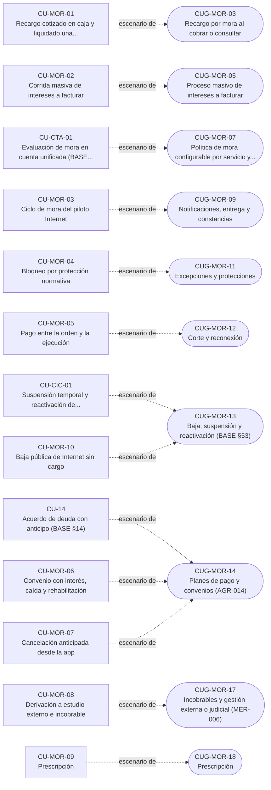

# Casos de uso de M08 MOR — Mora, intereses, suspensión, corte, reconexión, financiación y convenios, garantías, incobrables, gestión judicial y prescripción

Parte del entregable [21 Casos de uso por módulo](../21-casos-de-uso.md) (artefacto 3.3). Generado con `_trabajo/gen_21_casos_uso.py` desde `docs/especificacion/anexos/M08-MOR-mora-financiacion.md` y revisado a mano. Ante cualquier diferencia prevalece el anexo.

| Dato | Valor |
|---|---|
| Casos de uso agrupadores (CUG) | 21 |
| RF del anexo | 224 (todos asignados a un CUG) |
| CU con ficha en la sección 16 | 13 |
| CU citados sin ficha en este anexo | 0 |

## 1. Diagramas

### 1.1 Actores y casos de uso agrupadores

```mermaid
flowchart LR
    subgraph ACT["Actores (roles T02)"]
        direction TB
        A_T_ATE["T-ATE<br/>Comercial / Atención al socio"]
        A_T_TES["T-TES<br/>Tesorero / Financiero (MT-006)"]
        A_T_CAJ["T-CAJ<br/>Cajero"]
        A_T_CBR["T-CBR<br/>Cobrador (campo)"]
        A_T_TEC["T-TEC<br/>Técnico (campo)"]
        A_T_STE["T-STE<br/>Supervisor técnico"]
        A_S_SYS["S-SYS<br/>Sistema / worker"]
        A_T_SAT["T-SAT<br/>Supervisor de atención"]
        A_T_ADM["T-ADM<br/>Administrador de la cooperativa"]
        A_C_PRV["C-PRV<br/>Proveedor (portal de proveedores)"]
    end
    subgraph SIS["M08 MOR"]
        direction TB
        CUG_MOR_01(["CUG-MOR-01<br/>Motor común de interés"])
        CUG_MOR_02(["CUG-MOR-02<br/>Recargo entre vencimientos al emitir"])
        CUG_MOR_03(["CUG-MOR-03<br/>Recargo por mora al cobrar o consultar"])
        CUG_MOR_04(["CUG-MOR-04<br/>Diferimiento y documentación del interés"])
        CUG_MOR_05(["CUG-MOR-05<br/>Proceso masivo de intereses a facturar"])
        CUG_MOR_06(["CUG-MOR-06<br/>Bloqueos de comprobantes"])
        CUG_MOR_07(["CUG-MOR-07<br/>Política de mora configurable por servicio y categoría..."])
        CUG_MOR_08(["CUG-MOR-08<br/>Instancias y candidatos"])
        CUG_MOR_09(["CUG-MOR-09<br/>Notificaciones, entrega y constancias"])
        CUG_MOR_10(["CUG-MOR-10<br/>Tratamiento de morosos"])
        CUG_MOR_11(["CUG-MOR-11<br/>Excepciones y protecciones"])
        CUG_MOR_12(["CUG-MOR-12<br/>Corte y reconexión"])
        CUG_MOR_13(["CUG-MOR-13<br/>Baja, suspensión y reactivación (BASE §53)"])
        CUG_MOR_14(["CUG-MOR-14<br/>Planes de pago y convenios (AGR-014)"])
        CUG_MOR_15(["CUG-MOR-15<br/>Planes de cuotas y entidades financieras"])
        CUG_MOR_16(["CUG-MOR-16<br/>Garantías y garantes (MER-005)"])
        CUG_MOR_17(["CUG-MOR-17<br/>Incobrables y gestión externa o judicial (MER-006)"])
        CUG_MOR_18(["CUG-MOR-18<br/>Prescripción"])
        CUG_MOR_19(["CUG-MOR-19<br/>Informes, tableros y exportaciones"])
        CUG_MOR_20(["CUG-MOR-20<br/>Portal y app del socio"])
        CUG_MOR_21(["CUG-MOR-21<br/>Auditoría, operación y migración"])
    end
    A_T_ATE --> CUG_MOR_01
    A_T_TES --> CUG_MOR_01
    A_T_CAJ -.-> CUG_MOR_01
    A_T_CBR -.-> CUG_MOR_01
    A_T_TEC -.-> CUG_MOR_01
    A_T_ATE --> CUG_MOR_02
    A_T_CAJ --> CUG_MOR_02
    A_T_CBR -.-> CUG_MOR_02
    A_T_TEC -.-> CUG_MOR_02
    A_T_STE -.-> CUG_MOR_02
    A_T_ATE --> CUG_MOR_03
    A_T_CBR --> CUG_MOR_03
    A_T_CAJ -.-> CUG_MOR_03
    A_T_TEC -.-> CUG_MOR_03
    A_T_STE -.-> CUG_MOR_03
    A_T_TES --> CUG_MOR_04
    A_T_ATE --> CUG_MOR_04
    A_T_CAJ -.-> CUG_MOR_04
    A_T_CBR -.-> CUG_MOR_04
    A_T_TEC -.-> CUG_MOR_04
    A_T_ATE --> CUG_MOR_05
    A_T_TES --> CUG_MOR_05
    A_T_CBR -.-> CUG_MOR_05
    A_T_CAJ -.-> CUG_MOR_05
    A_T_TEC -.-> CUG_MOR_05
    A_T_ATE --> CUG_MOR_06
    A_T_CBR -.-> CUG_MOR_06
    A_T_CAJ -.-> CUG_MOR_06
    A_T_TEC -.-> CUG_MOR_06
    A_T_TES --> CUG_MOR_07
    A_T_ATE --> CUG_MOR_07
    A_T_CAJ -.-> CUG_MOR_07
    A_T_STE -.-> CUG_MOR_07
    A_T_CBR -.-> CUG_MOR_07
    A_T_ATE --> CUG_MOR_08
    A_T_STE --> CUG_MOR_08
    A_T_CAJ -.-> CUG_MOR_08
    A_T_CBR -.-> CUG_MOR_08
    A_T_TEC -.-> CUG_MOR_08
    A_T_ATE --> CUG_MOR_09
    A_T_CBR --> CUG_MOR_09
    A_T_CAJ -.-> CUG_MOR_09
    A_T_TEC -.-> CUG_MOR_09
    A_T_STE -.-> CUG_MOR_09
    A_S_SYS -.-> CUG_MOR_09
    A_T_STE --> CUG_MOR_10
    A_T_ATE --> CUG_MOR_10
    A_T_CBR -.-> CUG_MOR_10
    A_T_TEC -.-> CUG_MOR_10
    A_T_CAJ -.-> CUG_MOR_10
    A_T_ATE --> CUG_MOR_11
    A_T_STE --> CUG_MOR_11
    A_T_CAJ -.-> CUG_MOR_11
    A_T_CBR -.-> CUG_MOR_11
    A_T_TEC -.-> CUG_MOR_11
    A_T_STE --> CUG_MOR_12
    A_T_ATE --> CUG_MOR_12
    A_T_CAJ -.-> CUG_MOR_12
    A_T_TES -.-> CUG_MOR_12
    A_T_SAT -.-> CUG_MOR_12
    A_S_SYS -.-> CUG_MOR_12
    A_T_TES --> CUG_MOR_13
    A_T_SAT -.-> CUG_MOR_13
    A_T_ADM -.-> CUG_MOR_13
    A_T_ATE -.-> CUG_MOR_13
    A_T_ATE --> CUG_MOR_14
    A_T_CAJ --> CUG_MOR_14
    A_T_CBR -.-> CUG_MOR_14
    A_T_TEC -.-> CUG_MOR_14
    A_T_STE -.-> CUG_MOR_14
    A_S_SYS -.-> CUG_MOR_14
    A_T_TES --> CUG_MOR_15
    A_T_ADM -.-> CUG_MOR_15
    A_T_ATE -.-> CUG_MOR_15
    A_T_CAJ -.-> CUG_MOR_15
    A_T_ATE --> CUG_MOR_16
    A_T_CAJ -.-> CUG_MOR_16
    A_T_CBR -.-> CUG_MOR_16
    A_T_TEC -.-> CUG_MOR_16
    A_T_ATE --> CUG_MOR_17
    A_T_CAJ --> CUG_MOR_17
    A_T_CBR -.-> CUG_MOR_17
    A_T_TEC -.-> CUG_MOR_17
    A_T_STE -.-> CUG_MOR_17
    A_C_PRV -.-> CUG_MOR_17
    A_T_ATE --> CUG_MOR_18
    A_T_CAJ --> CUG_MOR_18
    A_T_STE -.-> CUG_MOR_18
    A_T_CBR -.-> CUG_MOR_18
    A_T_TEC -.-> CUG_MOR_18
    A_T_ATE --> CUG_MOR_19
    A_T_CAJ --> CUG_MOR_19
    A_T_STE -.-> CUG_MOR_19
    A_T_CBR -.-> CUG_MOR_19
    A_T_TEC -.-> CUG_MOR_19
    A_S_SYS -.-> CUG_MOR_19
    A_T_ATE --> CUG_MOR_20
    A_T_TES --> CUG_MOR_20
    A_T_CAJ -.-> CUG_MOR_20
    A_T_CBR -.-> CUG_MOR_20
    A_T_TEC -.-> CUG_MOR_20
    A_T_ATE --> CUG_MOR_21
    A_T_CAJ --> CUG_MOR_21
    A_T_CBR -.-> CUG_MOR_21
    A_T_TEC -.-> CUG_MOR_21
    A_T_STE -.-> CUG_MOR_21
    A_S_SYS -.-> CUG_MOR_21
    classDef actor fill:#1f2937,stroke:#60a5fa,color:#f9fafb;
    classDef cug fill:#0f172a,stroke:#34d399,color:#f9fafb;
    class A_T_ATE,A_T_TES,A_T_CAJ,A_T_CBR,A_T_TEC,A_T_STE,A_S_SYS,A_T_SAT,A_T_ADM,A_C_PRV actor;
    class CUG_MOR_01,CUG_MOR_02,CUG_MOR_03,CUG_MOR_04,CUG_MOR_05,CUG_MOR_06,CUG_MOR_07,CUG_MOR_08,CUG_MOR_09,CUG_MOR_10,CUG_MOR_11,CUG_MOR_12,CUG_MOR_13,CUG_MOR_14,CUG_MOR_15,CUG_MOR_16,CUG_MOR_17,CUG_MOR_18,CUG_MOR_19,CUG_MOR_20,CUG_MOR_21 cug;
```

Línea continua: actor principal. Línea punteada: actor secundario o participante.

### 1.2 Casos de uso de la especificación por agrupador

Rectángulo: CU con ficha en la sección 16 del anexo. Paralelogramo: CU citado (ficha en otro anexo o sin ficha).

## 2. Fichas de los casos de uso agrupadores

### CUG-MOR-01 — Motor común de interés

| Campo | Contenido |
|---|---|
| Actor principal | T-ATE Comercial / Atención al socio; T-TES Tesorero / Financiero (MT-006) |
| Actores secundarios | T-CAJ Cajero; T-CBR Cobrador (campo); T-TEC Técnico (campo) |
| Objetivo | Motor común de interés: Proveer un único motor de cálculo de interés consumido por emisión, caja, entes, pasarelas, portal, proceso masivo, convenios y gestión de mora, con la misma política y... |
| Precondición | Usuario del tenant autenticado con el rol indicado y capabilities `mor.politicasInteres.configurar`, `mor.politicasInteres.ver`, `mor.politicasInteres.ver/configurar`; módulo MOR licenciado y activo (T01, T02 §4.3). |
| Flujo principal | 1. Proveer un único motor de cálculo de interés consumido por emisión, caja, entes, pasarelas, portal, proceso masivo... (RF-MOR-001). 2. El motor recibe documento(s), fecha de cálculo, canal, ente (opcional), y devuelve componentes separados: recargo entre... (RF-MOR-002). 3. Persistir cada cálculo usado en una operación económica (cobro, cargo, convenio) como cálculo de interés inmutable con... (RF-MOR-003). 4. Permitir cotizaciones sin efecto (consulta de deuda, portal, simulador) con validez hasta el fin del día del tenant (RF-MOR-004). 5. Resolver la política aplicable por servicio, categoría, tipo de documento y vigencia, con prioridad explícita y visible... (RF-MOR-005). 6. Soportar los métodos de cálculo tasa fija diaria, tabla de tasas por vigencia e índices, elegidos explícitamente en la... (RF-MOR-006). |
| Alternativos | Sin la capability o fuera del alcance de datos: la acción se deniega por defecto y se audita (T02). |
| CU asociados | — (sin CU en la especificación; el flujo sale de los RF) |
| RF (10) | RF-MOR-001 a 010 |
| Prioridad y olas | Núcleo 8, Estándar 2, Extensión 0; olas O5, O6 |
| Origen | M08 §5.1 |

### CUG-MOR-02 — Recargo entre vencimientos al emitir

| Campo | Contenido |
|---|---|
| Actor principal | T-ATE Comercial / Atención al socio; T-CAJ Cajero |
| Actores secundarios | T-CBR Cobrador (campo); T-TEC Técnico (campo); T-STE Supervisor técnico |
| Objetivo | Recargo entre vencimientos al emitir: Configurar por servicio, ciclo y tipo de documento un esquema de recargo entre vencimientos con variantes: ninguno, porcentaje variable por días, porcentaje fijo por... |
| Precondición | Usuario del tenant autenticado con el rol indicado y capabilities `mor.tramasRecargo.configurar`, `mor.dispensaRecargo.aprobar`, `mor.dispensaRecargo.solicitar`; módulo MOR licenciado y activo (T01, T02 §4.3). |
| Flujo principal | 1. Configurar por servicio, ciclo y tipo de documento un esquema de recargo entre vencimientos con variantes: ninguno... (RF-MOR-011). 2. Calcular al emitir los importes de cada vencimiento y entregarlos a M05 para imprimirlos en la factura y mostrarlos en... (RF-MOR-012). 3. Calcular el IVA del recargo con el concepto de interés entre vencimientos y la situación de IVA del titular, más... (RF-MOR-014). 4. Cuotas de convenio emitidas como documento propio tienen un solo vencimiento (sin recargo entre vencimientos) (RF-MOR-016). 5. Al cobrar entre el VTO1 y el último vencimiento, el recargo cobrado es la diferencia del vencimiento vigente menos lo... (RF-MOR-017). 6. Registrar el recargo entre vencimientos efectivamente cobrado en un documento posterior (ND o factura según política)... (RF-MOR-020). |
| Alternativos | Sin la capability o fuera del alcance de datos: la acción se deniega por defecto y se audita (T02). |
| CU asociados | — (sin CU en la especificación; el flujo sale de los RF) |
| RF (10) | RF-MOR-011 a 020 |
| Prioridad y olas | Núcleo 6, Estándar 3, Extensión 1; olas O4, O5, O6, O7 |
| Origen | M08 §5.2 |

### CUG-MOR-03 — Recargo por mora al cobrar o consultar

| Campo | Contenido |
|---|---|
| Actor principal | T-ATE Comercial / Atención al socio; T-CBR Cobrador (campo) |
| Actores secundarios | T-CAJ Cajero; T-TEC Técnico (campo); T-STE Supervisor técnico |
| Objetivo | Recargo por mora al cobrar o consultar: Calcular el recargo por mora desde la fecha base (VTO1, o último vencimiento si la política lo indica. |
| Precondición | Usuario del tenant autenticado con el rol indicado y capabilities `mor.recargoDiario.cambiar`, `mor.politicasMora.configurar`, `mor.politicasMora.ver`; módulo MOR licenciado y activo (T01, T02 §4.3). |
| Flujo principal | Según CU-MOR-01: El cajero (M07) consulta la deuda de una factura de ARS 10.000 vencida hace 30 días; M08 cotiza ARS 300 de interés (0,1 % diario) más IVA; al confirmar el cobro M07 llama a settle; M08 registra el cálculo, marca interestSettledUntil = fecha de pago y emite mor.interest.settled; M05 emite la ND. Una segunda consulta al día siguiente solo calcula desde esa fecha. |
| Alternativos | Calcular interés por reversión (contracargo) entre la fecha del pago revertido y la fecha de reversión, con... (RF-MOR-036). Informar a la cobranza de prepago si corresponde retener intereses, respetando excepciones con "no retener" (RF-MOR-038). Proveer a M07 la lista de documentos notificados, bloqueados o incluidos en notificación abierta para sus... (RF-MOR-040). Sin la capability o fuera del alcance de datos: la acción se deniega por defecto y se audita (T02). |
| CU asociados | CU-MOR-01 |
| RF (20) | RF-MOR-021 a 040 |
| Prioridad y olas | Núcleo 7, Estándar 10, Extensión 3; olas O5, O6, O7, O8 |
| Origen | M08 §5.3 |

### CUG-MOR-04 — Diferimiento y documentación del interés

| Campo | Contenido |
|---|---|
| Actor principal | T-TES Tesorero / Financiero (MT-006); T-ATE Comercial / Atención al socio |
| Actores secundarios | T-CAJ Cajero; T-CBR Cobrador (campo); T-TEC Técnico (campo) |
| Objetivo | Diferimiento y documentación del interés: Soportar tres modos: no diferir (se cobra todo), diferir interés por mora (se cobra el entre vencimientos), diferir todo. |
| Precondición | Usuario del tenant autenticado con el rol indicado y capabilities `mor.cargosInterrupcion.configurar`, `mor.interesesFacturar.aprobar`, `mor.interesesFacturar.cancelar`; módulo MOR licenciado y activo (T01, T02 §4.3). |
| Flujo principal | 1. Soportar tres modos: no diferir (se cobra todo), diferir interés por mora (se cobra el entre vencimientos), diferir todo (RF-MOR-041). 2. Lo cobrado en el acto genera una solicitud de cargo a M05 por cuenta, situación de IVA, situación de IIBB y... (RF-MOR-042). 3. Tipo del documento del interés cobrado en el acto: factura o nota de débito según política (RF-MOR-043). 4. Lo diferido genera un interés diferido que se incorpora como cargo en la próxima factura del servicio de origen (si la... (RF-MOR-044). 5. En cuotas de convenio, los ítems de interés se copian por subtipo (financiación actual, anterior, mora) y se relacionan... (RF-MOR-045). 6. Recargos por medio de pago (cheque de terceros, transferencia, tarjeta) se documentan con sus conceptos (RF-MOR-046). |
| Alternativos | Soportar tres modos: no diferir (se cobra todo), diferir interés por mora (se cobra el entre vencimientos)... (RF-MOR-041). Sin la capability o fuera del alcance de datos: la acción se deniega por defecto y se audita (T02). |
| CU asociados | — (sin CU en la especificación; el flujo sale de los RF) |
| RF (8) | RF-MOR-041 a 048 |
| Prioridad y olas | Núcleo 4, Estándar 3, Extensión 1; olas O5, O6 |
| Origen | M08 §5.4 |

### CUG-MOR-05 — Proceso masivo de intereses a facturar

| Campo | Contenido |
|---|---|
| Actor principal | T-ATE Comercial / Atención al socio; T-TES Tesorero / Financiero (MT-006) |
| Actores secundarios | T-CBR Cobrador (campo); T-CAJ Cajero; T-TEC Técnico (campo) |
| Objetivo | Proceso masivo de intereses a facturar: Actualizar la marca "interés liquidado hasta" de cada documento incluido. |
| Precondición | Usuario del tenant autenticado con el rol indicado y capabilities `mor.interesesFacturar.aprobar`, `mor.interesesFacturar.cancelar`, `mor.interesesFacturar.ejecutar`; módulo MOR licenciado y activo (T01, T02 §4.3). |
| Flujo principal | Según CU-MOR-02: El analista crea una corrida estándar con fecha de cálculo fin de mes, revisa el preliminar, destilda dos documentos reclamados, la aprueba un supervisor y la genera; JOB-MOR-01 emite los cargos por cuenta a M05 y la corrida cierra con totales conciliados (REP-MOR-28). |
| Alternativos | Seleccionar documentos de débito no anulados sin marca "sin interés" (RF-MOR-050). Generar un cargo por cuenta (agrupado por situación de IVA, cuenta y titular) con un ítem por documento... (RF-MOR-056). Sin la capability o fuera del alcance de datos: la acción se deniega por defecto y se audita (T02). |
| CU asociados | CU-MOR-02 |
| RF (10) | RF-MOR-049 a 058 |
| Prioridad y olas | Núcleo 2, Estándar 6, Extensión 2; olas O6, O8 |
| Origen | M08 §5.5 |

### CUG-MOR-06 — Bloqueos de comprobantes

| Campo | Contenido |
|---|---|
| Actor principal | T-ATE Comercial / Atención al socio |
| Actores secundarios | T-CBR Cobrador (campo); T-CAJ Cajero; T-TEC Técnico (campo) |
| Objetivo | Bloqueos de comprobantes: Bloquear y desbloquear documentos por causa (catálogo), individual o masivamente, con historial (causa, fecha, usuario). |
| Precondición | Usuario del tenant autenticado con el rol indicado y capabilities `mor.bloqueos.aplicarMasivo`, `mor.bloqueos.crear`, `mor.bloqueos.liberar`; módulo MOR licenciado y activo (T01, T02 §4.3). |
| Flujo principal | 1. Bloquear y desbloquear documentos por causa (catálogo), individual o masivamente, con historial (causa, fecha, usuario) (RF-MOR-059). 2. Existir bloqueos de sistema no editables por usuarios (equivalente a ID_BLO = -1) (RF-MOR-060). 3. Desbloquear con interés: al liberar, calcular un porcentaje configurado y generar el cargo con concepto y tipo de... (RF-MOR-061). 4. Informar a M07 si se permite cobrar documentos o talones bloqueados en caja, y ocultarlos en autogestión si así se... (RF-MOR-062). 5. Bloquear opcionalmente los documentos notificados al generar o procesar una notificación (RF-MOR-063). 6. Bloquear la caja (cobro de documentos del servicio) mientras exista una orden de cambio de estado por mora pendiente... (RF-MOR-064). |
| Alternativos | Bloquear y desbloquear documentos por causa (catálogo), individual o masivamente, con historial (causa... (RF-MOR-059). Existir bloqueos de sistema no editables por usuarios (equivalente a ID_BLO = -1) (RF-MOR-060). Desbloquear con interés: al liberar, calcular un porcentaje configurado y generar el cargo con concepto y... (RF-MOR-061). Sin la capability o fuera del alcance de datos: la acción se deniega por defecto y se audita (T02). |
| CU asociados | — (sin CU en la especificación; el flujo sale de los RF) |
| RF (6) | RF-MOR-059 a 064 |
| Prioridad y olas | Núcleo 0, Estándar 4, Extensión 2; olas O6 |
| Origen | M08 §5.6 |

### CUG-MOR-07 — Política de mora configurable por servicio y categoría (BASE §68)

| Campo | Contenido |
|---|---|
| Actor principal | T-TES Tesorero / Financiero (MT-006); T-ATE Comercial / Atención al socio |
| Actores secundarios | T-CAJ Cajero; T-STE Supervisor técnico; T-CBR Cobrador (campo) |
| Objetivo | Política de mora configurable por servicio y categoría (BASE §68): Definir políticas de mora versionadas por servicio y categoría con: días desde vencimiento para ser candidato, monto mínimo de deuda, cantidad mínima de documentos... |
| Precondición | Usuario del tenant autenticado con el rol indicado y capabilities `mor.politicasMora.configurar`, `mor.politicasMora.ver`, `mor.politicasMora.ver/configurar`; módulo MOR licenciado y activo (T01, T02 §4.3). |
| Flujo principal | Según CU-CTA-01: 1. JOB-MOR-02 evalúa obligaciones, vencimientos y pagos confirmados; con un pago de ARS 8.000 imputado por M07 a la factura de agua, la evaluación registra el saldo exacto por factura y que no se alcanzó el umbral de cumplimiento. 2. Genera una evaluación de mora (delinquencyEvaluations), no un corte automático. 3. Por cada servicio verifica fundamento, avisos con constancia, restricciones y excepciones: agua →... |
| Alternativos | Definir el saldo elegible para mora: capital vencido, cargos autorizados, exclusiones, convenios y créditos (RF-MOR-068). Evaluar los efectos de incumplimiento en cuenta unificada por servicio: permitido, pendiente de revisión o... (RF-MOR-069). Registrar excepciones de la política: reclamos, pagos a verificar, situaciones protegidas, acuerdos y... (RF-MOR-071). Sin la capability o fuera del alcance de datos: la acción se deniega por defecto y se audita (T02). |
| CU asociados | CU-CTA-01 |
| RF (10) | RF-MOR-065 a 074 |
| Prioridad y olas | Núcleo 9, Estándar 1, Extensión 0; olas O6 |
| Origen | M08 §5.7 |

### CUG-MOR-08 — Instancias y candidatos

| Campo | Contenido |
|---|---|
| Actor principal | T-ATE Comercial / Atención al socio; T-STE Supervisor técnico |
| Actores secundarios | T-CAJ Cajero; T-CBR Cobrador (campo); T-TEC Técnico (campo) |
| Objetivo | Instancias y candidatos: Administrar instancias configurables (código, nombre, orden, días, tipo: candidatos, aviso, intimación, sensible, corte, tratamiento, cierre), sin límite de cantidad. |
| Precondición | Usuario del tenant autenticado con el rol indicado y capabilities `mor.instancias.configurar`, `mor.candidatos.generar`, `mor.corte.ordenar`; módulo MOR licenciado y activo (T01, T02 §4.3). |
| Flujo principal | 1. Administrar instancias configurables (código, nombre, orden, días, tipo: candidatos, aviso, intimación, sensible... (RF-MOR-075). 2. Marcar en las instancias cuál es la de candidatos, la inicial de mora, la sensible (riesgo de corte) y la de corte (RF-MOR-076). 3. Generar candidatos con filtros de cuenta (geografía, zona, sector, recorrido), servicio, estado y categoría del... (RF-MOR-077). 4. Excluir cuentas con excepción de mora vigente con "no reclamar": la cuenta entera si no tiene fecha de deuda, o la... (RF-MOR-078). 5. Crear la notificación de candidato con lote nuevo, documentos incluidos con su saldo, deuda (suma de saldos) y deuda... (RF-MOR-080). 6. Excluir de candidatos las deudas incluidas en convenios vigentes (se consideran las cuotas) y los documentos con... (RF-MOR-081). |
| Alternativos | Excluir cuentas con excepción de mora vigente con "no reclamar": la cuenta entera si no tiene fecha de deuda... (RF-MOR-078). Sin la capability o fuera del alcance de datos: la acción se deniega por defecto y se audita (T02). |
| CU asociados | — (sin CU en la especificación; el flujo sale de los RF) |
| RF (8) | RF-MOR-075 a 082 |
| Prioridad y olas | Núcleo 6, Estándar 2, Extensión 0; olas O6 |
| Origen | M08 §5.8 |

### CUG-MOR-09 — Notificaciones, entrega y constancias

| Campo | Contenido |
|---|---|
| Actor principal | T-ATE Comercial / Atención al socio; T-CBR Cobrador (campo) |
| Actores secundarios | T-CAJ Cajero; T-TEC Técnico (campo); T-STE Supervisor técnico; S-SYS Sistema / worker |
| Objetivo | Notificaciones, entrega y constancias: Procesar notificaciones abiertas hacia la instancia destino con filtros: vencidas al (vencimiento de la notificación), fecha, lote, cuenta, servicio, tipo de documento... |
| Precondición | Usuario del tenant autenticado con el rol indicado y capabilities `mor.notificaciones.calificar`, `mor.notificaciones.cerrar`, `mor.notificaciones.darBaja`; módulo MOR licenciado y activo (T01, T02 §4.3). |
| Flujo principal | Según CU-MOR-03: Con la política PA-MOR-05: JOB-MOR-03 genera candidatos (deuda ≥ umbral, 15 días de atraso); el operador procesa la instancia Aviso (T09 por WhatsApp y correo); tras el vencimiento, procesa la Intimación con preaviso (evidencia exigida); las cuentas sin constancia de entrega generan tarea de canal alternativo; al vencer la intimación, PAN-MOR-19 lista los servicios elegibles; los casos se programan en la ventana... |
| Alternativos | Procesar notificaciones abiertas hacia la instancia destino con filtros: vencidas al (vencimiento de la... (RF-MOR-083). Al procesar: crear nueva notificación con nuevo lote, instancia destino, vencimiento, modelo/plantilla y... (RF-MOR-084). Registrar promesas de pago con fecha e importe, que suspenden el avance hasta esa fecha (RF-MOR-094). Sin la capability o fuera del alcance de datos: la acción se deniega por defecto y se audita (T02). |
| CU asociados | CU-MOR-03 |
| RF (16) | RF-MOR-083 a 098 |
| Prioridad y olas | Núcleo 9, Estándar 6, Extensión 1; olas O6 |
| Origen | M08 §5.9 |

### CUG-MOR-10 — Tratamiento de morosos

| Campo | Contenido |
|---|---|
| Actor principal | T-STE Supervisor técnico; T-ATE Comercial / Atención al socio |
| Actores secundarios | T-CBR Cobrador (campo); T-TEC Técnico (campo); T-CAJ Cajero |
| Objetivo | Tratamiento de morosos: Listar, para notificaciones abiertas con vencimiento cumplido y sin promesa vigente, los servicios conectados de la cuenta, con filtros de pagos parciales y cantidad de... |
| Precondición | Usuario del tenant autenticado con el rol indicado y capabilities `mor.tratamiento.ejecutar`, `mor.tratamiento.ver`, `mor.tratamiento.ver/ejecutar`; módulo MOR licenciado y activo (T01, T02 §4.3). |
| Flujo principal | 1. Listar, para notificaciones abiertas con vencimiento cumplido y sin promesa vigente, los servicios conectados de la... (RF-MOR-099). 2. Acciones disponibles por servicio: suspensión/desconexión, cambio de estado (restricción, reducción de velocidad u otro... (RF-MOR-100). 3. Rechazar la acción si ya existe una orden pendiente de la misma operación para el servicio (RF-MOR-101). 4. Toda acción pasa por la evaluación normativa del servicio (matriz de restricciones, protecciones, reclamos, ventanas)... (RF-MOR-102). 5. Si el servicio requiere técnica, generar orden de trabajo hacia M10 con origen "gestión de mora", marca de moroso y... (RF-MOR-103). 6. Armar los datos de la orden desde el servicio (medidor, domicilio del servicio, catastro, GPS, categoría, certificado)... (RF-MOR-104). |
| Alternativos | Rechazar la acción si ya existe una orden pendiente de la misma operación para el servicio (RF-MOR-101). Sin la capability o fuera del alcance de datos: la acción se deniega por defecto y se audita (T02). |
| CU asociados | — (sin CU en la especificación; el flujo sale de los RF) |
| RF (10) | RF-MOR-099 a 108 |
| Prioridad y olas | Núcleo 5, Estándar 5, Extensión 0; olas O6 |
| Origen | M08 §5.10 |

### CUG-MOR-11 — Excepciones y protecciones

| Campo | Contenido |
|---|---|
| Actor principal | T-ATE Comercial / Atención al socio; T-STE Supervisor técnico |
| Actores secundarios | T-CAJ Cajero; T-CBR Cobrador (campo); T-TEC Técnico (campo) |
| Objetivo | Excepciones y protecciones: Administrar excepciones de mora por cuenta (o titular, o persona) con motivo, "no reclamar", "no retener/no cobrar interés", fecha hasta la que rige, deuda anterior a... |
| Precondición | Usuario del tenant autenticado con el rol indicado y capabilities `mor.excepciones.anular`, `mor.excepciones.aprobar`, `mor.excepciones.crear`; módulo MOR licenciado y activo (T01, T02 §4.3). |
| Flujo principal | Según CU-MOR-04: Un servicio eléctrico tiene una protección de electrodependiente acreditada; la cuenta llega a la instancia de corte; la evaluación devuelve blocked con motivo; el caso no se crea, queda una alerta a supervisión y el informe REP-MOR-13 lo cuenta. No existe capability que permita forzarlo. |
| Alternativos | Administrar excepciones de mora por cuenta (o titular, o persona) con motivo, "no reclamar", "no retener/no... (RF-MOR-109). Autorizar y desautorizar excepciones (doble control), con nota en la cuenta e impresión opcional del informe... (RF-MOR-110). Una protección de tipo bloqueante impide suspender, cortar o dar de baja por mora el servicio (RF-MOR-112). Sin la capability o fuera del alcance de datos: la acción se deniega por defecto y se audita (T02). |
| CU asociados | CU-MOR-04 |
| RF (8) | RF-MOR-109 a 116 |
| Prioridad y olas | Núcleo 5, Estándar 3, Extensión 0; olas O6 |
| Origen | M08 §5.11 |

### CUG-MOR-12 — Corte y reconexión

| Campo | Contenido |
|---|---|
| Actor principal | T-STE Supervisor técnico; T-ATE Comercial / Atención al socio |
| Actores secundarios | T-CAJ Cajero; T-TES Tesorero / Financiero (MT-006); T-SAT Supervisor de atención; S-SYS Sistema / worker |
| Objetivo | Corte y reconexión: Crear casos de interrupción por servicio con tipo, motivo, instancia que lo origina, evaluación, aprobación, orden, confirmación y comunicación al socio. |
| Precondición | Usuario del tenant autenticado con el rol indicado y capabilities `mor.corte.ordenar`, `mor.reconexion.ordenar`, `mor.cargosInterrupcion.configurar`; módulo MOR licenciado y activo (T01, T02 §4.3). |
| Flujo principal | Según CU-MOR-05: Con un caso scheduled de suspensión, M07 confirma el pago total; JOB-MOR-07 cancela el caso (PRM-MOR-122), pide a M10 cancelar la OT y, si M10 informa que la OT ya estaba ejecutada, abre la reconexión inmediata sin cargo. |
| Alternativos | Reconexión automática al regularizar: evaluar con el criterio de deuda configurado (toda, vencida al VTO1... (RF-MOR-122). Si el sistema remoto devuelve error o no hay sistema vigente, la orden vuelve a pendiente y el servicio no se... (RF-MOR-125). Configurar por servicio el modo de suspensión por mora (restricted o interrupted) y su perfil (bloqueo... (RF-MOR-222). Sin la capability o fuera del alcance de datos: la acción se deniega por defecto y se audita (T02). |
| CU asociados | CU-MOR-05 |
| RF (18) | RF-MOR-117 a 130, 221 a 224 |
| Prioridad y olas | Núcleo 13, Estándar 5, Extensión 0; olas O6, O7, O10 |
| Origen | M08 §5.12 |

### CUG-MOR-13 — Baja, suspensión y reactivación (BASE §53)

| Campo | Contenido |
|---|---|
| Actor principal | T-TES Tesorero / Financiero (MT-006) |
| Actores secundarios | T-SAT Supervisor de atención; T-ADM Administrador de la cooperativa; T-ATE Comercial / Atención al socio |
| Objetivo | Baja, suspensión y reactivación (BASE §53): Recibir la baja desde el canal del usuario (portal, app, landing pública sin registro cuando corresponda), con registro, constancia, seguimiento y ejecución sin cargo... |
| Precondición | Usuario del tenant autenticado con el rol indicado y capabilities `mor.suspension.ordenar`, `mor.cargosInterrupcion.configurar`, `mor.deuda.ver`; módulo MOR licenciado y activo (T01, T02 §4.3). |
| Flujo principal | Según CU-CIC-01: 1. Ana abre PAN-MOR-41 en su contrato de Internet; ve las modalidades habilitadas (SUS-DEMO-GRATIS, duración 1–3 meses, costo ARS 0) y sus condiciones. 2. Solicita la suspensión desde el 01-12; se crea un caso voluntarySuspension en requested; la evaluación verifica que no haya restricciones; el caso queda scheduled. 3. En la fecha, JOB-MOR-18 envía la acción a T06 (perfil de suspensión); con respuesta exitosa el... |
| Alternativos | Evitar cobros o ejecuciones duplicadas por reintentos (idempotencia) y no anunciar "reactivado" por la sola... (RF-MOR-140). Sin la capability o fuera del alcance de datos: la acción se deniega por defecto y se audita (T02). |
| CU asociados | CU-CIC-01; CU-MOR-10 |
| RF (10) | RF-MOR-131 a 140 |
| Prioridad y olas | Núcleo 7, Estándar 3, Extensión 0; olas O6 |
| Origen | M08 §5.13 |

### CUG-MOR-14 — Planes de pago y convenios (AGR-014)

| Campo | Contenido |
|---|---|
| Actor principal | T-ATE Comercial / Atención al socio; T-CAJ Cajero |
| Actores secundarios | T-CBR Cobrador (campo); T-TEC Técnico (campo); T-STE Supervisor técnico; S-SYS Sistema / worker |
| Objetivo | Planes de pago y convenios (AGR-014): Simulador de plan: deuda seleccionable, anticipo, cantidad de cuotas, tasa, método, quitas, sellado, primer vencimiento, con cronograma, total, intereses, impuestos... |
| Precondición | Usuario del tenant autenticado con el rol indicado y capabilities `mor.planesPago.configurar`, `mor.convenios.crear`, `mor.convenios.aprobar`; módulo MOR licenciado y activo (T01, T02 §4.3). |
| Flujo principal | Según CU-14: 1. El gestor abre PAN-MOR-30 (simulador), busca la cuenta y selecciona las obligaciones; el sistema verifica que ninguna esté en otro convenio vigente, bloqueada por gestión judicial ni reclamada (RF-MOR-145). 2. Elige el plan, que propone un anticipo de ARS 15.000 y tres cuotas de ARS 15.000 con 0 % de interés, CFT 0 %. 3. Confirma: se crea ACU-001 en pendingSignature; el titular firma con OTP (o firma presencial... |
| Alternativos | Seleccionar las obligaciones incluidas verificando que no estén en otro convenio vigente ni bloqueadas por... (RF-MOR-145). Registrar el convenio en forma transaccional: sustituir/bloquear las obligaciones de origen, cerrar... (RF-MOR-148). Controlar cumplimiento e incumplimiento de cuotas y anticipo (RF-MOR-155). Sin la capability o fuera del alcance de datos: la acción se deniega por defecto y se audita (T02). |
| CU asociados | CU-14; CU-MOR-06; CU-MOR-07 |
| RF (30) | RF-MOR-141 a 170 |
| Prioridad y olas | Núcleo 20, Estándar 9, Extensión 1; olas O6 |
| Origen | M08 §5.14 |

### CUG-MOR-15 — Planes de cuotas y entidades financieras

| Campo | Contenido |
|---|---|
| Actor principal | T-TES Tesorero / Financiero (MT-006) |
| Actores secundarios | T-ADM Administrador de la cooperativa; T-ATE Comercial / Atención al socio; T-CAJ Cajero |
| Objetivo | Planes de cuotas y entidades financieras: ABM de planes de pago: tipo de pago (entrega y cuotas / cuotas sin entrega), período entre cuotas, cantidad sugerida/mínima/máxima, tasas (TNA, TEM, tasa por período)... |
| Precondición | Usuario del tenant autenticado con el rol indicado y capabilities `mor.entidadesFinancieras.configurar`, `mor.planesPago.configurar`, `mor.descuentosProntoPago.configurar`; módulo MOR licenciado y activo (T01, T02 §4.3). |
| Flujo principal | 1. ABM de planes de pago: tipo de pago (entrega y cuotas / cuotas sin entrega), período entre cuotas, cantidad... (RF-MOR-171). 2. Cargar la tasa en una unidad declarada (TNA o TEM) y derivar la tasa por período (RF-MOR-172). 3. Catálogo de métodos de cálculo (tipos de financiación) con fórmula y descripción (RF-MOR-173). 4. ABM de entidades financieras (tarjetas, bancos, financieras) con planes de cuotas, coeficientes, comisiones, plazos de... (RF-MOR-174). 5. Tipo de documento por defecto para emitir la financiación (RF-MOR-175). 6. Ofrecer el motor de amortización a M11 para venta financiada y factura en cuotas (conceptos de interés de venta... (RF-MOR-176). |
| Alternativos | Sin la capability o fuera del alcance de datos: la acción se deniega por defecto y se audita (T02). |
| CU asociados | — (sin CU en la especificación; el flujo sale de los RF) |
| RF (6) | RF-MOR-171 a 176 |
| Prioridad y olas | Núcleo 3, Estándar 3, Extensión 0; olas O6 |
| Origen | M08 §5.15 |

### CUG-MOR-16 — Garantías y garantes (MER-005)

| Campo | Contenido |
|---|---|
| Actor principal | T-ATE Comercial / Atención al socio |
| Actores secundarios | T-CAJ Cajero; T-CBR Cobrador (campo); T-TEC Técnico (campo) |
| Objetivo | Garantías y garantes (MER-005): Registrar garantes (persona de M01) y garantías (depósito en garantía, aval, pagaré, fianza, seguro de caución) asociados a contratos, convenios o cuentas, con monto... |
| Precondición | Usuario del tenant autenticado con el rol indicado y capabilities `mor.garantias.gestionar`, `mor.garantias.crear`, `mor.garantias.editar`; módulo MOR licenciado y activo (T01, T02 §4.3). |
| Flujo principal | 1. Registrar garantes (persona de M01) y garantías (depósito en garantía, aval, pagaré, fianza, seguro de caución)... (RF-MOR-177). 2. Exigir garantía en ciertas contrataciones por regla (inquilinos, grandes usuarios, categoría, servicio), habilitable... (RF-MOR-178). 3. Aplicar o devolver el depósito en la baja con liquidación e imputación trazables (contra deuda o devolución por M14) (RF-MOR-179). 4. Cambiar el garante de un convenio con validación (persona válida, firma del nuevo garante) y regenerar la plantilla si... (RF-MOR-180). 5. Ejecutar la garantía ante incumplimiento (notificación al garante como destinatario adicional de la gestión de mora) (RF-MOR-181). 6. Actualizar el depósito en garantía por índice o regla, si la política lo indica (RF-MOR-182). |
| Alternativos | Sin la capability o fuera del alcance de datos: la acción se deniega por defecto y se audita (T02). |
| CU asociados | — (sin CU en la especificación; el flujo sale de los RF) |
| RF (6) | RF-MOR-177 a 182 |
| Prioridad y olas | Núcleo 0, Estándar 5, Extensión 1; olas O6, O8 |
| Origen | M08 §5.16 |

### CUG-MOR-17 — Incobrables y gestión externa o judicial (MER-006)

| Campo | Contenido |
|---|---|
| Actor principal | T-ATE Comercial / Atención al socio; T-CAJ Cajero |
| Actores secundarios | T-CBR Cobrador (campo); T-TEC Técnico (campo); T-STE Supervisor técnico; C-PRV Proveedor (portal de proveedores) |
| Objetivo | Incobrables y gestión externa o judicial (MER-006): Derivar deuda a gestión externa o judicial con expediente: documentos incluidos, estudio o agencia a cargo, fecha, estado, gastos, honorarios, movimientos procesales y... |
| Precondición | Usuario del tenant autenticado con el rol indicado y capabilities `mor.gestionExterna.cerrar`, `mor.gestionExterna.crear`, `mor.gestionExterna.editar`; módulo MOR licenciado y activo (T01, T02 §4.3). |
| Flujo principal | Según CU-MOR-08: Una cuenta de baja con deuda de 400 días se deriva al estudio ESTUDIO-DEMO; el estudio registra avances por /api/v1/ext; sin recupero, el analista propone el castigo; dos aprobadores lo aprueban; M15 registra el asiento y la deuda sigue visible como castigada (no se borra). Un pago posterior revierte parcialmente. |
| Alternativos | Revertir un incobrable ante recupero, imputando el recupero a la deuda original y publicando el evento... (RF-MOR-189). Mantener la relación de incobrables y expedientes con la persona, de modo que un alta nueva advierta deuda... (RF-MOR-192). Sin la capability o fuera del alcance de datos: la acción se deniega por defecto y se audita (T02). |
| CU asociados | CU-MOR-08 |
| RF (10) | RF-MOR-183 a 192 |
| Prioridad y olas | Núcleo 0, Estándar 9, Extensión 1; olas O6, O8 |
| Origen | M08 §5.17 |

### CUG-MOR-18 — Prescripción

| Campo | Contenido |
|---|---|
| Actor principal | T-ATE Comercial / Atención al socio; T-CAJ Cajero |
| Actores secundarios | T-STE Supervisor técnico; T-CBR Cobrador (campo); T-TEC Técnico (campo) |
| Objetivo | Prescripción: Configurar plazos de prescripción por tipo de obligación (servicio, tipo de documento, cuota de convenio) con fecha de cómputo (emisión o VTO1) y causales de... |
| Precondición | Usuario del tenant autenticado con el rol indicado y capabilities `mor.prescripcion.aprobar`, `mor.prescripcion.configurar`, `mor.prescripcion.proponer`; módulo MOR licenciado y activo (T01, T02 §4.3). |
| Flujo principal | Según CU-MOR-09: JOB-MOR-13 alerta deuda a prescribir; el responsable legal crea una corrida, revisa interrupciones registradas (reconocimiento, convenio, reclamo judicial) y la aprueba; la deuda prescripta deja de ser exigible por M07 y queda con estado y asiento. |
| Alternativos | Sin la capability o fuera del alcance de datos: la acción se deniega por defecto y se audita (T02). |
| CU asociados | CU-MOR-09 |
| RF (5) | RF-MOR-193 a 197 |
| Prioridad y olas | Núcleo 0, Estándar 5, Extensión 0; olas O6 |
| Origen | M08 §5.18 |

### CUG-MOR-19 — Informes, tableros y exportaciones

| Campo | Contenido |
|---|---|
| Actor principal | T-ATE Comercial / Atención al socio; T-CAJ Cajero |
| Actores secundarios | T-STE Supervisor técnico; T-CBR Cobrador (campo); T-TEC Técnico (campo); S-SYS Sistema / worker |
| Objetivo | Informes, tableros y exportaciones: Informe de servicios a cortar (lote, cuenta, medidor, meses de deuda, deuda) y totales por servicio. |
| Precondición | Usuario del tenant autenticado con el rol indicado y capabilities `mor.informes.exportar`, `mor.informes.ver`, `mor.deuda.ver`; módulo MOR licenciado y activo (T01, T02 §4.3). |
| Flujo principal | 1. Informes de gestión de mora: deuda a prescribir, notificaciones pendientes (sin candidatos), titulares notificados... (RF-MOR-198). 2. Informe de servicios a cortar (lote, cuenta, medidor, meses de deuda, deuda) y totales por servicio (RF-MOR-199). 3. Informe de deuda (Get_InformeDeuda) y composición por antigüedad (RF-MOR-200). 4. Informes de financiación: financiaciones del período, por plan, comprobantes y conceptos financiados, cuotas de un... (RF-MOR-201). 5. Exportación regulatoria de condición de mora por cuenta (ej (RF-MOR-202). 6. Exportación a herramientas de envío masivo (cuenta, cantidad de comprobantes, deuda, deuda actualizada, correo) cuando... (RF-MOR-203). |
| Alternativos | Informes de gestión de mora: deuda a prescribir, notificaciones pendientes (sin candidatos), titulares... (RF-MOR-198). Tablero de mora: deuda vencida por tramo, cuentas por instancia, tasa de recupero por instancia, promesas... (RF-MOR-204). Sin la capability o fuera del alcance de datos: la acción se deniega por defecto y se audita (T02). |
| CU asociados | — (sin CU en la especificación; el flujo sale de los RF) |
| RF (9) | RF-MOR-198 a 206 |
| Prioridad y olas | Núcleo 1, Estándar 7, Extensión 1; olas O6, O7 |
| Origen | M08 §5.19 |

### CUG-MOR-20 — Portal y app del socio

| Campo | Contenido |
|---|---|
| Actor principal | T-ATE Comercial / Atención al socio; T-TES Tesorero / Financiero (MT-006) |
| Actores secundarios | T-CAJ Cajero; T-CBR Cobrador (campo); T-TEC Técnico (campo) |
| Objetivo | Portal y app del socio: El socio ve su deuda vencida con recargo cotizado a hoy, el detalle del cálculo y los importes por vencimiento. |
| Precondición | Usuario del tenant autenticado con el rol indicado y capabilities `mor.suspension.ordenar`, `mor.planesPago.configurar`, `mor.politicasMora.configurar`; módulo MOR licenciado y activo (T01, T02 §4.3). |
| Flujo principal | 1. El socio ve su deuda vencida con recargo cotizado a hoy, el detalle del cálculo y los importes por vencimiento (RF-MOR-207). 2. El socio ve sus avisos de mora, instancia, vencimiento y constancia, y el riesgo de suspensión con fecha estimada (RF-MOR-208). 3. El socio simula y solicita un plan dentro de los planes habilitados para autogestión (RF-MOR-209). 4. El socio registra una promesa de pago si la política lo permite (RF-MOR-210). 5. El socio solicita suspensión voluntaria o reactivación y ve el estado real del caso ("Reactivación en trámite" hasta... (RF-MOR-211). 6. Mensajes y textos del portal por clave de diccionario (RF-MOR-214). |
| Alternativos | El socio ve su deuda vencida con recargo cotizado a hoy, el detalle del cálculo y los importes por... (RF-MOR-207). Sin la capability o fuera del alcance de datos: la acción se deniega por defecto y se audita (T02). |
| CU asociados | — (sin CU en la especificación; el flujo sale de los RF) |
| RF (8) | RF-MOR-207 a 214 |
| Prioridad y olas | Núcleo 4, Estándar 3, Extensión 1; olas O6 |
| Origen | M08 §5.20 |

### CUG-MOR-21 — Auditoría, operación y migración

| Campo | Contenido |
|---|---|
| Actor principal | T-ATE Comercial / Atención al socio; T-CAJ Cajero |
| Actores secundarios | T-CBR Cobrador (campo); T-TEC Técnico (campo); T-STE Supervisor técnico; S-SYS Sistema / worker |
| Objetivo | Auditoría, operación y migración: Auditoría de cada cambio de política, tasa, índice, excepción, protección, notificación, caso, convenio, incobrable y prescripción (quién, cuándo, antes/después). |
| Precondición | Usuario del tenant autenticado con el rol indicado y capabilities `mor.auditoria.ver`, `mor.operacionesEspeciales.ejecutar`, `mor.convenios.crear`; módulo MOR licenciado y activo (T01, T02 §4.3). |
| Flujo principal | 1. Operaciones especiales auditadas: consultar notificaciones por instancia, lote y estado (RF-MOR-215). 2. Auditoría de cada cambio de política, tasa, índice, excepción, protección, notificación, caso, convenio, incobrable y... (RF-MOR-216). 3. Importar tablas de tasas e índices por planilla (ExcelImportWizard) con preview de errores (RF-MOR-217). 4. Migrar desde ProCoop tasas, índices, tramas, conceptos base, descuentos, excepciones, instancias, notificaciones... (RF-MOR-218). 5. Paralelo: comparar cálculo de recargo GoodApps vs ProCoop por documento en un universo de muestra y reportar... (RF-MOR-219). 6. Aislamiento de tenant en todas las colecciones, jobs y exportaciones del módulo (RF-MOR-220). |
| Alternativos | Operaciones especiales auditadas: consultar notificaciones por instancia, lote y estado (RF-MOR-215). Auditoría de cada cambio de política, tasa, índice, excepción, protección, notificación, caso, convenio... (RF-MOR-216). Importar tablas de tasas e índices por planilla (ExcelImportWizard) con preview de errores (RF-MOR-217). Sin la capability o fuera del alcance de datos: la acción se deniega por defecto y se audita (T02). |
| CU asociados | — (sin CU en la especificación; el flujo sale de los RF) |
| RF (6) | RF-MOR-215 a 220 |
| Prioridad y olas | Núcleo 3, Estándar 3, Extensión 0; olas O6, O11 |
| Origen | M08 §5.21 |

## 3. Casos de uso de la especificación (CU)

| CU | Nombre | Actor según el anexo | Agrupador | Criterio de asignación |
|---|---|---|---|---|
| CU-14 | Acuerdo de deuda con anticipo (BASE §14) | gestor de deuda | CUG-MOR-14 | RF citados |
| CU-CIC-01 | Suspensión temporal y reactivación de Internet (BASE §53) | Ana (socia ficticia) desde la PWA | CUG-MOR-13 | RF citados |
| CU-CTA-01 | Evaluación de mora en cuenta unificada (BASE §68) | — | CUG-MOR-07 | RF citados |
| CU-MOR-01 | Recargo cotizado en caja y liquidado una sola vez | — | CUG-MOR-03 | RF citados |
| CU-MOR-02 | Corrida masiva de intereses a facturar | — | CUG-MOR-05 | RF citados |
| CU-MOR-03 | Ciclo de mora del piloto Internet | — | CUG-MOR-09 | RF citados |
| CU-MOR-04 | Bloqueo por protección normativa | — | CUG-MOR-11 | RF citados |
| CU-MOR-05 | Pago entre la orden y la ejecución | — | CUG-MOR-12 | RF citados |
| CU-MOR-06 | Convenio con interés, caída y rehabilitación | — | CUG-MOR-14 | RF citados |
| CU-MOR-07 | Cancelación anticipada desde la app | — | CUG-MOR-14 | RF citados |
| CU-MOR-08 | Derivación a estudio externo e incobrable | — | CUG-MOR-17 | RF citados |
| CU-MOR-09 | Prescripción | — | CUG-MOR-18 | RF citados |
| CU-MOR-10 | Baja pública de Internet sin cargo | — | CUG-MOR-13 | RF citados |

## 4. Cobertura del anexo

| Universo | En la especificación | Incluidos | Excluidos |
|---|---|---|---|
| RF | 224 | 224 | 0 |
| CU con ficha (sección 16) | 13 | 13 | 0 |
| CU citados sin ficha en este anexo | 0 | 0 | 0 |
