# Casos de uso de M09 CRM — CRM y atención (solicitudes, reclamos, tickets, mesa de entradas, turnero, canales, bot, IA, actividades internas)

Parte del entregable [21 Casos de uso por módulo](../21-casos-de-uso.md) (artefacto 3.3). Generado con `_trabajo/gen_21_casos_uso.py` desde `docs/especificacion/anexos/M09-CRM-atencion.md` y revisado a mano. Ante cualquier diferencia prevalece el anexo.

| Dato | Valor |
|---|---|
| Casos de uso agrupadores (CUG) | 9 |
| RF del anexo | 193 (todos asignados a un CUG) |
| CU con ficha en la sección 16 | 25 |
| CU citados sin ficha en este anexo | 0 |

## 1. Diagramas

### 1.1 Actores y casos de uso agrupadores

```mermaid
flowchart LR
    subgraph ACT["Actores (roles T02)"]
        direction TB
        A_T_ATE["T-ATE<br/>Comercial / Atención al socio"]
        A_T_SEC["T-SEC<br/>Secretaría institucional"]
        A_T_STE["T-STE<br/>Supervisor técnico"]
        A_T_LEC["T-LEC<br/>Lecturista (campo)"]
        A_S_SYS["S-SYS<br/>Sistema / worker"]
        A_T_SOC["T-SOC<br/>Operador de servicios sociales y salud"]
        A_T_SCM["T-SCM<br/>Supervisor de consumos (BASE §39.6)"]
        A_T_CBR["T-CBR<br/>Cobrador (campo)"]
        A_T_TEC["T-TEC<br/>Técnico (campo)"]
        A_T_CAJ["T-CAJ<br/>Cajero"]
        A_S_KSK["S-KSK<br/>Dispositivo kiosco/tótem/turnero"]
        A_T_COM["T-COM<br/>Editor de comunidad / Moderador (USR-NOT-A)"]
        A_S_BOT["S-BOT<br/>Bot / asistente IA"]
        A_C_SOC["C-SOC<br/>Socio titular"]
    end
    subgraph SIS["M09 CRM"]
        direction TB
        CUG_CRM_01(["CUG-CRM-01<br/>Expediente, bandejas y tickets"])
        CUG_CRM_02(["CUG-CRM-02<br/>Solicitudes comerciales"])
        CUG_CRM_03(["CUG-CRM-03<br/>Reclamos e incidentes"])
        CUG_CRM_04(["CUG-CRM-04<br/>Mesa de entradas"])
        CUG_CRM_05(["CUG-CRM-05<br/>Atención presencial y turnero"])
        CUG_CRM_06(["CUG-CRM-06<br/>Canales de atención"])
        CUG_CRM_07(["CUG-CRM-07<br/>IA supervisada"])
        CUG_CRM_08(["CUG-CRM-08<br/>Actividades y tareas internas"])
        CUG_CRM_09(["CUG-CRM-09<br/>Circulares, plantillas y encuestas"])
    end
    A_T_ATE --> CUG_CRM_01
    A_T_SEC -.-> CUG_CRM_01
    A_T_STE -.-> CUG_CRM_01
    A_T_LEC -.-> CUG_CRM_01
    A_S_SYS -.-> CUG_CRM_01
    A_T_ATE --> CUG_CRM_02
    A_T_LEC --> CUG_CRM_02
    A_T_SOC -.-> CUG_CRM_02
    A_T_SCM -.-> CUG_CRM_02
    A_T_CBR -.-> CUG_CRM_02
    A_S_SYS -.-> CUG_CRM_02
    A_T_ATE --> CUG_CRM_03
    A_T_STE -.-> CUG_CRM_03
    A_T_LEC -.-> CUG_CRM_03
    A_T_TEC -.-> CUG_CRM_03
    A_S_SYS -.-> CUG_CRM_03
    A_T_ATE --> CUG_CRM_04
    A_T_SEC --> CUG_CRM_04
    A_T_LEC -.-> CUG_CRM_04
    A_T_SOC -.-> CUG_CRM_04
    A_T_SCM -.-> CUG_CRM_04
    A_T_ATE --> CUG_CRM_05
    A_T_CAJ --> CUG_CRM_05
    A_T_LEC -.-> CUG_CRM_05
    A_T_SOC -.-> CUG_CRM_05
    A_T_SCM -.-> CUG_CRM_05
    A_S_KSK -.-> CUG_CRM_05
    A_T_ATE --> CUG_CRM_06
    A_T_SEC --> CUG_CRM_06
    A_T_STE -.-> CUG_CRM_06
    A_T_COM -.-> CUG_CRM_06
    A_T_LEC -.-> CUG_CRM_06
    A_S_BOT -.-> CUG_CRM_06
    A_T_ATE --> CUG_CRM_07
    A_T_STE -.-> CUG_CRM_07
    A_T_LEC -.-> CUG_CRM_07
    A_T_TEC -.-> CUG_CRM_07
    A_S_BOT -.-> CUG_CRM_07
    A_T_ATE --> CUG_CRM_08
    A_T_STE -.-> CUG_CRM_08
    A_T_LEC -.-> CUG_CRM_08
    A_T_TEC -.-> CUG_CRM_08
    A_S_SYS -.-> CUG_CRM_08
    A_T_COM --> CUG_CRM_09
    A_C_SOC --> CUG_CRM_09
    A_T_LEC -.-> CUG_CRM_09
    A_T_SOC -.-> CUG_CRM_09
    A_T_SCM -.-> CUG_CRM_09
    classDef actor fill:#1f2937,stroke:#60a5fa,color:#f9fafb;
    classDef cug fill:#0f172a,stroke:#34d399,color:#f9fafb;
    class A_T_ATE,A_T_SEC,A_T_STE,A_T_LEC,A_S_SYS,A_T_SOC,A_T_SCM,A_T_CBR,A_T_TEC,A_T_CAJ,A_S_KSK,A_T_COM,A_S_BOT,A_C_SOC actor;
    class CUG_CRM_01,CUG_CRM_02,CUG_CRM_03,CUG_CRM_04,CUG_CRM_05,CUG_CRM_06,CUG_CRM_07,CUG_CRM_08,CUG_CRM_09 cug;
```

Línea continua: actor principal. Línea punteada: actor secundario o participante.

### 1.2 Casos de uso de la especificación por agrupador

```mermaid
flowchart LR
    CUG_CRM_01(["CUG-CRM-01<br/>Expediente, bandejas y tickets"])
    X_CU_CRM_01_CUG_CRM_01["CU-CRM-01<br/>Reclamo por pérdida de agua con foto (BASE..."]
    X_CU_CRM_01_CUG_CRM_01 -.->|escenario de| CUG_CRM_01
    X_CU_CRM_14_CUG_CRM_01["CU-CRM-14<br/>Reapertura por falla persistente"]
    X_CU_CRM_14_CUG_CRM_01 -.->|escenario de| CUG_CRM_01
    X_CU_CRM_15_CUG_CRM_01["CU-CRM-15<br/>Duplicado detectado"]
    X_CU_CRM_15_CUG_CRM_01 -.->|escenario de| CUG_CRM_01
    X_CU_CRM_16_CUG_CRM_01["CU-CRM-16<br/>Soporte TIC con bolsa de horas (si se..."]
    X_CU_CRM_16_CUG_CRM_01 -.->|escenario de| CUG_CRM_01
    CUG_CRM_02(["CUG-CRM-02<br/>Solicitudes comerciales"])
    X_CU_15_CUG_CRM_02["CU-15<br/>Alta de Internet con documentación (BASE §15)"]
    X_CU_15_CUG_CRM_02 -.->|escenario de| CUG_CRM_02
    X_CU_SOL_01_CUG_CRM_02["CU-SOL-01<br/>Alta de Internet y baja de TV (BASE §48)"]
    X_CU_SOL_01_CUG_CRM_02 -.->|escenario de| CUG_CRM_02
    X_CU_CIC_01_CUG_CRM_02["CU-CIC-01<br/>Suspensión temporal y reactivación de..."]
    X_CU_CIC_01_CUG_CRM_02 -.->|escenario de| CUG_CRM_02
    X_CU_CRM_02_CUG_CRM_02["CU-CRM-02<br/>Baja pública de Internet sin registro"]
    X_CU_CRM_02_CUG_CRM_02 -.->|escenario de| CUG_CRM_02
    X_CU_CRM_04_CUG_CRM_02["CU-CRM-04<br/>Cambio de plan de Internet"]
    X_CU_CRM_04_CUG_CRM_02 -.->|escenario de| CUG_CRM_02
    X_CU_CRM_05_CUG_CRM_02["CU-CRM-05<br/>Cambio de titular por venta de inmueble"]
    X_CU_CRM_05_CUG_CRM_02 -.->|escenario de| CUG_CRM_02
    X_CU_CRM_06_CUG_CRM_02["CU-CRM-06<br/>Traslado de servicio"]
    X_CU_CRM_06_CUG_CRM_02 -.->|escenario de| CUG_CRM_02
    X_CU_CRM_19_CUG_CRM_02["CU-CRM-19<br/>Trámite de tarifa social vencido"]
    X_CU_CRM_19_CUG_CRM_02 -.->|escenario de| CUG_CRM_02
    X_CU_CRM_20_CUG_CRM_02["CU-CRM-20<br/>Cancelación con instalación offline en..."]
    X_CU_CRM_20_CUG_CRM_02 -.->|escenario de| CUG_CRM_02
    CUG_CRM_03(["CUG-CRM-03<br/>Reclamos e incidentes"])
    X_CU_16_CUG_CRM_03["CU-16<br/>Falta de agua en una zona (BASE §16)"]
    X_CU_16_CUG_CRM_03 -.->|escenario de| CUG_CRM_03
    X_CU_CRM_03_CUG_CRM_03["CU-CRM-03<br/>Corte zonal de Internet con aviso masivo"]
    X_CU_CRM_03_CUG_CRM_03 -.->|escenario de| CUG_CRM_03
    X_CU_CRM_13_CUG_CRM_03["CU-CRM-13<br/>SLA vencido y escalamiento"]
    X_CU_CRM_13_CUG_CRM_03 -.->|escenario de| CUG_CRM_03
    CUG_CRM_04(["CUG-CRM-04<br/>Mesa de entradas"])
    X_CU_CRM_10_CUG_CRM_04["CU-CRM-10<br/>Oficio judicial en mesa de entradas"]
    X_CU_CRM_10_CUG_CRM_04 -.->|escenario de| CUG_CRM_04
    CUG_CRM_05(["CUG-CRM-05<br/>Atención presencial y turnero"])
    X_CU_CRM_21_CUG_CRM_05["CU-CRM-21<br/>Tarea interna, turno y aviso (BASE §26)"]
    X_CU_CRM_21_CUG_CRM_05 -.->|escenario de| CUG_CRM_05
    X_CU_CRM_08_CUG_CRM_05["CU-CRM-08<br/>Turno presencial con derivación"]
    X_CU_CRM_08_CUG_CRM_05 -.->|escenario de| CUG_CRM_05
    X_CU_CRM_09_CUG_CRM_05["CU-CRM-09<br/>Turno online con aviso"]
    X_CU_CRM_09_CUG_CRM_05 -.->|escenario de| CUG_CRM_05
    CUG_CRM_06(["CUG-CRM-06<br/>Canales de atención"])
    X_CU_CRM_07_CUG_CRM_06["CU-CRM-07<br/>Consulta de saldo y reclamo por WhatsApp"]
    X_CU_CRM_07_CUG_CRM_06 -.->|escenario de| CUG_CRM_06
    X_CU_CRM_18_CUG_CRM_06["CU-CRM-18<br/>Email a caso"]
    X_CU_CRM_18_CUG_CRM_06 -.->|escenario de| CUG_CRM_06
    CUG_CRM_07(["CUG-CRM-07<br/>IA supervisada"])
    X_CU_CRM_12_CUG_CRM_07["CU-CRM-12<br/>Lectura de adjunto por IA"]
    X_CU_CRM_12_CUG_CRM_07 -.->|escenario de| CUG_CRM_07
    CUG_CRM_08(["CUG-CRM-08<br/>Actividades y tareas internas"])
    X_CU_CRM_11_CUG_CRM_08["CU-CRM-11<br/>Actividad recurrente regulatoria"]
    X_CU_CRM_11_CUG_CRM_08 -.->|escenario de| CUG_CRM_08
    CUG_CRM_09(["CUG-CRM-09<br/>Circulares, plantillas y encuestas"])
    X_CU_CRM_17_CUG_CRM_09["CU-CRM-17<br/>Circular de aviso de deuda con etiquetas"]
    X_CU_CRM_17_CUG_CRM_09 -.->|escenario de| CUG_CRM_09
```

Rectángulo: CU con ficha en la sección 16 del anexo. Paralelogramo: CU citado (ficha en otro anexo o sin ficha).

## 2. Fichas de los casos de uso agrupadores

### CUG-CRM-01 — Expediente, bandejas y tickets

| Campo | Contenido |
|---|---|
| Actor principal | T-ATE Comercial / Atención al socio |
| Actores secundarios | T-SEC Secretaría institucional; T-STE Supervisor técnico; T-LEC Lecturista (campo); S-SYS Sistema / worker |
| Objetivo | Expediente, bandejas y tickets: Crear casos con número de seguimiento único por tenant, visible al socio y al personal. |
| Precondición | Usuario del tenant autenticado con el rol indicado y capabilities `crm.bandejaSupervision.ver`, `crm.mesaEntradas.registrar`, `crm.mesaEntradas.crear`; módulo CRM licenciado y activo (T01, T02 §4.3). |
| Flujo principal | Según CU-CRM-01: Según BASE §47: Ana abre gestión en Agua con cuenta autorizada, el bot pide datos y foto, la IA propone resumen y motivo, se registra TCK-DEMO-001 en supervisión, el supervisor deriva a Agua, el empleado genera OT vinculada, registra el resultado y responde por el canal; cierre por el circuito acordado. |
| Alternativos | Según CU-CRM-01: cuenta ajena → denegado; cuenta desconocida → aclaración; cambio de área → mismo expediente; sugerencia IA incorrecta → corrección sin perder original. Sin la capability o fuera del alcance de datos: denegación por defecto y auditoría (T02). |
| CU asociados | CU-CRM-01; CU-CRM-14; CU-CRM-15; CU-CRM-16 |
| RF (53) | RF-CRM-001 a 053 |
| Prioridad y olas | Núcleo 31, Estándar 18, Extensión 4; olas O2, O3, O6, O10 |
| Origen | M09 §5.1 |

### CUG-CRM-02 — Solicitudes comerciales

| Campo | Contenido |
|---|---|
| Actor principal | T-ATE Comercial / Atención al socio; T-LEC Lecturista (campo) |
| Actores secundarios | T-SOC Operador de servicios sociales y salud; T-SCM Supervisor de consumos (BASE §39.6); T-CBR Cobrador (campo); S-SYS Sistema / worker |
| Objetivo | Solicitudes comerciales: Solicitar el alta de cualquiera de los servicios brindados por el tenant, con requisitos específicos por prestación. |
| Precondición | Usuario del tenant autenticado con el rol indicado y capabilities `crm.comandos.solicitar`, `crm.tramites.configurar`, `crm.interacciones.crear`; módulo CRM licenciado y activo (T01, T02 §4.3). |
| Flujo principal | Según CU-15: (1) el agente crea SOL-001 (tipo serviceActivation, plan INT-100, canal Presencial); (2) valida documentación; falta constancia de domicilio → estado "Pendiente de documentación" con faltante listado; (3) Ana sube la constancia por la app; (4) se envía a evaluación de cobertura (comando de factibilidad a M10); (5) aprobada, se piden a M02 el contrato y a M10 la instalación; (6) se informa el avance y la fecha... |
| Alternativos | Según CU-15: sin documentación, queda pendiente y no se da de alta una prestación activa. Sin la capability o fuera del alcance de datos: denegación por defecto y auditoría (T02). |
| CU asociados | CU-15; CU-SOL-01; CU-CIC-01; CU-CRM-02; CU-CRM-04; CU-CRM-05; CU-CRM-06; CU-CRM-19; CU-CRM-20 |
| RF (26) | RF-CRM-060 a 085 |
| Prioridad y olas | Núcleo 13, Estándar 13, Extensión 0; olas O2, O3, O6, O7 |
| Origen | M09 §5.2 |

### CUG-CRM-03 — Reclamos e incidentes

| Campo | Contenido |
|---|---|
| Actor principal | T-ATE Comercial / Atención al socio |
| Actores secundarios | T-STE Supervisor técnico; T-LEC Lecturista (campo); T-TEC Técnico (campo); S-SYS Sistema / worker |
| Objetivo | Reclamos e incidentes: Registrar reclamos vinculados a socio, servicio, cuenta y, cuando corresponda, contrato, inmueble o factura. |
| Precondición | Usuario del tenant autenticado con el rol indicado y capabilities `crm.incidentes.crear`, `crm.incidentes.editar`, `crm.incidentes.ver`; módulo CRM licenciado y activo (T01, T02 §4.3). |
| Flujo principal | Según CU-16: (1) se registran REC-001 y otros reclamos; JOB-CRM-05 propone INC-001; (2) el supervisor confirma, vincula casos y se solicita una sola intervención técnica; (3) se comunican avances; (4) M10 restablece; los casos quedan "resuelto pendiente de confirmación"; (5) un domicilio sigue afectado: su caso se reabre y se pide OT individual. |
| Alternativos | Alertas por SLA en riesgo (umbral %) y vencido (RF-CRM-104). Comunicación a afectados (aviso de falla, avance, restablecimiento) vía T09 con audiencia del incidente, y... (RF-CRM-109). Tipificación: categoría de incidente (M10), clase de incidente con numerador propio, tipo de falla (M10)... (RF-CRM-111). Sin la capability o fuera del alcance de datos: la acción se deniega por defecto y se audita (T02). |
| CU asociados | CU-16; CU-CRM-03; CU-CRM-13 |
| RF (29) | RF-CRM-100 a 125, 258 a 260 |
| Prioridad y olas | Núcleo 12, Estándar 16, Extensión 1; olas O3, O4, O6, O7, O11 |
| Origen | M09 §5.3 |

### CUG-CRM-04 — Mesa de entradas

| Campo | Contenido |
|---|---|
| Actor principal | T-ATE Comercial / Atención al socio; T-SEC Secretaría institucional |
| Actores secundarios | T-LEC Lecturista (campo); T-SOC Operador de servicios sociales y salud; T-SCM Supervisor de consumos (BASE §39.6) |
| Objetivo | Mesa de entradas: Registrar entradas documentales (nota, oficio judicial, cédula, carta documento, documentación de organismos, solicitud por escrito) con número de expediente. |
| Precondición | Usuario del tenant autenticado con el rol indicado y capabilities `crm.mesaEntradas.registrar`, `crm.mesaEntradas.crear`, `crm.mesaEntradas.pasar`; módulo CRM licenciado y activo (T01, T02 §4.3). |
| Flujo principal | Según CU-CRM-10: Ingresa un oficio con plazo de 10 días hábiles; se registra ME-2026-00045, se pasa a Legales con acuse; alerta a 2 días hábiles; se registra la salida con número y constancia. |
| Alternativos | Libro de mesa de entradas e informes (entradas por período, pendientes, vencidas) (RF-CRM-136). Sin la capability o fuera del alcance de datos: la acción se deniega por defecto y se audita (T02). |
| CU asociados | CU-CRM-10 |
| RF (7) | RF-CRM-130 a 136 |
| Prioridad y olas | Núcleo 0, Estándar 7, Extensión 0; olas O10 |
| Origen | M09 §5.4 |

### CUG-CRM-05 — Atención presencial y turnero

| Campo | Contenido |
|---|---|
| Actor principal | T-ATE Comercial / Atención al socio; T-CAJ Cajero |
| Actores secundarios | T-LEC Lecturista (campo); T-SOC Operador de servicios sociales y salud; T-SCM Supervisor de consumos (BASE §39.6); S-KSK Dispositivo kiosco/tótem/turnero |
| Objetivo | Atención presencial y turnero: Atención de ventanilla sin turnero (registro directo de interacción) desde O2. |
| Precondición | Usuario del tenant autenticado con el rol indicado y capabilities `crm.turnero.operar`, `crm.turnero.configurar`, `crm.turnero.box.abrir`; módulo CRM licenciado y activo (T01, T02 §4.3). |
| Flujo principal | Según CU-CRM-21: (1) tarea: TAR-001 "Revisión mensual" con responsable, evidencia y cierre (actividad mensual); (2) atención: se entrega A-001 para Caja, se llama y se registra atención o ausencia; (3) comunicación: aviso AVISO-FACTURA (T09) con resultado diferenciado por canal. |
| Alternativos | Según CU-CRM-21: un envío fallido queda identificado; encolar no es notificar. Sin la capability o fuera del alcance de datos: denegación por defecto y auditoría (T02). |
| CU asociados | CU-CRM-21; CU-CRM-08; CU-CRM-09 |
| RF (19) | RF-CRM-140 a 158 |
| Prioridad y olas | Núcleo 1, Estándar 16, Extensión 2; olas O2, O10 |
| Origen | M09 §5.5 |

### CUG-CRM-06 — Canales de atención

| Campo | Contenido |
|---|---|
| Actor principal | T-ATE Comercial / Atención al socio; T-SEC Secretaría institucional |
| Actores secundarios | T-STE Supervisor técnico; T-COM Editor de comunidad / Moderador (USR-NOT-A); T-LEC Lecturista (campo); S-BOT Bot / asistente IA |
| Objetivo | Canales de atención: Catálogo de canales/medios de atención por tenant (presencial, teléfono, email, WhatsApp, SMS, chat web, portal/app, redes sociales, mesa de entradas, IVR, bot) con... |
| Precondición | Usuario del tenant autenticado con el rol indicado y capabilities `crm.canales.configurar`, `crm.mesaEntradas.registrar`, `crm.mesaEntradas.crear`; módulo CRM licenciado y activo (T01, T02 §4.3). |
| Flujo principal | Según CU-CRM-07: Ana escribe al número oficial; el bot la identifica por teléfono vinculado verificado, informa saldo y ofrece link de pago (M07); luego elige "reclamo: Internet lento", adjunta captura; se crea el caso y se informa el número; fuera de horario se le indica el plazo de respuesta. |
| Alternativos | Sin la capability o fuera del alcance de datos: la acción se deniega por defecto y se audita (T02). |
| CU asociados | CU-CRM-07; CU-CRM-18 |
| RF (19) | RF-CRM-170 a 188 |
| Prioridad y olas | Núcleo 12, Estándar 4, Extensión 3; olas O2, O3, O6, O10 |
| Origen | M09 §5.6 |

### CUG-CRM-07 — IA supervisada

| Campo | Contenido |
|---|---|
| Actor principal | T-ATE Comercial / Atención al socio |
| Actores secundarios | T-STE Supervisor técnico; T-LEC Lecturista (campo); T-TEC Técnico (campo); S-BOT Bot / asistente IA |
| Objetivo | IA supervisada: Registro de cada sugerencia: función, fuentes, tenant, versión de modelo y de instrucciones, salida, confianza, decisión humana (aceptada, corregida, descartada) y texto... |
| Precondición | Usuario del tenant autenticado con el rol indicado y capabilities `crm.bandejaSupervision.ver`, `crm.casos.ver`, `crm.casos.crear`; módulo CRM licenciado y activo (T01, T02 §4.3). |
| Flujo principal | Según CU-CRM-12: El socio envía foto del medidor por WhatsApp; la IA propone número de medidor y lectura; el agente acepta el número y corrige la lectura; queda registro de ambos valores. |
| Alternativos | Operación sin IA: si la IA falla o está deshabilitada, la recepción y atención siguen normalmente (RF-CRM-207). Casos sensibles (salud, sepelio, violencia, menores) y clasificaciones inciertas se derivan a humano (RF-CRM-210). Detección de intención en el bot con umbral (RF-CRM-213). Sin la capability o fuera del alcance de datos: la acción se deniega por defecto y se audita (T02). |
| CU asociados | CU-CRM-12 |
| RF (14) | RF-CRM-200 a 213 |
| Prioridad y olas | Núcleo 6, Estándar 6, Extensión 2; olas O6, O10 |
| Origen | M09 §5.7 |

### CUG-CRM-08 — Actividades y tareas internas

| Campo | Contenido |
|---|---|
| Actor principal | T-ATE Comercial / Atención al socio |
| Actores secundarios | T-STE Supervisor técnico; T-LEC Lecturista (campo); T-TEC Técnico (campo); S-SYS Sistema / worker |
| Objetivo | Actividades y tareas internas: Áreas de actividades con responsable, destinatarios adicionales y días de envío de recordatorios. |
| Precondición | Usuario del tenant autenticado con el rol indicado y capabilities `crm.actividades.gestionar`, `crm.actividades.cerrar`, `crm.actividades.configurar`; módulo CRM licenciado y activo (T01, T02 §4.3). |
| Flujo principal | Según CU-CRM-11: Tipo "Presentación trimestral" (margen anterior 10 días, posterior 5); el job crea la ocurrencia y la cita; recordatorios por área; cierre con evidencia en término. |
| Alternativos | Estados de ocurrencia: pendiente, próxima a vencer, vencida, cerrada en término, cerrada fuera de término... (RF-CRM-228). Escalamiento de ocurrencias vencidas al responsable del área tras N días (RF-CRM-233). Sin la capability o fuera del alcance de datos: la acción se deniega por defecto y se audita (T02). |
| CU asociados | CU-CRM-11 |
| RF (18) | RF-CRM-220 a 237 |
| Prioridad y olas | Núcleo 0, Estándar 18, Extensión 0; olas O3, O10 |
| Origen | M09 §5.8 |

### CUG-CRM-09 — Circulares, plantillas y encuestas

| Campo | Contenido |
|---|---|
| Actor principal | T-COM Editor de comunidad / Moderador (USR-NOT-A); C-SOC Socio titular |
| Actores secundarios | T-LEC Lecturista (campo); T-SOC Operador de servicios sociales y salud; T-SCM Supervisor de consumos (BASE §39.6) |
| Objetivo | Circulares, plantillas y encuestas: Plantillas de correspondencia con variables (mail, SMS, WhatsApp, documento) administradas en T09. |
| Precondición | Usuario del tenant autenticado con el rol indicado y capabilities `crm.circulares.aprobar`, `crm.circulares.configurar`, `crm.circulares.generar`; módulo CRM licenciado y activo (T01, T02 §4.3). |
| Flujo principal | Según CU-CRM-17: El operador elige el modelo "Aviso deuda mayor a ARS 20.000", filtra por servicio y adheridos sin factura digital; aprueba; se generan PDF y etiquetas; el informe de comunicación muestra impresos y fallidos. |
| Alternativos | Sin la capability o fuera del alcance de datos: la acción se deniega por defecto y se audita (T02). |
| CU asociados | CU-CRM-17 |
| RF (8) | RF-CRM-250 a 257 |
| Prioridad y olas | Núcleo 1, Estándar 7, Extensión 0; olas O2, O3, O6, O11 |
| Origen | M09 §5.9 |

## 3. Casos de uso de la especificación (CU)

| CU | Nombre | Actor según el anexo | Agrupador | Criterio de asignación |
|---|---|---|---|---|
| CU-15 | Alta de Internet con documentación (BASE §15) | agente de atención | CUG-CRM-02 | RF citados |
| CU-16 | Falta de agua en una zona (BASE §16) | operador de reclamos | CUG-CRM-03 | RF citados |
| CU-CRM-21 | Tarea interna, turno y aviso (BASE §26) | supervisor, recepcionista, operador de comunicaciones | CUG-CRM-05 | RF citados |
| CU-CRM-01 | Reclamo por pérdida de agua con foto (BASE §47) | — | CUG-CRM-01 | RF citados |
| CU-SOL-01 | Alta de Internet y baja de TV (BASE §48) | — | CUG-CRM-02 | RF citados |
| CU-CIC-01 | Suspensión temporal y reactivación de Internet (BASE §53) | — | CUG-CRM-02 | RF citados |
| CU-CRM-02 | Baja pública de Internet sin registro | solicitante sin cuenta en el portal | CUG-CRM-02 | RF citados |
| CU-CRM-03 | Corte zonal de Internet con aviso masivo | — | CUG-CRM-03 | RF citados |
| CU-CRM-04 | Cambio de plan de Internet | — | CUG-CRM-02 | RF citados |
| CU-CRM-05 | Cambio de titular por venta de inmueble | — | CUG-CRM-02 | RF citados |
| CU-CRM-06 | Traslado de servicio | — | CUG-CRM-02 | RF citados |
| CU-CRM-07 | Consulta de saldo y reclamo por WhatsApp | — | CUG-CRM-06 | RF citados |
| CU-CRM-08 | Turno presencial con derivación | — | CUG-CRM-05 | RF citados |
| CU-CRM-09 | Turno online con aviso | — | CUG-CRM-05 | RF citados |
| CU-CRM-10 | Oficio judicial en mesa de entradas | — | CUG-CRM-04 | RF citados |
| CU-CRM-11 | Actividad recurrente regulatoria | — | CUG-CRM-08 | RF citados |
| CU-CRM-12 | Lectura de adjunto por IA | — | CUG-CRM-07 | RF citados |
| CU-CRM-13 | SLA vencido y escalamiento | — | CUG-CRM-03 | RF citados |
| CU-CRM-14 | Reapertura por falla persistente | — | CUG-CRM-01 | RF citados |
| CU-CRM-15 | Duplicado detectado | — | CUG-CRM-01 | RF citados |
| CU-CRM-16 | Soporte TIC con bolsa de horas (si se confirma PA-CRM-12) | — | CUG-CRM-01 | RF citados |
| CU-CRM-17 | Circular de aviso de deuda con etiquetas | — | CUG-CRM-09 | RF citados |
| CU-CRM-18 | Email a caso | — | CUG-CRM-06 | RF citados |
| CU-CRM-19 | Trámite de tarifa social vencido | — | CUG-CRM-02 | RF citados |
| CU-CRM-20 | Cancelación con instalación offline en conflicto (ESC-03) | — | CUG-CRM-02 | RF citados |

## 4. Cobertura del anexo

| Universo | En la especificación | Incluidos | Excluidos |
|---|---|---|---|
| RF | 193 | 193 | 0 |
| CU con ficha (sección 16) | 25 | 25 | 0 |
| CU citados sin ficha en este anexo | 0 | 0 | 0 |
