# Casos de uso de M10 TEC — Técnica, campo, agenda, instalación, GIS/redes, obras, aprovisionamiento TIC y telefonía

Parte del entregable [21 Casos de uso por módulo](../21-casos-de-uso.md) (artefacto 3.3). Generado con `_trabajo/gen_21_casos_uso.py` desde `docs/especificacion/anexos/M10-TEC-tecnica-campo-redes.md` y revisado a mano. Ante cualquier diferencia prevalece el anexo.

| Dato | Valor |
|---|---|
| Casos de uso agrupadores (CUG) | 20 |
| RF del anexo | 239 (todos asignados a un CUG) |
| CU con ficha en la sección 16 | 18 |
| CU citados sin ficha en este anexo | 0 |

## 1. Diagramas

### 1.1 Actores y casos de uso agrupadores

```mermaid
flowchart LR
    subgraph ACT["Actores (roles T02)"]
        direction TB
        A_T_TEC["T-TEC<br/>Técnico (campo)"]
        A_T_STE["T-STE<br/>Supervisor técnico"]
        A_T_ATE["T-ATE<br/>Comercial / Atención al socio"]
        A_S_SYS["S-SYS<br/>Sistema / worker"]
        A_C_SOC["C-SOC<br/>Socio titular"]
        A_T_FAC["T-FAC<br/>Facturación"]
    end
    subgraph SIS["M10 TEC"]
        direction TB
        CUG_TEC_01(["CUG-TEC-01<br/>Factibilidad"])
        CUG_TEC_02(["CUG-TEC-02<br/>Estimación técnica y presupuesto de conexión"])
        CUG_TEC_03(["CUG-TEC-03<br/>Órdenes de trabajo: núcleo"])
        CUG_TEC_04(["CUG-TEC-04<br/>Materiales de la OT"])
        CUG_TEC_05(["CUG-TEC-05<br/>Agenda y visitas"])
        CUG_TEC_06(["CUG-TEC-06<br/>Instalación integral (BASE §73)"])
        CUG_TEC_07(["CUG-TEC-07<br/>Cuadrillas, recursos y tipos de trabajo"])
        CUG_TEC_08(["CUG-TEC-08<br/>App de campo offline-first (perfiles técnico / lecturista /..."])
        CUG_TEC_09(["CUG-TEC-09<br/>Cortes y reconexiones ejecutados"])
        CUG_TEC_10(["CUG-TEC-10<br/>Mantenimiento, infraestructura y mapas (BASE §18)"])
        CUG_TEC_11(["CUG-TEC-11<br/>Red / GIS"])
        CUG_TEC_12(["CUG-TEC-12<br/>Equipos de red y centrales"])
        CUG_TEC_13(["CUG-TEC-13<br/>Obras, loteos y contribución por mejoras (MER-009)"])
        CUG_TEC_14(["CUG-TEC-14<br/>Inspecciones y consumo no registrado (MER-004)"])
        CUG_TEC_15(["CUG-TEC-15<br/>Aprovisionamiento de Internet/TV (BASE §86, MER-017)"])
        CUG_TEC_16(["CUG-TEC-16<br/>Telefonía (MER-017; tasación en M04)"])
        CUG_TEC_17(["CUG-TEC-17<br/>Geolocalización operativa (BASE §77)"])
        CUG_TEC_18(["CUG-TEC-18<br/>Informes, notificaciones y otros"])
        CUG_TEC_19(["CUG-TEC-19<br/>Guardias técnicas y protocolo de emergencias (HUE-GAS-05)"])
        CUG_TEC_20(["CUG-TEC-20<br/>Controles de calidad del agua (HUE-AG-01, PA-TEC-20)"])
    end
    A_T_TEC --> CUG_TEC_01
    A_T_STE --> CUG_TEC_01
    A_T_ATE -.-> CUG_TEC_01
    A_S_SYS -.-> CUG_TEC_01
    A_T_TEC --> CUG_TEC_02
    A_T_ATE --> CUG_TEC_02
    A_T_STE -.-> CUG_TEC_02
    A_T_TEC --> CUG_TEC_03
    A_T_ATE --> CUG_TEC_03
    A_T_STE -.-> CUG_TEC_03
    A_T_TEC --> CUG_TEC_04
    A_T_ATE --> CUG_TEC_04
    A_T_STE -.-> CUG_TEC_04
    A_T_ATE --> CUG_TEC_05
    A_T_TEC --> CUG_TEC_05
    A_T_STE -.-> CUG_TEC_05
    A_C_SOC -.-> CUG_TEC_05
    A_S_SYS -.-> CUG_TEC_05
    A_T_TEC --> CUG_TEC_06
    A_T_ATE --> CUG_TEC_06
    A_T_STE -.-> CUG_TEC_06
    A_T_TEC --> CUG_TEC_07
    A_T_ATE --> CUG_TEC_07
    A_T_STE -.-> CUG_TEC_07
    A_T_TEC --> CUG_TEC_08
    A_T_ATE -.-> CUG_TEC_08
    A_T_STE -.-> CUG_TEC_08
    A_S_SYS -.-> CUG_TEC_08
    A_T_TEC --> CUG_TEC_09
    A_T_ATE --> CUG_TEC_09
    A_T_STE -.-> CUG_TEC_09
    A_S_SYS -.-> CUG_TEC_09
    A_T_ATE --> CUG_TEC_10
    A_T_TEC -.-> CUG_TEC_10
    A_S_SYS -.-> CUG_TEC_10
    A_T_TEC --> CUG_TEC_11
    A_T_ATE --> CUG_TEC_11
    A_T_STE -.-> CUG_TEC_11
    A_T_TEC --> CUG_TEC_12
    A_T_ATE --> CUG_TEC_12
    A_T_STE -.-> CUG_TEC_12
    A_T_ATE --> CUG_TEC_13
    A_T_TEC --> CUG_TEC_13
    A_T_STE -.-> CUG_TEC_13
    A_S_SYS -.-> CUG_TEC_13
    A_T_ATE --> CUG_TEC_14
    A_T_TEC --> CUG_TEC_14
    A_T_STE -.-> CUG_TEC_14
    A_T_FAC -.-> CUG_TEC_14
    A_S_SYS -.-> CUG_TEC_14
    A_T_TEC --> CUG_TEC_15
    A_T_ATE --> CUG_TEC_15
    A_T_STE -.-> CUG_TEC_15
    A_T_ATE --> CUG_TEC_16
    A_T_TEC -.-> CUG_TEC_16
    A_T_STE -.-> CUG_TEC_16
    A_S_SYS -.-> CUG_TEC_16
    A_T_TEC --> CUG_TEC_17
    A_T_ATE -.-> CUG_TEC_17
    A_T_STE -.-> CUG_TEC_17
    A_S_SYS -.-> CUG_TEC_17
    A_T_TEC --> CUG_TEC_18
    A_T_ATE --> CUG_TEC_18
    A_T_STE -.-> CUG_TEC_18
    A_T_TEC --> CUG_TEC_19
    A_T_STE --> CUG_TEC_19
    A_T_ATE -.-> CUG_TEC_19
    A_T_ATE --> CUG_TEC_20
    A_T_STE -.-> CUG_TEC_20
    A_T_TEC -.-> CUG_TEC_20
    classDef actor fill:#1f2937,stroke:#60a5fa,color:#f9fafb;
    classDef cug fill:#0f172a,stroke:#34d399,color:#f9fafb;
    class A_T_TEC,A_T_STE,A_T_ATE,A_S_SYS,A_C_SOC,A_T_FAC actor;
    class CUG_TEC_01,CUG_TEC_02,CUG_TEC_03,CUG_TEC_04,CUG_TEC_05,CUG_TEC_06,CUG_TEC_07,CUG_TEC_08,CUG_TEC_09,CUG_TEC_10,CUG_TEC_11,CUG_TEC_12,CUG_TEC_13,CUG_TEC_14,CUG_TEC_15,CUG_TEC_16,CUG_TEC_17,CUG_TEC_18,CUG_TEC_19,CUG_TEC_20 cug;
```

Línea continua: actor principal. Línea punteada: actor secundario o participante.

### 1.2 Casos de uso de la especificación por agrupador

```mermaid
flowchart LR
    CUG_TEC_01(["CUG-TEC-01<br/>Factibilidad"])
    X_CU_TEC_06_CUG_TEC_01["CU-TEC-06<br/>Traslado de servicio"]
    X_CU_TEC_06_CUG_TEC_01 -.->|escenario de| CUG_TEC_01
    CUG_TEC_03(["CUG-TEC-03<br/>Órdenes de trabajo: núcleo"])
    X_CU_17_CUG_TEC_03["CU-17<br/>Conectar Internet con OT"]
    X_CU_17_CUG_TEC_03 -.->|escenario de| CUG_TEC_03
    CUG_TEC_05(["CUG-TEC-05<br/>Agenda y visitas"])
    X_CU_AUT_01_CUG_TEC_05["CU-AUT-01<br/>Contratación con turno desde la app"]
    X_CU_AUT_01_CUG_TEC_05 -.->|escenario de| CUG_TEC_05
    X_CU_TEC_01_CUG_TEC_05["CU-TEC-01<br/>Visita fallida y reprogramación"]
    X_CU_TEC_01_CUG_TEC_05 -.->|escenario de| CUG_TEC_05
    CUG_TEC_06(["CUG-TEC-06<br/>Instalación integral (BASE §73)"])
    X_CU_INS_01_CUG_TEC_06["CU-INS-01<br/>Instalación integral"]
    X_CU_INS_01_CUG_TEC_06 -.->|escenario de| CUG_TEC_06
    X_CU_TEC_02_CUG_TEC_06["CU-TEC-02<br/>Instalación offline con conflicto (ESC-03)"]
    X_CU_TEC_02_CUG_TEC_06 -.->|escenario de| CUG_TEC_06
    CUG_TEC_08(["CUG-TEC-08<br/>App de campo offline-first (perfiles técnico /..."])
    X_CU_OPE_01_CUG_TEC_08["CU-OPE-01<br/>Módem comprado y aplicado"]
    X_CU_OPE_01_CUG_TEC_08 -.->|escenario de| CUG_TEC_08
    X_CU_TEC_11_CUG_TEC_08["CU-TEC-11<br/>Cierre masivo con OT bloqueadas"]
    X_CU_TEC_11_CUG_TEC_08 -.->|escenario de| CUG_TEC_08
    CUG_TEC_09(["CUG-TEC-09<br/>Cortes y reconexiones ejecutados"])
    X_CU_TEC_03_CUG_TEC_09["CU-TEC-03<br/>Corte por mora remoto con pago previo"]
    X_CU_TEC_03_CUG_TEC_09 -.->|escenario de| CUG_TEC_09
    CUG_TEC_10(["CUG-TEC-10<br/>Mantenimiento, infraestructura y mapas (BASE §18)"])
    X_CU_18_CUG_TEC_10["CU-18<br/>Mantenimiento preventivo de un activo"]
    X_CU_18_CUG_TEC_10 -.->|escenario de| CUG_TEC_10
    CUG_TEC_11(["CUG-TEC-11<br/>Red / GIS"])
    X_CU_TEC_04_CUG_TEC_11["CU-TEC-04<br/>Aprovisionamiento con caída del sistema de..."]
    X_CU_TEC_04_CUG_TEC_11 -.->|escenario de| CUG_TEC_11
    CUG_TEC_13(["CUG-TEC-13<br/>Obras, loteos y contribución por mejoras (MER-009)"])
    X_CU_TEC_09_CUG_TEC_13["CU-TEC-09<br/>Contribución por mejoras"]
    X_CU_TEC_09_CUG_TEC_13 -.->|escenario de| CUG_TEC_13
    CUG_TEC_14(["CUG-TEC-14<br/>Inspecciones y consumo no registrado (MER-004)"])
    X_CU_TEC_08_CUG_TEC_14["CU-TEC-08<br/>Inspección con irregularidad"]
    X_CU_TEC_08_CUG_TEC_14 -.->|escenario de| CUG_TEC_14
    CUG_TEC_15(["CUG-TEC-15<br/>Aprovisionamiento de Internet/TV (BASE §86..."])
    X_CU_TEC_05_CUG_TEC_15["CU-TEC-05<br/>Interrupción planificada"]
    X_CU_TEC_05_CUG_TEC_15 -.->|escenario de| CUG_TEC_15
    X_CU_TEC_07_CUG_TEC_15["CU-TEC-07<br/>Cambio de medidor"]
    X_CU_TEC_07_CUG_TEC_15 -.->|escenario de| CUG_TEC_15
    CUG_TEC_16(["CUG-TEC-16<br/>Telefonía (MER-017; tasación en M04)"])
    X_CU_TEC_10_CUG_TEC_16["CU-TEC-10<br/>Importación de CDR"]
    X_CU_TEC_10_CUG_TEC_16 -.->|escenario de| CUG_TEC_16
    CUG_TEC_17(["CUG-TEC-17<br/>Geolocalización operativa (BASE §77)"])
    X_CU_GEO_01_CUG_TEC_17["CU-GEO-01<br/>Punto de prestación"]
    X_CU_GEO_01_CUG_TEC_17 -.->|escenario de| CUG_TEC_17
    CUG_TEC_19(["CUG-TEC-19<br/>Guardias técnicas y protocolo de emergencias..."])
    X_CU_TEC_12_CUG_TEC_19["CU-TEC-12<br/>Reclamo que deriva en OT"]
    X_CU_TEC_12_CUG_TEC_19 -.->|escenario de| CUG_TEC_19
```

Rectángulo: CU con ficha en la sección 16 del anexo. Paralelogramo: CU citado (ficha en otro anexo o sin ficha).

## 2. Fichas de los casos de uso agrupadores

### CUG-TEC-01 — Factibilidad

| Campo | Contenido |
|---|---|
| Actor principal | T-TEC Técnico (campo); T-STE Supervisor técnico |
| Actores secundarios | T-ATE Comercial / Atención al socio; S-SYS Sistema / worker |
| Objetivo | Factibilidad: Registrar solicitudes de factibilidad por servicio y operación (alta, traslado, reconexión, aumento de potencia/plan) desde CRM, admin o portal, con... |
| Precondición | Usuario del tenant autenticado con el rol indicado y capabilities `tec.factibilidad.evaluar`, `tec.factibilidades.ver`, `tec.factibilidades.crear`; módulo TEC licenciado y activo (T01, T02 §4.3). |
| Flujo principal | Según CU-TEC-06: la socia pide el traslado → factibilidad en el nuevo domicilio → OT move con la visita → al confirmar: cambio de domicilio del contrato, nueva conexión de red, retiro de la conexión anterior y aviso para revisar el recorrido (PRM-TEC-061/062). |
| Alternativos | Anular factibilidad con motivo (RF-TEC-009). Auditoría de acciones de factibilidad (alta, modificación, cierre, anulación) con diferencias (RF-TEC-014). Informe de factibilidades con estado (Pendiente/Cerrado/Anulado/Facturado), Factible, días entre fecha y... (RF-TEC-016). Sin la capability o fuera del alcance de datos: la acción se deniega por defecto y se audita (T02). |
| CU asociados | CU-TEC-06 |
| RF (17) | RF-TEC-001 a 017 |
| Prioridad y olas | Núcleo 12, Estándar 5, Extensión 0; olas O3 |
| Origen | M10 §5.1 |

### CUG-TEC-02 — Estimación técnica y presupuesto de conexión

| Campo | Contenido |
|---|---|
| Actor principal | T-TEC Técnico (campo); T-ATE Comercial / Atención al socio |
| Actores secundarios | T-STE Supervisor técnico |
| Objetivo | Estimación técnica y presupuesto de conexión: Preparar estimación técnica de conexión con materiales (desde catálogo M13), mano de obra (horas por rol), obra de red necesaria y extensión de red, vinculada a la... |
| Precondición | Usuario del tenant autenticado con el rol indicado y capabilities `tec.conexionesRed.editar`, `tec.estimate.manage`, `tec.estimate.gestionar`; módulo TEC licenciado y activo (T01, T02 §4.3). |
| Flujo principal | 1. Preparar estimación técnica de conexión con materiales (desde catálogo M13), mano de obra (horas por rol), obra de red... (RF-TEC-018). 2. Enviar la estimación a M11 para emitir el presupuesto comercial al socio (RF-TEC-019). 3. Plantillas de estimación por servicio/tecnología (por ejemplo, "Conexión FTTH aérea hasta 100 m") reutilizables (RF-TEC-020). 4. Convertir los materiales de la estimación aceptada en materiales previstos y reserva de stock de la OT de conexión (RF-TEC-021). |
| Alternativos | Enviar la estimación a M11 para emitir el presupuesto comercial al socio (RF-TEC-019). Sin la capability o fuera del alcance de datos: la acción se deniega por defecto y se audita (T02). |
| CU asociados | — (sin CU en la especificación; el flujo sale de los RF) |
| RF (4) | RF-TEC-018 a 021 |
| Prioridad y olas | Núcleo 3, Estándar 1, Extensión 0; olas O3 |
| Origen | M10 §5.2 |

### CUG-TEC-03 — Órdenes de trabajo: núcleo

| Campo | Contenido |
|---|---|
| Actor principal | T-TEC Técnico (campo); T-ATE Comercial / Atención al socio |
| Actores secundarios | T-STE Supervisor técnico |
| Objetivo | Órdenes de trabajo: núcleo: Modelo único de OT con clase service, maintenance, claim, inspection, network y enums únicos coherentes. |
| Precondición | SOL-001 con documentación completa (M09) y factibilidad favorable. |
| Flujo principal | Según CU-17: 1) El supervisor aprueba la cobertura y crea OT-001 (connect). 2) TEC pide a M13 reservar el equipo; el despachante asigna CUA-01. 3) La cuadrilla registra instalación, prueba y conformidad; TEC envía la fecha efectiva al contrato. - Trazabilidad: RF-TEC-022 a 063, 085 a 101; §9.1. |
| Alternativos | Verificar pagos pendientes al confirmar (por ejemplo, cargo de conexión no pagado) salvo parámetro (RF-TEC-043). Anulación de OT con motivo y reversión por compensación de efectos ya aplicados (reconexión anulada →... (RF-TEC-044). Restablecer (reabrir) una OT anulada o cerrada con capability, motivo y reglas de reversión (RF-TEC-045). Sin la capability o fuera del alcance de datos: la acción se deniega por defecto y se audita (T02). |
| CU asociados | CU-17 |
| RF (42) | RF-TEC-022 a 063 |
| Prioridad y olas | Núcleo 20, Estándar 22, Extensión 0; olas O3, O4, O7 |
| Origen | M10 §5.3 |

### CUG-TEC-04 — Materiales de la OT

| Campo | Contenido |
|---|---|
| Actor principal | T-TEC Técnico (campo); T-ATE Comercial / Atención al socio |
| Actores secundarios | T-STE Supervisor técnico |
| Objetivo | Materiales de la OT: Entidad propia de material de la OT (producto, cantidad prevista/usada/devuelta, depósito o custodia de origen, serie si corresponde, precio de referencia, facturable... |
| Precondición | Usuario del tenant autenticado con el rol indicado y capabilities `tec.material.authorize`, `tec.material.request`, `tec.materiales.autorizar`; módulo TEC licenciado y activo (T01, T02 §4.3). |
| Flujo principal | 1. Entidad propia de material de la OT (producto, cantidad prevista/usada/devuelta, depósito o custodia de origen, serie... (RF-TEC-064). 2. Origen del descuento: depósito indicado, custodia del técnico/responsable (depósito propio) o depósito por defecto... (RF-TEC-065). 3. Necesidades de materiales (OT de mantenimiento y obras): solicitada → autorizada (usuario y fecha) → retirada →... (RF-TEC-066). 4. Vales de retiro de depósito vinculados a la OT/obra y su consulta (RF-TEC-067). 5. Materiales en productos sin stock solo si parámetro lo permite (RF-TEC-068). 6. Bloqueo de edición de materiales en OT cerradas (parámetro) (RF-TEC-069). |
| Alternativos | Bloqueo de edición de materiales en OT cerradas (parámetro) (RF-TEC-069). Sin la capability o fuera del alcance de datos: la acción se deniega por defecto y se audita (T02). |
| CU asociados | — (sin CU en la especificación; el flujo sale de los RF) |
| RF (9) | RF-TEC-064 a 072 |
| Prioridad y olas | Núcleo 2, Estándar 7, Extensión 0; olas O3, O7, O8 |
| Origen | M10 §5.4 |

### CUG-TEC-05 — Agenda y visitas

| Campo | Contenido |
|---|---|
| Actor principal | T-ATE Comercial / Atención al socio; T-TEC Técnico (campo) |
| Actores secundarios | T-STE Supervisor técnico; C-SOC Socio titular; S-SYS Sistema / worker |
| Objetivo | Agenda y visitas: Configurar zonas de agenda (polígonos o lista de localidades/barrios), tipos de visita con duración, franjas, requisitos (habilidad, cuadrilla, vehículo, equipo) y... |
| Precondición | Usuario del tenant autenticado con el rol indicado y capabilities `tec.agenda.gestionar`, `tec.agenda.cancelar`, `tec.agenda.configurar`; módulo TEC licenciado y activo (T01, T02 §4.3). |
| Flujo principal | Según CU-AUT-01: - Definición dueña: M19 «CU-AUT-01 — Ciclo completo de Internet». Aquí solo el tramo técnico (factibilidad, reserva, visita e instalación). M09 crea el caso → TEC dictamina factibilidad → la socia elige la franja VIS-DEMO-001 (10/11/2026, 09:00 a 11:00) en PAN-TEC-57 → TEC confirma la reserva → asignación y visita → instalación → activación desde la fecha efectiva. - Control: una visita fallida no activa el contrato... |
| Alternativos | Resultado de visita: realizada, fallida (sin acceso, ausente, falta material, condición técnica, clima... (RF-TEC-080). Sin la capability o fuera del alcance de datos: la acción se deniega por defecto y se audita (T02). |
| CU asociados | CU-AUT-01; CU-TEC-01 |
| RF (12) | RF-TEC-073 a 084 |
| Prioridad y olas | Núcleo 10, Estándar 2, Extensión 0; olas O3 |
| Origen | M10 §5.5 |

### CUG-TEC-06 — Instalación integral (BASE §73)

| Campo | Contenido |
|---|---|
| Actor principal | T-TEC Técnico (campo); T-ATE Comercial / Atención al socio |
| Actores secundarios | T-STE Supervisor técnico |
| Objetivo | Instalación integral (BASE §73): Concertar cita de instalación (visita confirmada) con asignación operativa. |
| Precondición | Usuario del tenant autenticado con el rol indicado y capabilities `tec.instalaciones.registrar`, `tec.installation.read`, `tec.installation.review`; módulo TEC licenciado y activo (T01, T02 §4.3). |
| Flujo principal | Según CU-INS-01: - Definición dueña: este anexo. M11 (primer cobro), M13 (stock) y T09 (encuesta) citan su tramo. cita VIS-DEMO-002 el 10/11/2026; MOD-DEMO-001 en custodia del instalador; informa En camino; instala y prueba; registra la serie; captura la conformidad. La confirmación vincula el equipo al contrato (M13), actualiza la custodia y publica la activación del 10/11/2026. Se genera ENC-DEMO-001 y la respuesta 4/5 va al... |
| Alternativos | Disparar a M05/M04 la generación del cargo de instalación y el primer abono según reglas de devengamiento... (RF-TEC-094). Estados propios para ausencia de firma, falla de prueba e incidencia (RF-TEC-097). Retiro posterior del equipo (baja, cambio, falla) con OT de retiro, condición del equipo y devolución a... (RF-TEC-099). Sin la capability o fuera del alcance de datos: la acción se deniega por defecto y se audita (T02). |
| CU asociados | CU-INS-01; CU-TEC-02 |
| RF (17) | RF-TEC-085 a 101 |
| Prioridad y olas | Núcleo 16, Estándar 1, Extensión 0; olas O3, O4 |
| Origen | M10 §5.6 |

### CUG-TEC-07 — Cuadrillas, recursos y tipos de trabajo

| Campo | Contenido |
|---|---|
| Actor principal | T-TEC Técnico (campo); T-ATE Comercial / Atención al socio |
| Actores secundarios | T-STE Supervisor técnico |
| Objetivo | Cuadrillas, recursos y tipos de trabajo: ABM de cuadrillas con integrantes (responsables), líder, zona, servicios, habilidades, vehículo habitual y capacidad diaria. |
| Precondición | Usuario del tenant autenticado con el rol indicado y capabilities `tec.cuadrillas.gestionar`, `tec.servicioTecnico.editar`, `tec.servicioTecnico.ver`; módulo TEC licenciado y activo (T01, T02 §4.3). |
| Flujo principal | 1. ABM de cuadrillas con integrantes (responsables), líder, zona, servicios, habilidades, vehículo habitual y capacidad... (RF-TEC-102). 2. ABM de recursos de campo/responsables: nombre, actividad (técnico, lecturista, cobrador, inspector), mail, teléfono... (RF-TEC-103). 3. Responsables por servicio y operación (relación servicio-responsable) para sugerencia de asignación (RF-TEC-104). 4. Reglas de notificación a responsables por servicio, tipo de orden, operaciones, días de semana, franja horaria... (RF-TEC-105). 5. Tipos de trabajo con clase de orden (trabajo/mantenimiento) y reporte asociado (RF-TEC-107). 6. Resoluciones por servicio + operación más genéricas (sin servicio) (RF-TEC-109). |
| Alternativos | Sin la capability o fuera del alcance de datos: la acción se deniega por defecto y se audita (T02). |
| CU asociados | — (sin CU en la especificación; el flujo sale de los RF) |
| RF (10) | RF-TEC-102 a 111 |
| Prioridad y olas | Núcleo 4, Estándar 6, Extensión 0; olas O3, O7 |
| Origen | M10 §5.7 |

### CUG-TEC-08 — App de campo offline-first (perfiles técnico / lecturista / cobrador)

| Campo | Contenido |
|---|---|
| Actor principal | T-TEC Técnico (campo) |
| Actores secundarios | T-ATE Comercial / Atención al socio; T-STE Supervisor técnico; S-SYS Sistema / worker |
| Objetivo | App de campo offline-first (perfiles técnico / lecturista / cobrador): Una sola PWA con landing por perfil (técnico, lecturista, cobrador, inspector) y menú recortado por allowlist. |
| Precondición | Usuario del tenant autenticado con el rol indicado y capabilities `tec.perfilTecnico.editar`, `tec.perfilTecnico.ver`, `tec.perfilTecnico.verSecretos`; módulo TEC licenciado y activo (T01, T02 §4.3). |
| Flujo principal | Según CU-OPE-01: TEC solo interviene en la aplicación del equipo a una OT de Internet: lo consume desde la custodia del instalador una sola vez (sin doble descuento) y no genera cargo al socio por el costo del equipo. La compra y el pago se describen en M12 (definición dueña: «CU-OPE-01 — Compra de módems por servicio»), M13, M14 y M15. |
| Alternativos | Cola única de mutaciones en IndexedDB con clientMutationId, fotos/evidencias en IndexedDB, envío por lotes a... (RF-TEC-114). Bloqueo de OT enviadas a campo o a sistema externo (AION/otros) para evitar doble cierre (RF-TEC-126). Sin la capability o fuera del alcance de datos: la acción se deniega por defecto y se audita (T02). |
| CU asociados | CU-OPE-01; CU-TEC-11 |
| RF (20) | RF-TEC-112 a 131 |
| Prioridad y olas | Núcleo 12, Estándar 7, Extensión 1; olas O3, O7, O10 |
| Origen | M10 §5.8 |

### CUG-TEC-09 — Cortes y reconexiones ejecutados

| Campo | Contenido |
|---|---|
| Actor principal | T-TEC Técnico (campo); T-ATE Comercial / Atención al socio |
| Actores secundarios | T-STE Supervisor técnico; S-SYS Sistema / worker |
| Objetivo | Cortes y reconexiones ejecutados: Recibir órdenes de corte/suspensión/reconexión de M08 (mora) y de M09 (solicitud del socio) y crear OT (disconnect/reconnect) con marca moroso y origen gestión de mora... |
| Precondición | Usuario del tenant autenticado con el rol indicado y capabilities `tec.cortes.gestionar`, `tec.servicioTecnico.editar`, `tec.servicioTecnico.ver`; módulo TEC licenciado y activo (T01, T02 §4.3). |
| Flujo principal | Según CU-TEC-03: M08 ordena la suspensión → TEC encola suspend en MikroTik. El socio paga antes del envío → M08 revoca → el comando pasa a cancelled. No hay corte ni proporcionales. |
| Alternativos | Informar a M08 el resultado de cada corte/reconexión (ejecutado, no ejecutado con motivo: sin acceso, medidor... (RF-TEC-135). Suspensión restringida por mora (modo restricted de M08): cuando mor.interruption.approved (EVT-MOR-12) llega... (RF-TEC-238). Sin la capability o fuera del alcance de datos: la acción se deniega por defecto y se audita (T02). |
| CU asociados | CU-TEC-03 |
| RF (8) | RF-TEC-132 a 137, 238 a 239 |
| Prioridad y olas | Núcleo 3, Estándar 5, Extensión 0; olas O6, O7, O8 |
| Origen | M10 §5.9 |

### CUG-TEC-10 — Mantenimiento, infraestructura y mapas (BASE §18)

| Campo | Contenido |
|---|---|
| Actor principal | T-ATE Comercial / Atención al socio |
| Actores secundarios | T-TEC Técnico (campo); S-SYS Sistema / worker |
| Objetivo | Mantenimiento, infraestructura y mapas (BASE §18): Inventariar infraestructura por ubicación como elementos de red (válvulas, transformadores, nodos, postes, cámaras) con marca, modelo, serie, características técnicas... |
| Precondición | la válvula VAL-001 tiene un plan preventivo. |
| Flujo principal | Según CU-18: 1) Consulta ubicación e historial en PAN-TEC-27/29. 2) Crea la intervención y marca la zona afectada (análisis de impacto, PAN-TEC-28). 3) Registra tareas, materiales y resultado; el plan recalcula el próximo control. - Trazabilidad: RF-TEC-138 a 147; §9.6, §9.7. |
| Alternativos | Sin la capability o fuera del alcance de datos: la acción se deniega por defecto y se audita (T02). |
| CU asociados | CU-18 |
| RF (10) | RF-TEC-138 a 147 |
| Prioridad y olas | Núcleo 8, Estándar 2, Extensión 0; olas O7 |
| Origen | M10 §5.10 |

### CUG-TEC-11 — Red / GIS

| Campo | Contenido |
|---|---|
| Actor principal | T-TEC Técnico (campo); T-ATE Comercial / Atención al socio |
| Actores secundarios | T-STE Supervisor técnico |
| Objetivo | Red / GIS: Definir redes (eléctrica, agua, gas, cloacas, telecom) y los servicios que usan cada red. |
| Precondición | Usuario del tenant autenticado con el rol indicado y capabilities `tec.conexionesRed.editar`, `tec.equiposRed.editar`, `tec.equiposRed.gestionar`; módulo TEC licenciado y activo (T01, T02 §4.3). |
| Flujo principal | Según CU-TEC-04: la OT de alta se ejecuta y el comando activate falla 5 veces → failed → manualPending. El NOC activa a mano y registra la evidencia → manualDone → activación confirmada con la fecha de la evidencia. |
| Alternativos | Sin la capability o fuera del alcance de datos: la acción se deniega por defecto y se audita (T02). |
| CU asociados | CU-TEC-04 |
| RF (16) | RF-TEC-148 a 163 |
| Prioridad y olas | Núcleo 9, Estándar 7, Extensión 0; olas O3, O7 |
| Origen | M10 §5.11 |

### CUG-TEC-12 — Equipos de red y centrales

| Campo | Contenido |
|---|---|
| Actor principal | T-TEC Técnico (campo); T-ATE Comercial / Atención al socio |
| Actores secundarios | T-STE Supervisor técnico |
| Objetivo | Equipos de red y centrales: Inventario de equipos de red (OLT, router/BRAS MikroTik, NAS/Radius, switch, AP inalámbrico, central telefónica, DSLAM, cabecera TV) con ubicación (elemento de red), IP... |
| Precondición | Usuario del tenant autenticado con el rol indicado y capabilities `tec.equiposRed.editar`, `tec.equiposRed.gestionar`, `tec.equiposRed.ver`; módulo TEC licenciado y activo (T01, T02 §4.3). |
| Flujo principal | 1. Inventario de equipos de red (OLT, router/BRAS MikroTik, NAS/Radius, switch, AP inalámbrico, central telefónica, DSLAM... (RF-TEC-164). 2. Credenciales de equipos (usuario/clave/token) gestionadas en la bóveda del tenant (RF-TEC-165). 3. Monitoreo de nodos y equipos (estado arriba/abajo vía integración) asociado a incidentes de zona en M09 (RF-TEC-166). 4. Puertos y capacidad de OLT/PON/splitter como elementos de red para factibilidad y asignación (RF-TEC-167). |
| Alternativos | Sin la capability o fuera del alcance de datos: la acción se deniega por defecto y se audita (T02). |
| CU asociados | — (sin CU en la especificación; el flujo sale de los RF) |
| RF (4) | RF-TEC-164 a 167 |
| Prioridad y olas | Núcleo 3, Estándar 1, Extensión 0; olas O3 |
| Origen | M10 §5.12 |

### CUG-TEC-13 — Obras, loteos y contribución por mejoras (MER-009)

| Campo | Contenido |
|---|---|
| Actor principal | T-ATE Comercial / Atención al socio; T-TEC Técnico (campo) |
| Actores secundarios | T-STE Supervisor técnico; S-SYS Sistema / worker |
| Objetivo | Obras, loteos y contribución por mejoras (MER-009): Obras con descripción, servicio, tipo, grupo, fechas de inicio/fin, ocultar, presupuesto, avance (% y hitos), costeo real (materiales, horas, compras), centro de costo. |
| Precondición | Usuario del tenant autenticado con el rol indicado y capabilities `tec.contribucionesObra.gestionar`, `tec.obras.gestionar`, `tec.obras.aprobar`; módulo TEC licenciado y activo (T01, T02 §4.3). |
| Flujo principal | Según CU-TEC-09: obra OBR-DEMO-01 de ARS 1.000.000 (ficticio) con 4 frentistas de 10, 20, 30 y 40 m → shares 10 %, 20 %, 30 % y 40 % → importes ARS 100.000, 200.000, 300.000 y 400.000 → aprobación → envío a M05/M08. |
| Alternativos | Prorrateo por metros de frente, superficie, partes iguales, unidades u otro criterio explícito (RF-TEC-173). Sin la capability o fuera del alcance de datos: la acción se deniega por defecto y se audita (T02). |
| CU asociados | CU-TEC-09 |
| RF (8) | RF-TEC-168 a 175 |
| Prioridad y olas | Núcleo 5, Estándar 3, Extensión 0; olas O7 |
| Origen | M10 §5.13 |

### CUG-TEC-14 — Inspecciones y consumo no registrado (MER-004)

| Campo | Contenido |
|---|---|
| Actor principal | T-ATE Comercial / Atención al socio; T-TEC Técnico (campo) |
| Actores secundarios | T-STE Supervisor técnico; T-FAC Facturación; S-SYS Sistema / worker |
| Objetivo | Inspecciones y consumo no registrado (MER-004): Casos de inspección por alerta de patrón de consumo (M03), denuncia, hallazgo de lecturista o plan de control. |
| Precondición | Usuario del tenant autenticado con el rol indicado y capabilities `tec.inspection.approve`, `tec.inspection.manage`, `tec.inspecciones.anular`; módulo TEC licenciado y activo (T01, T02 §4.3). |
| Flujo principal | Según CU-TEC-08: alerta de consumo de M03 → caso → OT de inspección con acta, precintos y fotos → irregularidad → notificación con 10 días de descargo → propuesta de recupero (M04) → aprobación por un rol distinto al del inspector → documento separado (M05). |
| Alternativos | Sin la capability o fuera del alcance de datos: la acción se deniega por defecto y se audita (T02). |
| CU asociados | CU-TEC-08 |
| RF (6) | RF-TEC-176 a 181 |
| Prioridad y olas | Núcleo 4, Estándar 2, Extensión 0; olas O7 |
| Origen | M10 §5.14 |

### CUG-TEC-15 — Aprovisionamiento de Internet/TV (BASE §86, MER-017)

| Campo | Contenido |
|---|---|
| Actor principal | T-TEC Técnico (campo); T-ATE Comercial / Atención al socio |
| Actores secundarios | T-STE Supervisor técnico |
| Objetivo | Aprovisionamiento de Internet/TV (BASE §86, MER-017): Configurar sistemas de aprovisionamiento por tenant y servicio: tipo (MikroTik, Radius, Radius Gretix, SmartOlt, Wispro, Sopnet, Silexis, Ispfull, Sensa, SITSA, AION... |
| Precondición | Usuario del tenant autenticado con el rol indicado y capabilities `tec.aprovisionamiento.ejecutar`, `tec.aprovisionamiento.configurar`, `tec.aprovisionamiento.marcarManual`; módulo TEC licenciado y activo (T01, T02 §4.3). |
| Flujo principal | Según CU-TEC-05: el responsable selecciona el transformador TR-DEMO-01 → el impacto muestra 120 contratos ficticios, 2 de ellos críticos → aprueba → T09 avisa con constancia → OT de mantenimiento → cierre e informe. |
| Alternativos | Fallback manual: cuando no hay integración o falla definitivamente, generar tarea al NOC con datos y... (RF-TEC-188). Sin la capability o fuera del alcance de datos: la acción se deniega por defecto y se audita (T02). |
| CU asociados | CU-TEC-05; CU-TEC-07 |
| RF (15) | RF-TEC-182 a 196 |
| Prioridad y olas | Núcleo 8, Estándar 6, Extensión 1; olas O3, O6, O7, O10 |
| Origen | M10 §5.15 |

### CUG-TEC-16 — Telefonía (MER-017; tasación en M04)

| Campo | Contenido |
|---|---|
| Actor principal | T-ATE Comercial / Atención al socio |
| Actores secundarios | T-TEC Técnico (campo); T-STE Supervisor técnico; S-SYS Sistema / worker |
| Objetivo | Telefonía (MER-017; tasación en M04): Red física telefónica: centrales (modalidad de CDR, prefijo, moneda, último disco, GPS, importar segundos/clave), puertos de central, repartidores (GPS), grupos de... |
| Precondición | Usuario del tenant autenticado con el rol indicado y capabilities `tec.telefonia.tasar`, `tec.telefonia.numeracion.configurar`, `tec.telefonia.cdr.asignar`; módulo TEC licenciado y activo (T01, T02 §4.3). |
| Flujo principal | Según CU-TEC-10: se sube el archivo de una central → se rechaza si su hash ya existe → se parsea; un error en la fila 152 aborta con el número de fila → se corrige y se reimporta → deduplicación → atribución → M04 tasa la llamada. |
| Alternativos | Plan de numeración ENACOM (número completo, localidad, provincia, indicativo, bloque, operador, servicio... (RF-TEC-204). Importación de CDR por central según modalidad (≈35 formatos y descargas online sin archivo): lectores como... (RF-TEC-205). Llamadas rechazadas (público, abonado, duración) importadas cuando el formato las trae (RF-TEC-214). Sin la capability o fuera del alcance de datos: la acción se deniega por defecto y se audita (T02). |
| CU asociados | CU-TEC-10 |
| RF (20) | RF-TEC-197 a 214, 234, 237 |
| Prioridad y olas | Núcleo 9, Estándar 8, Extensión 3; olas O10 |
| Origen | M10 §5.16 |

### CUG-TEC-17 — Geolocalización operativa (BASE §77)

| Campo | Contenido |
|---|---|
| Actor principal | T-TEC Técnico (campo) |
| Actores secundarios | T-ATE Comercial / Atención al socio; T-STE Supervisor técnico; S-SYS Sistema / worker |
| Objetivo | Geolocalización operativa (BASE §77): Mostrar el punto de prestación en Google Maps en factibilidad, OT, visita, ficha del servicio y mapa operativo. |
| Precondición | Usuario del tenant autenticado con el rol indicado y capabilities `tec.operaciones.configurar`, `tec.dispositivos.gestionar`, `tec.mapa.ver`; módulo TEC licenciado y activo (T01, T02 §4.3). |
| Flujo principal | Según CU-GEO-01: - Definición dueña: T04 «CU-GEO-01 — Dirección de prestación georreferenciada (BASE §77, original)». Aquí solo el uso operativo del punto. M01/T04 normalizan la dirección DIR-DEMO-001. TEC usa el punto confirmado para la factibilidad, la agenda y la ruta. Si el punto está "pendiente de georreferenciación", la OT se crea igual con la marca y entra a la cola de PAN-TEC-48. Nunca se inventan coordenadas. -... |
| Alternativos | Sin la capability o fuera del alcance de datos: la acción se deniega por defecto y se audita (T02). |
| CU asociados | CU-GEO-01 |
| RF (9) | RF-TEC-215 a 223 |
| Prioridad y olas | Núcleo 7, Estándar 2, Extensión 0; olas O3 |
| Origen | M10 §5.17 |

### CUG-TEC-18 — Informes, notificaciones y otros

| Campo | Contenido |
|---|---|
| Actor principal | T-TEC Técnico (campo); T-ATE Comercial / Atención al socio |
| Actores secundarios | T-STE Supervisor técnico |
| Objetivo | Informes, notificaciones y otros: Publicación de OT al portal del socio (estado y notas públicas) sin sincronización a base externa. |
| Precondición | Usuario del tenant autenticado con el rol indicado y capabilities `tec.servicioTecnico.editar`, `tec.servicioTecnico.ver`, `tec.ordenes.ver`; módulo TEC licenciado y activo (T01, T02 §4.3). |
| Flujo principal | 1. Informes técnicos: planilla de control, planilla de relevamiento, detalle de orden, auditoría, reclamos (con numeración... (RF-TEC-224). 2. Vista previa de resultados con marcado de registros y exportación a mapa (KML/Google Earth) (RF-TEC-225). 3. Notificación al socio al generar/confirmar OT según operación y canal (SMS, WhatsApp con plantilla generacion_ot, mail... (RF-TEC-226). 4. Publicación de OT al portal del socio (estado y notas públicas) sin sincronización a base externa (RF-TEC-227). 5. Generar OT de reclamo desde la web/portal (vía M09) según parámetro (RF-TEC-228). 6. Carga rápida de OT derivada desde la ficha de atención (servicio, descripción) para operadores (RF-TEC-229). |
| Alternativos | Sin la capability o fuera del alcance de datos: la acción se deniega por defecto y se audita (T02). |
| CU asociados | — (sin CU en la especificación; el flujo sale de los RF) |
| RF (7) | RF-TEC-224 a 230 |
| Prioridad y olas | Núcleo 1, Estándar 5, Extensión 1; olas O3, O11 |
| Origen | M10 §5.18 |

### CUG-TEC-19 — Guardias técnicas y protocolo de emergencias (HUE-GAS-05)

| Campo | Contenido |
|---|---|
| Actor principal | T-TEC Técnico (campo); T-STE Supervisor técnico |
| Actores secundarios | T-ATE Comercial / Atención al socio |
| Objetivo | Guardias técnicas y protocolo de emergencias (HUE-GAS-05): Turnos de guardia por servicio y zona: calendario de turnos (día, franja, feriados de T04) con titular, suplente y jefe de guardia, teléfono de contacto de guardia... |
| Precondición | Usuario del tenant autenticado con el rol indicado y capabilities `tec.guardias.gestionar`, `tec.servicioTecnico.editar`, `tec.servicioTecnico.ver`; módulo TEC licenciado y activo (T01, T02 §4.3). |
| Flujo principal | Según CU-TEC-12: M09 registra el reclamo y lo clasifica → crm.commandRequest.requested (EVT-CRM-13) → TEC crea la OT con crmCaseId → los estados de la OT se reflejan en el caso → el cierre de la OT no cierra el caso automáticamente (lo cierra M09). |
| Alternativos | Sin la capability o fuera del alcance de datos: la acción se deniega por defecto y se audita (T02). |
| CU asociados | CU-TEC-12 |
| RF (3) | RF-TEC-231 a 233 |
| Prioridad y olas | Núcleo 3, Estándar 0, Extensión 0; olas O7 |
| Origen | M10 §5.19 |

### CUG-TEC-20 — Controles de calidad del agua (HUE-AG-01, PA-TEC-20)

| Campo | Contenido |
|---|---|
| Actor principal | T-ATE Comercial / Atención al socio |
| Actores secundarios | T-STE Supervisor técnico; T-TEC Técnico (campo) |
| Objetivo | Controles de calidad del agua (HUE-AG-01, PA-TEC-20): Puntos y plan de muestreo (habilitable por concesión, PRM-TEC-157): puntos de muestreo georreferenciados vinculados a elementos de red de agua (pozo, cisterna, planta... |
| Precondición | Usuario del tenant autenticado con el rol indicado y capabilities `tec.calidadAgua.gestionar`, `tec.contribucionesObra.gestionar`, `tec.conexionesRed.editar`; módulo TEC licenciado y activo (T01, T02 §4.3). |
| Flujo principal | 1. Puntos y plan de muestreo (habilitable por concesión, PRM-TEC-157): puntos de muestreo georreferenciados vinculados a... (RF-TEC-235). 2. Muestras, análisis y resultados: muestra tomada por OT (fecha, hora, punto, responsable, cadena de custodia)... (RF-TEC-236). |
| Alternativos | Sin la capability o fuera del alcance de datos: la acción se deniega por defecto y se audita (T02). |
| CU asociados | — (sin CU en la especificación; el flujo sale de los RF) |
| RF (2) | RF-TEC-235 a 236 |
| Prioridad y olas | Núcleo 0, Estándar 2, Extensión 0; olas O7 |
| Origen | M10 §5.20 |

## 3. Casos de uso de la especificación (CU)

| CU | Nombre | Actor según el anexo | Agrupador | Criterio de asignación |
|---|---|---|---|---|
| CU-17 | Conectar Internet con OT | supervisor y cuadrilla técnica | CUG-TEC-03 | RF citados |
| CU-18 | Mantenimiento preventivo de un activo | responsable de mantenimiento | CUG-TEC-10 | RF citados |
| CU-AUT-01 | Contratación con turno desde la app | socia ASO-001 (ficticia) y cooperativa TEN-001 | CUG-TEC-05 | RF citados |
| CU-INS-01 | Instalación integral | instalador EMP-INS-001 y socia | CUG-TEC-06 | RF citados |
| CU-GEO-01 | Punto de prestación | — | CUG-TEC-17 | RF citados |
| CU-OPE-01 | Módem comprado y aplicado | — | CUG-TEC-08 | similitud |
| CU-TEC-01 | Visita fallida y reprogramación | técnico, socio y despachante | CUG-TEC-05 | similitud |
| CU-TEC-02 | Instalación offline con conflicto (ESC-03) | — | CUG-TEC-06 | similitud |
| CU-TEC-03 | Corte por mora remoto con pago previo | — | CUG-TEC-09 | similitud |
| CU-TEC-04 | Aprovisionamiento con caída del sistema de red | — | CUG-TEC-11 | similitud |
| CU-TEC-05 | Interrupción planificada | — | CUG-TEC-15 | similitud |
| CU-TEC-06 | Traslado de servicio | — | CUG-TEC-01 | similitud |
| CU-TEC-07 | Cambio de medidor | — | CUG-TEC-15 | similitud |
| CU-TEC-08 | Inspección con irregularidad | — | CUG-TEC-14 | similitud |
| CU-TEC-09 | Contribución por mejoras | — | CUG-TEC-13 | similitud |
| CU-TEC-10 | Importación de CDR | — | CUG-TEC-16 | similitud |
| CU-TEC-11 | Cierre masivo con OT bloqueadas | — | CUG-TEC-08 | similitud |
| CU-TEC-12 | Reclamo que deriva en OT | — | CUG-TEC-19 | similitud |

## 4. Cobertura del anexo

| Universo | En la especificación | Incluidos | Excluidos |
|---|---|---|---|
| RF | 239 | 239 | 0 |
| CU con ficha (sección 16) | 18 | 18 | 0 |
| CU citados sin ficha en este anexo | 0 | 0 | 0 |
