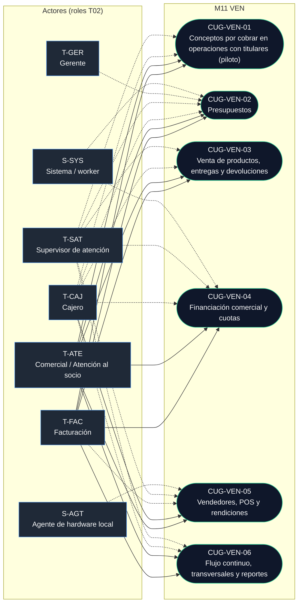
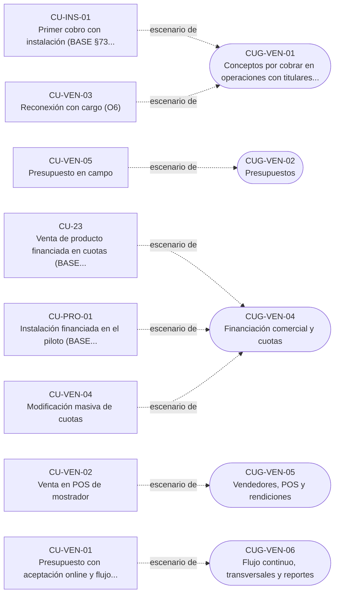

# Casos de uso de M11 VEN — Ventas, presupuestos y punto de venta

Parte del entregable [21 Casos de uso por módulo](../21-casos-de-uso.md) (artefacto 3.3). Generado con `_trabajo/gen_21_casos_uso.py` desde `docs/especificacion/anexos/M11-VEN-ventas-presupuestos.md` y revisado a mano. Ante cualquier diferencia prevalece el anexo.

| Dato | Valor |
|---|---|
| Casos de uso agrupadores (CUG) | 6 |
| RF del anexo | 94 (todos asignados a un CUG) |
| CU con ficha en la sección 16 | 8 |
| CU citados sin ficha en este anexo | 0 |

## 1. Diagramas

### 1.1 Actores y casos de uso agrupadores

Línea continua: actor principal. Línea punteada: actor secundario o participante.

### 1.2 Casos de uso de la especificación por agrupador

Rectángulo: CU con ficha en la sección 16 del anexo. Paralelogramo: CU citado (ficha en otro anexo o sin ficha).

## 2. Fichas de los casos de uso agrupadores

### CUG-VEN-01 — Conceptos por cobrar en operaciones con titulares (piloto)

| Campo | Contenido |
|---|---|
| Actor principal | T-FAC Facturación; T-ATE Comercial / Atención al socio |
| Actores secundarios | T-CAJ Cajero; T-SAT Supervisor de atención |
| Objetivo | Conceptos por cobrar en operaciones con titulares (piloto): Registrar cargos por operación con titulares: derecho de conexión, instalación, reconexión, cambio de titular, traslado de domicilio, visita adicional u otro concepto... |
| Precondición | Usuario del tenant autenticado con el rol indicado y capabilities `ven.cargos.anular`, `ven.cargos.aprobar`, `ven.cargos.crear`; módulo VEN licenciado y activo (T01, T02 §4.3). |
| Flujo principal | Según CU-INS-01: - Definición dueña: M10 «CU-INS-01 (BASE §73, parte técnica) — Instalación integral». Aquí solo el aporte de ventas al primer cobro. M11 aporta el cargo INS-INT de ARS 30.000 (contado) a la simulación; con prorrateo y promoción el primer cobro es ARS 30.500; sin prorrateo, ARS 35.000. Una visita fallida no genera cargo. |
| Alternativos | Al elegir la financiación de un cargo se anula la alternativa de cobrarlo al contado: un solo cronograma y... (RF-VEN-006). Bonificar total o parcialmente, o anular, un cargo antes de facturarlo, con motivo y aprobación por monto... (RF-VEN-008). Sin la capability o fuera del alcance de datos: la acción se deniega por defecto y se audita (T02). |
| CU asociados | CU-INS-01; CU-VEN-03 |
| RF (13) | RF-VEN-001 a 013 |
| Prioridad y olas | Núcleo 9, Estándar 4, Extensión 0; olas O4, O6, O7, O8 |
| Origen | M11 §5.1 |

### CUG-VEN-02 — Presupuestos

| Campo | Contenido |
|---|---|
| Actor principal | T-FAC Facturación; T-ATE Comercial / Atención al socio |
| Actores secundarios | T-CAJ Cajero; T-SAT Supervisor de atención; T-GER Gerente; S-SYS Sistema / worker |
| Objetivo | Presupuestos: Crear presupuestos para una cuenta/titular (con persona), para una persona registrada o para un prospecto (nombre y contacto), con persona por defecto configurable... |
| Precondición | Usuario del tenant autenticado con el rol indicado y capabilities `ven.presupuestos.crear`, `ven.presupuestos.aprobar`, `ven.misPresupuestos.aceptar`; módulo VEN licenciado y activo (T01, T02 §4.3). |
| Flujo principal | Según CU-VEN-05: el técnico, sin señal, arma un presupuesto con productos habilitados para campo, el socio firma en pantalla; al sincronizar se crea una única vez y, si se factura en campo, se usa el tipo P2592 y se publica en autogestión. |
| Alternativos | Validar al presupuestar, según configuración: que la cuenta tenga servicios activos (P2395 (RF-VEN-028). Impedir otro presupuesto vigente, no anulado y sin facturar de la misma cuenta con alguno de los mismos... (RF-VEN-029). Gestionar el ciclo de vida del presupuesto con transiciones explícitas (sección 8): enviar, reenviar... (RF-VEN-030). Sin la capability o fuera del alcance de datos: la acción se deniega por defecto y se audita (T02). |
| CU asociados | CU-VEN-05 |
| RF (28) | RF-VEN-020 a 047 |
| Prioridad y olas | Núcleo 0, Estándar 27, Extensión 1; olas O8, O10 |
| Origen | M11 §5.2 |

### CUG-VEN-03 — Venta de productos, entregas y devoluciones

| Campo | Contenido |
|---|---|
| Actor principal | T-FAC Facturación; T-ATE Comercial / Atención al socio |
| Actores secundarios | T-CAJ Cajero; T-SAT Supervisor de atención |
| Objetivo | Venta de productos, entregas y devoluciones: Registrar ventas de productos y servicios adicionales con cabecera (cuenta/titular, servicio opcional, vendedor, condición y forma de pago, lote, descuento... |
| Precondición | Usuario del tenant autenticado con el rol indicado y capabilities `ven.ventas.anular`, `ven.ventas.aprobar`, `ven.ventas.crear`; módulo VEN licenciado y activo (T01, T02 §4.3). |
| Flujo principal | 1. Registrar ventas de productos y servicios adicionales con cabecera (cuenta/titular, servicio opcional, vendedor... (RF-VEN-050). 2. Administrar listas de precios de venta de artículos con vigencia, moneda y canal (mostrador, campo, portal), sin... (RF-VEN-051). 3. Reglas de recargo o descuento por producto: aplican si la cuenta tiene la propiedad y valor exigidos, coincide el tipo... (RF-VEN-052). 4. Actualización masiva de precios de venta por filtros (rango de código, departamento, rubro, tipo, servicio, proveedor... (RF-VEN-053). 5. Controlar disponibilidad y reservar stock en M13 al confirmar la venta (RF-VEN-054). 6. Entregas parciales y consulta de "vendido/facturado no entregado" (RF-VEN-055). |
| Alternativos | Reglas de recargo o descuento por producto: aplican si la cuenta tiene la propiedad y valor exigidos... (RF-VEN-052). Mostrar y validar el riesgo crediticio (deuda vencida, importe y límite) antes de financiar o vender a... (RF-VEN-057). Anular ventas individualmente o por rango (tipo, punto de venta, número desde/hasta) con permiso y respetando... (RF-VEN-062). Sin la capability o fuera del alcance de datos: la acción se deniega por defecto y se audita (T02). |
| CU asociados | — (sin CU en la especificación; el flujo sale de los RF) |
| RF (21) | RF-VEN-050 a 070 |
| Prioridad y olas | Núcleo 0, Estándar 21, Extensión 0; olas O8 |
| Origen | M11 §5.3 |

### CUG-VEN-04 — Financiación comercial y cuotas

| Campo | Contenido |
|---|---|
| Actor principal | T-FAC Facturación; T-ATE Comercial / Atención al socio |
| Actores secundarios | T-CAJ Cajero; T-SAT Supervisor de atención; S-SYS Sistema / worker |
| Objetivo | Financiación comercial y cuotas: Generar el cronograma de cuotas con capital, interés, IVA (general y sobretasa), percepciones por cuota (IIBB solo si la base supera el mínimo), vencimientos y número de... |
| Precondición | TEN-001 con artículo ART-ROU-01 (router) en stock, precio ARS 90.000, plan "3 cuotas sin interés". |
| Flujo principal | Según CU-23: 1) el vendedor registra la venta VEN-001 a la cuenta de prueba; 2) M13 confirma disponibilidad y reserva; 3) elige el plan y ve la simulación (3 × ARS 30.000, TEA 0, CFT 0); 4) confirma; M05 emite según el modelo fiscal (PA-VEN-02); 5) entrega del equipo con serie (egreso M13); 6) las cuotas se facturan por corrida en documento propio y se presentan en el resumen; 7) M07 registra los cobros y las cuotas pasan a paid. |
| Alternativos | Según CU-23: devolución tras la cuota 1 cobrada: reingreso al depósito, NC, cuotas 2 y 3 voided, cuota 1 queda como saldo a favor o devolución. Sin la capability o fuera del alcance de datos: denegación por defecto y auditoría (T02). |
| CU asociados | CU-23; CU-PRO-01; CU-VEN-04 |
| RF (15) | RF-VEN-080 a 094 |
| Prioridad y olas | Núcleo 5, Estándar 10, Extensión 0; olas O4, O8 |
| Origen | M11 §5.4 |

### CUG-VEN-05 — Vendedores, POS y rendiciones

| Campo | Contenido |
|---|---|
| Actor principal | T-ATE Comercial / Atención al socio; T-CAJ Cajero |
| Actores secundarios | T-FAC Facturación; T-SAT Supervisor de atención; S-AGT Agente de hardware local |
| Objetivo | Vendedores, POS y rendiciones: ABM de vendedores: nombre o razón social, domicilio (calle, número, departamento, piso, barrio, provincia, localidad, código postal), teléfono, fax, celular, email... |
| Precondición | Usuario del tenant autenticado con el rol indicado y capabilities `ven.rendiciones.crear`, `ven.rendiciones.editar`, `ven.rendiciones.ver`; módulo VEN licenciado y activo (T01, T02 §4.3). |
| Flujo principal | Según CU-VEN-02: el cajero abre sesión con fondo ARS 10.000; vende un cable y un conector a consumidor final (cuenta por defecto); cobra con tarjeta de débito; se emite factura electrónica y ticket; al cierre, el arqueo cuadra por medio. |
| Alternativos | Según CU-VEN-02: sin conexión con ARCA, la venta queda pendiente de emisión y no se entrega como facturada si P727 está activo. Sin la capability o fuera del alcance de datos: denegación por defecto y auditoría (T02). |
| CU asociados | CU-VEN-02 |
| RF (9) | RF-VEN-100 a 108 |
| Prioridad y olas | Núcleo 0, Estándar 5, Extensión 4; olas O8, O10, O11 |
| Origen | M11 §5.5 |

### CUG-VEN-06 — Flujo continuo, transversales y reportes

| Campo | Contenido |
|---|---|
| Actor principal | T-FAC Facturación; T-ATE Comercial / Atención al socio |
| Actores secundarios | T-CAJ Cajero; T-SAT Supervisor de atención |
| Objetivo | Flujo continuo, transversales y reportes: Respetar el cierre de período de ventas (P67) y de facturación mediante la entidad unificada de períodos de T04/M15. |
| Precondición | Usuario del tenant autenticado con el rol indicado y capabilities `ven.presupuestos.crear`, `ven.presupuestos.aprobar`, `ven.entregas.registrar`; módulo VEN licenciado y activo (T01, T02 §4.3). |
| Flujo principal | Según CU-VEN-01: 1) el vendedor crea un presupuesto de ampliación de red interna con un conjunto "Materiales" y otro "Mano de obra"; 2) lo envía por email con enlace; 3) el socio abre el enlace, recibe OTP y acepta la versión 1; 4) se crea el caso CRM y la OT con los materiales reservados; 5) el técnico ejecuta y reporta un 3 % más de cable (dentro de tolerancia 5 %); 6) el presupuesto pasa a toInvoice y se factura lo aceptado... |
| Alternativos | Según CU-VEN-01: versión vencida → el enlace informa y ofrece pedir actualización; consumo 12 % mayor → aprobación del supervisor o del socio antes de facturar la diferencia. Sin la capability o fuera del alcance de datos: denegación por defecto y auditoría (T02). |
| CU asociados | CU-VEN-01 |
| RF (8) | RF-VEN-110 a 117 |
| Prioridad y olas | Núcleo 2, Estándar 5, Extensión 1; olas O4, O8 |
| Origen | M11 §5.6 |

## 3. Casos de uso de la especificación (CU)

| CU | Nombre | Actor según el anexo | Agrupador | Criterio de asignación |
|---|---|---|---|---|
| CU-23 | Venta de producto financiada en cuotas (BASE §23) | vendedor | CUG-VEN-04 | similitud |
| CU-PRO-01 | Instalación financiada en el piloto (BASE §72) | — | CUG-VEN-04 | similitud |
| CU-INS-01 | Primer cobro con instalación (BASE §73, compartido con M04/M05) | — | CUG-VEN-01 | similitud |
| CU-VEN-01 | Presupuesto con aceptación online y flujo continuo | vendedor, socio, técnico | CUG-VEN-06 | similitud |
| CU-VEN-02 | Venta en POS de mostrador | — | CUG-VEN-05 | similitud |
| CU-VEN-03 | Reconexión con cargo (O6) | — | CUG-VEN-01 | similitud |
| CU-VEN-04 | Modificación masiva de cuotas | — | CUG-VEN-04 | similitud |
| CU-VEN-05 | Presupuesto en campo | — | CUG-VEN-02 | similitud |

## 4. Cobertura del anexo

| Universo | En la especificación | Incluidos | Excluidos |
|---|---|---|---|
| RF | 94 | 94 | 0 |
| CU con ficha (sección 16) | 8 | 8 | 0 |
| CU citados sin ficha en este anexo | 0 | 0 | 0 |
