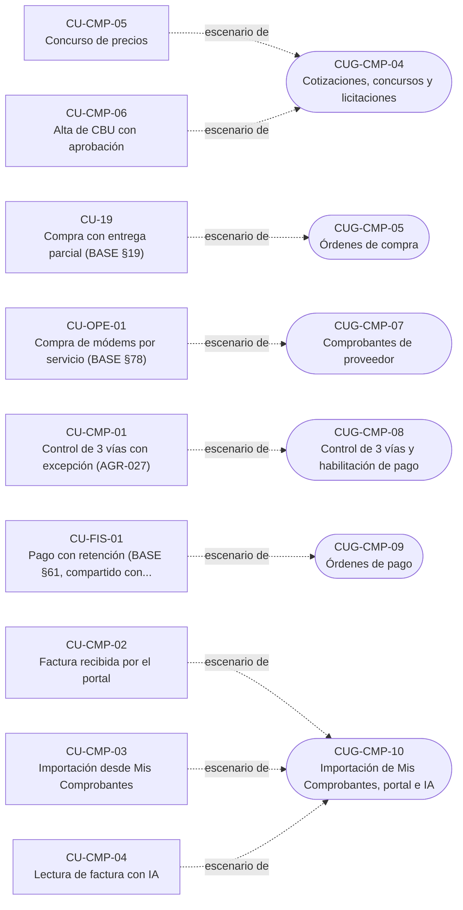

# Casos de uso de M12 CMP — Compras y proveedores

Parte del entregable [21 Casos de uso por módulo](../21-casos-de-uso.md) (artefacto 3.3). Generado con `_trabajo/gen_21_casos_uso.py` desde `docs/especificacion/anexos/M12-CMP-compras-proveedores.md` y revisado a mano. Ante cualquier diferencia prevalece el anexo.

| Dato | Valor |
|---|---|
| Casos de uso agrupadores (CUG) | 12 |
| RF del anexo | 115 (todos asignados a un CUG) |
| CU con ficha en la sección 16 | 9 |
| CU citados sin ficha en este anexo | 0 |

## 1. Diagramas

### 1.1 Actores y casos de uso agrupadores

```mermaid
flowchart LR
    subgraph ACT["Actores (roles T02)"]
        direction TB
        A_T_CMP["T-CMP<br/>Compras"]
        A_T_CON["T-CON<br/>Contador / Contable (MT-006)"]
        A_T_ATE["T-ATE<br/>Comercial / Atención al socio"]
        A_T_DEP["T-DEP<br/>Depósito"]
        A_S_SYS["S-SYS<br/>Sistema / worker"]
        A_T_LEC["T-LEC<br/>Lecturista (campo)"]
        A_T_GER["T-GER<br/>Gerente"]
        A_S_BOT["S-BOT<br/>Bot / asistente IA"]
        A_C_PRV["C-PRV<br/>Proveedor (portal de proveedores)"]
    end
    subgraph SIS["M12 CMP"]
        direction TB
        CUG_CMP_01(["CUG-CMP-01<br/>Proveedores"])
        CUG_CMP_02(["CUG-CMP-02<br/>Catálogos de compras"])
        CUG_CMP_03(["CUG-CMP-03<br/>Solicitud de aprovisionamiento"])
        CUG_CMP_04(["CUG-CMP-04<br/>Cotizaciones, concursos y licitaciones"])
        CUG_CMP_05(["CUG-CMP-05<br/>Órdenes de compra"])
        CUG_CMP_06(["CUG-CMP-06<br/>Recepción y remito de proveedor"])
        CUG_CMP_07(["CUG-CMP-07<br/>Comprobantes de proveedor"])
        CUG_CMP_08(["CUG-CMP-08<br/>Control de 3 vías y habilitación de pago"])
        CUG_CMP_09(["CUG-CMP-09<br/>Órdenes de pago"])
        CUG_CMP_10(["CUG-CMP-10<br/>Importación de Mis Comprobantes, portal e IA"])
        CUG_CMP_11(["CUG-CMP-11<br/>Informes y transversales"])
        CUG_CMP_12(["CUG-CMP-12<br/>Abastecimiento mayorista y derechos de señales"])
    end
    A_T_CMP --> CUG_CMP_01
    A_T_CON -.-> CUG_CMP_01
    A_T_ATE -.-> CUG_CMP_01
    A_T_DEP -.-> CUG_CMP_01
    A_S_SYS -.-> CUG_CMP_01
    A_T_CMP --> CUG_CMP_02
    A_T_ATE -.-> CUG_CMP_02
    A_T_CON -.-> CUG_CMP_02
    A_T_DEP -.-> CUG_CMP_02
    A_T_CMP --> CUG_CMP_03
    A_T_ATE --> CUG_CMP_03
    A_T_DEP -.-> CUG_CMP_03
    A_T_CON -.-> CUG_CMP_03
    A_T_LEC -.-> CUG_CMP_03
    A_T_CMP --> CUG_CMP_04
    A_T_CON -.-> CUG_CMP_04
    A_T_ATE -.-> CUG_CMP_04
    A_T_DEP -.-> CUG_CMP_04
    A_T_CMP --> CUG_CMP_05
    A_T_ATE -.-> CUG_CMP_05
    A_T_CON -.-> CUG_CMP_05
    A_T_DEP -.-> CUG_CMP_05
    A_T_CMP --> CUG_CMP_06
    A_T_CON -.-> CUG_CMP_06
    A_T_DEP -.-> CUG_CMP_06
    A_T_GER -.-> CUG_CMP_06
    A_T_CMP --> CUG_CMP_07
    A_T_CON -.-> CUG_CMP_07
    A_T_ATE -.-> CUG_CMP_07
    A_T_DEP -.-> CUG_CMP_07
    A_T_CMP --> CUG_CMP_08
    A_T_ATE -.-> CUG_CMP_08
    A_T_CON -.-> CUG_CMP_08
    A_T_DEP -.-> CUG_CMP_08
    A_S_SYS -.-> CUG_CMP_08
    A_T_CMP --> CUG_CMP_09
    A_T_ATE -.-> CUG_CMP_09
    A_T_CON -.-> CUG_CMP_09
    A_T_DEP -.-> CUG_CMP_09
    A_S_SYS -.-> CUG_CMP_09
    A_T_CMP --> CUG_CMP_10
    A_T_CON -.-> CUG_CMP_10
    A_T_ATE -.-> CUG_CMP_10
    A_T_DEP -.-> CUG_CMP_10
    A_S_BOT -.-> CUG_CMP_10
    A_C_PRV -.-> CUG_CMP_10
    A_T_CMP --> CUG_CMP_11
    A_T_CON -.-> CUG_CMP_11
    A_T_DEP -.-> CUG_CMP_11
    A_T_ATE -.-> CUG_CMP_11
    A_C_PRV -.-> CUG_CMP_11
    A_T_CMP --> CUG_CMP_12
    A_T_ATE -.-> CUG_CMP_12
    A_T_GER -.-> CUG_CMP_12
    A_T_CON -.-> CUG_CMP_12
    A_S_SYS -.-> CUG_CMP_12
    classDef actor fill:#1f2937,stroke:#60a5fa,color:#f9fafb;
    classDef cug fill:#0f172a,stroke:#34d399,color:#f9fafb;
    class A_T_CMP,A_T_CON,A_T_ATE,A_T_DEP,A_S_SYS,A_T_LEC,A_T_GER,A_S_BOT,A_C_PRV actor;
    class CUG_CMP_01,CUG_CMP_02,CUG_CMP_03,CUG_CMP_04,CUG_CMP_05,CUG_CMP_06,CUG_CMP_07,CUG_CMP_08,CUG_CMP_09,CUG_CMP_10,CUG_CMP_11,CUG_CMP_12 cug;
```

Línea continua: actor principal. Línea punteada: actor secundario o participante.

### 1.2 Casos de uso de la especificación por agrupador

Rectángulo: CU con ficha en la sección 16 del anexo. Paralelogramo: CU citado (ficha en otro anexo o sin ficha).

## 2. Fichas de los casos de uso agrupadores

### CUG-CMP-01 — Proveedores

| Campo | Contenido |
|---|---|
| Actor principal | T-CMP Compras |
| Actores secundarios | T-CON Contador / Contable (MT-006); T-ATE Comercial / Atención al socio; T-DEP Depósito; S-SYS Sistema / worker |
| Objetivo | Proveedores: Cuenta corriente del proveedor: comprobantes, pagos, anticipos, NC, saldo, vencidos y a vencer, con fecha de corte. |
| Precondición | Usuario del tenant autenticado con el rol indicado y capabilities `cmp.facturasProveedor.registrar`, `cmp.facturasProveedor.aprobar`, `cmp.proveedoresEmpleados.ver`; módulo CMP licenciado y activo (T01, T02 §4.3). |
| Flujo principal | 1. ABM de proveedores: razón social, nombre de fantasía, CUIT, condición de IVA (SITIVA), inscripción IIBB y... (RF-CMP-001). 2. Validar CUIT (dígito verificador) y consultar el padrón de ARCA mediante el componente de M06 al dar de alta o... (RF-CMP-002). 3. CBU/CVU del proveedor: varias cuentas con descripción, banco, titular y CUIT del titular (RF-CMP-003). 4. Mostrar y editar, desde la ficha del proveedor, los regímenes de retención aplicables, exclusiones y certificados de no... (RF-CMP-004). 5. Cuenta corriente del proveedor: comprobantes, pagos, anticipos, NC, saldo, vencidos y a vencer, con fecha de corte (RF-CMP-016). 6. Padrón mínimo de proveedores (razón social, CUIT, condición IVA) para registrar el ingreso de equipos serializados del... (RF-CMP-018). |
| Alternativos | ABM de proveedores: razón social, nombre de fantasía, CUIT, condición de IVA (SITIVA), inscripción IIBB y... (RF-CMP-001). Validar CUIT (dígito verificador) y consultar el padrón de ARCA mediante el componente de M06 al dar de alta... (RF-CMP-002). Cuenta corriente del proveedor: comprobantes, pagos, anticipos, NC, saldo, vencidos y a vencer, con fecha de... (RF-CMP-016). Sin la capability o fuera del alcance de datos: la acción se deniega por defecto y se audita (T02). |
| CU asociados | — (sin CU en la especificación; el flujo sale de los RF) |
| RF (18) | RF-CMP-001 a 018 |
| Prioridad y olas | Núcleo 2, Estándar 15, Extensión 1; olas O3, O8 |
| Origen | M12 §5.1 |

### CUG-CMP-02 — Catálogos de compras

| Campo | Contenido |
|---|---|
| Actor principal | T-CMP Compras |
| Actores secundarios | T-ATE Comercial / Atención al socio; T-CON Contador / Contable (MT-006); T-DEP Depósito |
| Objetivo | Catálogos de compras: Conceptos de compra (no inventariables): descripción, descripción para formulario, unidad, rubro contable, alícuota de IVA, no gravado, tipo, tipo de IVA, código IIBB. |
| Precondición | Usuario del tenant autenticado con el rol indicado y capabilities `cmp.catalogos.configurar`, `cmp.comprobantes.anular`, `cmp.comprobantes.editar`; módulo CMP licenciado y activo (T01, T02 §4.3). |
| Flujo principal | 1. Conceptos de compra (no inventariables): descripción, descripción para formulario, unidad, rubro contable, alícuota de... (RF-CMP-020). 2. Destinatarios de SA (áreas/personas receptoras) (RF-CMP-021). 3. Unidades de gasto y su panel al cargar productos desde un vale (P2906, uso en M13) (RF-CMP-022). 4. Tipos de combustible y registro de litros y km por comprobante de compra de combustible (RF-CMP-023). 5. Modalidades de contratación: sin asignar, caja chica, compulsa/mail, concurso de precios, concurso, licitación (RF-CMP-024). 6. Tipos de comprobante de compra y sus operaciones (suma/resta saldo, informa impuestos, mueve stock, anticipo, OP) desde... (RF-CMP-025). |
| Alternativos | Sin la capability o fuera del alcance de datos: la acción se deniega por defecto y se audita (T02). |
| CU asociados | — (sin CU en la especificación; el flujo sale de los RF) |
| RF (7) | RF-CMP-020 a 026 |
| Prioridad y olas | Núcleo 0, Estándar 7, Extensión 0; olas O8 |
| Origen | M12 §5.2 |

### CUG-CMP-03 — Solicitud de aprovisionamiento

| Campo | Contenido |
|---|---|
| Actor principal | T-CMP Compras; T-ATE Comercial / Atención al socio |
| Actores secundarios | T-DEP Depósito; T-CON Contador / Contable (MT-006); T-LEC Lecturista (campo) |
| Objetivo | Solicitud de aprovisionamiento: Alta de SA con ítems de producto, concepto o texto libre: cantidad, unidad, costo estimado (con precio de última compra), solicitante, destinatario, criticidad (normal... |
| Precondición | Usuario del tenant autenticado con el rol indicado y capabilities `cmp.solicitudes.crear`, `cmp.solicitudes.aprobar`, `cmp.solicitudes.descartar`; módulo CMP licenciado y activo (T01, T02 §4.3). |
| Flujo principal | 1. Alta de SA con ítems de producto, concepto o texto libre: cantidad, unidad, costo estimado (con precio de última... (RF-CMP-030). 2. Originar SA desde: punto de reposición de M13, OT/obra de M10 (materiales faltantes), fabricación (M13) o manualmente (RF-CMP-031). 3. Aprobación de SA por workflow T11 según política (monto estimado, área, criticidad), con opción de doble aprobación por... (RF-CMP-032). 4. Visibilidad: quien no puede aprobar ve solo SA aprobadas para procesar (RF-CMP-033). 5. Estados: borrador, pendiente de aprobación, aprobada, rechazada, en proceso (compras la tomó), parcialmente procesada... (RF-CMP-034). 6. Aprobación por informe impreso para firma del aprobador (marca "exportada"), como alternativa al workflow electrónico (RF-CMP-035). |
| Alternativos | Estados: borrador, pendiente de aprobación, aprobada, rechazada, en proceso (compras la tomó), parcialmente... (RF-CMP-034). Sin la capability o fuera del alcance de datos: la acción se deniega por defecto y se audita (T02). |
| CU asociados | — (sin CU en la especificación; el flujo sale de los RF) |
| RF (10) | RF-CMP-030 a 039 |
| Prioridad y olas | Núcleo 0, Estándar 9, Extensión 1; olas O8 |
| Origen | M12 §5.3 |

### CUG-CMP-04 — Cotizaciones, concursos y licitaciones

| Campo | Contenido |
|---|---|
| Actor principal | T-CMP Compras |
| Actores secundarios | T-CON Contador / Contable (MT-006); T-ATE Comercial / Atención al socio; T-DEP Depósito |
| Objetivo | Cotizaciones, concursos y licitaciones: Generar solicitudes de cotización a uno o varios proveedores desde SA aprobadas (una por proveedor, agrupadas), con vencimiento configurable (default 15 días), moneda y... |
| Precondición | Usuario del tenant autenticado con el rol indicado y capabilities `cmp.cotizaciones.crear`, `cmp.cotizaciones.editar`, `cmp.cotizaciones.evaluar`; módulo CMP licenciado y activo (T01, T02 §4.3). |
| Flujo principal | Según CU-CMP-05: SA de ARS 3.000.000 supera el umbral de concurso → se publica el evento e invita a 4 proveedores → ofertas en sobre cerrado → apertura con acta → planilla de adjudicación → OC al adjudicado. |
| Alternativos | Cargar precios cotizados por el comprador o por el proveedor en el portal (precio, validez, plazo de entrega... (RF-CMP-041). Sin la capability o fuera del alcance de datos: la acción se deniega por defecto y se audita (T02). |
| CU asociados | CU-CMP-05; CU-CMP-06 |
| RF (6) | RF-CMP-040 a 045 |
| Prioridad y olas | Núcleo 0, Estándar 6, Extensión 0; olas O8 |
| Origen | M12 §5.4 |

### CUG-CMP-05 — Órdenes de compra

| Campo | Contenido |
|---|---|
| Actor principal | T-CMP Compras |
| Actores secundarios | T-ATE Comercial / Atención al socio; T-CON Contador / Contable (MT-006); T-DEP Depósito |
| Objetivo | Órdenes de compra: Cada línea de OC identifica servicio, destino (depósito/OT/obra con P3101), centro de costo y, si abastece varios servicios, una distribución explícita (porcentaje o... |
| Precondición | TEN-001; proveedor PROV-DEMO-002; producto "Medidor monofásico". |
| Flujo principal | Según CU-19: SA de 10 medidores → aprobación → cotizaciones y comparación → OC-001 por 10 × ARS 20.000 = ARS 200.000 (aprobada por banda) → recepción de 6 → OC con 4 pendientes (no se da por entregado todo). |
| Alternativos | Según CU-19: la factura llega por 10 o con precio ARS 21.000: excepción de cantidad (4 unidades) o de precio (5 % > tolerancia 2 %); la factura queda retenida antes de autorizar el pago. Sin la capability o fuera del alcance de datos: denegación por defecto y auditoría (T02). |
| CU asociados | CU-19 |
| RF (10) | RF-CMP-050 a 059 |
| Prioridad y olas | Núcleo 2, Estándar 8, Extensión 0; olas O8 |
| Origen | M12 §5.5 |

### CUG-CMP-06 — Recepción y remito de proveedor

| Campo | Contenido |
|---|---|
| Actor principal | T-CMP Compras |
| Actores secundarios | T-CON Contador / Contable (MT-006); T-DEP Depósito; T-GER Gerente |
| Objetivo | Recepción y remito de proveedor: Registrar la recepción (remito del proveedor) contra una o varias OC aprobadas, por cantidades parciales, con número del proveedor cuando el comprobante informa... |
| Precondición | Usuario del tenant autenticado con el rol indicado y capabilities `cmp.proveedores.ver`, `cmp.proveedores.editar`, `cmp.proveedores.datosBancarios.editar`; módulo CMP licenciado y activo (T01, T02 §4.3). |
| Flujo principal | 1. Registrar la recepción (remito del proveedor) contra una o varias OC aprobadas, por cantidades parciales, con número... (RF-CMP-060). 2. La recepción no mueve stock en M12: publica cmp.receipt.confirmed y M13 registra el ingreso físico (RF-CMP-061). 3. Conformidad de servicios sin recepción material (mantenimiento, honorarios): el responsable del servicio registra la... (RF-CMP-062). 4. Excesos de entrega: aceptar hasta la tolerancia configurada (RF-CMP-063). 5. Devoluciones al proveedor: remito de devolución que reabre o reduce el pendiente de la OC, solicita a M13 la salida y... (RF-CMP-064). 6. Registro simplificado de ingreso de equipos serializados del piloto (OC opcional, proveedor del padrón mínimo, series) (RF-CMP-067). |
| Alternativos | La recepción no mueve stock en M12: publica cmp.receipt.confirmed y M13 registra el ingreso físico (RF-CMP-061). Excesos de entrega: aceptar hasta la tolerancia configurada (RF-CMP-063). Sin la capability o fuera del alcance de datos: la acción se deniega por defecto y se audita (T02). |
| CU asociados | — (sin CU en la especificación; el flujo sale de los RF) |
| RF (8) | RF-CMP-060 a 067 |
| Prioridad y olas | Núcleo 3, Estándar 5, Extensión 0; olas O3, O8 |
| Origen | M12 §5.6 |

### CUG-CMP-07 — Comprobantes de proveedor

| Campo | Contenido |
|---|---|
| Actor principal | T-CMP Compras |
| Actores secundarios | T-CON Contador / Contable (MT-006); T-ATE Comercial / Atención al socio; T-DEP Depósito |
| Objetivo | Comprobantes de proveedor: Registrar facturas, ND, NC, tickets y recibos de proveedor: tipo, punto de venta, número, fecha, fecha contable, vencimiento(s), moneda/cotización, CAE/CAI, netos... |
| Precondición | Usuario del tenant autenticado con el rol indicado y capabilities `cmp.facturasProveedor.registrar`, `cmp.facturasProveedor.aprobar`, `cmp.proveedoresEmpleados.ver`; módulo CMP licenciado y activo (T01, T02 §4.3). |
| Flujo principal | Según CU-OPE-01: OC-DEMO-002 por 2 módems a ARS 20.000 (total ARS 40.000) con servicio INT en la línea → recepción con series (M13) → un módem se asigna a instalador y se aplica a una OT, el otro queda disponible (M13) → factura y OP siguen cuentas a pagar y tesorería. - Control: el costo del módem no se transforma en cargo al socio (M11 RN-VEN-006); la existencia no se reduce dos veces. |
| Alternativos | Validaciones al registrar: proveedor, tipo, punto y número obligatorios (RF-CMP-071). Anular un comprobante: nunca se borra (RF-CMP-083). Sin la capability o fuera del alcance de datos: la acción se deniega por defecto y se audita (T02). |
| CU asociados | CU-OPE-01 |
| RF (17) | RF-CMP-070 a 086 |
| Prioridad y olas | Núcleo 5, Estándar 11, Extensión 1; olas O8, O9 |
| Origen | M12 §5.7 |

### CUG-CMP-08 — Control de 3 vías y habilitación de pago

| Campo | Contenido |
|---|---|
| Actor principal | T-CMP Compras |
| Actores secundarios | T-ATE Comercial / Atención al socio; T-CON Contador / Contable (MT-006); T-DEP Depósito; S-SYS Sistema / worker |
| Objetivo | Control de 3 vías y habilitación de pago: Conciliar automáticamente cada línea de factura con OC y recepción: cantidad facturada ≤ cantidad recibida (o conformada) + tolerancia. |
| Precondición | Usuario del tenant autenticado con el rol indicado y capabilities `cmp.ordenesPago.anular`, `cmp.ordenesPago.aprobar`, `cmp.ordenesPago.crear`; módulo CMP licenciado y activo (T01, T02 §4.3). |
| Flujo principal | Según CU-CMP-01: pedidos 10, recibidos 6, facturados 10 → excepción de cantidad por 4 → el autorizador elige "reclamar NC" → se habilitan ARS 120.000 → llega NC por ARS 80.000 → excepción resuelta. |
| Alternativos | Crear una excepción por cada diferencia fuera de tolerancia con tipo (cantidad, precio, condición, sin OC... (RF-CMP-091). Habilitación de pago: automática si la factura concilia sin excepciones abiertas (RF-CMP-092). Tablero de conciliación: facturas conciliadas, con excepción, retenidas, habilitadas (RF-CMP-094). Sin la capability o fuera del alcance de datos: la acción se deniega por defecto y se audita (T02). |
| CU asociados | CU-CMP-01 |
| RF (5) | RF-CMP-090 a 094 |
| Prioridad y olas | Núcleo 4, Estándar 1, Extensión 0; olas O8 |
| Origen | M12 §5.8 |

### CUG-CMP-09 — Órdenes de pago

| Campo | Contenido |
|---|---|
| Actor principal | T-CMP Compras |
| Actores secundarios | T-ATE Comercial / Atención al socio; T-CON Contador / Contable (MT-006); T-DEP Depósito; S-SYS Sistema / worker |
| Objetivo | Órdenes de pago: Preparar la OP: proveedor (o proveedor "paga a otros" con comprobantes de otros proveedores), selección de comprobantes habilitados con saldo (pago total o parcial), NC... |
| Precondición | Usuario del tenant autenticado con el rol indicado y capabilities `cmp.ordenesPago.anular`, `cmp.ordenesPago.aprobar`, `cmp.ordenesPago.crear`; módulo CMP licenciado y activo (T01, T02 §4.3). |
| Flujo principal | Según CU-FIS-01: - Definición dueña: M06 «CU-FIS-01 — Retención en un pago a proveedor (BASE §61, original)». Aquí solo el tramo de compras (orden de pago con la retención aplicada). OP a PROV-DEMO-001 por factura de ARS 100.000 → M06 determina RET-DEMO-001 por ARS 2.000 → neto ARS 98.000 → aprobación → M14 paga 98.000 → la factura queda cancelada por 100.000; M06 genera certificado y obligación. - Control: un reintento no genera... |
| Alternativos | Al recibir tes.paymentExecution.executed, marcar la OP pagada, cancelar saldos y actualizar la cuenta... (RF-CMP-106). Pagos de recibos de sueldo mediante OP solo si M16 lo solicita (lote aprobado) (RF-CMP-110). Portal de proveedores: el proveedor ve OC, estado de sus comprobantes (pendiente, registrado, rechazado con... (RF-CMP-112). Sin la capability o fuera del alcance de datos: la acción se deniega por defecto y se audita (T02). |
| CU asociados | CU-FIS-01 |
| RF (13) | RF-CMP-100 a 112 |
| Prioridad y olas | Núcleo 6, Estándar 7, Extensión 0; olas O8, O9 |
| Origen | M12 §5.9 |

### CUG-CMP-10 — Importación de Mis Comprobantes, portal e IA

| Campo | Contenido |
|---|---|
| Actor principal | T-CMP Compras |
| Actores secundarios | T-CON Contador / Contable (MT-006); T-ATE Comercial / Atención al socio; T-DEP Depósito; S-BOT Bot / asistente IA; C-PRV Proveedor (portal de proveedores) |
| Objetivo | Importación de Mis Comprobantes, portal e IA: Recibir de M06 los comprobantes recibidos que figuran en Mis Comprobantes de ARCA y no están registrados en M12, y crear borradores de comprobante de proveedor... |
| Precondición | Usuario del tenant autenticado con el rol indicado y capabilities `cmp.comprobantes.anular`, `cmp.comprobantes.editar`, `cmp.comprobantes.registrar`; módulo CMP licenciado y activo (T01, T02 §4.3). |
| Flujo principal | Según CU-CMP-02: el proveedor invitado sube su factura con PDF → duplicado rechazado si ya existe → cuentas a pagar registra (importando la OC) → el proveedor ve "Registrado", luego "Habilitado", "En pago" y "Pagado" y descarga el certificado de retención. |
| Alternativos | Recibir comprobantes cargados por el proveedor en el portal (datos + PDF), rechazar duplicados (CUIT + tipo +... (RF-CMP-122). Sin la capability o fuera del alcance de datos: la acción se deniega por defecto y se audita (T02). |
| CU asociados | CU-CMP-02; CU-CMP-03; CU-CMP-04 |
| RF (5) | RF-CMP-120 a 122, 130 a 131 |
| Prioridad y olas | Núcleo 0, Estándar 3, Extensión 2; olas O8, O11 |
| Origen | M12 §5.10 |

### CUG-CMP-11 — Informes y transversales

| Campo | Contenido |
|---|---|
| Actor principal | T-CMP Compras |
| Actores secundarios | T-CON Contador / Contable (MT-006); T-DEP Depósito; T-ATE Comercial / Atención al socio; C-PRV Proveedor (portal de proveedores) |
| Objetivo | Informes y transversales: Trazabilidad documento a documento por ítem (origen y destino con cantidades y precios) en todos los documentos, no solo en el primer ítem. |
| Precondición | Usuario del tenant autenticado con el rol indicado y capabilities `cmp.facturasProveedor.registrar`, `cmp.facturasProveedor.aprobar`, `cmp.proveedores.ver`; módulo CMP licenciado y activo (T01, T02 §4.3). |
| Flujo principal | 1. Informes de compras (sección 15): SA por estado y aprobación, cotizaciones y comparativos, OC pendientes de recepción... (RF-CMP-140). 2. Trazabilidad documento a documento por ítem (origen y destino con cantidades y precios) en todos los documentos, no... (RF-CMP-141). 3. Respetar el cierre de períodos de Compras (P500), Stock y Contable mediante la entidad unificada de períodos (T04/M15) (RF-CMP-142). 4. Identificadores internos por documento (ObjectId) y numeración legible por tipo y punto (RF-CMP-143). 5. Integrar el efecto contable en línea (DEC-009): cada comprobante, recepción con pendiente, retención y OP publica su... (RF-CMP-144). 6. Etiquetas por diccionario, plantillas por tenant, auditoría de todo cambio, aislamiento por tenant en consultas... (RF-CMP-145). |
| Alternativos | Sin la capability o fuera del alcance de datos: la acción se deniega por defecto y se audita (T02). |
| CU asociados | — (sin CU en la especificación; el flujo sale de los RF) |
| RF (9) | RF-CMP-140 a 148 |
| Prioridad y olas | Núcleo 5, Estándar 3, Extensión 1; olas O8 |
| Origen | M12 §5.11 |

### CUG-CMP-12 — Abastecimiento mayorista y derechos de señales

| Campo | Contenido |
|---|---|
| Actor principal | T-CMP Compras |
| Actores secundarios | T-ATE Comercial / Atención al socio; T-GER Gerente; T-CON Contador / Contable (MT-006); S-SYS Sistema / worker |
| Objetivo | Abastecimiento mayorista y derechos de señales: Recibir la factura mensual del mayorista de energía (EPEC u otro mayorista configurado) por archivo (FI-INT-33) o carga manual, como comprobante de proveedor con... |
| Precondición | Usuario del tenant autenticado con el rol indicado y capabilities `cmp.derechosSenales.liquidar`, `cmp.derechosSenales.aprobar`, `cmp.abastecimiento.aprobar`; módulo CMP licenciado y activo (T01, T02 §4.3). |
| Flujo principal | 1. Recibir la factura mensual del mayorista de energía (EPEC u otro mayorista configurado) por archivo (FI-INT-33) o carga... (RF-CMP-149). 2. Controlar cada renglón de la factura mayorista contra la medición propia del mismo punto y período de M03 (puntos... (RF-CMP-150). 3. Balance mensual comprado contra facturado por servicio y zona: cantidad comprada (facturas mayoristas aprobadas)... (RF-CMP-151). 4. Recibir la factura de la distribuidora de gas (archivo FI-INT-115 de T06 o carga manual) con wholesaleSupply.kind =... (RF-CMP-152). 5. Publicar el registro del comprobante mayorista (EVT-CMP-08) con supplyKind y rol de costo de abastecimiento para que... (RF-CMP-153). 6. Contratos de derechos de señales de TV por programadora: señales o paquetes alcanzados, precio por abonado activo... (RF-CMP-154). |
| Alternativos | Controlar cada renglón de la factura mayorista contra la medición propia del mismo punto y período de M03... (RF-CMP-150). Sin la capability o fuera del alcance de datos: la acción se deniega por defecto y se audita (T02). |
| CU asociados | — (sin CU en la especificación; el flujo sale de los RF) |
| RF (7) | RF-CMP-149 a 155 |
| Prioridad y olas | Núcleo 4, Estándar 3, Extensión 0; olas O8, O10 |
| Origen | M12 §5.12 |

## 3. Casos de uso de la especificación (CU)

| CU | Nombre | Actor según el anexo | Agrupador | Criterio de asignación |
|---|---|---|---|---|
| CU-19 | Compra con entrega parcial (BASE §19) | depósito (solicitante), comprador, aprobador, receptor... | CUG-CMP-05 | similitud |
| CU-OPE-01 | Compra de módems por servicio (BASE §78) | — | CUG-CMP-07 | similitud |
| CU-FIS-01 | Pago con retención (BASE §61, compartido con M06/M14) | — | CUG-CMP-09 | similitud |
| CU-CMP-01 | Control de 3 vías con excepción (AGR-027) | — | CUG-CMP-08 | similitud |
| CU-CMP-02 | Factura recibida por el portal | — | CUG-CMP-10 | similitud |
| CU-CMP-03 | Importación desde Mis Comprobantes | — | CUG-CMP-10 | similitud |
| CU-CMP-04 | Lectura de factura con IA | — | CUG-CMP-10 | similitud |
| CU-CMP-05 | Concurso de precios | — | CUG-CMP-04 | similitud |
| CU-CMP-06 | Alta de CBU con aprobación | — | CUG-CMP-04 | similitud |

## 4. Cobertura del anexo

| Universo | En la especificación | Incluidos | Excluidos |
|---|---|---|---|
| RF | 115 | 115 | 0 |
| CU con ficha (sección 16) | 9 | 9 | 0 |
| CU citados sin ficha en este anexo | 0 | 0 | 0 |
