# Casos de uso de M13 STK — Stock, equipos serializados, bienes de uso, RMA y fabricación

Parte del entregable [21 Casos de uso por módulo](../21-casos-de-uso.md) (artefacto 3.3). Generado con `_trabajo/gen_21_casos_uso.py` desde `docs/especificacion/anexos/M13-STK-stock-activos-fabricacion.md` y revisado a mano. Ante cualquier diferencia prevalece el anexo.

| Dato | Valor |
|---|---|
| Casos de uso agrupadores (CUG) | 14 |
| RF del anexo | 139 (todos asignados a un CUG) |
| CU con ficha en la sección 16 | 24 |
| CU citados sin ficha en este anexo | 0 |

## 1. Diagramas

### 1.1 Actores y casos de uso agrupadores

```mermaid
flowchart LR
    subgraph ACT["Actores (roles T02)"]
        direction TB
        A_T_DEP["T-DEP<br/>Depósito"]
        A_T_TEC["T-TEC<br/>Técnico (campo)"]
        A_T_STE["T-STE<br/>Supervisor técnico"]
        A_T_CMP["T-CMP<br/>Compras"]
        A_S_SYS["S-SYS<br/>Sistema / worker"]
    end
    subgraph SIS["M13 STK"]
        direction TB
        CUG_STK_01(["CUG-STK-01<br/>Artículos y clasificación"])
        CUG_STK_02(["CUG-STK-02<br/>Depósitos, ubicaciones y custodia"])
        CUG_STK_03(["CUG-STK-03<br/>Movimientos y documentos de stock"])
        CUG_STK_04(["CUG-STK-04<br/>Trazabilidad por número de serie y lote"])
        CUG_STK_05(["CUG-STK-05<br/>Reservas"])
        CUG_STK_06(["CUG-STK-06<br/>Entregas a cuadrilla, custodia y consumo desde la OT (app..."])
        CUG_STK_07(["CUG-STK-07<br/>Equipos en comodato y otras modalidades"])
        CUG_STK_08(["CUG-STK-08<br/>Inventario físico y ajustes"])
        CUG_STK_09(["CUG-STK-09<br/>Stock mínimo y sugerencia de compra"])
        CUG_STK_10(["CUG-STK-10<br/>Valorización y costeo"])
        CUG_STK_11(["CUG-STK-11<br/>Bienes de uso"])
        CUG_STK_12(["CUG-STK-12<br/>RMA, garantías, reparaciones y recepción técnica"])
        CUG_STK_13(["CUG-STK-13<br/>Fabricación"])
        CUG_STK_14(["CUG-STK-14<br/>Unidades de gasto, stock por servicio, vivienda y otros"])
    end
    A_T_DEP --> CUG_STK_01
    A_T_TEC -.-> CUG_STK_01
    A_T_STE -.-> CUG_STK_01
    A_T_CMP -.-> CUG_STK_01
    A_T_DEP --> CUG_STK_02
    A_T_STE -.-> CUG_STK_02
    A_T_TEC -.-> CUG_STK_02
    A_T_CMP -.-> CUG_STK_02
    A_T_DEP --> CUG_STK_03
    A_T_STE -.-> CUG_STK_03
    A_T_TEC -.-> CUG_STK_03
    A_T_CMP -.-> CUG_STK_03
    A_S_SYS -.-> CUG_STK_03
    A_T_DEP --> CUG_STK_04
    A_T_STE -.-> CUG_STK_04
    A_T_TEC -.-> CUG_STK_04
    A_T_CMP -.-> CUG_STK_04
    A_S_SYS -.-> CUG_STK_04
    A_T_DEP --> CUG_STK_05
    A_T_STE -.-> CUG_STK_05
    A_T_TEC -.-> CUG_STK_05
    A_T_CMP -.-> CUG_STK_05
    A_T_DEP --> CUG_STK_06
    A_T_STE -.-> CUG_STK_06
    A_T_TEC -.-> CUG_STK_06
    A_T_CMP -.-> CUG_STK_06
    A_S_SYS -.-> CUG_STK_06
    A_T_DEP --> CUG_STK_07
    A_T_STE -.-> CUG_STK_07
    A_T_TEC -.-> CUG_STK_07
    A_T_CMP -.-> CUG_STK_07
    A_T_DEP --> CUG_STK_08
    A_T_TEC -.-> CUG_STK_08
    A_T_STE -.-> CUG_STK_08
    A_T_CMP -.-> CUG_STK_08
    A_T_CMP --> CUG_STK_09
    A_T_DEP --> CUG_STK_09
    A_T_STE -.-> CUG_STK_09
    A_T_TEC -.-> CUG_STK_09
    A_T_DEP --> CUG_STK_10
    A_T_TEC -.-> CUG_STK_10
    A_T_CMP -.-> CUG_STK_10
    A_T_STE -.-> CUG_STK_10
    A_T_DEP --> CUG_STK_11
    A_T_TEC -.-> CUG_STK_11
    A_T_STE -.-> CUG_STK_11
    A_T_CMP -.-> CUG_STK_11
    A_T_DEP --> CUG_STK_12
    A_T_STE -.-> CUG_STK_12
    A_T_TEC -.-> CUG_STK_12
    A_T_CMP -.-> CUG_STK_12
    A_T_DEP --> CUG_STK_13
    A_T_TEC -.-> CUG_STK_13
    A_T_CMP -.-> CUG_STK_13
    A_T_STE -.-> CUG_STK_13
    A_T_DEP --> CUG_STK_14
    A_T_STE -.-> CUG_STK_14
    A_T_TEC -.-> CUG_STK_14
    A_T_CMP -.-> CUG_STK_14
    classDef actor fill:#1f2937,stroke:#60a5fa,color:#f9fafb;
    classDef cug fill:#0f172a,stroke:#34d399,color:#f9fafb;
    class A_T_DEP,A_T_TEC,A_T_STE,A_T_CMP,A_S_SYS actor;
    class CUG_STK_01,CUG_STK_02,CUG_STK_03,CUG_STK_04,CUG_STK_05,CUG_STK_06,CUG_STK_07,CUG_STK_08,CUG_STK_09,CUG_STK_10,CUG_STK_11,CUG_STK_12,CUG_STK_13,CUG_STK_14 cug;
```

Línea continua: actor principal. Línea punteada: actor secundario o participante.

### 1.2 Casos de uso de la especificación por agrupador

```mermaid
flowchart LR
    CUG_STK_03(["CUG-STK-03<br/>Movimientos y documentos de stock"])
    X_CU_STK_01_CUG_STK_03["CU-STK-01<br/>Entrega de stock rodante a cuadrilla"]
    X_CU_STK_01_CUG_STK_03 -.->|escenario de| CUG_STK_03
    X_CU_STK_20_CUG_STK_03["CU-STK-20<br/>Cierre mensual de stock"]
    X_CU_STK_20_CUG_STK_03 -.->|escenario de| CUG_STK_03
    CUG_STK_04(["CUG-STK-04<br/>Trazabilidad por número de serie y lote"])
    X_CU_07_CUG_STK_04["CU-07<br/>Reemplazo de medidor"]
    X_CU_07_CUG_STK_04 -.->|escenario de| CUG_STK_04
    CUG_STK_05(["CUG-STK-05<br/>Reservas"])
    X_CU_20_CUG_STK_05["CU-20<br/>Reserva, entrega, consumo y devolución de..."]
    X_CU_20_CUG_STK_05 -.->|escenario de| CUG_STK_05
    CUG_STK_06(["CUG-STK-06<br/>Entregas a cuadrilla, custodia y consumo desde la..."])
    X_CU_STK_02_CUG_STK_06["CU-STK-02<br/>Instalación sin conexión y sincronización..."]
    X_CU_STK_02_CUG_STK_06 -.->|escenario de| CUG_STK_06
    X_CU_STK_03_CUG_STK_06["CU-STK-03<br/>Visita fallida"]
    X_CU_STK_03_CUG_STK_06 -.->|escenario de| CUG_STK_06
    X_CU_STK_07_CUG_STK_06["CU-STK-07<br/>Rendición semanal de cuadrilla"]
    X_CU_STK_07_CUG_STK_06 -.->|escenario de| CUG_STK_06
    CUG_STK_07(["CUG-STK-07<br/>Equipos en comodato y otras modalidades"])
    X_CU_INS_01_CUG_STK_07["CU-INS-01<br/>Instalación de Internet con módem en comodato"]
    X_CU_INS_01_CUG_STK_07 -.->|escenario de| CUG_STK_07
    X_CU_STK_04_CUG_STK_07["CU-STK-04<br/>Cambio de ONU por falla"]
    X_CU_STK_04_CUG_STK_07 -.->|escenario de| CUG_STK_07
    X_CU_STK_05_CUG_STK_07["CU-STK-05<br/>Baja de Internet y retiro del equipo"]
    X_CU_STK_05_CUG_STK_07 -.->|escenario de| CUG_STK_07
    X_CU_STK_06_CUG_STK_07["CU-STK-06<br/>Devolución en mostrador"]
    X_CU_STK_06_CUG_STK_07 -.->|escenario de| CUG_STK_07
    X_CU_STK_19_CUG_STK_07["CU-STK-19<br/>Socio consulta su equipo"]
    X_CU_STK_19_CUG_STK_07 -.->|escenario de| CUG_STK_07
    CUG_STK_08(["CUG-STK-08<br/>Inventario físico y ajustes"])
    X_CU_STK_08_CUG_STK_08["CU-STK-08<br/>Inventario físico anual"]
    X_CU_STK_08_CUG_STK_08 -.->|escenario de| CUG_STK_08
    CUG_STK_09(["CUG-STK-09<br/>Stock mínimo y sugerencia de compra"])
    X_CU_OPE_01_CUG_STK_09["CU-OPE-01<br/>Compra de módems por servicio"]
    X_CU_OPE_01_CUG_STK_09 -.->|escenario de| CUG_STK_09
    X_CU_STK_09_CUG_STK_09["CU-STK-09<br/>Sugerencia de compra por mínimo"]
    X_CU_STK_09_CUG_STK_09 -.->|escenario de| CUG_STK_09
    CUG_STK_10(["CUG-STK-10<br/>Valorización y costeo"])
    X_CU_STK_10_CUG_STK_10["CU-STK-10<br/>Diferencia de precio de factura"]
    X_CU_STK_10_CUG_STK_10 -.->|escenario de| CUG_STK_10
    X_CU_STK_11_CUG_STK_10["CU-STK-11<br/>Revaluación por índice"]
    X_CU_STK_11_CUG_STK_10 -.->|escenario de| CUG_STK_10
    CUG_STK_11(["CUG-STK-11<br/>Bienes de uso"])
    X_CU_STK_12_CUG_STK_11["CU-STK-12<br/>Alta y amortización de una OLT"]
    X_CU_STK_12_CUG_STK_11 -.->|escenario de| CUG_STK_11
    X_CU_STK_13_CUG_STK_11["CU-STK-13<br/>Baja de un vehículo"]
    X_CU_STK_13_CUG_STK_11 -.->|escenario de| CUG_STK_11
    CUG_STK_12(["CUG-STK-12<br/>RMA, garantías, reparaciones y recepción técnica"])
    X_CU_STK_14_CUG_STK_12["CU-STK-14<br/>RMA con reemplazo del proveedor"]
    X_CU_STK_14_CUG_STK_12 -.->|escenario de| CUG_STK_12
    X_CU_STK_15_CUG_STK_12["CU-STK-15<br/>Recepción técnica de equipo de cliente"]
    X_CU_STK_15_CUG_STK_12 -.->|escenario de| CUG_STK_12
    CUG_STK_13(["CUG-STK-13<br/>Fabricación"])
    X_CU_STK_16_CUG_STK_13["CU-STK-16<br/>Orden de fabricación de pilares de medición"]
    X_CU_STK_16_CUG_STK_13 -.->|escenario de| CUG_STK_13
    CUG_STK_14(["CUG-STK-14<br/>Unidades de gasto, stock por servicio, vivienda y..."])
    X_CU_STK_17_CUG_STK_14["CU-STK-17<br/>Consumo a unidad de gasto"]
    X_CU_STK_17_CUG_STK_14 -.->|escenario de| CUG_STK_14
    X_CU_STK_18_CUG_STK_14["CU-STK-18<br/>Copia de servicio Internet a otro tenant"]
    X_CU_STK_18_CUG_STK_14 -.->|escenario de| CUG_STK_14
```

Rectángulo: CU con ficha en la sección 16 del anexo. Paralelogramo: CU citado (ficha en otro anexo o sin ficha).

## 2. Fichas de los casos de uso agrupadores

### CUG-STK-01 — Artículos y clasificación

| Campo | Contenido |
|---|---|
| Actor principal | T-DEP Depósito |
| Actores secundarios | T-TEC Técnico (campo); T-STE Supervisor técnico; T-CMP Compras |
| Objetivo | Artículos y clasificación: Mantener el artículo de inventario con código único por tenant, descripción, descripción corta, tipo, clasificación, rubro, departamento, unidad de stock, marca, modelo... |
| Precondición | Usuario del tenant autenticado con el rol indicado y capabilities `stk.articulos.ver`, `stk.articulos.crear`, `stk.articulos.editar`; módulo STK licenciado y activo (T01, T02 §4.3). |
| Flujo principal | 1. Mantener el artículo de inventario con código único por tenant, descripción, descripción corta, tipo, clasificación... (RF-STK-001). 2. Banderas del artículo: lleva stock, serializado, por lote, con vencimiento, usa ubicaciones, bien de uso, fabricable... (RF-STK-002). 3. Unidades y equivalencias: unidad de stock, de compra y de consumo con factor de conversión, y cantidad por bulto para... (RF-STK-003). 4. ABM de tipos de artículo (RF-STK-004). 5. ABM jerárquico de clasificaciones con coeficiente de mano de obra (RF-STK-005). 6. ABM jerárquico de rubros con perfil contable (claves: compras, ventas, otros, costo de venta, costo de baja, valor de... (RF-STK-006). |
| Alternativos | Importación masiva de artículos, series y saldos iniciales con ExcelImportWizard (subir → preview con errores... (RF-STK-011). Sin la capability o fuera del alcance de datos: la acción se deniega por defecto y se audita (T02). |
| CU asociados | — (sin CU en la especificación; el flujo sale de los RF) |
| RF (14) | RF-STK-001 a 014 |
| Prioridad y olas | Núcleo 0, Estándar 14, Extensión 0; olas O3, O8 |
| Origen | M13 §5.1 |

### CUG-STK-02 — Depósitos, ubicaciones y custodia

| Campo | Contenido |
|---|---|
| Actor principal | T-DEP Depósito |
| Actores secundarios | T-STE Supervisor técnico; T-TEC Técnico (campo); T-CMP Compras |
| Objetivo | Depósitos, ubicaciones y custodia: Depósitos tipificados: central, sucursal, cuadrilla, técnico (personal), vehículo, producción, componentes, tránsito, reparación interna, en proveedor (RMA), cuarentena... |
| Precondición | Usuario del tenant autenticado con el rol indicado y capabilities `stk.depositos.crear`, `stk.depositos.editar`, `stk.depositos.ver`; módulo STK licenciado y activo (T01, T02 §4.3). |
| Flujo principal | 1. Depósitos tipificados: central, sucursal, cuadrilla, técnico (personal), vehículo, producción, componentes, tránsito... (RF-STK-015). 2. El depósito de cuadrilla y el de técnico se vinculan con la cuadrilla/empleado de M10/M16, con responsable de custodia (RF-STK-016). 3. Ubicación de custodia domicilio del socio: ubicación lógica por contrato (contractId + premiseId), sin crear un... (RF-STK-017). 4. Ubicaciones jerárquicas (padre/hijo) dentro de un depósito, con marca asignable y por defecto, y alta masiva con... (RF-STK-018). 5. Ubicaciones por defecto y capacidad por artículo (RF-STK-019). 6. Depósitos por defecto por tipo de operación (stock, ventas, producción, componentes) en tres niveles: tenant, sucursal... (RF-STK-020). |
| Alternativos | Sin la capability o fuera del alcance de datos: la acción se deniega por defecto y se audita (T02). |
| CU asociados | — (sin CU en la especificación; el flujo sale de los RF) |
| RF (8) | RF-STK-015 a 022 |
| Prioridad y olas | Núcleo 0, Estándar 8, Extensión 0; olas O3, O8 |
| Origen | M13 §5.2 |

### CUG-STK-03 — Movimientos y documentos de stock

| Campo | Contenido |
|---|---|
| Actor principal | T-DEP Depósito |
| Actores secundarios | T-STE Supervisor técnico; T-TEC Técnico (campo); T-CMP Compras; S-SYS Sistema / worker |
| Objetivo | Movimientos y documentos de stock: Libro de movimientos inmutable con operación tipificada (sección 7, enum operation), fecha efectiva, fecha de registro, artículo, cantidad con signo de sentido... |
| Precondición | Usuario del tenant autenticado con el rol indicado y capabilities `stk.movimientos.registrar`, `stk.miStock.ver`, `stk.movimientos.anular`; módulo STK licenciado y activo (T01, T02 §4.3). |
| Flujo principal | Según CU-STK-01: Entrega 10 ONU y 300 m de cable drop a CUA-01; técnico acepta con firma en la app. |
| Alternativos | Según CU-STK-01: Sin aceptación, queda en tránsito y no disponible para el técnico. Sin la capability o fuera del alcance de datos: denegación por defecto y auditoría (T02). |
| CU asociados | CU-STK-01; CU-STK-20 |
| RF (21) | RF-STK-023 a 043 |
| Prioridad y olas | Núcleo 0, Estándar 21, Extensión 0; olas O3, O8, O11 |
| Origen | M13 §5.3 |

### CUG-STK-04 — Trazabilidad por número de serie y lote

| Campo | Contenido |
|---|---|
| Actor principal | T-DEP Depósito |
| Actores secundarios | T-STE Supervisor técnico; T-TEC Técnico (campo); T-CMP Compras; S-SYS Sistema / worker |
| Objetivo | Trazabilidad por número de serie y lote: Unidad serializada con número de serie del fabricante e identificadores secundarios tipados (MAC, GPON SN, IMEI, número de medidor, matrícula, código interno), únicos... |
| Precondición | Usuario del tenant autenticado con el rol indicado y capabilities `stk.series.crear`, `stk.series.editar`, `stk.series.ver`; módulo STK licenciado y activo (T01, T02 §4.3). |
| Flujo principal | Según CU-07: Retirar MED-001 con lectura final 1.270 m³ (M03), instalar MED-002 con lectura inicial 0 y fecha efectiva; STK mueve custodia y estados. |
| Alternativos | Según CU-07: MED-002 ya instalado en otro suministro ⇒ bloqueo hasta resolver. Sin la capability o fuera del alcance de datos: denegación por defecto y auditoría (T02). |
| CU asociados | CU-07 |
| RF (11) | RF-STK-044 a 053, 138 |
| Prioridad y olas | Núcleo 0, Estándar 11, Extensión 0; olas O3, O8 |
| Origen | M13 §5.4 |

### CUG-STK-05 — Reservas

| Campo | Contenido |
|---|---|
| Actor principal | T-DEP Depósito |
| Actores secundarios | T-STE Supervisor técnico; T-TEC Técnico (campo); T-CMP Compras |
| Objetivo | Reservas: Reservar materiales y equipos para una OT, obra, presupuesto, plan de vivienda u orden de fabricación, por cantidad de artículo o por serie específica. |
| Precondición | Usuario del tenant autenticado con el rol indicado y capabilities `stk.reservas.crear`, `stk.reservas.liberar`, `stk.reservas.ver`; módulo STK licenciado y activo (T01, T02 §4.3). |
| Flujo principal | Según CU-20: DEP-01 tiene 20 conectores MAT-CON-01; OT-001 requiere 4: reservar 4 (16 disponibles), entregar 4 a la cuadrilla, registrar 3 consumidos en la OT y 1 devuelto. |
| Alternativos | Según CU-20: Faltante físico ⇒ ajuste autorizado con evidencia; no se modifica la existencia sin movimiento. Sin la capability o fuera del alcance de datos: denegación por defecto y auditoría (T02). |
| CU asociados | CU-20 |
| RF (5) | RF-STK-054 a 058 |
| Prioridad y olas | Núcleo 0, Estándar 5, Extensión 0; olas O3 |
| Origen | M13 §5.5 |

### CUG-STK-06 — Entregas a cuadrilla, custodia y consumo desde la OT (app de campo)

| Campo | Contenido |
|---|---|
| Actor principal | T-DEP Depósito |
| Actores secundarios | T-STE Supervisor técnico; T-TEC Técnico (campo); T-CMP Compras; S-SYS Sistema / worker |
| Objetivo | Entregas a cuadrilla, custodia y consumo desde la OT (app de campo): Entregar materiales y equipos a cuadrillas o técnicos identificados como transferencia de custodia (sale del depósito y queda a cargo del técnico), con aceptación en la... |
| Precondición | Usuario del tenant autenticado con el rol indicado y capabilities `stk.consumos.registrar`, `stk.consumos.validar`, `stk.custodia.ver`; módulo STK licenciado y activo (T01, T02 §4.3). |
| Flujo principal | Según CU-STK-02: Sin señal aplica ONU y consume 25 m de drop; al volver la red sincroniza dos veces por un reintento. |
| Alternativos | Según CU-STK-02: La OT fue cancelada mientras tanto ⇒ conflicto en bandeja, evidencia conservada. Sin la capability o fuera del alcance de datos: denegación por defecto y auditoría (T02). |
| CU asociados | CU-STK-02; CU-STK-03; CU-STK-07 |
| RF (13) | RF-STK-059 a 071 |
| Prioridad y olas | Núcleo 0, Estándar 13, Extensión 0; olas O3, O8 |
| Origen | M13 §5.6 |

### CUG-STK-07 — Equipos en comodato y otras modalidades

| Campo | Contenido |
|---|---|
| Actor principal | T-DEP Depósito |
| Actores secundarios | T-STE Supervisor técnico; T-TEC Técnico (campo); T-CMP Compras |
| Objetivo | Equipos en comodato y otras modalidades: Modalidades de entrega por artículo/plan: comodato, préstamo temporal, alquiler, venta, propiedad del socio, incorporación a red propia. |
| Precondición | Usuario del tenant autenticado con el rol indicado y capabilities `stk.equipos.asignar`, `stk.misEquipos.ver`, `stk.asignaciones.editar`; módulo STK licenciado y activo (T01, T02 §4.3). |
| Flujo principal | Según CU-INS-01: MOD-DEMO-001 asignado al instalador; En camino; instala, prueba, registra serie, conformidad de Ana; aplicación vinculada al contrato INT-100 el 10/11/2026. |
| Alternativos | Según CU-INS-01: Sincronización repetida no duplica aplicación ni salida; equipo distinto del reservado ⇒ sustitución validada. Sin la capability o fuera del alcance de datos: denegación por defecto y auditoría (T02). |
| CU asociados | CU-INS-01; CU-STK-04; CU-STK-05; CU-STK-06; CU-STK-19 |
| RF (11) | RF-STK-072 a 082 |
| Prioridad y olas | Núcleo 0, Estándar 11, Extensión 0; olas O2, O3, O4, O6 |
| Origen | M13 §5.7 |

### CUG-STK-08 — Inventario físico y ajustes

| Campo | Contenido |
|---|---|
| Actor principal | T-DEP Depósito |
| Actores secundarios | T-TEC Técnico (campo); T-STE Supervisor técnico; T-CMP Compras |
| Objetivo | Inventario físico y ajustes: Inventario físico total, parcial o cíclico por depósito, ubicación, rubro, artículo o cuadrilla, con instantánea de saldos al inicio, conteo (ciego opcional) desde admin... |
| Precondición | Usuario del tenant autenticado con el rol indicado y capabilities `stk.inventario.aprobar`, `stk.inventarios.cerrar`, `stk.inventarios.contar`; módulo STK licenciado y activo (T01, T02 §4.3). |
| Flujo principal | Según CU-STK-08: Instantánea, conteo ciego por ubicaciones, diferencias, ajuste. |
| Alternativos | Según CU-STK-08: Movimientos durante el conteo considerados según PA-STK-07. Sin la capability o fuera del alcance de datos: denegación por defecto y auditoría (T02). |
| CU asociados | CU-STK-08 |
| RF (3) | RF-STK-083 a 085 |
| Prioridad y olas | Núcleo 0, Estándar 3, Extensión 0; olas O3, O8 |
| Origen | M13 §5.8 |

### CUG-STK-09 — Stock mínimo y sugerencia de compra

| Campo | Contenido |
|---|---|
| Actor principal | T-CMP Compras; T-DEP Depósito |
| Actores secundarios | T-STE Supervisor técnico; T-TEC Técnico (campo) |
| Objetivo | Stock mínimo y sugerencia de compra: Configurar por artículo y depósito (o global): stock mínimo, máximo, punto de pedido, cantidad de reposición, bulto, días de demora del proveedor. |
| Precondición | Usuario del tenant autenticado con el rol indicado y capabilities `stk.sugerencias.convertir`, `stk.sugerencias.ver`, `stk.sugerencias.ver/convertir`; módulo STK licenciado y activo (T01, T02 §4.3). |
| Flujo principal | Según CU-OPE-01: OC-DEMO-002: 2 módems a ARS 20.000; se reciben con series; uno se entrega e instala, el otro queda disponible. |
| Alternativos | Según CU-OPE-01: El costo del módem no se convierte automáticamente en cargo al socio. Sin la capability o fuera del alcance de datos: denegación por defecto y auditoría (T02). |
| CU asociados | CU-OPE-01; CU-STK-09 |
| RF (3) | RF-STK-086 a 088 |
| Prioridad y olas | Núcleo 0, Estándar 3, Extensión 0; olas O8 |
| Origen | M13 §5.9 |

### CUG-STK-10 — Valorización y costeo

| Campo | Contenido |
|---|---|
| Actor principal | T-DEP Depósito |
| Actores secundarios | T-TEC Técnico (campo); T-CMP Compras; T-STE Supervisor técnico |
| Objetivo | Valorización y costeo: Costeo perpetuo según el método aprobado (PPP móvil por defecto, PEPS opcional, identificación específica para serializados), calculado al registrar cada movimiento. |
| Precondición | Usuario del tenant autenticado con el rol indicado y capabilities `stk.valorizacion.exportar`, `stk.valorizacion.ver`, `stk.valorizacion.ver/exportar`; módulo STK licenciado y activo (T01, T02 §4.3). |
| Flujo principal | Según CU-STK-10: Recepción 10 a ARS 100; factura a ARS 110; 4 ya consumidas. |
| Alternativos | Según CU-STK-10: No se reescriben movimientos históricos. Sin la capability o fuera del alcance de datos: denegación por defecto y auditoría (T02). |
| CU asociados | CU-STK-10; CU-STK-11 |
| RF (7) | RF-STK-089 a 095 |
| Prioridad y olas | Núcleo 0, Estándar 7, Extensión 0; olas O3, O8 |
| Origen | M13 §5.10 |

### CUG-STK-11 — Bienes de uso

| Campo | Contenido |
|---|---|
| Actor principal | T-DEP Depósito |
| Actores secundarios | T-TEC Técnico (campo); T-STE Supervisor técnico; T-CMP Compras |
| Objetivo | Bienes de uso: Ficha de bien de uso: número, descripción, observaciones, serie, artículo, fecha de alta, usuario de alta, fecha de compra, factura de compra, fecha de afectación, fecha... |
| Precondición | Usuario del tenant autenticado con el rol indicado y capabilities `stk.bienesUso.gestionar`, `stk.bienesUso.baja`, `stk.bienesUso.crear`; módulo STK licenciado y activo (T01, T02 §4.3). |
| Flujo principal | Según CU-STK-12: Recepción de OLT marcada bien de uso ARS 1.200.000; borrador confirmado; afectación 16/03/2026; vida 5 años. |
| Alternativos | Según CU-STK-12: Reversión de corrida restaura acumulados. Sin la capability o fuera del alcance de datos: denegación por defecto y auditoría (T02). |
| CU asociados | CU-STK-12; CU-STK-13 |
| RF (12) | RF-STK-096 a 107 |
| Prioridad y olas | Núcleo 0, Estándar 12, Extensión 0; olas O8 |
| Origen | M13 §5.11 |

### CUG-STK-12 — RMA, garantías, reparaciones y recepción técnica

| Campo | Contenido |
|---|---|
| Actor principal | T-DEP Depósito |
| Actores secundarios | T-STE Supervisor técnico; T-TEC Técnico (campo); T-CMP Compras |
| Objetivo | RMA, garantías, reparaciones y recepción técnica: Caso RMA vinculado a la serie: fecha, usuario que recibió, contrato de origen, contacto (nombre, teléfono, horario), artículo, modelo, serie, proveedor, observación de... |
| Precondición | Usuario del tenant autenticado con el rol indicado y capabilities `stk.rma.gestionar`, `stk.recepciones.crear`, `stk.recepciones.editar`; módulo STK licenciado y activo (T01, T02 §4.3). |
| Flujo principal | Según CU-STK-14: ONU en garantía enviada; proveedor entrega otra serie. |
| Alternativos | Según CU-STK-14: Fuera de garantía ⇒ reparación con costo o descarte. Sin la capability o fuera del alcance de datos: denegación por defecto y auditoría (T02). |
| CU asociados | CU-STK-14; CU-STK-15 |
| RF (8) | RF-STK-108 a 115 |
| Prioridad y olas | Núcleo 0, Estándar 8, Extensión 0; olas O3, O8 |
| Origen | M13 §5.12 |

### CUG-STK-13 — Fabricación

| Campo | Contenido |
|---|---|
| Actor principal | T-DEP Depósito |
| Actores secundarios | T-TEC Técnico (campo); T-CMP Compras; T-STE Supervisor técnico |
| Objetivo | Fabricación: Estructura de producto fabricable (BOM) multinivel: componente, cantidad, costo, etapa, referencias y observaciones. |
| Precondición | Usuario del tenant autenticado con el rol indicado y capabilities `stk.fabricacion.gestionar`, `stk.fabricacion.aprovisionamiento.ejecutar`, `stk.fabricacion.estructuras.editar`; módulo STK licenciado y activo (T01, T02 §4.3). |
| Flujo principal | Según CU-STK-16: BOM de pilar (caño, caja, tablero); orden de 20; MRP genera requisición de faltantes; partes; finaliza. |
| Alternativos | Según CU-STK-16: Producto dañado ⇒ destrucción o reasignación. Sin la capability o fuera del alcance de datos: denegación por defecto y auditoría (T02). |
| CU asociados | CU-STK-16 |
| RF (14) | RF-STK-116 a 129 |
| Prioridad y olas | Núcleo 0, Estándar 14, Extensión 0; olas O10 |
| Origen | M13 §5.13 |

### CUG-STK-14 — Unidades de gasto, stock por servicio, vivienda y otros

| Campo | Contenido |
|---|---|
| Actor principal | T-DEP Depósito |
| Actores secundarios | T-STE Supervisor técnico; T-TEC Técnico (campo); T-CMP Compras |
| Objetivo | Unidades de gasto, stock por servicio, vivienda y otros: ABM de unidades de gasto (descripción, observaciones, centro de costo asociado) y uso como destino en vales y retiros de materiales. |
| Precondición | Usuario del tenant autenticado con el rol indicado y capabilities `stk.miStock.ver`, `stk.movimientos.registrar`, `stk.inventario.aprobar`; módulo STK licenciado y activo (T01, T02 §4.3). |
| Flujo principal | Según CU-STK-17: Vale de salida de 5 lámparas a "Mantenimiento edificio". |
| Alternativos | Según CU-STK-17: Sin destino ⇒ rechazo. Sin la capability o fuera del alcance de datos: denegación por defecto y auditoría (T02). |
| CU asociados | CU-STK-17; CU-STK-18 |
| RF (9) | RF-STK-130 a 137, 139 |
| Prioridad y olas | Núcleo 0, Estándar 9, Extensión 0; olas O2, O3, O8, O10 |
| Origen | M13 §5.14 |

## 3. Casos de uso de la especificación (CU)

| CU | Nombre | Actor según el anexo | Agrupador | Criterio de asignación |
|---|---|---|---|---|
| CU-20 | Reserva, entrega, consumo y devolución de conectores | Encargado de depósito, técnico | CUG-STK-05 | similitud |
| CU-07 | Reemplazo de medidor | Encargado técnico | CUG-STK-04 | similitud |
| CU-INS-01 | Instalación de Internet con módem en comodato | Técnico EMP-INS-001 | CUG-STK-07 | similitud |
| CU-OPE-01 | Compra de módems por servicio | Compras, depósito, técnico | CUG-STK-09 | similitud |
| CU-STK-01 | Entrega de stock rodante a cuadrilla | Encargado de depósito | CUG-STK-03 | similitud |
| CU-STK-02 | Instalación sin conexión y sincronización tardía | Técnico | CUG-STK-06 | similitud |
| CU-STK-03 | Visita fallida | Técnico | CUG-STK-06 | similitud |
| CU-STK-04 | Cambio de ONU por falla | Técnico, revisión, RMA | CUG-STK-07 | similitud |
| CU-STK-05 | Baja de Internet y retiro del equipo | Atención, técnico | CUG-STK-07 | similitud |
| CU-STK-06 | Devolución en mostrador | Cajero/atención | CUG-STK-07 | similitud |
| CU-STK-07 | Rendición semanal de cuadrilla | Supervisor | CUG-STK-06 | similitud |
| CU-STK-08 | Inventario físico anual | Encargado, contadores | CUG-STK-08 | similitud |
| CU-STK-09 | Sugerencia de compra por mínimo | Compras | CUG-STK-09 | similitud |
| CU-STK-10 | Diferencia de precio de factura | Compras, costos | CUG-STK-10 | similitud |
| CU-STK-11 | Revaluación por índice | Responsable de costos | CUG-STK-10 | similitud |
| CU-STK-12 | Alta y amortización de una OLT | Responsable de bienes de uso | CUG-STK-11 | similitud |
| CU-STK-13 | Baja de un vehículo | Responsable de bienes de uso | CUG-STK-11 | similitud |
| CU-STK-14 | RMA con reemplazo del proveedor | Responsable RMA | CUG-STK-12 | similitud |
| CU-STK-15 | Recepción técnica de equipo de cliente | Servicio técnico | CUG-STK-12 | similitud |
| CU-STK-16 | Orden de fabricación de pilares de medición | Jefe de planta | CUG-STK-13 | similitud |
| CU-STK-17 | Consumo a unidad de gasto | Encargado de depósito | CUG-STK-14 | similitud |
| CU-STK-18 | Copia de servicio Internet a otro tenant | Administrador de plataforma | CUG-STK-14 | similitud |
| CU-STK-19 | Socio consulta su equipo | Socio | CUG-STK-07 | similitud |
| CU-STK-20 | Cierre mensual de stock | Responsable de costos | CUG-STK-03 | similitud |

## 4. Cobertura del anexo

| Universo | En la especificación | Incluidos | Excluidos |
|---|---|---|---|
| RF | 139 | 139 | 0 |
| CU con ficha (sección 16) | 24 | 24 | 0 |
| CU citados sin ficha en este anexo | 0 | 0 | 0 |
