# Casos de uso de M14 TES — Tesorería y bancos

Parte del entregable [21 Casos de uso por módulo](../21-casos-de-uso.md) (artefacto 3.3). Generado con `_trabajo/gen_21_casos_uso.py` desde `docs/especificacion/anexos/M14-TES-tesoreria-bancos.md` y revisado a mano. Ante cualquier diferencia prevalece el anexo.

| Dato | Valor |
|---|---|
| Casos de uso agrupadores (CUG) | 19 |
| RF del anexo | 188 (todos asignados a un CUG) |
| CU con ficha en la sección 16 | 22 |
| CU citados sin ficha en este anexo | 0 |

## 1. Diagramas

### 1.1 Actores y casos de uso agrupadores

```mermaid
flowchart LR
    subgraph ACT["Actores (roles T02)"]
        direction TB
        A_T_TES["T-TES<br/>Tesorero / Financiero (MT-006)"]
        A_S_SYS["S-SYS<br/>Sistema / worker"]
        A_T_GER["T-GER<br/>Gerente"]
        A_T_ADM["T-ADM<br/>Administrador de la cooperativa"]
    end
    subgraph SIS["M14 TES"]
        direction TB
        CUG_TES_01(["CUG-TES-01<br/>Cuentas financieras y maestros"])
        CUG_TES_02(["CUG-TES-02<br/>Operaciones y movimientos"])
        CUG_TES_03(["CUG-TES-03<br/>Extractos y conciliación bancaria"])
        CUG_TES_04(["CUG-TES-04<br/>Interbanking"])
        CUG_TES_05(["CUG-TES-05<br/>Valores de terceros"])
        CUG_TES_06(["CUG-TES-06<br/>Cheques propios y chequeras"])
        CUG_TES_07(["CUG-TES-07<br/>ECheq"])
        CUG_TES_08(["CUG-TES-08<br/>Tarjetas, cupones y liquidaciones"])
        CUG_TES_09(["CUG-TES-09<br/>Retenciones recibidas"])
        CUG_TES_10(["CUG-TES-10<br/>Cajas para pagos a proveedores"])
        CUG_TES_11(["CUG-TES-11<br/>Ejecución financiera de órdenes de pago y otros egresos"])
        CUG_TES_12(["CUG-TES-12<br/>Rendiciones de cajas de cobranza y depósito"])
        CUG_TES_13(["CUG-TES-13<br/>Cierre de cajas de tesorería"])
        CUG_TES_14(["CUG-TES-14<br/>Monedas y cotizaciones"])
        CUG_TES_15(["CUG-TES-15<br/>Flujo de fondos, posición y escenarios"])
        CUG_TES_16(["CUG-TES-16<br/>Compromisos de fondos"])
        CUG_TES_17(["CUG-TES-17<br/>Pago de haberes"])
        CUG_TES_18(["CUG-TES-18<br/>Informes de tesorería"])
        CUG_TES_19(["CUG-TES-19<br/>Transversales del módulo"])
    end
    A_T_TES --> CUG_TES_01
    A_T_TES --> CUG_TES_02
    A_S_SYS -.-> CUG_TES_02
    A_T_TES --> CUG_TES_03
    A_S_SYS -.-> CUG_TES_03
    A_T_TES --> CUG_TES_04
    A_T_TES --> CUG_TES_05
    A_T_TES --> CUG_TES_06
    A_T_TES --> CUG_TES_07
    A_T_TES --> CUG_TES_08
    A_S_SYS -.-> CUG_TES_08
    A_T_TES --> CUG_TES_09
    A_S_SYS -.-> CUG_TES_09
    A_T_TES --> CUG_TES_10
    A_T_GER -.-> CUG_TES_10
    A_T_TES --> CUG_TES_11
    A_S_SYS -.-> CUG_TES_11
    A_T_TES --> CUG_TES_12
    A_S_SYS -.-> CUG_TES_12
    A_T_TES --> CUG_TES_13
    A_T_GER -.-> CUG_TES_13
    A_T_TES --> CUG_TES_14
    A_T_ADM -.-> CUG_TES_14
    A_T_TES --> CUG_TES_15
    A_T_TES --> CUG_TES_16
    A_T_GER -.-> CUG_TES_16
    A_T_TES --> CUG_TES_17
    A_S_SYS -.-> CUG_TES_17
    A_T_TES --> CUG_TES_18
    A_T_TES --> CUG_TES_19
    classDef actor fill:#1f2937,stroke:#60a5fa,color:#f9fafb;
    classDef cug fill:#0f172a,stroke:#34d399,color:#f9fafb;
    class A_T_TES,A_S_SYS,A_T_GER,A_T_ADM actor;
    class CUG_TES_01,CUG_TES_02,CUG_TES_03,CUG_TES_04,CUG_TES_05,CUG_TES_06,CUG_TES_07,CUG_TES_08,CUG_TES_09,CUG_TES_10,CUG_TES_11,CUG_TES_12,CUG_TES_13,CUG_TES_14,CUG_TES_15,CUG_TES_16,CUG_TES_17,CUG_TES_18,CUG_TES_19 cug;
```

Línea continua: actor principal. Línea punteada: actor secundario o participante.

### 1.2 Casos de uso de la especificación por agrupador

```mermaid
flowchart LR
    CUG_TES_03(["CUG-TES-03<br/>Extractos y conciliación bancaria"])
    X_CU_21_CUG_TES_03["CU-21<br/>Posición actual y proyectada tras una..."]
    X_CU_21_CUG_TES_03 -.->|escenario de| CUG_TES_03
    X_CU_TES_17_CUG_TES_03["CU-TES-17<br/>Conciliación de cobro por pasarela"]
    X_CU_TES_17_CUG_TES_03 -.->|escenario de| CUG_TES_03
    X_CU_CON_01_CUG_TES_03["CU-CON-01<br/>Banco/Caja del cobro de Ana"]
    X_CU_CON_01_CUG_TES_03 -.->|escenario de| CUG_TES_03
    X_CU_TES_02_CUG_TES_03["CU-TES-02<br/>Importación de extracto y conciliación..."]
    X_CU_TES_02_CUG_TES_03 -.->|escenario de| CUG_TES_03
    CUG_TES_04(["CUG-TES-04<br/>Interbanking"])
    X_CU_TES_03_CUG_TES_04["CU-TES-03<br/>Sincronización Interbanking (O8)"]
    X_CU_TES_03_CUG_TES_04 -.->|escenario de| CUG_TES_04
    X_CU_TES_04_CUG_TES_04["CU-TES-04<br/>Pago a proveedor por transferencia con..."]
    X_CU_TES_04_CUG_TES_04 -.->|escenario de| CUG_TES_04
    CUG_TES_05(["CUG-TES-05<br/>Valores de terceros"])
    X_CU_TES_06_CUG_TES_05["CU-TES-06<br/>Cheque de tercero: recepción, depósito y..."]
    X_CU_TES_06_CUG_TES_05 -.->|escenario de| CUG_TES_05
    CUG_TES_06(["CUG-TES-06<br/>Cheques propios y chequeras"])
    X_CU_TES_05_CUG_TES_06["CU-TES-05<br/>Pago con cheque propio diferido y con eCheq..."]
    X_CU_TES_05_CUG_TES_06 -.->|escenario de| CUG_TES_06
    CUG_TES_08(["CUG-TES-08<br/>Tarjetas, cupones y liquidaciones"])
    X_CU_TES_07_CUG_TES_08["CU-TES-07<br/>Cupones: presentación y liquidación (O8)"]
    X_CU_TES_07_CUG_TES_08 -.->|escenario de| CUG_TES_08
    CUG_TES_09(["CUG-TES-09<br/>Retenciones recibidas"])
    X_CU_TES_08_CUG_TES_09["CU-TES-08<br/>Presentación de retenciones recibidas (O8)"]
    X_CU_TES_08_CUG_TES_09 -.->|escenario de| CUG_TES_09
    CUG_TES_10(["CUG-TES-10<br/>Cajas para pagos a proveedores"])
    X_CU_TES_09_CUG_TES_10["CU-TES-09<br/>Caja de pagos en efectivo (O8)"]
    X_CU_TES_09_CUG_TES_10 -.->|escenario de| CUG_TES_10
    CUG_TES_11(["CUG-TES-11<br/>Ejecución financiera de órdenes de pago y otros..."])
    X_CU_FIS_01_CUG_TES_11["CU-FIS-01<br/>Ingreso de retenciones al organismo"]
    X_CU_FIS_01_CUG_TES_11 -.->|escenario de| CUG_TES_11
    X_CU_TES_15_CUG_TES_11["CU-TES-15<br/>Reintegro a socio (O5)"]
    X_CU_TES_15_CUG_TES_11 -.->|escenario de| CUG_TES_11
    CUG_TES_12(["CUG-TES-12<br/>Rendiciones de cajas de cobranza y depósito"])
    X_CU_TES_01_CUG_TES_12["CU-TES-01<br/>Rendición de caja de cobranza y depósito (O5)"]
    X_CU_TES_01_CUG_TES_12 -.->|escenario de| CUG_TES_12
    CUG_TES_13(["CUG-TES-13<br/>Cierre de cajas de tesorería"])
    X_CU_TES_10_CUG_TES_13["CU-TES-10<br/>Cierre diario de caja de tesorería (O5)"]
    X_CU_TES_10_CUG_TES_13 -.->|escenario de| CUG_TES_13
    CUG_TES_14(["CUG-TES-14<br/>Monedas y cotizaciones"])
    X_CU_TES_14_CUG_TES_14["CU-TES-14<br/>Cotización y saldo en dólares (O8)"]
    X_CU_TES_14_CUG_TES_14 -.->|escenario de| CUG_TES_14
    CUG_TES_15(["CUG-TES-15<br/>Flujo de fondos, posición y escenarios"])
    X_CU_TES_11_CUG_TES_15["CU-TES-11<br/>Flujo de fondos y escenario de liquidez (O8)"]
    X_CU_TES_11_CUG_TES_15 -.->|escenario de| CUG_TES_15
    CUG_TES_16(["CUG-TES-16<br/>Compromisos de fondos"])
    X_CU_OPE_01_CUG_TES_16["CU-OPE-01<br/>Pago de la compra de módems"]
    X_CU_OPE_01_CUG_TES_16 -.->|escenario de| CUG_TES_16
    X_CU_TES_16_CUG_TES_16["CU-TES-16<br/>Compromiso liberado (O8)"]
    X_CU_TES_16_CUG_TES_16 -.->|escenario de| CUG_TES_16
    CUG_TES_17(["CUG-TES-17<br/>Pago de haberes"])
    X_CU_SUE_CUG_TES_17["CU-SUE<br/>Tesorería confirma la acreditación de haberes"]
    X_CU_SUE_CUG_TES_17 -.->|escenario de| CUG_TES_17
    X_CU_TES_12_CUG_TES_17["CU-TES-12<br/>Pago de haberes (O9)"]
    X_CU_TES_12_CUG_TES_17 -.->|escenario de| CUG_TES_17
    CUG_TES_19(["CUG-TES-19<br/>Transversales del módulo"])
    X_CU_TES_13_CUG_TES_19["CU-TES-13<br/>Transferencia entre cuentas propias con..."]
    X_CU_TES_13_CUG_TES_19 -.->|escenario de| CUG_TES_19
```

Rectángulo: CU con ficha en la sección 16 del anexo. Paralelogramo: CU citado (ficha en otro anexo o sin ficha).

## 2. Fichas de los casos de uso agrupadores

### CUG-TES-01 — Cuentas financieras y maestros

| Campo | Contenido |
|---|---|
| Actor principal | T-TES Tesorero / Financiero (MT-006) |
| Actores secundarios | — |
| Objetivo | Cuentas financieras y maestros: Administrar cuentas financieras de los tipos: cuenta corriente bancaria, caja de ahorro, cuenta en moneda extranjera, cuenta virtual (CVU/billetera), caja de tesorería... |
| Precondición | Usuario del tenant autenticado con el rol indicado y capabilities `tes.cuentasBancarias.editar`, `tes.cuentas.configurar`, `tes.cuentas.crear`; módulo TES licenciado y activo (T01, T02 §4.3). |
| Flujo principal | 1. Administrar cuentas financieras de los tipos: cuenta corriente bancaria, caja de ahorro, cuenta en moneda extranjera... (RF-TES-001). 2. Registrar en cada cuenta bancaria: entidad, sucursal, tipo, número, CBU (validado con dígitos verificadores), alias... (RF-TES-002). 3. Mantener el catálogo de entidades financieras (código BCRA, nombre) y sus sucursales (código, localidad, provincia... (RF-TES-003). 4. Administrar categorías de movimiento (descripción, abreviatura, regla contable de M15, tipos de movimiento permitidos)... (RF-TES-004). 5. Administrar conceptos de tesorería de ingreso o egreso con concepto y observación por defecto, marca de concepto de... (RF-TES-005). 6. Calcular, sin campos editables, el saldo operativo (por fecha valor), el saldo contable (por fecha de emisión) y el... (RF-TES-011). |
| Alternativos | Administrar cuentas financieras de los tipos: cuenta corriente bancaria, caja de ahorro, cuenta en moneda... (RF-TES-001). Registrar cuentas de libradores (banco, sucursal, número de cuenta, nombre, CUIT) con marca de bloqueo para... (RF-TES-007). Calcular, sin campos editables, el saldo operativo (por fecha valor), el saldo contable (por fecha de... (RF-TES-011). Sin la capability o fuera del alcance de datos: la acción se deniega por defecto y se audita (T02). |
| CU asociados | — (sin CU en la especificación; el flujo sale de los RF) |
| RF (13) | RF-TES-001 a 013 |
| Prioridad y olas | Núcleo 7, Estándar 6, Extensión 0; olas O5, O8 |
| Origen | M14 §5.1 |

### CUG-TES-02 — Operaciones y movimientos

| Campo | Contenido |
|---|---|
| Actor principal | T-TES Tesorero / Financiero (MT-006) |
| Actores secundarios | S-SYS Sistema / worker |
| Objetivo | Operaciones y movimientos: Registrar operaciones de tesorería que combinen uno o más ingresos y egresos (efectivo, valores de terceros, cheques propios, eCheq, transferencias, retenciones... |
| Precondición | Usuario del tenant autenticado con el rol indicado y capabilities `tes.movimientos.registrar`, `tes.movimientos.anular`, `tes.movimientos.aprobar`; módulo TES licenciado y activo (T01, T02 §4.3). |
| Flujo principal | 1. Registrar operaciones de tesorería que combinen uno o más ingresos y egresos (efectivo, valores de terceros, cheques... (RF-TES-014). 2. Soportar los tipos de operación: depósito de efectivo, depósito de valores, transferencia entre cuentas propias... (RF-TES-015). 3. Numerar cada operación con el talonario "Operación de tesorería" del tenant y sucursal, sin saltos ni duplicados bajo... (RF-TES-016). 4. Relacionar cada movimiento con su origen: módulo, tipo de documento, identificador, y en su caso caja, rendición, OP... (RF-TES-017). 5. Registrar en cada movimiento fecha de emisión, fecha valor, fecha de registro (recordedAt) y, en depósitos de valores... (RF-TES-018). 6. Anular una operación mediante reversión vinculada (nunca borrado), con motivo, permiso, período abierto y... (RF-TES-020). |
| Alternativos | Soportar los tipos de operación: depósito de efectivo, depósito de valores, transferencia entre cuentas... (RF-TES-015). Anular una operación mediante reversión vinculada (nunca borrado), con motivo, permiso, período abierto y... (RF-TES-020). Registrar ingresos y egresos excepcionales con concepto obligatorio y aprobación por monto (T11) (RF-TES-024). Sin la capability o fuera del alcance de datos: la acción se deniega por defecto y se audita (T02). |
| CU asociados | — (sin CU en la especificación; el flujo sale de los RF) |
| RF (19) | RF-TES-014 a 032 |
| Prioridad y olas | Núcleo 11, Estándar 8, Extensión 0; olas O5, O8 |
| Origen | M14 §5.2 |

### CUG-TES-03 — Extractos y conciliación bancaria

| Campo | Contenido |
|---|---|
| Actor principal | T-TES Tesorero / Financiero (MT-006) |
| Actores secundarios | S-SYS Sistema / worker |
| Objetivo | Extractos y conciliación bancaria: Importar extractos bancarios en CSV, XLSX y TXT de ancho fijo mediante perfiles de importación por banco (mapeo de columnas, formato de fecha e importe, signo... |
| Precondición | Usuario del tenant autenticado con el rol indicado y capabilities `tes.cuentasBancarias.editar`, `tes.reglasConciliacion.configurar`, `tes.conciliacion.ejecutar`; módulo TES licenciado y activo (T01, T02 §4.3). |
| Flujo principal | Según CU-21: 1) El tesorero concilia la línea bancaria de 7.840 con el neto esperado de TX-DEMO-001 (RF-TES-043). 2) Registra/recibe la ejecución programada de un pago a proveedor de ARS 30.000 para el día siguiente (RF-TES-149). 3) Consulta PAN-TES-01. |
| Alternativos | Según CU-21: si el banco aún no acredita, los 7.840 figuran "a acreditar" y el disponible sigue en 100.000 (RN-TES-001). Sin la capability o fuera del alcance de datos: denegación por defecto y auditoría (T02). |
| CU asociados | CU-21; CU-TES-17; CU-CON-01; CU-TES-02 |
| RF (18) | RF-TES-033 a 050 |
| Prioridad y olas | Núcleo 12, Estándar 6, Extensión 0; olas O5, O8 |
| Origen | M14 §5.3 |

### CUG-TES-04 — Interbanking

| Campo | Contenido |
|---|---|
| Actor principal | T-TES Tesorero / Financiero (MT-006) |
| Actores secundarios | — |
| Objetivo | Interbanking: Configurar la conexión del tenant a la API de información financiera de Interbanking (identificador de cliente, credenciales en la bóveda de T06, alcance), con prueba de... |
| Precondición | Usuario del tenant autenticado con el rol indicado y capabilities `tes.interbanking.operar`, `tes.interbanking.configurar`, `tes.interbanking.sincronizar`; módulo TES licenciado y activo (T01, T02 §4.3). |
| Flujo principal | Según CU-TES-03: El job diario trae saldos y movimientos; el saldo banco difiere del libro en 4.000 por un crédito aún no registrado; la línea aparece en PAN-TES-09; una segunda corrida no la duplica. |
| Alternativos | Registrar envío, respuesta, aceptación y rechazo de cada archivo y de cada línea, con evidencia (archivo... (RF-TES-059). Monitorear la vigencia del token y los errores de la integración, con alertas al tesorero y bandeja técnica... (RF-TES-060). Sin la capability o fuera del alcance de datos: la acción se deniega por defecto y se audita (T02). |
| CU asociados | CU-TES-03; CU-TES-04 |
| RF (10) | RF-TES-051 a 060 |
| Prioridad y olas | Núcleo 0, Estándar 10, Extensión 0; olas O8 |
| Origen | M14 §5.4 |

### CUG-TES-05 — Valores de terceros

| Campo | Contenido |
|---|---|
| Actor principal | T-TES Tesorero / Financiero (MT-006) |
| Actores secundarios | — |
| Objetivo | Valores de terceros: Registrar cheques de terceros físicos, de pago diferido y eCheq recibidos, desde la cobranza (servicio invocado por M07) o desde tesorería, con: entidad, sucursal... |
| Precondición | Usuario del tenant autenticado con el rol indicado y capabilities `tes.valores.gestionar`, `tes.valores.crear`, `tes.valores.depositar`; módulo TES licenciado y activo (T01, T02 §4.3). |
| Flujo principal | Según CU-TES-06: Cheque CH-DEMO-001 de 15.000 recibido en caja → rendición → cartera → depósito → rechazo bancario: tipos 59 y 60 en BAN-DEMO-01 y cuenta de rechazados; evento a M07 que genera la ND al socio con gasto configurado; posterior recupero en efectivo (tipo 61). |
| Alternativos | Impedir duplicar un cheque por entidad + sucursal + cuenta + número en cualquier estado no anulado (RF-TES-062). Advertir al cargar un cheque de un librador con cheques rechazados no recuperados y bloquear libradores... (RF-TES-063). Validar la fecha de pago: rechazar o advertir cheques vencidos (más de N días desde la fecha de pago, por... (RF-TES-064). Sin la capability o fuera del alcance de datos: la acción se deniega por defecto y se audita (T02). |
| CU asociados | CU-TES-06 |
| RF (15) | RF-TES-061 a 075 |
| Prioridad y olas | Núcleo 5, Estándar 8, Extensión 2; olas O8 |
| Origen | M14 §5.5 |

### CUG-TES-06 — Cheques propios y chequeras

| Campo | Contenido |
|---|---|
| Actor principal | T-TES Tesorero / Financiero (MT-006) |
| Actores secundarios | — |
| Objetivo | Cheques propios y chequeras: Dar de alta chequeras físicas (cuenta, descripción, número desde, cantidad), generando un cheque por número. |
| Precondición | Usuario del tenant autenticado con el rol indicado y capabilities `tes.chequeras.anular`, `tes.chequeras.crear`, `tes.chequeras.imprimir`; módulo TES licenciado y activo (T01, T02 §4.3). |
| Flujo principal | Según CU-TES-05: Pago de 30.000 con cheque físico n.º 00012345 a 30 días (estado issued; cuenta pendiente de débito); al debitarse, conciliación → debited. Variante eCheq: emitido → aceptado por el proveedor → presentado → debitado; si el proveedor repudia, el pago vuelve a pendiente en M12 y el cupo se libera. |
| Alternativos | Gestionar estados del cheque propio: Disponible, Emitido (entregado), Debitado, Anulado, Rechazado (RF-TES-079). Reemplazar un cheque dentro de una ejecución de pago (cheque dañado o extraviado) manteniendo el pago y... (RF-TES-080). Recuperar un cheque propio devuelto por el beneficiario antes del débito (vuelve el fondo, el cheque queda... (RF-TES-081). Sin la capability o fuera del alcance de datos: la acción se deniega por defecto y se audita (T02). |
| CU asociados | CU-TES-05 |
| RF (9) | RF-TES-076 a 084 |
| Prioridad y olas | Núcleo 0, Estándar 9, Extensión 0; olas O8 |
| Origen | M14 §5.6 |

### CUG-TES-07 — ECheq

| Campo | Contenido |
|---|---|
| Actor principal | T-TES Tesorero / Financiero (MT-006) |
| Actores secundarios | — |
| Objetivo | ECheq: Emitir eCheq como medio de pago con: cuenta, CUIT y nombre del beneficiario, importe, fecha de pago, modalidad (a la orden / no a la orden), cruzado, motivo de pago y... |
| Precondición | Usuario del tenant autenticado con el rol indicado y capabilities `tes.echeq.gestionar`, `tes.echeq.ver`, `tes.echeq.*`; módulo TES licenciado y activo (T01, T02 §4.3). |
| Flujo principal | 1. Emitir eCheq como medio de pago con: cuenta, CUIT y nombre del beneficiario, importe, fecha de pago, modalidad (a la... (RF-TES-085). 2. Seguir el ciclo bancario del eCheq emitido: emitido, aceptado, repudiado, endosado por el beneficiario, presentado al... (RF-TES-086). 3. Recibir eCheq de terceros: registrar en cartera con identificador eCheq, aceptar o repudiar dentro del plazo con alerta... (RF-TES-087). 4. Endosar eCheq de cartera a proveedores, depositarlos, ponerlos en custodia y negociarlos, con estados propios... (RF-TES-088). 5. Actualizar el estado de los eCheq por importación del archivo/listado del banco o por adaptador de API cuando esté... (RF-TES-089). 6. Registrar avales y cesiones de eCheq como datos del valor, sin afectar disponibilidad hasta su acreditación (RF-TES-090). |
| Alternativos | Seguir el ciclo bancario del eCheq emitido: emitido, aceptado, repudiado, endosado por el beneficiario... (RF-TES-086). Sin la capability o fuera del alcance de datos: la acción se deniega por defecto y se audita (T02). |
| CU asociados | — (sin CU en la especificación; el flujo sale de los RF) |
| RF (6) | RF-TES-085 a 090 |
| Prioridad y olas | Núcleo 0, Estándar 5, Extensión 1; olas O8 |
| Origen | M14 §5.7 |

### CUG-TES-08 — Tarjetas, cupones y liquidaciones

| Campo | Contenido |
|---|---|
| Actor principal | T-TES Tesorero / Financiero (MT-006) |
| Actores secundarios | S-SYS Sistema / worker |
| Objetivo | Tarjetas, cupones y liquidaciones: Administrar tarjetas/planes aceptados: código único, nombre, procesador (proveedor M12), código de archivo, número de comercio, débito o crédito, requiere presentación... |
| Precondición | Usuario del tenant autenticado con el rol indicado y capabilities `tes.cupones.editar`, `tes.cupones.liquidar`, `tes.cupones.presentar`; módulo TES licenciado y activo (T01, T02 §4.3). |
| Flujo principal | Según CU-TES-07: 10 cupones de crédito por 100.000 → presentación → liquidación: neto 95.890, comisión 3.000, IVA 630, retención IIBB 480; cuadre verificado; comprobante de gastos al procesador (M12); retención IIBB en cartera; línea bancaria conciliada. |
| Alternativos | Anular una presentación (solo con cupones no liquidados, y si la suma coincide con el movimiento) y anular... (RF-TES-097). Registrar el rechazo de un cupón, marcando fecha de rechazo y notificando a M07 para generar el anticipo o la... (RF-TES-098). Sin la capability o fuera del alcance de datos: la acción se deniega por defecto y se audita (T02). |
| CU asociados | CU-TES-07 |
| RF (10) | RF-TES-091 a 100 |
| Prioridad y olas | Núcleo 0, Estándar 9, Extensión 1; olas O8 |
| Origen | M14 §5.8 |

### CUG-TES-09 — Retenciones recibidas

| Campo | Contenido |
|---|---|
| Actor principal | T-TES Tesorero / Financiero (MT-006) |
| Actores secundarios | S-SYS Sistema / worker |
| Objetivo | Retenciones recibidas: Registrar retenciones sufridas originadas en cobranzas (servicio invocado por M07), liquidaciones de tarjetas o movimientos de tesorería, con tipo (IIBB, IVA, Ganancias... |
| Precondición | Usuario del tenant autenticado con el rol indicado y capabilities `tes.retencionesRecibidas.crear`, `tes.retencionesRecibidas.presentar`, `tes.retencionesRecibidas.ver`; módulo TES licenciado y activo (T01, T02 §4.3). |
| Flujo principal | Según CU-TES-08: Retenciones del mes (IIBB 480 de tarjeta, IIBB 1.200 de un gran usuario) → lote de presentación → M06 las computa en la DDJJ; intento simultáneo de otro usuario → rechazado por "ya fue presentada". |
| Alternativos | Presentar retenciones (lote) hacia M06 para su cómputo en la DDJJ del período, con control de concurrencia... (RF-TES-103). Sin la capability o fuera del alcance de datos: la acción se deniega por defecto y se audita (T02). |
| CU asociados | CU-TES-08 |
| RF (6) | RF-TES-101 a 106 |
| Prioridad y olas | Núcleo 0, Estándar 6, Extensión 0; olas O8 |
| Origen | M14 §5.9 |

### CUG-TES-10 — Cajas para pagos a proveedores

| Campo | Contenido |
|---|---|
| Actor principal | T-TES Tesorero / Financiero (MT-006) |
| Actores secundarios | T-GER Gerente |
| Objetivo | Cajas para pagos a proveedores: Abrir y cerrar la caja de pagos del día con usuario, tope de efectivo y medios habilitados (cheques propios, valores, efectivo, transferencias). |
| Precondición | Usuario del tenant autenticado con el rol indicado y capabilities `tes.pagos.preparar`, `tes.pagos.aprobar`, `tes.pagos.ejecutar`; módulo TES licenciado y activo (T01, T02 §4.3). |
| Flujo principal | Según CU-TES-09: Caja de pagos del día abierta automáticamente con tope 20.000; pago de 5.000 a un proveedor como salida pendiente; el cajero de pagos entrega con constancia; cierre con arqueo sin diferencias. |
| Alternativos | Impedir anular un pago cuyo efectivo salió de una caja sin anular primero la salida de la caja (RF-TES-112). Sin la capability o fuera del alcance de datos: la acción se deniega por defecto y se audita (T02). |
| CU asociados | CU-TES-09 |
| RF (6) | RF-TES-107 a 112 |
| Prioridad y olas | Núcleo 0, Estándar 6, Extensión 0; olas O8 |
| Origen | M14 §5.10 |

### CUG-TES-11 — Ejecución financiera de órdenes de pago y otros egresos

| Campo | Contenido |
|---|---|
| Actor principal | T-TES Tesorero / Financiero (MT-006) |
| Actores secundarios | S-SYS Sistema / worker |
| Objetivo | Ejecución financiera de órdenes de pago y otros egresos: Mostrar la bandeja de órdenes de pago aprobadas por M12 pendientes de ejecución, con proveedor, vencimiento, importe bruto, retenciones, neto a pagar, prioridad, cuenta... |
| Precondición | Usuario del tenant autenticado con el rol indicado y capabilities `tes.archivosPago.enviar`, `tes.archivosPago.generar`, `tes.archivosPago.procesarRespuesta`; módulo TES licenciado y activo (T01, T02 §4.3). |
| Flujo principal | Según CU-FIS-01: Definición dueña: M06 «CU-FIS-01 — Retención en un pago a proveedor». Aquí solo el tramo de tesorería. M06 determina la obligación de 2.000; TES ejecuta el pago a organismo (VEP) como movimiento distinto del pago neto de 98.000 al proveedor (RF-TES-122). No se marca "Pagado" por generar el VEP: se confirma con el débito conciliado. |
| Alternativos | Anular una ejecución de pago: reverso de movimientos, cheques propios (anulados o recuperados según... (RF-TES-120). Sin la capability o fuera del alcance de datos: la acción se deniega por defecto y se audita (T02). |
| CU asociados | CU-FIS-01; CU-TES-15 |
| RF (13) | RF-TES-113 a 125 |
| Prioridad y olas | Núcleo 2, Estándar 10, Extensión 1; olas O5, O8 |
| Origen | M14 §5.11 |

### CUG-TES-12 — Rendiciones de cajas de cobranza y depósito

| Campo | Contenido |
|---|---|
| Actor principal | T-TES Tesorero / Financiero (MT-006) |
| Actores secundarios | S-SYS Sistema / worker |
| Objetivo | Rendiciones de cajas de cobranza y depósito: Crear automáticamente una rendición cuando M07 cierra una caja de cobranza, con totales teóricos y contados por medio (efectivo por moneda, cheques, cupones... |
| Precondición | CAJA-DEMO-03 cerrada en M07 con efectivo declarado ARS 52.300 y una transferencia recibida de ARS 8.000. |
| Flujo principal | Según CU-TES-01: recibe → cuenta 52.300 → acepta → efectivo a TES-CAJA-01; transferencia registrada en BAN-DEMO-01 pendiente de conciliación → arma depósito de 50.000 → al día siguiente concilia la acreditación. |
| Alternativos | Según CU-TES-01: contado 52.200 → aceptar con diferencia: quebranto de egreso 100 con aprobación del supervisor; los cobros de los socios no cambian. Sin la capability o fuera del alcance de datos: denegación por defecto y auditoría (T02). |
| CU asociados | CU-TES-01 |
| RF (10) | RF-TES-126 a 135 |
| Prioridad y olas | Núcleo 6, Estándar 4, Extensión 0; olas O5, O8 |
| Origen | M14 §5.12 |

### CUG-TES-13 — Cierre de cajas de tesorería

| Campo | Contenido |
|---|---|
| Actor principal | T-TES Tesorero / Financiero (MT-006) |
| Actores secundarios | T-GER Gerente |
| Objetivo | Cierre de cajas de tesorería: Realizar el arqueo de la caja de tesorería por moneda y, opcionalmente, por denominación. |
| Precondición | Usuario del tenant autenticado con el rol indicado y capabilities `tes.cierreCaja.cerrar`, `tes.cierreCaja.reabrir`, `tes.cajasPago.abrir`; módulo TES licenciado y activo (T01, T02 §4.3). |
| Flujo principal | Según CU-TES-10: Saldo inicial 2.300 + rendiciones 120.000 − depósitos 115.000 = teórico 7.300; contado 7.300; cierre sin diferencia; el día cerrado no admite movimientos. |
| Alternativos | Sin la capability o fuera del alcance de datos: la acción se deniega por defecto y se audita (T02). |
| CU asociados | CU-TES-10 |
| RF (4) | RF-TES-136 a 139 |
| Prioridad y olas | Núcleo 2, Estándar 2, Extensión 0; olas O5 |
| Origen | M14 §5.13 |

### CUG-TES-14 — Monedas y cotizaciones

| Campo | Contenido |
|---|---|
| Actor principal | T-TES Tesorero / Financiero (MT-006) |
| Actores secundarios | T-ADM Administrador de la cooperativa |
| Objetivo | Monedas y cotizaciones: Habilitar monedas por tenant desde el catálogo ISO de plataforma, con descripción, abreviatura, símbolo, divisible, porcentaje de percepción, regla de redondeo, admite... |
| Precondición | Usuario del tenant autenticado con el rol indicado y capabilities `tes.cotizaciones.crear`, `tes.monedas.configurar`, `tes.cierreCaja.cerrar`; módulo TES licenciado y activo (T01, T02 §4.3). |
| Flujo principal | Según CU-TES-14: Cuenta BAN-DEMO-USD con USD 1.000; cotización ARCA del día 1.000,00 (ficticia); disponibilidades muestran ARS 1.000.000 equivalente; al cierre de mes con cotización 1.050,00 se informa a M15 diferencia de cambio 50.000. |
| Alternativos | Sin la capability o fuera del alcance de datos: la acción se deniega por defecto y se audita (T02). |
| CU asociados | CU-TES-14 |
| RF (5) | RF-TES-140 a 144 |
| Prioridad y olas | Núcleo 1, Estándar 4, Extensión 0; olas O5, O8 |
| Origen | M14 §5.14 |

### CUG-TES-15 — Flujo de fondos, posición y escenarios

| Campo | Contenido |
|---|---|
| Actor principal | T-TES Tesorero / Financiero (MT-006) |
| Actores secundarios | — |
| Objetivo | Flujo de fondos, posición y escenarios: Consultar la posición diaria consolidada y por cuenta: disponible, en tránsito, a acreditar (depósitos, pasarelas, cupones presentados), valores en cartera, cheques... |
| Precondición | Usuario del tenant autenticado con el rol indicado y capabilities `tes.posicion.ver`, `tes.flujo.simular`, `tes.flujo.ver`; módulo TES licenciado y activo (T01, T02 §4.3). |
| Flujo principal | Según CU-TES-11: Proyección a 30 días con cobros por vencimientos (curva 90 % a 10 días, 7 % a 40 días), pagos a proveedores, cheques diferidos, haberes y compromisos; alerta de saldo bajo mínimo el día 18; escenario "postergar pago de obra 15 días" elimina la alerta sin modificar datos reales. |
| Alternativos | Sin la capability o fuera del alcance de datos: la acción se deniega por defecto y se audita (T02). |
| CU asociados | CU-TES-11 |
| RF (11) | RF-TES-145 a 155 |
| Prioridad y olas | Núcleo 1, Estándar 9, Extensión 1; olas O5, O8 |
| Origen | M14 §5.15 |

### CUG-TES-16 — Compromisos de fondos

| Campo | Contenido |
|---|---|
| Actor principal | T-TES Tesorero / Financiero (MT-006) |
| Actores secundarios | T-GER Gerente |
| Objetivo | Compromisos de fondos: Registrar compromisos de fondos al aprobarse una OC o contrato en M12, o manualmente, con importe, moneda, fecha esperada de pago, servicio, centro de costo y referencia. |
| Precondición | Usuario del tenant autenticado con el rol indicado y capabilities `tes.compromisos.liberar`, `tes.compromisos.ver`, `tes.archivosPago.enviar`; módulo TES licenciado y activo (T01, T02 §4.3). |
| Flujo principal | Según CU-OPE-01: Definición dueña: M12 «CU-OPE-01 — Compra de módems por servicio». Aquí solo el tramo de tesorería. OC-DEMO-002 (40.000) aprobada → compromiso de 40.000 (RF-TES-156). Factura registrada → compromiso consumido como devengado. OP aprobada → ejecución por transferencia → archivo → débito conciliado → executed; compromiso consumido como pagado. |
| Alternativos | Sin la capability o fuera del alcance de datos: la acción se deniega por defecto y se audita (T02). |
| CU asociados | CU-OPE-01; CU-TES-16 |
| RF (4) | RF-TES-156 a 159 |
| Prioridad y olas | Núcleo 0, Estándar 3, Extensión 1; olas O8 |
| Origen | M14 §5.16 |

### CUG-TES-17 — Pago de haberes

| Campo | Contenido |
|---|---|
| Actor principal | T-TES Tesorero / Financiero (MT-006) |
| Actores secundarios | S-SYS Sistema / worker |
| Objetivo | Pago de haberes: Recibir el lote de pago de haberes aprobado por M16 (empleado, neto, cuentas de acreditación con porcentajes) como obligación a ejecutar, sin simular facturas de... |
| Precondición | Usuario del tenant autenticado con el rol indicado y capabilities `tes.archivosPago.enviar`, `tes.archivosPago.generar`, `tes.archivosPago.procesarRespuesta`; módulo TES licenciado y activo (T01, T02 §4.3). |
| Flujo principal | Según CU-SUE: Ver CU-TES-12. |
| Alternativos | Registrar el débito bancario del lote, los rechazos por empleado y su reproceso (RF-TES-163). Anular un pago de haberes revirtiendo los movimientos de tesorería e informando a M16 (RF-TES-165). Sin la capability o fuera del alcance de datos: la acción se deniega por defecto y se audita (T02). |
| CU asociados | CU-SUE; CU-TES-12 |
| RF (6) | RF-TES-160 a 165 |
| Prioridad y olas | Núcleo 0, Estándar 6, Extensión 0; olas O9 |
| Origen | M14 §5.17 |

### CUG-TES-18 — Informes de tesorería

| Campo | Contenido |
|---|---|
| Actor principal | T-TES Tesorero / Financiero (MT-006) |
| Actores secundarios | — |
| Objetivo | Informes de tesorería: Planilla diaria de tesorería agrupada por tipo de movimiento con saldo anterior y neto. |
| Precondición | Usuario del tenant autenticado con el rol indicado y capabilities `tes.informes.exportar`, `tes.informes.ver`, `tes.informes.ver/exportar`; módulo TES licenciado y activo (T01, T02 §4.3). |
| Flujo principal | 1. Planilla diaria de tesorería agrupada por tipo de movimiento con saldo anterior y neto (RF-TES-166). 2. Disponibilidades: cajas de tesorería y bancos marcados, con saldo contable y operativo y moneda extranjera convertida (RF-TES-168). 3. Saldos de bancos (operativo y contable) y saldos a futuro (RF-TES-169). 4. Libro de bancos por cuenta y período (RF-TES-170). 5. Movimientos de cuentas conciliados, no conciliados y por fecha de conciliación (RF-TES-175). 6. Depósitos a acreditar por fecha probable (RF-TES-176). |
| Alternativos | Listado de valores con seis tipos de fecha (emisión, pago, recepción, depósito, rechazo, recupero), valores... (RF-TES-174). Sin la capability o fuera del alcance de datos: la acción se deniega por defecto y se audita (T02). |
| CU asociados | — (sin CU en la especificación; el flujo sale de los RF) |
| RF (17) | RF-TES-166 a 182 |
| Prioridad y olas | Núcleo 7, Estándar 10, Extensión 0; olas O5, O8 |
| Origen | M14 §5.18 |

### CUG-TES-19 — Transversales del módulo

| Campo | Contenido |
|---|---|
| Actor principal | T-TES Tesorero / Financiero (MT-006) |
| Actores secundarios | — |
| Objetivo | Transversales del módulo: Toda operación económica de TES por API exige Idempotency-Key y devuelve el mismo resultado al repetirse. |
| Precondición | Usuario del tenant autenticado con el rol indicado y capabilities `tes.pagos.preparar`, `tes.pagos.aprobar`, `tes.pagos.ejecutar`; módulo TES licenciado y activo (T01, T02 §4.3). |
| Flujo principal | Según CU-TES-13: Transferencia de 200.000 de BAN-DEMO-01 a BAN-DEMO-02 con fecha valor distinta: 200.000 en tránsito; ninguna de las dos cuentas lo cuenta como disponible hasta la acreditación. |
| Alternativos | Auditar altas, cambios, anulaciones, aprobaciones, conciliaciones, desconciliaciones, cambios de... (RF-TES-184). Notificar a responsables: rendiciones pendientes, conciliaciones atrasadas, valores por vencer, eCheq por... (RF-TES-186). Bandeja técnica/operativa de excepciones de tesorería: eventos no procesados, archivos sin respuesta, líneas... (RF-TES-188). Sin la capability o fuera del alcance de datos: la acción se deniega por defecto y se audita (T02). |
| CU asociados | CU-TES-13 |
| RF (6) | RF-TES-183 a 188 |
| Prioridad y olas | Núcleo 4, Estándar 1, Extensión 1; olas O5, O8 |
| Origen | M14 §5.19 |

## 3. Casos de uso de la especificación (CU)

| CU | Nombre | Actor según el anexo | Agrupador | Criterio de asignación |
|---|---|---|---|---|
| CU-21 | Posición actual y proyectada tras una acreditación | Tesorero | CUG-TES-03 | RF citados |
| CU-TES-17 | Conciliación de cobro por pasarela | — | CUG-TES-03 | similitud |
| CU-FIS-01 | Ingreso de retenciones al organismo | — | CUG-TES-11 | RF citados |
| CU-OPE-01 | Pago de la compra de módems | — | CUG-TES-16 | RF citados |
| CU-CON-01 | Banco/Caja del cobro de Ana | — | CUG-TES-03 | RF citados |
| CU-SUE | Tesorería confirma la acreditación de haberes | — | CUG-TES-17 | similitud |
| CU-TES-01 | Rendición de caja de cobranza y depósito (O5) | Auxiliar de tesorería | CUG-TES-12 | similitud |
| CU-TES-02 | Importación de extracto y conciliación asistida (O5) | — | CUG-TES-03 | similitud |
| CU-TES-03 | Sincronización Interbanking (O8) | — | CUG-TES-04 | similitud |
| CU-TES-04 | Pago a proveedor por transferencia con archivo Interbanking (O8) | — | CUG-TES-04 | similitud |
| CU-TES-05 | Pago con cheque propio diferido y con eCheq (O8) | — | CUG-TES-06 | similitud |
| CU-TES-06 | Cheque de tercero: recepción, depósito y rechazo (O8) | — | CUG-TES-05 | similitud |
| CU-TES-07 | Cupones: presentación y liquidación (O8) | — | CUG-TES-08 | similitud |
| CU-TES-08 | Presentación de retenciones recibidas (O8) | — | CUG-TES-09 | similitud |
| CU-TES-09 | Caja de pagos en efectivo (O8) | — | CUG-TES-10 | similitud |
| CU-TES-10 | Cierre diario de caja de tesorería (O5) | — | CUG-TES-13 | similitud |
| CU-TES-11 | Flujo de fondos y escenario de liquidez (O8) | — | CUG-TES-15 | similitud |
| CU-TES-12 | Pago de haberes (O9) | — | CUG-TES-17 | similitud |
| CU-TES-13 | Transferencia entre cuentas propias con tránsito (O5) | — | CUG-TES-19 | similitud |
| CU-TES-14 | Cotización y saldo en dólares (O8) | — | CUG-TES-14 | similitud |
| CU-TES-15 | Reintegro a socio (O5) | — | CUG-TES-11 | similitud |
| CU-TES-16 | Compromiso liberado (O8) | — | CUG-TES-16 | similitud |

## 4. Cobertura del anexo

| Universo | En la especificación | Incluidos | Excluidos |
|---|---|---|---|
| RF | 188 | 188 | 0 |
| CU con ficha (sección 16) | 22 | 22 | 0 |
| CU citados sin ficha en este anexo | 0 | 0 | 0 |
