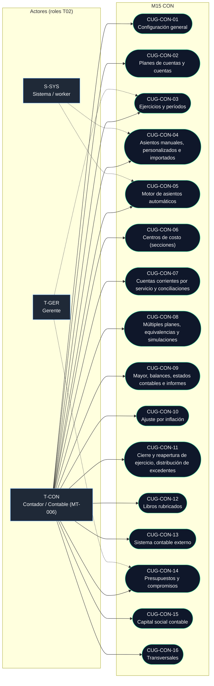

# Casos de uso de M15 CON — Contabilidad, centros de costo, múltiples planes de cuentas, escenarios simulados y presupuestos

Parte del entregable [21 Casos de uso por módulo](../21-casos-de-uso.md) (artefacto 3.3). Generado con `_trabajo/gen_21_casos_uso.py` desde `docs/especificacion/anexos/M15-CON-contabilidad.md` y revisado a mano. Ante cualquier diferencia prevalece el anexo.

| Dato | Valor |
|---|---|
| Casos de uso agrupadores (CUG) | 16 |
| RF del anexo | 162 (todos asignados a un CUG) |
| CU con ficha en la sección 16 | 21 |
| CU citados sin ficha en este anexo | 0 |

## 1. Diagramas

### 1.1 Actores y casos de uso agrupadores

Línea continua: actor principal. Línea punteada: actor secundario o participante.

### 1.2 Casos de uso de la especificación por agrupador

```mermaid
flowchart LR
    CUG_CON_01(["CUG-CON-01<br/>Configuración general"])
    X_CU_22_CUG_CON_01["CU-22<br/>Pago digital con comisión (BASE §22)"]
    X_CU_22_CUG_CON_01 -.->|escenario de| CUG_CON_01
    CUG_CON_03(["CUG-CON-03<br/>Ejercicios y períodos"])
    X_CU_CON_08_CUG_CON_03["CU-CON-08<br/>Reapertura de período"]
    X_CU_CON_08_CUG_CON_03 -.->|escenario de| CUG_CON_03
    CUG_CON_05(["CUG-CON-05<br/>Motor de asientos automáticos"])
    X_CU_104_CUG_CON_05["CU-104<br/>Asiento de sueldos (BASE §104, parte..."]
    X_CU_104_CUG_CON_05 -.->|escenario de| CUG_CON_05
    X_CU_CON_03_CUG_CON_05["CU-CON-03<br/>Resumen diario de cobranza"]
    X_CU_CON_03_CUG_CON_05 -.->|escenario de| CUG_CON_05
    CUG_CON_06(["CUG-CON-06<br/>Centros de costo (secciones)"])
    X_CU_CON_01_CUG_CON_06["CU-CON-01<br/>Resultado por servicio con costos comunes..."]
    X_CU_CON_01_CUG_CON_06 -.->|escenario de| CUG_CON_06
    CUG_CON_07(["CUG-CON-07<br/>Cuentas corrientes por servicio y conciliaciones"])
    X_CU_CON_02_CUG_CON_07["CU-CON-02<br/>Pago en exceso (ESC-01)"]
    X_CU_CON_02_CUG_CON_07 -.->|escenario de| CUG_CON_07
    X_CU_CON_04_CUG_CON_07["CU-CON-04<br/>Servicio nuevo sin cuenta"]
    X_CU_CON_04_CUG_CON_07 -.->|escenario de| CUG_CON_07
    X_CU_CON_16_CUG_CON_07["CU-CON-16<br/>Diferencia en conciliación de bancos"]
    X_CU_CON_16_CUG_CON_07 -.->|escenario de| CUG_CON_07
    CUG_CON_08(["CUG-CON-08<br/>Múltiples planes, equivalencias y simulaciones"])
    X_CU_ERP_01_CUG_CON_08["CU-ERP-01<br/>Planes alternativos y simulación de tarifa..."]
    X_CU_ERP_01_CUG_CON_08 -.->|escenario de| CUG_CON_08
    X_CU_CON_06_CUG_CON_08["CU-CON-06<br/>Convenio de pago con intereses"]
    X_CU_CON_06_CUG_CON_08 -.->|escenario de| CUG_CON_08
    CUG_CON_10(["CUG-CON-10<br/>Ajuste por inflación"])
    X_CU_CON_09_CUG_CON_10["CU-CON-09<br/>Ajuste por inflación"]
    X_CU_CON_09_CUG_CON_10 -.->|escenario de| CUG_CON_10
    X_CU_CON_14_CUG_CON_10["CU-CON-14<br/>Amortización y reversión"]
    X_CU_CON_14_CUG_CON_10 -.->|escenario de| CUG_CON_10
    CUG_CON_11(["CUG-CON-11<br/>Cierre y reapertura de ejercicio, distribución de..."])
    X_CU_CON_07_CUG_CON_11["CU-CON-07<br/>Cierre del ejercicio 2026"]
    X_CU_CON_07_CUG_CON_11 -.->|escenario de| CUG_CON_11
    X_CU_CON_15_CUG_CON_11["CU-CON-15<br/>Distribución de excedentes"]
    X_CU_CON_15_CUG_CON_11 -.->|escenario de| CUG_CON_11
    CUG_CON_12(["CUG-CON-12<br/>Libros rubricados"])
    X_CU_CON_13_CUG_CON_12["CU-CON-13<br/>Transcripción a libro rubricado"]
    X_CU_CON_13_CUG_CON_12 -.->|escenario de| CUG_CON_12
    CUG_CON_13(["CUG-CON-13<br/>Sistema contable externo"])
    X_CU_FIS_01_CUG_CON_13["CU-FIS-01<br/>Pago a proveedor con retención (BASE §61..."]
    X_CU_FIS_01_CUG_CON_13 -.->|escenario de| CUG_CON_13
    X_CU_CON_12_CUG_CON_13["CU-CON-12<br/>Importación del estudio contable"]
    X_CU_CON_12_CUG_CON_13 -.->|escenario de| CUG_CON_13
    CUG_CON_14(["CUG-CON-14<br/>Presupuestos y compromisos"])
    X_CU_OPE_01_CUG_CON_14["CU-OPE-01<br/>Compra de módems con compromiso (BASE §78..."]
    X_CU_OPE_01_CUG_CON_14 -.->|escenario de| CUG_CON_14
    X_CU_CON_05_CUG_CON_14["CU-CON-05<br/>Compra con IVA computable por sección"]
    X_CU_CON_05_CUG_CON_14 -.->|escenario de| CUG_CON_14
    X_CU_CON_11_CUG_CON_14["CU-CON-11<br/>Exceso presupuestario"]
    X_CU_CON_11_CUG_CON_14 -.->|escenario de| CUG_CON_14
    CUG_CON_15(["CUG-CON-15<br/>Capital social contable"])
    X_CU_CON_10_CUG_CON_15["CU-CON-10<br/>Capital social"]
    X_CU_CON_10_CUG_CON_15 -.->|escenario de| CUG_CON_15
```

Rectángulo: CU con ficha en la sección 16 del anexo. Paralelogramo: CU citado (ficha en otro anexo o sin ficha).

## 2. Fichas de los casos de uso agrupadores

### CUG-CON-01 — Configuración general

| Campo | Contenido |
|---|---|
| Actor principal | T-CON Contador / Contable (MT-006) |
| Actores secundarios | — |
| Objetivo | Configuración general: Configuración contable por tenant: plan operativo vigente, moneda funcional ARS, zona horaria, formato de numeración de asientos, decimales de porcentajes de centros... |
| Precondición | Usuario del tenant autenticado con el rol indicado y capabilities `con.planCuentas.editar`, `con.centrosCosto.editar`, `con.cuentas.crear`; módulo CON licenciado y activo (T01, T02 §4.3). |
| Flujo principal | Según CU-22: 1. Ana Pérez (ASO-001) paga ARS 8.000 por pasarela; COB publica cob.payment.confirmed (M-22). Asiento: Debe collectionsPendingBankCredit 8.000 / Haber billingReceivable (servicio de la factura) 8.000. 2. TES registra la acreditación neta (M-23): Debe Banco 7.840, gatewayCommissions 160 / Haber collectionsPendingBankCredit 8.000. ASI-DEMO-001 en la precarga muestra la forma condensada (Debe Banco 7.840 + Comisiones... |
| Alternativos | La publicación de configuración de un servicio, concepto, impuesto, medio de pago, banco, caja o grupo... (RF-CON-006). Sin la capability o fuera del alcance de datos: la acción se deniega por defecto y se audita (T02). |
| CU asociados | CU-22 |
| RF (6) | RF-CON-001 a 006 |
| Prioridad y olas | Núcleo 4, Estándar 2, Extensión 0; olas O5 |
| Origen | M15 §5.1 |

### CUG-CON-02 — Planes de cuentas y cuentas

| Campo | Contenido |
|---|---|
| Actor principal | T-CON Contador / Contable (MT-006) |
| Actores secundarios | — |
| Objetivo | Planes de cuentas y cuentas: Crear, copiar, versionar y administrar varios planes de cuentas por tenant, identificados y versionados. |
| Precondición | Usuario del tenant autenticado con el rol indicado y capabilities `con.planCuentas.editar`, `con.cuentas.crear`, `con.cuentas.editar`; módulo CON licenciado y activo (T01, T02 §4.3). |
| Flujo principal | 1. Crear, copiar, versionar y administrar varios planes de cuentas por tenant, identificados y versionados (RF-CON-007). 2. Estados del plan: borrador, aprobado, operativo, alternativo, archivado (RF-CON-009). 3. Árbol jerárquico de cuentas con código, nombre, nivel, cuenta padre y máscara de código configurable por plan (ej (RF-CON-010). 4. Cuenta imputable o agrupadora (RF-CON-011). 5. Naturaleza explícita de cada cuenta (activo, pasivo, patrimonio neto, ingresos, egresos, orden deudora, orden... (RF-CON-012). 6. Rubro y subrubro contable por cuenta para la exposición en estados contables (RF-CON-013). |
| Alternativos | Reasignación masiva de cuentas y rubros: cambiar en bloque el rubro de productos, servicios, impuestos y... (RF-CON-024). Sin la capability o fuera del alcance de datos: la acción se deniega por defecto y se audita (T02). |
| CU asociados | — (sin CU en la especificación; el flujo sale de los RF) |
| RF (20) | RF-CON-007 a 026 |
| Prioridad y olas | Núcleo 10, Estándar 9, Extensión 1; olas O5, O8, O10 |
| Origen | M15 §5.2 |

### CUG-CON-03 — Ejercicios y períodos

| Campo | Contenido |
|---|---|
| Actor principal | T-CON Contador / Contable (MT-006) |
| Actores secundarios | T-GER Gerente |
| Objetivo | Ejercicios y períodos: ABM de ejercicios: número, fecha desde, fecha hasta, estado. |
| Precondición | Usuario del tenant autenticado con el rol indicado y capabilities `con.periodos.cerrar`, `con.periodos.reabrir`, `con.ejercicios.cerrar`; módulo CON licenciado y activo (T01, T02 §4.3). |
| Flujo principal | Según CU-CON-08: El 10-11-2026 aparece una factura de compra de octubre. El contador solicita reabrir octubre para compras con motivo y plazo 2 días; el gerente aprueba (T11); se registra; el período vuelve a closed al vencer el plazo o a mano. Todo queda en el historial. |
| Alternativos | Bloqueo por módulo dentro de cada período: comprobantes de venta, facturación, cobranza, compras, bancos... (RF-CON-029). Servicio de guarda de período (periodGuard) consultado por todos los módulos antes de registrar o modificar... (RF-CON-030). Sin la capability o fuera del alcance de datos: la acción se deniega por defecto y se audita (T02). |
| CU asociados | CU-CON-08 |
| RF (8) | RF-CON-027 a 034 |
| Prioridad y olas | Núcleo 7, Estándar 1, Extensión 0; olas O5, O8 |
| Origen | M15 §5.3 |

### CUG-CON-04 — Asientos manuales, personalizados e importados

| Campo | Contenido |
|---|---|
| Actor principal | T-CON Contador / Contable (MT-006) |
| Actores secundarios | S-SYS Sistema / worker |
| Objetivo | Asientos manuales, personalizados e importados: Alta de asiento manual: fecha, descripción, renglones (cuenta, debe, haber, observación), distribución por centro de costo por porcentaje o importe, adjuntos de respaldo... |
| Precondición | Usuario del tenant autenticado con el rol indicado y capabilities `con.asientosManuales.crear`, `con.asientosManuales.aprobar`, `con.asientos.ver`; módulo CON licenciado y activo (T01, T02 §4.3). |
| Flujo principal | 1. Alta de asiento manual: fecha, descripción, renglones (cuenta, debe, haber, observación), distribución por centro de... (RF-CON-035). 2. Validaciones del asiento: al menos dos renglones, debe = haber exacto, cuentas imputables y vigentes, período y módulo... (RF-CON-036). 3. Estados del asiento: borrador, pendiente de aprobación, contabilizado, anulado, revertido (RF-CON-037). 4. Aprobación de asientos manuales y de ajuste según tipo e importe, con registro de quién grabó, revisó y autorizó (RF-CON-038). 5. Numeración interna global e inmutable y número visible correlativo por ejercicio (RF-CON-039). 6. Tipos de asiento: manual, automático, ajuste, apertura, refundición de resultados, patrimonial de cierre, ajuste por... (RF-CON-040). |
| Alternativos | Estados del asiento: borrador, pendiente de aprobación, contabilizado, anulado, revertido (RF-CON-037). Copiar asiento, revertir asiento (contraasiento con fecha elegida) y reversión automática el primer día del... (RF-CON-042). Importación de asientos desde Excel/CSV, con y sin centros de costo y en modalidad "asiento único", con... (RF-CON-045). Sin la capability o fuera del alcance de datos: la acción se deniega por defecto y se audita (T02). |
| CU asociados | — (sin CU en la especificación; el flujo sale de los RF) |
| RF (16) | RF-CON-035 a 050 |
| Prioridad y olas | Núcleo 10, Estándar 6, Extensión 0; olas O5, O8 |
| Origen | M15 §5.4 |

### CUG-CON-05 — Motor de asientos automáticos

| Campo | Contenido |
|---|---|
| Actor principal | T-CON Contador / Contable (MT-006) |
| Actores secundarios | S-SYS Sistema / worker |
| Objetivo | Motor de asientos automáticos: Recepción de los eventos económicos de todos los módulos vía outbox en una bandeja (accountingEvents), idempotente por identificador del evento de origen. |
| Precondición | Usuario del tenant autenticado con el rol indicado y capabilities `con.asientos.ver`, `con.asientosManuales.crear`, `con.asientosManuales.aprobar`; módulo CON licenciado y activo (T01, T02 §4.3). |
| Flujo principal | Según CU-104: 1. SUE aprueba la liquidación de octubre 2026 (sue.payrollRun.approved, M-96) con imputación por centro: Distribución 60 %, Administración 30 %, Internet 10 %. 2. Ejemplo: remuneraciones 1.000.000, contribuciones patronales 240.000, aportes y retenciones 170.000, sindicato 20.000. Asiento: Debe Sueldos 1.000.000 y Cargas sociales 240.000 (distribuidos 60/30/10) / Haber payrollPayable 810.000, socialSecurityPayable... |
| Alternativos | Resolución en cascada: cuenta asignada en la entidad (proveedor, banco, alícuota, rubro, tipo de factura... (RF-CON-054). Reversión automática al anular el documento o evento de origen: contraasiento vinculado en el período del... (RF-CON-058). Evento sin cuenta resuelta: queda "pendiente de configuración", genera alerta y bloquea el cierre del... (RF-CON-059). Sin la capability o fuera del alcance de datos: la acción se deniega por defecto y se audita (T02). |
| CU asociados | CU-104; CU-CON-03 |
| RF (30) | RF-CON-051 a 080 |
| Prioridad y olas | Núcleo 15, Estándar 13, Extensión 2; olas O3, O5, O6, O8, O9, O10 |
| Origen | M15 §5.5 |

### CUG-CON-06 — Centros de costo (secciones)

| Campo | Contenido |
|---|---|
| Actor principal | T-CON Contador / Contable (MT-006) |
| Actores secundarios | — |
| Objetivo | Centros de costo (secciones): ABM de centros de costo propios del tenant: código, nombre, jerarquía opcional, porcentaje de IVA compras computable, vigencia y relación opcional con servicio, área... |
| Precondición | Usuario del tenant autenticado con el rol indicado y capabilities `con.centrosCosto.editar`, `con.centros.configurar`, `con.centros.ver`; módulo CON licenciado y activo (T01, T02 §4.3). |
| Flujo principal | Según CU-CON-01: 1. Facturas de ASO-001: Agua 13.000 y Internet 25.000 (M-01). Cobro de 5.000 imputado a Agua (M-20). Saldo del auxiliar 33.000 = cuenta de control 33.000 (conciliación balanced). 2. Costos directos: Agua 6.000 (CC-AG), Internet 12.000 (CC-INT); comunes 4.000 en CC-ADM. 3. Corrida con DIST-DEMO-25-75: Agua recibe 1.000, Internet 3.000. Resultado: Agua 13.000 − 6.000 − 1.000 = 6.000; Internet 25.000 − 12.000 − 3.000 =... |
| Alternativos | Sin la capability o fuera del alcance de datos: la acción se deniega por defecto y se audita (T02). |
| CU asociados | CU-CON-01 |
| RF (11) | RF-CON-081 a 091 |
| Prioridad y olas | Núcleo 5, Estándar 5, Extensión 1; olas O5, O8 |
| Origen | M15 §5.6 |

### CUG-CON-07 — Cuentas corrientes por servicio y conciliaciones

| Campo | Contenido |
|---|---|
| Actor principal | T-CON Contador / Contable (MT-006) |
| Actores secundarios | — |
| Objetivo | Cuentas corrientes por servicio y conciliaciones: Cuentas de control de créditos por servicios con dimensión servicio obligatoria (subcuenta o dimensión) para explicar el saldo por servicio. |
| Precondición | Usuario del tenant autenticado con el rol indicado y capabilities `con.planCuentas.editar`, `con.conciliaciones.ejecutar`, `con.conciliaciones.ver`; módulo CON licenciado y activo (T01, T02 §4.3). |
| Flujo principal | Según CU-CON-02: ASO-001 paga 10.000 con una deuda de 8.000: Debe Caja 10.000 / Haber billingReceivable 8.000, customerAdvances 2.000 (M-20, M-25). El informe de anticipos al 31-10-2026 lista 2.000 y coincide con la cuenta. La factura siguiente consume el saldo (M-26). |
| Alternativos | Sin la capability o fuera del alcance de datos: la acción se deniega por defecto y se audita (T02). |
| CU asociados | CU-CON-02; CU-CON-04; CU-CON-16 |
| RF (11) | RF-CON-092 a 102 |
| Prioridad y olas | Núcleo 5, Estándar 6, Extensión 0; olas O5, O8, O9 |
| Origen | M15 §5.7 |

### CUG-CON-08 — Múltiples planes, equivalencias y simulaciones

| Campo | Contenido |
|---|---|
| Actor principal | T-CON Contador / Contable (MT-006) |
| Actores secundarios | — |
| Objetivo | Múltiples planes, equivalencias y simulaciones: Aislamiento total: una simulación no emite facturas, no genera deuda, no mueve fondos, no envía órdenes a terceros ni contabiliza oficialmente. |
| Precondición | Usuario del tenant autenticado con el rol indicado y capabilities `con.simulaciones.crear`, `con.simulaciones.ejecutar`, `con.simulaciones.exportar`; módulo CON licenciado y activo (T01, T02 §4.3). |
| Flujo principal | Según CU-ERP-01: 1. En PC-OPER-01 los ingresos del mes suman 38.000 en "Ingresos por servicios". 2. En PC-ALT-01 la equivalencia separa por servicio: Agua 13.000, Internet 25.000 (proyección JOB-CON-10). 3. SIM-ERP-001 aplica tarifa +10 %: Agua 14.300, Internet 27.500, total 41.800, con marca de simulación; los libros oficiales siguen en 38.000. |
| Alternativos | Sin la capability o fuera del alcance de datos: la acción se deniega por defecto y se audita (T02). |
| CU asociados | CU-ERP-01; CU-CON-06 |
| RF (9) | RF-CON-103 a 111 |
| Prioridad y olas | Núcleo 1, Estándar 8, Extensión 0; olas O8 |
| Origen | M15 §5.8 |

### CUG-CON-09 — Mayor, balances, estados contables e informes

| Campo | Contenido |
|---|---|
| Actor principal | T-CON Contador / Contable (MT-006) |
| Actores secundarios | — |
| Objetivo | Mayor, balances, estados contables e informes: Libro diario en pantalla e impresión, con renumeración solo de impresión desde un número N y detalle por sección con porcentaje. |
| Precondición | Usuario del tenant autenticado con el rol indicado y capabilities `con.estados.aprobar`, `con.estados.emitir`, `con.estados.generar`; módulo CON licenciado y activo (T01, T02 §4.3). |
| Flujo principal | 1. Libro diario en pantalla e impresión, con renumeración solo de impresión desde un número N y detalle por sección con... (RF-CON-112). 2. Mayor de una cuenta o de varias: rango, saldo anterior, movimientos, saldo acumulado, centro, ver asiento y navegar al... (RF-CON-114). 3. Sumas y saldos / balance de comprobación por período, por meses o acumulado, por nivel, con detalle por sección y... (RF-CON-115). 4. Control previo a balances: cuentas no imputables con saldo (hasta todas, no solo 20), cuentas sin naturaleza o sin... (RF-CON-121). 5. Todo reporte declara fecha de corte, universo, estados incluidos y separación real/simulado (RF-CON-124). 6. Trazabilidad informe → asiento → documento → operación de origen y viceversa (RF-CON-125). |
| Alternativos | Sin la capability o fuera del alcance de datos: la acción se deniega por defecto y se audita (T02). |
| CU asociados | — (sin CU en la especificación; el flujo sale de los RF) |
| RF (15) | RF-CON-112 a 126 |
| Prioridad y olas | Núcleo 7, Estándar 8, Extensión 0; olas O5, O8, O10 |
| Origen | M15 §5.9 |

### CUG-CON-10 — Ajuste por inflación

| Campo | Contenido |
|---|---|
| Actor principal | T-CON Contador / Contable (MT-006) |
| Actores secundarios | — |
| Objetivo | Ajuste por inflación: Tablas de índices (por ejemplo IPC/FACPCE) con valores mensuales. |
| Precondición | Usuario del tenant autenticado con el rol indicado y capabilities `con.inflacion.editar`, `con.inflacion.ejecutar`, `con.inflacion.ver`; módulo CON licenciado y activo (T01, T02 §4.3). |
| Flujo principal | Según CU-CON-09: Un terreno de 100.000 incorporado con índice 100; índice al cierre 150. Coeficiente 1,5; ajuste 50.000: Debe Terreno 50.000 / Haber inflationAdjustment 50.000. Si falta el índice de un mes, la corrida aborta indicando el mes. |
| Alternativos | Sin la capability o fuera del alcance de datos: la acción se deniega por defecto y se audita (T02). |
| CU asociados | CU-CON-09; CU-CON-14 |
| RF (5) | RF-CON-127 a 131 |
| Prioridad y olas | Núcleo 0, Estándar 5, Extensión 0; olas O8 |
| Origen | M15 §5.10 |

### CUG-CON-11 — Cierre y reapertura de ejercicio, distribución de excedentes

| Campo | Contenido |
|---|---|
| Actor principal | T-CON Contador / Contable (MT-006) |
| Actores secundarios | — |
| Objetivo | Cierre y reapertura de ejercicio, distribución de excedentes: Cierre de ejercicio: validar que no existan asientos de cierre previos ni pendientes. |
| Precondición | Usuario del tenant autenticado con el rol indicado y capabilities `con.ejercicios.cerrar`, `con.ejercicios.crear`, `con.ejercicios.reabrir`; módulo CON licenciado y activo (T01, T02 §4.3). |
| Flujo principal | Según CU-CON-07: 1. Los doce períodos están cerrados; el ajuste por inflación está contabilizado. 2. JOB-CON-05 genera la refundición (cierra todas las cuentas de ingresos y egresos del ejercicio y lleva la diferencia a resultAllocation o a los destinos de resultTargets), el cierre patrimonial y la apertura 2027. 3. Vista previa: todas las cuentas de resultado en cero; el contador confirma; EVT-CON-09 informa el resultado a M17 para... |
| Alternativos | Sin la capability o fuera del alcance de datos: la acción se deniega por defecto y se audita (T02). |
| CU asociados | CU-CON-07; CU-CON-15 |
| RF (4) | RF-CON-132 a 135 |
| Prioridad y olas | Núcleo 0, Estándar 4, Extensión 0; olas O8, O10 |
| Origen | M15 §5.11 |

### CUG-CON-12 — Libros rubricados

| Campo | Contenido |
|---|---|
| Actor principal | T-CON Contador / Contable (MT-006) |
| Actores secundarios | — |
| Objetivo | Libros rubricados: Registro de libros rubricados (diario, inventario y balances): organismo, número de rúbrica, fecha, hojas desde-hasta, líneas por hoja, última hoja usada. |
| Precondición | Usuario del tenant autenticado con el rol indicado y capabilities `con.libros.transcribir`, `con.libros.ver`, `con.libros.*`; módulo CON licenciado y activo (T01, T02 §4.3). |
| Flujo principal | Según CU-CON-13: Libro Diario N.º 3, hojas 1 a 500, 50 líneas por hoja. Se transcriben los asientos 1 a 420 de 2026 en las hojas 1 a 37; los asientos transcriptos ya no admiten anulación (solo contraasiento) ni renumeración. |
| Alternativos | Transcripción del diario sobre hojas rubricadas con continuidad de folio (RF-CON-137). Sin la capability o fuera del alcance de datos: la acción se deniega por defecto y se audita (T02). |
| CU asociados | CU-CON-13 |
| RF (3) | RF-CON-136 a 138 |
| Prioridad y olas | Núcleo 0, Estándar 2, Extensión 1; olas O8 |
| Origen | M15 §5.12 |

### CUG-CON-13 — Sistema contable externo

| Campo | Contenido |
|---|---|
| Actor principal | T-CON Contador / Contable (MT-006) |
| Actores secundarios | — |
| Objetivo | Sistema contable externo: Mapeo de operaciones y cuentas propias a cuentas y rubros de un sistema contable externo (operación, cuenta, rubro, observación). |
| Precondición | Usuario del tenant autenticado con el rol indicado y capabilities `con.externo.configurar`, `con.externo.ejecutar`, `con.externo.ver`; módulo CON licenciado y activo (T01, T02 §4.3). |
| Flujo principal | Según CU-FIS-01: Definición dueña: M06 «CU-FIS-01 — Retención en un pago a proveedor». Aquí solo el tramo contable, con los importes de M06 y M12 (corrección 05-11-2026: antes factura de 121.000 y pago de 119.000). Factura de 100.000 de PROV-DEMO-001; la OP aplica la retención RET-DEMO-001 de 2.000 (M-48) y paga 98.000 (M-58): Debe accountsPayable 100.000 / Haber Banco 98.000, withholdingsPayable 2.000. El depósito de la retención... |
| Alternativos | Sin la capability o fuera del alcance de datos: la acción se deniega por defecto y se audita (T02). |
| CU asociados | CU-FIS-01; CU-CON-12 |
| RF (4) | RF-CON-139 a 142 |
| Prioridad y olas | Núcleo 0, Estándar 3, Extensión 1; olas O5, O8 |
| Origen | M15 §5.13 |

### CUG-CON-14 — Presupuestos y compromisos

| Campo | Contenido |
|---|---|
| Actor principal | T-CON Contador / Contable (MT-006) |
| Actores secundarios | T-GER Gerente |
| Objetivo | Presupuestos y compromisos: Presupuesto económico por ejercicio y versión, por cuenta, centro de costo, servicio y mes. |
| Precondición | Usuario del tenant autenticado con el rol indicado y capabilities `con.presupuestos.gestionar`, `con.compromisos.autorizarExceso`, `con.compromisos.liberar`; módulo CON licenciado y activo (T01, T02 §4.3). |
| Flujo principal | Según CU-OPE-01: 1. OC-DEMO-002 por 2 módems × 20.000 = 40.000 aprobada: compromiso 40.000 en el presupuesto de CC-INT (sin asiento, M-55). 2. Recepción (M-56): Debe Stock módems 40.000 / Haber goodsPendingDelivery 40.000. 3. Factura del proveedor neto 40.000 + IVA 8.400 (M-57): Debe goodsPendingDelivery 40.000, vatInput 8.400 / Haber accountsPayable 48.400. El compromiso pasa a devengado; la ejecución muestra comprometido 0... |
| Alternativos | Control presupuestario al aprobar la OC: disponible = presupuesto − comprometido − devengado sin compromiso (RF-CON-146). Sin la capability o fuera del alcance de datos: la acción se deniega por defecto y se audita (T02). |
| CU asociados | CU-OPE-01; CU-CON-05; CU-CON-11 |
| RF (7) | RF-CON-143 a 149 |
| Prioridad y olas | Núcleo 0, Estándar 5, Extensión 2; olas O8, O9 |
| Origen | M15 §5.14 |

### CUG-CON-15 — Capital social contable

| Campo | Contenido |
|---|---|
| Actor principal | T-CON Contador / Contable (MT-006) |
| Actores secundarios | — |
| Objetivo | Capital social contable: Contabilidad por entidad jurídica (DEC-064, DEC-087): ejercicios, períodos, numeración de asientos, libro diario, mayores, sumas y saldos, libros rubricados, estados... |
| Precondición | Usuario del tenant autenticado con el rol indicado y capabilities `con.planCuentas.editar`, `con.asientos.ver`, `con.asientosManuales.crear`; módulo CON licenciado y activo (T01, T02 §4.3). |
| Flujo principal | Según CU-CON-10: Suscripción de 10 cuotas de 1.000 al afiliarse (M-105): Debe capitalSubscribedReceivable 10.000 / Haber capitalMovements 10.000. Integración de 2.000 en la factura (M-02, M-106) y cobro: el capital integrado no aparece como ingreso. Rescate aprobado de 2.000 (M-108) y pago (M-109). |
| Alternativos | Sin la capability o fuera del alcance de datos: la acción se deniega por defecto y se audita (T02). |
| CU asociados | CU-CON-10 |
| RF (5) | RF-CON-150 a 152, 161 a 162 |
| Prioridad y olas | Núcleo 1, Estándar 4, Extensión 0; olas O5, O10 |
| Origen | M15 §5.15 |

### CUG-CON-16 — Transversales

| Campo | Contenido |
|---|---|
| Actor principal | T-CON Contador / Contable (MT-006) |
| Actores secundarios | — |
| Objetivo | Transversales: Aislamiento por tenant de planes, asientos, simulaciones, presupuestos y exportaciones. |
| Precondición | Usuario del tenant autenticado con el rol indicado y capabilities `con.planCuentas.editar`, `con.centrosCosto.editar`, `con.asientos.ver`; módulo CON licenciado y activo (T01, T02 §4.3). |
| Flujo principal | 1. Aislamiento por tenant de planes, asientos, simulaciones, presupuestos y exportaciones (RF-CON-153). 2. Todas las etiquetas por clave de diccionario y renombrables por tenant (ej (RF-CON-154). 3. Única fuente de saldos: los renglones contabilizados (RF-CON-155). 4. Rendimiento: contabilizar el lote de 100.000 facturas del ciclo en resumen dentro de la ventana operativa (RF-CON-156). 5. Tablero contable con estado de períodos, eventos pendientes, borradores, conciliaciones con diferencias, alertas de... (RF-CON-157). 6. Segregación de funciones: quien carga un ajuste por encima del umbral no lo aprueba (RF-CON-159). |
| Alternativos | Segregación de funciones: quien carga un ajuste por encima del umbral no lo aprueba (RF-CON-159). Sin la capability o fuera del alcance de datos: la acción se deniega por defecto y se audita (T02). |
| CU asociados | — (sin CU en la especificación; el flujo sale de los RF) |
| RF (8) | RF-CON-153 a 160 |
| Prioridad y olas | Núcleo 5, Estándar 2, Extensión 1; olas O5, O11 |
| Origen | M15 §5.16 |

## 3. Casos de uso de la especificación (CU)

| CU | Nombre | Actor según el anexo | Agrupador | Criterio de asignación |
|---|---|---|---|---|
| CU-22 | Pago digital con comisión (BASE §22) | — | CUG-CON-01 | similitud |
| CU-ERP-01 | Planes alternativos y simulación de tarifa (BASE §55) | — | CUG-CON-08 | similitud |
| CU-CON-01 | Resultado por servicio con costos comunes (BASE §75) | — | CUG-CON-06 | similitud |
| CU-OPE-01 | Compra de módems con compromiso (BASE §78, parte contable) | — | CUG-CON-14 | similitud |
| CU-104 | Asiento de sueldos (BASE §104, parte contable) | — | CUG-CON-05 | similitud |
| CU-FIS-01 | Pago a proveedor con retención (BASE §61, parte contable) | — | CUG-CON-13 | similitud |
| CU-CON-02 | Pago en exceso (ESC-01) | — | CUG-CON-07 | similitud |
| CU-CON-03 | Resumen diario de cobranza | — | CUG-CON-05 | similitud |
| CU-CON-04 | Servicio nuevo sin cuenta | — | CUG-CON-07 | similitud |
| CU-CON-05 | Compra con IVA computable por sección | — | CUG-CON-14 | similitud |
| CU-CON-06 | Convenio de pago con intereses | — | CUG-CON-08 | similitud |
| CU-CON-07 | Cierre del ejercicio 2026 | — | CUG-CON-11 | similitud |
| CU-CON-08 | Reapertura de período | — | CUG-CON-03 | similitud |
| CU-CON-09 | Ajuste por inflación | — | CUG-CON-10 | similitud |
| CU-CON-10 | Capital social | — | CUG-CON-15 | similitud |
| CU-CON-11 | Exceso presupuestario | — | CUG-CON-14 | similitud |
| CU-CON-12 | Importación del estudio contable | — | CUG-CON-13 | similitud |
| CU-CON-13 | Transcripción a libro rubricado | — | CUG-CON-12 | similitud |
| CU-CON-14 | Amortización y reversión | — | CUG-CON-10 | similitud |
| CU-CON-15 | Distribución de excedentes | — | CUG-CON-11 | similitud |
| CU-CON-16 | Diferencia en conciliación de bancos | — | CUG-CON-07 | similitud |

## 4. Cobertura del anexo

| Universo | En la especificación | Incluidos | Excluidos |
|---|---|---|---|
| RF | 162 | 162 | 0 |
| CU con ficha (sección 16) | 21 | 21 | 0 |
| CU citados sin ficha en este anexo | 0 | 0 | 0 |
