# Casos de uso de M16 SUE — Personal y sueldos

Parte del entregable [21 Casos de uso por módulo](../21-casos-de-uso.md) (artefacto 3.3). Generado con `_trabajo/gen_21_casos_uso.py` desde `docs/especificacion/anexos/M16-SUE-personal-sueldos.md` y revisado a mano. Ante cualquier diferencia prevalece el anexo.

| Dato | Valor |
|---|---|
| Casos de uso agrupadores (CUG) | 17 |
| RF del anexo | 146 (todos asignados a un CUG) |
| CU con ficha en la sección 16 | 16 |
| CU citados sin ficha en este anexo | 0 |

## 1. Diagramas

### 1.1 Actores y casos de uso agrupadores

```mermaid
flowchart LR
    subgraph ACT["Actores (roles T02)"]
        direction TB
        A_T_RRHH["T-RRHH<br/>RRHH / Liquidador"]
        A_T_ADM["T-ADM<br/>Administrador de la cooperativa"]
        A_S_BOT["S-BOT<br/>Bot / asistente IA"]
        A_C_EMP["C-EMP<br/>Empleado en portal"]
        A_T_GER["T-GER<br/>Gerente"]
        A_T_CON["T-CON<br/>Contador / Contable (MT-006)"]
        A_S_SYS["S-SYS<br/>Sistema / worker"]
    end
    subgraph SIS["M16 SUE"]
        direction TB
        CUG_SUE_01(["CUG-SUE-01<br/>Legajo del empleado (SUE-001)"])
        CUG_SUE_02(["CUG-SUE-02<br/>Empresas empleadoras (multiempleador)"])
        CUG_SUE_03(["CUG-SUE-03<br/>Estructura laboral (SUE-002)"])
        CUG_SUE_04(["CUG-SUE-04<br/>Variables, conceptos y fórmulas (SUE-004)"])
        CUG_SUE_05(["CUG-SUE-05<br/>Novedades del período (SUE-003)"])
        CUG_SUE_06(["CUG-SUE-06<br/>Licencias y vacaciones"])
        CUG_SUE_07(["CUG-SUE-07<br/>Liquidaciones (SUE-005)"])
        CUG_SUE_08(["CUG-SUE-08<br/>Ganancias de 4.ª categoría (SUE-006)"])
        CUG_SUE_09(["CUG-SUE-09<br/>Seguridad social y presentaciones (SUE-007)"])
        CUG_SUE_10(["CUG-SUE-10<br/>Recibos y portal del empleado (SUE-008)"])
        CUG_SUE_11(["CUG-SUE-11<br/>Pago de haberes (SUE-009)"])
        CUG_SUE_12(["CUG-SUE-12<br/>Contabilización (SUE-010)"])
        CUG_SUE_13(["CUG-SUE-13<br/>Certificaciones y egreso (SUE-011)"])
        CUG_SUE_14(["CUG-SUE-14<br/>Gestión de RRHH — referencia GLM (SUE-012)"])
        CUG_SUE_15(["CUG-SUE-15<br/>Aprobaciones, auditoría y reportes (SUE-013, SUE-014)"])
        CUG_SUE_16(["CUG-SUE-16<br/>Importación de liquidación externa (CU-28)"])
        CUG_SUE_17(["CUG-SUE-17<br/>Migración y paralelo"])
    end
    A_T_RRHH --> CUG_SUE_01
    A_T_RRHH --> CUG_SUE_02
    A_T_RRHH --> CUG_SUE_03
    A_T_ADM -.-> CUG_SUE_03
    A_T_RRHH --> CUG_SUE_04
    A_S_BOT -.-> CUG_SUE_04
    A_T_RRHH --> CUG_SUE_05
    A_T_RRHH --> CUG_SUE_06
    A_C_EMP -.-> CUG_SUE_06
    A_T_GER -.-> CUG_SUE_06
    A_T_RRHH --> CUG_SUE_07
    A_T_RRHH --> CUG_SUE_08
    A_T_RRHH --> CUG_SUE_09
    A_T_CON -.-> CUG_SUE_09
    A_T_GER -.-> CUG_SUE_09
    A_C_EMP --> CUG_SUE_10
    A_T_RRHH -.-> CUG_SUE_10
    A_S_SYS -.-> CUG_SUE_10
    A_T_RRHH --> CUG_SUE_11
    A_T_RRHH --> CUG_SUE_12
    A_T_ADM -.-> CUG_SUE_12
    A_T_RRHH --> CUG_SUE_13
    A_T_RRHH --> CUG_SUE_14
    A_T_RRHH --> CUG_SUE_15
    A_T_CON -.-> CUG_SUE_15
    A_T_GER -.-> CUG_SUE_15
    A_T_RRHH --> CUG_SUE_16
    A_T_RRHH --> CUG_SUE_17
    classDef actor fill:#1f2937,stroke:#60a5fa,color:#f9fafb;
    classDef cug fill:#0f172a,stroke:#34d399,color:#f9fafb;
    class A_T_RRHH,A_T_ADM,A_S_BOT,A_C_EMP,A_T_GER,A_T_CON,A_S_SYS actor;
    class CUG_SUE_01,CUG_SUE_02,CUG_SUE_03,CUG_SUE_04,CUG_SUE_05,CUG_SUE_06,CUG_SUE_07,CUG_SUE_08,CUG_SUE_09,CUG_SUE_10,CUG_SUE_11,CUG_SUE_12,CUG_SUE_13,CUG_SUE_14,CUG_SUE_15,CUG_SUE_16,CUG_SUE_17 cug;
```

Línea continua: actor principal. Línea punteada: actor secundario o participante.

### 1.2 Casos de uso de la especificación por agrupador

```mermaid
flowchart LR
    CUG_SUE_01(["CUG-SUE-01<br/>Legajo del empleado (SUE-001)"])
    X_CU_SUE_01_CUG_SUE_01["CU-SUE-01<br/>Alta de un empleado que ya es socio"]
    X_CU_SUE_01_CUG_SUE_01 -.->|escenario de| CUG_SUE_01
    CUG_SUE_03(["CUG-SUE-03<br/>Estructura laboral (SUE-002)"])
    X_CU_SUE_12_CUG_SUE_03["CU-SUE-12<br/>Juicio laboral y provisión"]
    X_CU_SUE_12_CUG_SUE_03 -.->|escenario de| CUG_SUE_03
    CUG_SUE_04(["CUG-SUE-04<br/>Variables, conceptos y fórmulas (SUE-004)"])
    X_CU_SUE_02_CUG_SUE_04["CU-SUE-02<br/>Publicar la paritaria con retroactivo"]
    X_CU_SUE_02_CUG_SUE_04 -.->|escenario de| CUG_SUE_04
    CUG_SUE_06(["CUG-SUE-06<br/>Licencias y vacaciones"])
    X_CU_SUE_03_CUG_SUE_06["CU-SUE-03<br/>Solicitar y aprobar vacaciones desde la PWA"]
    X_CU_SUE_03_CUG_SUE_06 -.->|escenario de| CUG_SUE_06
    CUG_SUE_07(["CUG-SUE-07<br/>Liquidaciones (SUE-005)"])
    X_CU_104_CUG_SUE_07["CU-104<br/>Liquidación mensual de una cooperativa..."]
    X_CU_104_CUG_SUE_07 -.->|escenario de| CUG_SUE_07
    X_CU_SUE_04_CUG_SUE_07["CU-SUE-04<br/>Liquidar SAC del primer semestre"]
    X_CU_SUE_04_CUG_SUE_07 -.->|escenario de| CUG_SUE_07
    X_CU_SUE_05_CUG_SUE_07["CU-SUE-05<br/>Despido sin causa y liquidación final"]
    X_CU_SUE_05_CUG_SUE_07 -.->|escenario de| CUG_SUE_07
    CUG_SUE_08(["CUG-SUE-08<br/>Ganancias de 4.ª categoría (SUE-006)"])
    X_CU_SUE_06_CUG_SUE_08["CU-SUE-06<br/>Importar F.572 y recalcular Ganancias"]
    X_CU_SUE_06_CUG_SUE_08 -.->|escenario de| CUG_SUE_08
    CUG_SUE_09(["CUG-SUE-09<br/>Seguridad social y presentaciones (SUE-007)"])
    X_CU_SUE_07_CUG_SUE_09["CU-SUE-07<br/>Generar y presentar LSD y SICOSS"]
    X_CU_SUE_07_CUG_SUE_09 -.->|escenario de| CUG_SUE_09
    CUG_SUE_10(["CUG-SUE-10<br/>Recibos y portal del empleado (SUE-008)"])
    X_CU_SUE_08_CUG_SUE_10["CU-SUE-08<br/>Firma y recepción del recibo"]
    X_CU_SUE_08_CUG_SUE_10 -.->|escenario de| CUG_SUE_10
    CUG_SUE_11(["CUG-SUE-11<br/>Pago de haberes (SUE-009)"])
    X_CU_SUE_09_CUG_SUE_11["CU-SUE-09<br/>Pago con un CBU rechazado"]
    X_CU_SUE_09_CUG_SUE_11 -.->|escenario de| CUG_SUE_11
    CUG_SUE_12(["CUG-SUE-12<br/>Contabilización (SUE-010)"])
    X_CU_SUE_14_CUG_SUE_12["CU-SUE-14<br/>Pluriempleo en dos empresas del tenant (A..."]
    X_CU_SUE_14_CUG_SUE_12 -.->|escenario de| CUG_SUE_12
    CUG_SUE_14(["CUG-SUE-14<br/>Gestión de RRHH — referencia GLM (SUE-012)"])
    X_CU_SUE_10_CUG_SUE_14["CU-SUE-10<br/>Accidente in itinere"]
    X_CU_SUE_10_CUG_SUE_14 -.->|escenario de| CUG_SUE_14
    X_CU_SUE_11_CUG_SUE_14["CU-SUE-11<br/>Sanción con suspensión"]
    X_CU_SUE_11_CUG_SUE_14 -.->|escenario de| CUG_SUE_14
    X_CU_SUE_13_CUG_SUE_14["CU-SUE-13<br/>Ciclo de evaluación de desempeño"]
    X_CU_SUE_13_CUG_SUE_14 -.->|escenario de| CUG_SUE_14
    CUG_SUE_16(["CUG-SUE-16<br/>Importación de liquidación externa (CU-28)"])
    X_CU_28_CUG_SUE_16["CU-28<br/>Importar una liquidación externa (BASE §28..."]
    X_CU_28_CUG_SUE_16 -.->|escenario de| CUG_SUE_16
```

Rectángulo: CU con ficha en la sección 16 del anexo. Paralelogramo: CU citado (ficha en otro anexo o sin ficha).

## 2. Fichas de los casos de uso agrupadores

### CUG-SUE-01 — Legajo del empleado (SUE-001)

| Campo | Contenido |
|---|---|
| Actor principal | T-RRHH RRHH / Liquidador |
| Actores secundarios | — |
| Objetivo | Legajo del empleado (SUE-001): Registro mínimo de relación laboral: persona (M01), empresa empleadora, número de legajo, área, centro de costo, cargo, estado activo/baja, encargado. |
| Precondición | Usuario del tenant autenticado con el rol indicado y capabilities `sue.legajos.ver`, `sue.legajos.editar`, `sue.legajos.crear`; módulo SUE licenciado y activo (T01, T02 §4.3). |
| Flujo principal | Según CU-SUE-01: Actor RRHH. 1) Busca por CUIL; la persona existe como socio en M01. 2) Crea el legajo en la empresa «Cooperativa» con convenio, categoría, área «Distribución» y distribución 100 % al centro de costo Distribución. 3) Registra la constancia de alta. 4) Activa; T02 agrega el perfil empleado a la misma cuenta. |
| Alternativos | Según CU-SUE-01: CUIL inválido → error de validación. Sin la capability o fuera del alcance de datos: denegación por defecto y auditoría (T02). |
| CU asociados | CU-SUE-01 |
| RF (21) | RF-SUE-001 a 021 |
| Prioridad y olas | Núcleo 12, Estándar 8, Extensión 1; olas O3, O9 |
| Origen | M16 §5.1 |

### CUG-SUE-02 — Empresas empleadoras (multiempleador)

| Campo | Contenido |
|---|---|
| Actor principal | T-RRHH RRHH / Liquidador |
| Actores secundarios | — |
| Objetivo | Empresas empleadoras (multiempleador): Varias empresas empleadoras por tenant con CUIT, razón social, domicilio fiscal y de explotación, tipo de empleador, actividad principal, condición fiscal, ART... |
| Precondición | Usuario del tenant autenticado con el rol indicado y capabilities `sue.cuentasPago.editar`, `sue.miRecibo.ver`, `sue.miRecibo.firmar`; módulo SUE licenciado y activo (T01, T02 §4.3). |
| Flujo principal | 1. Varias empresas empleadoras por tenant con CUIT, razón social, domicilio fiscal y de explotación, tipo de empleador... (RF-SUE-022). 2. Todo legajo pertenece a una empresa (entidad jurídica, legalEntityId) (RF-SUE-023). 3. Pluriempleo dentro del tenant: una persona con relaciones laborales simultáneas en dos empresas del tenant, con... (RF-SUE-024). 4. Importación de datos de la empresa desde archivo (ARCA o modelo propio) (RF-SUE-025). |
| Alternativos | Sin la capability o fuera del alcance de datos: la acción se deniega por defecto y se audita (T02). |
| CU asociados | — (sin CU en la especificación; el flujo sale de los RF) |
| RF (4) | RF-SUE-022 a 025 |
| Prioridad y olas | Núcleo 2, Estándar 0, Extensión 2; olas O9 |
| Origen | M16 §5.2 |

### CUG-SUE-03 — Estructura laboral (SUE-002)

| Campo | Contenido |
|---|---|
| Actor principal | T-RRHH RRHH / Liquidador |
| Actores secundarios | T-ADM Administrador de la cooperativa |
| Objetivo | Estructura laboral (SUE-002): Sindicatos: nombre, CUIT, porcentaje e importe de retención al trabajador, porcentaje e importe de aporte del empleador, meses para cambio de categoría, cuentas... |
| Precondición | Usuario del tenant autenticado con el rol indicado y capabilities `sue.costoLaboral.ver`, `sue.estructura.configurar`, `sue.conceptos.configurar`; módulo SUE licenciado y activo (T01, T02 §4.3). |
| Flujo principal | Según CU-SUE-12: Actor asesor legal. 1) Registra el juicio y lo vincula al expediente de M08. 2) Fija provisión; M15 la registra. 3) Acuerdo homologado: liquidación complementaria o pago institucional según el caso. |
| Alternativos | Sin la capability o fuera del alcance de datos: la acción se deniega por defecto y se audita (T02). |
| CU asociados | CU-SUE-12 |
| RF (11) | RF-SUE-026 a 036 |
| Prioridad y olas | Núcleo 11, Estándar 0, Extensión 0; olas O9 |
| Origen | M16 §5.3 |

### CUG-SUE-04 — Variables, conceptos y fórmulas (SUE-004)

| Campo | Contenido |
|---|---|
| Actor principal | T-RRHH RRHH / Liquidador |
| Actores secundarios | S-BOT Bot / asistente IA |
| Objetivo | Variables, conceptos y fórmulas (SUE-004): Variables con nombre único, descripción, tipo de resultado y fórmula. |
| Precondición | Usuario del tenant autenticado con el rol indicado y capabilities `sue.conceptos.configurar`, `sue.conceptos.simular`, `sue.variables.configurar`; módulo SUE licenciado y activo (T01, T02 §4.3). |
| Flujo principal | Según CU-SUE-02: Actor responsable laboral y contador. 1) Aplica aumento de 8 % a las categorías del convenio con fecha efectiva 01-03 (PAN-SUE-16). 2) Simula marzo con la nueva escala. 3) El contador publica. 4) El sistema sugiere complementaria de marzo, que se liquida en abril con devengamiento marzo. |
| Alternativos | Según CU-SUE-02: convenio sin validación registrada → no publica. Sin la capability o fuera del alcance de datos: denegación por defecto y auditoría (T02). |
| CU asociados | CU-SUE-02 |
| RF (9) | RF-SUE-037 a 045 |
| Prioridad y olas | Núcleo 6, Estándar 3, Extensión 0; olas O9 |
| Origen | M16 §5.4 |

### CUG-SUE-05 — Novedades del período (SUE-003)

| Campo | Contenido |
|---|---|
| Actor principal | T-RRHH RRHH / Liquidador |
| Actores secundarios | — |
| Objetivo | Novedades del período (SUE-003): Tipos de novedad: por cantidad o importe, código SIRADIG, marca de anticipo, tope anual, porcentaje sobre ganancia neta, pago a cuenta, afecta impuesto cedular... |
| Precondición | Usuario del tenant autenticado con el rol indicado y capabilities `sue.tiposNovedad.configurar`, `sue.novedades.cargar`, `sue.novedades.aprobar`; módulo SUE licenciado y activo (T01, T02 §4.3). |
| Flujo principal | 1. Tipos de novedad: por cantidad o importe, código SIRADIG, marca de anticipo, tope anual, porcentaje sobre ganancia... (RF-SUE-046). 2. Carga de novedades del período en grilla masiva por empleado y tipo, con fecha, cantidad o importe, observación, cuotas... (RF-SUE-047). 3. Novedades propuestas desde partes de cuadrilla y órdenes de trabajo cerradas: horas normales, extra al 50 % y al 100 %... (RF-SUE-049). 4. Adelantos de sueldo: registro (desde SUE o como pago de M14), tope (art (RF-SUE-054). 5. Aprobación de novedades: el encargado aprueba las de su equipo y el liquidador las consolida (RF-SUE-055). 6. Remuneraciones y retenciones de otros empleos (incluidas las de cajas previsionales provinciales) como novedades... (RF-SUE-057). |
| Alternativos | Sin la capability o fuera del alcance de datos: la acción se deniega por defecto y se audita (T02). |
| CU asociados | — (sin CU en la especificación; el flujo sale de los RF) |
| RF (12) | RF-SUE-046 a 057 |
| Prioridad y olas | Núcleo 6, Estándar 6, Extensión 0; olas O9 |
| Origen | M16 §5.5 |

### CUG-SUE-06 — Licencias y vacaciones

| Campo | Contenido |
|---|---|
| Actor principal | T-RRHH RRHH / Liquidador |
| Actores secundarios | C-EMP Empleado en portal; T-GER Gerente |
| Objetivo | Licencias y vacaciones: Causas de licencia: descripción, base legal (LCT o convenio), con o sin goce, días por período (0 = sin límite), corridos o hábiles, es vacaciones, tipo de novedad que... |
| Precondición | Usuario del tenant autenticado con el rol indicado y capabilities `sue.causasLicencia.configurar`, `sue.licencias.autorizar`, `sue.licencias.solicitar`; módulo SUE licenciado y activo (T01, T02 §4.3). |
| Flujo principal | Según CU-SUE-03: Actor empleado y encargado. 1) El empleado ve 21 días disponibles y solicita 14 días desde el 05-01. 2) El encargado ve el calendario del equipo y aprueba. 3) Se generan novedades, el saldo baja a 7 y se propone liquidar las vacaciones al inicio. |
| Alternativos | Según CU-SUE-03: superposición con otra autorizada → rechazo automático de la solicitud. Sin la capability o fuera del alcance de datos: denegación por defecto y auditoría (T02). |
| CU asociados | CU-SUE-03 |
| RF (8) | RF-SUE-058 a 065 |
| Prioridad y olas | Núcleo 7, Estándar 1, Extensión 0; olas O9 |
| Origen | M16 §5.6 |

### CUG-SUE-07 — Liquidaciones (SUE-005)

| Campo | Contenido |
|---|---|
| Actor principal | T-RRHH RRHH / Liquidador |
| Actores secundarios | — |
| Objetivo | Liquidaciones (SUE-005): Períodos de sueldos por empresa y tipo con estados abierto, en liquidación, cerrado y reabierto (con motivo y aprobación). |
| Precondición | Usuario del tenant autenticado con el rol indicado y capabilities `sue.liquidaciones.calcular`, `sue.liquidaciones.aprobar`, `sue.liquidaciones.cerrar`; módulo SUE licenciado y activo (T01, T02 §4.3). |
| Flujo principal | Según CU-104: - Desarrollo: 1) las horas de guardia de las cuadrillas se importan desde las órdenes de trabajo cerradas del mes (§9.4); 2) el liquidador revisa novedades, simula la liquidación y compara con el período anterior (PAN-SUE-25/26); 3) el contador aprueba; se generan recibos, el asiento por centro de costo (distribución, administración, internet), el archivo bancario y los archivos para ARCA; 4) tesorería confirma la... |
| Alternativos | Según CU-SUE-05: el empleado tiene un embargo activo → el sistema aplica el embargo sobre los conceptos embargables y alerta sobre los indemnizatorios según configuración [VERIFICAR]. Sin la capability o fuera del alcance de datos: denegación por defecto y auditoría (T02). |
| CU asociados | CU-104; CU-SUE-04; CU-SUE-05 |
| RF (19) | RF-SUE-066 a 084 |
| Prioridad y olas | Núcleo 15, Estándar 3, Extensión 1; olas O9 |
| Origen | M16 §5.7 |

### CUG-SUE-08 — Ganancias de 4.ª categoría (SUE-006)

| Campo | Contenido |
|---|---|
| Actor principal | T-RRHH RRHH / Liquidador |
| Actores secundarios | — |
| Objetivo | Ganancias de 4.ª categoría (SUE-006): Tablas de Ganancias de plataforma con fuente y vigencia: deducciones personales por mes y año (ganancia no imponible, cónyuge, hijo, hijo incapacitado, deducción... |
| Precondición | Usuario del tenant autenticado con el rol indicado y capabilities `sue.ganancias.calcular`, `sue.ganancias.importarF572`, `sue.ganancias.ver`; módulo SUE licenciado y activo (T01, T02 §4.3). |
| Flujo principal | Según CU-SUE-06: Actor liquidador. 1) Descarga los XML de ARCA y los importa. 2) Un empleado declara alquiler y un hijo; otro declara otro empleo. 3) La liquidación del mes recalcula la retención acumulativa y genera una devolución en un caso. |
| Alternativos | Según CU-SUE-06: XML de otro CUIT empleador → rechazo. Sin la capability o fuera del alcance de datos: denegación por defecto y auditoría (T02). |
| CU asociados | CU-SUE-06 |
| RF (11) | RF-SUE-085 a 095 |
| Prioridad y olas | Núcleo 6, Estándar 3, Extensión 2; olas O9 |
| Origen | M16 §5.8 |

### CUG-SUE-09 — Seguridad social y presentaciones (SUE-007)

| Campo | Contenido |
|---|---|
| Actor principal | T-RRHH RRHH / Liquidador |
| Actores secundarios | T-CON Contador / Contable (MT-006); T-GER Gerente |
| Objetivo | Seguridad social y presentaciones (SUE-007): Cálculo de aportes y contribuciones por subsistema (SIPA, INSSJyP, obra social, Fondo Solidario de Redistribución, RENATRE cuando aplique, asignaciones familiares, Fondo... |
| Precondición | Usuario del tenant autenticado con el rol indicado y capabilities `sue.presentaciones.aprobar`, `sue.presentaciones.descargar`, `sue.presentaciones.generar`; módulo SUE licenciado y activo (T01, T02 §4.3). |
| Flujo principal | Según CU-SUE-07: Actor liquidador y contador. 1) Con la liquidación aprobada, genera LSD y SICOSS. 2) El control de totales da cero diferencias. 3) El contador aprueba y presenta en ARCA; carga el acuse. 4) El VEP del F.931 se registra como obligación en M14. |
| Alternativos | Según CU-SUE-07: concepto sin código ARCA → la generación se detiene y lista los conceptos. Sin la capability o fuera del alcance de datos: denegación por defecto y auditoría (T02). |
| CU asociados | CU-SUE-07 |
| RF (8) | RF-SUE-096 a 103 |
| Prioridad y olas | Núcleo 6, Estándar 2, Extensión 0; olas O9 |
| Origen | M16 §5.9 |

### CUG-SUE-10 — Recibos y portal del empleado (SUE-008)

| Campo | Contenido |
|---|---|
| Actor principal | C-EMP Empleado en portal |
| Actores secundarios | T-RRHH RRHH / Liquidador; S-SYS Sistema / worker |
| Objetivo | Recibos y portal del empleado (SUE-008): Recibo de haberes con el contenido del art. |
| Precondición | Usuario de la comunidad autenticado (o visitante en rutas públicas) con relación vigente sobre la cuenta (M01) y módulo habilitado en el tenant. |
| Flujo principal | Según CU-SUE-08: Actor empleado. 1) Recibe la notificación; abre el recibo en la PWA. 2) Firma con OTP en la interfaz de firma de T11 (PAN-WFL-27); T11 guarda la evidencia. 3) Otro empleado firma en disconformidad con observación; RRHH la ve en su bandeja. |
| Alternativos | Según CU-SUE-08: recibo rectificado → el anterior aparece como anulado con enlace al nuevo. Sin la capability o fuera del alcance de datos: denegación por defecto y auditoría (T02). |
| CU asociados | CU-SUE-08 |
| RF (8) | RF-SUE-104 a 111 |
| Prioridad y olas | Núcleo 6, Estándar 2, Extensión 0; olas O9 |
| Origen | M16 §5.10 |

### CUG-SUE-11 — Pago de haberes (SUE-009)

| Campo | Contenido |
|---|---|
| Actor principal | T-RRHH RRHH / Liquidador |
| Actores secundarios | — |
| Objetivo | Pago de haberes (SUE-009): Solicitud de pago de haberes a M14 por liquidación aprobada: neto por empleado distribuido por sus cuentas, adelantos ya pagados descontados, fecha de pago (modificable... |
| Precondición | Usuario del tenant autenticado con el rol indicado y capabilities `sue.cuentasPago.editar`, `sue.liquidaciones.calcular`, `sue.liquidaciones.aprobar`; módulo SUE licenciado y activo (T01, T02 §4.3). |
| Flujo principal | Según CU-SUE-09: Actor tesorero y liquidador. 1) M14 informa 17 acreditados y 1 rechazado. 2) El liquidador corrige la cuenta (aprobada por RRHH) y reenvía solo ese ítem. |
| Alternativos | Conciliación del pago: M14 informa acreditado/rechazado por empleado (RF-SUE-114). Anulación del pago con reversión en Tesorería (mejora sobre ProCoop, que solo borra la marca) (RF-SUE-115). Sin la capability o fuera del alcance de datos: la acción se deniega por defecto y se audita (T02). |
| CU asociados | CU-SUE-09 |
| RF (5) | RF-SUE-112 a 116 |
| Prioridad y olas | Núcleo 5, Estándar 0, Extensión 0; olas O9 |
| Origen | M16 §5.11 |

### CUG-SUE-12 — Contabilización (SUE-010)

| Campo | Contenido |
|---|---|
| Actor principal | T-RRHH RRHH / Liquidador |
| Actores secundarios | T-ADM Administrador de la cooperativa |
| Objetivo | Contabilización (SUE-010): Reglas de imputación contable de sueldos: por concepto, por empresa (incluida cuenta de contribuciones), por sindicato (general y cargas) y personalizadas por filtro... |
| Precondición | Usuario del tenant autenticado con el rol indicado y capabilities `sue.reglasContables.configurar`, `sue.cuentasPago.editar`, `sue.costos.ver`; módulo SUE licenciado y activo (T01, T02 §4.3). |
| Flujo principal | Según CU-SUE-14: Una persona trabaja en la Cooperativa y en su sociedad de servicios del mismo tenant; designa a la Cooperativa como agente de retención; la otra empresa informa «otros empleos». |
| Alternativos | Sin la capability o fuera del alcance de datos: la acción se deniega por defecto y se audita (T02). |
| CU asociados | CU-SUE-14 |
| RF (5) | RF-SUE-117 a 121 |
| Prioridad y olas | Núcleo 4, Estándar 1, Extensión 0; olas O8, O9 |
| Origen | M16 §5.12 |

### CUG-SUE-13 — Certificaciones y egreso (SUE-011)

| Campo | Contenido |
|---|---|
| Actor principal | T-RRHH RRHH / Liquidador |
| Actores secundarios | — |
| Objetivo | Certificaciones y egreso (SUE-011): Certificado de trabajo (art. |
| Precondición | Usuario del tenant autenticado con el rol indicado y capabilities `sue.certificados.emitir`, `sue.egresos.aprobar`, `sue.egresos.calcular`; módulo SUE licenciado y activo (T01, T02 §4.3). |
| Flujo principal | 1. Certificado de trabajo (art (RF-SUE-122). 2. Constancias (de trabajo, de haberes, de aportes) a pedido del empleado desde el portal o la administración (RF-SUE-123). 3. Registro del alta y la baja registral (Simplificación Registral de ARCA): datos, fecha, número de constancia y archivo (RF-SUE-124). 4. Lista de tareas de egreso: liquidación final, certificados, devolución de equipos y herramientas (M13), revocación de... (RF-SUE-125). 5. Desvinculación registra motivo y fecha y copia al empleado los conceptos del modelo de egreso (RF-SUE-126). |
| Alternativos | Sin la capability o fuera del alcance de datos: la acción se deniega por defecto y se audita (T02). |
| CU asociados | — (sin CU en la especificación; el flujo sale de los RF) |
| RF (5) | RF-SUE-122 a 126 |
| Prioridad y olas | Núcleo 3, Estándar 2, Extensión 0; olas O9 |
| Origen | M16 §5.13 |

### CUG-SUE-14 — Gestión de RRHH — referencia GLM (SUE-012)

| Campo | Contenido |
|---|---|
| Actor principal | T-RRHH RRHH / Liquidador |
| Actores secundarios | — |
| Objetivo | Gestión de RRHH — referencia GLM (SUE-012): Sanciones disciplinarias (apercibimiento, suspensión con días) con hecho, fecha, notificación, descargo y vínculo a sumario. |
| Precondición | Usuario del tenant autenticado con el rol indicado y capabilities `sue.rrhh.accidentes.editar`, `sue.rrhh.accidentes.ver`, `sue.rrhh.evaluaciones.editar`; módulo SUE licenciado y activo (T01, T02 §4.3). |
| Flujo principal | Según CU-SUE-10: Actor RRHH. 1) Denuncia el accidente y el número de siniestro de la ART. 2) Se genera la licencia por accidente y el código de siniestrado en SICOSS. 3) Se registran reintegros de la ART. 4) Alta médica cierra el caso. Control: datos visibles solo con sue.datosSensibles.ver. |
| Alternativos | Sin la capability o fuera del alcance de datos: la acción se deniega por defecto y se audita (T02). |
| CU asociados | CU-SUE-10; CU-SUE-11; CU-SUE-13 |
| RF (6) | RF-SUE-127 a 132 |
| Prioridad y olas | Núcleo 2, Estándar 4, Extensión 0; olas O9 |
| Origen | M16 §5.14 |

### CUG-SUE-15 — Aprobaciones, auditoría y reportes (SUE-013, SUE-014)

| Campo | Contenido |
|---|---|
| Actor principal | T-RRHH RRHH / Liquidador |
| Actores secundarios | T-CON Contador / Contable (MT-006); T-GER Gerente |
| Objetivo | Aprobaciones, auditoría y reportes (SUE-013, SUE-014): Workflow de T11 para novedades, licencias, escalas, publicación de configuración, liquidaciones, egresos, pagos, presentaciones y liquidaciones externas, con bandeja... |
| Precondición | Usuario del tenant autenticado con el rol indicado y capabilities `sue.auditoria.ver`, `sue.reportes.exportar`, `sue.reportes.ver`; módulo SUE licenciado y activo (T01, T02 §4.3). |
| Flujo principal | 1. Workflow de T11 para novedades, licencias, escalas, publicación de configuración, liquidaciones, egresos, pagos... (RF-SUE-133). 2. Auditoría de lectura de datos sensibles y de remuneraciones ajenas (RF-SUE-134). 3. Costo laboral por servicio y centro de costo (remuneraciones, contribuciones, provisiones, ART, seguro), por período y... (RF-SUE-135). 4. Indicadores de ausentismo, horas extra, guardias, licencias y rotación (RF-SUE-136). 5. Proyección presupuestaria de costo laboral (escalas futuras, aumentos previstos, SAC, vacaciones) para M15 (RF-SUE-137). 6. Exclusión de datos sensibles de BI general y de APIs para terceros (RF-SUE-139). |
| Alternativos | Sin la capability o fuera del alcance de datos: la acción se deniega por defecto y se audita (T02). |
| CU asociados | — (sin CU en la especificación; el flujo sale de los RF) |
| RF (7) | RF-SUE-133 a 139 |
| Prioridad y olas | Núcleo 4, Estándar 3, Extensión 0; olas O9 |
| Origen | M16 §5.15 |

### CUG-SUE-16 — Importación de liquidación externa (CU-28)

| Campo | Contenido |
|---|---|
| Actor principal | T-RRHH RRHH / Liquidador |
| Actores secundarios | — |
| Objetivo | Importación de liquidación externa (CU-28): Importar una liquidación cerrada por un sistema laboral externo: referencia de lote, origen, empresa, período, tipo, totales por concepto y centro de costo... |
| Precondición | Usuario del tenant autenticado con el rol indicado y capabilities `sue.importacionExterna.aprobar`, `sue.importacionExterna.importar`, `sue.importacionExterna.ver`; módulo SUE licenciado y activo (T01, T02 §4.3). |
| Flujo principal | Según CU-28: - Situación inicial: el sistema laboral externo cerró una liquidación y produjo un archivo autorizado. - Desarrollo: 1) importar la referencia y los totales del período (PAN-SUE-39, API-SUE-75); 2) validar correspondencia de centros de costo y evitar duplicados (RN-SUE-090); 3) enviar el resumen aprobado a contabilidad y tesorería (EVT-SUE-24). - Ola: O8. Requisitos: RF-SUE-121, RF-SUE-140 a RF-SUE-144. |
| Alternativos | Según CU-28: si el archivo ya se importó o no coincide el total, detener y solicitar conciliación. Sin la capability o fuera del alcance de datos: denegación por defecto y auditoría (T02). |
| CU asociados | CU-28 |
| RF (5) | RF-SUE-140 a 144 |
| Prioridad y olas | Núcleo 5, Estándar 0, Extensión 0; olas O8 |
| Origen | M16 §5.16 |

### CUG-SUE-17 — Migración y paralelo

| Campo | Contenido |
|---|---|
| Actor principal | T-RRHH RRHH / Liquidador |
| Actores secundarios | — |
| Objetivo | Migración y paralelo: Migración de legajos, estructura, conceptos, acumulados del año (Ganancias, SAC, vacaciones) e historial de recibos (§19). |
| Precondición | Usuario del tenant autenticado con el rol indicado y capabilities `sue.conceptos.configurar`, `sue.conceptos.simular`, `sue.conceptos.configurar/simular`; módulo SUE licenciado y activo (T01, T02 §4.3). |
| Flujo principal | 1. Paralelo de liquidación ProCoop / GoodApps con comparativo por empleado y concepto durante los períodos que se acuerden (RF-SUE-145). 2. Migración de legajos, estructura, conceptos, acumulados del año (Ganancias, SAC, vacaciones) e historial de recibos... (RF-SUE-146). |
| Alternativos | Sin la capability o fuera del alcance de datos: la acción se deniega por defecto y se audita (T02). |
| CU asociados | — (sin CU en la especificación; el flujo sale de los RF) |
| RF (2) | RF-SUE-145 a 146 |
| Prioridad y olas | Núcleo 1, Estándar 1, Extensión 0; olas O9 |
| Origen | M16 §5.17 |

## 3. Casos de uso de la especificación (CU)

| CU | Nombre | Actor según el anexo | Agrupador | Criterio de asignación |
|---|---|---|---|---|
| CU-28 | Importar una liquidación externa (BASE §28, se mantiene como alternativa) | responsable de personal y contador | CUG-SUE-16 | RF citados |
| CU-104 | Liquidación mensual de una cooperativa eléctrica (BASE §104.5) | responsable de personal, contador y tesorero | CUG-SUE-07 | RF citados |
| CU-SUE-01 | Alta de un empleado que ya es socio | Actor RRHH. 1) Busca por CUIL | CUG-SUE-01 | similitud |
| CU-SUE-02 | Publicar la paritaria con retroactivo | Actor responsable laboral y contador | CUG-SUE-04 | similitud |
| CU-SUE-03 | Solicitar y aprobar vacaciones desde la PWA | Actor empleado y encargado | CUG-SUE-06 | similitud |
| CU-SUE-04 | Liquidar SAC del primer semestre | Actor liquidador | CUG-SUE-07 | similitud |
| CU-SUE-05 | Despido sin causa y liquidación final | Actor RRHH, liquidador, aprobador | CUG-SUE-07 | similitud |
| CU-SUE-06 | Importar F.572 y recalcular Ganancias | Actor liquidador | CUG-SUE-08 | similitud |
| CU-SUE-07 | Generar y presentar LSD y SICOSS | Actor liquidador y contador | CUG-SUE-09 | similitud |
| CU-SUE-08 | Firma y recepción del recibo | Actor empleado | CUG-SUE-10 | similitud |
| CU-SUE-09 | Pago con un CBU rechazado | Actor tesorero y liquidador | CUG-SUE-11 | similitud |
| CU-SUE-10 | Accidente in itinere | Actor RRHH. 1) Denuncia el accidente y el número de... | CUG-SUE-14 | similitud |
| CU-SUE-11 | Sanción con suspensión | Actor RRHH. 1) Registra el hecho y notifica una suspensión... | CUG-SUE-14 | similitud |
| CU-SUE-12 | Juicio laboral y provisión | Actor asesor legal | CUG-SUE-03 | similitud |
| CU-SUE-13 | Ciclo de evaluación de desempeño | Actor RRHH, encargados, empleados | CUG-SUE-14 | similitud |
| CU-SUE-14 | Pluriempleo en dos empresas del tenant (A validar PA-SUE-11) | — | CUG-SUE-12 | similitud |

## 4. Cobertura del anexo

| Universo | En la especificación | Incluidos | Excluidos |
|---|---|---|---|
| RF | 146 | 146 | 0 |
| CU con ficha (sección 16) | 16 | 16 | 0 |
| CU citados sin ficha en este anexo | 0 | 0 | 0 |
