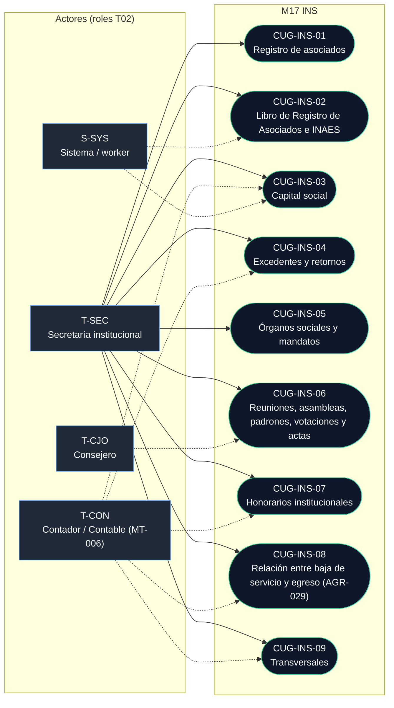
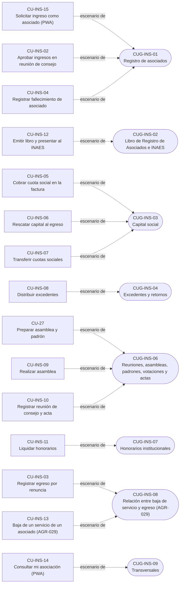

# Casos de uso de M17 INS — Gestión institucional (asociados, capital, asambleas, consejo, INAES)

Parte del entregable [21 Casos de uso por módulo](../21-casos-de-uso.md) (artefacto 3.3). Generado con `_trabajo/gen_21_casos_uso.py` desde `docs/especificacion/anexos/M17-INS-institucional.md` y revisado a mano. Ante cualquier diferencia prevalece el anexo.

| Dato | Valor |
|---|---|
| Casos de uso agrupadores (CUG) | 9 |
| RF del anexo | 108 (todos asignados a un CUG) |
| CU con ficha en la sección 16 | 15 |
| CU citados sin ficha en este anexo | 0 |

## 1. Diagramas

### 1.1 Actores y casos de uso agrupadores

Línea continua: actor principal. Línea punteada: actor secundario o participante.

### 1.2 Casos de uso de la especificación por agrupador

Rectángulo: CU con ficha en la sección 16 del anexo. Paralelogramo: CU citado (ficha en otro anexo o sin ficha).

## 2. Fichas de los casos de uso agrupadores

### CUG-INS-01 — Registro de asociados

| Campo | Contenido |
|---|---|
| Actor principal | T-SEC Secretaría institucional |
| Actores secundarios | — |
| Objetivo | Registro de asociados: Registrar la relación institucional de una persona del tenant como entidad propia, distinta de persona, titular, cliente, pagador, usuario y empleado. |
| Precondición | Usuario del tenant autenticado con el rol indicado y capabilities `ins.asociados.ver`, `ins.asociados.editar`, `ins.asociados.aprobar`; módulo INS licenciado y activo (T01, T02 §4.3). |
| Flujo principal | Según CU-INS-15: Abre "Asociarme" → confirma datos → acepta estatuto → ve suscripción propuesta → adjunta documentos → envía. |
| Alternativos | Según CU-INS-15: Persona con aviso de deuda en domicilio: se informa, no bloquea. Sin la capability o fuera del alcance de datos: denegación por defecto y auditoría (T02). |
| CU asociados | CU-INS-15; CU-INS-02; CU-INS-04 |
| RF (20) | RF-INS-001 a 020 |
| Prioridad y olas | Núcleo 8, Estándar 11, Extensión 1; olas O2, O10 |
| Origen | M17 §5.1 |

### CUG-INS-02 — Libro de Registro de Asociados e INAES

| Campo | Contenido |
|---|---|
| Actor principal | T-SEC Secretaría institucional |
| Actores secundarios | S-SYS Sistema / worker |
| Objetivo | Libro de Registro de Asociados e INAES: Generar el Libro de Registro de Asociados a una fecha o período: número, nombre o razón social, documento/CUIT, domicilio, fecha de ingreso, fecha y causa de egreso... |
| Precondición | Usuario del tenant autenticado con el rol indicado y capabilities `ins.asociados.ver`, `ins.asociados.editar`, `ins.inaes.generar`; módulo INS licenciado y activo (T01, T02 §4.3). |
| Flujo principal | Según CU-INS-12: Genera libro / exportación → valida → presenta → registra acuse. |
| Alternativos | Según CU-INS-12: Rechazo: nueva versión. Sin la capability o fuera del alcance de datos: denegación por defecto y auditoría (T02). |
| CU asociados | CU-INS-12 |
| RF (8) | RF-INS-021 a 028 |
| Prioridad y olas | Núcleo 0, Estándar 7, Extensión 1; olas O10 |
| Origen | M17 §5.2 |

### CUG-INS-03 — Capital social

| Campo | Contenido |
|---|---|
| Actor principal | T-SEC Secretaría institucional |
| Actores secundarios | T-CON Contador / Contable (MT-006); S-SYS Sistema / worker |
| Objetivo | Capital social: ABM de rubros de capital con código y descripción. |
| Precondición | Usuario del tenant autenticado con el rol indicado y capabilities `ins.capital.registrar`, `ins.capital.ajustar`, `ins.capital.importar`; módulo INS licenciado y activo (T01, T02 §4.3). |
| Flujo principal | Según CU-INS-05: Factura con renglón capitalizable → billed → pago → paid proporcional. |
| Alternativos | Según CU-INS-05: Anulación: contramovimiento. Sin la capability o fuera del alcance de datos: denegación por defecto y auditoría (T02). |
| CU asociados | CU-INS-05; CU-INS-06; CU-INS-07 |
| RF (31) | RF-INS-029 a 059 |
| Prioridad y olas | Núcleo 12, Estándar 19, Extensión 0; olas O5, O6, O10 |
| Origen | M17 §5.3 |

### CUG-INS-04 — Excedentes y retornos

| Campo | Contenido |
|---|---|
| Actor principal | T-SEC Secretaría institucional |
| Actores secundarios | T-CON Contador / Contable (MT-006) |
| Objetivo | Excedentes y retornos: Vincular la distribución con la resolución de asamblea que la aprueba. |
| Precondición | Usuario del tenant autenticado con el rol indicado y capabilities `ins.excedentes.calcular`, `ins.excedentes.ejecutar`, `ins.excedentes.calcular/ejecutar`; módulo INS licenciado y activo (T01, T02 §4.3). |
| Flujo principal | Según CU-INS-08: Simula → adjunta a expediente → asamblea aprueba → ejecuta. |
| Alternativos | Según CU-INS-08: Asamblea modifica proyecto: nueva simulación. Sin la capability o fuera del alcance de datos: denegación por defecto y auditoría (T02). |
| CU asociados | CU-INS-08 |
| RF (7) | RF-INS-060 a 066 |
| Prioridad y olas | Núcleo 1, Estándar 5, Extensión 1; olas O10 |
| Origen | M17 §5.4 |

### CUG-INS-05 — Órganos sociales y mandatos

| Campo | Contenido |
|---|---|
| Actor principal | T-SEC Secretaría institucional |
| Actores secundarios | — |
| Objetivo | Órganos sociales y mandatos: ABM de órganos: consejo de administración, sindicatura, comisión fiscalizadora, junta electoral, comisiones internas. |
| Precondición | Usuario del tenant autenticado con el rol indicado y capabilities `ins.organos.gestionar`, `ins.asociados.ver`, `ins.asociados.editar`; módulo INS licenciado y activo (T01, T02 §4.3). |
| Flujo principal | 1. ABM de órganos: consejo de administración, sindicatura, comisión fiscalizadora, junta electoral, comisiones internas (RF-INS-067). 2. Registrar mandatos: persona asociada (de M01), cargo (presidente, vicepresidente, secretario, prosecretario, tesorero... (RF-INS-068). 3. Validaciones de mandato: asociado activo (RF-INS-069). 4. Alertas de vencimiento de mandatos y de asamblea de renovación (RF-INS-070). 5. Nómina de autoridades vigente e histórica exportable (INAES, bancos, organismos) y firmantes autorizados derivados de... (RF-INS-071). |
| Alternativos | Sin la capability o fuera del alcance de datos: la acción se deniega por defecto y se audita (T02). |
| CU asociados | — (sin CU en la especificación; el flujo sale de los RF) |
| RF (5) | RF-INS-067 a 071 |
| Prioridad y olas | Núcleo 0, Estándar 5, Extensión 0; olas O10 |
| Origen | M17 §5.5 |

### CUG-INS-06 — Reuniones, asambleas, padrones, votaciones y actas

| Campo | Contenido |
|---|---|
| Actor principal | T-SEC Secretaría institucional |
| Actores secundarios | T-CJO Consejero |
| Objetivo | Reuniones, asambleas, padrones, votaciones y actas: ABM de reuniones por tipo: consejo (ordinaria/extraordinaria), sindicatura, comisión, asamblea ordinaria, asamblea extraordinaria, asamblea de distrito, asamblea de... |
| Precondición | Usuario del tenant autenticado con el rol indicado y capabilities `ins.asambleas.gestionar`, `ins.actas.editar`, `ins.actas.aprobar`; módulo INS licenciado y activo (T01, T02 §4.3). |
| Flujo principal | Según CU-27: Selecciona asamblea → aplica criterios → genera padrón preliminar → revisa excluidos con motivo → aprueba versión → publica convocatoria y documentación. |
| Alternativos | Según CU-27: Cambio de criterio: versión nueva, la anterior se conserva. Persona no asociada: no entra al padrón. Sin la capability o fuera del alcance de datos: denegación por defecto y auditoría (T02). |
| CU asociados | CU-27; CU-INS-09; CU-INS-10 |
| RF (23) | RF-INS-072 a 094 |
| Prioridad y olas | Núcleo 0, Estándar 21, Extensión 2; olas O10 |
| Origen | M17 §5.6 |

### CUG-INS-07 — Honorarios institucionales

| Campo | Contenido |
|---|---|
| Actor principal | T-SEC Secretaría institucional |
| Actores secundarios | T-CON Contador / Contable (MT-006) |
| Objetivo | Honorarios institucionales: Registrar la retribución aprobada por asamblea: cargos alcanzados, importe o fórmula, periodicidad, vigencia y resolución. |
| Precondición | Usuario del tenant autenticado con el rol indicado y capabilities `ins.honorarios.aprobar`, `ins.honorarios.gestionar`, `ins.asambleas.gestionar`; módulo INS licenciado y activo (T01, T02 §4.3). |
| Flujo principal | Según CU-INS-11: Liquida período → aprueba → orden de pago. |
| Alternativos | Según CU-INS-11: Mandato terminado a mitad de mes: prorrateo. Sin la capability o fuera del alcance de datos: denegación por defecto y auditoría (T02). |
| CU asociados | CU-INS-11 |
| RF (4) | RF-INS-095 a 098 |
| Prioridad y olas | Núcleo 0, Estándar 3, Extensión 1; olas O10 |
| Origen | M17 §5.7 |

### CUG-INS-08 — Relación entre baja de servicio y egreso (AGR-029)

| Campo | Contenido |
|---|---|
| Actor principal | T-SEC Secretaría institucional |
| Actores secundarios | T-CON Contador / Contable (MT-006) |
| Objetivo | Relación entre baja de servicio y egreso (AGR-029): La baja de un servicio no produce egreso ni devolución de capital. |
| Precondición | Usuario del tenant autenticado con el rol indicado y capabilities `ins.capital.registrar`, `ins.capital.ajustar`, `ins.capital.importar`; módulo INS licenciado y activo (T01, T02 §4.3). |
| Flujo principal | Según CU-INS-03: Recibe solicitud → valida servicios y capital → resolución → egreso → inicia rescate. |
| Alternativos | Según CU-INS-03: Servicios activos con PRM-INS-008 = false: rechaza y lista servicios. Sin la capability o fuera del alcance de datos: denegación por defecto y auditoría (T02). |
| CU asociados | CU-INS-03; CU-INS-13 |
| RF (4) | RF-INS-099 a 102 |
| Prioridad y olas | Núcleo 2, Estándar 2, Extensión 0; olas O2, O10 |
| Origen | M17 §5.8 |

### CUG-INS-09 — Transversales

| Campo | Contenido |
|---|---|
| Actor principal | T-SEC Secretaría institucional |
| Actores secundarios | T-CON Contador / Contable (MT-006) |
| Objetivo | Transversales: Privacidad: inventario de datos institucionales con finalidad y conservación. |
| Precondición | Usuario del tenant autenticado con el rol indicado y capabilities `ins.transferencias.crear`, `ins.capital.registrar`, `ins.padrones.exportar`; módulo INS licenciado y activo (T01, T02 §4.3). |
| Flujo principal | Según CU-INS-14: Ve estado, número, antigüedad, capital, credencial y convocatorias. |
| Alternativos | Según CU-INS-14: Cliente no asociado: ve "Asociarme". Sin la capability o fuera del alcance de datos: denegación por defecto y auditoría (T02). |
| CU asociados | CU-INS-14 |
| RF (6) | RF-INS-103 a 108 |
| Prioridad y olas | Núcleo 4, Estándar 2, Extensión 0; olas O2, O10 |
| Origen | M17 §5.9 |

## 3. Casos de uso de la especificación (CU)

| CU | Nombre | Actor según el anexo | Agrupador | Criterio de asignación |
|---|---|---|---|---|
| CU-27 | Preparar asamblea y padrón | Secretaría institucional | CUG-INS-06 | RF citados |
| CU-INS-15 | Solicitar ingreso como asociado (PWA) | Cliente / persona | CUG-INS-01 | RF citados |
| CU-INS-02 | Aprobar ingresos en reunión de consejo | Secretaría + Consejo | CUG-INS-01 | RF citados |
| CU-INS-03 | Registrar egreso por renuncia | Secretaría | CUG-INS-08 | RF citados |
| CU-INS-04 | Registrar fallecimiento de asociado | Sistema / Secretaría | CUG-INS-01 | RF citados |
| CU-INS-05 | Cobrar cuota social en la factura | Sistema (M04/M05/M07) | CUG-INS-03 | RF citados |
| CU-INS-06 | Rescatar capital al egreso | Administración de capital + Consejo + Tesorería | CUG-INS-03 | RF citados |
| CU-INS-07 | Transferir cuotas sociales | Administración de capital | CUG-INS-03 | RF citados |
| CU-INS-08 | Distribuir excedentes | Contador + Asamblea | CUG-INS-04 | RF citados |
| CU-INS-09 | Realizar asamblea | Secretaría, acreditadores, junta electoral | CUG-INS-06 | RF citados |
| CU-INS-10 | Registrar reunión de consejo y acta | Secretaría + Consejo | CUG-INS-06 | RF citados |
| CU-INS-11 | Liquidar honorarios | Contador | CUG-INS-07 | RF citados |
| CU-INS-12 | Emitir libro y presentar al INAES | Secretaría | CUG-INS-02 | RF citados |
| CU-INS-13 | Baja de un servicio de un asociado (AGR-029) | Operador | CUG-INS-08 | RF citados |
| CU-INS-14 | Consultar mi asociación (PWA) | Asociado | CUG-INS-09 | RF citados |

## 4. Cobertura del anexo

| Universo | En la especificación | Incluidos | Excluidos |
|---|---|---|---|
| RF | 108 | 108 | 0 |
| CU con ficha (sección 16) | 15 | 15 | 0 |
| CU citados sin ficha en este anexo | 0 | 0 | 0 |
