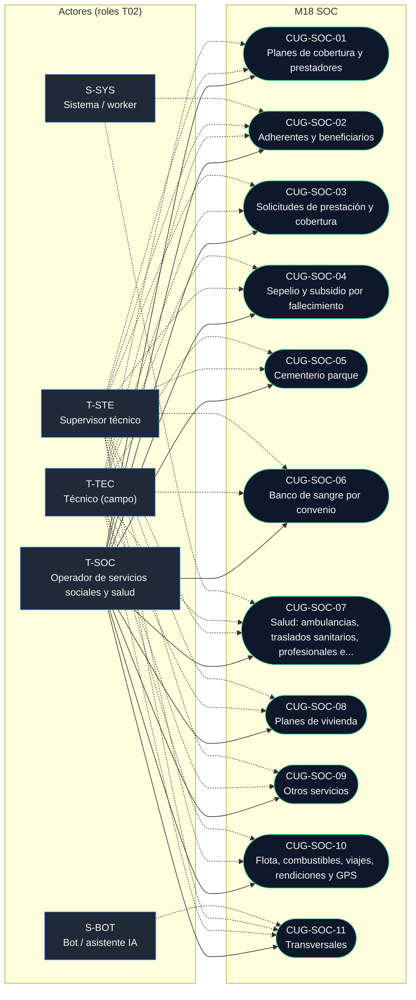

# Casos de uso de M18 SOC — Servicios sociales, otros servicios y flota

Parte del entregable [21 Casos de uso por módulo](../21-casos-de-uso.md) (artefacto 3.3). Generado con `_trabajo/gen_21_casos_uso.py` desde `docs/especificacion/anexos/M18-SOC-servicios-sociales-flota.md` y revisado a mano. Ante cualquier diferencia prevalece el anexo.

| Dato | Valor |
|---|---|
| Casos de uso agrupadores (CUG) | 11 |
| RF del anexo | 149 (todos asignados a un CUG) |
| CU con ficha en la sección 16 | 18 |
| CU citados sin ficha en este anexo | 0 |

## 1. Diagramas

### 1.1 Actores y casos de uso agrupadores

Línea continua: actor principal. Línea punteada: actor secundario o participante.

### 1.2 Casos de uso de la especificación por agrupador

```mermaid
flowchart LR
    CUG_SOC_02(["CUG-SOC-02<br/>Adherentes y beneficiarios"])
    X_CU_SOC_01_CUG_SOC_02["CU-SOC-01<br/>Agregar un hijo al grupo de sepelio"]
    X_CU_SOC_01_CUG_SOC_02 -.->|escenario de| CUG_SOC_02
    X_CU_SOC_02_CUG_SOC_02["CU-SOC-02<br/>Procesar mayoría de edad"]
    X_CU_SOC_02_CUG_SOC_02 -.->|escenario de| CUG_SOC_02
    X_CU_SOC_03_CUG_SOC_02["CU-SOC-03<br/>Desconexión y reconexión con adherentes"]
    X_CU_SOC_03_CUG_SOC_02 -.->|escenario de| CUG_SOC_02
    CUG_SOC_03(["CUG-SOC-03<br/>Solicitudes de prestación y cobertura"])
    X_CU_24_CUG_SOC_03["CU-24<br/>Autorizar prestación social"]
    X_CU_24_CUG_SOC_03 -.->|escenario de| CUG_SOC_03
    CUG_SOC_04(["CUG-SOC-04<br/>Sepelio y subsidio por fallecimiento"])
    X_CU_SOC_04_CUG_SOC_04["CU-SOC-04<br/>Gestionar sepelio con inhumación en el parque"]
    X_CU_SOC_04_CUG_SOC_04 -.->|escenario de| CUG_SOC_04
    X_CU_SOC_05_CUG_SOC_04["CU-SOC-05<br/>Pagar subsidio por fallecimiento"]
    X_CU_SOC_05_CUG_SOC_04 -.->|escenario de| CUG_SOC_04
    CUG_SOC_05(["CUG-SOC-05<br/>Cementerio parque"])
    X_CU_ESP_CEM_CUG_SOC_05["CU-ESP-CEM<br/>Reservar parcela e inhumar"]
    X_CU_ESP_CEM_CUG_SOC_05 -.->|escenario de| CUG_SOC_05
    X_CU_SOC_06_CUG_SOC_05["CU-SOC-06<br/>Ceder un derecho de sepultura"]
    X_CU_SOC_06_CUG_SOC_05 -.->|escenario de| CUG_SOC_05
    CUG_SOC_06(["CUG-SOC-06<br/>Banco de sangre por convenio"])
    X_CU_ESP_SAN_CUG_SOC_06["CU-ESP-SAN<br/>Acreditar cobertura de banco de sangre"]
    X_CU_ESP_SAN_CUG_SOC_06 -.->|escenario de| CUG_SOC_06
    CUG_SOC_07(["CUG-SOC-07<br/>Salud: ambulancias, traslados sanitarios..."])
    X_CU_SOC_07_CUG_SOC_07["CU-SOC-07<br/>Programar un traslado a diálisis"]
    X_CU_SOC_07_CUG_SOC_07 -.->|escenario de| CUG_SOC_07
    CUG_SOC_08(["CUG-SOC-08<br/>Planes de vivienda"])
    X_CU_SOC_08_CUG_SOC_08["CU-SOC-08<br/>Facturar cuota de vivienda"]
    X_CU_SOC_08_CUG_SOC_08 -.->|escenario de| CUG_SOC_08
    X_CU_SOC_09_CUG_SOC_08["CU-SOC-09<br/>Certificar avance de obra"]
    X_CU_SOC_09_CUG_SOC_08 -.->|escenario de| CUG_SOC_08
    X_CU_SOC_10_CUG_SOC_08["CU-SOC-10<br/>Retirar materiales para una vivienda"]
    X_CU_SOC_10_CUG_SOC_08 -.->|escenario de| CUG_SOC_08
    X_CU_SOC_11_CUG_SOC_08["CU-SOC-11<br/>Rescindir un plan de vivienda"]
    X_CU_SOC_11_CUG_SOC_08 -.->|escenario de| CUG_SOC_08
    CUG_SOC_09(["CUG-SOC-09<br/>Otros servicios"])
    X_CU_SOC_15_CUG_SOC_09["CU-SOC-15<br/>Prestar una silla de ruedas"]
    X_CU_SOC_15_CUG_SOC_09 -.->|escenario de| CUG_SOC_09
    CUG_SOC_10(["CUG-SOC-10<br/>Flota, combustibles, viajes, rendiciones y GPS"])
    X_CU_SOC_12_CUG_SOC_10["CU-SOC-12<br/>Registrar carga de combustible desde factura"]
    X_CU_SOC_12_CUG_SOC_10 -.->|escenario de| CUG_SOC_10
    X_CU_SOC_13_CUG_SOC_10["CU-SOC-13<br/>Rendir un viaje de flete"]
    X_CU_SOC_13_CUG_SOC_10 -.->|escenario de| CUG_SOC_10
    X_CU_SOC_14_CUG_SOC_10["CU-SOC-14<br/>Consultar recorrido GPS de una OT"]
    X_CU_SOC_14_CUG_SOC_10 -.->|escenario de| CUG_SOC_10
```

Rectángulo: CU con ficha en la sección 16 del anexo. Paralelogramo: CU citado (ficha en otro anexo o sin ficha).

## 2. Fichas de los casos de uso agrupadores

### CUG-SOC-01 — Planes de cobertura y prestadores

| Campo | Contenido |
|---|---|
| Actor principal | T-SOC Operador de servicios sociales y salud |
| Actores secundarios | T-STE Supervisor técnico; T-TEC Técnico (campo) |
| Objetivo | Planes de cobertura y prestadores: Definir planes de cobertura por servicio social: prestaciones incluidas, vínculos admitidos, edades mínima y máxima por vínculo, ocupación, discapacidad, cantidad máxima... |
| Precondición | Usuario del tenant autenticado con el rol indicado y capabilities `soc.prestadores.gestionar`, `soc.planes.configurar`, `soc.bancoSangre.gestionar`; módulo SOC licenciado y activo (T01, T02 §4.3). |
| Flujo principal | 1. Definir planes de cobertura por servicio social: prestaciones incluidas, vínculos admitidos, edades mínima y máxima por... (RF-SOC-001). 2. Distinguir tipos de servicio social con reglas propias: sepelio, subsidio por fallecimiento, cementerio parque, banco... (RF-SOC-002). 3. Registrar prestadores (empresa fúnebre, red de sangre, nosocomio, empresa de ambulancias, constructor) vinculados al... (RF-SOC-003). 4. Registrar convenios con prestadores: ámbito, vigencia, condiciones, modalidad de financiamiento (cooperativa, aporte... (RF-SOC-004). 5. Diccionario de términos por tenant (adherente, beneficiario, grupo familiar, parcela) (RF-SOC-009). 6. Distinguir servicio confirmado por el tenant de servicio candidato (RF-SOC-010). |
| Alternativos | Carencias configurables por plan y por adherente (desde su alta), con excepciones autorizadas (RF-SOC-005). Sin la capability o fuera del alcance de datos: la acción se deniega por defecto y se audita (T02). |
| CU asociados | — (sin CU en la especificación; el flujo sale de los RF) |
| RF (10) | RF-SOC-001 a 010 |
| Prioridad y olas | Núcleo 6, Estándar 4, Extensión 0; olas O10 |
| Origen | M18 §5.1 |

### CUG-SOC-02 — Adherentes y beneficiarios

| Campo | Contenido |
|---|---|
| Actor principal | T-SOC Operador de servicios sociales y salud |
| Actores secundarios | T-TEC Técnico (campo); T-STE Supervisor técnico; S-SYS Sistema / worker |
| Objetivo | Adherentes y beneficiarios: Alta de adherente a un contrato de servicio: persona de M01, vínculo, fecha de alta, titular del grupo (sí/no), tarifa asignada si corresponde, validación de requisitos... |
| Precondición | Usuario del tenant autenticado con el rol indicado y capabilities `soc.adherentes.gestionar`, `soc.adherentes.ver`, `soc.beneficiarios.gestionar`; módulo SOC licenciado y activo (T01, T02 §4.3). |
| Flujo principal | Según CU-SOC-01: Carga persona y vínculo → valida edad y requisitos → alta con carencia → M04 suma un adherente en el próximo período. |
| Alternativos | Según CU-SOC-01: Edad fuera de rango: rechazo con motivo; ya adherente en otro titular: ofrece baja allí. Sin la capability o fuera del alcance de datos: denegación por defecto y auditoría (T02). |
| CU asociados | CU-SOC-01; CU-SOC-02; CU-SOC-03 |
| RF (21) | RF-SOC-011 a 030, 149 |
| Prioridad y olas | Núcleo 7, Estándar 12, Extensión 2; olas O4, O10 |
| Origen | M18 §5.2 |

### CUG-SOC-03 — Solicitudes de prestación y cobertura

| Campo | Contenido |
|---|---|
| Actor principal | T-SOC Operador de servicios sociales y salud |
| Actores secundarios | T-TEC Técnico (campo); T-STE Supervisor técnico |
| Objetivo | Solicitudes de prestación y cobertura: Solicitud de prestación única con tipo, beneficiario, fecha del evento, prestador, canal y documentación. |
| Precondición | Usuario del tenant autenticado con el rol indicado y capabilities `soc.prestadores.gestionar`, `soc.solicitudes.crear`, `soc.solicitudes.excepcionar`; módulo SOC licenciado y activo (T01, T02 §4.3). |
| Flujo principal | Según CU-24: Identifica beneficiario y fecha → verifica cobertura → registra autorización y prestador o deriva excepción. |
| Alternativos | Según CU-24: Beneficiario no incorporado a la fecha del evento: revisión, sin cambio retroactivo. Sin la capability o fuera del alcance de datos: denegación por defecto y auditoría (T02). |
| CU asociados | CU-24 |
| RF (8) | RF-SOC-031 a 038 |
| Prioridad y olas | Núcleo 5, Estándar 3, Extensión 0; olas O10 |
| Origen | M18 §5.3 |

### CUG-SOC-04 — Sepelio y subsidio por fallecimiento

| Campo | Contenido |
|---|---|
| Actor principal | T-SOC Operador de servicios sociales y salud |
| Actores secundarios | T-STE Supervisor técnico; T-TEC Técnico (campo) |
| Objetivo | Sepelio y subsidio por fallecimiento: Distinguir sepelio, subsidio y cementerio: un asociado puede tener alguno y no los otros. |
| Precondición | Usuario del tenant autenticado con el rol indicado y capabilities `soc.sepelio.gestionar`, `soc.subsidios.aprobar`, `soc.subsidios.crear`; módulo SOC licenciado y activo (T01, T02 §4.3). |
| Flujo principal | Según CU-SOC-04: Caso → prestador → traslado → acto de inhumación → cierre → adicionales facturados. |
| Alternativos | Según CU-SOC-04: Fallecimiento fuera de alcance territorial: excepción. Sin la capability o fuera del alcance de datos: denegación por defecto y auditoría (T02). |
| CU asociados | CU-SOC-04; CU-SOC-05 |
| RF (10) | RF-SOC-039 a 048 |
| Prioridad y olas | Núcleo 1, Estándar 7, Extensión 2; olas O10 |
| Origen | M18 §5.4 |

### CUG-SOC-05 — Cementerio parque

| Campo | Contenido |
|---|---|
| Actor principal | T-SOC Operador de servicios sociales y salud |
| Actores secundarios | T-STE Supervisor técnico; T-TEC Técnico (campo) |
| Objetivo | Cementerio parque: Establecimiento: nombre, habilitación, modalidad jurídica (CCyC arts. |
| Precondición | Usuario del tenant autenticado con el rol indicado y capabilities `soc.cementerio.gestionar`, `soc.cementerio.configurar`, `soc.cementerio.ver`; módulo SOC licenciado y activo (T01, T02 §4.3). |
| Flujo principal | Según CU-ESP-CEM: Reserva PAR-DEMO-001 → instrumento → obligaciones → solicitud de inhumación de un fallecido distinto del titular → validación → turno → registro. |
| Alternativos | Según CU-ESP-CEM: Cambio de pagador: no elimina ocupación ni transfiere derecho. Sin la capability o fuera del alcance de datos: denegación por defecto y auditoría (T02). |
| CU asociados | CU-ESP-CEM; CU-SOC-06 |
| RF (16) | RF-SOC-049 a 064 |
| Prioridad y olas | Núcleo 9, Estándar 5, Extensión 2; olas O10 |
| Origen | M18 §5.5 |

### CUG-SOC-06 — Banco de sangre por convenio

| Campo | Contenido |
|---|---|
| Actor principal | T-SOC Operador de servicios sociales y salud |
| Actores secundarios | T-TEC Técnico (campo); T-STE Supervisor técnico |
| Objetivo | Banco de sangre por convenio: Convenio con red o banco habilitado: ámbito, vigencia, condiciones de atención, modalidad (financiado por la cooperativa, aporte del socio, gratuito). |
| Precondición | Usuario del tenant autenticado con el rol indicado y capabilities `soc.bancoSangre.gestionar`, `soc.convenios.gestionar`, `soc.sangre.gestionar`; módulo SOC licenciado y activo (T01, T02 §4.3). |
| Flujo principal | Según CU-ESP-SAN: Valida convenio y vigencia → tramita referencia → registra respuesta y seguimiento. |
| Alternativos | Según CU-ESP-SAN: Convenio financiado por la cooperativa: no se factura al paciente. Sin la capability o fuera del alcance de datos: denegación por defecto y auditoría (T02). |
| CU asociados | CU-ESP-SAN |
| RF (10) | RF-SOC-065 a 073, 146 |
| Prioridad y olas | Núcleo 7, Estándar 3, Extensión 0; olas O10 |
| Origen | M18 §5.6 |

### CUG-SOC-07 — Salud: ambulancias, traslados sanitarios, profesionales e internaciones

| Campo | Contenido |
|---|---|
| Actor principal | T-SOC Operador de servicios sociales y salud |
| Actores secundarios | T-STE Supervisor técnico; T-TEC Técnico (campo); S-SYS Sistema / worker |
| Objetivo | Salud: ambulancias, traslados sanitarios, profesionales e internaciones: Motivo del traslado como categoría administrativa (no diagnóstico), con texto libre restringido. |
| Precondición | Usuario del tenant autenticado con el rol indicado y capabilities `soc.traslados.despachar`, `soc.profesionales.gestionar`, `soc.traslados.gestionar`; módulo SOC licenciado y activo (T01, T02 §4.3). |
| Flujo principal | Según CU-SOC-07: Solicitud → verificación de cobertura y tope → asignación de móvil apto y chofer → ejecución en PWA → cierre e importe. |
| Alternativos | Según CU-SOC-07: Emergencia: derivación al prestador. Sin la capability o fuera del alcance de datos: denegación por defecto y auditoría (T02). |
| CU asociados | CU-SOC-07 |
| RF (12) | RF-SOC-074 a 084, 147 |
| Prioridad y olas | Núcleo 2, Estándar 8, Extensión 2; olas O10 |
| Origen | M18 §5.7 |

### CUG-SOC-08 — Planes de vivienda

| Campo | Contenido |
|---|---|
| Actor principal | T-SOC Operador de servicios sociales y salud |
| Actores secundarios | T-TEC Técnico (campo); T-STE Supervisor técnico |
| Objetivo | Planes de vivienda: Una cuenta no puede tener dos planes de vivienda. |
| Precondición | Usuario del tenant autenticado con el rol indicado y capabilities `soc.vivienda.gestionar`, `soc.planes.configurar`, `soc.vivienda.adjudicar`; módulo SOC licenciado y activo (T01, T02 §4.3). |
| Flujo principal | Según CU-SOC-08: M04 consulta % y precio → M05 emite comprobante exclusivo → M18 actualiza % facturado → pago actualiza % pagado. |
| Alternativos | Según CU-SOC-08: Aporte superior al máximo: rechazo salvo PRM-SOC-024. Sin la capability o fuera del alcance de datos: denegación por defecto y auditoría (T02). |
| CU asociados | CU-SOC-08; CU-SOC-09; CU-SOC-10; CU-SOC-11 |
| RF (28) | RF-SOC-085 a 112 |
| Prioridad y olas | Núcleo 3, Estándar 23, Extensión 2; olas O10 |
| Origen | M18 §5.8 |

### CUG-SOC-09 — Otros servicios

| Campo | Contenido |
|---|---|
| Actor principal | T-SOC Operador de servicios sociales y salud |
| Actores secundarios | T-TEC Técnico (campo); T-STE Supervisor técnico |
| Objetivo | Otros servicios: Banco ortopédico: elementos identificados (código, tipo, estado), préstamo con plazo, devolución, limpieza/mantenimiento, garantía o depósito. |
| Precondición | Usuario del tenant autenticado con el rol indicado y capabilities `soc.servicios.ver`, `soc.adherentes.gestionar`, `soc.adherentes.ver`; módulo SOC licenciado y activo (T01, T02 §4.3). |
| Flujo principal | Según CU-SOC-15: Préstamo con plazo y depósito → devolución → mantenimiento. |
| Alternativos | Según CU-SOC-15: Vencido: aviso al asociado. Sin la capability o fuera del alcance de datos: denegación por defecto y auditoría (T02). |
| CU asociados | CU-SOC-15 |
| RF (6) | RF-SOC-113 a 117, 148 |
| Prioridad y olas | Núcleo 0, Estándar 1, Extensión 5; olas O10 |
| Origen | M18 §5.9 |

### CUG-SOC-10 — Flota, combustibles, viajes, rendiciones y GPS

| Campo | Contenido |
|---|---|
| Actor principal | T-SOC Operador de servicios sociales y salud |
| Actores secundarios | T-STE Supervisor técnico; T-TEC Técnico (campo) |
| Objetivo | Flota, combustibles, viajes, rendiciones y GPS: La ubicación del móvil no se muestra en vivo al asociado ni reemplaza el estado "En camino" de M10. |
| Precondición | Usuario del tenant autenticado con el rol indicado y capabilities `soc.gps.ver`, `soc.combustible.gestionar`, `soc.combustible.registrar`; módulo SOC licenciado y activo (T01, T02 §4.3). |
| Flujo principal | Según CU-SOC-12: Factura con líneas de combustible y móvil → fuelLoads → rendimiento. |
| Alternativos | Según CU-SOC-12: Anulación de factura: libera cargas. Sin la capability o fuera del alcance de datos: denegación por defecto y auditoría (T02). |
| CU asociados | CU-SOC-12; CU-SOC-13; CU-SOC-14 |
| RF (21) | RF-SOC-118 a 138 |
| Prioridad y olas | Núcleo 1, Estándar 17, Extensión 3; olas O8, O10 |
| Origen | M18 §5.10 |

### CUG-SOC-11 — Transversales

| Campo | Contenido |
|---|---|
| Actor principal | T-SOC Operador de servicios sociales y salud |
| Actores secundarios | T-TEC Técnico (campo); T-STE Supervisor técnico; S-BOT Bot / asistente IA |
| Objetivo | Transversales: Privacidad: inventario de datos sensibles (salud, fallecimiento, ubicación), finalidad, conservación y acceso mínimo. |
| Precondición | Usuario del tenant autenticado con el rol indicado y capabilities `soc.solicitudes.crear`, `soc.solicitudes.excepcionar`, `soc.solicitudes.resolver`; módulo SOC licenciado y activo (T01, T02 §4.3). |
| Flujo principal | 1. Privacidad: inventario de datos sensibles (salud, fallecimiento, ubicación), finalidad, conservación y acceso mínimo (RF-SOC-139). 2. Auditoría de altas, bajas, solicitudes, decisiones, actos de cementerio, certificados y rendiciones (RF-SOC-140). 3. Aislamiento por tenant (RF-SOC-141). 4. Historia sin borrado de grupos, ocupaciones y solicitudes (vigencias, AGR-003) (RF-SOC-142). 5. IA: el asistente puede resumir y guiar, nunca decide coberturas sanitarias, aptitud ni disposición de restos (RF-SOC-144). 6. Importes en Decimal128 y ARS salvo configuración (RF-SOC-145). |
| Alternativos | Sin la capability o fuera del alcance de datos: la acción se deniega por defecto y se audita (T02). |
| CU asociados | — (sin CU en la especificación; el flujo sale de los RF) |
| RF (7) | RF-SOC-139 a 145 |
| Prioridad y olas | Núcleo 6, Estándar 1, Extensión 0; olas O4, O10 |
| Origen | M18 §5.11 |

## 3. Casos de uso de la especificación (CU)

| CU | Nombre | Actor según el anexo | Agrupador | Criterio de asignación |
|---|---|---|---|---|
| CU-24 | Autorizar prestación social | Operador de servicios sociales | CUG-SOC-03 | RF citados |
| CU-ESP-CEM | Reservar parcela e inhumar | Administrador de cementerio | CUG-SOC-05 | RF citados |
| CU-ESP-SAN | Acreditar cobertura de banco de sangre | Operador de banco de sangre | CUG-SOC-06 | RF citados |
| CU-SOC-01 | Agregar un hijo al grupo de sepelio | Operador / asociado PWA | CUG-SOC-02 | RF citados |
| CU-SOC-02 | Procesar mayoría de edad | Sistema + responsable | CUG-SOC-02 | RF citados |
| CU-SOC-03 | Desconexión y reconexión con adherentes | Sistema | CUG-SOC-02 | RF citados |
| CU-SOC-04 | Gestionar sepelio con inhumación en el parque | Operador | CUG-SOC-04 | RF citados |
| CU-SOC-05 | Pagar subsidio por fallecimiento | Operador + responsable | CUG-SOC-04 | RF citados |
| CU-SOC-06 | Ceder un derecho de sepultura | Administrador + jurídico | CUG-SOC-05 | RF citados |
| CU-SOC-07 | Programar un traslado a diálisis | Operador de traslados | CUG-SOC-07 | RF citados |
| CU-SOC-08 | Facturar cuota de vivienda | Sistema (M04/M05) | CUG-SOC-08 | RF citados |
| CU-SOC-09 | Certificar avance de obra | Técnico + responsable | CUG-SOC-08 | RF citados |
| CU-SOC-10 | Retirar materiales para una vivienda | Operador de vivienda | CUG-SOC-08 | RF citados |
| CU-SOC-11 | Rescindir un plan de vivienda | Responsable de planes | CUG-SOC-08 | RF citados |
| CU-SOC-12 | Registrar carga de combustible desde factura | Sistema / compras | CUG-SOC-10 | RF citados |
| CU-SOC-13 | Rendir un viaje de flete | Chofer + responsable | CUG-SOC-10 | RF citados |
| CU-SOC-14 | Consultar recorrido GPS de una OT | Responsable de flota | CUG-SOC-10 | RF citados |
| CU-SOC-15 | Prestar una silla de ruedas | Personal de ortopedia | CUG-SOC-09 | RF citados |

## 4. Cobertura del anexo

| Universo | En la especificación | Incluidos | Excluidos |
|---|---|---|---|
| RF | 149 | 149 | 0 |
| CU con ficha (sección 16) | 18 | 18 | 0 |
| CU citados sin ficha en este anexo | 0 | 0 | 0 |
