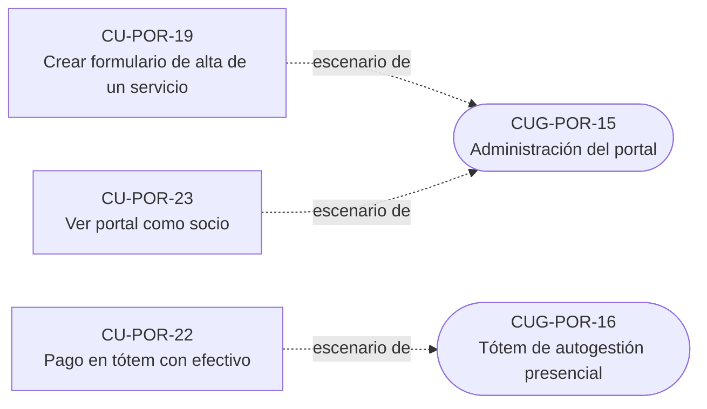

# Casos de uso de M19 POR — Landing, portal y app del socio (autogestión)

Parte del entregable [21 Casos de uso por módulo](../21-casos-de-uso.md) (artefacto 3.3). Generado con `_trabajo/gen_21_casos_uso.py` desde `docs/especificacion/anexos/M19-POR-portal-socio-landing.md` y revisado a mano. Ante cualquier diferencia prevalece el anexo.

| Dato | Valor |
|---|---|
| Casos de uso agrupadores (CUG) | 17 |
| RF del anexo | 180 (todos asignados a un CUG) |
| CU con ficha en la sección 16 | 29 |
| CU citados sin ficha en este anexo | 0 |

## 1. Diagramas

### 1.1 Actores y casos de uso agrupadores

```mermaid
flowchart LR
    subgraph ACT["Actores (roles T02)"]
        direction TB
        A_T_COM["T-COM<br/>Editor de comunidad / Moderador (USR-NOT-A)"]
        A_T_ATE["T-ATE<br/>Comercial / Atención al socio"]
        A_C_SOC["C-SOC<br/>Socio titular"]
        A_C_REP["C-REP<br/>Representante / autorizado"]
        A_S_BOT["S-BOT<br/>Bot / asistente IA"]
        A_T_SAT["T-SAT<br/>Supervisor de atención"]
        A_T_STE["T-STE<br/>Supervisor técnico"]
        A_C_EMP["C-EMP<br/>Empleado en portal"]
        A_S_SYS["S-SYS<br/>Sistema / worker"]
        A_S_KSK["S-KSK<br/>Dispositivo kiosco/tótem/turnero"]
        A_T_ADM["T-ADM<br/>Administrador de la cooperativa"]
        A_S_AGT["S-AGT<br/>Agente de hardware local"]
    end
    subgraph SIS["M19 POR"]
        direction TB
        CUG_POR_01(["CUG-POR-01<br/>Landing pública"])
        CUG_POR_02(["CUG-POR-02<br/>Registro, identidad y ámbito"])
        CUG_POR_03(["CUG-POR-03<br/>Vinculación de cuentas, accesos y representaciones"])
        CUG_POR_04(["CUG-POR-04<br/>Inicio por rol y navegación"])
        CUG_POR_05(["CUG-POR-05<br/>Mis servicios, contratación y trámites"])
        CUG_POR_06(["CUG-POR-06<br/>Visitas e instalación"])
        CUG_POR_07(["CUG-POR-07<br/>Facturas y documentos"])
        CUG_POR_08(["CUG-POR-08<br/>Pagos"])
        CUG_POR_09(["CUG-POR-09<br/>Consumos, autolectura y prepaga"])
        CUG_POR_10(["CUG-POR-10<br/>Gestiones (reclamos, consultas, trámites)"])
        CUG_POR_11(["CUG-POR-11<br/>Turnos de atención presencial"])
        CUG_POR_12(["CUG-POR-12<br/>Comunicaciones y comunidad"])
        CUG_POR_13(["CUG-POR-13<br/>Portal del empleado"])
        CUG_POR_14(["CUG-POR-14<br/>Accesibilidad, UX y tolerancia a errores"])
        CUG_POR_15(["CUG-POR-15<br/>Administración del portal"])
        CUG_POR_16(["CUG-POR-16<br/>Tótem de autogestión presencial"])
        CUG_POR_17(["CUG-POR-17<br/>Migración desde CoopOnline"])
    end
    A_T_COM --> CUG_POR_01
    A_T_ATE -.-> CUG_POR_01
    A_C_SOC -.-> CUG_POR_01
    A_C_REP -.-> CUG_POR_01
    A_C_SOC --> CUG_POR_02
    A_C_REP -.-> CUG_POR_02
    A_T_ATE -.-> CUG_POR_02
    A_T_COM -.-> CUG_POR_02
    A_C_SOC --> CUG_POR_03
    A_C_REP -.-> CUG_POR_03
    A_T_ATE -.-> CUG_POR_03
    A_C_SOC --> CUG_POR_04
    A_C_REP --> CUG_POR_04
    A_C_SOC --> CUG_POR_05
    A_C_REP --> CUG_POR_05
    A_S_BOT -.-> CUG_POR_05
    A_C_SOC --> CUG_POR_06
    A_C_REP --> CUG_POR_06
    A_C_SOC --> CUG_POR_07
    A_C_REP --> CUG_POR_07
    A_C_SOC --> CUG_POR_08
    A_C_REP --> CUG_POR_08
    A_C_SOC --> CUG_POR_09
    A_C_REP --> CUG_POR_09
    A_C_SOC --> CUG_POR_10
    A_C_REP --> CUG_POR_10
    A_T_SAT -.-> CUG_POR_10
    A_T_STE -.-> CUG_POR_10
    A_S_BOT -.-> CUG_POR_10
    A_C_SOC --> CUG_POR_11
    A_C_REP --> CUG_POR_11
    A_C_SOC --> CUG_POR_12
    A_C_REP --> CUG_POR_12
    A_T_ATE -.-> CUG_POR_12
    A_T_COM -.-> CUG_POR_12
    A_C_EMP -.-> CUG_POR_12
    A_S_SYS -.-> CUG_POR_12
    A_C_EMP --> CUG_POR_13
    A_T_COM --> CUG_POR_14
    A_T_ATE -.-> CUG_POR_14
    A_C_EMP --> CUG_POR_15
    A_C_SOC -.-> CUG_POR_15
    A_C_REP -.-> CUG_POR_15
    A_T_COM -.-> CUG_POR_15
    A_S_KSK -.-> CUG_POR_15
    A_C_SOC --> CUG_POR_16
    A_C_REP --> CUG_POR_16
    A_S_KSK -.-> CUG_POR_16
    A_T_ADM -.-> CUG_POR_16
    A_S_AGT -.-> CUG_POR_16
    A_T_ATE --> CUG_POR_17
    A_T_COM -.-> CUG_POR_17
    A_T_SAT -.-> CUG_POR_17
    A_C_SOC -.-> CUG_POR_17
    classDef actor fill:#1f2937,stroke:#60a5fa,color:#f9fafb;
    classDef cug fill:#0f172a,stroke:#34d399,color:#f9fafb;
    class A_T_COM,A_T_ATE,A_C_SOC,A_C_REP,A_S_BOT,A_T_SAT,A_T_STE,A_C_EMP,A_S_SYS,A_S_KSK,A_T_ADM,A_S_AGT actor;
    class CUG_POR_01,CUG_POR_02,CUG_POR_03,CUG_POR_04,CUG_POR_05,CUG_POR_06,CUG_POR_07,CUG_POR_08,CUG_POR_09,CUG_POR_10,CUG_POR_11,CUG_POR_12,CUG_POR_13,CUG_POR_14,CUG_POR_15,CUG_POR_16,CUG_POR_17 cug;
```

Línea continua: actor principal. Línea punteada: actor secundario o participante.

### 1.2 Casos de uso de la especificación por agrupador (parte 1 de 2)

```mermaid
flowchart LR
    CUG_POR_01(["CUG-POR-01<br/>Landing pública"])
    X_CU_MAR_01_CUG_POR_01["CU-MAR-01<br/>Alta de tenant con marca y landing..."]
    X_CU_MAR_01_CUG_POR_01 -.->|escenario de| CUG_POR_01
    X_CU_NOT_01_CUG_POR_01["CU-NOT-01<br/>Publicar noticias por canal"]
    X_CU_NOT_01_CUG_POR_01 -.->|escenario de| CUG_POR_01
    X_CU_POR_04_CUG_POR_01["CU-POR-04<br/>Baja pública de Internet sin registro"]
    X_CU_POR_04_CUG_POR_01 -.->|escenario de| CUG_POR_01
    X_CU_POR_18_CUG_POR_01["CU-POR-18<br/>Publicar nueva versión de landing"]
    X_CU_POR_18_CUG_POR_01 -.->|escenario de| CUG_POR_01
    X_CU_POR_20_CUG_POR_01["CU-POR-20<br/>Pagar factura sin ingresar"]
    X_CU_POR_20_CUG_POR_01 -.->|escenario de| CUG_POR_01
    CUG_POR_02(["CUG-POR-02<br/>Registro, identidad y ámbito"])
    X_CU_REG_01_CUG_POR_02["CU-REG-01<br/>Registro y contratación por persona nueva"]
    X_CU_REG_01_CUG_POR_02 -.->|escenario de| CUG_POR_02
    X_CU_POR_03_CUG_POR_02["CU-POR-03<br/>Activar acceso de usuario migrado de..."]
    X_CU_POR_03_CUG_POR_02 -.->|escenario de| CUG_POR_02
    X_CU_POR_21_CUG_POR_02["CU-POR-21<br/>Cambiar de cooperativa"]
    X_CU_POR_21_CUG_POR_02 -.->|escenario de| CUG_POR_02
    CUG_POR_03(["CUG-POR-03<br/>Vinculación de cuentas, accesos y representaciones"])
    X_CU_25_CUG_POR_03["CU-25<br/>Consultar y pagar una factura"]
    X_CU_25_CUG_POR_03 -.->|escenario de| CUG_POR_03
    X_CU_POR_01_CUG_POR_03["CU-POR-01<br/>Vincular cuenta existente con código de..."]
    X_CU_POR_01_CUG_POR_03 -.->|escenario de| CUG_POR_03
    X_CU_POR_02_CUG_POR_03["CU-POR-02<br/>Vinculación asistida en sucursal"]
    X_CU_POR_02_CUG_POR_03 -.->|escenario de| CUG_POR_03
    X_CU_POR_07_CUG_POR_03["CU-POR-07<br/>Hermano paga la factura del otro (ESC-01)"]
    X_CU_POR_07_CUG_POR_03 -.->|escenario de| CUG_POR_03
    X_CU_POR_08_CUG_POR_03["CU-POR-08<br/>Autorizar a un familiar a consultar y pagar"]
    X_CU_POR_08_CUG_POR_03 -.->|escenario de| CUG_POR_03
    CUG_POR_04(["CUG-POR-04<br/>Inicio por rol y navegación"])
    X_CU_POR_17_CUG_POR_04["CU-POR-17<br/>Inicio de socio moroso y suspendido"]
    X_CU_POR_17_CUG_POR_04 -.->|escenario de| CUG_POR_04
    CUG_POR_05(["CUG-POR-05<br/>Mis servicios, contratación y trámites"])
    X_CU_AUT_01_CUG_POR_05["CU-AUT-01<br/>Ciclo completo de Internet"]
    X_CU_AUT_01_CUG_POR_05 -.->|escenario de| CUG_POR_05
    X_CU_CIC_01_CUG_POR_05["CU-CIC-01<br/>Suspensión temporal y reactivación..."]
    X_CU_CIC_01_CUG_POR_05 -.->|escenario de| CUG_POR_05
    X_CU_POR_14_CUG_POR_05["CU-POR-14<br/>Presentar DDJJ de artefactos"]
    X_CU_POR_14_CUG_POR_05 -.->|escenario de| CUG_POR_05
    CUG_POR_06(["CUG-POR-06<br/>Visitas e instalación"])
    X_CU_POR_09_CUG_POR_06["CU-POR-09<br/>Coordinar y reprogramar visita de instalación"]
    X_CU_POR_09_CUG_POR_06 -.->|escenario de| CUG_POR_06
    CUG_POR_07(["CUG-POR-07<br/>Facturas y documentos"])
    X_CU_POR_13_CUG_POR_07["CU-POR-13<br/>Adherirse a factura digital y débito..."]
    X_CU_POR_13_CUG_POR_07 -.->|escenario de| CUG_POR_07
    CUG_POR_08(["CUG-POR-08<br/>Pagos"])
    X_CU_POR_05_CUG_POR_08["CU-POR-05<br/>Pagar varias facturas con cupón único en..."]
    X_CU_POR_05_CUG_POR_08 -.->|escenario de| CUG_POR_08
    X_CU_POR_06_CUG_POR_08["CU-POR-06<br/>Pago con tarjeta y confirmación diferida"]
    X_CU_POR_06_CUG_POR_08 -.->|escenario de| CUG_POR_08
    CUG_POR_09(["CUG-POR-09<br/>Consumos, autolectura y prepaga"])
    X_CU_POR_11_CUG_POR_09["CU-POR-11<br/>Autolectura de agua"]
    X_CU_POR_11_CUG_POR_09 -.->|escenario de| CUG_POR_09
    X_CU_POR_12_CUG_POR_09["CU-POR-12<br/>Recarga prepaga"]
    X_CU_POR_12_CUG_POR_09 -.->|escenario de| CUG_POR_09
    CUG_POR_10(["CUG-POR-10<br/>Gestiones (reclamos, consultas, trámites)"])
    X_CU_POR_10_CUG_POR_10["CU-POR-10<br/>Reclamo con foto sin conexión"]
    X_CU_POR_10_CUG_POR_10 -.->|escenario de| CUG_POR_10
    CUG_POR_11(["CUG-POR-11<br/>Turnos de atención presencial"])
    X_CU_POR_15_CUG_POR_11["CU-POR-15<br/>Pedir turno de atención presencial"]
    X_CU_POR_15_CUG_POR_11 -.->|escenario de| CUG_POR_11
    CUG_POR_13(["CUG-POR-13<br/>Portal del empleado"])
    X_CU_POR_16_CUG_POR_13["CU-POR-16<br/>Firmar recibo de sueldo"]
    X_CU_POR_16_CUG_POR_13 -.->|escenario de| CUG_POR_13
```

### 1.3 Casos de uso de la especificación por agrupador (parte 2 de 2)

Rectángulo: CU con ficha en la sección 16 del anexo. Paralelogramo: CU citado (ficha en otro anexo o sin ficha).

## 2. Fichas de los casos de uso agrupadores

### CUG-POR-01 — Landing pública

| Campo | Contenido |
|---|---|
| Actor principal | T-COM Editor de comunidad / Moderador (USR-NOT-A) |
| Actores secundarios | T-ATE Comercial / Atención al socio; C-SOC Socio titular; C-REP Representante / autorizado |
| Objetivo | Landing pública: Cada tenant dispone de una landing propia con su marca (T03), accesible por subdominio <tenantSlug>.<dominioPlataforma> y, opcionalmente, dominio propio. |
| Precondición | Servicio con botón de baja |
| Flujo principal | Según CU-MAR-01: 1) Alta de TEN-001. 2) La cooperativa dispone de admin y configuración de landing. 3) Carga marca, colores, logos (desktop, móvil, empleados, socios) y splash (T03). 4) Configura la landing (bloques, servicios, acceso a la app). 5) Revisa y publica. 6) Un socio consulta Internet e ingresa a la app. 7) En su sesión consulta servicios y solicita la activación de Internet. 8) Si solicita desactivar, se aplica el... |
| Alternativos | Según CU-POR-04: No identificable automáticamente: operador identifica; envío fallido: tarea y canal alternativo Sin la capability o fuera del alcance de datos: denegación por defecto y auditoría (T02). |
| CU asociados | CU-MAR-01; CU-NOT-01; CU-POR-04; CU-POR-18; CU-POR-20 |
| RF (22) | RF-POR-001 a 021, 177 |
| Prioridad y olas | Núcleo 0, Estándar 22, Extensión 0; olas O2, O5, O10, O11 |
| Origen | M19 §5.1 |

### CUG-POR-02 — Registro, identidad y ámbito

| Campo | Contenido |
|---|---|
| Actor principal | C-SOC Socio titular |
| Actores secundarios | C-REP Representante / autorizado; T-ATE Comercial / Atención al socio; T-COM Editor de comunidad / Moderador (USR-NOT-A) |
| Objetivo | Registro, identidad y ámbito: Registro sencillo desde la landing: correo o celular, contraseña o Google. |
| Precondición | Importado y invitado |
| Flujo principal | Según CU-REG-01: Entra a la landing de B, se registra, elige Gas, completa solicitud y requisitos; si necesita asociarse, se informa y registra. |
| Alternativos | Según CU-POR-03: Correo compartido por varias personas: conflicto, vinculación asistida Sin la capability o fuera del alcance de datos: denegación por defecto y auditoría (T02). |
| CU asociados | CU-REG-01; CU-POR-03; CU-POR-21 |
| RF (11) | RF-POR-022 a 032 |
| Prioridad y olas | Núcleo 0, Estándar 11, Extensión 0; olas O2, O6 |
| Origen | M19 §5.2 |

### CUG-POR-03 — Vinculación de cuentas, accesos y representaciones

| Campo | Contenido |
|---|---|
| Actor principal | C-SOC Socio titular |
| Actores secundarios | C-REP Representante / autorizado; T-ATE Comercial / Atención al socio |
| Objetivo | Vinculación de cuentas, accesos y representaciones: Vincular cuenta con código de socio + clave/suministro, con textos de botón, título, campos y observación configurables por tenant. |
| Precondición | Tiene factura con código y clave |
| Flujo principal | Según CU-25: 1) Ingresa y selecciona la cuenta. 2) Consulta FAC-DEMO-001 y, con saldo, inicia el pago por el canal habilitado. 3) Ve el resultado confirmado y descarga el comprobante o registra una consulta. |
| Alternativos | Según CU-POR-01: Datos erróneos: mensaje genérico; 6.º intento: bloqueo 15 min; documento no coincide: autorizadoConsulta pendiente de confirmación Sin la capability o fuera del alcance de datos: denegación por defecto y auditoría (T02). |
| CU asociados | CU-25; CU-POR-01; CU-POR-02; CU-POR-07; CU-POR-08 |
| RF (15) | RF-POR-033 a 046, 179 |
| Prioridad y olas | Núcleo 0, Estándar 15, Extensión 0; olas O2, O4, O5 |
| Origen | M19 §5.3 |

### CUG-POR-04 — Inicio por rol y navegación

| Campo | Contenido |
|---|---|
| Actor principal | C-SOC Socio titular; C-REP Representante / autorizado |
| Actores secundarios | — |
| Objetivo | Inicio por rol y navegación: Landing por rol calculada en servidor: visitante, usuario registrado sin cuenta, socio activo, socio moroso, socio suspendido, socio con baja, representante, empleado... |
| Precondición | Deuda vencida / suspensión por mora |
| Flujo principal | Según CU-POR-17: Ingresa → banner crítico → paga → "Pago confirmado — reconexión en trámite" → evento de reconexión → banner desaparece |
| Alternativos | Según CU-POR-17: Puede pedir la baja con deuda Sin la capability o fuera del alcance de datos: denegación por defecto y auditoría (T02). |
| CU asociados | CU-POR-17 |
| RF (7) | RF-POR-047 a 053 |
| Prioridad y olas | Núcleo 0, Estándar 7, Extensión 0; olas O2, O6 |
| Origen | M19 §5.4 |

### CUG-POR-05 — Mis servicios, contratación y trámites

| Campo | Contenido |
|---|---|
| Actor principal | C-SOC Socio titular; C-REP Representante / autorizado |
| Actores secundarios | S-BOT Bot / asistente IA |
| Objetivo | Mis servicios, contratación y trámites: "Mis servicios": por cuenta, cada contrato con su estado del servicio (M01/M02) separado del estado del trámite en curso (M09). |
| Precondición | Plantilla de DDJJ del servicio en M02 (PRM-CAT-110) y formulario publicado |
| Flujo principal | Según CU-AUT-01: Consulta INT-100 en la landing → contrata en la app → caso y requisitos → elige franja VIS-DEMO-001 (10-11-2026, 09:00–11:00) → OT-INT-DEMO-001 → instalación y activación con fecha efectiva → consulta factura separada de Internet → paga → reclamo con foto por chat → puede suspender, reactivar o dar de baja. |
| Alternativos | Según CU-POR-14: Servicio sin plantilla de DDJJ: no se ofrece (texto original: "Servicio no energía: no se ofrece"); fila de gas sin potencia: se rechaza en el campo Sin la capability o fuera del alcance de datos: denegación por defecto y auditoría (T02). |
| CU asociados | CU-AUT-01; CU-CIC-01; CU-POR-14 |
| RF (22) | RF-POR-054 a 071, 174, 176, 178, 180 |
| Prioridad y olas | Núcleo 0, Estándar 22, Extensión 0; olas O2, O3, O6, O7, O10 |
| Origen | M19 §5.5 |

### CUG-POR-06 — Visitas e instalación

| Campo | Contenido |
|---|---|
| Actor principal | C-SOC Socio titular; C-REP Representante / autorizado |
| Actores secundarios | — |
| Objetivo | Visitas e instalación: Coordinar visita: ver franjas disponibles compatibles con servicio, domicilio y requisitos (M10) y reservar sin duplicar recursos. |
| Precondición | Caso aprobado |
| Flujo principal | Según CU-POR-09: Coordinar visita → franja → confirmar → recordatorio → reprogramar dentro del plazo → técnico en camino → conformidad firmada → encuesta |
| Alternativos | Según CU-POR-09: Última franja tomada: 409 y nuevas opciones; visita sin acceso: reprogramar, servicio sigue pendiente Sin la capability o fuera del alcance de datos: denegación por defecto y auditoría (T02). |
| CU asociados | CU-POR-09 |
| RF (6) | RF-POR-072 a 077 |
| Prioridad y olas | Núcleo 0, Estándar 6, Extensión 0; olas O3 |
| Origen | M19 §5.6 |

### CUG-POR-07 — Facturas y documentos

| Campo | Contenido |
|---|---|
| Actor principal | C-SOC Socio titular; C-REP Representante / autorizado |
| Actores secundarios | — |
| Objetivo | Facturas y documentos: "Mis facturas" por cuenta y servicio con filtros (estado, servicio, período), opción "solo adeudadas" y agrupación por vencimiento configurables. |
| Precondición | Correo verificado |
| Flujo principal | Según CU-POR-13: Factura digital → correo → confirmado; Débito → componente tokenizado → constancia |
| Alternativos | Según CU-POR-13: Correo sin verificar: verificar primero Sin la capability o fuera del alcance de datos: denegación por defecto y auditoría (T02). |
| CU asociados | CU-POR-13 |
| RF (11) | RF-POR-078 a 088 |
| Prioridad y olas | Núcleo 0, Estándar 11, Extensión 0; olas O4, O5, O6 |
| Origen | M19 §5.7 |

### CUG-POR-08 — Pagos

| Campo | Contenido |
|---|---|
| Actor principal | C-SOC Socio titular; C-REP Representante / autorizado |
| Actores secundarios | — |
| Objetivo | Pagos: Pagar una o varias facturas (carro) creando un checkout en M07 con Idempotency-Key. |
| Precondición | Pagos habilitados, cupón PDF habilitado |
| Flujo principal | Según CU-POR-05: Facturas → seleccionar 3 → Pagar → "Cupón para efectivo" → PDF con código de barras, vence hoy + 3 |
| Alternativos | Según CU-POR-05: Deuda cambió: aviso y rehacer; factura bloqueada: no seleccionable Sin la capability o fuera del alcance de datos: denegación por defecto y auditoría (T02). |
| CU asociados | CU-POR-05; CU-POR-06 |
| RF (14) | RF-POR-089 a 102 |
| Prioridad y olas | Núcleo 0, Estándar 14, Extensión 0; olas O5, O6, O8 |
| Origen | M19 §5.8 |

### CUG-POR-09 — Consumos, autolectura y prepaga

| Campo | Contenido |
|---|---|
| Actor principal | C-SOC Socio titular; C-REP Representante / autorizado |
| Actores secundarios | — |
| Objetivo | Consumos, autolectura y prepaga: Historial y gráfico de consumos por servicio medido (12 a 24 períodos), comparación con período anterior y mismo mes del año previo, promedio diario, tabla accesible... |
| Precondición | Ventana abierta |
| Flujo principal | Según CU-POR-11: Autolectura → foto → OCR propone 01234 → confirma → M03 valida → "Aceptada" |
| Alternativos | Según CU-POR-11: Fuera de rango: "En revisión"; ventana cerrada: próxima fecha Sin la capability o fuera del alcance de datos: denegación por defecto y auditoría (T02). |
| CU asociados | CU-POR-11; CU-POR-12 |
| RF (7) | RF-POR-103 a 108, 175 |
| Prioridad y olas | Núcleo 0, Estándar 7, Extensión 0; olas O7, O10 |
| Origen | M19 §5.9 |

### CUG-POR-10 — Gestiones (reclamos, consultas, trámites)

| Campo | Contenido |
|---|---|
| Actor principal | C-SOC Socio titular; C-REP Representante / autorizado |
| Actores secundarios | T-SAT Supervisor de atención; T-STE Supervisor técnico; S-BOT Bot / asistente IA |
| Objetivo | Gestiones (reclamos, consultas, trámites): Nueva gestión (reclamo, consulta, trámite) con tipología por servicio (M09), descripción, fotos y adjuntos, ubicación opcional (con alternativa textual) y contrato... |
| Precondición | — |
| Flujo principal | Según CU-POR-10: Nueva gestión sin señal → borrador en cola → al volver señal se envía una vez → número de caso → OT automática (si configurado) |
| Alternativos | Según CU-POR-10: Reenvío duplicado: misma respuesta por clientMutationId Sin la capability o fuera del alcance de datos: denegación por defecto y auditoría (T02). |
| CU asociados | CU-POR-10 |
| RF (9) | RF-POR-109 a 117 |
| Prioridad y olas | Núcleo 0, Estándar 9, Extensión 0; olas O2, O3 |
| Origen | M19 §5.10 |

### CUG-POR-11 — Turnos de atención presencial

| Campo | Contenido |
|---|---|
| Actor principal | C-SOC Socio titular; C-REP Representante / autorizado |
| Actores secundarios | — |
| Objetivo | Turnos de atención presencial: Solicitar turno de atención en sucursal por área (fecha y hora, o turno del día) desde el portal. |
| Precondición | Turnos habilitados |
| Flujo principal | Según CU-POR-15: Turnos → sucursal, área, hora → número y tiempo estimado → QR en sucursal |
| Alternativos | Según CU-POR-15: Sin disponibilidad: próximo día Sin la capability o fuera del alcance de datos: denegación por defecto y auditoría (T02). |
| CU asociados | CU-POR-15 |
| RF (3) | RF-POR-118 a 120 |
| Prioridad y olas | Núcleo 0, Estándar 3, Extensión 0; olas O10 |
| Origen | M19 §5.11 |

### CUG-POR-12 — Comunicaciones y comunidad

| Campo | Contenido |
|---|---|
| Actor principal | C-SOC Socio titular; C-REP Representante / autorizado |
| Actores secundarios | T-ATE Comercial / Atención al socio; T-COM Editor de comunidad / Moderador (USR-NOT-A); C-EMP Empleado en portal; S-SYS Sistema / worker |
| Objetivo | Comunicaciones y comunidad: Bandeja de avisos in-app con tipos (factura emitida, vencimiento, corte programado, deuda, visita, reclamo resuelto, trámite observado, pago confirmado), marcar leído y... |
| Precondición | Usuario de la comunidad autenticado (o visitante en rutas públicas) con relación vigente sobre la cuenta (M01) y módulo habilitado en el tenant. |
| Flujo principal | 1. Bandeja de avisos in-app con tipos (factura emitida, vencimiento, corte programado, deuda, visita, reclamo resuelto... (RF-POR-121). 2. Push web con consentimiento, preferencias por categoría y canal, horario de no molestar (T09) (RF-POR-122). 3. Diferenciar avisos comerciales, operativos y constancias reguladas (RF-POR-123). 4. Encuestas en el portal (T09) con banner de pendientes que nunca bloquea operaciones esenciales (RF-POR-124). 5. Muro de socios (T09): publicaciones editoriales por audiencia (RF-POR-125). 6. Novedades y boletines (T09) (RF-POR-126). |
| Alternativos | Diferenciar avisos comerciales, operativos y constancias reguladas (RF-POR-123). Encuestas en el portal (T09) con banner de pendientes que nunca bloquea operaciones esenciales (RF-POR-124). Sin la capability o fuera del alcance de datos: la acción se deniega por defecto y se audita (T02). |
| CU asociados | — (sin CU en la especificación; el flujo sale de los RF) |
| RF (8) | RF-POR-121 a 128 |
| Prioridad y olas | Núcleo 0, Estándar 8, Extensión 0; olas O2, O5, O11 |
| Origen | M19 §5.12 |

### CUG-POR-13 — Portal del empleado

| Campo | Contenido |
|---|---|
| Actor principal | C-EMP Empleado en portal |
| Actores secundarios | — |
| Objetivo | Portal del empleado: Espacio empleado en la misma PWA, con marca de empleados (T03), menú y almacén de datos separados del espacio socio. |
| Precondición | Espacio empleado habilitado |
| Flujo principal | Según CU-POR-16: Cambia a "Mi trabajo" → reautenticación → recibo de octubre → firmar con OTP → descargar |
| Alternativos | Según CU-POR-16: Recibo anterior sin firmar con 3166 activo: bloqueo explicado Sin la capability o fuera del alcance de datos: denegación por defecto y auditoría (T02). |
| CU asociados | CU-POR-16 |
| RF (8) | RF-POR-129 a 136 |
| Prioridad y olas | Núcleo 0, Estándar 8, Extensión 0; olas O2, O9 |
| Origen | M19 §5.13 |

### CUG-POR-14 — Accesibilidad, UX y tolerancia a errores

| Campo | Contenido |
|---|---|
| Actor principal | T-COM Editor de comunidad / Moderador (USR-NOT-A) |
| Actores secundarios | T-ATE Comercial / Atención al socio |
| Objetivo | Accesibilidad, UX y tolerancia a errores: Objetivo WCAG 2.2 nivel AA verificado en landing, PWA socio y empleado. |
| Precondición | Usuario del tenant autenticado con el rol indicado y capabilities `por.accesos.revocar`, `por.accesos.ver`, `por.landing.configurar`; módulo POR licenciado y activo (T01, T02 §4.3). |
| Flujo principal | 1. Objetivo WCAG 2.2 nivel AA verificado en landing, PWA socio y empleado (RF-POR-137). 2. Navegación completa por teclado, foco visible no oculto (2.4.11), orden lógico, etiquetas y nombres accesibles... (RF-POR-138). 3. Validación de contraste de los colores de marca del tenant con ajuste automático del texto y CTA cuando no alcanzan... (RF-POR-139). 4. Alternativa a mapa y a gestos de arrastre (2.5.7) en toda funcionalidad (RF-POR-140). 5. Tolerancia a errores: borradores, recuperación tras expiración de sesión sin perder datos, no repetir información ya... (RF-POR-141). 6. Mensajes de error claros, junto al campo y en un resumen con enlaces, indicando qué falta (RF-POR-142). |
| Alternativos | Tolerancia a errores: borradores, recuperación tras expiración de sesión sin perder datos, no repetir... (RF-POR-141). Mensajes de error claros, junto al campo y en un resumen con enlaces, indicando qué falta (RF-POR-142). Sin la capability o fuera del alcance de datos: la acción se deniega por defecto y se audita (T02). |
| CU asociados | — (sin CU en la especificación; el flujo sale de los RF) |
| RF (12) | RF-POR-137 a 148 |
| Prioridad y olas | Núcleo 0, Estándar 12, Extensión 0; olas O2 |
| Origen | M19 §5.14 |

### CUG-POR-15 — Administración del portal

| Campo | Contenido |
|---|---|
| Actor principal | C-EMP Empleado en portal |
| Actores secundarios | C-SOC Socio titular; C-REP Representante / autorizado; T-COM Editor de comunidad / Moderador (USR-NOT-A); S-KSK Dispositivo kiosco/tótem/turnero |
| Objetivo | Administración del portal: Configuración del portal por tenant (parámetros del §14) con vigencia y auditoría (T04). |
| Precondición | Servicio habilitado |
| Flujo principal | Según CU-POR-19: Formularios → nuevo → pasos/campos → comando crm.openServiceRequest → publicar v1 |
| Alternativos | Según CU-POR-19: Cambios posteriores → v2; presentaciones de v1 intactas Sin la capability o fuera del alcance de datos: denegación por defecto y auditoría (T02). |
| CU asociados | CU-POR-19; CU-POR-23 |
| RF (13) | RF-POR-149 a 161 |
| Prioridad y olas | Núcleo 0, Estándar 13, Extensión 0; olas O2, O6, O10, O11 |
| Origen | M19 §5.15 |

### CUG-POR-16 — Tótem de autogestión presencial

| Campo | Contenido |
|---|---|
| Actor principal | C-SOC Socio titular; C-REP Representante / autorizado |
| Actores secundarios | S-KSK Dispositivo kiosco/tótem/turnero; T-ADM Administrador de la cooperativa; S-AGT Agente de hardware local |
| Objetivo | Tótem de autogestión presencial: Modo tótem: pantalla táctil de inicio con mosaicos (Pagar facturas, Recargar prepaga) y regreso automático al inicio por inactividad. |
| Precondición | Tótem activo |
| Flujo principal | Según CU-POR-22: Tótem → documento → deuda → efectivo en billetero → recibo impreso |
| Alternativos | Según CU-POR-22: Excedente: anticipo si permitido; periférico con error: fuera de servicio Sin la capability o fuera del alcance de datos: denegación por defecto y auditoría (T02). |
| CU asociados | CU-POR-22 |
| RF (7) | RF-POR-162 a 168 |
| Prioridad y olas | Núcleo 0, Estándar 7, Extensión 0; olas O10 |
| Origen | M19 §5.16 |

### CUG-POR-17 — Migración desde CoopOnline

| Campo | Contenido |
|---|---|
| Actor principal | T-ATE Comercial / Atención al socio |
| Actores secundarios | T-COM Editor de comunidad / Moderador (USR-NOT-A); T-SAT Supervisor de atención; C-SOC Socio titular |
| Objetivo | Migración desde CoopOnline: Importar usuarios del portal (correo, celular, nombre, apellido, fecha de alta y validación) y sus cuentas vinculadas. |
| Precondición | Usuario del tenant autenticado con el rol indicado y capabilities `por.migracion.ejecutar`, `por.migracion.ver`, `por.tramites.configurar`; módulo POR licenciado y activo (T01, T02 §4.3). |
| Flujo principal | 1. Importar usuarios del portal (correo, celular, nombre, apellido, fecha de alta y validación) y sus cuentas vinculadas (RF-POR-169). 2. Importar adhesiones a factura digital y débito automático vigentes (RF-POR-170). 3. Importar trámites web del último año con su estado y adjuntos como histórico consultable (RF-POR-171). 4. Importar formularios de trámite (REQUISITOS/REQUISITOS_ITEMS) como borradores de formularios para revisión (RF-POR-172). 5. Invitar a los usuarios migrados por correo/celular a activar su acceso, con plantilla del tenant (RF-POR-173). |
| Alternativos | Sin la capability o fuera del alcance de datos: la acción se deniega por defecto y se audita (T02). |
| CU asociados | — (sin CU en la especificación; el flujo sale de los RF) |
| RF (5) | RF-POR-169 a 173 |
| Prioridad y olas | Núcleo 0, Estándar 5, Extensión 0; olas O6, O11 |
| Origen | M19 §5.17 |

## 3. Casos de uso de la especificación (CU)

| CU | Nombre | Actor según el anexo | Agrupador | Criterio de asignación |
|---|---|---|---|---|
| CU-25 | Consultar y pagar una factura | Asociada titular (Ana) con acceso validado a SUM-AG-001 | CUG-POR-03 | RF citados |
| CU-MAR-01 | Alta de tenant con marca y landing (definición dueña: T03 «CU-MAR-01 — Personalizar la... | Administrador de plataforma y administrador de la... | CUG-POR-01 | RF citados |
| CU-NOT-01 | Publicar noticias por canal | Empleado con rol de publicación | CUG-POR-01 | RF citados |
| CU-AUT-01 | Ciclo completo de Internet | Socia ASO-001 (Ana) | CUG-POR-05 | RF citados |
| CU-CIC-01 | Suspensión temporal y reactivación (definición dueña: M08 «CU-CIC-01 — Suspensión... | Ana | CUG-POR-05 | RF citados |
| CU-REG-01 | Registro y contratación por persona nueva | Persona nueva (USR-NUEVO-B) en TEN-002 | CUG-POR-02 | RF citados |
| CU-POR-01 | Vincular cuenta existente con código de socio y clave | Socio registrado | CUG-POR-03 | RF citados |
| CU-POR-02 | Vinculación asistida en sucursal | Operador + socio | CUG-POR-03 | RF citados |
| CU-POR-03 | Activar acceso de usuario migrado de CoopOnline | Usuario de CoopOnline | CUG-POR-02 | RF citados |
| CU-POR-04 | Baja pública de Internet sin registro | Visitante titular | CUG-POR-01 | RF citados |
| CU-POR-05 | Pagar varias facturas con cupón único en efectivo | Socio titular | CUG-POR-08 | RF citados |
| CU-POR-06 | Pago con tarjeta y confirmación diferida | Socio titular | CUG-POR-08 | RF citados |
| CU-POR-07 | Hermano paga la factura del otro (ESC-01) | Hermano A con acceso pagar a la cuenta de B o pagador... | CUG-POR-03 | RF citados |
| CU-POR-08 | Autorizar a un familiar a consultar y pagar | Titular | CUG-POR-03 | RF citados |
| CU-POR-09 | Coordinar y reprogramar visita de instalación | Socio | CUG-POR-06 | RF citados |
| CU-POR-10 | Reclamo con foto sin conexión | Socio | CUG-POR-10 | RF citados |
| CU-POR-11 | Autolectura de agua | Socio con servicio medido | CUG-POR-09 | RF citados |
| CU-POR-12 | Recarga prepaga | Socio con servicio prepago | CUG-POR-09 | RF citados |
| CU-POR-13 | Adherirse a factura digital y débito automático | Socio titular | CUG-POR-07 | RF citados |
| CU-POR-14 | Presentar DDJJ de artefactos | Socio de gas o de energía (HUE-GAS-01 | CUG-POR-05 | RF citados |
| CU-POR-15 | Pedir turno de atención presencial | Socio | CUG-POR-11 | RF citados |
| CU-POR-16 | Firmar recibo de sueldo | Empleado-socio | CUG-POR-13 | RF citados |
| CU-POR-17 | Inicio de socio moroso y suspendido | Socio | CUG-POR-04 | RF citados |
| CU-POR-18 | Publicar nueva versión de landing | Administrador de contenidos + publicador | CUG-POR-01 | RF citados |
| CU-POR-19 | Crear formulario de alta de un servicio | Administrador funcional | CUG-POR-15 | RF citados |
| CU-POR-20 | Pagar factura sin ingresar | Visitante | CUG-POR-01 | RF citados |
| CU-POR-21 | Cambiar de cooperativa | Persona socia de TEN-001 y TEN-002 | CUG-POR-02 | RF citados |
| CU-POR-22 | Pago en tótem con efectivo | Socio en sucursal | CUG-POR-16 | RF citados |
| CU-POR-23 | Ver portal como socio | Operador de atención | CUG-POR-15 | RF citados |

## 4. Cobertura del anexo

| Universo | En la especificación | Incluidos | Excluidos |
|---|---|---|---|
| RF | 180 | 180 | 0 |
| CU con ficha (sección 16) | 29 | 29 | 0 |
| CU citados sin ficha en este anexo | 0 | 0 | 0 |
