# Casos de uso de T01 PLA — Plataforma SaaS: arquitectura de referencia, stack, multitenancy, tenants, licencias, soporte, ambientes y backups

Parte del entregable [21 Casos de uso por módulo](../21-casos-de-uso.md) (artefacto 3.3). Generado con `_trabajo/gen_21_casos_uso.py` desde `docs/especificacion/anexos/T01-PLA-plataforma-saas.md` y revisado a mano. Ante cualquier diferencia prevalece el anexo.

| Dato | Valor |
|---|---|
| Casos de uso agrupadores (CUG) | 17 |
| RF del anexo | 165 (todos asignados a un CUG) |
| CU con ficha en la sección 16 | 19 |
| CU citados sin ficha en este anexo | 0 |

## 1. Diagramas

### 1.1 Actores y casos de uso agrupadores

```mermaid
flowchart LR
    subgraph ACT["Actores (roles T02)"]
        direction TB
        A_P_ADM["P-ADM<br/>Administrador de operaciones de tenants"]
        A_P_SUP["P-SUP<br/>Superadministrador de plataforma"]
        A_T_ADM["T-ADM<br/>Administrador de la cooperativa"]
        A_P_SOP2["P-SOP2<br/>Soporte plataforma nivel 2 / ingeniería"]
        A_P_OPS["P-OPS<br/>Operaciones técnicas (SRE)"]
        A_S_SYS["S-SYS<br/>Sistema / worker"]
        A_S_BOT["S-BOT<br/>Bot / asistente IA"]
        A_P_SOP1["P-SOP1<br/>Soporte plataforma nivel 1"]
        A_P_SEC["P-SEC<br/>Seguridad y auditoría de plataforma"]
        A_T_GER["T-GER<br/>Gerente"]
        A_P_COM["P-COM<br/>Comercial de plataforma"]
        A_T_ATE["T-ATE<br/>Comercial / Atención al socio"]
        A_S_API["S-API<br/>Cliente API (integración externa)"]
        A_S_AGT["S-AGT<br/>Agente de hardware local"]
    end
    subgraph SIS["T01 PLA"]
        direction TB
        CUG_PLA_01(["CUG-PLA-01<br/>A. Arquitectura de referencia y stack (DEC-001, DEC-003..."])
        CUG_PLA_02(["CUG-PLA-02<br/>B. Multitenancy en base única (DEC-002)"])
        CUG_PLA_03(["CUG-PLA-03<br/>C. Tenant PLATFORM"])
        CUG_PLA_04(["CUG-PLA-04<br/>D. Ciclo de vida del tenant (AGR-004)"])
        CUG_PLA_05(["CUG-PLA-05<br/>E. Alta asistida de cooperativa con IA"])
        CUG_PLA_06(["CUG-PLA-06<br/>F. Licenciamiento en tres capas y catálogo de módulos..."])
        CUG_PLA_07(["CUG-PLA-07<br/>G. Contrato comercial SaaS y medición de uso (AGR-005, BASE..."])
        CUG_PLA_08(["CUG-PLA-08<br/>H. Dashboards de plataforma y alertas (BASE §54, lado..."])
        CUG_PLA_09(["CUG-PLA-09<br/>I. Soporte de plataforma y acceso temporal auditado..."])
        CUG_PLA_10(["CUG-PLA-10<br/>J. Ambientes, configuración y pruebas por tenant (BASE..."])
        CUG_PLA_11(["CUG-PLA-11<br/>K. Backups y restauración por tenant (AGR-019)"])
        CUG_PLA_12(["CUG-PLA-12<br/>L. Capacidad, rendimiento y aislamiento de carga (AGR-020..."])
        CUG_PLA_13(["CUG-PLA-13<br/>M. Operación: monitoreo, logs, salud de jobs"])
        CUG_PLA_14(["CUG-PLA-14<br/>N. Actualizaciones sin intervención del usuario"])
        CUG_PLA_15(["CUG-PLA-15<br/>O. Salida, portabilidad y residencia de datos"])
        CUG_PLA_16(["CUG-PLA-16<br/>P. Mapa de soluciones y entrega"])
        CUG_PLA_17(["CUG-PLA-17<br/>R. Copias entre tenants y plantillas de plataforma..."])
    end
    A_P_ADM --> CUG_PLA_01
    A_P_SUP --> CUG_PLA_01
    A_T_ADM -.-> CUG_PLA_01
    A_P_SOP2 -.-> CUG_PLA_01
    A_P_OPS -.-> CUG_PLA_01
    A_P_SUP --> CUG_PLA_02
    A_P_ADM --> CUG_PLA_02
    A_S_SYS -.-> CUG_PLA_02
    A_S_BOT -.-> CUG_PLA_02
    A_P_SUP --> CUG_PLA_03
    A_T_ADM --> CUG_PLA_03
    A_P_ADM -.-> CUG_PLA_03
    A_P_SOP1 -.-> CUG_PLA_03
    A_P_SEC -.-> CUG_PLA_03
    A_P_SUP --> CUG_PLA_04
    A_P_ADM --> CUG_PLA_04
    A_T_ADM -.-> CUG_PLA_04
    A_T_GER -.-> CUG_PLA_04
    A_P_SUP --> CUG_PLA_05
    A_P_ADM --> CUG_PLA_05
    A_S_BOT -.-> CUG_PLA_05
    A_P_COM -.-> CUG_PLA_05
    A_P_SUP --> CUG_PLA_06
    A_P_ADM -.-> CUG_PLA_06
    A_T_GER -.-> CUG_PLA_06
    A_P_COM -.-> CUG_PLA_06
    A_P_SUP --> CUG_PLA_07
    A_P_ADM --> CUG_PLA_07
    A_T_ATE -.-> CUG_PLA_07
    A_S_API -.-> CUG_PLA_07
    A_P_COM -.-> CUG_PLA_07
    A_P_SUP --> CUG_PLA_08
    A_P_ADM --> CUG_PLA_08
    A_P_OPS -.-> CUG_PLA_08
    A_S_AGT -.-> CUG_PLA_08
    A_T_ADM --> CUG_PLA_09
    A_P_SUP -.-> CUG_PLA_09
    A_P_ADM -.-> CUG_PLA_09
    A_P_SOP1 -.-> CUG_PLA_09
    A_P_OPS --> CUG_PLA_10
    A_P_SUP -.-> CUG_PLA_10
    A_P_ADM -.-> CUG_PLA_10
    A_T_ADM -.-> CUG_PLA_10
    A_P_SUP --> CUG_PLA_11
    A_P_ADM -.-> CUG_PLA_11
    A_P_OPS -.-> CUG_PLA_11
    A_P_SUP --> CUG_PLA_12
    A_P_ADM -.-> CUG_PLA_12
    A_S_SYS -.-> CUG_PLA_12
    A_S_API -.-> CUG_PLA_12
    A_P_SUP --> CUG_PLA_13
    A_P_ADM --> CUG_PLA_13
    A_P_SOP2 -.-> CUG_PLA_13
    A_P_OPS -.-> CUG_PLA_13
    A_S_SYS -.-> CUG_PLA_13
    A_P_SUP --> CUG_PLA_14
    A_P_ADM --> CUG_PLA_14
    A_S_SYS -.-> CUG_PLA_14
    A_S_API -.-> CUG_PLA_14
    A_P_SUP --> CUG_PLA_15
    A_P_ADM -.-> CUG_PLA_15
    A_P_SUP --> CUG_PLA_16
    A_P_ADM -.-> CUG_PLA_16
    A_P_SUP --> CUG_PLA_17
    A_P_ADM -.-> CUG_PLA_17
    A_T_GER -.-> CUG_PLA_17
    classDef actor fill:#1f2937,stroke:#60a5fa,color:#f9fafb;
    classDef cug fill:#0f172a,stroke:#34d399,color:#f9fafb;
    class A_P_ADM,A_P_SUP,A_T_ADM,A_P_SOP2,A_P_OPS,A_S_SYS,A_S_BOT,A_P_SOP1,A_P_SEC,A_T_GER,A_P_COM,A_T_ATE,A_S_API,A_S_AGT actor;
    class CUG_PLA_01,CUG_PLA_02,CUG_PLA_03,CUG_PLA_04,CUG_PLA_05,CUG_PLA_06,CUG_PLA_07,CUG_PLA_08,CUG_PLA_09,CUG_PLA_10,CUG_PLA_11,CUG_PLA_12,CUG_PLA_13,CUG_PLA_14,CUG_PLA_15,CUG_PLA_16,CUG_PLA_17 cug;
```

Línea continua: actor principal. Línea punteada: actor secundario o participante.

### 1.2 Casos de uso de la especificación por agrupador

```mermaid
flowchart LR
    CUG_PLA_01(["CUG-PLA-01<br/>A. Arquitectura de referencia y stack (DEC-001..."])
    X_CU_PLA_15_CUG_PLA_01["CU-PLA-15<br/>Pedido de internet sin duplicados"]
    X_CU_PLA_15_CUG_PLA_01 -.->|escenario de| CUG_PLA_01
    CUG_PLA_02(["CUG-PLA-02<br/>B. Multitenancy en base única (DEC-002)"])
    X_CU_MT_01_CUG_PLA_02["CU-MT-01<br/>Incorporación de cooperativas como tenants"]
    X_CU_MT_01_CUG_PLA_02 -.->|escenario de| CUG_PLA_02
    CUG_PLA_05(["CUG-PLA-05<br/>E. Alta asistida de cooperativa con IA"])
    X_CU_S_CUG_PLA_05["CU-S<br/>Cooperativa que se incorpora y reporta un..."]
    X_CU_S_CUG_PLA_05 -.->|escenario de| CUG_PLA_05
    X_CU_PLA_01_CUG_PLA_05["CU-PLA-01<br/>Alta asistida con IA"]
    X_CU_PLA_01_CUG_PLA_05 -.->|escenario de| CUG_PLA_05
    CUG_PLA_06(["CUG-PLA-06<br/>F. Licenciamiento en tres capas y catálogo de..."])
    X_CU_CAT_01_CUG_PLA_06["CU-CAT-01<br/>Servicios habilitados por cooperativa"]
    X_CU_CAT_01_CUG_PLA_06 -.->|escenario de| CUG_PLA_06
    CUG_PLA_07(["CUG-PLA-07<br/>G. Contrato comercial SaaS y medición de uso..."])
    X_CU_PLA_03_CUG_PLA_07["CU-PLA-03<br/>Activar facturación en producción"]
    X_CU_PLA_03_CUG_PLA_07 -.->|escenario de| CUG_PLA_07
    X_CU_PLA_05_CUG_PLA_07["CU-PLA-05<br/>Suspender y reactivar por deuda SaaS"]
    X_CU_PLA_05_CUG_PLA_07 -.->|escenario de| CUG_PLA_07
    CUG_PLA_08(["CUG-PLA-08<br/>H. Dashboards de plataforma y alertas (BASE §54..."])
    X_CU_PLA_11_CUG_PLA_08["CU-PLA-11<br/>Aviso y gestión de cupo"]
    X_CU_PLA_11_CUG_PLA_08 -.->|escenario de| CUG_PLA_08
    CUG_PLA_09(["CUG-PLA-09<br/>I. Soporte de plataforma y acceso temporal..."])
    X_CU_GOB_01_CUG_PLA_09["CU-GOB-01<br/>Cambio de regla con auditoría y pendiente en..."]
    X_CU_GOB_01_CUG_PLA_09 -.->|escenario de| CUG_PLA_09
    X_CU_PLA_04_CUG_PLA_09["CU-PLA-04<br/>Desactivar un módulo conservando la historia"]
    X_CU_PLA_04_CUG_PLA_09 -.->|escenario de| CUG_PLA_09
    X_CU_PLA_06_CUG_PLA_09["CU-PLA-06<br/>Soporte con acceso temporal"]
    X_CU_PLA_06_CUG_PLA_09 -.->|escenario de| CUG_PLA_09
    X_CU_PLA_12_CUG_PLA_09["CU-PLA-12<br/>Incidente general con casos vinculados"]
    X_CU_PLA_12_CUG_PLA_09 -.->|escenario de| CUG_PLA_09
    CUG_PLA_10(["CUG-PLA-10<br/>J. Ambientes, configuración y pruebas por tenant..."])
    X_CU_PLA_07_CUG_PLA_10["CU-PLA-07<br/>Probar una tarifa nueva en sandbox"]
    X_CU_PLA_07_CUG_PLA_10 -.->|escenario de| CUG_PLA_10
    CUG_PLA_11(["CUG-PLA-11<br/>K. Backups y restauración por tenant (AGR-019)"])
    X_CU_PLA_08_CUG_PLA_11["CU-PLA-08<br/>Restaurar un tenant tras un error masivo"]
    X_CU_PLA_08_CUG_PLA_11 -.->|escenario de| CUG_PLA_11
    CUG_PLA_13(["CUG-PLA-13<br/>M. Operación: monitoreo, logs, salud de jobs"])
    X_CU_PLA_02_CUG_PLA_13["CU-PLA-02<br/>Pasar de Preparación a Operativo"]
    X_CU_PLA_02_CUG_PLA_13 -.->|escenario de| CUG_PLA_13
    X_CU_PLA_13_CUG_PLA_13["CU-PLA-13<br/>Reprocesar evento fallido"]
    X_CU_PLA_13_CUG_PLA_13 -.->|escenario de| CUG_PLA_13
    CUG_PLA_14(["CUG-PLA-14<br/>N. Actualizaciones sin intervención del usuario"])
    X_CU_PLA_10_CUG_PLA_14["CU-PLA-10<br/>Desplegar una versión por anillos"]
    X_CU_PLA_10_CUG_PLA_14 -.->|escenario de| CUG_PLA_14
    CUG_PLA_15(["CUG-PLA-15<br/>O. Salida, portabilidad y residencia de datos"])
    X_CU_PLA_09_CUG_PLA_15["CU-PLA-09<br/>Salida de una cooperativa"]
    X_CU_PLA_09_CUG_PLA_15 -.->|escenario de| CUG_PLA_15
    X_CU_PLA_14_CUG_PLA_15["CU-PLA-14<br/>Exportación completa a pedido"]
    X_CU_PLA_14_CUG_PLA_15 -.->|escenario de| CUG_PLA_15
```

Rectángulo: CU con ficha en la sección 16 del anexo. Paralelogramo: CU citado (ficha en otro anexo o sin ficha).

## 2. Fichas de los casos de uso agrupadores

### CUG-PLA-01 — A. Arquitectura de referencia y stack (DEC-001, DEC-003, DEC-004)

| Campo | Contenido |
|---|---|
| Actor principal | P-ADM Administrador de operaciones de tenants; P-SUP Superadministrador de plataforma |
| Actores secundarios | T-ADM Administrador de la cooperativa; P-SOP2 Soporte plataforma nivel 2 / ingeniería; P-OPS Operaciones técnicas (SRE) |
| Objetivo | A. Arquitectura de referencia y stack (DEC-001, DEC-003, DEC-004): La solución se presta como SaaS en la nube: la cooperativa no instala el núcleo de gestión ni opera servidores para alojarlo. |
| Precondición | Usuario de plataforma con MFA y capability de plataforma; acciones sobre datos de un tenant solo con acceso de soporte vigente (T02 RN-IAM-060). |
| Flujo principal | Según CU-PLA-15: El CRM (M09) registra el pedido; técnica (M10) gestiona la visita; contratos (M01/M02) confirma el alta; ERP (M05) liquida. PLA garantiza: comandos por index.js, eventos por outbox, consumidores idempotentes (inboxReceipts), Idempotency-Key y jobKey → un reintento no crea dos contratos ni dos facturas (RF-PLA-009, RN-PLA-025/026). |
| Alternativos | Errores RFC 9457 con requestId (RF-PLA-015). Sin la capability o fuera del alcance de datos: la acción se deniega por defecto y se audita (T02). |
| CU asociados | CU-PLA-15 |
| RF (15) | RF-PLA-001 a 015 |
| Prioridad y olas | Núcleo 14, Estándar 1, Extensión 0; olas O0 |
| Origen | T01 §5.A |

### CUG-PLA-02 — B. Multitenancy en base única (DEC-002)

| Campo | Contenido |
|---|---|
| Actor principal | P-SUP Superadministrador de plataforma; P-ADM Administrador de operaciones de tenants |
| Actores secundarios | S-SYS Sistema / worker; S-BOT Bot / asistente IA |
| Objetivo | B. Multitenancy en base única (DEC-002): Aplicación multitenant: cada cooperativa es un tenant con sus propios asociados, empleados, usuarios y roles. |
| Precondición | Usuario de plataforma con MFA y capability de plataforma; acciones sobre datos de un tenant solo con acceso de soporte vigente (T02 RN-IAM-060). |
| Flujo principal | Según CU-MT-01: 1) El administrador de plataforma registra TEN-001 — Cooperativa Ejemplo A (§9.1); 2) se habilita su administrador (invitación con 2FA, T02); 3) el administrador incorpora USR-FIN-A y USR-CON-A y vincula personal (T02); 4) la cooperativa registra asociados y habilita un socio (M01/T02); 5) cada usuario opera dentro de TEN-001; 6) se registra TEN-002 y se comprueba que los usuarios de TEN-001 no acceden a sus datos.... |
| Alternativos | Según CU-MT-01: cambiar el identificador de cooperativa o de documento en la solicitud no da acceso (RF-PLA-033, §17.2). / Sin la capability o fuera del alcance de datos: denegación por defecto y auditoría (T02). |
| CU asociados | CU-MT-01 |
| RF (20) | RF-PLA-016 a 035 |
| Prioridad y olas | Núcleo 19, Estándar 1, Extensión 0; olas O0, O1 |
| Origen | T01 §5.B |

### CUG-PLA-03 — C. Tenant `PLATFORM`

| Campo | Contenido |
|---|---|
| Actor principal | P-SUP Superadministrador de plataforma; T-ADM Administrador de la cooperativa |
| Actores secundarios | P-ADM Administrador de operaciones de tenants; P-SOP1 Soporte plataforma nivel 1; P-SEC Seguridad y auditoría de plataforma |
| Objetivo | C. Tenant `PLATFORM`: Existe el tenant especial PLATFORM (kind platform), creado por migración idempotente, que representa al operador del software. |
| Precondición | Usuario de plataforma con MFA y capability de plataforma; acciones sobre datos de un tenant solo con acceso de soporte vigente (T02 RN-IAM-060). |
| Flujo principal | 1. Existe el tenant especial PLATFORM (kind platform), creado por migración idempotente, que representa al operador del... (RF-PLA-036). 2. Solo usuarios de PLATFORM acceden a /api/platform/* y a rutas meta.platformOnly del admin (RF-PLA-037). 3. Los usuarios de PLATFORM no tienen acceso a datos de negocio de los tenants por pertenecer a la plataforma (RF-PLA-038). 4. El tablero global de plataforma no habilita acceso irrestricto a datos personales ni a la contabilidad de los tenants (RF-PLA-039). 5. El tenant PLATFORM puede usar los módulos funcionales del propio sistema para su gestión (facturación del SaaS, CRM de... (RF-PLA-040). |
| Alternativos | Sin la capability o fuera del alcance de datos: la acción se deniega por defecto y se audita (T02). |
| CU asociados | — (sin CU en la especificación; el flujo sale de los RF) |
| RF (5) | RF-PLA-036 a 040 |
| Prioridad y olas | Núcleo 4, Estándar 0, Extensión 1; olas O0, O1, O5 |
| Origen | T01 §5.C |

### CUG-PLA-04 — D. Ciclo de vida del tenant (AGR-004)

| Campo | Contenido |
|---|---|
| Actor principal | P-SUP Superadministrador de plataforma; P-ADM Administrador de operaciones de tenants |
| Actores secundarios | T-ADM Administrador de la cooperativa; T-GER Gerente |
| Objetivo | D. Ciclo de vida del tenant (AGR-004): El administrador de plataforma registra cooperativas como tenants (alta, edición de identidad, contactos, región, zona horaria, dominio). |
| Precondición | Usuario de plataforma con MFA y capability de plataforma; acciones sobre datos de un tenant solo con acceso de soporte vigente (T02 RN-IAM-060). |
| Flujo principal | 1. El administrador de plataforma registra cooperativas como tenants (alta, edición de identidad, contactos, región, zona... (RF-PLA-041). 2. Estados del tenant: Preparación, Prueba, Listo para habilitar, Operativo, Suspendido administrativo, Cierre/salida... (RF-PLA-042). 3. Cada transición registra actor, motivo, fecha, checklist evaluado y evidencia (RF-PLA-043). 4. En Preparación el tenant puede cargar marca, catálogo, configuración y usuarios, pero no habilitar emisión, cobro ni... (RF-PLA-044). 5. Prueba: el tenant usa su sandbox y/o modo prueba de módulos con integraciones de homologación (RF-PLA-045). 6. Checklists de habilitación por capacidad (§9.2): identidad, servicio, tarifas, emisión, pagos, usuarios, contactos... (RF-PLA-046). |
| Alternativos | Sin la capability o fuera del alcance de datos: la acción se deniega por defecto y se audita (T02). |
| CU asociados | — (sin CU en la especificación; el flujo sale de los RF) |
| RF (15) | RF-PLA-041 a 055 |
| Prioridad y olas | Núcleo 14, Estándar 1, Extensión 0; olas O1 |
| Origen | T01 §5.D |

### CUG-PLA-05 — E. Alta asistida de cooperativa con IA

| Campo | Contenido |
|---|---|
| Actor principal | P-SUP Superadministrador de plataforma; P-ADM Administrador de operaciones de tenants |
| Actores secundarios | S-BOT Bot / asistente IA; P-COM Comercial de plataforma |
| Objetivo | E. Alta asistida de cooperativa con IA: El alta crea: tenant (Preparación), licencias del plan, activaciones en off, checklist base, invitación al administrador inicial (T02), branding y diccionario... |
| Precondición | Usuario de plataforma con MFA y capability de plataforma; acciones sobre datos de un tenant solo con acceso de soporte vigente (T02 RN-IAM-060). |
| Flujo principal | Según CU-S: Se habilita el tenant sin servidores propios (§9.1–9.3), configura marca y servicios, dispone de landing; el responsable registra SUP-DEMO-001 (módulo Reportes, estado Recibida) en el soporte de plataforma (§9.5); el caso no se mezcla con un reclamo de agua de un socio. Sin plazo contractual fijado (PA-PLA-03). |
| Alternativos | Según CU-PLA-01: IA no disponible; CUIT duplicado; reintento Sin la capability o fuera del alcance de datos: denegación por defecto y auditoría (T02). |
| CU asociados | CU-S; CU-PLA-01 |
| RF (7) | RF-PLA-056 a 062 |
| Prioridad y olas | Núcleo 1, Estándar 6, Extensión 0; olas O1 |
| Origen | T01 §5.E |

### CUG-PLA-06 — F. Licenciamiento en tres capas y catálogo de módulos vendibles

| Campo | Contenido |
|---|---|
| Actor principal | P-SUP Superadministrador de plataforma |
| Actores secundarios | P-ADM Administrador de operaciones de tenants; T-GER Gerente; P-COM Comercial de plataforma |
| Objetivo | F. Licenciamiento en tres capas y catálogo de módulos vendibles: Catálogo global de módulos vendibles (moduleCatalog): código, clase (módulo funcional, servicio vertical, complemento, canal, integración), etiqueta por diccionario... |
| Precondición | Usuario de plataforma con MFA y capability de plataforma; acciones sobre datos de un tenant solo con acceso de soporte vigente (T02 RN-IAM-060). |
| Flujo principal | Según CU-CAT-01: Licencias: TEN-001 svc.agua, svc.electricidad, svc.cementerioParque; TEN-002 svc.electricidad, svc.gas. Un usuario de A ve las tres ofertas publicadas en M02; uno de B ve Electricidad y Gas. Retirar Agua de nuevas contrataciones en A = newSalesBlocked: true (RF-PLA-075); los contratos activos no desaparecen. |
| Alternativos | Sin la capability o fuera del alcance de datos: la acción se deniega por defecto y se audita (T02). |
| CU asociados | CU-CAT-01 |
| RF (13) | RF-PLA-063 a 075 |
| Prioridad y olas | Núcleo 11, Estándar 2, Extensión 0; olas O1 |
| Origen | T01 §5.F |

### CUG-PLA-07 — G. Contrato comercial SaaS y medición de uso (AGR-005, BASE §97.11)

| Campo | Contenido |
|---|---|
| Actor principal | P-SUP Superadministrador de plataforma; P-ADM Administrador de operaciones de tenants |
| Actores secundarios | T-ATE Comercial / Atención al socio; S-API Cliente API (integración externa); P-COM Comercial de plataforma |
| Objetivo | G. Contrato comercial SaaS y medición de uso (AGR-005, BASE §97.11): Separar capacidades contratadas a la plataforma, servicios ofrecidos por el tenant y contratos de sus socios. |
| Precondición | Usuario de plataforma con MFA y capability de plataforma; acciones sobre datos de un tenant solo con acceso de soporte vigente (T02 RN-IAM-060). |
| Flujo principal | Según CU-PLA-03: §9.3 |
| Alternativos | Según CU-PLA-03: Certificado ARCA faltante → 409 Sin la capability o fuera del alcance de datos: denegación por defecto y auditoría (T02). |
| CU asociados | CU-PLA-03; CU-PLA-05 |
| RF (10) | RF-PLA-076 a 085 |
| Prioridad y olas | Núcleo 2, Estándar 8, Extensión 0; olas O1, O5, O11 |
| Origen | T01 §5.G |

### CUG-PLA-08 — H. Dashboards de plataforma y alertas (BASE §54, lado plataforma)

| Campo | Contenido |
|---|---|
| Actor principal | P-SUP Superadministrador de plataforma; P-ADM Administrador de operaciones de tenants |
| Actores secundarios | P-OPS Operaciones técnicas (SRE); S-AGT Agente de hardware local |
| Objetivo | H. Dashboards de plataforma y alertas (BASE §54, lado plataforma): Dashboard del administrador de plataforma con visión global autorizada de la solución y sus tenants. |
| Precondición | Usuario de plataforma con MFA y capability de plataforma; acciones sobre datos de un tenant solo con acceso de soporte vigente (T02 RN-IAM-060). |
| Flujo principal | Según CU-PLA-11: §9.9 |
| Alternativos | Según CU-PLA-11: Cupo duro según PA-PLA-10 Sin la capability o fuera del alcance de datos: denegación por defecto y auditoría (T02). |
| CU asociados | CU-PLA-11 |
| RF (10) | RF-PLA-086 a 095 |
| Prioridad y olas | Núcleo 6, Estándar 4, Extensión 0; olas O0, O1 |
| Origen | T01 §5.H |

### CUG-PLA-09 — I. Soporte de plataforma y acceso temporal auditado (AGR-034, BASE §64.5)

| Campo | Contenido |
|---|---|
| Actor principal | T-ADM Administrador de la cooperativa |
| Actores secundarios | P-SUP Superadministrador de plataforma; P-ADM Administrador de operaciones de tenants; P-SOP1 Soporte plataforma nivel 1 |
| Objetivo | I. Soporte de plataforma y acceso temporal auditado (AGR-034, BASE §64.5): La cooperativa registra una incidencia de plataforma y recibe una referencia de seguimiento (SUP-AAAA-NNNNN). |
| Precondición | Usuario del tenant autenticado con el rol indicado y capabilities `pla.accesosSoporte.ver`, `pla.accesosSoporte.aprobar`, `pla.accesosSoporte.revocar`; módulo PLA licenciado y activo (T01, T02 §4.3). |
| Flujo principal | Según CU-GOB-01: La regla BON-VAR-30 (30 % → 20 %) se versiona y aprueba en T04/T11; PLA aporta: la alerta ALT-DEMO-001 (regla pendiente de aprobación) en el motor de alertas, el indicador “configuración pendiente” y el aislamiento: el dashboard de TEN-002 no consulta eventos de TEN-001. Evidencia AUD-DEMO-001 en T02. |
| Alternativos | Según CU-PLA-04: Dependencias activas Sin la capability o fuera del alcance de datos: denegación por defecto y auditoría (T02). |
| CU asociados | CU-GOB-01; CU-PLA-04; CU-PLA-06; CU-PLA-12 |
| RF (13) | RF-PLA-096 a 108 |
| Prioridad y olas | Núcleo 9, Estándar 3, Extensión 1; olas O1 |
| Origen | T01 §5.I |

### CUG-PLA-10 — J. Ambientes, configuración y pruebas por tenant (BASE §97.9, AGR-035)

| Campo | Contenido |
|---|---|
| Actor principal | P-OPS Operaciones técnicas (SRE) |
| Actores secundarios | P-SUP Superadministrador de plataforma; P-ADM Administrador de operaciones de tenants; T-ADM Administrador de la cooperativa |
| Objetivo | J. Ambientes, configuración y pruebas por tenant (BASE §97.9, AGR-035): Ambientes separados: local, ci, dev, staging, sandbox, demo, prod (§7.10), con datos, secretos, dominios y credenciales de integración propios. |
| Precondición | Usuario de plataforma con MFA y capability de plataforma; acciones sobre datos de un tenant solo con acceso de soporte vigente (T02 RN-IAM-060). |
| Flujo principal | Según CU-PLA-07: §9.6 |
| Alternativos | Según CU-PLA-07: Paquete incompatible con producción Sin la capability o fuera del alcance de datos: denegación por defecto y auditoría (T02). |
| CU asociados | CU-PLA-07 |
| RF (8) | RF-PLA-109 a 116 |
| Prioridad y olas | Núcleo 8, Estándar 0, Extensión 0; olas O0, O1 |
| Origen | T01 §5.J |

### CUG-PLA-11 — K. Backups y restauración por tenant (AGR-019)

| Campo | Contenido |
|---|---|
| Actor principal | P-SUP Superadministrador de plataforma |
| Actores secundarios | P-ADM Administrador de operaciones de tenants; P-OPS Operaciones técnicas (SRE) |
| Objetivo | K. Backups y restauración por tenant (AGR-019): Copias automáticas gestionadas por la plataforma. |
| Precondición | Usuario de plataforma con MFA y capability de plataforma; acciones sobre datos de un tenant solo con acceso de soporte vigente (T02 RN-IAM-060). |
| Flujo principal | Según CU-PLA-08: §9.7 |
| Alternativos | Según CU-PLA-08: Pagos/CAE posteriores al punto (ESC-04) Sin la capability o fuera del alcance de datos: denegación por defecto y auditoría (T02). |
| CU asociados | CU-PLA-08 |
| RF (12) | RF-PLA-117 a 128 |
| Prioridad y olas | Núcleo 11, Estándar 1, Extensión 0; olas O1 |
| Origen | T01 §5.K |

### CUG-PLA-12 — L. Capacidad, rendimiento y aislamiento de carga (AGR-020, BASE §97.8)

| Campo | Contenido |
|---|---|
| Actor principal | P-SUP Superadministrador de plataforma |
| Actores secundarios | P-ADM Administrador de operaciones de tenants; S-SYS Sistema / worker; S-API Cliente API (integración externa) |
| Objetivo | L. Capacidad, rendimiento y aislamiento de carga (AGR-020, BASE §97.8): Un lote o una API de BI de un tenant no degrada a otros: colas por clase de carga, concurrencia máxima por tenant y por cola, prioridades, rate limiting por tenant y... |
| Precondición | Usuario de plataforma con MFA y capability de plataforma; acciones sobre datos de un tenant solo con acceso de soporte vigente (T02 RN-IAM-060). |
| Flujo principal | 1. Un lote o una API de BI de un tenant no degrada a otros: colas por clase de carga, concurrencia máxima por tenant y por... (RF-PLA-129). 2. Separar trabajos pesados del uso interactivo: el API no ejecuta procesos batch (RF-PLA-130). 3. Perfil de volumen a relevar y mantener (referencia de DEC-075: tenant estándar 25.000 suministros, grande 150.000 (RF-PLA-131). 4. Objetivos de respuesta y ventanas batch acordados (tiempo máximo de un lote de facturación, consulta del socio, emisión... (RF-PLA-132). 5. Rate limiting por IP en login, recuperación, IA, uploads y portal del socio (RF-PLA-133). 6. Cuotas por tenant de exportaciones concurrentes, tamaño de archivo y almacenamiento (RF-PLA-134). |
| Alternativos | Sin la capability o fuera del alcance de datos: la acción se deniega por defecto y se audita (T02). |
| CU asociados | — (sin CU en la especificación; el flujo sale de los RF) |
| RF (7) | RF-PLA-129 a 135 |
| Prioridad y olas | Núcleo 5, Estándar 2, Extensión 0; olas O0, O1 |
| Origen | T01 §5.L |

### CUG-PLA-13 — M. Operación: monitoreo, logs, salud de jobs

| Campo | Contenido |
|---|---|
| Actor principal | P-SUP Superadministrador de plataforma; P-ADM Administrador de operaciones de tenants |
| Actores secundarios | P-SOP2 Soporte plataforma nivel 2 / ingeniería; P-OPS Operaciones técnicas (SRE); S-SYS Sistema / worker |
| Objetivo | M. Operación: monitoreo, logs, salud de jobs: Logs estructurados JSON (pino) con requestId, tenantId, userId seudonimizado, module, jobId, correlationId. |
| Precondición | Usuario de plataforma con MFA y capability de plataforma; acciones sobre datos de un tenant solo con acceso de soporte vigente (T02 RN-IAM-060). |
| Flujo principal | Según CU-PLA-02: §8.1 + §9.2 |
| Alternativos | Según CU-PLA-02: Ítem no dispensable pendiente Sin la capability o fuera del alcance de datos: denegación por defecto y auditoría (T02). |
| CU asociados | CU-PLA-02; CU-PLA-13 |
| RF (10) | RF-PLA-136 a 145 |
| Prioridad y olas | Núcleo 7, Estándar 3, Extensión 0; olas O0, O1 |
| Origen | T01 §5.M |

### CUG-PLA-14 — N. Actualizaciones sin intervención del usuario

| Campo | Contenido |
|---|---|
| Actor principal | P-SUP Superadministrador de plataforma; P-ADM Administrador de operaciones de tenants |
| Actores secundarios | S-SYS Sistema / worker; S-API Cliente API (integración externa) |
| Objetivo | N. Actualizaciones sin intervención del usuario: Las actualizaciones las despliega la plataforma (CI/CD) sin intervención de usuarios. |
| Precondición | Usuario de plataforma con MFA y capability de plataforma; acciones sobre datos de un tenant solo con acceso de soporte vigente (T02 RN-IAM-060). |
| Flujo principal | Según CU-PLA-10: §9.11 |
| Alternativos | Según CU-PLA-10: Rollback por tasa de error Sin la capability o fuera del alcance de datos: denegación por defecto y auditoría (T02). |
| CU asociados | CU-PLA-10 |
| RF (10) | RF-PLA-146 a 155 |
| Prioridad y olas | Núcleo 6, Estándar 4, Extensión 0; olas O0, O1, O11 |
| Origen | T01 §5.N |

### CUG-PLA-15 — O. Salida, portabilidad y residencia de datos

| Campo | Contenido |
|---|---|
| Actor principal | P-SUP Superadministrador de plataforma |
| Actores secundarios | P-ADM Administrador de operaciones de tenants |
| Objetivo | O. Salida, portabilidad y residencia de datos: Región de alojamiento declarada por tenant en el contrato y visible. |
| Precondición | Usuario de plataforma con MFA y capability de plataforma; acciones sobre datos de un tenant solo con acceso de soporte vigente (T02 RN-IAM-060). |
| Flujo principal | Según CU-PLA-09: §9.8 |
| Alternativos | Según CU-PLA-09: Retención legal (legalHold) Sin la capability o fuera del alcance de datos: denegación por defecto y auditoría (T02). |
| CU asociados | CU-PLA-09; CU-PLA-14 |
| RF (5) | RF-PLA-156 a 160 |
| Prioridad y olas | Núcleo 1, Estándar 4, Extensión 0; olas O1 |
| Origen | T01 §5.O |

### CUG-PLA-16 — P. Mapa de soluciones y entrega

| Campo | Contenido |
|---|---|
| Actor principal | P-SUP Superadministrador de plataforma |
| Actores secundarios | P-ADM Administrador de operaciones de tenants |
| Objetivo | P. Mapa de soluciones y entrega: Las ocho soluciones de BASE §105 se despliegan como un solo sistema modular (DEC-003). |
| Precondición | Usuario de plataforma con MFA y capability de plataforma; acciones sobre datos de un tenant solo con acceso de soporte vigente (T02 RN-IAM-060). |
| Flujo principal | 1. Las ocho soluciones de BASE §105 se despliegan como un solo sistema modular (DEC-003) (RF-PLA-161). 2. Plan de entrega del piloto (Internet, DEC-005) con matriz de capacidades incluidas/excluidas por ola y criterios de... (RF-PLA-162). 3. Registro único de requisitos con ID estable, origen, estado y criterio de aceptación (este anexo y el maestro aplican... (RF-PLA-163). |
| Alternativos | Sin la capability o fuera del alcance de datos: la acción se deniega por defecto y se audita (T02). |
| CU asociados | — (sin CU en la especificación; el flujo sale de los RF) |
| RF (3) | RF-PLA-161 a 163 |
| Prioridad y olas | Núcleo 3, Estándar 0, Extensión 0; olas O0, O1 |
| Origen | T01 §5.P |

### CUG-PLA-17 — R. Copias entre tenants y plantillas de plataforma (DEC-025, DEC-026)

| Campo | Contenido |
|---|---|
| Actor principal | P-SUP Superadministrador de plataforma |
| Actores secundarios | P-ADM Administrador de operaciones de tenants; T-GER Gerente |
| Objetivo | R. Copias entre tenants y plantillas de plataforma (DEC-025, DEC-026): Copia de configuración entre tenants con autorización explícita del tenant origen: el administrador del tenant origen otorga una autorización registrada (tenant destino... |
| Precondición | Usuario de plataforma con MFA y capability de plataforma; acciones sobre datos de un tenant solo con acceso de soporte vigente (T02 RN-IAM-060). |
| Flujo principal | 1. Copia de configuración entre tenants con autorización explícita del tenant origen: el administrador del tenant origen... (RF-PLA-164). 2. Plantillas de plataforma: catálogo global del tenant PLATFORM de plantillas versionadas (servicios de M02 y otras... (RF-PLA-165). |
| Alternativos | Plantillas de plataforma: catálogo global del tenant PLATFORM de plantillas versionadas (servicios de M02 y... (RF-PLA-165). Sin la capability o fuera del alcance de datos: la acción se deniega por defecto y se audita (T02). |
| CU asociados | — (sin CU en la especificación; el flujo sale de los RF) |
| RF (2) | RF-PLA-164 a 165 |
| Prioridad y olas | Núcleo 1, Estándar 1, Extensión 0; olas O2 |
| Origen | T01 §5.R |

## 3. Casos de uso de la especificación (CU)

| CU | Nombre | Actor según el anexo | Agrupador | Criterio de asignación |
|---|---|---|---|---|
| CU-MT-01 | Incorporación de cooperativas como tenants | — | CUG-PLA-02 | RF citados |
| CU-GOB-01 | Cambio de regla con auditoría y pendiente en tablero | — | CUG-PLA-09 | similitud |
| CU-PLA-15 | Pedido de internet sin duplicados | — | CUG-PLA-01 | RF citados |
| CU-S | Cooperativa que se incorpora y reporta un error | — | CUG-PLA-05 | similitud |
| CU-CAT-01 | Servicios habilitados por cooperativa | — | CUG-PLA-06 | RF citados |
| CU-PLA-01 | Alta asistida con IA | Implementación | CUG-PLA-05 | similitud |
| CU-PLA-02 | Pasar de Preparación a Operativo | Implementación, Aprobador | CUG-PLA-13 | similitud |
| CU-PLA-03 | Activar facturación en producción | Aprobador | CUG-PLA-07 | similitud |
| CU-PLA-04 | Desactivar un módulo conservando la historia | Aprobador / admin | CUG-PLA-09 | similitud |
| CU-PLA-05 | Suspender y reactivar por deuda SaaS | Aprobador comercial | CUG-PLA-07 | similitud |
| CU-PLA-06 | Soporte con acceso temporal | Admin del tenant, agente | CUG-PLA-09 | similitud |
| CU-PLA-07 | Probar una tarifa nueva en sandbox | Admin del tenant | CUG-PLA-10 | similitud |
| CU-PLA-08 | Restaurar un tenant tras un error masivo | Operaciones, Seguridad, admin | CUG-PLA-11 | similitud |
| CU-PLA-09 | Salida de una cooperativa | Aprobador, admin | CUG-PLA-15 | similitud |
| CU-PLA-10 | Desplegar una versión por anillos | Operaciones | CUG-PLA-14 | similitud |
| CU-PLA-11 | Aviso y gestión de cupo | Sistema, Comercial | CUG-PLA-08 | similitud |
| CU-PLA-12 | Incidente general con casos vinculados | Operaciones, Soporte | CUG-PLA-09 | RF citados |
| CU-PLA-13 | Reprocesar evento fallido | Soporte N2 | CUG-PLA-13 | similitud |
| CU-PLA-14 | Exportación completa a pedido | Admin del tenant | CUG-PLA-15 | RF citados |

## 4. Cobertura del anexo

| Universo | En la especificación | Incluidos | Excluidos |
|---|---|---|---|
| RF | 165 | 165 | 0 |
| CU con ficha (sección 16) | 19 | 19 | 0 |
| CU citados sin ficha en este anexo | 0 | 0 | 0 |
