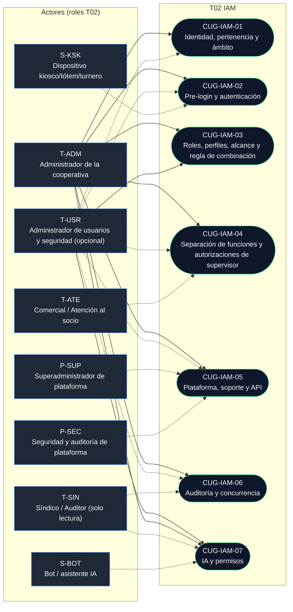
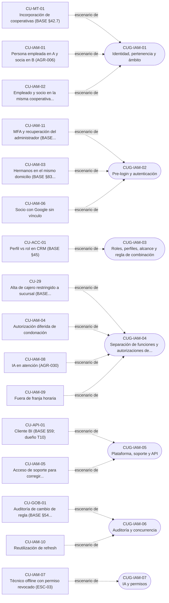

# Casos de uso de T02 IAM — Identidad, autenticación, roles, perfiles, alcance y auditoría

Parte del entregable [21 Casos de uso por módulo](../21-casos-de-uso.md) (artefacto 3.3). Generado con `_trabajo/gen_21_casos_uso.py` desde `docs/especificacion/anexos/T02-IAM-identidad-roles-auditoria.md` y revisado a mano. Ante cualquier diferencia prevalece el anexo.

| Dato | Valor |
|---|---|
| Casos de uso agrupadores (CUG) | 7 |
| RF del anexo | 93 (todos asignados a un CUG) |
| CU con ficha en la sección 16 | 16 |
| CU citados sin ficha en este anexo | 0 |

## 1. Diagramas

### 1.1 Actores y casos de uso agrupadores

Línea continua: actor principal. Línea punteada: actor secundario o participante.

### 1.2 Casos de uso de la especificación por agrupador

Rectángulo: CU con ficha en la sección 16 del anexo. Paralelogramo: CU citado (ficha en otro anexo o sin ficha).

## 2. Fichas de los casos de uso agrupadores

### CUG-IAM-01 — Identidad, pertenencia y ámbito

| Campo | Contenido |
|---|---|
| Actor principal | T-ADM Administrador de la cooperativa |
| Actores secundarios | T-USR Administrador de usuarios y seguridad (opcional) |
| Objetivo | Identidad, pertenencia y ámbito: Existe una identidad de acceso común por persona humana (correo verificado como identificador global, teléfono opcional, contraseña, factores y vínculos federados), sin... |
| Precondición | Usuario del tenant autenticado con el rol indicado y capabilities `iam.roles.ver`, `iam.roles.editar`, `iam.roles.asignar`; módulo IAM licenciado y activo (T01, T02 §4.3). |
| Flujo principal | Según CU-MT-01: 1. P-ADM registra TEN-001 (T01) e invita a USR-ADM-A como T-ADM. 2. USR-ADM-A enrola TOTP, invita a USR-FIN-A (T-TES) y USR-CON-A (T-CON) y vincula a EMP-A-001 con su legajo, sin rol (pertenencia activa sin capabilities: solo iam.miCuenta). 3. Habilita el portal; Ana Pérez (ASO-001 de TEN-001) se registra y vincula su cuenta con prueba. 4. P-ADM registra TEN-002 con USR-ADM-B. USR-ADM-A intenta GET... |
| Alternativos | Sin la capability o fuera del alcance de datos: la acción se deniega por defecto y se audita (T02). |
| CU asociados | CU-MT-01; CU-IAM-01; CU-IAM-02 |
| RF (10) | RF-IAM-001 a 010 |
| Prioridad y olas | Núcleo 8, Estándar 2, Extensión 0; olas O0, O1 |
| Origen | T02 §5.1 |

### CUG-IAM-02 — Pre-login y autenticación

| Campo | Contenido |
|---|---|
| Actor principal | T-ADM Administrador de la cooperativa |
| Actores secundarios | T-USR Administrador de usuarios y seguridad (opcional); S-KSK Dispositivo kiosco/tótem/turnero |
| Objetivo | Pre-login y autenticación: Pre-login por tenant: el tenant se resuelve por subdominio <slug>.<dominio> o, si no hay subdominio, por código de cooperativa. |
| Precondición | Usuario del tenant autenticado con el rol indicado y capabilities `iam.usuarios.ver`, `iam.usuarios.invitar`, `iam.usuarios.editar`; módulo IAM licenciado y activo (T01, T02 §4.3). |
| Flujo principal | Según CU-IAM-11: USR-ADM-A registra TOTP y códigos de recuperación; ingresa; cambia la política de contraseñas con step-up. Olvida la contraseña: recupera con enlace + TOTP sin eliminar MFA. Pierde el teléfono: usa un código de recuperación, enrola uno nuevo; todas las notificaciones se envían; su rol sigue limitado a TEN-001. |
| Alternativos | Bloqueo por intentos: 5 fallos en 15 minutos por identidad bloquean temporalmente 15 minutos (RF-IAM-033). Bloqueo por inactividad del admin y PWA staff tras PRM-IAM-015 minutos: pantalla de desbloqueo con contraseña... (RF-IAM-037). Política de contraseñas NIST: longitud mínima (staff 12, socio 10), máxima 128, sin reglas arbitrarias de... (RF-IAM-040). Sin la capability o fuera del alcance de datos: la acción se deniega por defecto y se audita (T02). |
| CU asociados | CU-IAM-11; CU-IAM-03; CU-IAM-06 |
| RF (30) | RF-IAM-020 a 049 |
| Prioridad y olas | Núcleo 20, Estándar 10, Extensión 0; olas O0, O1 |
| Origen | T02 §5.2 |

### CUG-IAM-03 — Roles, perfiles, alcance y regla de combinación

| Campo | Contenido |
|---|---|
| Actor principal | T-ADM Administrador de la cooperativa; T-USR Administrador de usuarios y seguridad (opcional) |
| Actores secundarios | — |
| Objetivo | Roles, perfiles, alcance y regla de combinación: Catálogo de capabilities declarado en código (packages/shared/capabilities) con metadatos (módulo, recurso, acción, sensible, SoD, autorizable, limitada por importe... |
| Precondición | Usuario del tenant autenticado con el rol indicado y capabilities `iam.rolesPlantilla.editar`, `iam.roles.ver`, `iam.roles.editar`; módulo IAM licenciado y activo (T01, T02 §4.3). |
| Flujo principal | Según CU-ACC-01: USR-SUP-A recibe perfil "Supervisión CRM" (Bandeja de supervisión, Detalle de caso, Conversación) y rol "Supervisor de casos" (crm.casos.ver, crm.casos.derivar, crm.bandejaSupervision.ver). Abre y deriva un caso. Invoca por API cob.cobros.registrar: 403. Abre por URL la pantalla de tarifas: 403 (no está en su perfil) aunque tuviera capability. |
| Alternativos | Denegación por defecto en servidor: cada endpoint declara la capability requerida (RF-IAM-061). Límites de importe por asignación y capability $ (p (RF-IAM-066). Denegaciones explícitas en rol o asignación, que prevalecen sobre cualquier concesión (RF-IAM-067). Sin la capability o fuera del alcance de datos: la acción se deniega por defecto y se audita (T02). |
| CU asociados | CU-ACC-01 |
| RF (20) | RF-IAM-060 a 079 |
| Prioridad y olas | Núcleo 13, Estándar 7, Extensión 0; olas O0, O1 |
| Origen | T02 §5.3 |

### CUG-IAM-04 — Separación de funciones y autorizaciones de supervisor

| Campo | Contenido |
|---|---|
| Actor principal | T-ADM Administrador de la cooperativa |
| Actores secundarios | T-USR Administrador de usuarios y seguridad (opcional); T-ATE Comercial / Atención al socio |
| Objetivo | Separación de funciones y autorizaciones de supervisor: SoD dinámica siempre bloqueante: quien crea/solicita un objeto no puede aprobarlo, quien registra un cobro no puede aprobar su propia anulación, nadie aprueba su propia... |
| Precondición | Usuario del tenant autenticado con el rol indicado y capabilities `iam.autorizaciones.solicitar`, `iam.autorizaciones.bandeja`, `iam.sod.configurar`; módulo IAM licenciado y activo (T01, T02 §4.3). |
| Flujo principal | Según CU-29: 1. Invita a USR-CAJ-01 (correo ficticio) con rol T-CAJ, alcance suc = Centro, caja = CAJ-01, límite de anulación ARS 0 (toda anulación requiere autorización), perfil "Caja". 2. USR-CAJ-01 acepta, crea contraseña y queda en contexto Centro/CAJ-01. 3. Registra cobros y consulta sus operaciones. 4. Intenta editar una tarifa: el ítem no aparece en el menú; la llamada directa a la API devuelve 403 no_capability y queda... |
| Alternativos | Según CU-29: si pierde la función, T-USR revoca el rol; authzVersion++ bloquea la siguiente operación en ≤ 60 s y sus sesiones se cierran si se revoca la pertenencia. Sin la capability o fuera del alcance de datos: denegación por defecto y auditoría (T02). |
| CU asociados | CU-29; CU-IAM-04; CU-IAM-08; CU-IAM-09 |
| RF (7) | RF-IAM-090 a 096 |
| Prioridad y olas | Núcleo 7, Estándar 0, Extensión 0; olas O1 |
| Origen | T02 §5.4 |

### CUG-IAM-05 — Plataforma, soporte y API

| Campo | Contenido |
|---|---|
| Actor principal | T-ADM Administrador de la cooperativa |
| Actores secundarios | T-USR Administrador de usuarios y seguridad (opcional); P-SUP Superadministrador de plataforma; P-SEC Seguridad y auditoría de plataforma |
| Objetivo | Plataforma, soporte y API: Usuarios y roles de plataforma (sección 4.1), en tenant PLATFORM, con MFA obligatorio sin SMS. |
| Precondición | Usuario del tenant autenticado con el rol indicado y capabilities `iam.apiClientes.ver`, `iam.apiClientes.gestionar`, `iam.plataforma.usuarios.gestionar`; módulo IAM licenciado y activo (T01, T02 §4.3). |
| Flujo principal | Según CU-API-01: Caso de uso dueño: T10 §16 (CU-API-01, cliente de BI de la cooperativa); T02 describe solo la parte de credenciales, scopes y revocación (RF-IAM-113, P-IAM-20). USR-ADM-A crea CLI-BI-A con scopes fac.comprobantes.ver y cob.cuentaCorriente.ver (equivalentes a "facturacion:leer" y "cobranza:leer"); la herramienta obtiene token por client_credentials y consulta paginado con fecha de corte; no puede consultar TEN-002 ni... |
| Alternativos | Sin la capability o fuera del alcance de datos: la acción se deniega por defecto y se audita (T02). |
| CU asociados | CU-API-01; CU-IAM-05 |
| RF (7) | RF-IAM-110 a 116 |
| Prioridad y olas | Núcleo 5, Estándar 2, Extensión 0; olas O0, O1 |
| Origen | T02 §5.5 |

### CUG-IAM-06 — Auditoría y concurrencia

| Campo | Contenido |
|---|---|
| Actor principal | T-ADM Administrador de la cooperativa |
| Actores secundarios | T-USR Administrador de usuarios y seguridad (opcional); T-SIN Síndico / Auditor (solo lectura) |
| Objetivo | Auditoría y concurrencia: Auditoría de cada cambio persistente (negocio, configuración, reglas, roles, perfiles, asignaciones) con evento, tenant/ámbito, objeto, operación, actor humano o... |
| Precondición | Usuario del tenant autenticado con el rol indicado y capabilities `iam.auditoria.cambios.ver`, `iam.auditoria.accesos.ver`, `iam.auditoria.lecturas.ver`; módulo IAM licenciado y activo (T01, T02 §4.3). |
| Flujo principal | Según CU-GOB-01: Caso de uso dueño: T11 §16.1 (CU-GOB-01, aprobación del cambio de configuración); T10 y T01 lo citan para el tablero y la alerta. T02 describe solo la parte de auditoría y aislamiento (evidencia AUD-DEMO-001). Un T-FAC propone cambiar BON-VAR-30 de 30 % a 20 % con vigencia futura; auditLogs registra borrador (30 → 20); T-GER aprueba (evento propio, distinto actor); el tablero muestra la configuración pendiente hasta... |
| Alternativos | Registro de intentos fallidos relevantes (denegaciones de permiso, validaciones de negocio sobre operaciones... (RF-IAM-131). Inmutabilidad: sin actualización ni borrado ordinario (RF-IAM-133). Auditoría de accesos: pre-login, login correcto/fallido, MFA, logout, refresh con reutilización, bloqueo... (RF-IAM-134). Sin la capability o fuera del alcance de datos: la acción se deniega por defecto y se audita (T02). |
| CU asociados | CU-GOB-01; CU-IAM-10 |
| RF (15) | RF-IAM-130 a 144 |
| Prioridad y olas | Núcleo 10, Estándar 5, Extensión 0; olas O0, O1, O11 |
| Origen | T02 §5.6 |

### CUG-IAM-07 — IA y permisos

| Campo | Contenido |
|---|---|
| Actor principal | T-USR Administrador de usuarios y seguridad (opcional); T-ADM Administrador de la cooperativa |
| Actores secundarios | T-SIN Síndico / Auditor (solo lectura); S-BOT Bot / asistente IA |
| Objetivo | IA y permisos: La IA actúa con los permisos del usuario que la invoca (nunca más) o con las capabilities mínimas del principal S-BOT. |
| Precondición | Usuario del tenant autenticado con el rol indicado y capabilities `iam.permisos.explicar`, `iam.usuarios.ver`, `iam.usuarios.invitar`; módulo IAM licenciado y activo (T01, T02 §4.3). |
| Flujo principal | Según CU-IAM-07: USR-TEC-A instala sin conexión y captura firma y equipo; mientras, su supervisor le retira la cuadrilla. Al sincronizar, la operación se acepta como pendingReview con evidencia; el supervisor decide; no se duplica salida de equipo. |
| Alternativos | La IA no ejecuta cobros, cortes, anulaciones, cambios de permisos ni decisiones clínicas (RF-IAM-152). Sin la capability o fuera del alcance de datos: la acción se deniega por defecto y se audita (T02). |
| CU asociados | CU-IAM-07 |
| RF (4) | RF-IAM-150 a 153 |
| Prioridad y olas | Núcleo 4, Estándar 0, Extensión 0; olas O1 |
| Origen | T02 §5.7 |

## 3. Casos de uso de la especificación (CU)

| CU | Nombre | Actor según el anexo | Agrupador | Criterio de asignación |
|---|---|---|---|---|
| CU-29 | Alta de cajero restringido a sucursal (BASE §29) | T-USR o T-ADM de TEN-001 | CUG-IAM-04 | similitud |
| CU-MT-01 | Incorporación de cooperativas (BASE §42.7) | — | CUG-IAM-01 | similitud |
| CU-ACC-01 | Perfil vs rol en CRM (BASE §45) | — | CUG-IAM-03 | similitud |
| CU-IAM-11 | MFA y recuperación del administrador (BASE §60) | — | CUG-IAM-02 | similitud |
| CU-GOB-01 | Auditoría de cambio de regla (BASE §54 | — | CUG-IAM-06 | similitud |
| CU-API-01 | Cliente BI (BASE §59 | — | CUG-IAM-05 | RF citados |
| CU-IAM-01 | Persona empleada en A y socia en B (AGR-006) | — | CUG-IAM-01 | similitud |
| CU-IAM-02 | Empleado y socio en la misma cooperativa (PA-IAM-08) | — | CUG-IAM-01 | similitud |
| CU-IAM-03 | Hermanos en el mismo domicilio (BASE §83, ESC-01) | — | CUG-IAM-02 | similitud |
| CU-IAM-04 | Autorización diferida de condonación | — | CUG-IAM-04 | similitud |
| CU-IAM-05 | Acceso de soporte para corregir configuración (AGR-034) | — | CUG-IAM-05 | similitud |
| CU-IAM-06 | Socio con Google sin vínculo | — | CUG-IAM-02 | similitud |
| CU-IAM-07 | Técnico offline con permiso revocado (ESC-03) | — | CUG-IAM-07 | similitud |
| CU-IAM-08 | IA en atención (AGR-030) | — | CUG-IAM-04 | similitud |
| CU-IAM-09 | Fuera de franja horaria | — | CUG-IAM-04 | similitud |
| CU-IAM-10 | Reutilización de refresh | — | CUG-IAM-06 | similitud |

## 4. Cobertura del anexo

| Universo | En la especificación | Incluidos | Excluidos |
|---|---|---|---|
| RF | 93 | 93 | 0 |
| CU con ficha (sección 16) | 16 | 16 | 0 |
| CU citados sin ficha en este anexo | 0 | 0 | 0 |
