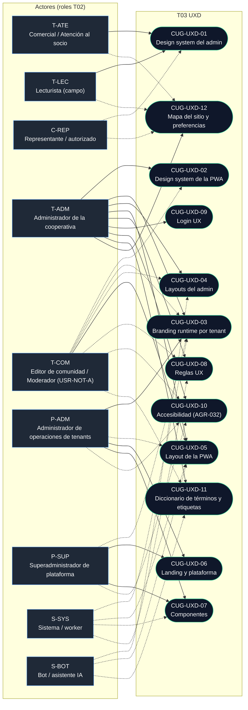
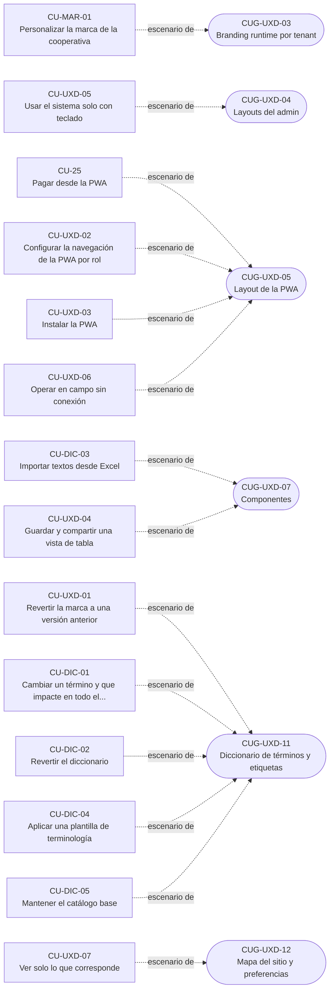

# Casos de uso de T03 UXD — Experiencia, design system, marca por tenant, diccionario de términos y etiquetas, layouts y mapa del sitio

Parte del entregable [21 Casos de uso por módulo](../21-casos-de-uso.md) (artefacto 3.3). Generado con `_trabajo/gen_21_casos_uso.py` desde `docs/especificacion/anexos/T03-UXD-experiencia-marca-diccionario.md` y revisado a mano. Ante cualquier diferencia prevalece el anexo.

| Dato | Valor |
|---|---|
| Casos de uso agrupadores (CUG) | 12 |
| RF del anexo | 179 (todos asignados a un CUG) |
| CU con ficha en la sección 16 | 14 |
| CU citados sin ficha en este anexo | 0 |

## 1. Diagramas

### 1.1 Actores y casos de uso agrupadores

Línea continua: actor principal. Línea punteada: actor secundario o participante.

### 1.2 Casos de uso de la especificación por agrupador

Rectángulo: CU con ficha en la sección 16 del anexo. Paralelogramo: CU citado (ficha en otro anexo o sin ficha).

## 2. Fichas de los casos de uso agrupadores

### CUG-UXD-01 — Design system del admin

| Campo | Contenido |
|---|---|
| Actor principal | T-ATE Comercial / Atención al socio; T-LEC Lecturista (campo) |
| Actores secundarios | C-REP Representante / autorizado |
| Objetivo | Design system del admin: El admin usa tema oscuro por defecto con tema claro disponible, conmutado por data-theme en <html>. |
| Precondición | Usuario del tenant autenticado con el rol indicado y capabilities `uxd.tokens.ver`, `uxd.preferencias.editar`; módulo UXD licenciado y activo (T01, T02 §4.3). |
| Flujo principal | 1. El admin usa tema oscuro por defecto con tema claro disponible, conmutado por data-theme en <html> (RF-UXD-001). 2. Tokens del admin oscuro: --canvas #111019, --panel #1e1a2b, --panel-2 #17141f, --ink #ece9f4, --line #2c2739, --brand... (RF-UXD-002). 3. Tokens del admin claro derivados (7.A.1) con --brand igual en claro y oscuro salvo override del tenant (RF-UXD-003). 4. Tipografías del admin: Space Grotesk (títulos), IBM Plex Sans (cuerpo), IBM Plex Mono (importes, lecturas, códigos... (RF-UXD-004). 5. Estados semánticos únicos ok / warn / bad / info / neutral usados por StatusBadge, toasts, rail de cards y KPIs (RF-UXD-005). 6. Radios --r 12px (paneles, modales, cards) y --r-s 9px (campos, botones, chips de filtro) (RF-UXD-006). |
| Alternativos | Sin la capability o fuera del alcance de datos: la acción se deniega por defecto y se audita (T02). |
| CU asociados | — (sin CU en la especificación; el flujo sale de los RF) |
| RF (10) | RF-UXD-001 a 010 |
| Prioridad y olas | Núcleo 8, Estándar 2, Extensión 0; olas O0, O1 |
| Origen | T03 §5.1 |

### CUG-UXD-02 — Design system de la PWA

| Campo | Contenido |
|---|---|
| Actor principal | T-ADM Administrador de la cooperativa |
| Actores secundarios | T-COM Editor de comunidad / Moderador (USR-NOT-A) |
| Objetivo | Design system de la PWA: Piel oscura .pwa-mod aplicada a listados, formularios y modales de la PWA, independiente del tema de la empresa. |
| Precondición | Usuario del tenant autenticado con el rol indicado y capabilities `uxd.marca.ver`, `uxd.marca.configurar`, `uxd.marca.asistir`; módulo UXD licenciado y activo (T01, T02 §4.3). |
| Flujo principal | 1. Piel oscura .pwa-mod aplicada a listados, formularios y modales de la PWA, independiente del tema de la empresa (RF-UXD-011). 2. Tokens .pwa-mod: --pwa-bg #000 (página) / #22222b (hoja), --pwa-brand (default #7a51ca), --pwa-lilac (default #8b78ff)... (RF-UXD-012). 3. Fondo glow obligatorio: background-color #000 + radial-gradient(90% 55% at 50% -8%, rgba(139,120,255,.18), transparent... (RF-UXD-013). 4. Tipografía única de la PWA: 'Sora', 'Montserrat', 'Segoe UI', sans-serif, con cifras tabulares (font-variant-numeric... (RF-UXD-014). 5. Tema claro de base de la PWA (style.css): página #f8fafc, superficie #ffffff, texto #0f172a, secundario #64748b, marca... (RF-UXD-015). 6. Resolución del tema en tres niveles: política del tenant (dark / light / user), preferencia del usuario (si la política... (RF-UXD-016). |
| Alternativos | Sin la capability o fuera del alcance de datos: la acción se deniega por defecto y se audita (T02). |
| CU asociados | — (sin CU en la especificación; el flujo sale de los RF) |
| RF (10) | RF-UXD-011 a 020 |
| Prioridad y olas | Núcleo 9, Estándar 1, Extensión 0; olas O0, O1 |
| Origen | T03 §5.2 |

### CUG-UXD-03 — Branding runtime por tenant

| Campo | Contenido |
|---|---|
| Actor principal | T-ADM Administrador de la cooperativa; P-ADM Administrador de operaciones de tenants |
| Actores secundarios | P-SUP Superadministrador de plataforma; T-COM Editor de comunidad / Moderador (USR-NOT-A); S-SYS Sistema / worker |
| Objetivo | Branding runtime por tenant: El alta de un tenant crea su tenantBranding publicado con valores por defecto (nombre del tenant, colores default, logos de producto) para que admin, PWA y landing... |
| Precondición | uxd.marca.editar; tenant activo |
| Flujo principal | Según CU-MAR-01: 1. Abre PAN-UXD-01. 2. Carga nombre, nombre corto y 3 colores (ve contraste en vivo). 3. Sube logos por canal (JOB-UXD-01 genera variantes). 4. Revisa previsualización (admin, PWA, login, splash, ícono, email, PDF). 5. Publica con nota. 6. Las apps abiertas toman la marca en ≤ PRM-UXD-012 |
| Alternativos | Según CU-MAR-01: 2a. Contraste insuficiente: advertencia, propone color derivado; puede publicar solo si la combinación crítica (texto sobre brand) cumple. 3a. Recurso rechazado (formato/peso/SVG con scripts): motivo y reintento. 5a. PRM-UXD-021 activo: queda "pendiente de publicar" para otro... Sin la capability o fuera del alcance de datos: denegación por defecto y auditoría (T02). |
| CU asociados | CU-MAR-01 |
| RF (20) | RF-UXD-021 a 040 |
| Prioridad y olas | Núcleo 12, Estándar 7, Extensión 1; olas O0, O1 |
| Origen | T03 §5.3 |

### CUG-UXD-04 — Layouts del admin

| Campo | Contenido |
|---|---|
| Actor principal | T-ADM Administrador de la cooperativa |
| Actores secundarios | T-COM Editor de comunidad / Moderador (USR-NOT-A); S-BOT Bot / asistente IA |
| Objetivo | Layouts del admin: AdminShell único con topbar: logo del producto, logo del tenant, selector de contexto, botón dict:ui.mapaSitio.titulo (Mapa del sitio), accesos fijados, buscador global... |
| Precondición | — |
| Flujo principal | Según CU-UXD-05: Salto a contenido, navegación del sidebar con flechas, Ctrl+K mapa del sitio, formularios y modales con foco atrapado y Esc |
| Alternativos | Según CU-UXD-05: — Sin la capability o fuera del alcance de datos: denegación por defecto y auditoría (T02). |
| CU asociados | CU-UXD-05 |
| RF (22) | RF-UXD-041 a 062 |
| Prioridad y olas | Núcleo 15, Estándar 6, Extensión 1; olas O0, O1 |
| Origen | T03 §5.4 |

### CUG-UXD-05 — Layout de la PWA

| Campo | Contenido |
|---|---|
| Actor principal | T-ADM Administrador de la cooperativa; T-COM Editor de comunidad / Moderador (USR-NOT-A) |
| Actores secundarios | P-ADM Administrador de operaciones de tenants; S-SYS Sistema / worker; S-BOT Bot / asistente IA |
| Objetivo | Layout de la PWA: Una sola PWA (apps/pwa) con landing por rol: socio, empleado, técnico, lecturista, cobrador. |
| Precondición | Sesión PWA; deuda |
| Flujo principal | Según CU-25: 1. FAB Pagar. 2. Elige comprobantes (preseleccionados vencidos). 3. Elige medio. 4. Confirma. 5. Ve resultado con estado (aprobado, pendiente, rechazado) y comprobante |
| Alternativos | Según CU-25: 5a. Sin conexión: no permite pagar, explica. 5b. Pendiente: aviso cuando se acredite (T09) Sin la capability o fuera del alcance de datos: denegación por defecto y auditoría (T02). |
| CU asociados | CU-25; CU-UXD-02; CU-UXD-03; CU-UXD-06 |
| RF (13) | RF-UXD-063 a 075 |
| Prioridad y olas | Núcleo 10, Estándar 3, Extensión 0; olas O0, O2 |
| Origen | T03 §5.5 |

### CUG-UXD-06 — Landing y plataforma

| Campo | Contenido |
|---|---|
| Actor principal | P-ADM Administrador de operaciones de tenants; P-SUP Superadministrador de plataforma |
| Actores secundarios | — |
| Objetivo | Landing y plataforma: LandingLayout público por tenant (resuelto por subdominio): cabecera con logo y navegación, hero, servicios habilitados, noticias públicas, acceso a la app, consulta... |
| Precondición | Usuario de plataforma con MFA y capability de plataforma; acciones sobre datos de un tenant solo con acceso de soporte vigente (T02 RN-IAM-060). |
| Flujo principal | 1. LandingLayout público por tenant (resuelto por subdominio): cabecera con logo y navegación, hero, servicios... (RF-UXD-076). 2. La landing usa tipografía Sora y los tokens claros de la PWA por defecto (público general), con secciones en piel... (RF-UXD-077). 3. El ingreso a la app desde la landing conserva el contexto del tenant (no pide código de empresa) (RF-UXD-078). 4. PlatformShell: misma estructura que AdminShell con marca del producto (sin marca de tenant), banda superior distintiva... (RF-UXD-079). 5. Dashboard global de plataforma y dashboard de tenant separados (RF-UXD-080). |
| Alternativos | Sin la capability o fuera del alcance de datos: la acción se deniega por defecto y se audita (T02). |
| CU asociados | — (sin CU en la especificación; el flujo sale de los RF) |
| RF (5) | RF-UXD-076 a 080 |
| Prioridad y olas | Núcleo 4, Estándar 1, Extensión 0; olas O0, O1, O2 |
| Origen | T03 §5.6 |

### CUG-UXD-07 — Componentes

| Campo | Contenido |
|---|---|
| Actor principal | P-ADM Administrador de operaciones de tenants; P-SUP Superadministrador de plataforma |
| Actores secundarios | S-SYS Sistema / worker |
| Objetivo | Componentes: Portar los componentes molde de la PWA: PwaModal, PwaTabs, PwaFilters, PwaEmptyState, PwaFab, PwaFilePicker, PwaCardExtra, ConfirmSheet, AppIcon, SplashScreen... |
| Precondición | uxd.diccionario.importar |
| Flujo principal | Según CU-DIC-03: Exportar plantilla, completar, subir, previsualizar (nuevas/cambiadas/errores), confirmar como borradores |
| Alternativos | Según CU-DIC-03: Filas con clave inexistente o protegida: se informan y no se importan Sin la capability o fuera del alcance de datos: denegación por defecto y auditoría (T02). |
| CU asociados | CU-DIC-03; CU-UXD-04 |
| RF (17) | RF-UXD-081 a 097 |
| Prioridad y olas | Núcleo 15, Estándar 2, Extensión 0; olas O0, O1, O2, O3 |
| Origen | T03 §5.7 |

### CUG-UXD-08 — Reglas UX

| Campo | Contenido |
|---|---|
| Actor principal | T-ADM Administrador de la cooperativa |
| Actores secundarios | T-COM Editor de comunidad / Moderador (USR-NOT-A); S-SYS Sistema / worker |
| Objetivo | Reglas UX: Card de listado con anatomía fija: rail de color de estado · ícono de tipo · título que nunca se trunca · badge de estado · dato principal · 2–4 meta-tags · chevron. |
| Precondición | Usuario del tenant autenticado con el rol indicado y capabilities `uxd.navegacion.configurar`, `uxd.vistas.compartir`; módulo UXD licenciado y activo (T01, T02 §4.3). |
| Flujo principal | 1. Card de listado con anatomía fija: rail de color de estado · ícono de tipo · título que nunca se trunca · badge de... (RF-UXD-098). 2. Alta siempre en modal abierto desde el FAB (PWA), nunca en página completa (RF-UXD-099). 3. Carga inicial con 3 skeleton cards del mismo formato (nunca spinner centrado) (RF-UXD-100). 4. Fecha única dd-mm-yyyy desde helper central formatDate (y dd-mm-yyyy HH:mm para fecha-hora), en zona del tenant (RF-UXD-101). 5. Errores inline en el formulario, nunca alert() del navegador (RF-UXD-102). 6. Mapa central notifKinds tipo → {ícono, color, etiqueta dict} con fallback por prefijo (fac.*, cob.*, mor.*, crm.*... (RF-UXD-103). |
| Alternativos | Errores inline en el formulario, nunca alert() del navegador (RF-UXD-102). Estados de integración visibles: Pendiente, Confirmado, Fallido, Resultado incierto con explicación... (RF-UXD-110). Sin la capability o fuera del alcance de datos: la acción se deniega por defecto y se audita (T02). |
| CU asociados | — (sin CU en la especificación; el flujo sale de los RF) |
| RF (14) | RF-UXD-098 a 111 |
| Prioridad y olas | Núcleo 11, Estándar 3, Extensión 0; olas O0, O1, O4 |
| Origen | T03 §5.8 |

### CUG-UXD-09 — Login UX

| Campo | Contenido |
|---|---|
| Actor principal | T-ADM Administrador de la cooperativa |
| Actores secundarios | — |
| Objetivo | Login UX: Resolución del tenant por subdominio ({slug}.{dominio}). |
| Precondición | Usuario del tenant autenticado con el rol indicado y capabilities `uxd.ayuda.editar`, `uxd.marca.ver`, `uxd.marca.configurar`; módulo UXD licenciado y activo (T01, T02 §4.3). |
| Flujo principal | 1. Resolución del tenant por subdominio ({slug}.{dominio}) (RF-UXD-112). 2. Pasos: usuario (email, DNI/CUIT para socios, legajo/usuario para empleados) → contraseña → 2FA si corresponde (reenvío... (RF-UXD-113). 3. "Recordarme" decide localStorage vs sessionStorage (RF-UXD-114). 4. Selector de tenant si el usuario pertenece a varios, y de espacio (socio / empleado) si tiene ambas relaciones en el... (RF-UXD-115). 5. Splash post-login, oferta de instalar la app y landing según rol (RF-UXD-116). 6. Ayuda de formato bajo cada campo ("DNI sin puntos") y errores específicos para el usuario sin habilitar enumeración en... (RF-UXD-117). |
| Alternativos | Ayuda de formato bajo cada campo ("DNI sin puntos") y errores específicos para el usuario sin habilitar... (RF-UXD-117). Bloqueo de sesión por inactividad con aviso previo de 60 s y conservación del trabajo en borrador (RF-UXD-121). Sin la capability o fuera del alcance de datos: la acción se deniega por defecto y se audita (T02). |
| CU asociados | — (sin CU en la especificación; el flujo sale de los RF) |
| RF (11) | RF-UXD-112 a 122 |
| Prioridad y olas | Núcleo 8, Estándar 3, Extensión 0; olas O0, O1, O2 |
| Origen | T03 §5.9 |

### CUG-UXD-10 — Accesibilidad (AGR-032)

| Campo | Contenido |
|---|---|
| Actor principal | T-ADM Administrador de la cooperativa |
| Actores secundarios | P-ADM Administrador de operaciones de tenants; T-COM Editor de comunidad / Moderador (USR-NOT-A); P-SUP Superadministrador de plataforma |
| Objetivo | Accesibilidad (AGR-032): Objetivo WCAG 2.2 nivel AA para admin, PWA (todas las variantes), landing y plataforma. |
| Precondición | Usuario del tenant autenticado con el rol indicado y capabilities `uxd.ayuda.editar`, `uxd.diccionario.ver`, `uxd.diccionario.editar`; módulo UXD licenciado y activo (T01, T02 §4.3). |
| Flujo principal | 1. Objetivo WCAG 2.2 nivel AA para admin, PWA (todas las variantes), landing y plataforma (RF-UXD-123). 2. Operación completa por teclado, orden de foco lógico, foco visible (:focus-visible con anillo de 2 px y contraste ≥... (RF-UXD-124). 3. Contraste ≥ 4,5:1 texto normal, ≥ 3:1 texto grande y componentes de UI, en ambos temas y con cualquier color de tenant... (RF-UXD-125). 4. Etiquetas programáticas en todos los campos (label visible (RF-UXD-126). 5. Mensajes de error claros que indican qué falta y cómo corregir (RF-UXD-127). 6. Alternativa al mapa y a cualquier gesto táctil (arrastrar, pinch, swipe, firma): siempre hay control equivalente con un... (RF-UXD-128). |
| Alternativos | Etiquetas programáticas en todos los campos (label visible (RF-UXD-126). Mensajes de error claros que indican qué falta y cómo corregir (RF-UXD-127). Sin la capability o fuera del alcance de datos: la acción se deniega por defecto y se audita (T02). |
| CU asociados | — (sin CU en la especificación; el flujo sale de los RF) |
| RF (17) | RF-UXD-123 a 139 |
| Prioridad y olas | Núcleo 17, Estándar 0, Extensión 0; olas O0, O1 |
| Origen | T03 §5.10 |

### CUG-UXD-11 — Diccionario de términos y etiquetas

| Campo | Contenido |
|---|---|
| Actor principal | T-ADM Administrador de la cooperativa |
| Actores secundarios | T-COM Editor de comunidad / Moderador (USR-NOT-A); S-BOT Bot / asistente IA |
| Objetivo | Diccionario de términos y etiquetas: Diccionario de términos por cooperativa. |
| Precondición | uxd.marca.publicar; ≥ 2 releases |
| Flujo principal | Según CU-UXD-01: 1. PAN-UXD-01 > Versiones. 2. Elige release N, ve diferencias. 3. Confirma con motivo. 4. Se crea release nuevo con el contenido de N |
| Alternativos | Según CU-UXD-01: 2a. Recurso de N dado de baja: se restaura si existe en almacenamiento; si no, bloquea con detalle Sin la capability o fuera del alcance de datos: denegación por defecto y auditoría (T02). |
| CU asociados | CU-UXD-01; CU-DIC-01; CU-DIC-02; CU-DIC-04; CU-DIC-05 |
| RF (32) | RF-UXD-140 a 170, 179 |
| Prioridad y olas | Núcleo 26, Estándar 6, Extensión 0; olas O0, O1, O2, O4, O6 |
| Origen | T03 §5.11 |

### CUG-UXD-12 — Mapa del sitio y preferencias

| Campo | Contenido |
|---|---|
| Actor principal | T-ADM Administrador de la cooperativa |
| Actores secundarios | T-ATE Comercial / Atención al socio; T-LEC Lecturista (campo); C-REP Representante / autorizado |
| Objetivo | Mapa del sitio y preferencias: Mapa del sitio completo por app (admin, PWA socio, PWA empleado, PWA campo, landing, plataforma) según 10.8, con ID estable SM-*, ruta, capability y módulo. |
| Precondición | Sesión válida |
| Flujo principal | Según CU-UXD-07: 1. Ingresa. 2. El sidebar y el mapa del sitio muestran solo ítems con RN-UXD-022 verdadera. 3. Una ruta directa sin permiso muestra EmptyState "No tenés acceso" (403) sin datos |
| Alternativos | Según CU-UXD-07: 2a. Administrador ve "No contratado" (PRM-UXD-026) con enlace a licencia Sin la capability o fuera del alcance de datos: denegación por defecto y auditoría (T02). |
| CU asociados | CU-UXD-07 |
| RF (8) | RF-UXD-171 a 178 |
| Prioridad y olas | Núcleo 4, Estándar 4, Extensión 0; olas O0, O1 |
| Origen | T03 §5.12 |

## 3. Casos de uso de la especificación (CU)

| CU | Nombre | Actor según el anexo | Agrupador | Criterio de asignación |
|---|---|---|---|---|
| CU-MAR-01 | Personalizar la marca de la cooperativa | Administrador de cooperativa | CUG-UXD-03 | similitud |
| CU-UXD-01 | Revertir la marca a una versión anterior | Administrador de cooperativa | CUG-UXD-11 | similitud |
| CU-DIC-01 | Cambiar un término y que impacte en todo el sistema | Administrador de cooperativa | CUG-UXD-11 | RF citados |
| CU-DIC-02 | Revertir el diccionario | Administrador de cooperativa | CUG-UXD-11 | similitud |
| CU-DIC-03 | Importar textos desde Excel | Administrador de cooperativa | CUG-UXD-07 | similitud |
| CU-DIC-04 | Aplicar una plantilla de terminología | Administrador de cooperativa | CUG-UXD-11 | similitud |
| CU-DIC-05 | Mantener el catálogo base | Administrador de plataforma | CUG-UXD-11 | RF citados |
| CU-UXD-07 | Ver solo lo que corresponde | Cualquier usuario interno | CUG-UXD-12 | similitud |
| CU-25 | Pagar desde la PWA | Socio | CUG-UXD-05 | similitud |
| CU-UXD-02 | Configurar la navegación de la PWA por rol | Administrador de cooperativa | CUG-UXD-05 | similitud |
| CU-UXD-03 | Instalar la PWA | Socio / empleado / técnico | CUG-UXD-05 | similitud |
| CU-UXD-04 | Guardar y compartir una vista de tabla | Usuario interno | CUG-UXD-07 | similitud |
| CU-UXD-05 | Usar el sistema solo con teclado | Usuario interno con discapacidad motriz | CUG-UXD-04 | similitud |
| CU-UXD-06 | Operar en campo sin conexión | Técnico / lecturista | CUG-UXD-05 | similitud |

## 4. Cobertura del anexo

| Universo | En la especificación | Incluidos | Excluidos |
|---|---|---|---|
| RF | 179 | 179 | 0 |
| CU con ficha (sección 16) | 14 | 14 | 0 |
| CU citados sin ficha en este anexo | 0 | 0 | 0 |
