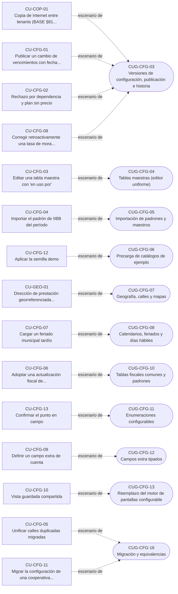

# Casos de uso de T04 CFG — Configuración versionada, parámetros, tablas maestras y geografía

Parte del entregable [21 Casos de uso por módulo](../21-casos-de-uso.md) (artefacto 3.3). Generado con `_trabajo/gen_21_casos_uso.py` desde `docs/especificacion/anexos/T04-CFG-configuracion-parametros-maestros.md` y revisado a mano. Ante cualquier diferencia prevalece el anexo.

| Dato | Valor |
|---|---|
| Casos de uso agrupadores (CUG) | 17 |
| RF del anexo | 143 (todos asignados a un CUG) |
| CU con ficha en la sección 16 | 15 |
| CU citados sin ficha en este anexo | 0 |

## 1. Diagramas

### 1.1 Actores y casos de uso agrupadores

```mermaid
flowchart LR
    subgraph ACT["Actores (roles T02)"]
        direction TB
        A_T_ADM["T-ADM<br/>Administrador de la cooperativa"]
        A_T_GER["T-GER<br/>Gerente"]
        A_P_SUP["P-SUP<br/>Superadministrador de plataforma"]
        A_P_ADM["P-ADM<br/>Administrador de operaciones de tenants"]
        A_T_ATE["T-ATE<br/>Comercial / Atención al socio"]
        A_S_SYS["S-SYS<br/>Sistema / worker"]
        A_T_CON["T-CON<br/>Contador / Contable (MT-006)"]
        A_S_AGT["S-AGT<br/>Agente de hardware local"]
    end
    subgraph SIS["T04 CFG"]
        direction TB
        CUG_CFG_01(["CUG-CFG-01<br/>Registro y modelo de parámetros"])
        CUG_CFG_02(["CUG-CFG-02<br/>Ámbitos y lectura"])
        CUG_CFG_03(["CUG-CFG-03<br/>Versiones de configuración, publicación e historia"])
        CUG_CFG_04(["CUG-CFG-04<br/>Tablas maestras (editor uniforme)"])
        CUG_CFG_05(["CUG-CFG-05<br/>Importación de padrones y maestros"])
        CUG_CFG_06(["CUG-CFG-06<br/>Precarga de catálogos de ejemplo"])
        CUG_CFG_07(["CUG-CFG-07<br/>Geografía, calles y mapas"])
        CUG_CFG_08(["CUG-CFG-08<br/>Calendarios, feriados y días hábiles"])
        CUG_CFG_09(["CUG-CFG-09<br/>Índices económicos y monedas"])
        CUG_CFG_10(["CUG-CFG-10<br/>Tablas fiscales comunes y padrones"])
        CUG_CFG_11(["CUG-CFG-11<br/>Enumeraciones configurables"])
        CUG_CFG_12(["CUG-CFG-12<br/>Campos extra tipados"])
        CUG_CFG_13(["CUG-CFG-13<br/>Reemplazo del motor de pantallas configurable"])
        CUG_CFG_14(["CUG-CFG-14<br/>Configuración técnica, bóveda y entorno"])
        CUG_CFG_15(["CUG-CFG-15<br/>Perfil de configuración por servicio y reglas transversales"])
        CUG_CFG_16(["CUG-CFG-16<br/>Migración y equivalencias"])
        CUG_CFG_17(["CUG-CFG-17<br/>Entidades jurídicas, sucursales y puestos (DEC-064)"])
    end
    A_T_ADM --> CUG_CFG_01
    A_T_GER -.-> CUG_CFG_01
    A_T_ADM --> CUG_CFG_02
    A_P_SUP --> CUG_CFG_02
    A_P_ADM -.-> CUG_CFG_02
    A_T_ADM --> CUG_CFG_03
    A_T_ADM --> CUG_CFG_04
    A_T_ATE -.-> CUG_CFG_04
    A_T_ADM --> CUG_CFG_05
    A_T_ATE -.-> CUG_CFG_05
    A_S_SYS -.-> CUG_CFG_05
    A_T_ADM --> CUG_CFG_06
    A_T_ADM --> CUG_CFG_07
    A_P_SUP -.-> CUG_CFG_07
    A_P_ADM -.-> CUG_CFG_07
    A_S_SYS -.-> CUG_CFG_07
    A_T_ADM --> CUG_CFG_08
    A_P_SUP -.-> CUG_CFG_08
    A_P_ADM -.-> CUG_CFG_08
    A_T_ADM --> CUG_CFG_09
    A_P_ADM -.-> CUG_CFG_09
    A_P_SUP -.-> CUG_CFG_09
    A_S_SYS -.-> CUG_CFG_09
    A_T_ADM --> CUG_CFG_10
    A_T_CON --> CUG_CFG_10
    A_P_ADM -.-> CUG_CFG_10
    A_P_SUP --> CUG_CFG_11
    A_T_ADM -.-> CUG_CFG_11
    A_P_ADM -.-> CUG_CFG_11
    A_T_ADM --> CUG_CFG_12
    A_T_ADM --> CUG_CFG_13
    A_T_ADM --> CUG_CFG_14
    A_T_ATE -.-> CUG_CFG_14
    A_T_ADM --> CUG_CFG_15
    A_T_ADM --> CUG_CFG_16
    A_P_SUP -.-> CUG_CFG_16
    A_T_GER -.-> CUG_CFG_16
    A_T_ADM --> CUG_CFG_17
    A_S_AGT -.-> CUG_CFG_17
    classDef actor fill:#1f2937,stroke:#60a5fa,color:#f9fafb;
    classDef cug fill:#0f172a,stroke:#34d399,color:#f9fafb;
    class A_T_ADM,A_T_GER,A_P_SUP,A_P_ADM,A_T_ATE,A_S_SYS,A_T_CON,A_S_AGT actor;
    class CUG_CFG_01,CUG_CFG_02,CUG_CFG_03,CUG_CFG_04,CUG_CFG_05,CUG_CFG_06,CUG_CFG_07,CUG_CFG_08,CUG_CFG_09,CUG_CFG_10,CUG_CFG_11,CUG_CFG_12,CUG_CFG_13,CUG_CFG_14,CUG_CFG_15,CUG_CFG_16,CUG_CFG_17 cug;
```

Línea continua: actor principal. Línea punteada: actor secundario o participante.

### 1.2 Casos de uso de la especificación por agrupador

Rectángulo: CU con ficha en la sección 16 del anexo. Paralelogramo: CU citado (ficha en otro anexo o sin ficha).

## 2. Fichas de los casos de uso agrupadores

### CUG-CFG-01 — Registro y modelo de parámetros

| Campo | Contenido |
|---|---|
| Actor principal | T-ADM Administrador de la cooperativa |
| Actores secundarios | T-GER Gerente |
| Objetivo | Registro y modelo de parámetros: Cada parámetro se declara en código (paquete del módulo dueño) con: clave semántica, módulo, grupo, tipo, validación, ámbitos permitidos, default, clase de cambio, modo... |
| Precondición | Usuario del tenant autenticado con el rol indicado y capabilities `cfg.parametros.ver`, `cfg.parametros.editar`, `cfg.parametros.publicar`; módulo CFG licenciado y activo (T01, T02 §4.3). |
| Flujo principal | 1. Cada parámetro se declara en código (paquete del módulo dueño) con: clave semántica, módulo, grupo, tipo, validación... (RF-CFG-001). 2. En cada despliegue un job idempotente sincroniza el registro de código con parameterDefinitions (alta, actualización de... (RF-CFG-002). 3. Una clave inexistente es un error de desarrollo: la lectura lanza excepción y registra alerta (RF-CFG-003). 4. Tipos soportados: boolean, integer, decimal, money, percentage, string, text, date, time, dateTime, duration, enum... (RF-CFG-004). 5. Validaciones declarables: requerido, mínimo, máximo, paso, decimales, largo máximo, expresión regular, valores... (RF-CFG-005). 6. Dependencias declarables entre parámetros: requires (A habilitado exige B con valor válido), excludes, enables (B solo... (RF-CFG-006). |
| Alternativos | Una clave inexistente es un error de desarrollo: la lectura lanza excepción y registra alerta (RF-CFG-003). Prohibido guardar secretos en parámetros: el tipo secretRef almacena solo el identificador del secreto de la... (RF-CFG-014). Sin la capability o fuera del alcance de datos: la acción se deniega por defecto y se audita (T02). |
| CU asociados | — (sin CU en la especificación; el flujo sale de los RF) |
| RF (17) | RF-CFG-001 a 017 |
| Prioridad y olas | Núcleo 15, Estándar 2, Extensión 0; olas O0, O1, O2 |
| Origen | T04 §5.1 |

### CUG-CFG-02 — Ámbitos y lectura

| Campo | Contenido |
|---|---|
| Actor principal | T-ADM Administrador de la cooperativa; P-SUP Superadministrador de plataforma |
| Actores secundarios | P-ADM Administrador de operaciones de tenants |
| Objetivo | Ámbitos y lectura: Ámbitos soportados: platform, tenant, branch (sucursal), service, category (categoría tarifaria del servicio), user. |
| Precondición | Usuario del tenant autenticado con el rol indicado y capabilities `cfg.sucursales.ver`, `cfg.sucursales.editar`, `pla.cfg.registro.ver`; módulo CFG licenciado y activo (T01, T02 §4.3). |
| Flujo principal | 1. Ámbitos soportados: platform, tenant, branch (sucursal), service, category (categoría tarifaria del servicio), user (RF-CFG-018). 2. Precedencia de resolución, de más específico a más general: user → category → service → branch → tenant → platform... (RF-CFG-019). 3. Lectura única config.get(clave, { tenantId, branchId, serviceId, categoryId, userId, at, knownAt }): at = fecha... (RF-CFG-020). 4. La respuesta de lectura incluye value, scopeResolved, valueId, configVersionId, validFrom, validTo, para que cada... (RF-CFG-021). 5. Caché en memoria por proceso con invalidación por evento cfg.configVersion.published y por vencimiento de vigencia (RF-CFG-022). 6. Lectura masiva por módulo/grupo para pantallas y apps (/api/admin/cfg/effective?module=) y lectura pública acotada para... (RF-CFG-023). |
| Alternativos | Sin la capability o fuera del alcance de datos: la acción se deniega por defecto y se audita (T02). |
| CU asociados | — (sin CU en la especificación; el flujo sale de los RF) |
| RF (8) | RF-CFG-018 a 025 |
| Prioridad y olas | Núcleo 7, Estándar 1, Extensión 0; olas O1 |
| Origen | T04 §5.2 |

### CUG-CFG-03 — Versiones de configuración, publicación e historia

| Campo | Contenido |
|---|---|
| Actor principal | T-ADM Administrador de la cooperativa |
| Actores secundarios | — |
| Objetivo | Versiones de configuración, publicación e historia: Todo cambio de configuración (parámetros, registros maestros del tenant, enumeraciones, campos extra, personalizaciones de formularios y configuraciones de módulo que se... |
| Precondición | Usuario del tenant autenticado con el rol indicado y capabilities `cfg.versiones.revertir`, `cfg.versiones.aprobar`, `cfg.versiones.cancelar`; módulo CFG licenciado y activo (T01, T02 §4.3). |
| Flujo principal | Según CU-COP-01: CFG aporta los pasos 3, 5 y 6: el destino recibe una configVersion en borrador con dependencias pendientes; se simula contratación y primera factura sin deuda real; se publica por el circuito del destino. Datos: origen TEN-001/INT/versión 1; destino TEN-002/INT/versión 1; COP-DEMO-001; estado inicial Borrador con dependencias pendientes. |
| Alternativos | Publicación íntegra y atómica: todos los ítems de la versión se vuelven vigentes en una sola transacción (RF-CFG-033). Reversión: una versión publicada puede revertirse creando una versión nueva que restituye los valores... (RF-CFG-038). Sin la capability o fuera del alcance de datos: la acción se deniega por defecto y se audita (T02). |
| CU asociados | CU-COP-01; CU-CFG-01; CU-CFG-02; CU-CFG-08 |
| RF (19) | RF-CFG-026 a 044 |
| Prioridad y olas | Núcleo 16, Estándar 3, Extensión 0; olas O1, O2 |
| Origen | T04 §5.3 |

### CUG-CFG-04 — Tablas maestras (editor uniforme)

| Campo | Contenido |
|---|---|
| Actor principal | T-ADM Administrador de la cooperativa |
| Actores secundarios | T-ATE Comercial / Atención al socio |
| Objetivo | Tablas maestras (editor uniforme): Registro de tablas maestras (masterTableDefinitions) con código, módulo dueño, ámbito (platform, tenant, platformAdoptable), esquema de campos, clave natural, si es... |
| Precondición | Usuario del tenant autenticado con el rol indicado y capabilities `cfg.maestros.ver`, `cfg.maestros.editar`, `cfg.maestros.anular`; módulo CFG licenciado y activo (T01, T02 §4.3). |
| Flujo principal | Según CU-CFG-03: El operador intenta eliminar el barrio "Barrio Demo Norte"; el sistema informa 120 domicilios y 3 zonas que lo referencian y ofrece inactivar o unificar. |
| Alternativos | Sin la capability o fuera del alcance de datos: la acción se deniega por defecto y se audita (T02). |
| CU asociados | CU-CFG-03 |
| RF (9) | RF-CFG-045 a 053 |
| Prioridad y olas | Núcleo 7, Estándar 2, Extensión 0; olas O1 |
| Origen | T04 §5.4 |

### CUG-CFG-05 — Importación de padrones y maestros

| Campo | Contenido |
|---|---|
| Actor principal | T-ADM Administrador de la cooperativa |
| Actores secundarios | T-ATE Comercial / Atención al socio; S-SYS Sistema / worker |
| Objetivo | Importación de padrones y maestros: Importación por archivo (XLSX/CSV/TXT de ancho fijo) de cualquier tabla maestra importable con ExcelImportWizard: subir → mapear columnas → vista previa con errores por... |
| Precondición | Usuario del tenant autenticado con el rol indicado y capabilities `cfg.maestros.ver`, `cfg.maestros.editar`, `cfg.maestros.anular`; módulo CFG licenciado y activo (T01, T02 §4.3). |
| Flujo principal | Según CU-CFG-04: El responsable fiscal sube el archivo del período 05-2026 de la jurisdicción (ficticio). Vista previa: 250.000 filas, 12 con CUIT inválido. Confirma; el job carga 249.988 entradas con vigencia 01-05-2026 a 31-05-2026 y cierra las anteriores. Consulta CUIT 30-00000000-0 al 15-05-2026: alícuota 2,5 % (ficticia). |
| Alternativos | Importación por archivo (XLSX/CSV/TXT de ancho fijo) de cualquier tabla maestra importable con... (RF-CFG-054). Las importaciones grandes corren como job (cfg:importar-maestro) reanudable, con progreso, cancelación y... (RF-CFG-057). Sin la capability o fuera del alcance de datos: la acción se deniega por defecto y se audita (T02). |
| CU asociados | CU-CFG-04 |
| RF (5) | RF-CFG-054 a 058 |
| Prioridad y olas | Núcleo 4, Estándar 1, Extensión 0; olas O1, O4 |
| Origen | T04 §5.5 |

### CUG-CFG-06 — Precarga de catálogos de ejemplo

| Campo | Contenido |
|---|---|
| Actor principal | T-ADM Administrador de la cooperativa |
| Actores secundarios | — |
| Objetivo | Precarga de catálogos de ejemplo: Paquetes semilla versionados por plataforma. |
| Precondición | Usuario del tenant autenticado con el rol indicado y capabilities `cfg.semillas.aplicar`, `cfg.versiones.revertir`, `cfg.geografia.editar`; módulo CFG licenciado y activo (T01, T02 §4.3). |
| Flujo principal | Según CU-CFG-12: Plataforma crea TEN-DEMO y aplica demo-base-s39. Se crean servicios, conceptos, medios de cobro, estados y roles de §18; tarifas y recargos quedan en un borrador pendiente de aprobación; TRIB-PEND queda pendiente de validación fiscal; REC-PEND deshabilitado. |
| Alternativos | Los datos de demostración se identifican (demoData: true y seedApplicationId) y se mantienen separados de los... (RF-CFG-060). Sin la capability o fuera del alcance de datos: la acción se deniega por defecto y se audita (T02). |
| CU asociados | CU-CFG-12 |
| RF (6) | RF-CFG-059 a 064 |
| Prioridad y olas | Núcleo 5, Estándar 1, Extensión 0; olas O2 |
| Origen | T04 §5.6 |

### CUG-CFG-07 — Geografía, calles y mapas

| Campo | Contenido |
|---|---|
| Actor principal | T-ADM Administrador de la cooperativa |
| Actores secundarios | P-SUP Superadministrador de plataforma; P-ADM Administrador de operaciones de tenants; S-SYS Sistema / worker |
| Objetivo | Geografía, calles y mapas: Catálogo de plataforma de países, provincias (24 jurisdicciones), departamentos/partidos, municipios/gobiernos locales y localidades/asentamientos de Argentina, con... |
| Precondición | Usuario del tenant autenticado con el rol indicado y capabilities `cfg.calles.crear`, `cfg.geografia.editar`, `cfg.plataforma.tablasComunes.editar`; módulo CFG licenciado y activo (T01, T02 §4.3). |
| Flujo principal | Según CU-GEO-01: Ana solicita un servicio para un nuevo domicilio. Selecciona Córdoba y su localidad, busca la calle y completa la altura y unidad. El sistema muestra la dirección normalizada y un punto candidato en Google Maps. Ana o un operador autorizado confirma el acceso correcto al inmueble. El contrato y la visita utilizan esa dirección, mientras el domicilio fiscal permanece separado. Si no aparece la calle de un loteo... |
| Alternativos | Tolerancia a caídas o límites de las fuentes: el formulario se guarda con estado pending y un job reintenta... (RF-CFG-077). Sin la capability o fuera del alcance de datos: la acción se deniega por defecto y se audita (T02). |
| CU asociados | CU-GEO-01 |
| RF (19) | RF-CFG-065 a 083 |
| Prioridad y olas | Núcleo 15, Estándar 4, Extensión 0; olas O1 |
| Origen | T04 §5.7 |

### CUG-CFG-08 — Calendarios, feriados y días hábiles

| Campo | Contenido |
|---|---|
| Actor principal | T-ADM Administrador de la cooperativa |
| Actores secundarios | P-SUP Superadministrador de plataforma; P-ADM Administrador de operaciones de tenants |
| Objetivo | Calendarios, feriados y días hábiles: Calendarios jerárquicos: nacional (plataforma), provincial (plataforma), municipal (tenant), del tenant (días no laborables propios, asuetos) y opcionalmente por servicio. |
| Precondición | Usuario del tenant autenticado con el rol indicado y capabilities `cfg.calendarios.editar`, `cfg.calendarios.ver`, `cfg.plataforma.tablasComunes.editar`; módulo CFG licenciado y activo (T01, T02 §4.3). |
| Flujo principal | Según CU-CFG-07: El 05-08-2026 la municipalidad declara asueto el 07-08-2026. El operador lo agrega al calendario municipal; cfg.holiday.changed hace que M05 recalcule vencimientos de documentos no emitidos; las facturas ya emitidas conservan su vencimiento. |
| Alternativos | Sin la capability o fuera del alcance de datos: la acción se deniega por defecto y se audita (T02). |
| CU asociados | CU-CFG-07 |
| RF (6) | RF-CFG-084 a 089 |
| Prioridad y olas | Núcleo 5, Estándar 1, Extensión 0; olas O1 |
| Origen | T04 §5.8 |

### CUG-CFG-09 — Índices económicos y monedas

| Campo | Contenido |
|---|---|
| Actor principal | T-ADM Administrador de la cooperativa |
| Actores secundarios | P-ADM Administrador de operaciones de tenants; P-SUP Superadministrador de plataforma; S-SYS Sistema / worker |
| Objetivo | Índices económicos y monedas: Series de índices (economicIndexSeries): inflación (IPC nacional/regional INDEC, índices propios), cotizaciones de moneda (comprador/vendedor, por fecha y hora), tasas e... |
| Precondición | Usuario del tenant autenticado con el rol indicado y capabilities `cfg.indices.editar`, `cfg.indices.ver`, `cfg.plataforma.tablasComunes.editar`; módulo CFG licenciado y activo (T01, T02 §4.3). |
| Flujo principal | 1. Series de índices (economicIndexSeries): inflación (IPC nacional/regional INDEC, índices propios), cotizaciones de... (RF-CFG-090). 2. Series de plataforma adoptables: el tenant elige qué serie oficial usa para cada propósito (PRM-CFG-024/025) o crea... (RF-CFG-091). 3. Valores con Decimal128, período o fecha, publishedAt, recordedAt, estado (provisional, definitive), revisión de un... (RF-CFG-092). 4. Carga manual e importación de valores de series propias del tenant con auditoría (RF-CFG-094). 5. Catálogo de monedas (plataforma: ISO 4217 + código ARCA) con atributos del tenant: símbolo, divisible, redondeo... (RF-CFG-095). 6. Consulta de valor de una serie a una fecha con regla de ausencia declarada (último publicado anterior / exacto o error) (RF-CFG-096). |
| Alternativos | Ingesta automática de series oficiales (cotizaciones diarias, tasas, IPC mensual) por job con reintentos y... (RF-CFG-093). Consulta de valor de una serie a una fecha con regla de ausencia declarada (último publicado anterior /... (RF-CFG-096). Sin la capability o fuera del alcance de datos: la acción se deniega por defecto y se audita (T02). |
| CU asociados | — (sin CU en la especificación; el flujo sale de los RF) |
| RF (7) | RF-CFG-090 a 096 |
| Prioridad y olas | Núcleo 6, Estándar 1, Extensión 0; olas O4, O5 |
| Origen | T04 §5.9 |

### CUG-CFG-10 — Tablas fiscales comunes y padrones

| Campo | Contenido |
|---|---|
| Actor principal | T-ADM Administrador de la cooperativa; T-CON Contador / Contable (MT-006) |
| Actores secundarios | P-ADM Administrador de operaciones de tenants |
| Objetivo | Tablas fiscales comunes y padrones: Tabla de plataforma de condiciones frente al IVA con código ARCA de condición del receptor, comprobante por defecto (A/B/C) como atributo sugerido, y vigencia. |
| Precondición | Usuario del tenant autenticado con el rol indicado y capabilities `cfg.fiscal.configurar`, `cfg.fiscal.ver`, `cfg.padrones.importar`; módulo CFG licenciado y activo (T01, T02 §4.3). |
| Flujo principal | Según CU-CFG-06: Plataforma publica un release de alícuotas de IIBB con vigencia futura y fuente normativa. TEN-001 (modo seguirConAviso) recibe aviso y borrador origin = platform; el responsable fiscal revisa simulación (M06) y aprueba; rige desde la fecha de vigencia. |
| Alternativos | Sin la capability o fuera del alcance de datos: la acción se deniega por defecto y se audita (T02). |
| CU asociados | CU-CFG-06 |
| RF (7) | RF-CFG-097 a 103 |
| Prioridad y olas | Núcleo 6, Estándar 1, Extensión 0; olas O1, O2, O4, O7 |
| Origen | T04 §5.10 |

### CUG-CFG-11 — Enumeraciones configurables

| Campo | Contenido |
|---|---|
| Actor principal | P-SUP Superadministrador de plataforma |
| Actores secundarios | T-ADM Administrador de la cooperativa; P-ADM Administrador de operaciones de tenants |
| Objetivo | Enumeraciones configurables: Toda lista cerrada se modela como enumeración con código estable (inmutable), etiqueta por diccionario, orden, color/ícono opcional, activo, vigencia, padre opcional... |
| Precondición | Usuario de plataforma con MFA y capability de plataforma; acciones sobre datos de un tenant solo con acceso de soporte vigente (T02 RN-IAM-060). |
| Flujo principal | Según CU-CFG-13: El técnico llega a una dirección approximate; en la PWA de campo, sin señal, marca el acceso real y escribe "entrada por calle lateral". Al recuperar conexión la mutación se sincroniza; el punto queda confirmed con fuente field-survey. |
| Alternativos | Sin la capability o fuera del alcance de datos: la acción se deniega por defecto y se audita (T02). |
| CU asociados | CU-CFG-13 |
| RF (4) | RF-CFG-104 a 107 |
| Prioridad y olas | Núcleo 4, Estándar 0, Extensión 0; olas O1 |
| Origen | T04 §5.11 |

### CUG-CFG-12 — Campos extra tipados

| Campo | Contenido |
|---|---|
| Actor principal | T-ADM Administrador de la cooperativa |
| Actores secundarios | — |
| Objetivo | Campos extra tipados: El tenant define campos extra por entidad habilitada (persona, cuenta, contrato de servicio, inmueble, categoría, orden de trabajo, ticket/solicitud, producto... |
| Precondición | Usuario del tenant autenticado con el rol indicado y capabilities `cfg.camposExtra.configurar`, `cfg.entidadesJuridicas.ver`, `cfg.entidadesJuridicas.editar`; módulo CFG licenciado y activo (T01, T02 §4.3). |
| Flujo principal | Según CU-CFG-09: El administrador define en "cuenta" el campo nroFichaPapel (texto, único, sección "Legado", visible solo en admin). Se publica; aparece en la ficha, la grilla de cuentas (columna opcional), la importación y la exportación. |
| Alternativos | Sin la capability o fuera del alcance de datos: la acción se deniega por defecto y se audita (T02). |
| CU asociados | CU-CFG-09 |
| RF (6) | RF-CFG-108 a 113 |
| Prioridad y olas | Núcleo 4, Estándar 2, Extensión 0; olas O2 |
| Origen | T04 §5.12 |

### CUG-CFG-13 — Reemplazo del motor de pantallas configurable

| Campo | Contenido |
|---|---|
| Actor principal | T-ADM Administrador de la cooperativa |
| Actores secundarios | — |
| Objetivo | Reemplazo del motor de pantallas configurable: Las grillas/consultas dinámicas definidas por metadatos SQL (ENTIDADES, ENTIDACOL, ENTIDACOL_EXTRA, ENTIDACON, ENTIDACRIT, ENTIDAEST, ENTIDAGRUP, ENTIDAMEN. |
| Precondición | Usuario del tenant autenticado con el rol indicado y capabilities `cfg.entidadesJuridicas.ver`, `cfg.entidadesJuridicas.editar`, `cfg.camposExtra.configurar`; módulo CFG licenciado y activo (T01, T02 §4.3). |
| Flujo principal | Según CU-CFG-10: Una supervisora de cobranza arma en la grilla de cuentas una vista "Mora > 60 días — Zona Norte", con columnas y formato condicional rojo para saldo > ARS 100.000, y la comparte con el rol "Gestor de mora". Un gestor sin alcance sobre la zona Norte la abre y ve cero registros (RN-CFG-042). |
| Alternativos | Sin la capability o fuera del alcance de datos: la acción se deniega por defecto y se audita (T02). |
| CU asociados | CU-CFG-10 |
| RF (6) | RF-CFG-114 a 119 |
| Prioridad y olas | Núcleo 5, Estándar 1, Extensión 0; olas O1, O2 |
| Origen | T04 §5.13 |

### CUG-CFG-14 — Configuración técnica, bóveda y entorno

| Campo | Contenido |
|---|---|
| Actor principal | T-ADM Administrador de la cooperativa |
| Actores secundarios | T-ATE Comercial / Atención al socio |
| Objetivo | Configuración técnica, bóveda y entorno: La configuración técnica de ProCoop (Configuracion*.pro) se clasifica campo por campo (§19.3): infraestructura → variables de entorno del despliegue. |
| Precondición | Usuario del tenant autenticado con el rol indicado y capabilities `cfg.tecnica.ver`, `cfg.parametros.ver`, `cfg.parametros.editar`; módulo CFG licenciado y activo (T01, T02 §4.3). |
| Flujo principal | 1. La configuración técnica de ProCoop (Configuracion*.pro) se clasifica campo por campo (§19.3): infraestructura →... (RF-CFG-120). 2. Vista de configuración técnica del tenant (PAN-CFG-28): lista los secretRef requeridos por los módulos activos con... (RF-CFG-121). 3. No existen contraseñas maestras, credenciales por defecto ni conexión compartida a base: la identidad del usuario llega... (RF-CFG-122). 4. Las migraciones de esquema y del catálogo de parámetros se ejecutan en el pipeline de despliegue, nunca al iniciar... (RF-CFG-123). |
| Alternativos | Sin la capability o fuera del alcance de datos: la acción se deniega por defecto y se audita (T02). |
| CU asociados | — (sin CU en la especificación; el flujo sale de los RF) |
| RF (4) | RF-CFG-120 a 123 |
| Prioridad y olas | Núcleo 4, Estándar 0, Extensión 0; olas O0, O1 |
| Origen | T04 §5.14 |

### CUG-CFG-15 — Perfil de configuración por servicio y reglas transversales

| Campo | Contenido |
|---|---|
| Actor principal | T-ADM Administrador de la cooperativa |
| Actores secundarios | — |
| Objetivo | Perfil de configuración por servicio y reglas transversales: Configuración propia e independiente por tenant y servicio (COP-001): cada valor de ámbito service/category pertenece a un tenant. |
| Precondición | Usuario del tenant autenticado con el rol indicado y capabilities `cfg.formularios.configurar`, `cfg.versiones.revertir`, `cfg.versiones.aprobar`; módulo CFG licenciado y activo (T01, T02 §4.3). |
| Flujo principal | 1. Configuración propia e independiente por tenant y servicio (COP-001): cada valor de ámbito service/category pertenece a... (RF-CFG-124). 2. Perfil de configuración por servicio con las 15 dimensiones de BASE §84 (prestador y jurisdicción, titularidad, unidad... (RF-CFG-125). 3. Donde un concepto no corresponde a un servicio se marca No aplica explícitamente en lugar de forzar un cargo o proceso... (RF-CFG-126). 4. Las fichas por servicio (Internet, Electricidad, Agua, Gas, Cementerio parque, Banco de sangre) se completan con lista... (RF-CFG-127). 5. Diferencias entre servicios se representan con configuraciones y componentes de dominio explícitos (RF-CFG-128). 6. Prestaciones complementarias se habilitan como extensiones explícitas, no indiscriminadamente (ESP-006) (RF-CFG-129). |
| Alternativos | Perfil de configuración por servicio con las 15 dimensiones de BASE §84 (prestador y jurisdicción... (RF-CFG-125). Sin la capability o fuera del alcance de datos: la acción se deniega por defecto y se audita (T02). |
| CU asociados | — (sin CU en la especificación; el flujo sale de los RF) |
| RF (6) | RF-CFG-124 a 129 |
| Prioridad y olas | Núcleo 5, Estándar 1, Extensión 0; olas O1, O2 |
| Origen | T04 §5.15 |

### CUG-CFG-16 — Migración y equivalencias

| Campo | Contenido |
|---|---|
| Actor principal | T-ADM Administrador de la cooperativa |
| Actores secundarios | P-SUP Superadministrador de plataforma; T-GER Gerente |
| Objetivo | Migración y equivalencias: Tabla de equivalencias legacyParameterMappings: (VARIABLE o VARIABLE_PMOVIL + MOD_VAR) + COD_VAR → clave(s) + transformación + destino (parameter, dictionary... |
| Precondición | Usuario del tenant autenticado con el rol indicado y capabilities `cfg.parametros.ver`, `cfg.parametros.editar`, `cfg.parametros.publicar`; módulo CFG licenciado y activo (T01, T02 §4.3). |
| Flujo principal | Según CU-CFG-05: Tras migrar ProCoop hay "Bv. San Juan" y "Boulevard San Juan" en la misma localidad. El operador unifica en la calle nacional; el job redirige 3.400 domicilios; la local queda merged y "Bv. San Juan" pasa a alias. |
| Alternativos | Sin la capability o fuera del alcance de datos: la acción se deniega por defecto y se audita (T02). |
| CU asociados | CU-CFG-05; CU-CFG-11 |
| RF (4) | RF-CFG-130 a 133 |
| Prioridad y olas | Núcleo 4, Estándar 0, Extensión 0; olas O1, O11 |
| Origen | T04 §5.16 |

### CUG-CFG-17 — Entidades jurídicas, sucursales y puestos (DEC-064)

| Campo | Contenido |
|---|---|
| Actor principal | T-ADM Administrador de la cooperativa |
| Actores secundarios | S-AGT Agente de hardware local |
| Objetivo | Entidades jurídicas, sucursales y puestos (DEC-064): Entidades jurídicas del tenant (legalEntities, §7.14): cada tenant tiene una o más entidades jurídicas con código, razón social, nombre de fantasía, CUIT, condición... |
| Precondición | Usuario del tenant autenticado con el rol indicado y capabilities `cfg.entidadesJuridicas.ver`, `cfg.entidadesJuridicas.editar`, `cfg.entidadesJuridicas.ver/editar`; módulo CFG licenciado y activo (T01, T02 §4.3). |
| Flujo principal | 1. Entidades jurídicas del tenant (legalEntities, §7.14): cada tenant tiene una o más entidades jurídicas con código... (RF-CFG-134). 2. Entidad por defecto: al consumir pla.tenant.created se crea en la misma unidad idempotente la entidad jurídica por... (RF-CFG-135). 3. legalEntityId obligatorio en el esquema base de los documentos económicos (paquete compartido de esquemas Zod... (RF-CFG-136). 4. Resolución de la entidad de un documento nuevo (servicio interno legalEntities.resolve({ branchId, serviceId, at })... (RF-CFG-137). 5. Datos fiscales por entidad: T04 guarda solo los datos legales básicos de REQ-DEC-064 (RF-CFG-138). 6. Subdocumento employer de legalEntities para sueldos (tipo de empleador, actividad principal, zona, régimen de... (RF-CFG-139). |
| Alternativos | Sin la capability o fuera del alcance de datos: la acción se deniega por defecto y se audita (T02). |
| CU asociados | — (sin CU en la especificación; el flujo sale de los RF) |
| RF (10) | RF-CFG-134 a 143 |
| Prioridad y olas | Núcleo 9, Estándar 1, Extensión 0; olas O0, O1, O9, O11 |
| Origen | T04 §5.18 |

## 3. Casos de uso de la especificación (CU)

| CU | Nombre | Actor según el anexo | Agrupador | Criterio de asignación |
|---|---|---|---|---|
| CU-GEO-01 | Dirección de prestación georreferenciada (BASE §77, original) | — | CUG-CFG-07 | RF citados |
| CU-COP-01 | Copia de Internet entre tenants (BASE §81, original | — | CUG-CFG-03 | similitud |
| CU-CFG-01 | Publicar un cambio de vencimientos con fecha efectiva | configurador de facturación de TEN-001 | CUG-CFG-03 | similitud |
| CU-CFG-02 | Rechazo por dependencia y plan sin precio | — | CUG-CFG-03 | similitud |
| CU-CFG-03 | Editar una tabla maestra con "en uso por" | — | CUG-CFG-04 | similitud |
| CU-CFG-04 | Importar el padrón de IIBB del período | — | CUG-CFG-05 | similitud |
| CU-CFG-05 | Unificar calles duplicadas migradas | — | CUG-CFG-16 | similitud |
| CU-CFG-06 | Adoptar una actualización fiscal de plataforma | — | CUG-CFG-10 | similitud |
| CU-CFG-07 | Cargar un feriado municipal tardío | — | CUG-CFG-08 | similitud |
| CU-CFG-08 | Corregir retroactivamente una tasa de mora propia | — | CUG-CFG-03 | similitud |
| CU-CFG-09 | Definir un campo extra de cuenta | — | CUG-CFG-12 | similitud |
| CU-CFG-10 | Vista guardada compartida | — | CUG-CFG-13 | similitud |
| CU-CFG-11 | Migrar la configuración de una cooperativa desde ProCoop | — | CUG-CFG-16 | similitud |
| CU-CFG-12 | Aplicar la semilla demo | — | CUG-CFG-06 | similitud |
| CU-CFG-13 | Confirmar el punto en campo | — | CUG-CFG-11 | similitud |

## 4. Cobertura del anexo

| Universo | En la especificación | Incluidos | Excluidos |
|---|---|---|---|
| RF | 143 | 143 | 0 |
| CU con ficha (sección 16) | 15 | 15 | 0 |
| CU citados sin ficha en este anexo | 0 | 0 | 0 |
