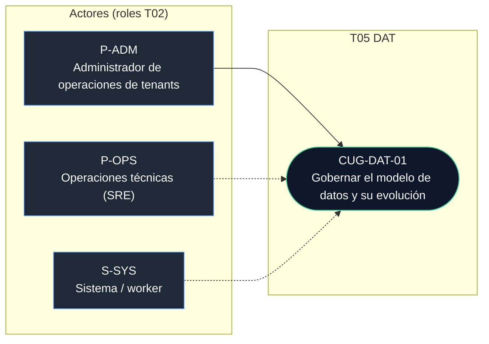
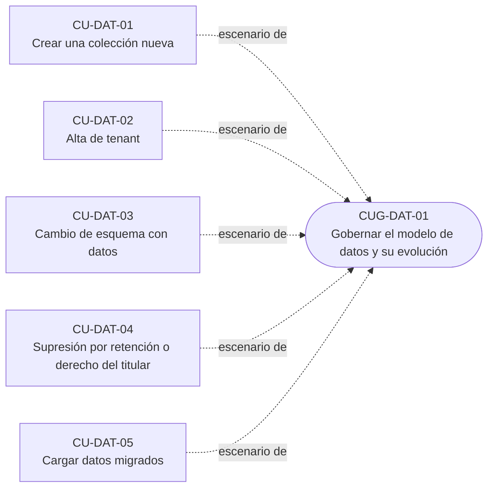

# Casos de uso de T05 DAT — Modelo de datos canónico consolidado

Parte del entregable [21 Casos de uso por módulo](../21-casos-de-uso.md) (artefacto 3.3). Generado con `_trabajo/gen_21_casos_uso.py` desde `docs/especificacion/anexos/T05-DAT-modelo-datos.md` y revisado a mano. Ante cualquier diferencia prevalece el anexo.

| Dato | Valor |
|---|---|
| Casos de uso agrupadores (CUG) | 1 |
| RF del anexo | 0 (todos asignados a un CUG) |
| CU con ficha en la sección 16 | 5 |
| CU citados sin ficha en este anexo | 0 |

## 1. Diagramas

### 1.1 Actores y casos de uso agrupadores

Línea continua: actor principal. Línea punteada: actor secundario o participante.

### 1.2 Casos de uso de la especificación por agrupador

Rectángulo: CU con ficha en la sección 16 del anexo. Paralelogramo: CU citado (ficha en otro anexo o sin ficha).

## 2. Fichas de los casos de uso agrupadores

### CUG-DAT-01 — Gobernar el modelo de datos y su evolución

| Campo | Contenido |
|---|---|
| Actor principal | P-ADM Administrador de operaciones de tenants |
| Actores secundarios | P-OPS Operaciones técnicas (SRE); S-SYS Sistema / worker |
| Objetivo | Crear y evolucionar colecciones, esquemas e índices respetando el catálogo canónico (T05 §6 y §7). |
| Precondición | Usuario de plataforma con MFA y capability de plataforma; acciones sobre datos de un tenant solo con acceso de soporte vigente (T02 RN-IAM-060). |
| Flujo principal | Según CU-DAT-01: 1) Verificar que figure en el catálogo con estado C, R o N y en su ola; 2) esquema con tenancyPlugin, auditPlugin, AuditFields, schemaVersion, retentionClass y x-pii; 3) índices del catálogo con tenantId primero; 4) validador $jsonSchema si es económica; 5) prueba de aislamiento. |
| Alternativos | Sin la capability o fuera del alcance de datos: la acción se deniega por defecto y se audita (T02). |
| CU asociados | CU-DAT-01; CU-DAT-02; CU-DAT-03; CU-DAT-04; CU-DAT-05 |
| RF (0) | — (el anexo no define RF propios) |
| Origen | T05 §6, §7 y §16 |

## 3. Casos de uso de la especificación (CU)

| CU | Nombre | Actor según el anexo | Agrupador | Criterio de asignación |
|---|---|---|---|---|
| CU-DAT-01 | Crear una colección nueva | Desarrollador | CUG-DAT-01 | único CUG |
| CU-DAT-02 | Alta de tenant | Operador de plataforma (T01) | CUG-DAT-01 | único CUG |
| CU-DAT-03 | Cambio de esquema con datos | Desarrollador | CUG-DAT-01 | único CUG |
| CU-DAT-04 | Supresión por retención o derecho del titular | T08 | CUG-DAT-01 | único CUG |
| CU-DAT-05 | Cargar datos migrados | T07 | CUG-DAT-01 | único CUG |

## 4. Cobertura del anexo

| Universo | En la especificación | Incluidos | Excluidos |
|---|---|---|---|
| RF | 0 | 0 | 0 |
| CU con ficha (sección 16) | 5 | 5 | 0 |
| CU citados sin ficha en este anexo | 0 | 0 | 0 |
