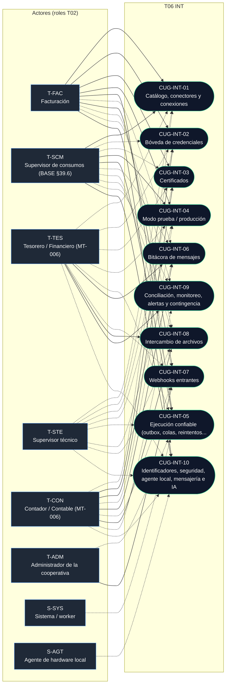
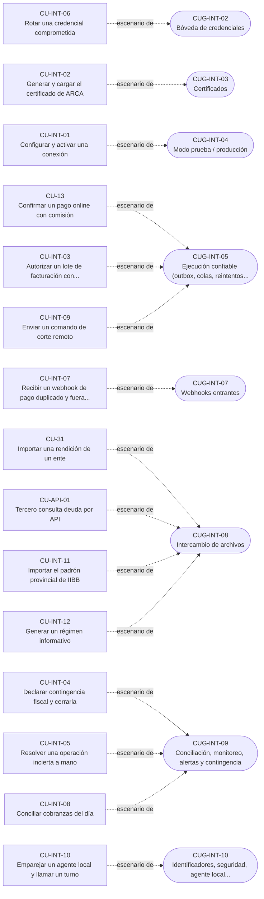

# Casos de uso de T06 INT — Integraciones externas: marco común de conectores y fichas

Parte del entregable [21 Casos de uso por módulo](../21-casos-de-uso.md) (artefacto 3.3). Generado con `_trabajo/gen_21_casos_uso.py` desde `docs/especificacion/anexos/T06-INT-integraciones.md` y revisado a mano. Ante cualquier diferencia prevalece el anexo.

| Dato | Valor |
|---|---|
| Casos de uso agrupadores (CUG) | 10 |
| RF del anexo | 86 (todos asignados a un CUG) |
| CU con ficha en la sección 16 | 15 |
| CU citados sin ficha en este anexo | 0 |

## 1. Diagramas

### 1.1 Actores y casos de uso agrupadores

Línea continua: actor principal. Línea punteada: actor secundario o participante.

### 1.2 Casos de uso de la especificación por agrupador

Rectángulo: CU con ficha en la sección 16 del anexo. Paralelogramo: CU citado (ficha en otro anexo o sin ficha).

## 2. Fichas de los casos de uso agrupadores

### CUG-INT-01 — Catálogo, conectores y conexiones

| Campo | Contenido |
|---|---|
| Actor principal | T-FAC Facturación; T-SCM Supervisor de consumos (BASE §39.6) |
| Actores secundarios | T-TES Tesorero / Financiero (MT-006); T-STE Supervisor técnico; T-CON Contador / Contable (MT-006) |
| Objetivo | Catálogo, conectores y conexiones: Catálogo de plataforma de proveedores (integrationProviders): código, nombre, tipo de conector, capacidades, protocolos, ambientes (test/production) con URLs base... |
| Precondición | Usuario del tenant autenticado con el rol indicado y capabilities `int.conectores.ver`, `int.conectores.configurar`, `int.conexiones.configurar`; módulo INT licenciado y activo (T01, T02 §4.3). |
| Flujo principal | 1. Catálogo de plataforma de proveedores (integrationProviders): código, nombre, tipo de conector, capacidades... (RF-INT-001). 2. Conexión por tenant (integrationConnections): instancia de un proveedor con nombre, configuración no secreta... (RF-INT-002). 3. Un conector solo se ofrece si la licencia del tenant lo incluye (capability de plataforma, T01) y el servicio asociado... (RF-INT-003). 4. Alcance de la conexión: servicios, sucursales, puntos de venta, cajas, canales, zonas (RF-INT-004). 5. Capacidades declaradas por conector (RF-INT-005). 6. "Probar conexión" por conexión: ejecuta la operación de salud del proveedor (ej (RF-INT-006). |
| Alternativos | Capacidades declaradas por conector (RF-INT-005). Suspender o desactivar una conexión sin perder historia (RF-INT-009). Sin la capability o fuera del alcance de datos: la acción se deniega por defecto y se audita (T02). |
| CU asociados | — (sin CU en la especificación; el flujo sale de los RF) |
| RF (14) | RF-INT-001 a 014 |
| Prioridad y olas | Núcleo 8, Estándar 6, Extensión 0; olas O0, O1, O2, O5 |
| Origen | T06 §5.1 |

### CUG-INT-02 — Bóveda de credenciales

| Campo | Contenido |
|---|---|
| Actor principal | T-CON Contador / Contable (MT-006); T-FAC Facturación |
| Actores secundarios | T-STE Supervisor técnico; T-SCM Supervisor de consumos (BASE §39.6); T-TES Tesorero / Financiero (MT-006) |
| Objetivo | Bóveda de credenciales: Bóveda por tenant con cifrado de sobre (*envelope encryption*): clave de datos por tenant cifrada por una clave maestra en un KMS. |
| Precondición | Usuario del tenant autenticado con el rol indicado y capabilities `int.credenciales.gestionar`, `int.alertas.gestionar`, `int.alertas.ver`; módulo INT licenciado y activo (T01, T02 §4.3). |
| Flujo principal | Según CU-INT-06: regenera la clave en el proveedor → carga el nuevo valor → prueba → período de gracia (PRM-INT-009) → la versión anterior pasa a revoked. |
| Alternativos | Caché de tokens de sesión (TA de WSAA, access tokens OAuth, tokens de sesión SIRO/ProntoPago/Macro) cifrada... (RF-INT-022). Sin la capability o fuera del alcance de datos: la acción se deniega por defecto y se audita (T02). |
| CU asociados | CU-INT-06 |
| RF (9) | RF-INT-015 a 023 |
| Prioridad y olas | Núcleo 8, Estándar 1, Extensión 0; olas O0, O1, O4 |
| Origen | T06 §5.2 |

### CUG-INT-03 — Certificados

| Campo | Contenido |
|---|---|
| Actor principal | T-CON Contador / Contable (MT-006); T-FAC Facturación |
| Actores secundarios | T-STE Supervisor técnico; T-SCM Supervisor de consumos (BASE §39.6); T-TES Tesorero / Financiero (MT-006) |
| Objetivo | Certificados: Generar par de claves (RSA 2048 o superior) y CSR en el servidor con los datos del tenant (CUIT en el *subject*, alias). |
| Precondición | Usuario del tenant autenticado con el rol indicado y capabilities `int.certificados.gestionar`, `int.conexiones.configurar`, `int.conexiones.crear`; módulo INT licenciado y activo (T01, T02 §4.3). |
| Flujo principal | Según CU-INT-02: el sistema genera clave y CSR → el usuario descarga el CSR y lo tramita en ARCA → sube el certificado → el sistema valida módulo, CUIT, vigencia y emisor → el usuario asocia los servicios autorizados → prueba FEDummy y obtención de TA. |
| Alternativos | Según CU-INT-02: certificado que no corresponde a la clave ⇒ rechazo; servicio no autorizado en ARCA ⇒ error auth con indicación del servicio faltante. Sin la capability o fuera del alcance de datos: denegación por defecto y auditoría (T02). |
| CU asociados | CU-INT-02 |
| RF (4) | RF-INT-024 a 027 |
| Prioridad y olas | Núcleo 4, Estándar 0, Extensión 0; olas O4 |
| Origen | T06 §5.3 |

### CUG-INT-04 — Modo prueba / producción

| Campo | Contenido |
|---|---|
| Actor principal | T-FAC Facturación; T-SCM Supervisor de consumos (BASE §39.6) |
| Actores secundarios | T-TES Tesorero / Financiero (MT-006); T-CON Contador / Contable (MT-006); T-STE Supervisor técnico |
| Objetivo | Modo prueba / producción: Modo test / production por conexión, con URLs del catálogo. |
| Precondición | conector habilitado por plataforma y licencia (T01). |
| Flujo principal | Según CU-INT-01: elige el conector del catálogo → completa configuración no secreta → carga secretos (solo escritura) → elige modo test → ejecuta prueba de conexión → resultado OK → solicita pasar a production → un segundo usuario aprueba → prueba de conexión en producción → active. |
| Alternativos | Según CU-INT-01: prueba falla ⇒ queda draft con el error normalizado; un ambiente no productivo intenta production ⇒ bloqueo (RF-INT-030). Sin la capability o fuera del alcance de datos: denegación por defecto y auditoría (T02). |
| CU asociados | CU-INT-01 |
| RF (4) | RF-INT-028 a 031 |
| Prioridad y olas | Núcleo 3, Estándar 1, Extensión 0; olas O0, O1 |
| Origen | T06 §5.4 |

### CUG-INT-05 — Ejecución confiable (outbox, colas, reintentos, idempotencia, circuit breaker)

| Campo | Contenido |
|---|---|
| Actor principal | T-FAC Facturación; T-SCM Supervisor de consumos (BASE §39.6) |
| Actores secundarios | T-TES Tesorero / Financiero (MT-006); T-STE Supervisor técnico; T-ADM Administrador de la cooperativa; S-SYS Sistema / worker |
| Objetivo | Ejecución confiable (outbox, colas, reintentos, idempotencia, circuit breaker): Toda llamada externa originada por un cambio de negocio se registra como integrationOperation en la misma transacción que el cambio (outbox) y se ejecuta en un worker. |
| Precondición | Usuario del tenant autenticado con el rol indicado y capabilities `int.ejecuciones.ver`, `int.ejecuciones.reintentar`, `int.conectores.ver`; módulo INT licenciado y activo (T01, T02 §4.3). |
| Flujo principal | Según CU-13: Recibe el webhook, reconsulta, deduplica por id externo, emite int.payment.confirmed con bruto ARS 8.000, comisión ARS 160 y neto ARS 7.840 (ficticio); M07 imputa. |
| Alternativos | Según CU-INT-09: sin respuesta ⇒ uncertain y consulta de estado del equipo; nunca se repite a ciegas; caída ⇒ orden manual en campo. Sin la capability o fuera del alcance de datos: denegación por defecto y auditoría (T02). |
| CU asociados | CU-13; CU-INT-03; CU-INT-09 |
| RF (15) | RF-INT-032 a 046 |
| Prioridad y olas | Núcleo 14, Estándar 1, Extensión 0; olas O0, O1, O4, O5 |
| Origen | T06 §5.5 |

### CUG-INT-06 — Bitácora de mensajes

| Campo | Contenido |
|---|---|
| Actor principal | T-TES Tesorero / Financiero (MT-006); T-CON Contador / Contable (MT-006) |
| Actores secundarios | T-FAC Facturación; T-SCM Supervisor de consumos (BASE §39.6); T-STE Supervisor técnico |
| Objetivo | Bitácora de mensajes: Bitácora de cada mensaje (HTTP/SOAP/archivo/SFTP/TCP/SSH/SQL/email/webhook) con dirección, endpoint sin parámetros sensibles, método, estado, duración, tamaño, intento... |
| Precondición | Usuario del tenant autenticado con el rol indicado y capabilities `int.bitacora.ver`, `int.bitacora.verPayload`, `int.operaciones.reintentar`; módulo INT licenciado y activo (T01, T02 §4.3). |
| Flujo principal | 1. Bitácora de cada mensaje (HTTP/SOAP/archivo/SFTP/TCP/SSH/SQL/email/webhook) con dirección, endpoint sin parámetros... (RF-INT-047). 2. Saneamiento obligatorio antes de persistir: se eliminan headers de autorización, cookies, tokens, contraseñas, claves... (RF-INT-048). 3. Cuerpos mayores a un umbral se guardan en almacenamiento privado (clave + hash SHA-256) (RF-INT-049). 4. Ver cuerpos requiere int.bitacora.verPayload y queda auditado (RF-INT-050). 5. Búsqueda y exportación de bitácora por conexión, operación, entidad de negocio, estado, fecha y correlación (RF-INT-051). 6. Los logs de aplicación (stdout) nunca contienen cuerpos de integraciones (RF-INT-052). |
| Alternativos | Sin la capability o fuera del alcance de datos: la acción se deniega por defecto y se audita (T02). |
| CU asociados | — (sin CU en la especificación; el flujo sale de los RF) |
| RF (6) | RF-INT-047 a 052 |
| Prioridad y olas | Núcleo 5, Estándar 1, Extensión 0; olas O0, O1 |
| Origen | T06 §5.6 |

### CUG-INT-07 — Webhooks entrantes

| Campo | Contenido |
|---|---|
| Actor principal | T-ADM Administrador de la cooperativa; T-FAC Facturación |
| Actores secundarios | T-SCM Supervisor de consumos (BASE §39.6); T-TES Tesorero / Financiero (MT-006); T-CON Contador / Contable (MT-006) |
| Objetivo | Webhooks entrantes: Endpoint de webhook por conexión en /api/public/{tenantSlug}/webhooks/{endpointKey} con endpointKey aleatorio no adivinable. |
| Precondición | Usuario del tenant autenticado con el rol indicado y capabilities `int.webhooks.configurar`, `int.webhooks.gestionar`, `int.proveedores.configurar`; módulo INT licenciado y activo (T01, T02 §4.3). |
| Flujo principal | Según CU-INT-07: llega "paid" dos veces y luego "pending" → la firma se valida → el inbox deduplica por id de evento → la reconsulta devuelve paid → una sola confirmación; el "pending" tardío no retrocede el estado (RN-INT-034). |
| Alternativos | El webhook es disparador: antes de un efecto económico se reconsulta el estado al proveedor con credenciales... (RF-INT-056). Sin la capability o fuera del alcance de datos: la acción se deniega por defecto y se audita (T02). |
| CU asociados | CU-INT-07 |
| RF (6) | RF-INT-053 a 058 |
| Prioridad y olas | Núcleo 5, Estándar 1, Extensión 0; olas O2, O5 |
| Origen | T06 §5.7 |

### CUG-INT-08 — Intercambio de archivos

| Campo | Contenido |
|---|---|
| Actor principal | T-CON Contador / Contable (MT-006); T-TES Tesorero / Financiero (MT-006) |
| Actores secundarios | T-FAC Facturación; T-STE Supervisor técnico; T-SCM Supervisor de consumos (BASE §39.6) |
| Objetivo | Intercambio de archivos: Layouts declarativos versionados (fileLayouts): ancho fijo, CSV (separador configurable), XLSX, XML, JSON, TXT de ARCA, lectura DBF/Access para migración. |
| Precondición | Usuario del tenant autenticado con el rol indicado y capabilities `int.archivos.aprobar`, `int.archivos.generar`, `int.archivos.importar`; módulo INT licenciado y activo (T01, T02 §4.3). |
| Flujo principal | Según CU-31: Motor de archivos: hash, layout, vista previa, validaciones (RF-INT-066), aplicación idempotente; reproceso sin duplicar. |
| Alternativos | Recepción de archivo entrante por carga manual (ExcelImportWizard), buzón SFTP, API o email dedicado (RF-INT-063). Transporte SFTP con clave privada en bóveda y huella de host fijada (RF-INT-065). Validaciones comunes de importadores: duplicados, importes, comprobante inexistente/anulado/bloqueado... (RF-INT-066). Sin la capability o fuera del alcance de datos: la acción se deniega por defecto y se audita (T02). |
| CU asociados | CU-31; CU-API-01; CU-INT-11; CU-INT-12 |
| RF (8) | RF-INT-059 a 066 |
| Prioridad y olas | Núcleo 7, Estándar 1, Extensión 0; olas O4, O5 |
| Origen | T06 §5.8 |

### CUG-INT-09 — Conciliación, monitoreo, alertas y contingencia

| Campo | Contenido |
|---|---|
| Actor principal | T-TES Tesorero / Financiero (MT-006) |
| Actores secundarios | T-FAC Facturación; T-SCM Supervisor de consumos (BASE §39.6); T-CON Contador / Contable (MT-006) |
| Objetivo | Conciliación, monitoreo, alertas y contingencia: Motor de conciliación por conector con tipos: pagos (externo vs. |
| Precondición | Usuario del tenant autenticado con el rol indicado y capabilities `int.conciliaciones.aprobar`, `int.conciliaciones.ver`, `int.conciliaciones.ver/aprobar`; módulo INT licenciado y activo (T01, T02 §4.3). |
| Flujo principal | Según CU-INT-04: circuito abierto de WSFE por más de PRM-INT-014 min → el sistema sugiere contingencia → el supervisor la declara → la emisión usa CAEA vigente → al recuperarse ARCA, el sistema informa los comprobantes CAEA → conciliación → cierre. |
| Alternativos | Según CU-INT-04: no hay CAEA vigente ⇒ la contingencia es "emisión diferida": los comprobantes quedan pending y no se entregan al socio como válidos. Sin la capability o fuera del alcance de datos: denegación por defecto y auditoría (T02). |
| CU asociados | CU-INT-04; CU-INT-05; CU-INT-08 |
| RF (11) | RF-INT-067 a 077 |
| Prioridad y olas | Núcleo 10, Estándar 1, Extensión 0; olas O0, O1, O4, O5 |
| Origen | T06 §5.9 |

### CUG-INT-10 — Identificadores, seguridad, agente local, mensajería e IA

| Campo | Contenido |
|---|---|
| Actor principal | T-FAC Facturación; T-SCM Supervisor de consumos (BASE §39.6) |
| Actores secundarios | T-TES Tesorero / Financiero (MT-006); T-CON Contador / Contable (MT-006); T-STE Supervisor técnico; S-AGT Agente de hardware local |
| Objetivo | Identificadores, seguridad, agente local, mensajería e IA: Registro de identificadores externos (externalReferences) por entidad, único por tenantId + system + externalId, con historia. |
| Precondición | Usuario del tenant autenticado con el rol indicado y capabilities `int.agentes.ejecutar`, `int.agentes.gestionar`, `int.conectores.ver`; módulo INT licenciado y activo (T01, T02 §4.3). |
| Flujo principal | Según CU-INT-10: instala el agente → ingresa el código de un solo uso → el agente queda online con sus dispositivos → el empleado llama el turno desde la PWA → el agente muestra el número en la pantalla. |
| Alternativos | Escaneo de secretos en el repositorio y en imágenes (CI) bloquea el merge (RF-INT-083). Sin la capability o fuera del alcance de datos: la acción se deniega por defecto y se audita (T02). |
| CU asociados | CU-INT-10 |
| RF (9) | RF-INT-078 a 086 |
| Prioridad y olas | Núcleo 7, Estándar 2, Extensión 0; olas O0, O2, O5, O10 |
| Origen | T06 §5.10 |

## 3. Casos de uso de la especificación (CU)

| CU | Nombre | Actor según el anexo | Agrupador | Criterio de asignación |
|---|---|---|---|---|
| CU-13 | Confirmar un pago online con comisión | — | CUG-INT-05 | similitud |
| CU-31 | Importar una rendición de un ente | — | CUG-INT-08 | RF citados |
| CU-API-01 | Tercero consulta deuda por API | — | CUG-INT-08 | similitud |
| CU-INT-01 | Configurar y activar una conexión | responsable de integraciones del tenant... | CUG-INT-04 | RF citados |
| CU-INT-02 | Generar y cargar el certificado de ARCA | administrador fiscal | CUG-INT-03 | similitud |
| CU-INT-03 | Autorizar un lote de facturación con resultado incierto | sistema (JOB-INT-01/02) | CUG-INT-05 | similitud |
| CU-INT-04 | Declarar contingencia fiscal y cerrarla | supervisor fiscal (int.contingencias.declarar) | CUG-INT-09 | similitud |
| CU-INT-05 | Resolver una operación incierta a mano | operador con int.operaciones.resolverManual | CUG-INT-09 | similitud |
| CU-INT-06 | Rotar una credencial comprometida | administrador de integraciones | CUG-INT-02 | similitud |
| CU-INT-07 | Recibir un webhook de pago duplicado y fuera de orden | pasarela | CUG-INT-07 | similitud |
| CU-INT-08 | Conciliar cobranzas del día | sistema (JOB-INT-06) | CUG-INT-09 | similitud |
| CU-INT-09 | Enviar un comando de corte remoto | M08 (orden de corte aprobada) | CUG-INT-05 | similitud |
| CU-INT-10 | Emparejar un agente local y llamar un turno | administrador de sucursal | CUG-INT-10 | similitud |
| CU-INT-11 | Importar el padrón provincial de IIBB | analista fiscal | CUG-INT-08 | similitud |
| CU-INT-12 | Generar un régimen informativo | analista fiscal | CUG-INT-08 | similitud |

## 4. Cobertura del anexo

| Universo | En la especificación | Incluidos | Excluidos |
|---|---|---|---|
| RF | 86 | 86 | 0 |
| CU con ficha (sección 16) | 15 | 15 | 0 |
| CU citados sin ficha en este anexo | 0 | 0 | 0 |
