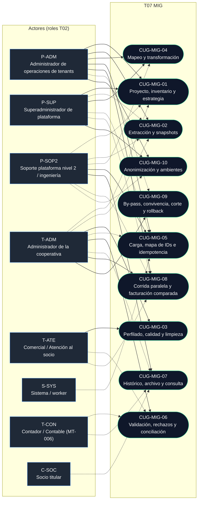
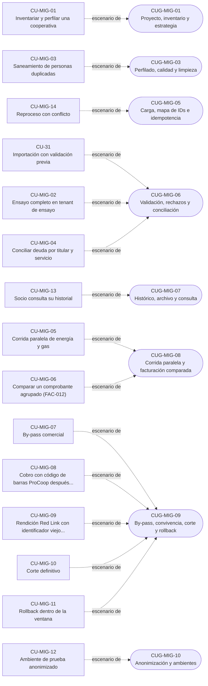

# Casos de uso de T07 MIG — Migración desde ProCoop, convivencia, corrida paralela y by-pass

Parte del entregable [21 Casos de uso por módulo](../21-casos-de-uso.md) (artefacto 3.3). Generado con `_trabajo/gen_21_casos_uso.py` desde `docs/especificacion/anexos/T07-MIG-migracion-procoop.md` y revisado a mano. Ante cualquier diferencia prevalece el anexo.

| Dato | Valor |
|---|---|
| Casos de uso agrupadores (CUG) | 10 |
| RF del anexo | 78 (todos asignados a un CUG) |
| CU con ficha en la sección 16 | 15 |
| CU citados sin ficha en este anexo | 0 |

## 1. Diagramas

### 1.1 Actores y casos de uso agrupadores

Línea continua: actor principal. Línea punteada: actor secundario o participante.

### 1.2 Casos de uso de la especificación por agrupador

Rectángulo: CU con ficha en la sección 16 del anexo. Paralelogramo: CU citado (ficha en otro anexo o sin ficha).

## 2. Fichas de los casos de uso agrupadores

### CUG-MIG-01 — Proyecto, inventario y estrategia

| Campo | Contenido |
|---|---|
| Actor principal | P-ADM Administrador de operaciones de tenants; P-SUP Superadministrador de plataforma |
| Actores secundarios | P-SOP2 Soporte plataforma nivel 2 / ingeniería; T-ADM Administrador de la cooperativa |
| Objetivo | Proyecto, inventario y estrategia: Crear un proyecto de migración por cooperativa con tenant destino, sigla ProCoop (V2 2264), versión de ProCoop, fuentes y responsables. |
| Precondición | Usuario de plataforma con MFA y capability de plataforma; acciones sobre datos de un tenant solo con acceso de soporte vigente (T02 RN-IAM-060). |
| Flujo principal | Según CU-MIG-01: Implementador registra fuentes, extrae snapshot full, el sistema perfila y precarga la matriz de 659 tablas con conteos; el analista revisa módulos sin uso y ajusta estrategias con motivo. |
| Alternativos | Sin la capability o fuera del alcance de datos: la acción se deniega por defecto y se audita (T02). |
| CU asociados | CU-MIG-01 |
| RF (7) | RF-MIG-001 a 007 |
| Prioridad y olas | Núcleo 6, Estándar 1, Extensión 0; olas O1, O4, O11 |
| Origen | T07 §5.1 |

### CUG-MIG-02 — Extracción y snapshots

| Campo | Contenido |
|---|---|
| Actor principal | P-ADM Administrador de operaciones de tenants |
| Actores secundarios | P-SUP Superadministrador de plataforma; P-SOP2 Soporte plataforma nivel 2 / ingeniería; T-ADM Administrador de la cooperativa |
| Objetivo | Extracción y snapshots: Extraer desde SQL Server con un usuario de solo lectura, sin bloqueos (lectura con instantánea o desde un backup restaurado), tabla por tabla. |
| Precondición | Usuario de plataforma con MFA y capability de plataforma; acciones sobre datos de un tenant solo con acceso de soporte vigente (T02 RN-IAM-060). |
| Flujo principal | 1. Extraer desde SQL Server con un usuario de solo lectura, sin bloqueos (lectura con instantánea o desde un backup... (RF-MIG-010). 2. Guardar cada extracción como snapshot inmutable (formato JSON Lines o Parquet por tabla) cifrado en almacenamiento de... (RF-MIG-011). 3. Extraer la base MySQL de CoopOnline/PMovil (usuarios web, cuentas vinculadas, adhesiones a factura digital, trámites) (RF-MIG-012). 4. Extraer adjuntos y PDF (facturas, actas, documentos de empleados, firmas) desde carpetas o S3, con hash y vínculo a su... (RF-MIG-013). 5. Extracción incremental (delta) por tabla mediante columnas de fecha de registro/modificación (FEC_REG, FECHA, FEC_ACT)... (RF-MIG-015). 6. Registrar la fecha de corte de datos ("as of") de cada snapshot y la zona horaria del origen (RF-MIG-016). |
| Alternativos | Extraer desde SQL Server con un usuario de solo lectura, sin bloqueos (lectura con instantánea o desde un... (RF-MIG-010). Sin la capability o fuera del alcance de datos: la acción se deniega por defecto y se audita (T02). |
| CU asociados | — (sin CU en la especificación; el flujo sale de los RF) |
| RF (7) | RF-MIG-010 a 016 |
| Prioridad y olas | Núcleo 4, Estándar 3, Extensión 0; olas O0, O1, O2 |
| Origen | T07 §5.2 |

### CUG-MIG-03 — Perfilado, calidad y limpieza

| Campo | Contenido |
|---|---|
| Actor principal | T-ADM Administrador de la cooperativa; T-ATE Comercial / Atención al socio |
| Actores secundarios | — |
| Objetivo | Perfilado, calidad y limpieza: Perfilado automático por tabla y columna: nulos, cardinalidad, mínimos/máximos, formatos, huérfanos de claves foráneas, duplicados de clave natural. |
| Precondición | Usuario del tenant autenticado con el rol indicado y capabilities `mig.perfilado.ver`, `mig.calidad.sanear`, `mig.clavesHeredadas.resolver`; módulo MIG licenciado y activo (T01, T02 §4.3). |
| Flujo principal | Según CU-MIG-03: Analista revisa grupo de tres registros con mismo DNI ficticio 20.000.001; fusiona dos (mismo nombre) y deja el tercero (nombre distinto) para corregir en origen; las cuentas de ambos titulares siguen separadas. |
| Alternativos | Validar correos y celulares (formato E.164 Argentina) sin bloquear la carga (RF-MIG-026). Sin la capability o fuera del alcance de datos: la acción se deniega por defecto y se audita (T02). |
| CU asociados | CU-MIG-03 |
| RF (9) | RF-MIG-020 a 028 |
| Prioridad y olas | Núcleo 6, Estándar 3, Extensión 0; olas O1, O2 |
| Origen | T07 §5.3 |

### CUG-MIG-04 — Mapeo y transformación

| Campo | Contenido |
|---|---|
| Actor principal | P-ADM Administrador de operaciones de tenants; P-SUP Superadministrador de plataforma |
| Actores secundarios | P-SOP2 Soporte plataforma nivel 2 / ingeniería |
| Objetivo | Mapeo y transformación: Reglas de mapeo declarativas versionadas (tabla/columna origen → colección/campo destino, transformación, validación), agrupadas en conjuntos publicados con semver. |
| Precondición | Usuario de plataforma con MFA y capability de plataforma; acciones sobre datos de un tenant solo con acceso de soporte vigente (T02 RN-IAM-060). |
| Flujo principal | 1. Reglas de mapeo declarativas versionadas (tabla/columna origen → colección/campo destino, transformación, validación)... (RF-MIG-030). 2. Reglas base de plataforma (comunes a toda cooperativa ProCoop) y reglas de tenant (overrides) con precedencia explícita (RF-MIG-031). 3. Mapas de valores para códigos maestros (situaciones IVA, tipos de documento, estados de servicio, causas, transacciones... (RF-MIG-032). 4. Transformar tablas espejo de anulación (ANUFAC, ANUITEMSFAC, ANUPAG_SOC, ANUIT_PAGSO, ANUPLAN_CAJ) en el mismo... (RF-MIG-033). 5. Transformar históricos HIS_* y *_HST en versiones con validFrom/validTo del documento destino (RF-MIG-034). 6. Transformar tablas *_EXTRAS en campos del documento principal o atributos configurables tipados (RF-MIG-035). |
| Alternativos | Transformar tablas espejo de anulación (ANUFAC, ANUITEMSFAC, ANUPAG_SOC, ANUIT_PAGSO, ANUPLAN_CAJ) en el... (RF-MIG-033). Sin la capability o fuera del alcance de datos: la acción se deniega por defecto y se audita (T02). |
| CU asociados | — (sin CU en la especificación; el flujo sale de los RF) |
| RF (11) | RF-MIG-030 a 039, 099 |
| Prioridad y olas | Núcleo 10, Estándar 1, Extensión 0; olas O0, O1, O2, O4, O10 |
| Origen | T07 §5.4 |

### CUG-MIG-05 — Carga, mapa de IDs e idempotencia

| Campo | Contenido |
|---|---|
| Actor principal | P-ADM Administrador de operaciones de tenants; P-SOP2 Soporte plataforma nivel 2 / ingeniería |
| Actores secundarios | P-SUP Superadministrador de plataforma; T-ADM Administrador de la cooperativa; S-SYS Sistema / worker |
| Objetivo | Carga, mapa de IDs e idempotencia: Cargar por dominio invocando el servicio del módulo dueño en modo migration (validaciones de dominio activas, sin emitir eventos de negocio que disparen efectos... |
| Precondición | Usuario de plataforma con MFA y capability de plataforma; acciones sobre datos de un tenant solo con acceso de soporte vigente (T02 RN-IAM-060). |
| Flujo principal | Según CU-MIG-14: Tras el corte de un dominio, un delta trae un cambio de domicilio de ProCoop sobre una cuenta ya modificada en GoodApps; el sistema registra conflicto y no sobrescribe. |
| Alternativos | Sin la capability o fuera del alcance de datos: la acción se deniega por defecto y se audita (T02). |
| CU asociados | CU-MIG-14 |
| RF (8) | RF-MIG-040 a 047 |
| Prioridad y olas | Núcleo 8, Estándar 0, Extensión 0; olas O0, O1, O5 |
| Origen | T07 §5.5 |

### CUG-MIG-06 — Validación, rechazos y conciliación

| Campo | Contenido |
|---|---|
| Actor principal | T-ADM Administrador de la cooperativa |
| Actores secundarios | T-ATE Comercial / Atención al socio; T-CON Contador / Contable (MT-006) |
| Objetivo | Validación, rechazos y conciliación: Validación previa por fila con errores bloqueantes y advertencias, mostrada antes de confirmar (patrón ExcelImportWizard). |
| Precondición | Usuario del tenant autenticado con el rol indicado y capabilities `mig.conciliacion.aprobar`, `mig.conciliacion.ver`, `mig.rechazos.editar`; módulo MIG licenciado y activo (T01, T02 §4.3). |
| Flujo principal | Según CU-MIG-02: Líder lanza dryRun de todos los dominios; revisa rechazos; analista corrige en origen o staging; reproceso; conciliaciones; purga del ensayo y repetición con nuevo snapshot hasta 0 rechazos bloqueantes. |
| Alternativos | Según CU-31: si se repite el mismo lote, reconocerlo y evitar duplicados; una corrección debe tener una ejecución identificada. Cubierto por RF-MIG-043, RF-MIG-050, RF-MIG-052, RF-MIG-053. Datos: lote MIG-DEMO-001, 3 filas, 2 válidas, error "Suministro sin titular asociado". Sin la capability o fuera del alcance de datos: denegación por defecto y auditoría (T02). |
| CU asociados | CU-31; CU-MIG-02; CU-MIG-04 |
| RF (9) | RF-MIG-050 a 058 |
| Prioridad y olas | Núcleo 9, Estándar 0, Extensión 0; olas O1, O3, O5 |
| Origen | T07 §5.6 |

### CUG-MIG-07 — Histórico, archivo y consulta

| Campo | Contenido |
|---|---|
| Actor principal | P-SOP2 Soporte plataforma nivel 2 / ingeniería |
| Actores secundarios | C-SOC Socio titular; T-ADM Administrador de la cooperativa; T-CON Contador / Contable (MT-006) |
| Objetivo | Histórico, archivo y consulta: Cargar históricos tipados de solo lectura en la colección del módulo dueño con legacy.readOnly = true (comprobantes, recibos, lecturas, asientos, recibos de sueldo)... |
| Precondición | Usuario de plataforma con MFA y capability de plataforma; acciones sobre datos de un tenant solo con acceso de soporte vigente (T02 RN-IAM-060). |
| Flujo principal | Según CU-MIG-13: El socio entra al portal y ve sus facturas ProCoop de los últimos 24 meses con el PDF original. |
| Alternativos | Sin la capability o fuera del alcance de datos: la acción se deniega por defecto y se audita (T02). |
| CU asociados | CU-MIG-13 |
| RF (5) | RF-MIG-060 a 064 |
| Prioridad y olas | Núcleo 2, Estándar 3, Extensión 0; olas O1, O11 |
| Origen | T07 §5.7 |

### CUG-MIG-08 — Corrida paralela y facturación comparada

| Campo | Contenido |
|---|---|
| Actor principal | T-ADM Administrador de la cooperativa; P-ADM Administrador de operaciones de tenants |
| Actores secundarios | P-SUP Superadministrador de plataforma; P-SOP2 Soporte plataforma nivel 2 / ingeniería; T-ATE Comercial / Atención al socio |
| Objetivo | Corrida paralela y facturación comparada: Ejecutar ciclos de facturación en paralelo sobre el mismo padrón y período que ProCoop, en modo simulación (sin CAE, sin publicar deuda, sin notificar). |
| Precondición | Usuario del tenant autenticado con el rol indicado y capabilities `mig.paralelo.ver`, `mig.paralelo.aprobar`, `mig.paralelo.ejecutar`; módulo MIG licenciado y activo (T01, T02 §4.3). |
| Flujo principal | Según CU-MIG-05: Facturación simula el ciclo del período, importa lo emitido por ProCoop, compara 12.500 comprobantes (volumen BASE §97.8); 12.430 iguales, 50 por redondeo dentro de tolerancia, 20 explicados (configuración de un cargo adicional corregida y re-simulada); aprueba el ciclo. |
| Alternativos | Clasificar diferencias (configuración, dato migrado, redondeo, regla corregida a propósito, error GoodApps... (RF-MIG-073). Sin la capability o fuera del alcance de datos: la acción se deniega por defecto y se audita (T02). |
| CU asociados | CU-MIG-05; CU-MIG-06 |
| RF (7) | RF-MIG-070 a 076 |
| Prioridad y olas | Núcleo 6, Estándar 1, Extensión 0; olas O11 |
| Origen | T07 §5.8 |

### CUG-MIG-09 — By-pass, convivencia, corte y rollback

| Campo | Contenido |
|---|---|
| Actor principal | T-ADM Administrador de la cooperativa |
| Actores secundarios | P-ADM Administrador de operaciones de tenants |
| Objetivo | By-pass, convivencia, corte y rollback: Plan de by-pass por módulo con estado: ProCoop maestro → GoodApps en paralelo → GoodApps maestro (ProCoop solo consulta) → ProCoop apagado. |
| Precondición | Usuario del tenant autenticado con el rol indicado y capabilities `mig.corte.aprobar`, `mig.corte.ejecutar`, `mig.corte.planificar`; módulo MIG licenciado y activo (T01, T02 §4.3). |
| Flujo principal | Según CU-MIG-07: Responsable aprueba el by-pass de los dominios comerciales; ProCoop queda solo lectura para ellos; se activa la exportación diaria de asientos a ProCoop porque la contabilidad oficial sigue allí (DEC-069). |
| Alternativos | Sin la capability o fuera del alcance de datos: la acción se deniega por defecto y se audita (T02). |
| CU asociados | CU-MIG-07; CU-MIG-08; CU-MIG-09; CU-MIG-10; CU-MIG-11 |
| RF (11) | RF-MIG-080 a 090 |
| Prioridad y olas | Núcleo 9, Estándar 2, Extensión 0; olas O2, O5, O11 |
| Origen | T07 §5.9 |

### CUG-MIG-10 — Anonimización y ambientes

| Campo | Contenido |
|---|---|
| Actor principal | P-ADM Administrador de operaciones de tenants; P-SUP Superadministrador de plataforma |
| Actores secundarios | P-SOP2 Soporte plataforma nivel 2 / ingeniería |
| Objetivo | Anonimización y ambientes: Perfiles de anonimización por tabla/campo: seudonimización determinística (mismo valor → mismo seudónimo, para conservar duplicados), generalización (fechas de... |
| Precondición | Usuario de plataforma con MFA y capability de plataforma; acciones sobre datos de un tenant solo con acceso de soporte vigente (T02 RN-IAM-060). |
| Flujo principal | Según CU-MIG-12: Implementador genera snapshot anonimizado desde el real; la verificación de fuga da 0 coincidencias; se carga en test para pruebas de una ola. |
| Alternativos | Sin la capability o fuera del alcance de datos: la acción se deniega por defecto y se audita (T02). |
| CU asociados | CU-MIG-12 |
| RF (4) | RF-MIG-095 a 098 |
| Prioridad y olas | Núcleo 3, Estándar 1, Extensión 0; olas O0, O1 |
| Origen | T07 §5.10 |

## 3. Casos de uso de la especificación (CU)

| CU | Nombre | Actor según el anexo | Agrupador | Criterio de asignación |
|---|---|---|---|---|
| CU-31 | Importación con validación previa | implementador y responsable del área | CUG-MIG-06 | RF citados |
| CU-MIG-01 | Inventariar y perfilar una cooperativa | — | CUG-MIG-01 | similitud |
| CU-MIG-02 | Ensayo completo en tenant de ensayo | — | CUG-MIG-06 | similitud |
| CU-MIG-03 | Saneamiento de personas duplicadas | — | CUG-MIG-03 | similitud |
| CU-MIG-04 | Conciliar deuda por titular y servicio | — | CUG-MIG-06 | similitud |
| CU-MIG-05 | Corrida paralela de energía y gas | — | CUG-MIG-08 | similitud |
| CU-MIG-06 | Comparar un comprobante agrupado (FAC-012) | — | CUG-MIG-08 | similitud |
| CU-MIG-07 | By-pass comercial | — | CUG-MIG-09 | similitud |
| CU-MIG-08 | Cobro con código de barras ProCoop después del corte | — | CUG-MIG-09 | similitud |
| CU-MIG-09 | Rendición Red Link con identificador viejo ambiguo | — | CUG-MIG-09 | similitud |
| CU-MIG-10 | Corte definitivo | — | CUG-MIG-09 | similitud |
| CU-MIG-11 | Rollback dentro de la ventana | — | CUG-MIG-09 | similitud |
| CU-MIG-12 | Ambiente de prueba anonimizado | — | CUG-MIG-10 | similitud |
| CU-MIG-13 | Socio consulta su historial | — | CUG-MIG-07 | similitud |
| CU-MIG-14 | Reproceso con conflicto | — | CUG-MIG-05 | similitud |

## 4. Cobertura del anexo

| Universo | En la especificación | Incluidos | Excluidos |
|---|---|---|---|
| RF | 78 | 78 | 0 |
| CU con ficha (sección 16) | 15 | 15 | 0 |
| CU citados sin ficha en este anexo | 0 | 0 | 0 |
