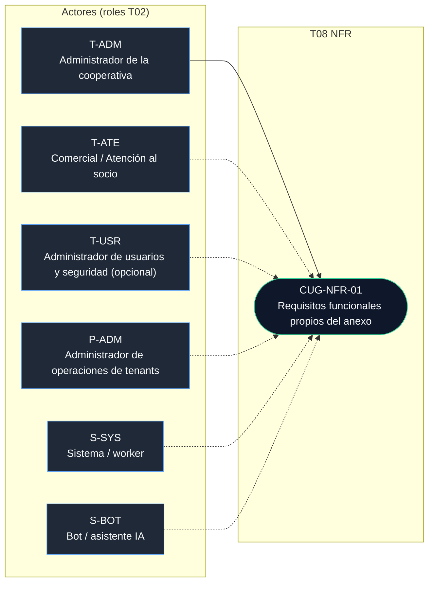
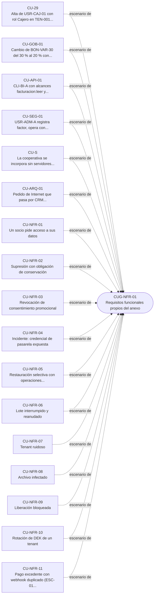

# Casos de uso de T08 NFR — Requisitos no funcionales, seguridad, privacidad, observabilidad y calidad

Parte del entregable [21 Casos de uso por módulo](../21-casos-de-uso.md) (artefacto 3.3). Generado con `_trabajo/gen_21_casos_uso.py` desde `docs/especificacion/anexos/T08-NFR-no-funcionales-seguridad.md` y revisado a mano. Ante cualquier diferencia prevalece el anexo.

| Dato | Valor |
|---|---|
| Casos de uso agrupadores (CUG) | 1 |
| RF del anexo | 25 (todos asignados a un CUG) |
| CU con ficha en la sección 16 | 17 |
| CU citados sin ficha en este anexo | 0 |

## 1. Diagramas

### 1.1 Actores y casos de uso agrupadores

Línea continua: actor principal. Línea punteada: actor secundario o participante.

### 1.2 Casos de uso de la especificación por agrupador

Rectángulo: CU con ficha en la sección 16 del anexo. Paralelogramo: CU citado (ficha en otro anexo o sin ficha).

## 2. Fichas de los casos de uso agrupadores

### CUG-NFR-01 — Requisitos funcionales propios del anexo

| Campo | Contenido |
|---|---|
| Actor principal | T-ADM Administrador de la cooperativa |
| Actores secundarios | T-ATE Comercial / Atención al socio; T-USR Administrador de usuarios y seguridad (opcional); P-ADM Administrador de operaciones de tenants; S-SYS Sistema / worker; S-BOT Bot / asistente IA |
| Objetivo | Requisitos funcionales propios del anexo: Inventario de datos personales por entidad/colección: campo, categoría (identificatorio, contacto, fiscal, financiero, ubicación, salud, laboral, imagen, comunicación)... |
| Precondición | Usuario del tenant autenticado con el rol indicado y capabilities `nfr.bloqueosLegales.anular`, `nfr.bloqueosLegales.aprobar`, `nfr.bloqueosLegales.crear`; módulo NFR licenciado y activo (T01, T02 §4.3). |
| Flujo principal | Según CU-29: RNF-NFR-062 (revocación ≤ 60 s), RNF-NFR-090, RNF-NFR-110, RNF-NFR-115, RNF-NFR-150. |
| Alternativos | Registro de consentimientos y preferencias: titular, finalidad, versión del aviso, canal, fecha, evidencia... (RF-NFR-004). Supresión compatible con obligaciones de conservación: si hay bloqueo legal o plazo vigente, se bloquea el... (RF-NFR-008). Bloqueos legales (litigio, requerimiento judicial o administrativo, auditoría fiscal) sobre titular, cuenta... (RF-NFR-010). Sin la capability o fuera del alcance de datos: la acción se deniega por defecto y se audita (T02). |
| CU asociados | CU-29; CU-GOB-01; CU-API-01; CU-SEG-01; CU-S; CU-ARQ-01; CU-NFR-01; CU-NFR-02; CU-NFR-03; CU-NFR-04; CU-NFR-05; CU-NFR-06; CU-NFR-07; CU-NFR-08; CU-NFR-09; CU-NFR-10; CU-NFR-11 |
| RF (25) | RF-NFR-001 a 025 |
| Prioridad y olas | Núcleo 16, Estándar 9, Extensión 0; olas O0, O1, O2 |
| Origen | T08 §5.1 |

## 3. Casos de uso de la especificación (CU)

| CU | Nombre | Actor según el anexo | Agrupador | Criterio de asignación |
|---|---|---|---|---|
| CU-29 | Alta de USR-CAJ-01 con rol Cajero en TEN-001 restringido a sucursal | — | CUG-NFR-01 | único CUG |
| CU-GOB-01 | Cambio de BON-VAR-30 del 30 % al 20 % con vigencia futura y aprobación | — | CUG-NFR-01 | único CUG |
| CU-API-01 | CLI-BI-A con alcances facturacion:leer y cobranza:leer consulta TEN-001 paginado con... | — | CUG-NFR-01 | único CUG |
| CU-SEG-01 | USR-ADM-A registra factor, opera con verificación reforzada, recupera contraseña sin... | — | CUG-NFR-01 | único CUG |
| CU-S | La cooperativa se incorpora sin servidores propios y registra SUP-DEMO-001 en el soporte... | — | CUG-NFR-01 | RF citados |
| CU-ARQ-01 | Pedido de Internet que pasa por CRM, técnica, contratos y ERP sin que un reintento genere... | — | CUG-NFR-01 | único CUG |
| CU-NFR-01 | Un socio pide acceso a sus datos | socia ficticia ASO-001 de TEN-001 | CUG-NFR-01 | único CUG |
| CU-NFR-02 | Supresión con obligación de conservación | — | CUG-NFR-01 | único CUG |
| CU-NFR-03 | Revocación de consentimiento promocional | — | CUG-NFR-01 | RF citados |
| CU-NFR-04 | Incidente: credencial de pasarela expuesta | — | CUG-NFR-01 | único CUG |
| CU-NFR-05 | Restauración selectiva con operaciones externas (ESC-04) | — | CUG-NFR-01 | único CUG |
| CU-NFR-06 | Lote interrumpido y reanudado | — | CUG-NFR-01 | único CUG |
| CU-NFR-07 | Tenant ruidoso | — | CUG-NFR-01 | único CUG |
| CU-NFR-08 | Archivo infectado | — | CUG-NFR-01 | único CUG |
| CU-NFR-09 | Liberación bloqueada | — | CUG-NFR-01 | único CUG |
| CU-NFR-10 | Rotación de DEK de un tenant | — | CUG-NFR-01 | único CUG |
| CU-NFR-11 | Pago excedente con webhook duplicado (ESC-01 + escenario 7) | — | CUG-NFR-01 | único CUG |

## 4. Cobertura del anexo

| Universo | En la especificación | Incluidos | Excluidos |
|---|---|---|---|
| RF | 25 | 25 | 0 |
| CU con ficha (sección 16) | 17 | 17 | 0 |
| CU citados sin ficha en este anexo | 0 | 0 | 0 |
