# Casos de uso de T09 COM — Comunidad y comunicaciones (muro, novedades, encuestas, eventos, beneficios, audiencias, notificaciones y campañas)

Parte del entregable [21 Casos de uso por módulo](../21-casos-de-uso.md) (artefacto 3.3). Generado con `_trabajo/gen_21_casos_uso.py` desde `docs/especificacion/anexos/T09-COM-comunidad-comunicaciones.md` y revisado a mano. Ante cualquier diferencia prevalece el anexo.

| Dato | Valor |
|---|---|
| Casos de uso agrupadores (CUG) | 13 |
| RF del anexo | 157 (todos asignados a un CUG) |
| CU con ficha en la sección 16 | 24 |
| CU citados sin ficha en este anexo | 0 |

## 1. Diagramas

### 1.1 Actores y casos de uso agrupadores

```mermaid
flowchart LR
    subgraph ACT["Actores (roles T02)"]
        direction TB
        A_T_COM["T-COM<br/>Editor de comunidad / Moderador (USR-NOT-A)"]
        A_S_SYS["S-SYS<br/>Sistema / worker"]
        A_S_BOT["S-BOT<br/>Bot / asistente IA"]
        A_T_ADM["T-ADM<br/>Administrador de la cooperativa"]
        A_T_SAT["T-SAT<br/>Supervisor de atención"]
        A_T_ATE["T-ATE<br/>Comercial / Atención al socio"]
        A_T_RRHH["T-RRHH<br/>RRHH / Liquidador"]
        A_C_ADH["C-ADH<br/>Adherente / grupo familiar"]
        A_C_SOC["C-SOC<br/>Socio titular"]
        A_C_REP["C-REP<br/>Representante / autorizado"]
        A_T_STE["T-STE<br/>Supervisor técnico"]
        A_T_GER["T-GER<br/>Gerente"]
    end
    subgraph SIS["T09 COM"]
        direction TB
        CUG_COM_01(["CUG-COM-01<br/>Muro editorial y publicaciones"])
        CUG_COM_02(["CUG-COM-02<br/>Reacciones, comentarios y menciones"])
        CUG_COM_03(["CUG-COM-03<br/>Moderación (IA + humana), reportes, sanciones y auditoría"])
        CUG_COM_04(["CUG-COM-04<br/>Novedades: boletines"])
        CUG_COM_05(["CUG-COM-05<br/>Encuestas, votaciones y consultas no vinculantes"])
        CUG_COM_06(["CUG-COM-06<br/>Eventos/agenda y beneficios"])
        CUG_COM_07(["CUG-COM-07<br/>Motor único de audiencias"])
        CUG_COM_08(["CUG-COM-08<br/>Motor de comunicaciones multicanal y plantillas"])
        CUG_COM_09(["CUG-COM-09<br/>Avisos de interrupción por zona"])
        CUG_COM_10(["CUG-COM-10<br/>Preferencias y consentimientos"])
        CUG_COM_11(["CUG-COM-11<br/>Notificaciones transaccionales (marco)"])
        CUG_COM_12(["CUG-COM-12<br/>Campañas masivas"])
        CUG_COM_13(["CUG-COM-13<br/>Bandeja in-app y notifKinds"])
    end
    A_T_COM --> CUG_COM_01
    A_S_SYS -.-> CUG_COM_01
    A_S_BOT -.-> CUG_COM_01
    A_T_COM --> CUG_COM_02
    A_T_ADM -.-> CUG_COM_02
    A_T_SAT -.-> CUG_COM_02
    A_T_COM --> CUG_COM_03
    A_T_SAT -.-> CUG_COM_03
    A_T_ADM -.-> CUG_COM_03
    A_S_SYS -.-> CUG_COM_03
    A_S_BOT -.-> CUG_COM_03
    A_T_COM --> CUG_COM_04
    A_T_ATE -.-> CUG_COM_04
    A_T_SAT -.-> CUG_COM_04
    A_T_RRHH -.-> CUG_COM_04
    A_T_COM --> CUG_COM_05
    A_T_ADM -.-> CUG_COM_05
    A_S_SYS -.-> CUG_COM_05
    A_S_BOT -.-> CUG_COM_05
    A_T_COM --> CUG_COM_06
    A_C_ADH -.-> CUG_COM_06
    A_C_SOC -.-> CUG_COM_06
    A_C_REP -.-> CUG_COM_06
    A_T_COM --> CUG_COM_07
    A_T_SAT -.-> CUG_COM_07
    A_S_SYS -.-> CUG_COM_07
    A_T_ATE -.-> CUG_COM_07
    A_T_COM --> CUG_COM_08
    A_T_ADM -.-> CUG_COM_08
    A_S_SYS -.-> CUG_COM_08
    A_T_SAT -.-> CUG_COM_08
    A_T_COM --> CUG_COM_09
    A_T_ADM -.-> CUG_COM_09
    A_T_STE -.-> CUG_COM_09
    A_S_SYS -.-> CUG_COM_09
    A_T_SAT --> CUG_COM_10
    A_S_SYS --> CUG_COM_10
    A_T_ATE -.-> CUG_COM_10
    A_T_COM -.-> CUG_COM_10
    A_T_ADM -.-> CUG_COM_10
    A_T_COM --> CUG_COM_11
    A_T_SAT --> CUG_COM_11
    A_S_SYS -.-> CUG_COM_11
    A_T_ADM -.-> CUG_COM_11
    A_T_ATE -.-> CUG_COM_11
    A_T_COM --> CUG_COM_12
    A_T_ADM -.-> CUG_COM_12
    A_T_GER -.-> CUG_COM_12
    A_T_COM --> CUG_COM_13
    A_T_ADM --> CUG_COM_13
    A_T_GER -.-> CUG_COM_13
    classDef actor fill:#1f2937,stroke:#60a5fa,color:#f9fafb;
    classDef cug fill:#0f172a,stroke:#34d399,color:#f9fafb;
    class A_T_COM,A_S_SYS,A_S_BOT,A_T_ADM,A_T_SAT,A_T_ATE,A_T_RRHH,A_C_ADH,A_C_SOC,A_C_REP,A_T_STE,A_T_GER actor;
    class CUG_COM_01,CUG_COM_02,CUG_COM_03,CUG_COM_04,CUG_COM_05,CUG_COM_06,CUG_COM_07,CUG_COM_08,CUG_COM_09,CUG_COM_10,CUG_COM_11,CUG_COM_12,CUG_COM_13 cug;
```

Línea continua: actor principal. Línea punteada: actor secundario o participante.

### 1.2 Casos de uso de la especificación por agrupador

```mermaid
flowchart LR
    CUG_COM_01(["CUG-COM-01<br/>Muro editorial y publicaciones"])
    X_CU_NOT_01_CUG_COM_01["CU-NOT-01<br/>Publicar una noticia solo para empleados"]
    X_CU_NOT_01_CUG_COM_01 -.->|escenario de| CUG_COM_01
    X_CU_COM_20_CUG_COM_01["CU-COM-20<br/>Supervisor envía aviso a su equipo"]
    X_CU_COM_20_CUG_COM_01 -.->|escenario de| CUG_COM_01
    CUG_COM_03(["CUG-COM-03<br/>Moderación (IA + humana), reportes, sanciones y..."])
    X_CU_COM_02_CUG_COM_03["CU-COM-02<br/>Comentar una publicación con moderación IA"]
    X_CU_COM_02_CUG_COM_03 -.->|escenario de| CUG_COM_03
    X_CU_COM_03_CUG_COM_03["CU-COM-03<br/>Revisar la cola de moderación"]
    X_CU_COM_03_CUG_COM_03 -.->|escenario de| CUG_COM_03
    X_CU_COM_04_CUG_COM_03["CU-COM-04<br/>Reportar un comentario"]
    X_CU_COM_04_CUG_COM_03 -.->|escenario de| CUG_COM_03
    X_CU_COM_05_CUG_COM_03["CU-COM-05<br/>Sancionar y apelar"]
    X_CU_COM_05_CUG_COM_03 -.->|escenario de| CUG_COM_03
    CUG_COM_04(["CUG-COM-04<br/>Novedades: boletines"])
    X_CU_COM_06_CUG_COM_04["CU-COM-06<br/>Generar y enviar un boletín semanal"]
    X_CU_COM_06_CUG_COM_04 -.->|escenario de| CUG_COM_04
    CUG_COM_05(["CUG-COM-05<br/>Encuestas, votaciones y consultas no vinculantes"])
    X_CU_INS_01_CUG_COM_05["CU-INS-01<br/>Instalación integral: aporte de T09..."]
    X_CU_INS_01_CUG_COM_05 -.->|escenario de| CUG_COM_05
    X_CU_COM_07_CUG_COM_05["CU-COM-07<br/>Lanzar una consulta no vinculante a asociados"]
    X_CU_COM_07_CUG_COM_05 -.->|escenario de| CUG_COM_05
    X_CU_COM_08_CUG_COM_05["CU-COM-08<br/>Encuesta post-reclamo con alerta"]
    X_CU_COM_08_CUG_COM_05 -.->|escenario de| CUG_COM_05
    CUG_COM_06(["CUG-COM-06<br/>Eventos/agenda y beneficios"])
    X_CU_COM_09_CUG_COM_06["CU-COM-09<br/>Inscribirse a un evento con lista de espera"]
    X_CU_COM_09_CUG_COM_06 -.->|escenario de| CUG_COM_06
    X_CU_COM_10_CUG_COM_06["CU-COM-10<br/>Obtener y canjear un beneficio"]
    X_CU_COM_10_CUG_COM_06 -.->|escenario de| CUG_COM_06
    CUG_COM_07(["CUG-COM-07<br/>Motor único de audiencias"])
    X_CU_COM_11_CUG_COM_07["CU-COM-11<br/>Armar una audiencia con vista previa"]
    X_CU_COM_11_CUG_COM_07 -.->|escenario de| CUG_COM_07
    CUG_COM_08(["CUG-COM-08<br/>Motor de comunicaciones multicanal y plantillas"])
    X_CU_26_CUG_COM_08["CU-26<br/>Comunicar al asociado por el canal adecuado..."]
    X_CU_26_CUG_COM_08 -.->|escenario de| CUG_COM_08
    X_CU_COM_15_CUG_COM_08["CU-COM-15<br/>Notificación transaccional con alternativa..."]
    X_CU_COM_15_CUG_COM_08 -.->|escenario de| CUG_COM_08
    X_CU_COM_17_CUG_COM_08["CU-COM-17<br/>Editar y publicar una plantilla"]
    X_CU_COM_17_CUG_COM_08 -.->|escenario de| CUG_COM_08
    X_CU_COM_18_CUG_COM_08["CU-COM-18<br/>Envío manual desde la ficha"]
    X_CU_COM_18_CUG_COM_08 -.->|escenario de| CUG_COM_08
    CUG_COM_09(["CUG-COM-09<br/>Avisos de interrupción por zona"])
    X_CU_COM_13_CUG_COM_09["CU-COM-13<br/>Aviso de corte programado por zona"]
    X_CU_COM_13_CUG_COM_09 -.->|escenario de| CUG_COM_09
    CUG_COM_10(["CUG-COM-10<br/>Preferencias y consentimientos"])
    X_CU_COM_01_CUG_COM_10["CU-COM-01<br/>Centro de comunicaciones del socio"]
    X_CU_COM_01_CUG_COM_10 -.->|escenario de| CUG_COM_10
    X_CU_COM_14_CUG_COM_10["CU-COM-14<br/>Darse de baja de comunicaciones comerciales"]
    X_CU_COM_14_CUG_COM_10 -.->|escenario de| CUG_COM_10
    CUG_COM_11(["CUG-COM-11<br/>Notificaciones transaccionales (marco)"])
    X_CU_COM_16_CUG_COM_11["CU-COM-16<br/>Intimación de mora con evidencia"]
    X_CU_COM_16_CUG_COM_11 -.->|escenario de| CUG_COM_11
    CUG_COM_12(["CUG-COM-12<br/>Campañas masivas"])
    X_CU_COM_12_CUG_COM_12["CU-COM-12<br/>Campaña masiva por WhatsApp y email con tope..."]
    X_CU_COM_12_CUG_COM_12 -.->|escenario de| CUG_COM_12
    X_CU_COM_19_CUG_COM_12["CU-COM-19<br/>Mensaje impreso en factura segmentado"]
    X_CU_COM_19_CUG_COM_12 -.->|escenario de| CUG_COM_12
    CUG_COM_13(["CUG-COM-13<br/>Bandeja in-app y notifKinds"])
    X_CU_COM_21_CUG_COM_13["CU-COM-21<br/>Aviso de plataforma a tenants"]
    X_CU_COM_21_CUG_COM_13 -.->|escenario de| CUG_COM_13
```

Rectángulo: CU con ficha en la sección 16 del anexo. Paralelogramo: CU citado (ficha en otro anexo o sin ficha).

## 2. Fichas de los casos de uso agrupadores

### CUG-COM-01 — Muro editorial y publicaciones

| Campo | Contenido |
|---|---|
| Actor principal | T-COM Editor de comunidad / Moderador (USR-NOT-A) |
| Actores secundarios | S-SYS Sistema / worker; S-BOT Bot / asistente IA |
| Objetivo | Muro editorial y publicaciones: Publicar noticias en la landing pública del tenant. |
| Precondición | Usuario del tenant autenticado con el rol indicado y capabilities `com.muroInterno.ver`, `com.muro.ver`, `com.muro.reaccionar`; módulo COM licenciado y activo (T01, T02 §4.3). |
| Flujo principal | Según CU-NOT-01: 1) Crea publicación canal employees; 2) audiencia empleados de su alcance; 3) publica. |
| Alternativos | Según CU-NOT-01: Intento de canal landing con audiencia restringida → bloqueado (RN-COM-010). Sin la capability o fuera del alcance de datos: denegación por defecto y auditoría (T02). |
| CU asociados | CU-NOT-01; CU-COM-20 |
| RF (26) | RF-COM-001 a 026 |
| Prioridad y olas | Núcleo 10, Estándar 10, Extensión 6; olas O2 |
| Origen | T09 §5.1 |

### CUG-COM-02 — Reacciones, comentarios y menciones

| Campo | Contenido |
|---|---|
| Actor principal | T-COM Editor de comunidad / Moderador (USR-NOT-A) |
| Actores secundarios | T-ADM Administrador de la cooperativa; T-SAT Supervisor de atención |
| Objetivo | Reacciones, comentarios y menciones: Reacciones: una por usuario y publicación, barra estilo WhatsApp. |
| Precondición | Usuario del tenant autenticado con el rol indicado y capabilities `com.comentarios.moderar`, `com.publicaciones.crear`, `com.publicaciones.publicar`; módulo COM licenciado y activo (T01, T02 §4.3). |
| Flujo principal | 1. Reacciones: una por usuario y publicación, barra estilo WhatsApp (RF-COM-030). 2. Comentarios con un nivel de respuestas, foto/GIF opcional (si el tenant lo habilita), edición y borrado propio (con... (RF-COM-031). 3. Habilitación de comentarios en dos niveles: tenant (PRM-COM-001) y publicación (commentsEnabled) (RF-COM-032). 4. Respuesta institucional destacada (adminReply) a un comentario (RF-COM-033). 5. Menciones @usuario solo a personas que ya pueden ver la publicación (RF-COM-034). 6. Los socios no pueden crear publicaciones propias (sin endpoint UGC en PWA para rol socio) (RF-COM-035). |
| Alternativos | Sin la capability o fuera del alcance de datos: la acción se deniega por defecto y se audita (T02). |
| CU asociados | — (sin CU en la especificación; el flujo sale de los RF) |
| RF (8) | RF-COM-030 a 037 |
| Prioridad y olas | Núcleo 4, Estándar 4, Extensión 0; olas O2 |
| Origen | T09 §5.2 |

### CUG-COM-03 — Moderación (IA + humana), reportes, sanciones y auditoría

| Campo | Contenido |
|---|---|
| Actor principal | T-COM Editor de comunidad / Moderador (USR-NOT-A) |
| Actores secundarios | T-SAT Supervisor de atención; T-ADM Administrador de la cooperativa; S-SYS Sistema / worker; S-BOT Bot / asistente IA |
| Objetivo | Moderación (IA + humana), reportes, sanciones y auditoría: Modos de moderación por tenant/publicación: pre (todo comentario a revisión), ai_assisted (publica si riesgo bajo. |
| Precondición | Usuario del tenant autenticado con el rol indicado y capabilities `com.reports.crear`, `com.moderation.ver`, `com.moderation.decidir`; módulo COM licenciado y activo (T01, T02 §4.3). |
| Flujo principal | Según CU-COM-02: Abre la publicación → acepta reglas (primera vez) → escribe → reglas automáticas → IA → publicado o en revisión. |
| Alternativos | Según CU-COM-02: Sanción vigente → mensaje con fecha de fin; regla block → rechazo con categoría; IA caída → revisión. Sin la capability o fuera del alcance de datos: denegación por defecto y auditoría (T02). |
| CU asociados | CU-COM-02; CU-COM-03; CU-COM-04; CU-COM-05 |
| RF (18) | RF-COM-040 a 057 |
| Prioridad y olas | Núcleo 12, Estándar 6, Extensión 0; olas O2 |
| Origen | T09 §5.3 |

### CUG-COM-04 — Novedades: boletines

| Campo | Contenido |
|---|---|
| Actor principal | T-COM Editor de comunidad / Moderador (USR-NOT-A) |
| Actores secundarios | T-ATE Comercial / Atención al socio; T-SAT Supervisor de atención; T-RRHH RRHH / Liquidador |
| Objetivo | Novedades: boletines: Reglas de boletín: cadencia (cada N horas o calendario días+hora+zona), formato (corto, digest, revista), cantidad de publicaciones, criterio (latest, pinned_first... |
| Precondición | Usuario del tenant autenticado con el rol indicado y capabilities `com.novedades.enviar`, `com.audiences.usar`, `com.audiences.exportar`; módulo COM licenciado y activo (T01, T02 §4.3). |
| Flujo principal | Según CU-COM-06: Regla dispara → boletín con variantes → revisión y nota de tapa → aprobación → envío → métricas. |
| Alternativos | Según CU-COM-06: Sin publicaciones nuevas → no genera (o genera vacío según regla). Sin la capability o fuera del alcance de datos: denegación por defecto y auditoría (T02). |
| CU asociados | CU-COM-06 |
| RF (4) | RF-COM-060 a 063 |
| Prioridad y olas | Núcleo 0, Estándar 4, Extensión 0; olas O2 |
| Origen | T09 §5.4 |

### CUG-COM-05 — Encuestas, votaciones y consultas no vinculantes

| Campo | Contenido |
|---|---|
| Actor principal | T-COM Editor de comunidad / Moderador (USR-NOT-A) |
| Actores secundarios | T-ADM Administrador de la cooperativa; S-SYS Sistema / worker; S-BOT Bot / asistente IA |
| Objetivo | Encuestas, votaciones y consultas no vinculantes: Constructor: título, nombre interno, descripción, instrucciones, bienvenida, cierre, portada (imagen/galería/video), contexto IA, categoría, tags, tiempo estimado... |
| Precondición | Usuario del tenant autenticado con el rol indicado y capabilities `com.encuestas.responder`, `com.encuestas.editar`, `com.encuestas.publicar`; módulo COM licenciado y activo (T01, T02 §4.3). |
| Flujo principal | Según CU-INS-01: 1) M10 confirma activación (EVT-TEC-16); 2) COM crea invitación idempotente a la encuesta post-instalación; 3) envía por el canal preferido tras el retardo; 4) el socio responde (app, link o QR); 5) la respuesta se vincula a visita/OT/servicio; 6) insatisfacción → caso en M09. |
| Alternativos | Según CU-INS-01: Sin respuesta → la invitación vence; el servicio sigue activo (invariante 68); sincronización repetida no duplica (invariante 70). Sin la capability o fuera del alcance de datos: denegación por defecto y auditoría (T02). |
| CU asociados | CU-INS-01; CU-COM-07; CU-COM-08 |
| RF (25) | RF-COM-070 a 094 |
| Prioridad y olas | Núcleo 9, Estándar 14, Extensión 2; olas O2, O3, O11 |
| Origen | T09 §5.5 |

### CUG-COM-06 — Eventos/agenda y beneficios

| Campo | Contenido |
|---|---|
| Actor principal | T-COM Editor de comunidad / Moderador (USR-NOT-A) |
| Actores secundarios | C-ADH Adherente / grupo familiar; C-SOC Socio titular; C-REP Representante / autorizado |
| Objetivo | Eventos/agenda y beneficios: Los beneficios comunitarios no son bonificaciones tarifarias ni tarifa social y no generan asientos. |
| Precondición | Usuario del tenant autenticado con el rol indicado y capabilities `com.providerEvents.registrar`, `com.events.ver`, `com.events.gestionar`; módulo COM licenciado y activo (T01, T02 §4.3). |
| Flujo principal | Según CU-COM-09: Agenda → evento → inscribirse → cupo lleno → lista de espera → se libera un lugar → promovido y notificado → check-in QR. |
| Alternativos | Según CU-COM-09: Evento cancelado → aviso a todos. Sin la capability o fuera del alcance de datos: denegación por defecto y auditoría (T02). |
| CU asociados | CU-COM-09; CU-COM-10 |
| RF (7) | RF-COM-100 a 106 |
| Prioridad y olas | Núcleo 1, Estándar 6, Extensión 0; olas O2 |
| Origen | T09 §5.6 |

### CUG-COM-07 — Motor único de audiencias

| Campo | Contenido |
|---|---|
| Actor principal | T-COM Editor de comunidad / Moderador (USR-NOT-A) |
| Actores secundarios | T-SAT Supervisor de atención; S-SYS Sistema / worker; T-ATE Comercial / Atención al socio |
| Objetivo | Motor único de audiencias: Modos: all, restricted (dimensiones + personas), users (personas puntuales), import (lista importada. |
| Precondición | Usuario del tenant autenticado con el rol indicado y capabilities `com.audiences.usar`, `com.audiences.exportar`, `com.audiences.consultar`; módulo COM licenciado y activo (T01, T02 §4.3). |
| Flujo principal | Según CU-COM-11: AudiencePicker → dimensiones (Internet + Zona 3 + deuda vencida > 30 días) → resumen legible → vista previa por canal, excluidos y costo → guardar segmento. |
| Alternativos | Según CU-COM-11: Dimensión fuera del grant → recortada con aviso; dimensión sensible en marketing → no disponible. Sin la capability o fuera del alcance de datos: denegación por defecto y auditoría (T02). |
| CU asociados | CU-COM-11 |
| RF (11) | RF-COM-110 a 120 |
| Prioridad y olas | Núcleo 9, Estándar 2, Extensión 0; olas O2, O3 |
| Origen | T09 §5.7 |

### CUG-COM-08 — Motor de comunicaciones multicanal y plantillas

| Campo | Contenido |
|---|---|
| Actor principal | T-COM Editor de comunidad / Moderador (USR-NOT-A) |
| Actores secundarios | T-ADM Administrador de la cooperativa; S-SYS Sistema / worker; T-SAT Supervisor de atención |
| Objetivo | Motor de comunicaciones multicanal y plantillas: Canales: email, sms, whatsapp, push (Web Push PWA), in_app, print_invoice (mensaje impreso en factura), print_letter (carta/notificación impresa entregada por M05/M08)... |
| Precondición | Usuario del tenant autenticado con el rol indicado y capabilities `com.plantillas.editar`, `com.comunicaciones.historial.ver`, `com.providerEvents.registrar`; módulo COM licenciado y activo (T01, T02 §4.3). |
| Flujo principal | Según CU-26: 1) Evento de dominio (ej. fac.invoice.issued); 2) COM resuelve destinatario, canal según preferencias y consentimientos; 3) renderiza la plantilla vigente del tenant; 4) encola; 5) envía; 6) registra estados; 7) el módulo emisor recibe el hito. |
| Alternativos | Según CU-26: Sin canal → undeliverable y acción visible; fallo → alternativa; nunca se declara notificado por haber encolado. Sin la capability o fuera del alcance de datos: denegación por defecto y auditoría (T02). |
| CU asociados | CU-26; CU-COM-15; CU-COM-17; CU-COM-18 |
| RF (27) | RF-COM-130 a 156 |
| Prioridad y olas | Núcleo 20, Estándar 5, Extensión 2; olas O0, O2, O4, O6 |
| Origen | T09 §5.8 |

### CUG-COM-09 — Avisos de interrupción por zona

| Campo | Contenido |
|---|---|
| Actor principal | T-COM Editor de comunidad / Moderador (USR-NOT-A) |
| Actores secundarios | T-ADM Administrador de la cooperativa; T-STE Supervisor técnico; S-SYS Sistema / worker |
| Objetivo | Avisos de interrupción por zona: Aviso de interrupción: tipo (scheduled, unscheduled), servicio(s), motivo, zona/localidad/calles/ramal/nodo, fecha-hora inicio y fin estimados, estado (draft, published... |
| Precondición | Usuario del tenant autenticado con el rol indicado y capabilities `com.muroInterno.ver`, `com.publicaciones.crear`, `com.publicaciones.publicar`; módulo COM licenciado y activo (T01, T02 §4.3). |
| Flujo principal | Según CU-COM-13: Plan de corte en M10 → tec.outage.notified → aviso en draft con afectados → publicación → muro, tira, landing, notificación a afectados → críticos al dueño → restablecido. |
| Alternativos | Según CU-COM-13: Anticipación insuficiente → confirmación con motivo; reprogramación → aviso nuevo vinculado. Sin la capability o fuera del alcance de datos: denegación por defecto y auditoría (T02). |
| CU asociados | CU-COM-13 |
| RF (5) | RF-COM-160 a 164 |
| Prioridad y olas | Núcleo 4, Estándar 1, Extensión 0; olas O2, O3, O6 |
| Origen | T09 §5.9 |

### CUG-COM-10 — Preferencias y consentimientos

| Campo | Contenido |
|---|---|
| Actor principal | T-SAT Supervisor de atención; S-SYS Sistema / worker |
| Actores secundarios | T-ATE Comercial / Atención al socio; T-COM Editor de comunidad / Moderador (USR-NOT-A); T-ADM Administrador de la cooperativa |
| Objetivo | Preferencias y consentimientos: Preferencias por persona × finalidad × canal (activar/desactivar), canal preferido por finalidad, idioma, horario propio de no molestar, frecuencia máxima de boletines. |
| Precondición | Usuario del tenant autenticado con el rol indicado y capabilities `com.preferences.editar`, `com.preferences.consultar`, `com.consents.ver`; módulo COM licenciado y activo (T01, T02 §4.3). |
| Flujo principal | Según CU-COM-01: 1) El socio abre Avisos; 2) ve avisos de facturas, reclamos, cortes y novedades con tipo e ícono; 3) abre el objeto; 4) gestiona preferencias de canal por categoría. |
| Alternativos | Según CU-COM-01: Constancias regulatorias no desactivables (explicado en pantalla). Sin la capability o fuera del alcance de datos: denegación por defecto y auditoría (T02). |
| CU asociados | CU-COM-01; CU-COM-14 |
| RF (7) | RF-COM-170 a 176 |
| Prioridad y olas | Núcleo 7, Estándar 0, Extensión 0; olas O1, O2, O4 |
| Origen | T09 §5.10 |

### CUG-COM-11 — Notificaciones transaccionales (marco)

| Campo | Contenido |
|---|---|
| Actor principal | T-COM Editor de comunidad / Moderador (USR-NOT-A); T-SAT Supervisor de atención |
| Actores secundarios | S-SYS Sistema / worker; T-ADM Administrador de la cooperativa; T-ATE Comercial / Atención al socio |
| Objetivo | Notificaciones transaccionales (marco): Catálogo transaccional completo (§9.6) precargado como plantilla de plataforma. |
| Precondición | Usuario del tenant autenticado con el rol indicado y capabilities `com.communications.ver`, `com.communications.verContacto`, `com.communications.reenviar`; módulo COM licenciado y activo (T01, T02 §4.3). |
| Flujo principal | Según CU-COM-16: mor.notice.dispatchRequested con evidencia exigida → carta impresa + email → acuse de M08 o delivered → milestoneReached → M08 habilita el siguiente paso. |
| Alternativos | Según CU-COM-16: Solo accepted → no habilita (RN-COM-046); sin canal → allChannelsFailed → tarea canal alternativo. Sin la capability o fuera del alcance de datos: denegación por defecto y auditoría (T02). |
| CU asociados | CU-COM-16 |
| RF (5) | RF-COM-180 a 184 |
| Prioridad y olas | Núcleo 3, Estándar 2, Extensión 0; olas O0, O3, O6 |
| Origen | T09 §5.11 |

### CUG-COM-12 — Campañas masivas

| Campo | Contenido |
|---|---|
| Actor principal | T-COM Editor de comunidad / Moderador (USR-NOT-A) |
| Actores secundarios | T-ADM Administrador de la cooperativa; T-GER Gerente |
| Objetivo | Campañas masivas: Campaña: nombre, finalidad (community, marketing, operational, service_outage), audiencia (motor único), canales y orden de preferencia, plantilla por canal (o contenido... |
| Precondición | Usuario del tenant autenticado con el rol indicado y capabilities `com.campaigns.ver`, `com.campaigns.crear`, `com.campaigns.programar`; módulo COM licenciado y activo (T01, T02 §4.3). |
| Flujo principal | Según CU-COM-12: Composer → audiencia 8.000 → aprobación (supera umbral) → programación 10:00 → envío con throttling → pausa automática al tope → reanudación → métricas. |
| Alternativos | Según CU-COM-12: Circuit breaker abierto → pausa; horario de no molestar → difiere. Sin la capability o fuera del alcance de datos: denegación por defecto y auditoría (T02). |
| CU asociados | CU-COM-12; CU-COM-19 |
| RF (8) | RF-COM-190 a 197 |
| Prioridad y olas | Núcleo 4, Estándar 1, Extensión 3; olas O2, O4, O6 |
| Origen | T09 §5.12 |

### CUG-COM-13 — Bandeja in-app y notifKinds

| Campo | Contenido |
|---|---|
| Actor principal | T-COM Editor de comunidad / Moderador (USR-NOT-A); T-ADM Administrador de la cooperativa |
| Actores secundarios | T-GER Gerente |
| Objetivo | Bandeja in-app y notifKinds: Bandeja PWA /avisos con pestañas Todas / No leídas / Leídas / Enviados (avisos que el usuario emitió como supervisor), marcar leído, marcar todo leído, descartar con... |
| Precondición | Usuario del tenant autenticado con el rol indicado y capabilities `com.muroInterno.ver`, `com.campaigns.ver`, `com.campaigns.crear`; módulo COM licenciado y activo (T01, T02 §4.3). |
| Flujo principal | Según CU-COM-21: Publica mantenimiento → administradores de tenants lo ven en la campana con permanencia. |
| Alternativos | Según CU-COM-21: — Sin la capability o fuera del alcance de datos: denegación por defecto y auditoría (T02). |
| CU asociados | CU-COM-21 |
| RF (6) | RF-COM-200 a 205 |
| Prioridad y olas | Núcleo 3, Estándar 3, Extensión 0; olas O0, O1 |
| Origen | T09 §5.13 |

## 3. Casos de uso de la especificación (CU)

| CU | Nombre | Actor según el anexo | Agrupador | Criterio de asignación |
|---|---|---|---|---|
| CU-26 | Comunicar al asociado por el canal adecuado (incluye plantilla AVISO-FACTURA) | Sistema / operador | CUG-COM-08 | RF citados |
| CU-NOT-01 | Publicar una noticia solo para empleados | Editor | CUG-COM-01 | RF citados |
| CU-INS-01 | Instalación integral: aporte de T09 (encuesta de satisfacción) | Técnico, socio, sistema | CUG-COM-05 | RF citados |
| CU-COM-01 | Centro de comunicaciones del socio | Socio | CUG-COM-10 | RF citados |
| CU-COM-02 | Comentar una publicación con moderación IA | Socio | CUG-COM-03 | RF citados |
| CU-COM-03 | Revisar la cola de moderación | Moderador | CUG-COM-03 | RF citados |
| CU-COM-04 | Reportar un comentario | Socio | CUG-COM-03 | RF citados |
| CU-COM-05 | Sancionar y apelar | Moderador, socio, revisor | CUG-COM-03 | RF citados |
| CU-COM-06 | Generar y enviar un boletín semanal | Sistema, revisor | CUG-COM-04 | RF citados |
| CU-COM-07 | Lanzar una consulta no vinculante a asociados | Gestor | CUG-COM-05 | RF citados |
| CU-COM-08 | Encuesta post-reclamo con alerta | Sistema, socio, supervisor | CUG-COM-05 | RF citados |
| CU-COM-09 | Inscribirse a un evento con lista de espera | Socio | CUG-COM-06 | RF citados |
| CU-COM-10 | Obtener y canjear un beneficio | Socio, comercio | CUG-COM-06 | RF citados |
| CU-COM-11 | Armar una audiencia con vista previa | Operador | CUG-COM-07 | RF citados |
| CU-COM-12 | Campaña masiva por WhatsApp y email con tope de costo | Operador, aprobador | CUG-COM-12 | RF citados |
| CU-COM-13 | Aviso de corte programado por zona | Operador / M10 | CUG-COM-09 | RF citados |
| CU-COM-14 | Darse de baja de comunicaciones comerciales | Socio | CUG-COM-10 | RF citados |
| CU-COM-15 | Notificación transaccional con alternativa de canal | Sistema | CUG-COM-08 | RF citados |
| CU-COM-16 | Intimación de mora con evidencia | M08, sistema | CUG-COM-11 | RF citados |
| CU-COM-17 | Editar y publicar una plantilla | Administrador de plantillas | CUG-COM-08 | RF citados |
| CU-COM-18 | Envío manual desde la ficha | Operador de atención | CUG-COM-08 | RF citados |
| CU-COM-19 | Mensaje impreso en factura segmentado | Operador, M05 | CUG-COM-12 | RF citados |
| CU-COM-20 | Supervisor envía aviso a su equipo | Supervisor (PWA) | CUG-COM-01 | RF citados |
| CU-COM-21 | Aviso de plataforma a tenants | Plataforma | CUG-COM-13 | RF citados |

## 4. Cobertura del anexo

| Universo | En la especificación | Incluidos | Excluidos |
|---|---|---|---|
| RF | 157 | 157 | 0 |
| CU con ficha (sección 16) | 24 | 24 | 0 |
| CU citados sin ficha en este anexo | 0 | 0 | 0 |
