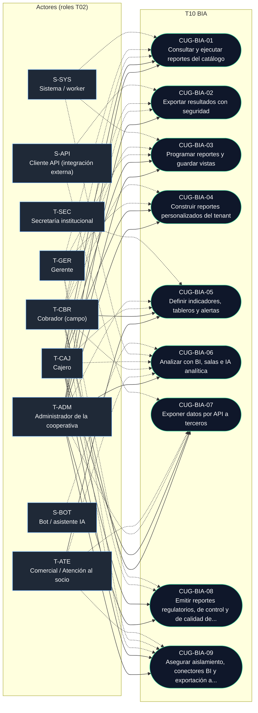
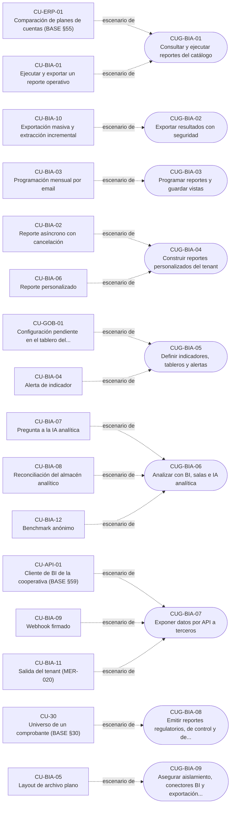

# Casos de uso de T10 BIA — Reportes, BI, tableros, exportaciones y APIs para terceros

Parte del entregable [21 Casos de uso por módulo](../21-casos-de-uso.md) (artefacto 3.3). Generado con `_trabajo/gen_21_casos_uso.py` desde `docs/especificacion/anexos/T10-BIA-reportes-bi-apis.md` y revisado a mano. Ante cualquier diferencia prevalece el anexo.

| Dato | Valor |
|---|---|
| Casos de uso agrupadores (CUG) | 9 |
| RF del anexo | 103 (todos asignados a un CUG) |
| CU con ficha en la sección 16 | 16 |
| CU citados sin ficha en este anexo | 0 |

## 1. Diagramas

### 1.1 Actores y casos de uso agrupadores

Línea continua: actor principal. Línea punteada: actor secundario o participante.

### 1.2 Casos de uso de la especificación por agrupador

Rectángulo: CU con ficha en la sección 16 del anexo. Paralelogramo: CU citado (ficha en otro anexo o sin ficha).

## 2. Fichas de los casos de uso agrupadores

### CUG-BIA-01 — Consultar y ejecutar reportes del catálogo

| Campo | Contenido |
|---|---|
| Actor principal | T-ADM Administrador de la cooperativa; T-CAJ Cajero |
| Actores secundarios | T-CBR Cobrador (campo); T-GER Gerente; S-SYS Sistema / worker |
| Objetivo | Consultar y ejecutar reportes del catálogo: Catálogo único de reportes (reportDefinitions) con código REP, nombre por clave de diccionario, módulo dueño, propósito, granularidad, parámetros, columnas... |
| Precondición | Usuario del tenant autenticado con el rol indicado y capabilities `bia.reportes.ver`, `bia.reportes.crear`, `bia.reportes.exportar`; módulo BIA licenciado y activo (T01, T02 §4.3). |
| Flujo principal | Según CU-ERP-01: El caso es de M15 (dueño de CU-ERP-01, M15 §16); T10 cubre solo la salida del reporte. El contador de TEN-001 ejecuta REP-CON-004 sobre el plan operativo PC-OPER-01 (Ingresos por servicios ARS 38.000) y sobre el alternativo PC-ALT-01 (Ingresos Agua ARS 13.000 e Ingresos Internet ARS 25.000; total ARS 38.000): los totales de los dos planes coinciden. La simulación SIM-ERP-001 de M15 aplica tarifa +10 % y da Agua ARS... |
| Alternativos | Catálogo único de reportes (reportDefinitions) con código REP, nombre por clave de diccionario, módulo dueño... (RF-BIA-001). Ejecución con validación de parámetros, defaults (incl (RF-BIA-003). Encabezado obligatorio de toda salida: tenant, reporte y versión, parámetros, universo, fecha de corte, tipo... (RF-BIA-007). Sin la capability o fuera del alcance de datos: la acción se deniega por defecto y se audita (T02). |
| CU asociados | CU-ERP-01; CU-BIA-01 |
| RF (20) | RF-BIA-001 a 020 |
| Prioridad y olas | Núcleo 11, Estándar 9, Extensión 0; olas O1, O2, O3, O5 |
| Origen | T10 §5 (tramo RF-BIA-001 a 020) |

### CUG-BIA-02 — Exportar resultados con seguridad

| Campo | Contenido |
|---|---|
| Actor principal | T-ADM Administrador de la cooperativa |
| Actores secundarios | T-CAJ Cajero; T-CBR Cobrador (campo); S-API Cliente API (integración externa) |
| Objetivo | Exportar resultados con seguridad: Exportación de cualquier DataTable del sistema a XLSX, CSV y PDF e impresión, con columnas visibles o todas. |
| Precondición | Usuario del tenant autenticado con el rol indicado y capabilities `bia.exportaciones.administrar`, `bia.exportaciones.crear`, `bia.exportaciones.ver`; módulo BIA licenciado y activo (T01, T02 §4.3). |
| Flujo principal | Según CU-BIA-10: CLI-BI-A crea POST /exports del recurso invoices con asOf; descarga las partes NDJSON con checksum; luego consulta cada hora GET /invoices?updatedSince=<asOf> y recibe solo cambios (incluidas anulaciones como cambio de status). |
| Alternativos | Sin la capability o fuera del alcance de datos: la acción se deniega por defecto y se audita (T02). |
| CU asociados | CU-BIA-10 |
| RF (14) | RF-BIA-021 a 034 |
| Prioridad y olas | Núcleo 9, Estándar 5, Extensión 0; olas O1, O2 |
| Origen | T10 §5 (tramo RF-BIA-021 a 034) |

### CUG-BIA-03 — Programar reportes y guardar vistas

| Campo | Contenido |
|---|---|
| Actor principal | T-ADM Administrador de la cooperativa; T-CAJ Cajero |
| Actores secundarios | T-GER Gerente; T-CBR Cobrador (campo); S-SYS Sistema / worker |
| Objetivo | Programar reportes y guardar vistas: La programación corre con los permisos actuales del propietario. |
| Precondición | Usuario del tenant autenticado con el rol indicado y capabilities `bia.reportes.ver`, `bia.reportes.crear`, `bia.reportes.exportar`; módulo BIA licenciado y activo (T01, T02 §4.3). |
| Flujo principal | Según CU-BIA-03: La gerente programa REP-FAC-001 "primer día hábil de cada mes 07:00" con parámetro relativo previousMonth, formato XLSX y destinatarios: rol Consejo. El 2-11-2026 (si el 1 no es hábil, según calendario T04) corre, cada destinatario con permiso recibe un enlace; uno sin permiso queda skippedNoPermission. |
| Alternativos | Suspensión automática tras PRM-BIA-013 fallos consecutivos e historial de entregas (RF-BIA-039). Sin la capability o fuera del alcance de datos: la acción se deniega por defecto y se audita (T02). |
| CU asociados | CU-BIA-03 |
| RF (6) | RF-BIA-035 a 040 |
| Prioridad y olas | Núcleo 1, Estándar 5, Extensión 0; olas O1, O2 |
| Origen | T10 §5 (tramo RF-BIA-035 a 040) |

### CUG-BIA-04 — Construir reportes personalizados del tenant

| Campo | Contenido |
|---|---|
| Actor principal | T-ADM Administrador de la cooperativa; T-CAJ Cajero |
| Actores secundarios | T-GER Gerente; T-CBR Cobrador (campo) |
| Objetivo | Construir reportes personalizados del tenant: Prohibido SQL libre, procedimientos almacenados o selección de tablas internas en reportes personalizados. |
| Precondición | Usuario del tenant autenticado con el rol indicado y capabilities `bia.reportes.ver`, `bia.reportes.crear`, `bia.reportes.exportar`; módulo BIA licenciado y activo (T01, T02 §4.3). |
| Flujo principal | Según CU-BIA-02: Un analista ejecuta REP-PER-001 para 300.000 cuentas; el sistema pasa a modo asíncrono, muestra progreso, el usuario cancela a mitad y la corrida queda cancelled liberando el worker; reintenta más tarde y la corrida nueva termina con aviso in-app. |
| Alternativos | Sin la capability o fuera del alcance de datos: la acción se deniega por defecto y se audita (T02). |
| CU asociados | CU-BIA-02; CU-BIA-06 |
| RF (5) | RF-BIA-041 a 045 |
| Prioridad y olas | Núcleo 2, Estándar 2, Extensión 1; olas O11 |
| Origen | T10 §5 (tramo RF-BIA-041 a 045) |

### CUG-BIA-05 — Definir indicadores, tableros y alertas

| Campo | Contenido |
|---|---|
| Actor principal | T-ATE Comercial / Atención al socio; T-CBR Cobrador (campo) |
| Actores secundarios | T-CAJ Cajero; T-ADM Administrador de la cooperativa; T-SEC Secretaría institucional |
| Objetivo | Definir indicadores, tableros y alertas: Catálogo de indicadores con definición exacta: fórmula, numerador/denominador, nivel, universo y estados incluidos, tipo de fecha y corte, frecuencia de refresco... |
| Precondición | Usuario del tenant autenticado con el rol indicado y capabilities `bia.tableros.ver`, `bia.indicadores.ver`, `bia.tableros.disenar`; módulo BIA licenciado y activo (T01, T02 §4.3). |
| Flujo principal | Según CU-GOB-01: El caso de uso lo define T11 §16.1 ("Cambio de configuración aprobado": RF-WFL-110, EVT-CFG-02, EVT-WFL-016); T10 aporta solo la vista del tablero (corrección del 05-11-2026; antes este anexo lo definía como propio). Un usuario autorizado modifica en TEN-001 la regla BON-VAR-30 del 30 % al 20 % con vigencia futura (T04). El cambio queda pendiente de aprobación. DSH-GER y DSH-AREA muestran el widget "Configuraciones... |
| Alternativos | Tablero de plataforma (GOB-001): tenants y estados, errores de procesos e integraciones, trabajos pendientes... (RF-BIA-048). Tablero de responsables de área: casos sin asignar, turnos fallidos, tareas vencidas, conciliaciones... (RF-BIA-050). Sin la capability o fuera del alcance de datos: la acción se deniega por defecto y se audita (T02). |
| CU asociados | CU-GOB-01; CU-BIA-04 |
| RF (14) | RF-BIA-046 a 059 |
| Prioridad y olas | Núcleo 8, Estándar 5, Extensión 1; olas O1, O2 |
| Origen | T10 §5 (tramo RF-BIA-046 a 059) |

### CUG-BIA-06 — Analizar con BI, salas e IA analítica

| Campo | Contenido |
|---|---|
| Actor principal | T-ADM Administrador de la cooperativa |
| Actores secundarios | T-ATE Comercial / Atención al socio; T-CBR Cobrador (campo); T-CAJ Cajero; S-SYS Sistema / worker; S-BOT Bot / asistente IA |
| Objetivo | Analizar con BI, salas e IA analítica: Reconciliación diaria tablero interno vs almacén analítico para indicadores certificados. |
| Precondición | Usuario del tenant autenticado con el rol indicado y capabilities `pla.bia.*`, `bia.tableros.ver`, `bia.alertas.configurar`; módulo BIA licenciado y activo (T01, T02 §4.3). |
| Flujo principal | Según CU-BIA-07: En la sala Cobranza, la gerente pregunta "¿Cuánto cobramos en octubre por Mercado Pago comparado con septiembre?". La IA genera la consulta semántica (dataset DS-COBROS, medida Cobrado, dimensión canal, períodos 2026-10 y 2026-09), el backend la ejecuta y la respuesta cita KPI-COB-01, universo y corte; cada cifra coincide con la consulta registrada. Si pregunta "¿cuánto debe Juan Pérez?", la IA se niega y ofrece... |
| Alternativos | Sin la capability o fuera del alcance de datos: la acción se deniega por defecto y se audita (T02). |
| CU asociados | CU-BIA-07; CU-BIA-08; CU-BIA-12 |
| RF (10) | RF-BIA-060 a 069 |
| Prioridad y olas | Núcleo 2, Estándar 6, Extensión 2; olas O11 |
| Origen | T10 §5 (tramo RF-BIA-060 a 069) |

### CUG-BIA-07 — Exponer datos por API a terceros

| Campo | Contenido |
|---|---|
| Actor principal | T-CBR Cobrador (campo); T-CAJ Cajero |
| Actores secundarios | T-ADM Administrador de la cooperativa; T-ATE Comercial / Atención al socio; S-API Cliente API (integración externa) |
| Objetivo | Exponer datos por API a terceros: Registro de clientes de API por tenant con responsable, finalidad, sistema, contacto técnico, estado, scopes, restricciones (IP, sucursales, servicios) y vigencia. |
| Precondición | Usuario del tenant autenticado con el rol indicado y capabilities `bia.api.clientes.aprobar`, `bia.api.clientes.crear`, `bia.api.clientes.ver`; módulo BIA licenciado y activo (T01, T02 §4.3). |
| Flujo principal | Según CU-API-01: 1. El administrador de TEN-001 crea en PAN-BIA-15 el cliente CLI-BI-A (responsable USR-ADM-A, finalidad "Tablero propio de gerencia", scopes billing:read y collections:read, equivalentes a las propuestas facturacion:leer y cobranza:leer de BASE). 2. Otro usuario con bia.api.clientes.aprobar lo aprueba y emite la credencial (secreto visible una vez). 3. La herramienta obtiene un token (API-IAM-48) y consulta GET... |
| Alternativos | Errores RFC 9457 con requestId, sin revelar secretos ni detalles internos (RF-BIA-079). Webhooks salientes opcionales firmados (HMAC-SHA256 con timestamp), reintentos con backoff, cola de no... (RF-BIA-083). Sin la capability o fuera del alcance de datos: la acción se deniega por defecto y se audita (T02). |
| CU asociados | CU-API-01; CU-BIA-09; CU-BIA-11 |
| RF (19) | RF-BIA-070 a 088 |
| Prioridad y olas | Núcleo 14, Estándar 4, Extensión 1; olas O11 |
| Origen | T10 §5 (tramo RF-BIA-070 a 088) |

### CUG-BIA-08 — Emitir reportes regulatorios, de control y de calidad de datos

| Campo | Contenido |
|---|---|
| Actor principal | T-ADM Administrador de la cooperativa; T-CAJ Cajero |
| Actores secundarios | T-CBR Cobrador (campo); T-GER Gerente |
| Objetivo | Emitir reportes regulatorios, de control y de calidad de datos: Reportes de control y conciliación entre cuentas corrientes, facturación, cobranza, tesorería y contabilidad. |
| Precondición | Usuario del tenant autenticado con el rol indicado y capabilities `bia.reportes.ver`, `bia.reportes.crear`, `bia.reportes.exportar`; módulo BIA licenciado y activo (T01, T02 §4.3). |
| Flujo principal | Según CU-30: - Situación inicial: escenario demo con la factura FAC-DEMO-001 de ARS 13.000 y pagos confirmados de ARS 5.000 y ARS 8.000. - Desarrollo: 1) Abre REP-COB-024 con universo FAC-DEMO-001 y fecha de corte 31-10-2026. 2) Consulta importe emitido, cancelado y saldo. 3) Abre el detalle (drill-down) y compara con documentos e imputaciones. |
| Alternativos | Según CU-30: si hay pagos en proceso, se muestran en columna "En proceso" separada de los confirmados (RN-BIA-009). Sin la capability o fuera del alcance de datos: denegación por defecto y auditoría (T02). |
| CU asociados | CU-30 |
| RF (11) | RF-BIA-089 a 099 |
| Prioridad y olas | Núcleo 5, Estándar 5, Extensión 1; olas O1, O2, O4, O5, O7, O11 |
| Origen | T10 §5 (tramo RF-BIA-089 a 099) |

### CUG-BIA-09 — Asegurar aislamiento, conectores BI y exportación a sistemas externos

| Campo | Contenido |
|---|---|
| Actor principal | T-ADM Administrador de la cooperativa; T-CAJ Cajero |
| Actores secundarios | T-CBR Cobrador (campo); T-GER Gerente; T-ATE Comercial / Atención al socio |
| Objetivo | Asegurar aislamiento, conectores BI y exportación a sistemas externos: Cada reporte, indicador y endpoint externo se prueba con un test de aislamiento multitenant en CI. |
| Precondición | Usuario del tenant autenticado con el rol indicado y capabilities `bia.exportaciones.administrar`, `bia.exportaciones.crear`, `bia.exportaciones.ver`; módulo BIA licenciado y activo (T01, T02 §4.3). |
| Flujo principal | Según CU-BIA-05: El tenant define un layout de 120 posiciones para un sistema contable externo sobre REP-CON-001; la vista previa muestra 20 líneas de exactamente 120 caracteres; se activa y se exporta el diario de octubre. |
| Alternativos | Reporte de uso de la plataforma de reportes (más usados, tiempos, fallos) para mejora continua (RF-BIA-103). Sin la capability o fuera del alcance de datos: la acción se deniega por defecto y se audita (T02). |
| CU asociados | CU-BIA-05 |
| RF (4) | RF-BIA-100 a 103 |
| Prioridad y olas | Núcleo 1, Estándar 1, Extensión 2; olas O1, O2, O8, O11 |
| Origen | T10 §5 (tramo RF-BIA-100 a 103) |

## 3. Casos de uso de la especificación (CU)

| CU | Nombre | Actor según el anexo | Agrupador | Criterio de asignación |
|---|---|---|---|---|
| CU-30 | Universo de un comprobante (BASE §30) | Gerente | CUG-BIA-08 | similitud |
| CU-GOB-01 | Configuración pendiente en el tablero del tenant (BASE §54 | — | CUG-BIA-05 | similitud |
| CU-ERP-01 | Comparación de planes de cuentas (BASE §55) | — | CUG-BIA-01 | RF citados |
| CU-API-01 | Cliente de BI de la cooperativa (BASE §59) | — | CUG-BIA-07 | similitud |
| CU-BIA-01 | Ejecutar y exportar un reporte operativo | — | CUG-BIA-01 | similitud |
| CU-BIA-02 | Reporte asíncrono con cancelación | — | CUG-BIA-04 | similitud |
| CU-BIA-03 | Programación mensual por email | — | CUG-BIA-03 | similitud |
| CU-BIA-04 | Alerta de indicador | — | CUG-BIA-05 | similitud |
| CU-BIA-05 | Layout de archivo plano | — | CUG-BIA-09 | similitud |
| CU-BIA-06 | Reporte personalizado | — | CUG-BIA-04 | similitud |
| CU-BIA-07 | Pregunta a la IA analítica | — | CUG-BIA-06 | similitud |
| CU-BIA-08 | Reconciliación del almacén analítico | — | CUG-BIA-06 | similitud |
| CU-BIA-09 | Webhook firmado | — | CUG-BIA-07 | similitud |
| CU-BIA-10 | Exportación masiva y extracción incremental | — | CUG-BIA-02 | similitud |
| CU-BIA-11 | Salida del tenant (MER-020) | — | CUG-BIA-07 | similitud |
| CU-BIA-12 | Benchmark anónimo | — | CUG-BIA-06 | similitud |

## 4. Cobertura del anexo

| Universo | En la especificación | Incluidos | Excluidos |
|---|---|---|---|
| RF | 103 | 103 | 0 |
| CU con ficha (sección 16) | 16 | 16 | 0 |
| CU citados sin ficha en este anexo | 0 | 0 | 0 |
