# Casos de uso de T11 WFL — Workflow, eventos, tareas, aprobaciones y documentos

Parte del entregable [21 Casos de uso por módulo](../21-casos-de-uso.md) (artefacto 3.3). Generado con `_trabajo/gen_21_casos_uso.py` desde `docs/especificacion/anexos/T11-WFL-workflow-eventos-documentos.md` y revisado a mano. Ante cualquier diferencia prevalece el anexo.

| Dato | Valor |
|---|---|
| Casos de uso agrupadores (CUG) | 16 |
| RF del anexo | 157 (todos asignados a un CUG) |
| CU con ficha en la sección 16 | 18 |
| CU citados sin ficha en este anexo | 0 |

## 1. Diagramas

### 1.1 Actores y casos de uso agrupadores

```mermaid
flowchart LR
    subgraph ACT["Actores (roles T02)"]
        direction TB
        A_T_FAC["T-FAC<br/>Facturación"]
        A_T_LEC["T-LEC<br/>Lecturista (campo)"]
        A_T_SAT["T-SAT<br/>Supervisor de atención"]
        A_T_SOC["T-SOC<br/>Operador de servicios sociales y salud"]
        A_T_SCM["T-SCM<br/>Supervisor de consumos (BASE §39.6)"]
        A_S_SYS["S-SYS<br/>Sistema / worker"]
        A_S_API["S-API<br/>Cliente API (integración externa)"]
        A_T_ADM["T-ADM<br/>Administrador de la cooperativa"]
        A_T_ATE["T-ATE<br/>Comercial / Atención al socio"]
        A_T_CBR["T-CBR<br/>Cobrador (campo)"]
        A_T_STE["T-STE<br/>Supervisor técnico"]
        A_T_GER["T-GER<br/>Gerente"]
        A_T_CJO["T-CJO<br/>Consejero"]
    end
    subgraph SIS["T11 WFL"]
        direction TB
        CUG_WFL_01(["CUG-WFL-01<br/>Bus de eventos de dominio"])
        CUG_WFL_02(["CUG-WFL-02<br/>Jobs, programación y corridas masivas"])
        CUG_WFL_03(["CUG-WFL-03<br/>Patrón de operaciones (MER-012)"])
        CUG_WFL_04(["CUG-WFL-04<br/>Máquinas de estado canónicas"])
        CUG_WFL_05(["CUG-WFL-05<br/>Workflow configurable de trámites"])
        CUG_WFL_06(["CUG-WFL-06<br/>Formularios dinámicos tipados"])
        CUG_WFL_07(["CUG-WFL-07<br/>SLA, vencimientos y escalamiento"])
        CUG_WFL_08(["CUG-WFL-08<br/>Aprobaciones"])
        CUG_WFL_09(["CUG-WFL-09<br/>Bandeja unificada del empleado"])
        CUG_WFL_10(["CUG-WFL-10<br/>Agenda y calendario"])
        CUG_WFL_11(["CUG-WFL-11<br/>Gestión documental"])
        CUG_WFL_12(["CUG-WFL-12<br/>Plantillas de documentos y generación de PDF"])
        CUG_WFL_13(["CUG-WFL-13<br/>Numeración de documentos"])
        CUG_WFL_14(["CUG-WFL-14<br/>Firma"])
        CUG_WFL_15(["CUG-WFL-15<br/>Expediente digital"])
        CUG_WFL_16(["CUG-WFL-16<br/>Mesa de entradas (coordinación con M09)"])
    end
    A_T_FAC --> CUG_WFL_01
    A_T_LEC --> CUG_WFL_01
    A_T_SAT -.-> CUG_WFL_01
    A_T_SOC -.-> CUG_WFL_01
    A_T_SCM -.-> CUG_WFL_01
    A_S_SYS -.-> CUG_WFL_01
    A_S_API -.-> CUG_WFL_01
    A_T_ADM --> CUG_WFL_02
    A_T_FAC -.-> CUG_WFL_02
    A_T_LEC -.-> CUG_WFL_02
    A_T_SAT -.-> CUG_WFL_02
    A_S_SYS -.-> CUG_WFL_02
    A_T_ATE --> CUG_WFL_03
    A_T_LEC --> CUG_WFL_03
    A_T_SAT -.-> CUG_WFL_03
    A_T_SOC -.-> CUG_WFL_03
    A_T_SCM -.-> CUG_WFL_03
    A_S_SYS -.-> CUG_WFL_03
    A_T_LEC --> CUG_WFL_04
    A_T_SAT --> CUG_WFL_04
    A_T_SOC -.-> CUG_WFL_04
    A_T_SCM -.-> CUG_WFL_04
    A_T_CBR -.-> CUG_WFL_04
    A_T_ATE --> CUG_WFL_05
    A_T_SAT --> CUG_WFL_05
    A_T_FAC -.-> CUG_WFL_05
    A_T_STE -.-> CUG_WFL_05
    A_T_ADM -.-> CUG_WFL_05
    A_S_SYS -.-> CUG_WFL_05
    A_T_ADM --> CUG_WFL_06
    A_T_LEC -.-> CUG_WFL_06
    A_T_SAT -.-> CUG_WFL_06
    A_T_SOC -.-> CUG_WFL_06
    A_T_ATE --> CUG_WFL_07
    A_T_SAT --> CUG_WFL_07
    A_T_FAC -.-> CUG_WFL_07
    A_T_STE -.-> CUG_WFL_07
    A_T_LEC -.-> CUG_WFL_07
    A_T_LEC --> CUG_WFL_08
    A_T_SAT --> CUG_WFL_08
    A_T_SOC -.-> CUG_WFL_08
    A_T_SCM -.-> CUG_WFL_08
    A_T_CBR -.-> CUG_WFL_08
    A_T_ATE --> CUG_WFL_09
    A_T_SAT --> CUG_WFL_09
    A_T_FAC -.-> CUG_WFL_09
    A_T_STE -.-> CUG_WFL_09
    A_T_LEC -.-> CUG_WFL_09
    A_T_ATE --> CUG_WFL_10
    A_T_SAT --> CUG_WFL_10
    A_T_FAC -.-> CUG_WFL_10
    A_T_STE -.-> CUG_WFL_10
    A_T_LEC -.-> CUG_WFL_10
    A_T_GER --> CUG_WFL_11
    A_T_ATE --> CUG_WFL_11
    A_T_LEC -.-> CUG_WFL_11
    A_T_SAT -.-> CUG_WFL_11
    A_T_SOC -.-> CUG_WFL_11
    A_T_GER --> CUG_WFL_12
    A_T_LEC --> CUG_WFL_12
    A_T_SAT -.-> CUG_WFL_12
    A_T_SOC -.-> CUG_WFL_12
    A_T_SCM -.-> CUG_WFL_12
    A_S_SYS -.-> CUG_WFL_12
    A_T_CJO -.-> CUG_WFL_12
    A_T_ADM --> CUG_WFL_13
    A_T_ATE --> CUG_WFL_13
    A_T_GER -.-> CUG_WFL_13
    A_T_SAT -.-> CUG_WFL_13
    A_T_FAC -.-> CUG_WFL_13
    A_T_CJO -.-> CUG_WFL_13
    A_T_LEC --> CUG_WFL_14
    A_T_SAT --> CUG_WFL_14
    A_T_SOC -.-> CUG_WFL_14
    A_T_SCM -.-> CUG_WFL_14
    A_T_CBR -.-> CUG_WFL_14
    A_T_ATE --> CUG_WFL_15
    A_T_LEC -.-> CUG_WFL_15
    A_T_SAT -.-> CUG_WFL_15
    A_T_SOC -.-> CUG_WFL_15
    A_T_ATE --> CUG_WFL_16
    A_T_LEC -.-> CUG_WFL_16
    A_T_SAT -.-> CUG_WFL_16
    A_T_SOC -.-> CUG_WFL_16
    classDef actor fill:#1f2937,stroke:#60a5fa,color:#f9fafb;
    classDef cug fill:#0f172a,stroke:#34d399,color:#f9fafb;
    class A_T_FAC,A_T_LEC,A_T_SAT,A_T_SOC,A_T_SCM,A_S_SYS,A_S_API,A_T_ADM,A_T_ATE,A_T_CBR,A_T_STE,A_T_GER,A_T_CJO actor;
    class CUG_WFL_01,CUG_WFL_02,CUG_WFL_03,CUG_WFL_04,CUG_WFL_05,CUG_WFL_06,CUG_WFL_07,CUG_WFL_08,CUG_WFL_09,CUG_WFL_10,CUG_WFL_11,CUG_WFL_12,CUG_WFL_13,CUG_WFL_14,CUG_WFL_15,CUG_WFL_16 cug;
```

Línea continua: actor principal. Línea punteada: actor secundario o participante.

### 1.2 Casos de uso de la especificación por agrupador

```mermaid
flowchart LR
    CUG_WFL_01(["CUG-WFL-01<br/>Bus de eventos de dominio"])
    X_CU_ARQ_01_CUG_WFL_01["CU-ARQ-01<br/>Reintento seguro"]
    X_CU_ARQ_01_CUG_WFL_01 -.->|escenario de| CUG_WFL_01
    X_CU_WFL_10_CUG_WFL_01["CU-WFL-10<br/>Reprocesar eventos fallidos"]
    X_CU_WFL_10_CUG_WFL_01 -.->|escenario de| CUG_WFL_01
    CUG_WFL_02(["CUG-WFL-02<br/>Jobs, programación y corridas masivas"])
    X_CU_LOT_01_CUG_WFL_02["CU-LOT-01<br/>Corrida masiva con excepciones"]
    X_CU_LOT_01_CUG_WFL_02 -.->|escenario de| CUG_WFL_02
    X_CU_WFL_09_CUG_WFL_02["CU-WFL-09<br/>Programar un job del tenant"]
    X_CU_WFL_09_CUG_WFL_02 -.->|escenario de| CUG_WFL_02
    CUG_WFL_03(["CUG-WFL-03<br/>Patrón de operaciones (MER-012)"])
    X_CU_WFL_07_CUG_WFL_03["CU-WFL-07<br/>Resolver una operación incierta"]
    X_CU_WFL_07_CUG_WFL_03 -.->|escenario de| CUG_WFL_03
    CUG_WFL_05(["CUG-WFL-05<br/>Workflow configurable de trámites"])
    X_CU_WFL_04_CUG_WFL_05["CU-WFL-04<br/>Diseñar y publicar un trámite"]
    X_CU_WFL_04_CUG_WFL_05 -.->|escenario de| CUG_WFL_05
    CUG_WFL_08(["CUG-WFL-08<br/>Aprobaciones"])
    X_CU_29_CUG_WFL_08["CU-29<br/>Operar con permisos y aprobación"]
    X_CU_29_CUG_WFL_08 -.->|escenario de| CUG_WFL_08
    X_CU_GOB_01_CUG_WFL_08["CU-GOB-01<br/>Cambio de configuración aprobado"]
    X_CU_GOB_01_CUG_WFL_08 -.->|escenario de| CUG_WFL_08
    X_CU_WFL_01_CUG_WFL_08["CU-WFL-01<br/>Aprobar una orden de pago por monto con..."]
    X_CU_WFL_01_CUG_WFL_08 -.->|escenario de| CUG_WFL_08
    X_CU_WFL_02_CUG_WFL_08["CU-WFL-02<br/>Reasignar pendientes de un empleado que se va"]
    X_CU_WFL_02_CUG_WFL_08 -.->|escenario de| CUG_WFL_08
    X_CU_WFL_11_CUG_WFL_08["CU-WFL-11<br/>Delegar aprobaciones por vacaciones"]
    X_CU_WFL_11_CUG_WFL_08 -.->|escenario de| CUG_WFL_08
    CUG_WFL_09(["CUG-WFL-09<br/>Bandeja unificada del empleado"])
    X_CU_WFL_03_CUG_WFL_09["CU-WFL-03<br/>Trabajar la bandeja del día"]
    X_CU_WFL_03_CUG_WFL_09 -.->|escenario de| CUG_WFL_09
    CUG_WFL_12(["CUG-WFL-12<br/>Plantillas de documentos y generación de PDF"])
    X_CU_26_CUG_WFL_12["CU-26<br/>Comunicar al asociado con constancia"]
    X_CU_26_CUG_WFL_12 -.->|escenario de| CUG_WFL_12
    CUG_WFL_14(["CUG-WFL-14<br/>Firma"])
    X_CU_27_CUG_WFL_14["CU-27<br/>Convocar y realizar la asamblea"]
    X_CU_27_CUG_WFL_14 -.->|escenario de| CUG_WFL_14
    X_CU_WFL_05_CUG_WFL_14["CU-WFL-05<br/>Generar y firmar recibos de sueldo"]
    X_CU_WFL_05_CUG_WFL_14 -.->|escenario de| CUG_WFL_14
    X_CU_WFL_12_CUG_WFL_14["CU-WFL-12<br/>Conformidad firmada en campo sin conexión"]
    X_CU_WFL_12_CUG_WFL_14 -.->|escenario de| CUG_WFL_14
    CUG_WFL_15(["CUG-WFL-15<br/>Expediente digital"])
    X_CU_WFL_06_CUG_WFL_15["CU-WFL-06<br/>Registrar una nota en la mesa de entradas y..."]
    X_CU_WFL_06_CUG_WFL_15 -.->|escenario de| CUG_WFL_15
    X_CU_WFL_08_CUG_WFL_15["CU-WFL-08<br/>Ver el expediente digital de una cuenta"]
    X_CU_WFL_08_CUG_WFL_15 -.->|escenario de| CUG_WFL_15
```

Rectángulo: CU con ficha en la sección 16 del anexo. Paralelogramo: CU citado (ficha en otro anexo o sin ficha).

## 2. Fichas de los casos de uso agrupadores

### CUG-WFL-01 — Bus de eventos de dominio

| Campo | Contenido |
|---|---|
| Actor principal | T-FAC Facturación; T-LEC Lecturista (campo) |
| Actores secundarios | T-SAT Supervisor de atención; T-SOC Operador de servicios sociales y salud; T-SCM Supervisor de consumos (BASE §39.6); S-SYS Sistema / worker; S-API Cliente API (integración externa) |
| Objetivo | Bus de eventos de dominio: Todo cambio de estado de negocio que interese a otro módulo se publica como evento de dominio vía outbox en la misma transacción del cambio (servicio publish() de T01). |
| Precondición | Usuario del tenant autenticado con el rol indicado y capabilities `wfl.eventos.ver`, `wfl.eventos.reprocesar`, `wfl.eventos.*`; módulo WFL licenciado y activo (T01, T02 §4.3). |
| Flujo principal | Según CU-ARQ-01: Sistema Un doble envío o un reintento de un consumidor no duplica efectos RF-WFL-008, RF-WFL-043, RN-WFL-004 |
| Alternativos | Suscripciones declaradas por manifiesto de módulo (eventSubscriptions): consumidor, tipo, versión aceptada... (RF-WFL-007). Bandeja operativa del tenant (operationalInboxItems): eventos agotados con businessImpact, jobs fallidos... (RF-WFL-010). Conciliación de nombres: el catálogo registra los alias que hoy usan algunos consumidores (§12.4) y el... (RF-WFL-015). Sin la capability o fuera del alcance de datos: la acción se deniega por defecto y se audita (T02). |
| CU asociados | CU-ARQ-01; CU-WFL-10 |
| RF (17) | RF-WFL-001 a 017 |
| Prioridad y olas | Núcleo 14, Estándar 2, Extensión 1; olas O0, O1, O11 |
| Origen | T11 §5.1 |

### CUG-WFL-02 — Jobs, programación y corridas masivas

| Campo | Contenido |
|---|---|
| Actor principal | T-ADM Administrador de la cooperativa |
| Actores secundarios | T-FAC Facturación; T-LEC Lecturista (campo); T-SAT Supervisor de atención; S-SYS Sistema / worker |
| Objetivo | Jobs, programación y corridas masivas: Catálogo jobDefinitions (§12.6–12.7) con nombre <mod>:<proceso>, módulo dueño, clase de cola de T01 (interactive, integration, events, notifications, batch, export, ai... |
| Precondición | Usuario del tenant autenticado con el rol indicado y capabilities `wfl.jobs.ver`, `wfl.jobs.reintentar`, `wfl.jobs.programar`; módulo WFL licenciado y activo (T01, T02 §4.3). |
| Flujo principal | Según CU-LOT-01: Operador 98 de 100 ítems emitidos; 2 en excepciones asignadas; el reproceso no reemite. M05 define el caso; T11 aporta el motor de corridas (bulkRuns) y la bandeja de excepciones RF-WFL-026, RN-WFL-008, P-WFL-03 |
| Alternativos | Según CU-WFL-09: programarlo a las 14:00 devuelve 422. Sin la capability o fuera del alcance de datos: denegación por defecto y auditoría (T02). |
| CU asociados | CU-LOT-01; CU-WFL-09 |
| RF (12) | RF-WFL-020 a 031 |
| Prioridad y olas | Núcleo 9, Estándar 3, Extensión 0; olas O0, O1, O4 |
| Origen | T11 §5.2 |

### CUG-WFL-03 — Patrón de operaciones (MER-012)

| Campo | Contenido |
|---|---|
| Actor principal | T-ATE Comercial / Atención al socio; T-LEC Lecturista (campo) |
| Actores secundarios | T-SAT Supervisor de atención; T-SOC Operador de servicios sociales y salud; T-SCM Supervisor de consumos (BASE §39.6); S-SYS Sistema / worker |
| Objetivo | Patrón de operaciones (MER-012): Toda acción sensible se modela como operación con número propio (OPE-AAAA-NNNNNN), tipo, sujeto, solicitante, motivo, importe, atributos de riesgo, estado y vínculo a la... |
| Precondición | Usuario del tenant autenticado con el rol indicado y capabilities `wfl.operaciones.reintentar`, `wfl.operaciones.ver`, `wfl.aprobaciones.administrar`; módulo WFL licenciado y activo (T01, T02 §4.3). |
| Flujo principal | Según CU-WFL-07: 1. Un reintegro a una pasarela quedó uncertain. 2. JOB-WFL-03 consulta durante 48 h sin respuesta. 3. La bandeja operativa muestra el ítem. 4. El operador verifica en el portal del proveedor, registra "resultado verificado: acreditado" con la captura como evidencia. 5. T11 emite EVT-WFL-006. 6. M07 completa el reintegro sin reenviarlo. - Requisitos: RF-WFL-046, RN-WFL-022. |
| Alternativos | Ejecución idempotente: el handler recibe operationId como clave (RF-WFL-043). Estados observables Pendiente, Confirmado, Fallido e Incierto en la interfaz, con traducción funcional... (RF-WFL-045). Conciliación de inciertos: job por tipo con consulta al sistema externo (RF-WFL-046). Sin la capability o fuera del alcance de datos: la acción se deniega por defecto y se audita (T02). |
| CU asociados | CU-WFL-07 |
| RF (12) | RF-WFL-040 a 051 |
| Prioridad y olas | Núcleo 9, Estándar 3, Extensión 0; olas O0, O1, O4 |
| Origen | T11 §5.3 |

### CUG-WFL-04 — Máquinas de estado canónicas

| Campo | Contenido |
|---|---|
| Actor principal | T-LEC Lecturista (campo); T-SAT Supervisor de atención |
| Actores secundarios | T-SOC Operador de servicios sociales y salud; T-SCM Supervisor de consumos (BASE §39.6); T-CBR Cobrador (campo) |
| Objetivo | Máquinas de estado canónicas: Librería común defineStateMachine con estados, transiciones, actor permitido (capability), guardas (precondiciones puras), efectos (comandos y eventos), reversión y si... |
| Precondición | Usuario del tenant autenticado con el rol indicado y capabilities `wfl.aprobaciones.administrar`, `wfl.aprobaciones.decidir`, `wfl.aprobaciones.delegar`; módulo WFL licenciado y activo (T01, T02 §4.3). |
| Flujo principal | 1. Librería común defineStateMachine con estados, transiciones, actor permitido (capability), guardas (precondiciones... (RF-WFL-060). 2. Cada módulo declara sus máquinas (contrato, factura, OT, caso, lote, liquidación, OP) y las registra en... (RF-WFL-061). 3. Historial de transiciones en la colección del módulo dueño con estado anterior, nuevo, fecha efectiva, fecha de... (RF-WFL-062). 4. Estados operativos configurables por el tenant, mapeados a un canónico y con banderas (visible al socio, notificar... (RF-WFL-063). 5. Transiciones que requieren aprobación se declaran como tales en la máquina y crean una operación (RF-WFL-064). 6. Reemplazo de TRANSAC (códigos 1–8 con efectos al cerrar OT): los efectos por tipo de operación técnica se declaran en... (RF-WFL-066). |
| Alternativos | Sin la capability o fuera del alcance de datos: la acción se deniega por defecto y se audita (T02). |
| CU asociados | — (sin CU en la especificación; el flujo sale de los RF) |
| RF (7) | RF-WFL-060 a 066 |
| Prioridad y olas | Núcleo 5, Estándar 2, Extensión 0; olas O1, O2, O3 |
| Origen | T11 §5.4 |

### CUG-WFL-05 — Workflow configurable de trámites

| Campo | Contenido |
|---|---|
| Actor principal | T-ATE Comercial / Atención al socio; T-SAT Supervisor de atención |
| Actores secundarios | T-FAC Facturación; T-STE Supervisor técnico; T-ADM Administrador de la cooperativa; S-SYS Sistema / worker |
| Objetivo | Workflow configurable de trámites: Diseñador de workflows (PAN-WFL-06) con nodos: inicio, tarea humana, aprobación, acción automática, espera de evento, temporizador, decisión (condición), paralelo y... |
| Precondición | Usuario del tenant autenticado con el rol indicado y capabilities `wfl.tareas.ver`, `wfl.tareas.ejecutar`, `wfl.tareas.reasignar`; módulo WFL licenciado y activo (T01, T02 §4.3). |
| Flujo principal | Según CU-WFL-04: 1. Duplica la plantilla de plataforma WF-CAT-CAMBIO-TITULAR. 2. Cambia el área responsable y el SLA a 5 días hábiles. 3. Agrega un campo al formulario. 4. Simula con datos ficticios. 5. Envía a publicar. El aprobador aprueba y la versión 2 queda vigente desde el 01-12-2026. 6. Las instancias abiertas siguen en la versión 1. - Requisitos: RF-WFL-070..082, PAN-WFL-08..12. |
| Alternativos | Según CU-WFL-04: intenta quitar el paso obligatorio "verificar identidad": la validación lo impide (RF-WFL-076). Sin la capability o fuera del alcance de datos: denegación por defecto y auditoría (T02). |
| CU asociados | CU-WFL-04 |
| RF (13) | RF-WFL-070 a 082 |
| Prioridad y olas | Núcleo 8, Estándar 5, Extensión 0; olas O1, O2 |
| Origen | T11 §5.5 |

### CUG-WFL-06 — Formularios dinámicos tipados

| Campo | Contenido |
|---|---|
| Actor principal | T-ADM Administrador de la cooperativa |
| Actores secundarios | T-LEC Lecturista (campo); T-SAT Supervisor de atención; T-SOC Operador de servicios sociales y salud |
| Objetivo | Formularios dinámicos tipados: Diseñador de formularios versionados con tipos de campo: texto corto, texto largo, número entero, número decimal, importe (Decimal128 y moneda), fecha, fecha y hora... |
| Precondición | Usuario del tenant autenticado con el rol indicado y capabilities `wfl.formularios.configurar`, `wfl.firmas.configurar`, `wfl.firmas.solicitar`; módulo WFL licenciado y activo (T01, T02 §4.3). |
| Flujo principal | 1. Diseñador de formularios versionados con tipos de campo: texto corto, texto largo, número entero, número decimal... (RF-WFL-090). 2. Validaciones declarativas: obligatoriedad, rangos, longitud, patrón, unicidad dentro del trámite, comparaciones entre... (RF-WFL-091). 3. Visibilidad y obligatoriedad condicional por valor de otros campos, por canal (PWA socio, admin, campo) y por rol (RF-WFL-092). 4. Fuentes de datos tipadas registradas por módulos (por ejemplo, "adherentes del contrato", "categorías del servicio"... (RF-WFL-093). 5. Comparación contra fuentes oficiales mediante conectores (por ejemplo, datos de identidad validados), como paso de... (RF-WFL-094). 6. Envío del formulario: snapshot inmutable (formSubmissions) con la versión del formulario, valores, adjuntos y huella (RF-WFL-095). |
| Alternativos | Comparación contra fuentes oficiales mediante conectores (por ejemplo, datos de identidad validados), como... (RF-WFL-094). Sin la capability o fuera del alcance de datos: la acción se deniega por defecto y se audita (T02). |
| CU asociados | — (sin CU en la especificación; el flujo sale de los RF) |
| RF (9) | RF-WFL-090 a 098 |
| Prioridad y olas | Núcleo 5, Estándar 4, Extensión 0; olas O2, O3, O7 |
| Origen | T11 §5.6 |

### CUG-WFL-07 — SLA, vencimientos y escalamiento

| Campo | Contenido |
|---|---|
| Actor principal | T-ATE Comercial / Atención al socio; T-SAT Supervisor de atención |
| Actores secundarios | T-FAC Facturación; T-STE Supervisor técnico; T-LEC Lecturista (campo) |
| Objetivo | SLA, vencimientos y escalamiento: Políticas de SLA (slaPolicies) por definición, nodo, tipo de operación o tipo de tarea, en horas o días, hábiles o corridos, con calendario de T04 y horario laboral del... |
| Precondición | Usuario del tenant autenticado con el rol indicado y capabilities `wfl.tareas.ver`, `wfl.tareas.ejecutar`, `wfl.tareas.reasignar`; módulo WFL licenciado y activo (T01, T02 §4.3). |
| Flujo principal | 1. Políticas de SLA (slaPolicies) por definición, nodo, tipo de operación o tipo de tarea, en horas o días, hábiles o... (RF-WFL-100). 2. Umbrales de alerta (por ejemplo, 75 % y 100 %) con acciones: avisar al responsable, avisar al supervisor, reasignar... (RF-WFL-101). 3. Pausa y reanudación de SLA por estados que la declaran (espera del socio, espera de un tercero) con registro del tiempo... (RF-WFL-102). 4. Guardias de escalamiento por día, franja horaria y feriado (quién recibe fuera de horario) (RF-WFL-103). 5. Recalcular temporizadores al cambiar feriados (cfg.holiday.changed) solo para los no vencidos (RF-WFL-104). 6. Un solo motor de temporizadores (slaTimers) para workflow, tareas y aprobaciones (RF-WFL-105). |
| Alternativos | Recalcular temporizadores al cambiar feriados (cfg.holiday.changed) solo para los no vencidos (RF-WFL-104). Sin la capability o fuera del alcance de datos: la acción se deniega por defecto y se audita (T02). |
| CU asociados | — (sin CU en la especificación; el flujo sale de los RF) |
| RF (6) | RF-WFL-100 a 105 |
| Prioridad y olas | Núcleo 4, Estándar 2, Extensión 0; olas O2, O3 |
| Origen | T11 §5.7 |

### CUG-WFL-08 — Aprobaciones

| Campo | Contenido |
|---|---|
| Actor principal | T-LEC Lecturista (campo); T-SAT Supervisor de atención |
| Actores secundarios | T-SOC Operador de servicios sociales y salud; T-SCM Supervisor de consumos (BASE §39.6); T-CBR Cobrador (campo) |
| Objetivo | Aprobaciones: Políticas de aprobación (approvalPolicies) por tipo de operación o código de política, con versión y vigencia, que resuelven pasos según importe, moneda, área, sucursal... |
| Precondición | la política tes.paymentExecution.execute tiene tramos: hasta ARS 1.000.000, un paso T-TES; hasta ARS 5.000.000, T-TES + T-GER; más, T-GER + consejo con quórum. |
| Flujo principal | Según CU-29: Cajero, tesorera USR-CAJ-01 no puede anular el recibo R-0001-00004567 de ARS 18.450,00 sin la aprobación de otra persona con MFA; T02 deniega la acción directa y T11 gestiona la aprobación RF-WFL-040..051, RF-WFL-110..124, P-WFL-04 |
| Alternativos | Según CU-WFL-02: si no hay supervisor configurado, se crea un ítem en la bandeja operativa para T-ADM. Sin la capability o fuera del alcance de datos: denegación por defecto y auditoría (T02). |
| CU asociados | CU-29; CU-GOB-01; CU-WFL-01; CU-WFL-02; CU-WFL-11 |
| RF (15) | RF-WFL-110 a 124 |
| Prioridad y olas | Núcleo 11, Estándar 4, Extensión 0; olas O1, O10 |
| Origen | T11 §5.8 |

### CUG-WFL-09 — Bandeja unificada del empleado

| Campo | Contenido |
|---|---|
| Actor principal | T-ATE Comercial / Atención al socio; T-SAT Supervisor de atención |
| Actores secundarios | T-FAC Facturación; T-STE Supervisor técnico; T-LEC Lecturista (campo) |
| Objetivo | Bandeja unificada del empleado: Bandeja única (workItems) que proyecta: tareas de T11, pasos de aprobación, autorizaciones puntuales de T02, casos de M09 asignados, OT y visitas de M10 asignadas... |
| Precondición | Usuario del tenant autenticado con el rol indicado y capabilities `wfl.bandeja.supervisar`, `wfl.tareas.ver`, `wfl.tareas.ejecutar`; módulo WFL licenciado y activo (T01, T02 §4.3). |
| Flujo principal | Según CU-WFL-03: 1. Abre PAN-WFL-01 y ve 2 vencidos, 5 de hoy y 3 de mañana. 2. Toma una tarea de grupo y la deja asignada a su nombre. 3. Aprueba, con comentario, el cambio de la regla BON-VAR-30 del 30 % al 20 % (CU-GOB-01). 4. Pospone una tarea con motivo. 5. Abre un caso de M09 desde la tarjeta y vuelve a la bandeja con el contador actualizado. - Requisitos: RF-WFL-130..139. |
| Alternativos | Según CU-WFL-03: otro agente tomó la tarea un segundo antes: 409 wfl/task-claimed y la tarjeta se refresca. Sin la capability o fuera del alcance de datos: denegación por defecto y auditoría (T02). |
| CU asociados | CU-WFL-03 |
| RF (10) | RF-WFL-130 a 139 |
| Prioridad y olas | Núcleo 6, Estándar 4, Extensión 0; olas O1, O2 |
| Origen | T11 §5.9 |

### CUG-WFL-10 — Agenda y calendario

| Campo | Contenido |
|---|---|
| Actor principal | T-ATE Comercial / Atención al socio; T-SAT Supervisor de atención |
| Actores secundarios | T-FAC Facturación; T-STE Supervisor técnico; T-LEC Lecturista (campo) |
| Objetivo | Agenda y calendario: Agenda unificada del empleado (agendaEntries, proyección) con vistas día, semana, mes y lista: citas del calendario interno de M09, visitas de M10, turnos reservados de... |
| Precondición | Usuario del tenant autenticado con el rol indicado y capabilities `wfl.agenda.ver`, `wfl.eventos.ver`, `wfl.eventos.reprocesar`; módulo WFL licenciado y activo (T01, T02 §4.3). |
| Flujo principal | 1. Agenda unificada del empleado (agendaEntries, proyección) con vistas día, semana, mes y lista: citas del calendario... (RF-WFL-140). 2. Recurrencias RRULE con excepciones y edición "solo esta / esta y siguientes / todas" (RF-WFL-141). 3. Eventos de todo el día con fin exclusivo correcto y búsqueda por asunto (RF-WFL-142). 4. Agenda de equipo según alcance (área, cuadrilla) con disponibilidad para coordinar (RF-WFL-143). 5. Feed iCal privado de solo lectura por usuario con token revocable, sin datos personales de socios en el título (RF-WFL-144). 6. Eliminación de eventos propios (RF-WFL-145). |
| Alternativos | Recurrencias RRULE con excepciones y edición "solo esta / esta y siguientes / todas" (RF-WFL-141). Sin la capability o fuera del alcance de datos: la acción se deniega por defecto y se audita (T02). |
| CU asociados | — (sin CU en la especificación; el flujo sale de los RF) |
| RF (6) | RF-WFL-140 a 145 |
| Prioridad y olas | Núcleo 0, Estándar 5, Extensión 1; olas O2 |
| Origen | T11 §5.10 |

### CUG-WFL-11 — Gestión documental

| Campo | Contenido |
|---|---|
| Actor principal | T-GER Gerente; T-ATE Comercial / Atención al socio |
| Actores secundarios | T-LEC Lecturista (campo); T-SAT Supervisor de atención; T-SOC Operador de servicios sociales y salud |
| Objetivo | Gestión documental: Repositorio privado por tenant: todo archivo de negocio se registra como document con versiones sobre storedFiles de T01 (clave tenants/<tenantId>/...), nunca servido... |
| Precondición | Usuario del tenant autenticado con el rol indicado y capabilities `wfl.documentos.firmar`, `wfl.documentos.anular`, `wfl.documentos.compartir`; módulo WFL licenciado y activo (T01, T02 §4.3). |
| Flujo principal | 1. Repositorio privado por tenant: todo archivo de negocio se registra como document con versiones sobre storedFiles de... (RF-WFL-150). 2. Subida en dos pasos con URL prefirmada, verificación de tipo real, tamaño máximo, antivirus (JOB-PLA-21), hash SHA-256... (RF-WFL-151). 3. Tipos documentales (documentTypes) con código, nombre (diccionario), sujetos admitidos, extensiones, tamaño... (RF-WFL-152). 4. Versionado inmutable: nunca se sobrescribe un archivo (RF-WFL-153). 5. Vínculos múltiples (documentLinks): un documento se asocia a uno o varios sujetos (persona, cuenta, contrato... (RF-WFL-154). 6. Descarga con URL firmada de vida corta tras verificar permiso del objeto dueño (RF-WFL-157). |
| Alternativos | Vencimiento de documentos con aviso previo y efecto configurable por el módulo dueño (por ejemplo... (RF-WFL-156). Legal hold por sujeto, expediente o documento, con motivo, responsable y fecha (RF-WFL-161). Sin la capability o fuera del alcance de datos: la acción se deniega por defecto y se audita (T02). |
| CU asociados | — (sin CU en la especificación; el flujo sale de los RF) |
| RF (15) | RF-WFL-150 a 164 |
| Prioridad y olas | Núcleo 9, Estándar 5, Extensión 1; olas O0, O1, O2, O11 |
| Origen | T11 §5.11 |

### CUG-WFL-12 — Plantillas de documentos y generación de PDF

| Campo | Contenido |
|---|---|
| Actor principal | T-GER Gerente; T-LEC Lecturista (campo) |
| Actores secundarios | T-SAT Supervisor de atención; T-SOC Operador de servicios sociales y salud; T-SCM Supervisor de consumos (BASE §39.6); S-SYS Sistema / worker; T-CJO Consejero |
| Objetivo | Plantillas de documentos y generación de PDF: Plantillas versionadas (documentTemplates, templateVersions) por tipo documental con HTML restringido, CSS de impresión, encabezado y pie, marca del tenant (T03) y... |
| Precondición | Usuario del tenant autenticado con el rol indicado y capabilities `wfl.documentos.firmar`, `wfl.documentos.anular`, `wfl.documentos.compartir`; módulo WFL licenciado y activo (T01, T02 §4.3). |
| Flujo principal | Según CU-26: Sistema, operador T11 aporta el render de la constancia (JOB-COM-17 usa JOB-WFL-11), su guardado como documento del expediente con huella y la línea de tiempo; "notificado" solo se marca con el hito de EVT-COM-28 RF-WFL-170..180, RF-WFL-211 |
| Alternativos | Copias (original, duplicado, triplicado), marcas de agua (BORRADOR, ANULADO, COPIA, SIMULACIÓN) y talones... (RF-WFL-177). Sin la capability o fuera del alcance de datos: la acción se deniega por defecto y se audita (T02). |
| CU asociados | CU-26 |
| RF (11) | RF-WFL-170 a 180 |
| Prioridad y olas | Núcleo 7, Estándar 4, Extensión 0; olas O0, O1, O4, O10 |
| Origen | T11 §5.12 |

### CUG-WFL-13 — Numeración de documentos

| Campo | Contenido |
|---|---|
| Actor principal | T-ADM Administrador de la cooperativa; T-ATE Comercial / Atención al socio |
| Actores secundarios | T-GER Gerente; T-SAT Supervisor de atención; T-FAC Facturación; T-CJO Consejero |
| Objetivo | Numeración de documentos: Secuencias (numberingSequences) con código, alcance (tenant, sucursal, punto de venta, tipo de documento, servicio, año o mes), máscara ({PREFIX}-{YYYY}-{N:6}), valor... |
| Precondición | Usuario del tenant autenticado con el rol indicado y capabilities `wfl.numeracion.configurar`, `wfl.documentos.firmar`, `wfl.documentos.anular`; módulo WFL licenciado y activo (T01, T02 §4.3). |
| Flujo principal | 1. Secuencias (numberingSequences) con código, alcance (tenant, sucursal, punto de venta, tipo de documento, servicio, año... (RF-WFL-185). 2. Obtención atómica dentro de la transacción del llamador (incremento atómico en Mongo) (RF-WFL-186). 3. Políticas de huecos: gapless (comprobantes, recibos, actas, expedientes formales), allowGaps (tareas, operaciones... (RF-WFL-187). 4. Anulación trazable: un número asignado a un documento anulado queda voided con motivo (RF-WFL-188). 5. Numeración fiscal: M05 usa secuencias por punto de venta y tipo de comprobante con política gapless y sincronización... (RF-WFL-189). 6. Ajuste manual de secuencia solo con operación aprobada (wfl.sequence.adjust) y motivo (RF-WFL-190). |
| Alternativos | Anulación trazable: un número asignado a un documento anulado queda voided con motivo (RF-WFL-188). Sin la capability o fuera del alcance de datos: la acción se deniega por defecto y se audita (T02). |
| CU asociados | — (sin CU en la especificación; el flujo sale de los RF) |
| RF (7) | RF-WFL-185 a 191 |
| Prioridad y olas | Núcleo 5, Estándar 2, Extensión 0; olas O0, O1, O4 |
| Origen | T11 §5.13 |

### CUG-WFL-14 — Firma

| Campo | Contenido |
|---|---|
| Actor principal | T-LEC Lecturista (campo); T-SAT Supervisor de atención |
| Actores secundarios | T-SOC Operador de servicios sociales y salud; T-SCM Supervisor de consumos (BASE §39.6); T-CBR Cobrador (campo) |
| Objetivo | Firma: Tres niveles de firma en signatureProfiles: manuscrita digitalizada (conformidad), electrónica (art. |
| Precondición | Usuario del tenant autenticado con el rol indicado y capabilities `wfl.firmas.configurar`, `wfl.firmas.solicitar`, `wfl.documentos.firmar`; módulo WFL licenciado y activo (T01, T02 §4.3). |
| Flujo principal | Según CU-27: Secretaría, consejo Para ASM-DEMO-001, T11 aporta el expediente de la asamblea, la numeración de actas, la plantilla de convocatoria TPL-INS-03, el acta TPL-INS-04 con firma conjunta de presidente y secretario, y la agenda RF-WFL-195..202, RF-WFL-212, EVT-INS-14..16 |
| Alternativos | Según CU-WFL-05: 3 recibos vencen sin firma. JOB-WFL-19 los marca vencidos y M16 los informa como "no firmados". Sin la capability o fuera del alcance de datos: denegación por defecto y auditoría (T02). |
| CU asociados | CU-27; CU-WFL-05; CU-WFL-12 |
| RF (8) | RF-WFL-195 a 202 |
| Prioridad y olas | Núcleo 4, Estándar 4, Extensión 0; olas O2, O3, O8, O9 |
| Origen | T11 §5.14 |

### CUG-WFL-15 — Expediente digital

| Campo | Contenido |
|---|---|
| Actor principal | T-ATE Comercial / Atención al socio |
| Actores secundarios | T-LEC Lecturista (campo); T-SAT Supervisor de atención; T-SOC Operador de servicios sociales y salud |
| Objetivo | Expediente digital: Expediente por sujeto: persona, titular, cuenta, suministro/punto de servicio, contrato, inmueble, empleado, proveedor, asociado, asamblea, caso, OT. |
| Precondición | Usuario del tenant autenticado con el rol indicado y capabilities `wfl.expedientes.ver`, `wfl.expedientes.adjuntar`, `wfl.expedientes.exportar`; módulo WFL licenciado y activo (T01, T02 §4.3). |
| Flujo principal | Según CU-WFL-06: 1. Ingresa la nota del ente regulador. 2. M09 crea el caso deskEntry. 3. T11 numera ME-2026-000045, abre el expediente, emite el acuse TPL-CRM-04 y la carátula TPL-WFL-02. 4. El pase a Técnica genera una tarea con SLA de 10 días hábiles. 5. La respuesta se numera como MS-2026-000019 y se vincula. 6. El expediente se cierra. - Requisitos: P-WFL-13, RF-WFL-210..222. |
| Alternativos | Documentos obligatorios por trámite y sujeto (checklist) con estado presentado, validado, vencido, faltante (RF-WFL-215). Sin la capability o fuera del alcance de datos: la acción se deniega por defecto y se audita (T02). |
| CU asociados | CU-WFL-06; CU-WFL-08 |
| RF (6) | RF-WFL-210 a 215 |
| Prioridad y olas | Núcleo 4, Estándar 2, Extensión 0; olas O1, O2, O10 |
| Origen | T11 §5.15 |

### CUG-WFL-16 — Mesa de entradas (coordinación con M09)

| Campo | Contenido |
|---|---|
| Actor principal | T-ATE Comercial / Atención al socio |
| Actores secundarios | T-LEC Lecturista (campo); T-SAT Supervisor de atención; T-SOC Operador de servicios sociales y salud |
| Objetivo | Mesa de entradas (coordinación con M09): M09 registra la mesa de entradas como caso kind = deskEntry. |
| Precondición | Usuario del tenant autenticado con el rol indicado y capabilities `wfl.expedientes.ver`, `wfl.expedientes.adjuntar`, `wfl.documentos.firmar`; módulo WFL licenciado y activo (T01, T02 §4.3). |
| Flujo principal | 1. M09 registra la mesa de entradas como caso kind = deskEntry (RF-WFL-220). 2. Pases entre áreas con acuse de recepción del área destino, plazo de respuesta en días hábiles y salida (respuesta)... (RF-WFL-221). 3. Digitalización de la documentación recibida como documentos del expediente con tipo y folios (RF-WFL-222). |
| Alternativos | Sin la capability o fuera del alcance de datos: la acción se deniega por defecto y se audita (T02). |
| CU asociados | — (sin CU en la especificación; el flujo sale de los RF) |
| RF (3) | RF-WFL-220 a 222 |
| Prioridad y olas | Núcleo 0, Estándar 3, Extensión 0; olas O10 |
| Origen | T11 §5.16 |

## 3. Casos de uso de la especificación (CU)

| CU | Nombre | Actor según el anexo | Agrupador | Criterio de asignación |
|---|---|---|---|---|
| CU-26 | Comunicar al asociado con constancia | Sistema, operador | CUG-WFL-12 | RF citados |
| CU-27 | Convocar y realizar la asamblea | Secretaría, consejo | CUG-WFL-14 | RF citados |
| CU-29 | Operar con permisos y aprobación | Cajero, tesorera | CUG-WFL-08 | RF citados |
| CU-GOB-01 | Cambio de configuración aprobado | Administrador, aprobador | CUG-WFL-08 | RF citados |
| CU-ARQ-01 | Reintento seguro | Sistema | CUG-WFL-01 | RF citados |
| CU-LOT-01 | Corrida masiva con excepciones | Operador | CUG-WFL-02 | RF citados |
| CU-WFL-01 | Aprobar una orden de pago por monto con firma conjunta | tesorero (solicita), gerente y presidente (aprueban) | CUG-WFL-08 | RF citados |
| CU-WFL-02 | Reasignar pendientes de un empleado que se va | supervisor | CUG-WFL-08 | RF citados |
| CU-WFL-03 | Trabajar la bandeja del día | agente de atención | CUG-WFL-09 | RF citados |
| CU-WFL-04 | Diseñar y publicar un trámite | administrador del tenant y aprobador | CUG-WFL-05 | RF citados |
| CU-WFL-05 | Generar y firmar recibos de sueldo | liquidador, empleador, empleado | CUG-WFL-14 | RF citados |
| CU-WFL-06 | Registrar una nota en la mesa de entradas y responderla | mesa de entradas (M09), área destino | CUG-WFL-15 | RF citados |
| CU-WFL-07 | Resolver una operación incierta | operador de soporte del tenant | CUG-WFL-03 | RF citados |
| CU-WFL-08 | Ver el expediente digital de una cuenta | agente | CUG-WFL-15 | RF citados |
| CU-WFL-09 | Programar un job del tenant | administrador del tenant | CUG-WFL-02 | RF citados |
| CU-WFL-10 | Reprocesar eventos fallidos | T-SOP | CUG-WFL-01 | RF citados |
| CU-WFL-11 | Delegar aprobaciones por vacaciones | gerente | CUG-WFL-08 | RF citados |
| CU-WFL-12 | Conformidad firmada en campo sin conexión | técnico, socio | CUG-WFL-14 | similitud |

## 4. Cobertura del anexo

| Universo | En la especificación | Incluidos | Excluidos |
|---|---|---|---|
| RF | 157 | 157 | 0 |
| CU con ficha (sección 16) | 18 | 18 | 0 |
| CU citados sin ficha en este anexo | 0 | 0 | 0 |
