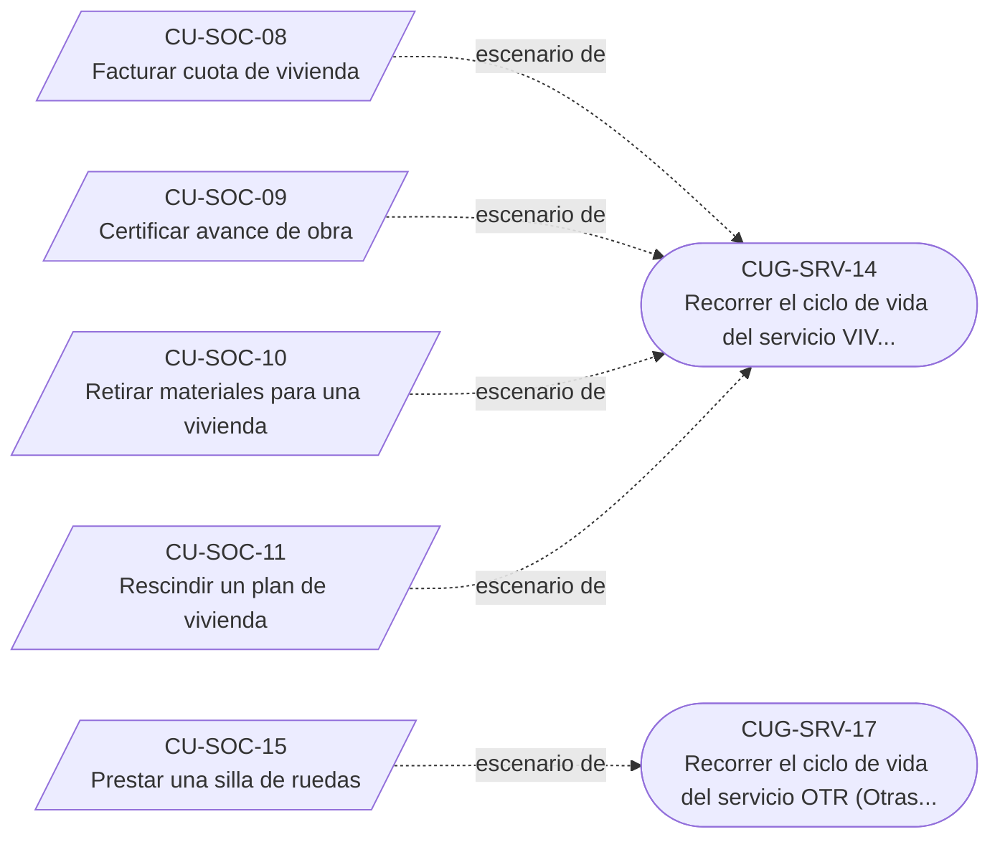

# Casos de uso de T12 SRV — Fichas verticales por servicio (partes 1 y 2)

Parte del entregable [21 Casos de uso por módulo](../21-casos-de-uso.md) (artefacto 3.3). Generado con `_trabajo/gen_21_casos_uso.py` desde `docs/especificacion/anexos/T12-SRV-fichas-verticales-servicios-parte1.md, T12-SRV-fichas-verticales-servicios-parte2.md` y revisado a mano. Ante cualquier diferencia prevalece el anexo.

| Dato | Valor |
|---|---|
| Casos de uso agrupadores (CUG) | 17 |
| RF del anexo | 0 (todos asignados a un CUG) |
| CU con ficha en la sección 16 | 0 |
| CU citados sin ficha en este anexo | 61 |

## 1. Diagramas

### 1.1 Actores y casos de uso agrupadores

```mermaid
flowchart LR
    subgraph ACT["Actores (roles T02)"]
        direction TB
        A_C_SOC["C-SOC<br/>Socio titular"]
        A_T_ATE["T-ATE<br/>Comercial / Atención al socio"]
        A_T_TEC["T-TEC<br/>Técnico (campo)"]
        A_T_STE["T-STE<br/>Supervisor técnico"]
        A_T_FAC["T-FAC<br/>Facturación"]
        A_S_SYS["S-SYS<br/>Sistema / worker"]
        A_T_LEC["T-LEC<br/>Lecturista (campo)"]
        A_T_SCM["T-SCM<br/>Supervisor de consumos (BASE §39.6)"]
        A_T_CON["T-CON<br/>Contador / Contable (MT-006)"]
        A_T_SOC["T-SOC<br/>Operador de servicios sociales y salud"]
        A_C_ADH["C-ADH<br/>Adherente / grupo familiar"]
        A_T_SEC["T-SEC<br/>Secretaría institucional"]
    end
    subgraph SIS["T12 SRV"]
        direction TB
        CUG_SRV_01(["CUG-SRV-01<br/>Recorrer el ciclo de vida del servicio INT (Internet)"])
        CUG_SRV_02(["CUG-SRV-02<br/>Recorrer el ciclo de vida del servicio TEL (Telefonía)"])
        CUG_SRV_03(["CUG-SRV-03<br/>Recorrer el ciclo de vida del servicio TV (Televisión /..."])
        CUG_SRV_04(["CUG-SRV-04<br/>Recorrer el ciclo de vida del servicio ELE (Energía..."])
        CUG_SRV_05(["CUG-SRV-05<br/>Recorrer el ciclo de vida del servicio AG (Agua potable)"])
        CUG_SRV_06(["CUG-SRV-06<br/>Recorrer el ciclo de vida del servicio CLO (Cloacas /..."])
        CUG_SRV_07(["CUG-SRV-07<br/>Recorrer el ciclo de vida del servicio GAS (Gas natural por..."])
        CUG_SRV_08(["CUG-SRV-08<br/>Recorrer el ciclo de vida del servicio ALU (Alumbrado..."])
        CUG_SRV_09(["CUG-SRV-09<br/>Recorrer el ciclo de vida del servicio OBR (Pavimento y..."])
        CUG_SRV_10(["CUG-SRV-10<br/>Recorrer el ciclo de vida del servicio SEP (Sepelio y..."])
        CUG_SRV_11(["CUG-SRV-11<br/>Recorrer el ciclo de vida del servicio CEM (Cementerio..."])
        CUG_SRV_12(["CUG-SRV-12<br/>Recorrer el ciclo de vida del servicio SAN (Banco de sangre..."])
        CUG_SRV_13(["CUG-SRV-13<br/>Recorrer el ciclo de vida del servicio SAL (Ambulancias y..."])
        CUG_SRV_14(["CUG-SRV-14<br/>Recorrer el ciclo de vida del servicio VIV (Planes de..."])
        CUG_SRV_15(["CUG-SRV-15<br/>Recorrer el ciclo de vida del servicio TAS (Tasas y..."])
        CUG_SRV_16(["CUG-SRV-16<br/>Recorrer el ciclo de vida del servicio CAP (Capital social..."])
        CUG_SRV_17(["CUG-SRV-17<br/>Recorrer el ciclo de vida del servicio OTR (Otras..."])
    end
    A_C_SOC --> CUG_SRV_01
    A_T_ATE -.-> CUG_SRV_01
    A_T_TEC -.-> CUG_SRV_01
    A_T_STE -.-> CUG_SRV_01
    A_T_FAC -.-> CUG_SRV_01
    A_S_SYS -.-> CUG_SRV_01
    A_C_SOC --> CUG_SRV_02
    A_T_ATE -.-> CUG_SRV_02
    A_T_TEC -.-> CUG_SRV_02
    A_T_STE -.-> CUG_SRV_02
    A_T_FAC -.-> CUG_SRV_02
    A_S_SYS -.-> CUG_SRV_02
    A_C_SOC --> CUG_SRV_03
    A_T_ATE -.-> CUG_SRV_03
    A_T_TEC -.-> CUG_SRV_03
    A_T_STE -.-> CUG_SRV_03
    A_T_FAC -.-> CUG_SRV_03
    A_S_SYS -.-> CUG_SRV_03
    A_C_SOC --> CUG_SRV_04
    A_T_ATE -.-> CUG_SRV_04
    A_T_TEC -.-> CUG_SRV_04
    A_T_LEC -.-> CUG_SRV_04
    A_T_SCM -.-> CUG_SRV_04
    A_T_FAC -.-> CUG_SRV_04
    A_S_SYS -.-> CUG_SRV_04
    A_C_SOC --> CUG_SRV_05
    A_T_ATE -.-> CUG_SRV_05
    A_T_TEC -.-> CUG_SRV_05
    A_T_LEC -.-> CUG_SRV_05
    A_T_SCM -.-> CUG_SRV_05
    A_T_FAC -.-> CUG_SRV_05
    A_S_SYS -.-> CUG_SRV_05
    A_T_FAC --> CUG_SRV_06
    A_C_SOC -.-> CUG_SRV_06
    A_T_STE -.-> CUG_SRV_06
    A_T_CON -.-> CUG_SRV_06
    A_S_SYS -.-> CUG_SRV_06
    A_C_SOC --> CUG_SRV_07
    A_T_ATE -.-> CUG_SRV_07
    A_T_TEC -.-> CUG_SRV_07
    A_T_LEC -.-> CUG_SRV_07
    A_T_SCM -.-> CUG_SRV_07
    A_T_FAC -.-> CUG_SRV_07
    A_S_SYS -.-> CUG_SRV_07
    A_T_FAC --> CUG_SRV_08
    A_C_SOC -.-> CUG_SRV_08
    A_T_STE -.-> CUG_SRV_08
    A_T_CON -.-> CUG_SRV_08
    A_S_SYS -.-> CUG_SRV_08
    A_T_FAC --> CUG_SRV_09
    A_C_SOC -.-> CUG_SRV_09
    A_T_STE -.-> CUG_SRV_09
    A_T_CON -.-> CUG_SRV_09
    A_S_SYS -.-> CUG_SRV_09
    A_C_SOC --> CUG_SRV_10
    A_T_SOC -.-> CUG_SRV_10
    A_C_ADH -.-> CUG_SRV_10
    A_T_FAC -.-> CUG_SRV_10
    A_S_SYS -.-> CUG_SRV_10
    A_C_SOC --> CUG_SRV_11
    A_T_SOC -.-> CUG_SRV_11
    A_C_ADH -.-> CUG_SRV_11
    A_T_FAC -.-> CUG_SRV_11
    A_S_SYS -.-> CUG_SRV_11
    A_C_SOC --> CUG_SRV_12
    A_T_SOC -.-> CUG_SRV_12
    A_C_ADH -.-> CUG_SRV_12
    A_T_FAC -.-> CUG_SRV_12
    A_S_SYS -.-> CUG_SRV_12
    A_C_SOC --> CUG_SRV_13
    A_T_SOC -.-> CUG_SRV_13
    A_C_ADH -.-> CUG_SRV_13
    A_T_FAC -.-> CUG_SRV_13
    A_S_SYS -.-> CUG_SRV_13
    A_C_SOC --> CUG_SRV_14
    A_T_SOC -.-> CUG_SRV_14
    A_C_ADH -.-> CUG_SRV_14
    A_T_FAC -.-> CUG_SRV_14
    A_S_SYS -.-> CUG_SRV_14
    A_T_FAC --> CUG_SRV_15
    A_C_SOC -.-> CUG_SRV_15
    A_T_STE -.-> CUG_SRV_15
    A_T_CON -.-> CUG_SRV_15
    A_S_SYS -.-> CUG_SRV_15
    A_T_SEC --> CUG_SRV_16
    A_C_SOC -.-> CUG_SRV_16
    A_T_FAC -.-> CUG_SRV_16
    A_T_CON -.-> CUG_SRV_16
    A_C_SOC --> CUG_SRV_17
    A_T_ATE -.-> CUG_SRV_17
    A_T_FAC -.-> CUG_SRV_17
    A_S_SYS -.-> CUG_SRV_17
    classDef actor fill:#1f2937,stroke:#60a5fa,color:#f9fafb;
    classDef cug fill:#0f172a,stroke:#34d399,color:#f9fafb;
    class A_C_SOC,A_T_ATE,A_T_TEC,A_T_STE,A_T_FAC,A_S_SYS,A_T_LEC,A_T_SCM,A_T_CON,A_T_SOC,A_C_ADH,A_T_SEC actor;
    class CUG_SRV_01,CUG_SRV_02,CUG_SRV_03,CUG_SRV_04,CUG_SRV_05,CUG_SRV_06,CUG_SRV_07,CUG_SRV_08,CUG_SRV_09,CUG_SRV_10,CUG_SRV_11,CUG_SRV_12,CUG_SRV_13,CUG_SRV_14,CUG_SRV_15,CUG_SRV_16,CUG_SRV_17 cug;
```

Línea continua: actor principal. Línea punteada: actor secundario o participante.

### 1.2 Casos de uso de la especificación por agrupador (parte 1 de 3)

```mermaid
flowchart LR
    CUG_SRV_01(["CUG-SRV-01<br/>Recorrer el ciclo de vida del servicio INT..."])
    X_CU_POR_06_CUG_SRV_01[/"CU-POR-06<br/>Pago con tarjeta y confirmación diferida"/]
    X_CU_POR_06_CUG_SRV_01 -.->|escenario de| CUG_SRV_01
    X_CU_MOR_03_CUG_SRV_01[/"CU-MOR-03<br/>Ciclo de mora del piloto Internet"/]
    X_CU_MOR_03_CUG_SRV_01 -.->|escenario de| CUG_SRV_01
    X_CU_COP_01_CUG_SRV_01[/"CU-COP-01<br/>Copiar un servicio de A a B"/]
    X_CU_COP_01_CUG_SRV_01 -.->|escenario de| CUG_SRV_01
    X_CU_SOL_01_CUG_SRV_01[/"CU-SOL-01<br/>Solicitud de alta por portal (definición en..."/]
    X_CU_SOL_01_CUG_SRV_01 -.->|escenario de| CUG_SRV_01
    X_CU_TEC_04_CUG_SRV_01[/"CU-TEC-04<br/>Aprovisionamiento con caída del sistema de..."/]
    X_CU_TEC_04_CUG_SRV_01 -.->|escenario de| CUG_SRV_01
    X_CU_POR_05_CUG_SRV_01[/"CU-POR-05<br/>Pagar varias facturas con cupón único en..."/]
    X_CU_POR_05_CUG_SRV_01 -.->|escenario de| CUG_SRV_01
    X_CU_CRM_03_CUG_SRV_01[/"CU-CRM-03<br/>Corte zonal de Internet con aviso masivo"/]
    X_CU_CRM_03_CUG_SRV_01 -.->|escenario de| CUG_SRV_01
    X_CU_CRM_04_CUG_SRV_01[/"CU-CRM-04<br/>Cambio de plan de Internet"/]
    X_CU_CRM_04_CUG_SRV_01 -.->|escenario de| CUG_SRV_01
    X_CU_CRM_05_CUG_SRV_01[/"CU-CRM-05<br/>Cambio de titular por venta de inmueble"/]
    X_CU_CRM_05_CUG_SRV_01 -.->|escenario de| CUG_SRV_01
    X_CU_CRM_06_CUG_SRV_01[/"CU-CRM-06<br/>Traslado de servicio"/]
    X_CU_CRM_06_CUG_SRV_01 -.->|escenario de| CUG_SRV_01
    X_CU_TEC_06_CUG_SRV_01[/"CU-TEC-06<br/>Traslado de servicio"/]
    X_CU_TEC_06_CUG_SRV_01 -.->|escenario de| CUG_SRV_01
    X_CU_CRM_02_CUG_SRV_01[/"CU-CRM-02<br/>Baja pública de Internet sin registro"/]
    X_CU_CRM_02_CUG_SRV_01 -.->|escenario de| CUG_SRV_01
    X_CU_POR_04_CUG_SRV_01[/"CU-POR-04<br/>Baja pública de Internet sin registro"/]
    X_CU_POR_04_CUG_SRV_01 -.->|escenario de| CUG_SRV_01
    X_CU_MOR_10_CUG_SRV_01[/"CU-MOR-10<br/>Baja pública de Internet sin cargo"/]
    X_CU_MOR_10_CUG_SRV_01 -.->|escenario de| CUG_SRV_01
    X_CU_POR_17_CUG_SRV_01[/"CU-POR-17<br/>Inicio de socio moroso y suspendido"/]
    X_CU_POR_17_CUG_SRV_01 -.->|escenario de| CUG_SRV_01
    CUG_SRV_02(["CUG-SRV-02<br/>Recorrer el ciclo de vida del servicio TEL..."])
    X_CU_TEC_10_CUG_SRV_02[/"CU-TEC-10<br/>Importación de CDR"/]
    X_CU_TEC_10_CUG_SRV_02 -.->|escenario de| CUG_SRV_02
    X_CU_TAR_09_CUG_SRV_02[/"CU-TAR-09<br/>Tasar llamadas"/]
    X_CU_TAR_09_CUG_SRV_02 -.->|escenario de| CUG_SRV_02
    X_CU_CRM_03_CUG_SRV_02[/"CU-CRM-03<br/>Corte zonal de Internet con aviso masivo"/]
    X_CU_CRM_03_CUG_SRV_02 -.->|escenario de| CUG_SRV_02
    CUG_SRV_03(["CUG-SRV-03<br/>Recorrer el ciclo de vida del servicio TV..."])
    X_CU_CRM_03_CUG_SRV_03[/"CU-CRM-03<br/>Corte zonal de Internet con aviso masivo"/]
    X_CU_CRM_03_CUG_SRV_03 -.->|escenario de| CUG_SRV_03
    CUG_SRV_04(["CUG-SRV-04<br/>Recorrer el ciclo de vida del servicio ELE..."])
    X_CU_ESP_ELE_CUG_SRV_04[/"CU-ESP-ELE<br/>Alta de suministro eléctrico con medidor y GD"/]
    X_CU_ESP_ELE_CUG_SRV_04 -.->|escenario de| CUG_SRV_04
    X_CU_MED_08_CUG_SRV_04[/"CU-MED-08<br/>Toma de estado por telemedición y corte..."/]
    X_CU_MED_08_CUG_SRV_04 -.->|escenario de| CUG_SRV_04
    X_CU_MED_01_CUG_SRV_04[/"CU-MED-01<br/>Generar, asignar y confirmar una ruta"/]
    X_CU_MED_01_CUG_SRV_04 -.->|escenario de| CUG_SRV_04
    X_CU_MER_01_CUG_SRV_04[/"CU-MER-01<br/>Usuario-generador (MER-001, original)"/]
    X_CU_MER_01_CUG_SRV_04 -.->|escenario de| CUG_SRV_04
    X_CU_POR_12_CUG_SRV_04[/"CU-POR-12<br/>Recarga prepaga"/]
    X_CU_POR_12_CUG_SRV_04 -.->|escenario de| CUG_SRV_04
    X_CU_TEC_03_CUG_SRV_04[/"CU-TEC-03<br/>Corte por mora remoto con pago previo"/]
    X_CU_TEC_03_CUG_SRV_04 -.->|escenario de| CUG_SRV_04
    X_CU_TEC_07_CUG_SRV_04[/"CU-TEC-07<br/>Cambio de medidor"/]
    X_CU_TEC_07_CUG_SRV_04 -.->|escenario de| CUG_SRV_04
    X_CU_MED_14_CUG_SRV_04[/"CU-MED-14<br/>Cambio de medidor desde OT de M10 con..."/]
    X_CU_MED_14_CUG_SRV_04 -.->|escenario de| CUG_SRV_04
    X_CU_POR_11_CUG_SRV_04[/"CU-POR-11<br/>Autolectura de agua"/]
    X_CU_POR_11_CUG_SRV_04 -.->|escenario de| CUG_SRV_04
    X_CU_MED_13_CUG_SRV_04[/"CU-MED-13<br/>Medición propia y pérdidas"/]
    X_CU_MED_13_CUG_SRV_04 -.->|escenario de| CUG_SRV_04
```

### 1.3 Casos de uso de la especificación por agrupador (parte 2 de 3)

```mermaid
flowchart LR
    CUG_SRV_05(["CUG-SRV-05<br/>Recorrer el ciclo de vida del servicio AG (Agua..."])
    X_CU_MED_06_CUG_SRV_05[/"CU-MED-06<br/>Distribución en consorcio"/]
    X_CU_MED_06_CUG_SRV_05 -.->|escenario de| CUG_SRV_05
    X_CU_ESP_AG_CUG_SRV_05[/"CU-ESP-AG<br/>Alta de agua con conexión"/]
    X_CU_ESP_AG_CUG_SRV_05 -.->|escenario de| CUG_SRV_05
    X_CU_MED_01_CUG_SRV_05[/"CU-MED-01<br/>Generar, asignar y confirmar una ruta"/]
    X_CU_MED_01_CUG_SRV_05 -.->|escenario de| CUG_SRV_05
    X_CU_POR_11_CUG_SRV_05[/"CU-POR-11<br/>Autolectura de agua"/]
    X_CU_POR_11_CUG_SRV_05 -.->|escenario de| CUG_SRV_05
    X_CU_MED_05_CUG_SRV_05[/"CU-MED-05<br/>Vuelta de medidor"/]
    X_CU_MED_05_CUG_SRV_05 -.->|escenario de| CUG_SRV_05
    X_CU_POR_05_CUG_SRV_05[/"CU-POR-05<br/>Pagar varias facturas con cupón único en..."/]
    X_CU_POR_05_CUG_SRV_05 -.->|escenario de| CUG_SRV_05
    X_CU_CRM_01_CUG_SRV_05[/"CU-CRM-01<br/>Reclamo por pérdida de agua con foto (BASE..."/]
    X_CU_CRM_01_CUG_SRV_05 -.->|escenario de| CUG_SRV_05
    X_CU_CRM_05_CUG_SRV_05[/"CU-CRM-05<br/>Cambio de titular por venta de inmueble"/]
    X_CU_CRM_05_CUG_SRV_05 -.->|escenario de| CUG_SRV_05
    X_CU_TEC_07_CUG_SRV_05[/"CU-TEC-07<br/>Cambio de medidor"/]
    X_CU_TEC_07_CUG_SRV_05 -.->|escenario de| CUG_SRV_05
    CUG_SRV_07(["CUG-SRV-07<br/>Recorrer el ciclo de vida del servicio GAS (Gas..."])
    X_CU_ESP_GAS_CUG_SRV_07[/"CU-ESP-GAS<br/>Alta de gas con DDJJ de artefactos"/]
    X_CU_ESP_GAS_CUG_SRV_07 -.->|escenario de| CUG_SRV_07
    X_CU_MED_01_CUG_SRV_07[/"CU-MED-01<br/>Generar, asignar y confirmar una ruta"/]
    X_CU_MED_01_CUG_SRV_07 -.->|escenario de| CUG_SRV_07
    X_CU_TEC_07_CUG_SRV_07[/"CU-TEC-07<br/>Cambio de medidor"/]
    X_CU_TEC_07_CUG_SRV_07 -.->|escenario de| CUG_SRV_07
    X_CU_POR_14_CUG_SRV_07[/"CU-POR-14<br/>Presentar DDJJ de artefactos"/]
    X_CU_POR_14_CUG_SRV_07 -.->|escenario de| CUG_SRV_07
    CUG_SRV_08(["CUG-SRV-08<br/>Recorrer el ciclo de vida del servicio ALU..."])
    X_CU_CAT_09_CUG_SRV_08[/"CU-CAT-09<br/>Configurar alta automática"/]
    X_CU_CAT_09_CUG_SRV_08 -.->|escenario de| CUG_SRV_08
    X_CU_TAR_04_CUG_SRV_08[/"CU-TAR-04<br/>Crear una regla con fórmula"/]
    X_CU_TAR_04_CUG_SRV_08 -.->|escenario de| CUG_SRV_08
    CUG_SRV_09(["CUG-SRV-09<br/>Recorrer el ciclo de vida del servicio OBR..."])
    X_CU_TEC_09_CUG_SRV_09[/"CU-TEC-09<br/>Contribución por mejoras"/]
    X_CU_TEC_09_CUG_SRV_09 -.->|escenario de| CUG_SRV_09
    CUG_SRV_10(["CUG-SRV-10<br/>Recorrer el ciclo de vida del servicio SEP..."])
    X_CU_SOC_04_CUG_SRV_10[/"CU-SOC-04<br/>Gestionar sepelio con inhumación en el parque"/]
    X_CU_SOC_04_CUG_SRV_10 -.->|escenario de| CUG_SRV_10
    X_CU_SOC_05_CUG_SRV_10[/"CU-SOC-05<br/>Pagar subsidio por fallecimiento"/]
    X_CU_SOC_05_CUG_SRV_10 -.->|escenario de| CUG_SRV_10
    X_CU_SOC_01_CUG_SRV_10[/"CU-SOC-01<br/>Agregar un hijo al grupo de sepelio"/]
    X_CU_SOC_01_CUG_SRV_10 -.->|escenario de| CUG_SRV_10
    X_CU_24_CUG_SRV_10[/"CU-24<br/>Autorizar prestación social"/]
    X_CU_24_CUG_SRV_10 -.->|escenario de| CUG_SRV_10
    X_CU_SOC_02_CUG_SRV_10[/"CU-SOC-02<br/>Procesar mayoría de edad"/]
    X_CU_SOC_02_CUG_SRV_10 -.->|escenario de| CUG_SRV_10
    X_CU_SOC_03_CUG_SRV_10[/"CU-SOC-03<br/>Desconexión y reconexión con adherentes"/]
    X_CU_SOC_03_CUG_SRV_10 -.->|escenario de| CUG_SRV_10
    CUG_SRV_11(["CUG-SRV-11<br/>Recorrer el ciclo de vida del servicio CEM..."])
    X_CU_ESP_CEM_CUG_SRV_11[/"CU-ESP-CEM<br/>Contratar parcela de cementerio parque..."/]
    X_CU_ESP_CEM_CUG_SRV_11 -.->|escenario de| CUG_SRV_11
    X_CU_SOC_04_CUG_SRV_11[/"CU-SOC-04<br/>Gestionar sepelio con inhumación en el parque"/]
    X_CU_SOC_04_CUG_SRV_11 -.->|escenario de| CUG_SRV_11
    X_CU_SOC_06_CUG_SRV_11[/"CU-SOC-06<br/>Ceder un derecho de sepultura"/]
    X_CU_SOC_06_CUG_SRV_11 -.->|escenario de| CUG_SRV_11
    CUG_SRV_12(["CUG-SRV-12<br/>Recorrer el ciclo de vida del servicio SAN (Banco..."])
    X_CU_ESP_SAN_CUG_SRV_12[/"CU-ESP-SAN<br/>Adhesión a banco de sangre (definición en..."/]
    X_CU_ESP_SAN_CUG_SRV_12 -.->|escenario de| CUG_SRV_12
    CUG_SRV_13(["CUG-SRV-13<br/>Recorrer el ciclo de vida del servicio SAL..."])
    X_CU_SOC_07_CUG_SRV_13[/"CU-SOC-07<br/>Programar un traslado a diálisis"/]
    X_CU_SOC_07_CUG_SRV_13 -.->|escenario de| CUG_SRV_13
```

### 1.4 Casos de uso de la especificación por agrupador (parte 3 de 3)

Rectángulo: CU con ficha en la sección 16 del anexo. Paralelogramo: CU citado (ficha en otro anexo o sin ficha).

## 2. Fichas de los casos de uso agrupadores

### CUG-SRV-01 — Recorrer el ciclo de vida del servicio INT (Internet)

| Campo | Contenido |
|---|---|
| Actor principal | C-SOC Socio titular |
| Actores secundarios | T-ATE Comercial / Atención al socio; T-TEC Técnico (campo); T-STE Supervisor técnico; T-FAC Facturación; S-SYS Sistema / worker |
| Objetivo | Contratar, instalar o habilitar, medir o tasar, facturar, cobrar, atender y dar de baja el servicio INT con los IDs de cada anexo dueño (DEC-073). |
| Precondición | Usuario de la comunidad autenticado (o visitante en rutas públicas) con relación vigente sobre la cuenta (M01) y módulo habilitado en el tenant. |
| Flujo principal | 1. Oferta y landing. 2. Solicitud de alta. 3. Factibilidad. 4. Alta del contrato. 5. Instalación y equipos. 6. Aprovisionamiento. 7. Medidor y lecturas. 8. Tarifa. 9. Facturación. 10. Fiscal y regulador. 11. Cuenta corriente y cobro. 12. Mora, corte y reconexión. 13. Reclamos. 14. Cambios. 15. Baja. 16. Portal del socio. 17. Comunicaciones. 18. Reportes. 19. Contabilidad. 20. Migración. |
| Alternativos | Sin la capability o fuera del alcance de datos: la acción se deniega por defecto y se audita (T02). |
| CU asociados | CU-POR-06 (ficha en M19); CU-MOR-03 (ficha en M08); CU-COP-01 (ficha en M02); CU-SOL-01 (ficha en M09); CU-TEC-04 (ficha en M10); CU-POR-05 (ficha en M19); CU-CRM-03 (ficha en M09); CU-CRM-04 (ficha en M09); CU-CRM-05 (ficha en M09); CU-CRM-06 (ficha en M09); CU-TEC-06 (ficha en M10); CU-CRM-02 (ficha en M09); CU-POR-04 (ficha en M19); CU-MOR-10 (ficha en M08); CU-POR-17 (ficha en M19) |
| RF (0) | — (el anexo no define RF propios) |
| Origen | T12 parte1, línea 78 |

### CUG-SRV-02 — Recorrer el ciclo de vida del servicio TEL (Telefonía)

| Campo | Contenido |
|---|---|
| Actor principal | C-SOC Socio titular |
| Actores secundarios | T-ATE Comercial / Atención al socio; T-TEC Técnico (campo); T-STE Supervisor técnico; T-FAC Facturación; S-SYS Sistema / worker |
| Objetivo | Contratar, instalar o habilitar, medir o tasar, facturar, cobrar, atender y dar de baja el servicio TEL con los IDs de cada anexo dueño (DEC-073). |
| Precondición | Usuario de la comunidad autenticado (o visitante en rutas públicas) con relación vigente sobre la cuenta (M01) y módulo habilitado en el tenant. |
| Flujo principal | 1. Oferta y landing. 2. Solicitud. 3. Factibilidad. 4. Alta del contrato. 5. Instalación y numeración. 6. Aprovisionamiento. 7. Tasación (consumo). 8. Tarifa. 9. Facturación. 10. Fiscal y regulador. 11. Cuenta corriente y cobro. 12. Mora, corte y reconexión. 13. Reclamos. 14. Cambios. 15. Baja. 16. Portal del socio. 17. Comunicaciones. 18. Reportes. 19. Contabilidad. 20. Migración. |
| Alternativos | Sin la capability o fuera del alcance de datos: la acción se deniega por defecto y se audita (T02). |
| CU asociados | CU-TEC-10 (ficha en M10); CU-TAR-09 (ficha en M04); CU-CRM-03 (ficha en M09) |
| RF (0) | — (el anexo no define RF propios) |
| Origen | T12 parte1, línea 197 |

### CUG-SRV-03 — Recorrer el ciclo de vida del servicio TV (Televisión / cable)

| Campo | Contenido |
|---|---|
| Actor principal | C-SOC Socio titular |
| Actores secundarios | T-ATE Comercial / Atención al socio; T-TEC Técnico (campo); T-STE Supervisor técnico; T-FAC Facturación; S-SYS Sistema / worker |
| Objetivo | Contratar, instalar o habilitar, medir o tasar, facturar, cobrar, atender y dar de baja el servicio TV con los IDs de cada anexo dueño (DEC-073). |
| Precondición | Usuario de la comunidad autenticado (o visitante en rutas públicas) con relación vigente sobre la cuenta (M01) y módulo habilitado en el tenant. |
| Flujo principal | 1. Oferta y landing. 2. Solicitud. 3. Factibilidad. 4. Alta del contrato. 5. Instalación y equipos. 6. Aprovisionamiento. 7. Medidor y lecturas. 8. Tarifa. 9. Facturación. 10. Fiscal y regulador. 11. Cuenta corriente y cobro. 12. Mora, corte y reconexión. 13. Reclamos. 14. Cambios. 15. Baja. 16. Portal del socio. 17. Comunicaciones. 18. Reportes. 19. Contabilidad. 20. Migración. |
| Alternativos | Sin la capability o fuera del alcance de datos: la acción se deniega por defecto y se audita (T02). |
| CU asociados | CU-CRM-03 (ficha en M09) |
| RF (0) | — (el anexo no define RF propios) |
| Origen | T12 parte1, línea 309 |

### CUG-SRV-04 — Recorrer el ciclo de vida del servicio ELE (Energía eléctrica)

| Campo | Contenido |
|---|---|
| Actor principal | C-SOC Socio titular |
| Actores secundarios | T-ATE Comercial / Atención al socio; T-TEC Técnico (campo); T-LEC Lecturista (campo); T-SCM Supervisor de consumos (BASE §39.6); T-FAC Facturación; S-SYS Sistema / worker |
| Objetivo | Contratar, instalar o habilitar, medir o tasar, facturar, cobrar, atender y dar de baja el servicio ELE con los IDs de cada anexo dueño (DEC-073). |
| Precondición | Usuario de la comunidad autenticado (o visitante en rutas públicas) con relación vigente sobre la cuenta (M01) y módulo habilitado en el tenant. |
| Flujo principal | 1. Oferta y landing. 2. Solicitud. 3. Factibilidad y obra. 4. Alta del contrato. 5. Instalación y medidor. 6. Telemedición y prepago. 7. Lecturas y consumos. 8. 7b. 9. Tarifa. 10. Facturación. 11. Fiscal y regulador. 12. Cuenta corriente y cobro. 13. Mora, corte y reconexión. 14. Reclamos y emergencias. 15. Cambios. 16. Baja. 17. Portal del socio. 18. Comunicaciones. 19. Reportes. 20. Contabilidad. |
| Alternativos | Sin la capability o fuera del alcance de datos: la acción se deniega por defecto y se audita (T02). |
| CU asociados | CU-ESP-ELE (ficha en M02); CU-MED-08 (ficha en M03); CU-MED-01 (ficha en M03); CU-MER-01 (ficha en M03); CU-POR-12 (ficha en M19); CU-TEC-03 (ficha en M10); CU-TEC-07 (ficha en M10); CU-MED-14 (ficha en M03); CU-POR-11 (ficha en M19); CU-MED-13 (ficha en M03) |
| RF (0) | — (el anexo no define RF propios) |
| Origen | T12 parte1, línea 415 |

### CUG-SRV-05 — Recorrer el ciclo de vida del servicio AG (Agua potable)

| Campo | Contenido |
|---|---|
| Actor principal | C-SOC Socio titular |
| Actores secundarios | T-ATE Comercial / Atención al socio; T-TEC Técnico (campo); T-LEC Lecturista (campo); T-SCM Supervisor de consumos (BASE §39.6); T-FAC Facturación; S-SYS Sistema / worker |
| Objetivo | Contratar, instalar o habilitar, medir o tasar, facturar, cobrar, atender y dar de baja el servicio AG con los IDs de cada anexo dueño (DEC-073). |
| Precondición | Usuario de la comunidad autenticado (o visitante en rutas públicas) con relación vigente sobre la cuenta (M01) y módulo habilitado en el tenant. |
| Flujo principal | 1. Oferta y landing. 2. Solicitud. 3. Factibilidad y obra. 4. Alta del contrato. 5. Instalación y medidor. 6. Aprovisionamiento. 7. Lecturas y consumos. 8. Tarifa. 9. Facturación. 10. Fiscal y regulador. 11. Cuenta corriente y cobro. 12. Mora, corte y reconexión. 13. Reclamos. 14. Cambios. 15. Baja. 16. Portal del socio. 17. Comunicaciones. 18. Reportes. 19. Contabilidad. 20. Migración. |
| Alternativos | Sin la capability o fuera del alcance de datos: la acción se deniega por defecto y se audita (T02). |
| CU asociados | CU-MED-06 (ficha en M03); CU-ESP-AG (ficha en M02); CU-MED-01 (ficha en M03); CU-POR-11 (ficha en M19); CU-MED-05 (ficha en M03); CU-POR-05 (ficha en M19); CU-CRM-01 (ficha en M09); CU-CRM-05 (ficha en M09); CU-TEC-07 (ficha en M10) |
| RF (0) | — (el anexo no define RF propios) |
| Origen | T12 parte1, línea 536 |

### CUG-SRV-06 — Recorrer el ciclo de vida del servicio CLO (Cloacas / saneamiento)

| Campo | Contenido |
|---|---|
| Actor principal | T-FAC Facturación |
| Actores secundarios | C-SOC Socio titular; T-STE Supervisor técnico; T-CON Contador / Contable (MT-006); S-SYS Sistema / worker |
| Objetivo | Contratar, instalar o habilitar, medir o tasar, facturar, cobrar, atender y dar de baja el servicio CLO con los IDs de cada anexo dueño (DEC-073). |
| Precondición | Usuario del tenant autenticado con el rol indicado; módulo SRV licenciado y activo (T01, T02 §4.3). |
| Flujo principal | 1. Oferta y landing. 2. Solicitud. 3. Factibilidad y obra. 4. Alta del contrato. 5. Instalación. 6. Aprovisionamiento o medidor. 7. Consumos. 8. Tarifa. 9. Facturación. 10. Fiscal y regulador. 11. Cuenta corriente y cobro. 12. Mora, corte y reconexión. 13. Reclamos. 14. Cambios. 15. Baja. 16. Portal del socio. 17. Comunicaciones. 18. Reportes. 19. Contabilidad. 20. Migración. |
| Alternativos | Sin la capability o fuera del alcance de datos: la acción se deniega por defecto y se audita (T02). |
| CU asociados | — (sin CU en la especificación; el flujo sale de los RF) |
| RF (0) | — (el anexo no define RF propios) |
| Origen | T12 parte1, línea 647 |

### CUG-SRV-07 — Recorrer el ciclo de vida del servicio GAS (Gas natural por red, propano por red y envasado)

| Campo | Contenido |
|---|---|
| Actor principal | C-SOC Socio titular |
| Actores secundarios | T-ATE Comercial / Atención al socio; T-TEC Técnico (campo); T-LEC Lecturista (campo); T-SCM Supervisor de consumos (BASE §39.6); T-FAC Facturación; S-SYS Sistema / worker |
| Objetivo | Contratar, instalar o habilitar, medir o tasar, facturar, cobrar, atender y dar de baja el servicio GAS con los IDs de cada anexo dueño (DEC-073). |
| Precondición | Usuario de la comunidad autenticado (o visitante en rutas públicas) con relación vigente sobre la cuenta (M01) y módulo habilitado en el tenant. |
| Flujo principal | 1. Oferta y landing. 2. Solicitud. 3. Factibilidad y obra. 4. Alta del contrato. 5. Instalación y medidor. 6. Aprovisionamiento. 7. Lecturas y corrección. 8. Tarifa. 9. Facturación. 10. Fiscal y regulador. 11. Cuenta corriente y cobro. 12. Mora, corte y reconexión. 13. Reclamos y emergencias. 14. Cambios. 15. Baja. 16. Portal del socio. 17. Comunicaciones. 18. Reportes. 19. Contabilidad. 20. Migración. |
| Alternativos | Sin la capability o fuera del alcance de datos: la acción se deniega por defecto y se audita (T02). |
| CU asociados | CU-ESP-GAS (ficha en M02); CU-MED-01 (ficha en M03); CU-TEC-07 (ficha en M10); CU-POR-14 (ficha en M19) |
| RF (0) | — (el anexo no define RF propios) |
| Origen | T12 parte1, línea 752 |

### CUG-SRV-08 — Recorrer el ciclo de vida del servicio ALU (Alumbrado público)

| Campo | Contenido |
|---|---|
| Actor principal | T-FAC Facturación |
| Actores secundarios | C-SOC Socio titular; T-STE Supervisor técnico; T-CON Contador / Contable (MT-006); S-SYS Sistema / worker |
| Objetivo | Contratar, instalar o habilitar, medir o tasar, facturar, cobrar, atender y dar de baja el servicio ALU con los IDs de cada anexo dueño (DEC-073). |
| Precondición | Usuario del tenant autenticado con el rol indicado; módulo SRV licenciado y activo (T01, T02 §4.3). |
| Flujo principal | 1. Oferta y landing. 2. Solicitud. 3. Factibilidad y obra. 4. Alta del contrato. 5. Instalación. 6. Aprovisionamiento o medidor. 7. Lecturas. 8. Tarifa. 9. Facturación. 10. Fiscal. 11. Cuenta corriente y cobro. 12. Mora, corte y reconexión. 13. Reclamos. 14. Cambios. 15. Baja. 16. Portal del socio. 17. Comunicaciones. 18. Reportes. 19. Contabilidad y pagos. 20. Migración. |
| Alternativos | Sin la capability o fuera del alcance de datos: la acción se deniega por defecto y se audita (T02). |
| CU asociados | CU-CAT-09 (ficha en M02); CU-TAR-04 (ficha en M04) |
| RF (0) | — (el anexo no define RF propios) |
| Origen | T12 parte1, línea 865 |

### CUG-SRV-09 — Recorrer el ciclo de vida del servicio OBR (Pavimento y obras, cuotas de obra, contribución por mejoras)

| Campo | Contenido |
|---|---|
| Actor principal | T-FAC Facturación |
| Actores secundarios | C-SOC Socio titular; T-STE Supervisor técnico; T-CON Contador / Contable (MT-006); S-SYS Sistema / worker |
| Objetivo | Contratar, instalar o habilitar, medir o tasar, facturar, cobrar, atender y dar de baja el servicio OBR con los IDs de cada anexo dueño (DEC-073). |
| Precondición | Usuario del tenant autenticado con el rol indicado; módulo SRV licenciado y activo (T01, T02 §4.3). |
| Flujo principal | 1. Oferta y landing (M19) (no aplica). 2. Solicitud (M09) (no aplica). 3. Alta, adhesión y grupo familiar (M02/M01/M18). 4. Carencias, convenios y prestación (M18) (no aplica). 5. Cálculo (M04). 6. Facturación (M05). 7. Fiscal y terceros (M06). 8. Cuenta corriente y cobro (M07). 9. Mora y efecto sobre la cobertura (M08). 10. Solicitud de prestación o uso (M18/M09) (no aplica). 11. Cambios y bajas (M01). 12. Portal (M19). 13. Comunicaciones (T09). 14. Reportes (T10). 15. Contabilidad (M15) e institucional (M17). 16. Migración (T07, tablas CAT). |
| Alternativos | Sin la capability o fuera del alcance de datos: la acción se deniega por defecto y se audita (T02). |
| CU asociados | CU-TEC-09 (ficha en M10) |
| RF (0) | — (el anexo no define RF propios) |
| Origen | T12 parte2, línea 55 |

### CUG-SRV-10 — Recorrer el ciclo de vida del servicio SEP (Sepelio y subsidio por fallecimiento)

| Campo | Contenido |
|---|---|
| Actor principal | C-SOC Socio titular |
| Actores secundarios | T-SOC Operador de servicios sociales y salud; C-ADH Adherente / grupo familiar; T-FAC Facturación; S-SYS Sistema / worker |
| Objetivo | Contratar, instalar o habilitar, medir o tasar, facturar, cobrar, atender y dar de baja el servicio SEP con los IDs de cada anexo dueño (DEC-073). |
| Precondición | Usuario de la comunidad autenticado (o visitante en rutas públicas) con relación vigente sobre la cuenta (M01) y módulo habilitado en el tenant. |
| Flujo principal | 1. Oferta y landing (M19). 2. Solicitud (M09). 3. Alta, adhesión y grupo familiar (M02/M01/M18). 4. Carencias, convenios y prestación (M18). 5. Cálculo (M04). 6. Facturación (M05). 7. Fiscal y terceros (M06) (no aplica). 8. Cuenta corriente y cobro (M07). 9. Mora y efecto sobre la cobertura (M08). 10. Solicitud de prestación o uso (M18/M09). 11. Cambios y bajas (M01). 12. Portal (M19). 13. Comunicaciones (T09). 14. Reportes (T10). 15. Contabilidad (M15) e institucional (M17). 16. Migración (T07, tablas CAT). |
| Alternativos | Sin la capability o fuera del alcance de datos: la acción se deniega por defecto y se audita (T02). |
| CU asociados | CU-SOC-04 (ficha en M18); CU-SOC-05 (ficha en M18); CU-SOC-01 (ficha en M18); CU-24 (ficha en M18); CU-SOC-02 (ficha en M18); CU-SOC-03 (ficha en M18) |
| RF (0) | — (el anexo no define RF propios) |
| Origen | T12 parte2, línea 150 |

### CUG-SRV-11 — Recorrer el ciclo de vida del servicio CEM (Cementerio parque)

| Campo | Contenido |
|---|---|
| Actor principal | C-SOC Socio titular |
| Actores secundarios | T-SOC Operador de servicios sociales y salud; C-ADH Adherente / grupo familiar; T-FAC Facturación; S-SYS Sistema / worker |
| Objetivo | Contratar, instalar o habilitar, medir o tasar, facturar, cobrar, atender y dar de baja el servicio CEM con los IDs de cada anexo dueño (DEC-073). |
| Precondición | Usuario de la comunidad autenticado (o visitante en rutas públicas) con relación vigente sobre la cuenta (M01) y módulo habilitado en el tenant. |
| Flujo principal | 1. Oferta y landing (M19). 2. Solicitud (M09). 3. Alta, adhesión y grupo familiar (M02/M01/M18). 4. Carencias, convenios y prestación (M18) (no aplica). 5. Cálculo (M04). 6. Facturación (M05). 7. Fiscal y terceros (M06) (no aplica). 8. Cuenta corriente y cobro (M07). 9. Mora y efecto sobre la cobertura (M08). 10. Solicitud de prestación o uso (M18/M09). 11. Cambios y bajas (M01). 12. Portal (M19). 13. Comunicaciones (T09). 14. Reportes (T10). 15. Contabilidad (M15) e institucional (M17). 16. Migración (T07, tablas CAT). |
| Alternativos | Sin la capability o fuera del alcance de datos: la acción se deniega por defecto y se audita (T02). |
| CU asociados | CU-ESP-CEM (ficha en M18); CU-SOC-04 (ficha en M18); CU-SOC-06 (ficha en M18) |
| RF (0) | — (el anexo no define RF propios) |
| Origen | T12 parte2, línea 246 |

### CUG-SRV-12 — Recorrer el ciclo de vida del servicio SAN (Banco de sangre por convenio)

| Campo | Contenido |
|---|---|
| Actor principal | C-SOC Socio titular |
| Actores secundarios | T-SOC Operador de servicios sociales y salud; C-ADH Adherente / grupo familiar; T-FAC Facturación; S-SYS Sistema / worker |
| Objetivo | Contratar, instalar o habilitar, medir o tasar, facturar, cobrar, atender y dar de baja el servicio SAN con los IDs de cada anexo dueño (DEC-073). |
| Precondición | Usuario de la comunidad autenticado (o visitante en rutas públicas) con relación vigente sobre la cuenta (M01) y módulo habilitado en el tenant. |
| Flujo principal | 1. Oferta y landing (M19). 2. Solicitud (M09). 3. Alta, adhesión y grupo familiar (M02/M01/M18). 4. Carencias, convenios y prestación (M18). 5. Cálculo (M04). 6. Facturación (M05). 7. Fiscal y terceros (M06) (no aplica). 8. Cuenta corriente y cobro (M07). 9. Mora y efecto sobre la cobertura (M08). 10. Solicitud de prestación o uso (M18/M09). 11. Cambios y bajas (M01). 12. Portal (M19). 13. Comunicaciones (T09). 14. Reportes (T10). 15. Contabilidad (M15) e institucional (M17). 16. Migración (T07, tablas CAT) (no aplica). |
| Alternativos | Sin la capability o fuera del alcance de datos: la acción se deniega por defecto y se audita (T02). |
| CU asociados | CU-ESP-SAN (ficha en M18) |
| RF (0) | — (el anexo no define RF propios) |
| Origen | T12 parte2, línea 338 |

### CUG-SRV-13 — Recorrer el ciclo de vida del servicio SAL (Ambulancias y salud)

| Campo | Contenido |
|---|---|
| Actor principal | C-SOC Socio titular |
| Actores secundarios | T-SOC Operador de servicios sociales y salud; C-ADH Adherente / grupo familiar; T-FAC Facturación; S-SYS Sistema / worker |
| Objetivo | Contratar, instalar o habilitar, medir o tasar, facturar, cobrar, atender y dar de baja el servicio SAL con los IDs de cada anexo dueño (DEC-073). |
| Precondición | Usuario de la comunidad autenticado (o visitante en rutas públicas) con relación vigente sobre la cuenta (M01) y módulo habilitado en el tenant. |
| Flujo principal | 1. Oferta y landing (M19). 2. Solicitud (M09). 3. Alta, adhesión y grupo familiar (M02/M01/M18). 4. Carencias, convenios y prestación (M18). 5. Cálculo (M04). 6. Facturación (M05). 7. Fiscal y terceros (M06) (no aplica). 8. Cuenta corriente y cobro (M07). 9. Mora y efecto sobre la cobertura (M08). 10. Solicitud de prestación o uso (M18/M09). 11. Cambios y bajas (M01). 12. Portal (M19). 13. Comunicaciones (T09). 14. Reportes (T10). 15. Contabilidad (M15) e institucional (M17). 16. Migración (T07, tablas CAT). |
| Alternativos | Sin la capability o fuera del alcance de datos: la acción se deniega por defecto y se audita (T02). |
| CU asociados | CU-SOC-07 (ficha en M18) |
| RF (0) | — (el anexo no define RF propios) |
| Origen | T12 parte2, línea 426 |

### CUG-SRV-14 — Recorrer el ciclo de vida del servicio VIV (Planes de vivienda)

| Campo | Contenido |
|---|---|
| Actor principal | C-SOC Socio titular |
| Actores secundarios | T-SOC Operador de servicios sociales y salud; C-ADH Adherente / grupo familiar; T-FAC Facturación; S-SYS Sistema / worker |
| Objetivo | Contratar, instalar o habilitar, medir o tasar, facturar, cobrar, atender y dar de baja el servicio VIV con los IDs de cada anexo dueño (DEC-073). |
| Precondición | Usuario de la comunidad autenticado (o visitante en rutas públicas) con relación vigente sobre la cuenta (M01) y módulo habilitado en el tenant. |
| Flujo principal | 1. Oferta y landing (M19). 2. Solicitud (M09). 3. Alta, adhesión y grupo familiar (M02/M01/M18). 4. Carencias, convenios y prestación (M18) (no aplica). 5. Cálculo (M04). 6. Facturación (M05). 7. Fiscal y terceros (M06) (no aplica). 8. Cuenta corriente y cobro (M07). 9. Mora y efecto sobre la cobertura (M08). 10. Solicitud de prestación o uso (M18/M09). 11. Cambios y bajas (M01). 12. Portal (M19). 13. Comunicaciones (T09). 14. Reportes (T10). 15. Contabilidad (M15) e institucional (M17). 16. Migración (T07, tablas CAT). |
| Alternativos | Sin la capability o fuera del alcance de datos: la acción se deniega por defecto y se audita (T02). |
| CU asociados | CU-SOC-08 (ficha en M18); CU-SOC-09 (ficha en M18); CU-SOC-10 (ficha en M18); CU-SOC-11 (ficha en M18) |
| RF (0) | — (el anexo no define RF propios) |
| Origen | T12 parte2, línea 515 |

### CUG-SRV-15 — Recorrer el ciclo de vida del servicio TAS (Tasas y conceptos por cuenta de terceros)

| Campo | Contenido |
|---|---|
| Actor principal | T-FAC Facturación |
| Actores secundarios | C-SOC Socio titular; T-STE Supervisor técnico; T-CON Contador / Contable (MT-006); S-SYS Sistema / worker |
| Objetivo | Contratar, instalar o habilitar, medir o tasar, facturar, cobrar, atender y dar de baja el servicio TAS con los IDs de cada anexo dueño (DEC-073). |
| Precondición | Usuario del tenant autenticado con el rol indicado; módulo SRV licenciado y activo (T01, T02 §4.3). |
| Flujo principal | 1. Oferta y landing (M19) (no aplica). 2. Solicitud (M09) (no aplica). 3. Alta, adhesión y grupo familiar (M02/M01/M18). 4. Carencias, convenios y prestación (M18) (no aplica). 5. Cálculo (M04). 6. Facturación (M05). 7. Fiscal y terceros (M06). 8. Cuenta corriente y cobro (M07). 9. Mora y efecto sobre la cobertura (M08). 10. Solicitud de prestación o uso (M18/M09) (no aplica). 11. Cambios y bajas (M01). 12. Portal (M19). 13. Comunicaciones (T09) (no aplica). 14. Reportes (T10). 15. Contabilidad (M15) e institucional (M17). 16. Migración (T07, tablas CAT). |
| Alternativos | Sin la capability o fuera del alcance de datos: la acción se deniega por defecto y se audita (T02). |
| CU asociados | — (sin CU en la especificación; el flujo sale de los RF) |
| RF (0) | — (el anexo no define RF propios) |
| Origen | T12 parte2, línea 606 |

### CUG-SRV-16 — Recorrer el ciclo de vida del servicio CAP (Capital social como concepto)

| Campo | Contenido |
|---|---|
| Actor principal | T-SEC Secretaría institucional |
| Actores secundarios | C-SOC Socio titular; T-FAC Facturación; T-CON Contador / Contable (MT-006) |
| Objetivo | Contratar, instalar o habilitar, medir o tasar, facturar, cobrar, atender y dar de baja el servicio CAP con los IDs de cada anexo dueño (DEC-073). |
| Precondición | Usuario del tenant autenticado con el rol indicado; módulo SRV licenciado y activo (T01, T02 §4.3). |
| Flujo principal | 1. Oferta y landing (M19). 2. Solicitud (M09). 3. Alta, adhesión y grupo familiar (M02/M01/M18). 4. Carencias, convenios y prestación (M18) (no aplica). 5. Cálculo (M04) (no aplica). 6. Facturación (M05). 7. Fiscal y terceros (M06). 8. Cuenta corriente y cobro (M07). 9. Mora y efecto sobre la cobertura (M08). 10. Solicitud de prestación o uso (M18/M09) (no aplica). 11. Cambios y bajas (M01). 12. Portal (M19). 13. Comunicaciones (T09). 14. Reportes (T10). 15. Contabilidad (M15) e institucional (M17). 16. Migración (T07, tablas CAT). |
| Alternativos | Sin la capability o fuera del alcance de datos: la acción se deniega por defecto y se audita (T02). |
| CU asociados | — (sin CU en la especificación; el flujo sale de los RF) |
| RF (0) | — (el anexo no define RF propios) |
| Origen | T12 parte2, línea 698 |

### CUG-SRV-17 — Recorrer el ciclo de vida del servicio OTR (Otras prestaciones)

| Campo | Contenido |
|---|---|
| Actor principal | C-SOC Socio titular |
| Actores secundarios | T-ATE Comercial / Atención al socio; T-FAC Facturación; S-SYS Sistema / worker |
| Objetivo | Contratar, instalar o habilitar, medir o tasar, facturar, cobrar, atender y dar de baja el servicio OTR con los IDs de cada anexo dueño (DEC-073). |
| Precondición | Usuario de la comunidad autenticado (o visitante en rutas públicas) con relación vigente sobre la cuenta (M01) y módulo habilitado en el tenant. |
| Flujo principal | 1. Oferta y landing (M19). 2. Solicitud (M09). 3. Alta, adhesión y grupo familiar (M02/M01/M18). 4. Carencias, convenios y prestación (M18). 5. Cálculo (M04). 6. Facturación (M05). 7. Fiscal y terceros (M06). 8. Cuenta corriente y cobro (M07). 9. Mora y efecto sobre la cobertura (M08). 10. Solicitud de prestación o uso (M18/M09). 11. Cambios y bajas (M01). 12. Portal (M19). 13. Comunicaciones (T09). 14. Reportes (T10). 15. Contabilidad (M15) e institucional (M17). 16. Migración (T07, tablas CAT). |
| Alternativos | Sin la capability o fuera del alcance de datos: la acción se deniega por defecto y se audita (T02). |
| CU asociados | CU-SOC-15 (ficha en M18) |
| RF (0) | — (el anexo no define RF propios) |
| Origen | T12 parte2, línea 791 |

## 3. Casos de uso de la especificación (CU)

El anexo no tiene fichas de CU en su sección 16.

CU citados en este anexo sin ficha propia aquí:

| CU | Agrupador | Ficha |
|---|---|---|
| CU-POR-06 | CUG-SRV-01 | M19 (Pago con tarjeta y confirmación diferida) |
| CU-MOR-03 | CUG-SRV-01 | M08 (Ciclo de mora del piloto Internet) |
| CU-COP-01 | CUG-SRV-01 | M02 (Copiar un servicio de A a B) |
| CU-SOL-01 | CUG-SRV-01 | M09 (Solicitud de alta por portal (definición en M09 §16, anexo dueño) |
| CU-TEC-04 | CUG-SRV-01 | M10 (Aprovisionamiento con caída del sistema de red) |
| CU-POR-05 | CUG-SRV-01 | M19 (Pagar varias facturas con cupón único en efectivo) |
| CU-CRM-03 | CUG-SRV-01 | M09 (Corte zonal de Internet con aviso masivo) |
| CU-CRM-04 | CUG-SRV-01 | M09 (Cambio de plan de Internet) |
| CU-CRM-05 | CUG-SRV-01 | M09 (Cambio de titular por venta de inmueble) |
| CU-CRM-06 | CUG-SRV-01 | M09 (Traslado de servicio) |
| CU-TEC-06 | CUG-SRV-01 | M10 (Traslado de servicio) |
| CU-CRM-02 | CUG-SRV-01 | M09 (Baja pública de Internet sin registro) |
| CU-POR-04 | CUG-SRV-01 | M19 (Baja pública de Internet sin registro) |
| CU-MOR-10 | CUG-SRV-01 | M08 (Baja pública de Internet sin cargo) |
| CU-POR-17 | CUG-SRV-01 | M19 (Inicio de socio moroso y suspendido) |
| CU-TEC-10 | CUG-SRV-02 | M10 (Importación de CDR) |
| CU-TAR-09 | CUG-SRV-02 | M04 (Tasar llamadas) |
| CU-CRM-03 | CUG-SRV-02 | M09 (Corte zonal de Internet con aviso masivo) |
| CU-CRM-03 | CUG-SRV-03 | M09 (Corte zonal de Internet con aviso masivo) |
| CU-ESP-ELE | CUG-SRV-04 | M02 (Alta de suministro eléctrico con medidor y GD) |
| CU-MED-08 | CUG-SRV-04 | M03 (Toma de estado por telemedición y corte remoto) |
| CU-MED-01 | CUG-SRV-04 | M03 (Generar, asignar y confirmar una ruta) |
| CU-MER-01 | CUG-SRV-04 | M03 (Usuario-generador (MER-001, original)) |
| CU-POR-12 | CUG-SRV-04 | M19 (Recarga prepaga) |
| CU-TEC-03 | CUG-SRV-04 | M10 (Corte por mora remoto con pago previo) |
| CU-TEC-07 | CUG-SRV-04 | M10 (Cambio de medidor) |
| CU-MED-14 | CUG-SRV-04 | M03 (Cambio de medidor desde OT de M10 con medidor telemedido) |
| CU-POR-11 | CUG-SRV-04 | M19 (Autolectura de agua) |
| CU-MED-13 | CUG-SRV-04 | M03 (Medición propia y pérdidas) |
| CU-MED-06 | CUG-SRV-05 | M03 (Distribución en consorcio) |
| CU-ESP-AG | CUG-SRV-05 | M02 (Alta de agua con conexión) |
| CU-MED-01 | CUG-SRV-05 | M03 (Generar, asignar y confirmar una ruta) |
| CU-POR-11 | CUG-SRV-05 | M19 (Autolectura de agua) |
| CU-MED-05 | CUG-SRV-05 | M03 (Vuelta de medidor) |
| CU-POR-05 | CUG-SRV-05 | M19 (Pagar varias facturas con cupón único en efectivo) |
| CU-CRM-01 | CUG-SRV-05 | M09 (Reclamo por pérdida de agua con foto (BASE §47)) |
| CU-CRM-05 | CUG-SRV-05 | M09 (Cambio de titular por venta de inmueble) |
| CU-TEC-07 | CUG-SRV-05 | M10 (Cambio de medidor) |
| CU-ESP-GAS | CUG-SRV-07 | M02 (Alta de gas con DDJJ de artefactos) |
| CU-MED-01 | CUG-SRV-07 | M03 (Generar, asignar y confirmar una ruta) |
| CU-TEC-07 | CUG-SRV-07 | M10 (Cambio de medidor) |
| CU-POR-14 | CUG-SRV-07 | M19 (Presentar DDJJ de artefactos) |
| CU-CAT-09 | CUG-SRV-08 | M02 (Configurar alta automática) |
| CU-TAR-04 | CUG-SRV-08 | M04 (Crear una regla con fórmula) |
| CU-TEC-09 | CUG-SRV-09 | M10 (Contribución por mejoras) |
| CU-SOC-04 | CUG-SRV-10 | M18 (Gestionar sepelio con inhumación en el parque) |
| CU-SOC-05 | CUG-SRV-10 | M18 (Pagar subsidio por fallecimiento) |
| CU-SOC-01 | CUG-SRV-10 | M18 (Agregar un hijo al grupo de sepelio) |
| CU-24 | CUG-SRV-10 | M18 (Autorizar prestación social) |
| CU-SOC-02 | CUG-SRV-10 | M18 (Procesar mayoría de edad) |
| CU-SOC-03 | CUG-SRV-10 | M18 (Desconexión y reconexión con adherentes) |
| CU-ESP-CEM | CUG-SRV-11 | M18 (Contratar parcela de cementerio parque (definición en M18 §16, anexo...) |
| CU-SOC-04 | CUG-SRV-11 | M18 (Gestionar sepelio con inhumación en el parque) |
| CU-SOC-06 | CUG-SRV-11 | M18 (Ceder un derecho de sepultura) |
| CU-ESP-SAN | CUG-SRV-12 | M18 (Adhesión a banco de sangre (definición en M18 §16, anexo dueño según...) |
| CU-SOC-07 | CUG-SRV-13 | M18 (Programar un traslado a diálisis) |
| CU-SOC-08 | CUG-SRV-14 | M18 (Facturar cuota de vivienda) |
| CU-SOC-09 | CUG-SRV-14 | M18 (Certificar avance de obra) |
| CU-SOC-10 | CUG-SRV-14 | M18 (Retirar materiales para una vivienda) |
| CU-SOC-11 | CUG-SRV-14 | M18 (Rescindir un plan de vivienda) |
| CU-SOC-15 | CUG-SRV-17 | M18 (Prestar una silla de ruedas) |

## 4. Cobertura del anexo

| Universo | En la especificación | Incluidos | Excluidos |
|---|---|---|---|
| RF | 0 | 0 | 0 |
| CU con ficha (sección 16) | 0 | 0 | 0 |
| CU citados sin ficha en este anexo | 61 | 61 | 0 |
