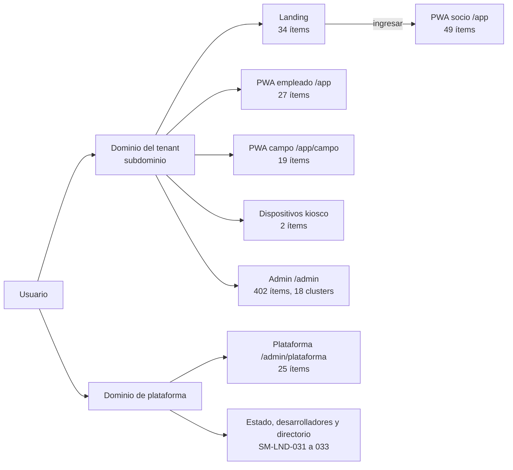
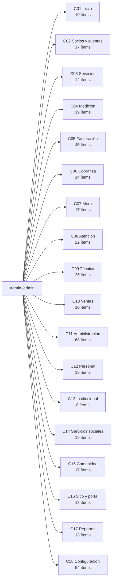

# 22. Mapa de navegación y arquitectura de información por portal

Entregable del artefacto 4.1. Describe, por portal, el menú, las rutas canónicas y las capabilities de acceso, y ubica en ese mapa cada una de las 1.051 pantallas (PAN) definidas en los anexos. Deriva de la maestra §9 y §10, de T03 §10.8 (mapa del sitio) y §10.9 (alineación de rutas y capabilities), de M19 (dueño del shell del socio) y de las rutas declaradas en los PAN de cada anexo. Ante cualquier diferencia prevalece la especificación; el tenant piloto es Laguna Larga (LAG, DEC-088).

Las partes están en [22-mapa-navegacion/](22-mapa-navegacion/) y se generan con `_trabajo/gen_22_navegacion.py` (lector común `_trabajo/lib_espec.py`).

## 1. Método

1. **Ítems del mapa.** Filas `SM-*` de T03 §10.8 y §10.9. Se leyeron 558 ítems (T03 §10.9.11 declara 558).
2. **Ruta y capability canónicas.** Las de T03 §10.9 cuando existen (regla AL-01: prevalece el anexo dueño); si no, la de §10.8 con la base de la app: `/admin/` (AL-02), `/admin/plataforma/` (AL-03), `/app/` (AL-04), `/app/campo/` (AL-05) y rutas relativas al subdominio en la landing (AL-06).
3. **Ubicación de cada PAN.** Principal del ítem (columna "PAN principal" de §10.9 o "PAN" de los agregados); asociada (columna de asociadas, paréntesis o notas); por ruta (la ruta declarada en el anexo, normalizada con las reglas AL-02 a AL-06, coincide con la de un ítem); sin ítem propio por AL-07 (modales, pestañas, componentes); sin ruta propia; o con ruta y sin ítem.
4. **Diagramas.** Mermaid `flowchart` por portal y por cluster (raíz, grupos, ítems), partidos en bloques de hasta unos 38 nodos.

## 2. Portales y arquitectura de información

| Portal | App y layout (maestra §10) | Navegación primaria | Base de rutas | Roles (T02) | Ítems | Parte |
|---|---|---|---|---|---|---|
| Admin de la cooperativa | `apps/admin`, AdminShell | Menú lateral de 18 clusters y grupos desde `siteMapGroups`, filtrado por capability; buscador y accesos fijados | `/admin/` | T-* | 402 | [Admin C01 a C10](22-mapa-navegacion/22-01-admin-C01-C10.md), [Admin C11 a C18](22-mapa-navegacion/22-02-admin-C11-C18.md) |
| Portal del socio (M19) | `apps/landing` (Landing) y `apps/pwa` (AppShell) | Landing: header y accesos (registro, pagar, reclamos). PWA: tabbar Inicio, Cuentas y servicios, FAB (Pagar por defecto), Gestiones, Comunidad; Perfil desde el avatar; menú hamburguesa | `/` del subdominio y `/app/` | Visitante, C-VIS, C-SOC, C-REP, C-ADH | 83 | [Portal del socio (M19): landing y PWA socio](22-mapa-navegacion/22-03-portal-socio-m19.md) |
| PWA de trabajo | `apps/pwa` (AppShell; kiosco sin tabbar) | Empleado: tabbar Inicio, Recibos, FAB, Solicitudes, Perfil. Campo: tabbar Hoy, Órdenes / Rutas / Cobranza, Nuevo (FAB), Stock en vehículo, Sincronización | `/app/`, `/app/campo/`, `/totem`, `/pantalla` | C-EMP, T-*, T-TEC, T-LEC, T-CBR, S-KSK | 48 | [PWA de trabajo: empleado, campo y dispositivos](22-mapa-navegacion/22-04-pwa-empleado-campo.md) |
| Plataforma | `apps/admin` con contexto `PLATFORM` | Menú lateral de plataforma (`meta.platformOnly`) | `/admin/plataforma/` | P-* | 25 | [Consola de plataforma](22-mapa-navegacion/22-05-plataforma.md) |

## 3. Admin: vista de clusters

| Cluster | Nombre | Grupos | Ítems | Parte |
|---|---|---|---|---|
| C01 | Inicio | 1 | 10 | [22-01-admin-C01-C10.md](22-mapa-navegacion/22-01-admin-C01-C10.md) |
| C02 | Socios y cuentas | 5 | 17 | [22-01-admin-C01-C10.md](22-mapa-navegacion/22-01-admin-C01-C10.md) |
| C03 | Servicios | 2 | 12 | [22-01-admin-C01-C10.md](22-mapa-navegacion/22-01-admin-C01-C10.md) |
| C04 | Medición | 5 | 19 | [22-01-admin-C01-C10.md](22-mapa-navegacion/22-01-admin-C01-C10.md) |
| C05 | Facturación | 5 | 45 | [22-01-admin-C01-C10.md](22-mapa-navegacion/22-01-admin-C01-C10.md) |
| C06 | Cobranza | 5 | 14 | [22-01-admin-C01-C10.md](22-mapa-navegacion/22-01-admin-C01-C10.md) |
| C07 | Mora | 5 | 17 | [22-01-admin-C01-C10.md](22-mapa-navegacion/22-01-admin-C01-C10.md) |
| C08 | Atención | 6 | 22 | [22-01-admin-C01-C10.md](22-mapa-navegacion/22-01-admin-C01-C10.md) |
| C09 | Técnica | 5 | 25 | [22-01-admin-C01-C10.md](22-mapa-navegacion/22-01-admin-C01-C10.md) |
| C10 | Ventas | 2 | 10 | [22-01-admin-C01-C10.md](22-mapa-navegacion/22-01-admin-C01-C10.md) |
| C11 | Administración | 4 | 68 | [22-02-admin-C11-C18.md](22-mapa-navegacion/22-02-admin-C11-C18.md) |
| C12 | Personal | 5 | 19 | [22-02-admin-C11-C18.md](22-mapa-navegacion/22-02-admin-C11-C18.md) |
| C13 | Institucional | 1 | 8 | [22-02-admin-C11-C18.md](22-mapa-navegacion/22-02-admin-C11-C18.md) |
| C14 | Servicios sociales | 4 | 19 | [22-02-admin-C11-C18.md](22-mapa-navegacion/22-02-admin-C11-C18.md) |
| C15 | Comunidad | 5 | 17 | [22-02-admin-C11-C18.md](22-mapa-navegacion/22-02-admin-C11-C18.md) |
| C16 | Sitio y portal | 2 | 13 | [22-02-admin-C11-C18.md](22-mapa-navegacion/22-02-admin-C11-C18.md) |
| C17 | Reportes | 1 | 13 | [22-02-admin-C11-C18.md](22-mapa-navegacion/22-02-admin-C11-C18.md) |
| C18 | Configuración | 8 | 54 | [22-02-admin-C11-C18.md](22-mapa-navegacion/22-02-admin-C11-C18.md) |

## 4. Índice de partes

| Parte | Contenido | Elementos | Líneas |
|---|---|---|---|
| [22-01-admin-C01-C10.md](22-mapa-navegacion/22-01-admin-C01-C10.md) | Admin C01 a C10 | 191 ítems | 806 |
| [22-02-admin-C11-C18.md](22-mapa-navegacion/22-02-admin-C11-C18.md) | Admin C11 a C18 | 211 ítems | 832 |
| [22-03-portal-socio-m19.md](22-mapa-navegacion/22-03-portal-socio-m19.md) | Portal del socio (M19): landing y PWA socio | 83 ítems | 355 |
| [22-04-pwa-empleado-campo.md](22-mapa-navegacion/22-04-pwa-empleado-campo.md) | PWA de trabajo: empleado, campo y dispositivos | 48 ítems | 230 |
| [22-05-plataforma.md](22-mapa-navegacion/22-05-plataforma.md) | Consola de plataforma | 25 ítems | 113 |
| [22-06-pantallas-M01-M15.md](22-mapa-navegacion/22-06-pantallas-M01-M15.md) | Pantallas M01 a M15 | 558 PAN | 621 |
| [22-07-pantallas-M16-T11.md](22-mapa-navegacion/22-07-pantallas-M16-T11.md) | Pantallas M16 a T11 | 493 PAN | 552 |

## 5. Ubicación de las pantallas en el mapa

| Relación con el mapa | PAN |
|---|---|
| Principal del ítem | 527 |
| Asociada al ítem | 512 |
| Misma ruta que el ítem | 4 |
| Sin ítem propio: modal, pestaña o componente (T03 AL-07) | 7 |
| Sin ruta propia en el anexo (modal, pestaña, componente o API) | 0 |
| Con ruta y sin ítem en el mapa | 1 |
| **Total** | **1.051** |

| Portal | PAN |
|---|---|
| Admin de la cooperativa | 795 |
| Landing | 48 |
| PWA socio | 98 |
| PWA empleado | 29 |
| PWA campo | 20 |
| Dispositivo (kiosco) | 7 |
| Plataforma | 53 |
| Sin portal deducible | 1 |

## 6. Inconsistencias detectadas en la especificación

La especificación no se modificó. Estas observaciones quedan para el coordinador.

| # | Tipo | Detalle | Tratamiento |
|---|---|---|---|
| 1 | PAN con ruta y sin ítem | 1 PAN declaran ruta pero no figuran como principal ni asociada en T03 §10.9 y su ruta no coincide con ningún ítem: PAN-COM-16 `/admin/com/beneficios/validar`. | Se listan en el catálogo de pantallas con su ruta declarada; T03 §10.9 afirma que toda pantalla navegable tiene entrada en el mapa. A revisar si son modales o si falta el ítem. |
| 2 | Ítems sin PAN principal | 1 ítems del mapa no tienen pantalla principal en ningún anexo: SM-PWS-028 (— (sin pantalla propia en esta app; pantalla...). | Se mantienen con la ruta y capability de T03. |

## 7. Tabla de cobertura

| Universo | Cómo se contó | En la especificación | Incluidos | Excluidos (motivo) |
|---|---|---|---|---|
| PAN definidos | Filas o encabezados con ID `PAN-<COD>-NN` en la sección 10 de los 31 anexos (T05 y T12 no definen PAN) | 1.051 | 1.051 en el catálogo de pantallas | 0 |
| Rutas de PAN definidas | PAN con al menos una ruta en su definición | 1.018 | 1.018 en el catálogo: 1.016 con ítem del mapa y 2 sin ítem (inconsistencia 1) | 0 |
| PAN sin ruta | PAN sin ruta en su definición (modales, pestañas, componentes, API) | 33 | 33 (ubicados como asociados o marcados sin ítem) | 0 |
| Ítems del mapa del sitio | Filas `SM-*` de T03 §10.8 y §10.9 | 558 (T03 §10.9.11) | 558 | 0 |
| Clusters del admin | Encabezados `C01` a `C18` de T03 §10.8.1 | 18 | 18 | 0 |
| Portales pedidos | Admin, socio (M19), campo (PWA), plataforma | 4 | 4 (más PWA empleado y dispositivos) | 0 |
