# Admin de la cooperativa: clusters C01 a C10

Parte del entregable [22 Mapa de navegación y arquitectura de información](../22-mapa-navegacion.md) (artefacto 4.1). Generado con `_trabajo/gen_22_navegacion.py` desde T03 §10.8 y §10.9 y las pantallas (PAN) de los anexos; revisado a mano. Ante cualquier diferencia prevalece T03 y el anexo dueño de la pantalla.

App `apps/admin`, layout AdminShell (maestra §10): menú lateral generado desde `siteMapGroups` y filtrado por capability; base de rutas `/admin/` (T03 AL-02). Roles del espacio tenant (T-*).

## 1. C01 Inicio

Clave `nav.cluster.inicio`. 1 grupos y 10 ítems. 

### Estructura de C01

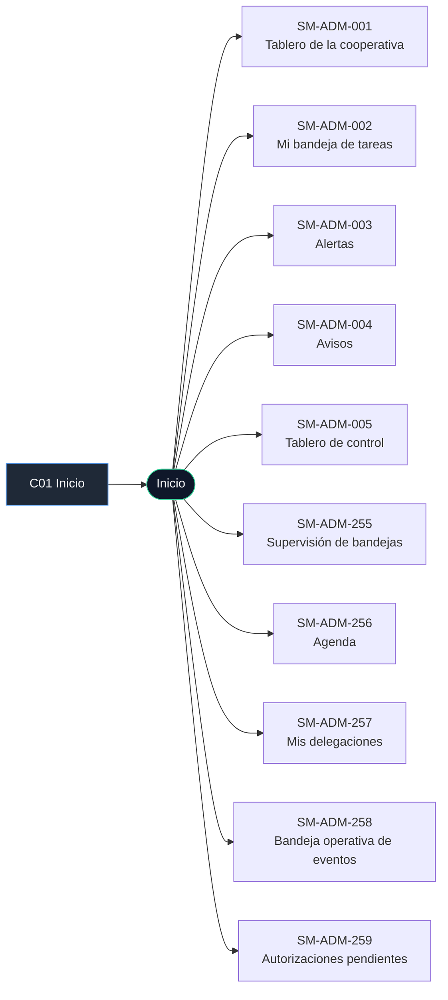

### Menú, rutas y capabilities de C01

| SM | Grupo | Ítem | Ruta canónica | Capability | Ola | PAN principal | PAN asociadas | Origen |
|---|---|---|---|---|---|---|---|---|
| SM-ADM-001 | Inicio | Tablero de la cooperativa | `/admin/tableros/:code` (`/admin/inicio` redirige al tablero del rol) | `bia.tableros.ver` | O1 | PAN-BIA-10 | — | T03 10.8.1 y 10.9.2 |
| SM-ADM-002 | Inicio | Mi bandeja de tareas | `/admin/inicio/bandeja` | `wfl.tareas.ver` | O1 | PAN-WFL-01 | PAN-WFL-03 | T03 10.8.1 y 10.9.2 |
| SM-ADM-003 | Inicio | Alertas | `/admin/inicio/alertas` | `bia.tableros.ver` | O0 | PAN-UXD-17 | PAN-BIA-14, PAN-FIS-09, PAN-NFR-07 | T03 10.8.1 y 10.9.2 |
| SM-ADM-004 | Inicio | Avisos | `/admin/avisos` | sesión | O0 | PAN-COM-32 | — | T03 10.8.1 y 10.9.2 |
| SM-ADM-005 | Inicio | Tablero de control | `/admin/tableros/control` | `bia.tableros.ver` | O1 | PAN-BIA-10 | PAN-BIA-12 | T03 10.8.1 y 10.9.2 |
| SM-ADM-255 | Inicio | Supervisión de bandejas | `/admin/inicio/bandeja/equipo` | `wfl.bandeja.supervisar` | O1 | PAN-WFL-02 | — | T03 10.9.3 |
| SM-ADM-256 | Inicio | Agenda | `/admin/inicio/agenda` | `wfl.agenda.ver` | O1 | PAN-WFL-04 | — | T03 10.9.3 |
| SM-ADM-257 | Inicio | Mis delegaciones | `/admin/inicio/delegaciones` | `wfl.aprobaciones.delegar` | O1 | PAN-WFL-11 | PAN-WFL-10 | T03 10.9.3 |
| SM-ADM-258 | Inicio | Bandeja operativa de eventos | `/admin/inicio/bandeja-operativa` | `wfl.eventos.ver` | O1 | PAN-WFL-22 | — | T03 10.9.3 |
| SM-ADM-259 | Inicio | Autorizaciones pendientes | `/admin/autorizaciones` | `iam.autorizaciones.bandeja` | O1 | PAN-IAM-15 | PAN-IAM-16, PAN-WFL-10 | T03 10.9.3 |

## 2. C02 Socios y cuentas

Clave `nav.cluster.socios`. 5 grupos y 17 ítems. Origen de dominio: M01 PER.

### Estructura de C02

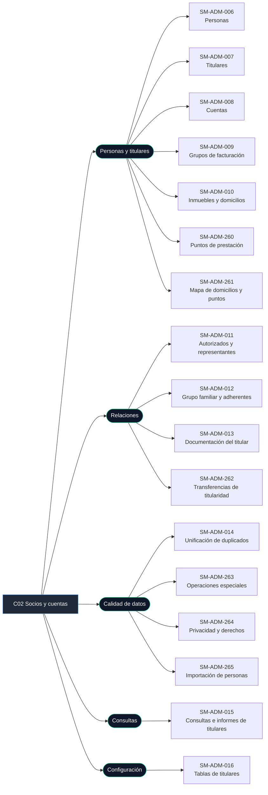

### Menú, rutas y capabilities de C02

| SM | Grupo | Ítem | Ruta canónica | Capability | Ola | PAN principal | PAN asociadas | Origen |
|---|---|---|---|---|---|---|---|---|
| SM-ADM-006 | Personas y titulares | Personas | `/admin/per/personas` | `per.personas.ver` | O2 | PAN-PER-03 | PAN-PER-04, PAN-PER-16 | T03 10.8.1 y 10.9.2 |
| SM-ADM-007 | Personas y titulares | Titulares | `/admin/per/titulares` | `per.titulares.ver` | O2 | PAN-PER-01 | PAN-PER-02, PAN-PER-11, PAN-PER-12, PAN-PER-17, PAN-PER-19, PAN-CRM-05 | T03 10.8.1 y 10.9.2 |
| SM-ADM-008 | Personas y titulares | Cuentas | `/admin/per/cuentas/:accountId` (listado desde PER-01) | `per.cuentas.ver` | O2 | PAN-PER-05 | — | T03 10.8.1 y 10.9.2 |
| SM-ADM-009 | Personas y titulares | Grupos de facturación | `/admin/fac/grupos` | `fac.grupos.ver` | O4 | PAN-FAC-25 | — | T03 10.8.1 y 10.9.2 |
| SM-ADM-010 | Personas y titulares | Inmuebles y domicilios | `/admin/per/inmuebles` | `per.inmuebles.ver` | O2 | PAN-PER-07 | PAN-PER-06 | T03 10.8.1 y 10.9.2 |
| SM-ADM-011 | Relaciones | Autorizados y representantes | `/admin/per/titulares/:holderId?tab=relaciones` | `per.relaciones.ver` | O2 | PAN-PER-09 | PAN-PER-02, PAN-POR-90 | T03 10.8.1 y 10.9.2 |
| SM-ADM-012 | Relaciones | Grupo familiar y adherentes | `/admin/per/titulares/:holderId?tab=adherentes` | `soc.adherentes.ver` (PAN-PER-10, AL-01) | O2 | PAN-PER-10 | PAN-PER-02, PAN-CAT-20, PAN-SOC-01 | T03 10.8.1 y 10.9.2 |
| SM-ADM-013 | Relaciones | Documentación del titular | `/admin/per/documentacion` | `per.documentacion.ver` | O2 | PAN-PER-13 | — | T03 10.8.1 y 10.9.2 |
| SM-ADM-014 | Calidad de datos | Unificación de duplicados | `/admin/per/duplicados` | `per.duplicados.ver` | O2 | PAN-PER-18 | PAN-MIG-11 | T03 10.8.1 y 10.9.2 |
| SM-ADM-015 | Consultas | Consultas e informes de titulares | `/admin/per/padron` | `per.padron.ver` | O2 | PAN-PER-20 | PAN-BIA-01 | T03 10.8.1 y 10.9.2 |
| SM-ADM-016 | Configuración | Tablas de titulares | `/admin/per/configuracion` | `per.configuracion.configurar` | O2 | PAN-PER-22 | — | T03 10.8.1 y 10.9.2 |
| SM-ADM-260 | Personas y titulares | Puntos de prestación | `/admin/per/puntos` | `per.puntosPrestacion.ver` | O2 | PAN-PER-08 | — | T03 10.9.3 |
| SM-ADM-261 | Personas y titulares | Mapa de domicilios y puntos | `/admin/per/mapa` | `per.puntosPrestacion.ver` | O2 | PAN-PER-28 | — | T03 10.9.3 |
| SM-ADM-262 | Relaciones | Transferencias de titularidad | `/admin/per/transferencias` | `per.transferencias.ver` | O2 | PAN-PER-15 | PAN-PER-14 | T03 10.9.3 |
| SM-ADM-263 | Calidad de datos | Operaciones especiales | `/admin/per/operaciones-especiales` | `per.operacionesEspeciales.ejecutar` | O2 | PAN-PER-21 | — | T03 10.9.3 |
| SM-ADM-264 | Calidad de datos | Privacidad y derechos | `/admin/per/privacidad` | `per.privacidad.gestionar` | O2 | PAN-PER-23 | — | T03 10.9.3 |
| SM-ADM-265 | Calidad de datos | Importación de personas | `/admin/per/importar` | `per.importaciones.crear` | O2 | PAN-PER-24 | — | T03 10.9.3 |

## 3. C03 Servicios

Clave `nav.cluster.servicios`. 2 grupos y 12 ítems. Origen de dominio: M02 CAT.

### Estructura de C03

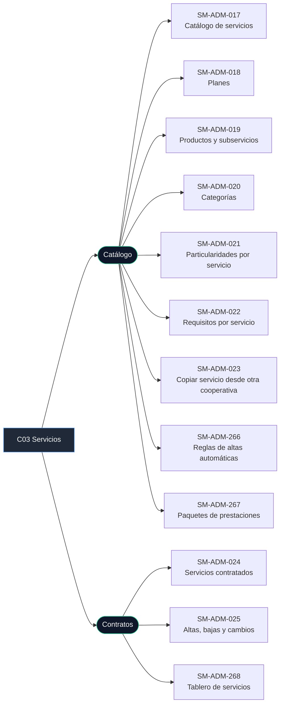

### Menú, rutas y capabilities de C03

| SM | Grupo | Ítem | Ruta canónica | Capability | Ola | PAN principal | PAN asociadas | Origen |
|---|---|---|---|---|---|---|---|---|
| SM-ADM-017 | Catálogo | Catálogo de servicios | `/admin/cat/services` | `cat.servicios.ver` | O2 | PAN-CAT-03 | PAN-CAT-04, PAN-CAT-05, PAN-CAT-10, PAN-CAT-26 | T03 10.8.1 y 10.9.2 |
| SM-ADM-018 | Catálogo | Planes | `/admin/cat/plans` | `cat.planes.ver` | O2 | PAN-CAT-07 | — | T03 10.8.1 y 10.9.2 |
| SM-ADM-019 | Catálogo | Productos y subservicios | `/admin/cat/products` | `cat.productos.ver` | O2 | PAN-CAT-06 | — | T03 10.8.1 y 10.9.2 |
| SM-ADM-020 | Catálogo | Categorías | `/admin/cat/categories` | `cat.categorias.ver` | O2 | PAN-CAT-08 | — | T03 10.8.1 y 10.9.2 |
| SM-ADM-021 | Catálogo | Particularidades por servicio | `/admin/cat/classes-properties` | `cat.clases.ver` | O2 | PAN-CAT-09 | — | T03 10.8.1 y 10.9.2 |
| SM-ADM-022 | Catálogo | Requisitos por servicio | `/admin/cat/services/:id` (pestaña Requisitos con `?tab=requisitos`; ruta del anexo, AL-01) | `cat.servicios.configurar` | O2 | PAN-CAT-04 | PAN-POR-87 | T03 10.8.1 y 10.9.2 |
| SM-ADM-023 | Catálogo | Copiar servicio desde otra cooperativa | `/admin/cat/copies` | `cat.copias.ejecutar` | O2 | PAN-CAT-18 | — | T03 10.8.1 y 10.9.2 |
| SM-ADM-024 | Contratos | Servicios contratados | `/admin/cat/contracts` | `cat.contratos.ver` | O2 | PAN-CAT-13 | PAN-CAT-14, PAN-CAT-15, PAN-CAT-16, PAN-CAT-25 | T03 10.8.1 y 10.9.2 |
| SM-ADM-025 | Contratos | Altas, bajas y cambios | `/admin/cat/bulk-operations` | `cat.masivos.ejecutar` | O2 | PAN-CAT-17 | — | T03 10.8.1 y 10.9.2 |
| SM-ADM-266 | Catálogo | Reglas de altas automáticas | `/admin/cat/auto-rules` | `cat.reglasAuto.configurar` | O2 | PAN-CAT-11 | — | T03 10.9.3 |
| SM-ADM-267 | Catálogo | Paquetes de prestaciones | `/admin/cat/bundles` | `cat.paquetes.ver` | O2 | PAN-CAT-27 | — | T03 10.9.3 |
| SM-ADM-268 | Contratos | Tablero de servicios | `/admin/cat/dashboard` | `cat.servicios.ver` | O2 | PAN-CAT-24 | — | T03 10.9.3 |

## 4. C04 Medición

Clave `nav.cluster.medicion`. 5 grupos y 19 ítems. Origen de dominio: M03 MED.

### Estructura de C04

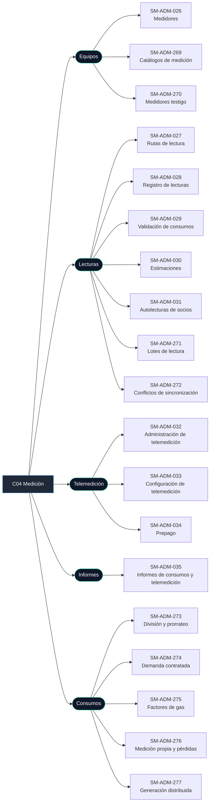

### Menú, rutas y capabilities de C04

| SM | Grupo | Ítem | Ruta canónica | Capability | Ola | PAN principal | PAN asociadas | Origen |
|---|---|---|---|---|---|---|---|---|
| SM-ADM-026 | Equipos | Medidores | `/admin/med/medidores` | `med.medidores.ver` | O7 | PAN-MED-02 | PAN-MED-03, PAN-MED-04 | T03 10.8.1 y 10.9.2 |
| SM-ADM-027 | Lecturas | Rutas de lectura | `/admin/med/rutas` | `med.rutas.ver` | O7 | PAN-MED-05 | PAN-MED-06 | T03 10.8.1 y 10.9.2 |
| SM-ADM-028 | Lecturas | Registro de lecturas | `/admin/med/lecturas/registro` | `med.lecturas.crear` | O7 | PAN-MED-09 | PAN-MED-08, PAN-MED-10 | T03 10.8.1 y 10.9.2 |
| SM-ADM-029 | Lecturas | Validación de consumos | `/admin/med/excepciones` | `med.excepciones.ver` | O7 | PAN-MED-11 | PAN-MED-12, PAN-MED-13, PAN-MED-35 | T03 10.8.1 y 10.9.2 |
| SM-ADM-030 | Lecturas | Estimaciones | `/admin/med/consumos/estimacion` | `med.consumos.estimar` | O7 | PAN-MED-14 | PAN-MED-15, PAN-MED-17 | T03 10.8.1 y 10.9.2 |
| SM-ADM-031 | Lecturas | Autolecturas de socios | `/admin/med/excepciones?origen=autolectura` | `med.excepciones.ver` | O7 | PAN-MED-11 | PAN-MED-32 | T03 10.8.1 y 10.9.2 |
| SM-ADM-032 | Telemedición | Administración de telemedición | `/admin/med/telemedicion/operaciones` | `med.telemedicion.ver` | O7 | PAN-MED-24 | — | T03 10.8.1 y 10.9.2 |
| SM-ADM-033 | Telemedición | Configuración de telemedición | `/admin/med/config/telemedicion` | `med.telemedicion.configurar` | O7 | PAN-MED-23 | — | T03 10.8.1 y 10.9.2 |
| SM-ADM-034 | Telemedición | Prepago | `/admin/med/prepago` | `med.prepago.ver` | O7 | PAN-MED-25 | — | T03 10.8.1 y 10.9.2 |
| SM-ADM-035 | Informes | Informes de consumos y telemedición | `/admin/med/informes` | `med.informes.ver` | O7 | PAN-MED-22 | PAN-MED-27 | T03 10.8.1 y 10.9.2 |
| SM-ADM-269 | Equipos | Catálogos de medición | `/admin/med/config/catalogos` | `med.catalogos.ver` | O7 | PAN-MED-01 | — | T03 10.9.3 |
| SM-ADM-270 | Equipos | Medidores testigo | `/admin/med/testigos` | `med.testigos.ver` | O7 | PAN-MED-18 | — | T03 10.9.3 |
| SM-ADM-271 | Lecturas | Lotes de lectura | `/admin/med/lotes` | `med.lotes.ver` | O7 | PAN-MED-07 | PAN-MED-08 | T03 10.9.3 |
| SM-ADM-272 | Lecturas | Conflictos de sincronización | `/admin/med/conflictos` | `med.conflictos.resolver` | O7 | PAN-MED-34 | — | T03 10.9.3 |
| SM-ADM-273 | Consumos (grupo nuevo en 10.9.3) | División y prorrateo | `/admin/med/consumos/division` | `med.consumos.dividir` | O7 | PAN-MED-16 | — | T03 10.9.3 |
| SM-ADM-274 | Consumos | Demanda contratada | `/admin/med/demanda` | `med.demanda.ver` | O7 | PAN-MED-19 | — | T03 10.9.3 |
| SM-ADM-275 | Consumos | Factores de gas | `/admin/med/config/factores-gas` | `med.gas.configurar` | O7 | PAN-MED-20 | — | T03 10.9.3 |
| SM-ADM-276 | Consumos | Medición propia y pérdidas | `/admin/med/medicion-propia` | `med.medicionPropia.ver` | O7 | PAN-MED-21 | — | T03 10.9.3 |
| SM-ADM-277 | Consumos | Generación distribuida | `/admin/med/generacion-distribuida` | `med.gd.ver` | O7 | PAN-MED-26 | — | T03 10.9.3 |

## 5. C05 Facturación

Clave `nav.cluster.facturacion`. 5 grupos y 45 ítems. Origen de dominio: M04 TAR, M05 FAC, M06 FIS.

### Estructura de C05 (parte 1 de 2)

```mermaid
flowchart LR
    R_C05["C05 Facturación"]
    R_C05_Tarifas(["Tarifas"])
    R_C05 --> R_C05_Tarifas
    SM_ADM_036["SM-ADM-036<br/>Cuadros tarifarios"]
    R_C05_Tarifas --> SM_ADM_036
    SM_ADM_037["SM-ADM-037<br/>Conceptos y cargos"]
    R_C05_Tarifas --> SM_ADM_037
    SM_ADM_038["SM-ADM-038<br/>Fórmulas y cargos adicionales"]
    R_C05_Tarifas --> SM_ADM_038
    SM_ADM_039["SM-ADM-039<br/>Promociones y bonificaciones"]
    R_C05_Tarifas --> SM_ADM_039
    SM_ADM_040["SM-ADM-040<br/>Subsidios y tarifa social"]
    R_C05_Tarifas --> SM_ADM_040
    SM_ADM_041["SM-ADM-041<br/>Simulador de cálculo"]
    R_C05_Tarifas --> SM_ADM_041
    SM_ADM_278["SM-ADM-278<br/>Políticas de redondeo"]
    R_C05_Tarifas --> SM_ADM_278
    SM_ADM_279["SM-ADM-279<br/>Configuración de tarifas"]
    R_C05_Tarifas --> SM_ADM_279
    R_C05_Emisi_n(["Emisión"])
    R_C05 --> R_C05_Emisi_n
    SM_ADM_042["SM-ADM-042<br/>Ciclos y calendarios"]
    R_C05_Emisi_n --> SM_ADM_042
    SM_ADM_043["SM-ADM-043<br/>Lotes de facturación"]
    R_C05_Emisi_n --> SM_ADM_043
    SM_ADM_044["SM-ADM-044<br/>Bandeja de no facturables"]
    R_C05_Emisi_n --> SM_ADM_044
    SM_ADM_280["SM-ADM-280<br/>Tablero de facturación"]
    R_C05_Emisi_n --> SM_ADM_280
    SM_ADM_281["SM-ADM-281<br/>Modificación masiva"]
    R_C05_Emisi_n --> SM_ADM_281
    SM_ADM_282["SM-ADM-282<br/>Recategorización"]
    R_C05_Emisi_n --> SM_ADM_282
    SM_ADM_283["SM-ADM-283<br/>Retroactivos"]
    R_C05_Emisi_n --> SM_ADM_283
    SM_ADM_284["SM-ADM-284<br/>Importaciones de terceros"]
    R_C05_Emisi_n --> SM_ADM_284
    SM_ADM_285["SM-ADM-285<br/>Cierre de ciclo"]
    R_C05_Emisi_n --> SM_ADM_285
    SM_ADM_394["SM-ADM-394<br/>Revisión previa"]
    R_C05_Emisi_n --> SM_ADM_394
    R_C05_Comprobantes(["Comprobantes"])
    R_C05 --> R_C05_Comprobantes
    SM_ADM_045["SM-ADM-045<br/>Comprobantes emitidos"]
    R_C05_Comprobantes --> SM_ADM_045
    SM_ADM_046["SM-ADM-046<br/>Pendientes de autorizar en ARCA"]
    R_C05_Comprobantes --> SM_ADM_046
    SM_ADM_047["SM-ADM-047<br/>Notas de crédito y débito"]
    R_C05_Comprobantes --> SM_ADM_047
    SM_ADM_048["SM-ADM-048<br/>Movimiento de conceptos"]
    R_C05_Comprobantes --> SM_ADM_048
    SM_ADM_049["SM-ADM-049<br/>Distribución y envío"]
    R_C05_Comprobantes --> SM_ADM_049
    SM_ADM_050["SM-ADM-050<br/>Informes de facturación"]
    R_C05_Comprobantes --> SM_ADM_050
    SM_ADM_286["SM-ADM-286<br/>CVLP"]
    R_C05_Comprobantes --> SM_ADM_286
    classDef raiz fill:#1f2937,stroke:#60a5fa,color:#f9fafb;
    classDef grupo fill:#0f172a,stroke:#34d399,color:#f9fafb;
    class R_C05 raiz;
    class R_C05_Tarifas,R_C05_Emisi_n,R_C05_Comprobantes grupo;
```

### Estructura de C05 (parte 2 de 2)

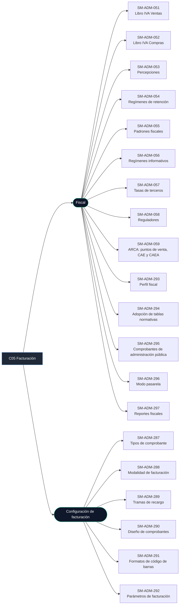

### Menú, rutas y capabilities de C05

| SM | Grupo | Ítem | Ruta canónica | Capability | Ola | PAN principal | PAN asociadas | Origen |
|---|---|---|---|---|---|---|---|---|
| SM-ADM-036 | Tarifas | Cuadros tarifarios | `/admin/tarifas/cuadros` | `tar.cuadros.ver` | O4 | PAN-TAR-01 | PAN-TAR-02, PAN-TAR-03, PAN-TAR-04, PAN-TAR-05, PAN-TAR-09, PAN-TAR-10, PAN-TAR-21, PAN-TAR-29 | T03 10.8.1 y 10.9.2 |
| SM-ADM-037 | Tarifas | Conceptos y cargos | `/admin/tarifas/cargos-evento` | `tar.eventos.ver` | O4 | PAN-TAR-18 | PAN-CAT-12, PAN-TAR-28 | T03 10.8.1 y 10.9.2 |
| SM-ADM-038 | Tarifas | Fórmulas y cargos adicionales | `/admin/tarifas/reglas` | `tar.reglas.ver` | O7 | PAN-TAR-06 | PAN-TAR-07, PAN-TAR-08 | T03 10.8.1 y 10.9.2 |
| SM-ADM-039 | Tarifas | Promociones y bonificaciones | `/admin/tarifas/promociones` | `tar.promociones.ver` | O4 | PAN-TAR-14 | PAN-TAR-11, PAN-TAR-26 | T03 10.8.1 y 10.9.2 |
| SM-ADM-040 | Tarifas | Subsidios y tarifa social | `/admin/tarifas/subsidios` | `tar.subsidios.ver` | O7 | PAN-TAR-12 | PAN-TAR-13 | T03 10.8.1 y 10.9.2 |
| SM-ADM-041 | Tarifas | Simulador de cálculo | `/admin/tarifas/simulador` | `tar.simulador.ejecutar` | O4 | PAN-TAR-15 | PAN-TAR-16, PAN-TAR-17, PAN-TAR-22 | T03 10.8.1 y 10.9.2 |
| SM-ADM-042 | Emisión | Ciclos y calendarios | `/admin/fac/ciclos` | `fac.ciclos.ver` | O4 | PAN-FAC-02 | PAN-FAC-03, PAN-FAC-04, PAN-FAC-39 | T03 10.8.1 y 10.9.2 |
| SM-ADM-043 | Emisión | Lotes de facturación | `/admin/fac/lotes` | `fac.lotes.ver` | O4 | PAN-FAC-05 | PAN-FAC-06, PAN-FAC-07 | T03 10.8.1 y 10.9.2 |
| SM-ADM-044 | Emisión | Bandeja de no facturables | `/admin/fac/excepciones` | `fac.excepciones.ver` | O4 | PAN-FAC-08 | PAN-FAC-42 | T03 10.8.1 y 10.9.2 |
| SM-ADM-045 | Comprobantes | Comprobantes emitidos | `/admin/fac/comprobantes` | `fac.comprobantes.ver` | O4 | PAN-FAC-09 | PAN-FAC-10, PAN-FAC-11, PAN-FAC-12, PAN-FAC-15, PAN-FAC-16, PAN-FAC-17 | T03 10.8.1 y 10.9.2 |
| SM-ADM-046 | Comprobantes | Pendientes de autorizar en ARCA | `/admin/fis/authorizations` | `fis.autorizaciones.ver` | O4 | PAN-FIS-09 | PAN-FIS-10, PAN-FIS-11 | T03 10.8.1 y 10.9.2 |
| SM-ADM-047 | Comprobantes | Notas de crédito y débito | `/admin/fac/anulaciones` | `fac.comprobantes.anular` | O4 | PAN-FAC-14 | PAN-FAC-13 | T03 10.8.1 y 10.9.2 |
| SM-ADM-048 | Comprobantes | Movimiento de conceptos | `/admin/fac/cargos` | `fac.cargos.crear` | O4 | PAN-FAC-21 | PAN-FAC-36 | T03 10.8.1 y 10.9.2 |
| SM-ADM-049 | Comprobantes | Distribución y envío | `/admin/fac/distribucion` | `fac.distribucion.ver` | O4 | PAN-FAC-31 | PAN-FAC-32, PAN-FAC-33, PAN-FAC-34 | T03 10.8.1 y 10.9.2 |
| SM-ADM-050 | Comprobantes | Informes de facturación | `/admin/fac/reportes` | `fac.reportes.ver` | O4 | PAN-FAC-36 | — | T03 10.8.1 y 10.9.2 |
| SM-ADM-051 | Fiscal | Libro IVA Ventas | `/admin/fis/vat-ledger` (filtro `?libro=ventas`; ruta del anexo, AL-01) | `fis.libroIva.ver` | O4 | PAN-FIS-29 | PAN-FIS-30 | T03 10.8.1 y 10.9.2 |
| SM-ADM-052 | Fiscal | Libro IVA Compras | `/admin/fis/vat-ledger?libro=compras` | `fis.libroIva.ver` | O8 | PAN-FIS-29 | PAN-FIS-30 | T03 10.8.1 y 10.9.2 |
| SM-ADM-053 | Fiscal | Percepciones | `/admin/fis/taxes` | `fis.impuestos.configurar` | O4 | PAN-FIS-19 | PAN-FIS-17, PAN-FIS-18, PAN-FIS-20, PAN-FIS-22 | T03 10.8.1 y 10.9.2 |
| SM-ADM-054 | Fiscal | Regímenes de retención | `/admin/fis/withholding/types` | `fis.retenciones.configurar` | O8 | PAN-FIS-24 | PAN-FIS-06, PAN-FIS-25, PAN-FIS-27 | T03 10.8.1 y 10.9.2 |
| SM-ADM-055 | Fiscal | Padrones fiscales | `/admin/fis/registries` | `fis.padrones.importar` | O4 | PAN-FIS-21 | PAN-FIS-23, PAN-CFG-10, PAN-CFG-19 | T03 10.8.1 y 10.9.2 |
| SM-ADM-056 | Fiscal | Regímenes informativos | `/admin/fis/filings` | `fis.regimenes.generar` | O8 | PAN-FIS-31 | PAN-FIS-28, PAN-FIS-32 | T03 10.8.1 y 10.9.2 |
| SM-ADM-057 | Fiscal | Tasas de terceros | `/admin/fis/third-parties/agreements` | `fis.terceros.configurar` | O4 | PAN-FIS-33 | PAN-FIS-34, PAN-COB-30 | T03 10.8.1 y 10.9.2 |
| SM-ADM-058 | Fiscal | Reguladores | `/admin/fis/regulatory` | `fis.reguladores.ver` | O7 | PAN-FIS-35 | PAN-FIS-36 | T03 10.8.1 y 10.9.2 |
| SM-ADM-059 | Fiscal | ARCA: puntos de venta, CAE y CAEA | `/admin/fis/points-of-sale` | `fis.puntosVenta.configurar` | O4 | PAN-FIS-08 | PAN-FIS-07, PAN-FIS-12, PAN-FIS-13, PAN-FIS-14, PAN-FIS-15, PAN-FIS-16, PAN-FIS-39, PAN-FAC-24 | T03 10.8.1 y 10.9.2 |
| SM-ADM-278 | Tarifas | Políticas de redondeo | `/admin/tarifas/redondeo` | `tar.redondeo.configurar` | O4 | PAN-TAR-25 | — | T03 10.9.3 |
| SM-ADM-279 | Tarifas | Configuración de tarifas | `/admin/tarifas/configuracion` | `tar.config.configurar` | O4 | PAN-TAR-27 | — | T03 10.9.3 |
| SM-ADM-280 | Emisión | Tablero de facturación | `/admin/fac` | `fac.lotes.ver` | O4 | PAN-FAC-01 | — | T03 10.9.3 |
| SM-ADM-281 | Emisión | Modificación masiva | `/admin/fac/modificacion-masiva` | `fac.modificacionMasiva.crear` | O4 | PAN-FAC-18 | — | T03 10.9.3 |
| SM-ADM-282 | Emisión | Recategorización | `/admin/fac/recategorizacion` | `fac.recategorizacion.simular` | O4 | PAN-FAC-19 | — | T03 10.9.3 |
| SM-ADM-283 | Emisión | Retroactivos | `/admin/fac/retroactivos` | `fac.retroactivos.crear` | O4 | PAN-FAC-20 | — | T03 10.9.3 |
| SM-ADM-284 | Emisión | Importaciones de terceros | `/admin/fac/importaciones` | `fac.importaciones.crear` | O4 | PAN-FAC-22 | — | T03 10.9.3 |
| SM-ADM-285 | Emisión | Cierre de ciclo | `/admin/fac/cierres` | `fac.cierre.proponer` | O4 | PAN-FAC-35 | — | T03 10.9.3 |
| SM-ADM-286 | Comprobantes | CVLP | `/admin/fac/cvlp` | `fac.cvlp.ver` | O4 | PAN-FAC-37 | — | T03 10.9.3 |
| SM-ADM-287 | Configuración de facturación (grupo nuevo en 10.9.3) | Tipos de comprobante | `/admin/fac/config/tipos-comprobante` | `fac.tiposComprobante.configurar` | O4 | PAN-FAC-23 | — | T03 10.9.3 |
| SM-ADM-288 | Configuración de facturación | Modalidad de facturación | `/admin/fac/config/modalidad` | `fac.modalidad.configurar` | O4 | PAN-FAC-26 | — | T03 10.9.3 |
| SM-ADM-289 | Configuración de facturación | Tramas de recargo | `/admin/fac/config/tramas` | `fac.tramas.configurar` | O4 | PAN-FAC-27 | PAN-MOR-05 | T03 10.9.3 |
| SM-ADM-290 | Configuración de facturación | Diseño de comprobantes | `/admin/fac/config/diseno` | `fac.diseno.configurar` | O4 | PAN-FAC-28 | PAN-FAC-29 | T03 10.9.3 |
| SM-ADM-291 | Configuración de facturación | Formatos de código de barras | `/admin/fac/config/codigos` | `fac.codigoBarras.configurar` | O4 | PAN-FAC-30 | — | T03 10.9.3 |
| SM-ADM-292 | Configuración de facturación | Parámetros de facturación | `/admin/fac/config/parametros` | `fac.parametros.configurar` | O4 | PAN-FAC-41 | — | T03 10.9.3 |
| SM-ADM-293 | Fiscal | Perfil fiscal | `/admin/fis/profile` | `fis.perfil.ver` | O4 | PAN-FIS-04 | PAN-FIS-05 | T03 10.9.3 |
| SM-ADM-294 | Fiscal | Adopción de tablas normativas | `/admin/fis/normative-adoptions` | `fis.tablasNormativas.adoptar` | O4 | PAN-FIS-03 | — | T03 10.9.3 |
| SM-ADM-295 | Fiscal | Comprobantes de administración pública | `/admin/fis/public-admin` | `fis.admPublica.ver` | O4 | PAN-FIS-37 | PAN-FAC-38 | T03 10.9.3 |
| SM-ADM-296 | Fiscal | Modo pasarela | `/admin/fis/gateway` | `fis.pasarela.enviar` | O4 | PAN-FIS-38 | — | T03 10.9.3 |
| SM-ADM-297 | Fiscal | Reportes fiscales | `/admin/fis/reports` | `fis.*.ver` (AL-08) | O4 | PAN-FIS-40 | — | T03 10.9.3 |
| SM-ADM-394 | Emisión | Revisión previa | `/admin/fac/revision-previa` | `fac.revisionPrevia.ver` | O7 | PAN-FAC-47 | — | T03 10.9.3 |

## 6. C06 Cobranza

Clave `nav.cluster.cobranza`. 5 grupos y 14 ítems. Origen de dominio: M07 COB.

### Estructura de C06

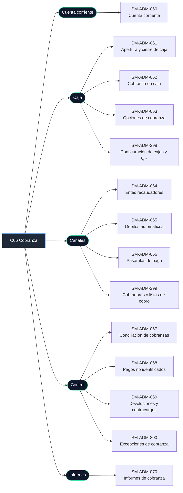

### Menú, rutas y capabilities de C06

| SM | Grupo | Ítem | Ruta canónica | Capability | Ola | PAN principal | PAN asociadas | Origen |
|---|---|---|---|---|---|---|---|---|
| SM-ADM-060 | Cuenta corriente | Cuenta corriente | `/admin/cob/cuentas/:currentAccountId` | `cob.cuentas.ver` | O5 | PAN-COB-01 | PAN-COB-02, PAN-COB-03, PAN-COB-05, PAN-COB-06, PAN-COB-07 | T03 10.8.1 y 10.9.2 |
| SM-ADM-061 | Caja | Apertura y cierre de caja | `/admin/cob/caja/apertura` | `cob.caja.abrir` | O5 | PAN-COB-09 | PAN-COB-12, PAN-COB-13 | T03 10.8.1 y 10.9.2 |
| SM-ADM-062 | Caja | Cobranza en caja | `/admin/cob/caja/cobro` | `cob.caja.cobrar` | O5 | PAN-COB-10 | PAN-COB-11, PAN-COB-14, PAN-COB-33 | T03 10.8.1 y 10.9.2 |
| SM-ADM-063 | Caja | Opciones de cobranza | `/admin/cob/config/medios` | `cob.medios.configurar` | O5 | PAN-COB-15 | PAN-COB-16, PAN-COB-31, PAN-COB-32 | T03 10.8.1 y 10.9.2 |
| SM-ADM-064 | Canales | Entes recaudadores | `/admin/cob/config/entes` | `cob.entes.configurar` | O5 | PAN-COB-17 | PAN-COB-18, PAN-COB-19, PAN-COB-20 | T03 10.8.1 y 10.9.2 |
| SM-ADM-065 | Canales | Débitos automáticos | `/admin/cob/debitos/adhesiones` | `cob.debitos.ver` | O5 | PAN-COB-21 | PAN-COB-22 | T03 10.8.1 y 10.9.2 |
| SM-ADM-066 | Canales | Pasarelas de pago | `/admin/cob/config/pasarelas` | `cob.pasarelas.configurar` | O5 | PAN-COB-23 | PAN-COB-24, PAN-COB-25 | T03 10.8.1 y 10.9.2 |
| SM-ADM-067 | Control | Conciliación de cobranzas | `/admin/cob/conciliacion` | `cob.conciliacion.ver` | O5 | PAN-COB-27 | — | T03 10.8.1 y 10.9.2 |
| SM-ADM-068 | Control | Pagos no identificados | `/admin/cob/no-identificados` | `cob.noIdentificados.ver` | O5 | PAN-COB-04 | — | T03 10.8.1 y 10.9.2 |
| SM-ADM-069 | Control | Devoluciones y contracargos | `/admin/cob/devoluciones` | `cob.devoluciones.solicitar` | O5 | PAN-COB-26 | — | T03 10.8.1 y 10.9.2 |
| SM-ADM-070 | Informes | Informes de cobranza | `/admin/cob/reportes` | `cob.reportes.ver` | O5 | PAN-COB-36 | — | T03 10.8.1 y 10.9.2 |
| SM-ADM-298 | Caja | Configuración de cajas y QR | `/admin/cob/config/cajas` | `cob.caja.configurar` | O5 | PAN-COB-08 | — | T03 10.9.3 |
| SM-ADM-299 | Canales | Cobradores y listas de cobro | `/admin/cob/cobradores` | `cob.cobradores.gestionar` | O5 | PAN-COB-28 | — | T03 10.9.3 |
| SM-ADM-300 | Control | Excepciones de cobranza | `/admin/cob/excepciones` | `cob.excepciones.resolver` | O5 | PAN-COB-34 | — | T03 10.9.3 |

## 7. C07 Mora

Clave `nav.cluster.mora`. 5 grupos y 17 ítems. Origen de dominio: M08 MOR.

### Estructura de C07

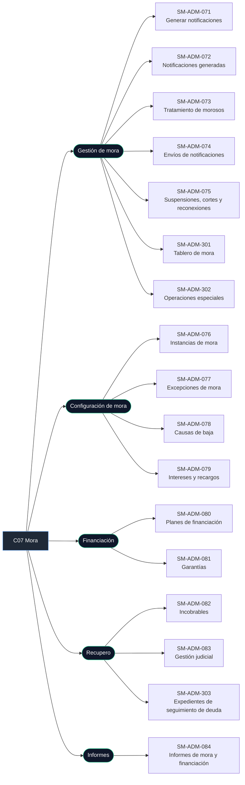

### Menú, rutas y capabilities de C07

| SM | Grupo | Ítem | Ruta canónica | Capability | Ola | PAN principal | PAN asociadas | Origen |
|---|---|---|---|---|---|---|---|---|
| SM-ADM-071 | Gestión de mora | Generar notificaciones | `/admin/mor/candidatos` | `mor.candidatos.generar` | O6 | PAN-MOR-13 | — | T03 10.8.1 y 10.9.2 |
| SM-ADM-072 | Gestión de mora | Notificaciones generadas | `/admin/mor/notificaciones` | `mor.notificaciones.ver` | O6 | PAN-MOR-14 | PAN-MOR-15, PAN-MOR-16, PAN-MOR-17, PAN-MOR-21 | T03 10.8.1 y 10.9.2 |
| SM-ADM-073 | Gestión de mora | Tratamiento de morosos | `/admin/mor/tratamiento` | `mor.tratamiento.ver` (acciones con `mor.tratamiento.ejecutar`; AL-01, M08) | O6 | PAN-MOR-19 | PAN-MOR-18, PAN-MOR-20 | T03 10.8.1 y 10.9.2 |
| SM-ADM-074 | Gestión de mora | Envíos de notificaciones | `/admin/mor/modelos-aviso` | `mor.modelosAviso.configurar` | O6 | PAN-MOR-12 | PAN-MOR-14 | T03 10.8.1 y 10.9.2 |
| SM-ADM-075 | Gestión de mora | Suspensiones, cortes y reconexiones | `/admin/mor/interrupciones` | `mor.interrupciones.ver` | O6 | PAN-MOR-27 | PAN-MOR-24, PAN-MOR-25, PAN-MOR-28 | T03 10.8.1 y 10.9.2 |
| SM-ADM-076 | Configuración de mora | Instancias de mora | `/admin/mor/instancias` | `mor.instancias.configurar` | O6 | PAN-MOR-11 | PAN-MOR-10 | T03 10.8.1 y 10.9.2 |
| SM-ADM-077 | Configuración de mora | Excepciones de mora | `/admin/mor/excepciones` | `mor.excepciones.ver` (acciones con `mor.excepciones.editar` y `mor.excepciones.aprobar`... | O6 | PAN-MOR-23 | — | T03 10.8.1 y 10.9.2 |
| SM-ADM-078 | Configuración de mora | Causas de baja | `/admin/mor/causas` | `mor.causas.configurar` | O6 | PAN-MOR-26 | — | T03 10.8.1 y 10.9.2 |
| SM-ADM-079 | Configuración de mora | Intereses y recargos | `/admin/mor/politicas-interes` | `mor.politicasInteres.ver` | O6 | PAN-MOR-02 | PAN-MOR-03, PAN-MOR-04, PAN-MOR-05, PAN-MOR-06, PAN-MOR-07, PAN-MOR-08, PAN-MOR-09 | T03 10.8.1 y 10.9.2 |
| SM-ADM-080 | Financiación | Planes de financiación | `/admin/mor/convenios` | `mor.convenios.ver` | O6 | PAN-MOR-31 | PAN-MOR-29, PAN-MOR-30, PAN-MOR-32 | T03 10.8.1 y 10.9.2 |
| SM-ADM-081 | Financiación | Garantías | `/admin/mor/garantias` | `mor.garantias.ver` (acciones con `mor.garantias.editar`; AL-01, M08) | O6 | PAN-MOR-33 | — | T03 10.8.1 y 10.9.2 |
| SM-ADM-082 | Recupero | Incobrables | `/admin/mor/incobrables` | `mor.incobrables.ver` (acciones con `mor.incobrables.proponer` y... | O6 | PAN-MOR-35 | PAN-MOR-36 | T03 10.8.1 y 10.9.2 |
| SM-ADM-083 | Recupero | Gestión judicial | `/admin/mor/gestion-externa` | `mor.gestionExterna.ver` (acciones con `mor.gestionExterna.editar` y... | O6 | PAN-MOR-34 | PAN-MOR-42 | T03 10.8.1 y 10.9.2 |
| SM-ADM-084 | Informes | Informes de mora y financiación | `/admin/mor/informes` | `mor.informes.ver` (exportar con `mor.informes.exportar`; AL-01, M08) | O6 | PAN-MOR-37 | — | T03 10.8.1 y 10.9.2 |
| SM-ADM-301 | Gestión de mora | Tablero de mora | `/admin/mor/tablero` | `mor.deuda.ver` | O6 | PAN-MOR-01 | — | T03 10.9.3 |
| SM-ADM-302 | Gestión de mora | Operaciones especiales | `/admin/mor/operaciones-especiales` | `mor.operacionesEspeciales.ejecutar` | O6 | PAN-MOR-22 | — | T03 10.9.3 |
| SM-ADM-303 | Recupero | Expedientes de seguimiento de deuda | `/admin/mor/seguimiento` | `mor.deuda.ver` | O6 | PAN-MOR-38 | — | T03 10.9.3 |

## 8. C08 Atención

Clave `nav.cluster.atencion`. 6 grupos y 22 ítems. Origen de dominio: M09 CRM.

### Estructura de C08

```mermaid
flowchart LR
    R_C08["C08 Atención"]
    R_C08_Casos(["Casos"])
    R_C08 --> R_C08_Casos
    SM_ADM_085["SM-ADM-085<br/>Bandeja de atención"]
    R_C08_Casos --> SM_ADM_085
    SM_ADM_086["SM-ADM-086<br/>Carga rápida de reclamos"]
    R_C08_Casos --> SM_ADM_086
    SM_ADM_087["SM-ADM-087<br/>Solicitudes comerciales"]
    R_C08_Casos --> SM_ADM_087
    SM_ADM_088["SM-ADM-088<br/>Reclamos"]
    R_C08_Casos --> SM_ADM_088
    SM_ADM_089["SM-ADM-089<br/>Trámites web recibidos"]
    R_C08_Casos --> SM_ADM_089
    SM_ADM_090["SM-ADM-090<br/>Conversaciones (WhatsApp, chat, bot)"]
    R_C08_Casos --> SM_ADM_090
    SM_ADM_304["SM-ADM-304<br/>Bandeja de supervisión"]
    R_C08_Casos --> SM_ADM_304
    SM_ADM_305["SM-ADM-305<br/>Trámites con vencimiento"]
    R_C08_Casos --> SM_ADM_305
    SM_ADM_306["SM-ADM-306<br/>Instancias de trámites"]
    R_C08_Casos --> SM_ADM_306
    R_C08_Mesa_de_entradas(["Mesa de entradas"])
    R_C08 --> R_C08_Mesa_de_entradas
    SM_ADM_091["SM-ADM-091<br/>Expedientes"]
    R_C08_Mesa_de_entradas --> SM_ADM_091
    SM_ADM_092["SM-ADM-092<br/>Incidentes"]
    R_C08_Mesa_de_entradas --> SM_ADM_092
    R_C08_Turnero(["Turnero"])
    R_C08 --> R_C08_Turnero
    SM_ADM_093["SM-ADM-093<br/>Boxes"]
    R_C08_Turnero --> SM_ADM_093
    SM_ADM_094["SM-ADM-094<br/>Atención de turnos"]
    R_C08_Turnero --> SM_ADM_094
    SM_ADM_095["SM-ADM-095<br/>Selección de turnos"]
    R_C08_Turnero --> SM_ADM_095
    SM_ADM_096["SM-ADM-096<br/>Estadísticas del turnero"]
    R_C08_Turnero --> SM_ADM_096
    R_C08_Actividades_internas(["Actividades internas"])
    R_C08 --> R_C08_Actividades_internas
    SM_ADM_097["SM-ADM-097<br/>Seguimiento de actividades"]
    R_C08_Actividades_internas --> SM_ADM_097
    SM_ADM_098["SM-ADM-098<br/>Informe de actividades"]
    R_C08_Actividades_internas --> SM_ADM_098
    SM_ADM_307["SM-ADM-307<br/>Proyectos, horas y bolsas"]
    R_C08_Actividades_internas --> SM_ADM_307
    SM_ADM_308["SM-ADM-308<br/>Circulares"]
    R_C08_Actividades_internas --> SM_ADM_308
    R_C08_Configuraci_n(["Configuración"])
    R_C08 --> R_C08_Configuraci_n
    SM_ADM_099["SM-ADM-099<br/>Tipos, estados y SLA"]
    R_C08_Configuraci_n --> SM_ADM_099
    SM_ADM_309["SM-ADM-309<br/>Auditoría de IA de atención"]
    R_C08_Configuraci_n --> SM_ADM_309
    R_C08_Informes(["Informes"])
    R_C08 --> R_C08_Informes
    SM_ADM_100["SM-ADM-100<br/>Informes de atención"]
    R_C08_Informes --> SM_ADM_100
    classDef raiz fill:#1f2937,stroke:#60a5fa,color:#f9fafb;
    classDef grupo fill:#0f172a,stroke:#34d399,color:#f9fafb;
    class R_C08 raiz;
    class R_C08_Casos,R_C08_Mesa_de_entradas,R_C08_Turnero,R_C08_Actividades_internas,R_C08_Configuraci_n,R_C08_Informes grupo;
```

### Menú, rutas y capabilities de C08

| SM | Grupo | Ítem | Ruta canónica | Capability | Ola | PAN principal | PAN asociadas | Origen |
|---|---|---|---|---|---|---|---|---|
| SM-ADM-085 | Casos | Bandeja de atención | `/admin/crm/bandeja` | `crm.casos.ver` | O2 | PAN-CRM-02 | PAN-CRM-03, PAN-CRM-06 | T03 10.8.1 y 10.9.2 |
| SM-ADM-086 | Casos | Carga rápida de reclamos | `/admin/crm/carga-rapida` | `crm.casos.crear` | O2 | PAN-CRM-04 | — | T03 10.8.1 y 10.9.2 |
| SM-ADM-087 | Casos | Solicitudes comerciales | `/admin/crm/bandeja?clase=solicitud` | `crm.casos.ver` | O2 | PAN-CRM-02 | — | T03 10.8.1 y 10.9.2 |
| SM-ADM-088 | Casos | Reclamos | `/admin/crm/bandeja?clase=reclamo` | `crm.casos.ver` | O2 | PAN-CRM-02 | — | T03 10.8.1 y 10.9.2 |
| SM-ADM-089 | Casos | Trámites web recibidos | `/admin/portal/presentaciones` | `por.formularios.ver` | O2 | PAN-POR-97 | PAN-WFL-08 | T03 10.8.1 y 10.9.2 |
| SM-ADM-090 | Casos | Conversaciones (WhatsApp, chat, bot) | `/admin/crm/conversaciones` | `crm.conversaciones.atender` | O2 | PAN-CRM-10 | — | T03 10.8.1 y 10.9.2 |
| SM-ADM-091 | Mesa de entradas | Expedientes | `/admin/crm/mesa-entradas` | `crm.mesaEntradas.ver` | O2 | PAN-CRM-09 | PAN-WFL-15 | T03 10.8.1 y 10.9.2 |
| SM-ADM-092 | Mesa de entradas | Incidentes | `/admin/crm/incidentes` | `crm.incidentes.ver` | O2 | PAN-CRM-07 | PAN-CRM-08 | T03 10.8.1 y 10.9.2 |
| SM-ADM-093 | Turnero | Boxes | `/admin/crm/turnero/config` | `crm.turnero.configurar` | O10 | PAN-CRM-27 | — | T03 10.8.1 y 10.9.2 |
| SM-ADM-094 | Turnero | Atención de turnos | `/admin/crm/turnero/box` | `crm.turnero.llamar` | O10 | PAN-CRM-24 | — | T03 10.8.1 y 10.9.2 |
| SM-ADM-095 | Turnero | Selección de turnos | `/admin/crm/turnero/recepcion` | `crm.turnero.emitir` | O10 | PAN-CRM-23 | — | T03 10.8.1 y 10.9.2 |
| SM-ADM-096 | Turnero | Estadísticas del turnero | `/admin/crm/turnero/estadisticas` | `crm.reportes.ver` | O10 | PAN-CRM-28 | — | T03 10.8.1 y 10.9.2 |
| SM-ADM-097 | Actividades internas | Seguimiento de actividades | `/admin/crm/actividades` | `crm.actividades.ver` | O10 | PAN-CRM-29 | PAN-CRM-30, PAN-CRM-31 | T03 10.8.1 y 10.9.2 |
| SM-ADM-098 | Actividades internas | Informe de actividades | `/admin/crm/actividades?vista=informe` | `crm.actividades.ver` | O10 | PAN-CRM-29 | — | T03 10.8.1 y 10.9.2 |
| SM-ADM-099 | Configuración | Tipos, estados y SLA | `/admin/crm/config/tipos` | `crm.config.tipos.configurar` | O2 | PAN-CRM-11 | PAN-CRM-12, PAN-CRM-13, PAN-CRM-14, PAN-CRM-15, PAN-CRM-16, PAN-CRM-17, PAN-CRM-18, PAN-CRM-20 | T03 10.8.1 y 10.9.2 |
| SM-ADM-100 | Informes | Informes de atención | `/admin/crm/tablero` | `crm.bandejaSupervision.ver` | O2 | PAN-CRM-33 | PAN-CRM-34 | T03 10.8.1 y 10.9.2 |
| SM-ADM-304 | Casos | Bandeja de supervisión | `/admin/crm/supervision` | `crm.bandejaSupervision.ver` | O2 | PAN-CRM-01 | — | T03 10.9.3 |
| SM-ADM-305 | Casos | Trámites con vencimiento | `/admin/crm/tramites` | `crm.tramites.configurar` | O2 | PAN-CRM-21 | — | T03 10.9.3 |
| SM-ADM-306 | Casos | Instancias de trámites | `/admin/tramites/instancias` | `wfl.tareas.ver` | O2 | PAN-WFL-08 | — | T03 10.9.3 |
| SM-ADM-307 | Actividades internas | Proyectos, horas y bolsas | `/admin/crm/proyectos` | `crm.horas.ver` | O10 | PAN-CRM-22 | — | T03 10.9.3 |
| SM-ADM-308 | Actividades internas | Circulares | `/admin/crm/circulares` | `crm.circulares.ver` | O10 | PAN-CRM-32 | — | T03 10.9.3 |
| SM-ADM-309 | Configuración | Auditoría de IA de atención | `/admin/crm/auditoria-ia` | `crm.ia.auditar` | O11 | PAN-CRM-19 | — | T03 10.9.3 |

## 9. C09 Técnica

Clave `nav.cluster.tecnica`. 5 grupos y 25 ítems. Origen de dominio: M10 TEC.

### Estructura de C09

```mermaid
flowchart LR
    R_C09["C09 Técnica"]
    R_C09_Operaci_n(["Operación"])
    R_C09 --> R_C09_Operaci_n
    SM_ADM_101["SM-ADM-101<br/>Agenda y visitas"]
    R_C09_Operaci_n --> SM_ADM_101
    SM_ADM_102["SM-ADM-102<br/>Factibilidades"]
    R_C09_Operaci_n --> SM_ADM_102
    SM_ADM_103["SM-ADM-103<br/>Órdenes de trabajo"]
    R_C09_Operaci_n --> SM_ADM_103
    SM_ADM_104["SM-ADM-104<br/>Despacho y mapa de campo"]
    R_C09_Operaci_n --> SM_ADM_104
    SM_ADM_105["SM-ADM-105<br/>Cuadrillas y contratistas"]
    R_C09_Operaci_n --> SM_ADM_105
    SM_ADM_106["SM-ADM-106<br/>Instalaciones"]
    R_C09_Operaci_n --> SM_ADM_106
    SM_ADM_310["SM-ADM-310<br/>Mapa operativo"]
    R_C09_Operaci_n --> SM_ADM_310
    SM_ADM_311["SM-ADM-311<br/>Interrupciones e impacto"]
    R_C09_Operaci_n --> SM_ADM_311
    SM_ADM_312["SM-ADM-312<br/>Inspecciones y fraude"]
    R_C09_Operaci_n --> SM_ADM_312
    SM_ADM_313["SM-ADM-313<br/>Conflictos de sincronización"]
    R_C09_Operaci_n --> SM_ADM_313
    SM_ADM_399["SM-ADM-399<br/>Guardias"]
    R_C09_Operaci_n --> SM_ADM_399
    SM_ADM_400["SM-ADM-400<br/>Protocolos de emergencia"]
    R_C09_Operaci_n --> SM_ADM_400
    R_C09_TIC(["TIC"])
    R_C09 --> R_C09_TIC
    SM_ADM_107["SM-ADM-107<br/>Aprovisionamiento de Internet"]
    R_C09_TIC --> SM_ADM_107
    SM_ADM_108["SM-ADM-108<br/>Telefonía: centrales y numeración"]
    R_C09_TIC --> SM_ADM_108
    SM_ADM_109["SM-ADM-109<br/>Telefonía: CDR y tasación"]
    R_C09_TIC --> SM_ADM_109
    SM_ADM_110["SM-ADM-110<br/>TV y otros TIC"]
    R_C09_TIC --> SM_ADM_110
    SM_ADM_401["SM-ADM-401<br/>Portabilidad numérica"]
    R_C09_TIC --> SM_ADM_401
    R_C09_Infraestructura(["Infraestructura"])
    R_C09 --> R_C09_Infraestructura
    SM_ADM_111["SM-ADM-111<br/>Redes y GIS"]
    R_C09_Infraestructura --> SM_ADM_111
    SM_ADM_112["SM-ADM-112<br/>Obras y mantenimiento"]
    R_C09_Infraestructura --> SM_ADM_112
    SM_ADM_314["SM-ADM-314<br/>Activos y mantenimiento"]
    R_C09_Infraestructura --> SM_ADM_314
    SM_ADM_315["SM-ADM-315<br/>Equipos de red"]
    R_C09_Infraestructura --> SM_ADM_315
    SM_ADM_402["SM-ADM-402<br/>Calidad del agua"]
    R_C09_Infraestructura --> SM_ADM_402
    R_C09_Informes(["Informes"])
    R_C09 --> R_C09_Informes
    SM_ADM_113["SM-ADM-113<br/>Informes técnicos"]
    R_C09_Informes --> SM_ADM_113
    R_C09_Configuraci_n_t_cnica(["Configuración técnica"])
    R_C09 --> R_C09_Configuraci_n_t_cnica
    SM_ADM_316["SM-ADM-316<br/>Catálogos técnicos"]
    R_C09_Configuraci_n_t_cnica --> SM_ADM_316
    SM_ADM_317["SM-ADM-317<br/>Formularios de campo"]
    R_C09_Configuraci_n_t_cnica --> SM_ADM_317
    classDef raiz fill:#1f2937,stroke:#60a5fa,color:#f9fafb;
    classDef grupo fill:#0f172a,stroke:#34d399,color:#f9fafb;
    class R_C09 raiz;
    class R_C09_Operaci_n,R_C09_TIC,R_C09_Infraestructura,R_C09_Informes,R_C09_Configuraci_n_t_cnica grupo;
```

### Menú, rutas y capabilities de C09

| SM | Grupo | Ítem | Ruta canónica | Capability | Ola | PAN principal | PAN asociadas | Origen |
|---|---|---|---|---|---|---|---|---|
| SM-ADM-101 | Operación | Agenda y visitas | `/admin/tec/schedule` | `tec.agenda.gestionar` | O3 | PAN-TEC-11 | PAN-TEC-12 | T03 10.8.1 y 10.9.2 |
| SM-ADM-102 | Operación | Factibilidades | `/admin/tec/feasibility` | `tec.factibilidad.ver` | O3 | PAN-TEC-01 | PAN-TEC-02, PAN-TEC-03 | T03 10.8.1 y 10.9.2 |
| SM-ADM-103 | Operación | Órdenes de trabajo | `/admin/tec/work-orders` | `tec.ordenes.ver` | O3 | PAN-TEC-04 | PAN-TEC-05, PAN-TEC-06, PAN-TEC-07, PAN-TEC-08, PAN-TEC-09, PAN-TEC-22, PAN-TEC-23 | T03 10.8.1 y 10.9.2 |
| SM-ADM-104 | Operación | Despacho y mapa de campo | `/admin/tec/dispatch` | `tec.despacho.gestionar` | O3 | PAN-TEC-10 | — | T03 10.8.1 y 10.9.2 |
| SM-ADM-105 | Operación | Cuadrillas y contratistas | `/admin/tec/crews` | `tec.cuadrillas.gestionar` | O3 | PAN-TEC-13 | PAN-TEC-14, PAN-TEC-16 | T03 10.8.1 y 10.9.2 |
| SM-ADM-106 | Operación | Instalaciones | `/admin/tec/installations` | `tec.instalaciones.ver` | O3 | PAN-TEC-25 | — | T03 10.8.1 y 10.9.2 |
| SM-ADM-107 | TIC | Aprovisionamiento de Internet | `/admin/tec/provisioning/systems` | `tec.aprovisionamiento.configurar` | O3 | PAN-TEC-36 | PAN-TEC-37, PAN-TEC-38 | T03 10.8.1 y 10.9.2 |
| SM-ADM-108 | TIC | Telefonía: centrales y numeración | `/admin/tec/phone/plant` | `tec.telefonia.redFisica.ver` | O10 | PAN-TEC-42 | PAN-TEC-43, PAN-TEC-44, PAN-TEC-46 | T03 10.8.1 y 10.9.2 |
| SM-ADM-109 | TIC | Telefonía: CDR y tasación | `/admin/tec/phone/cdr` | `tec.cdr.importar` | O10 | PAN-TEC-45 | PAN-TAR-19, PAN-TAR-20 | T03 10.8.1 y 10.9.2 |
| SM-ADM-110 | TIC | TV y otros TIC | `/admin/tec/provisioning/systems?tecnologia=tv` | `tec.aprovisionamiento.configurar` | O10 | PAN-TEC-36 | — | T03 10.8.1 y 10.9.2 |
| SM-ADM-111 | Infraestructura | Redes y GIS | `/admin/tec/networks/elements` | `tec.redes.gestionar` | O7 | PAN-TEC-31 | PAN-TEC-30, PAN-TEC-32, PAN-TEC-34, PAN-TEC-48 | T03 10.8.1 y 10.9.2 |
| SM-ADM-112 | Infraestructura | Obras y mantenimiento | `/admin/tec/works` | `tec.obras.gestionar` | O7 | PAN-TEC-39 | PAN-TEC-40 | T03 10.8.1 y 10.9.2 |
| SM-ADM-113 | Informes | Informes técnicos | `/admin/tec/reports` | `tec.reportes.ver` | O3 | PAN-TEC-47 | — | T03 10.8.1 y 10.9.2 |
| SM-ADM-310 | Operación | Mapa operativo | `/admin/tec/map` | `tec.mapa.ver` | O3 | PAN-TEC-29 | — | T03 10.9.3 |
| SM-ADM-311 | Operación | Interrupciones e impacto | `/admin/tec/outages` | `tec.cortes.gestionar` | O3 | PAN-TEC-28 | PAN-COM-27 | T03 10.9.3 |
| SM-ADM-312 | Operación | Inspecciones y fraude | `/admin/tec/inspections` | `tec.inspecciones.gestionar` | O3 | PAN-TEC-41 | — | T03 10.9.3 |
| SM-ADM-313 | Operación | Conflictos de sincronización | `/admin/tec/sync-conflicts` | `tec.conflictos.resolver` | O3 | PAN-TEC-24 | — | T03 10.9.3 |
| SM-ADM-314 | Infraestructura | Activos y mantenimiento | `/admin/tec/maintenance` | `tec.mantenimiento.gestionar` | O7 | PAN-TEC-27 | — | T03 10.9.3 |
| SM-ADM-315 | Infraestructura | Equipos de red | `/admin/tec/network-devices` | `tec.equiposRed.gestionar` | O3 | PAN-TEC-35 | — | T03 10.9.3 |
| SM-ADM-316 | Configuración técnica (grupo nuevo en 10.9.3) | Catálogos técnicos | `/admin/tec/catalog/operations` | `tec.config.gestionar` | O3 | PAN-TEC-17 | PAN-TEC-15, PAN-TEC-18, PAN-TEC-19, PAN-TEC-20, PAN-TEC-21 | T03 10.9.3 |
| SM-ADM-317 | Configuración técnica | Formularios de campo | `/admin/tec/field-forms` | `tec.formulariosCampo.gestionar` | O3 | PAN-TEC-26 | — | T03 10.9.3 |
| SM-ADM-399 | Operación | Guardias | `/admin/tec/on-call` | `tec.guardias.gestionar` | O7 | PAN-TEC-61 | — | T03 10.9.3 |
| SM-ADM-400 | Operación | Protocolos de emergencia | `/admin/tec/emergency-protocols` | `tec.config.gestionar` | O7 | PAN-TEC-62 | — | T03 10.9.3 |
| SM-ADM-401 | TIC | Portabilidad numérica | `/admin/tec/phone/portings` | `tec.telefonia.numeracion.ver` (PAN-TEC-63, AL-01) | O10 | PAN-TEC-63 | — | T03 10.9.3 |
| SM-ADM-402 | Infraestructura | Calidad del agua | `/admin/tec/water-quality` | `tec.calidadAgua.gestionar` | O7 | PAN-TEC-64 | — | T03 10.9.3 |

## 10. C10 Ventas

Clave `nav.cluster.ventas`. 2 grupos y 10 ítems. Origen de dominio: M11 VEN.

### Estructura de C10

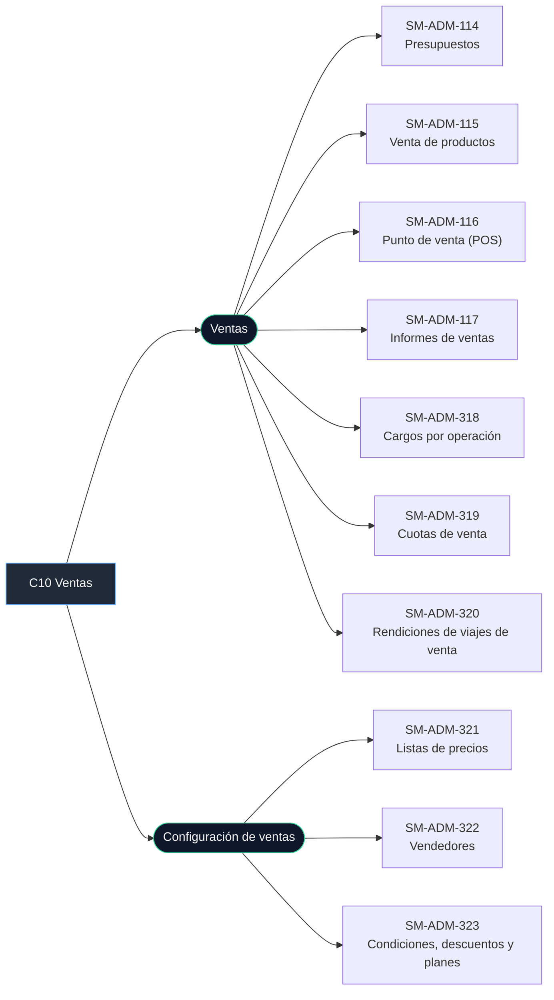

### Menú, rutas y capabilities de C10

| SM | Grupo | Ítem | Ruta canónica | Capability | Ola | PAN principal | PAN asociadas | Origen |
|---|---|---|---|---|---|---|---|---|
| SM-ADM-114 | Ventas | Presupuestos | `/admin/ven/presupuestos` | `ven.presupuestos.ver` | O5 | PAN-VEN-02 | PAN-VEN-03, PAN-VEN-21 | T03 10.8.1 y 10.9.2 |
| SM-ADM-115 | Ventas | Venta de productos | `/admin/ven/ventas` | `ven.ventas.ver` | O5 | PAN-VEN-08 | PAN-VEN-09, PAN-VEN-12, PAN-VEN-13, PAN-VEN-22 | T03 10.8.1 y 10.9.2 |
| SM-ADM-116 | Ventas | Punto de venta (POS) | `/admin/ven/pos/sesiones` | `ven.pos.abrir` | O5 | PAN-VEN-11 | PAN-VEN-10 | T03 10.8.1 y 10.9.2 |
| SM-ADM-117 | Ventas | Informes de ventas | `/admin/ven/reportes` | `ven.ventas.exportar` | O5 | PAN-VEN-23 | — | T03 10.8.1 y 10.9.2 |
| SM-ADM-318 | Ventas | Cargos por operación | `/admin/ven/cargos` | `ven.cargos.ver` | O5 | PAN-VEN-01 | — | T03 10.9.3 |
| SM-ADM-319 | Ventas | Cuotas de venta | `/admin/ven/cuotas` | `ven.cuotas.ver` | O5 | PAN-VEN-14 | PAN-VEN-15 | T03 10.9.3 |
| SM-ADM-320 | Ventas | Rendiciones de viajes de venta | `/admin/ven/rendiciones` | `ven.rendiciones.ver` | O5 | PAN-VEN-20 | — | T03 10.9.3 |
| SM-ADM-321 | Configuración de ventas (grupo nuevo en 10.9.3) | Listas de precios | `/admin/ven/precios` | `ven.precios.ver` | O5 | PAN-VEN-17 | — | T03 10.9.3 |
| SM-ADM-322 | Configuración de ventas | Vendedores | `/admin/ven/config/vendedores` | `ven.vendedores.ver` | O5 | PAN-VEN-16 | — | T03 10.9.3 |
| SM-ADM-323 | Configuración de ventas | Condiciones, descuentos y planes | `/admin/ven/config` | `ven.config.configurar` | O5 | PAN-VEN-24 | PAN-VEN-04, PAN-VEN-18, PAN-VEN-19 | T03 10.9.3 |
