# Admin de la cooperativa: clusters C11 a C18

Parte del entregable [22 Mapa de navegación y arquitectura de información](../22-mapa-navegacion.md) (artefacto 4.1). Generado con `_trabajo/gen_22_navegacion.py` desde T03 §10.8 y §10.9 y las pantallas (PAN) de los anexos; revisado a mano. Ante cualquier diferencia prevalece T03 y el anexo dueño de la pantalla.

App `apps/admin`, layout AdminShell (maestra §10): menú lateral generado desde `siteMapGroups` y filtrado por capability; base de rutas `/admin/` (T03 AL-02). Roles del espacio tenant (T-*).

## 1. C11 Administración

Clave `nav.cluster.administracion`. 4 grupos y 68 ítems. Origen de dominio: M12 CMP, M13 STK, M14 TES, M15 CON.

### Estructura de C11 (parte 1 de 3)

```mermaid
flowchart LR
    R_C11["C11 Administración"]
    R_C11_Compras(["Compras"])
    R_C11 --> R_C11_Compras
    SM_ADM_118["SM-ADM-118<br/>Proveedores"]
    R_C11_Compras --> SM_ADM_118
    SM_ADM_119["SM-ADM-119<br/>Solicitudes de aprovisionamiento"]
    R_C11_Compras --> SM_ADM_119
    SM_ADM_120["SM-ADM-120<br/>Solicitudes de cotización"]
    R_C11_Compras --> SM_ADM_120
    SM_ADM_121["SM-ADM-121<br/>Órdenes de compra"]
    R_C11_Compras --> SM_ADM_121
    SM_ADM_122["SM-ADM-122<br/>Remitos de proveedores"]
    R_C11_Compras --> SM_ADM_122
    SM_ADM_123["SM-ADM-123<br/>Comprobantes de proveedores"]
    R_C11_Compras --> SM_ADM_123
    SM_ADM_124["SM-ADM-124<br/>Pago a proveedores"]
    R_C11_Compras --> SM_ADM_124
    SM_ADM_125["SM-ADM-125<br/>Retenciones practicadas"]
    R_C11_Compras --> SM_ADM_125
    SM_ADM_126["SM-ADM-126<br/>Informes de compras"]
    R_C11_Compras --> SM_ADM_126
    SM_ADM_127["SM-ADM-127<br/>Correspondencia"]
    R_C11_Compras --> SM_ADM_127
    SM_ADM_324["SM-ADM-324<br/>Cuenta corriente de proveedores"]
    R_C11_Compras --> SM_ADM_324
    SM_ADM_325["SM-ADM-325<br/>Configuración de compras"]
    R_C11_Compras --> SM_ADM_325
    SM_ADM_397["SM-ADM-397<br/>Abastecimiento mayorista y balance"]
    R_C11_Compras --> SM_ADM_397
    SM_ADM_398["SM-ADM-398<br/>Derechos de señales"]
    R_C11_Compras --> SM_ADM_398
    R_C11_Stock(["Stock"])
    R_C11 --> R_C11_Stock
    SM_ADM_128["SM-ADM-128<br/>Artículos y depósitos"]
    R_C11_Stock --> SM_ADM_128
    SM_ADM_129["SM-ADM-129<br/>Movimientos de stock"]
    R_C11_Stock --> SM_ADM_129
    SM_ADM_130["SM-ADM-130<br/>Equipos serializados y comodatos"]
    R_C11_Stock --> SM_ADM_130
    SM_ADM_131["SM-ADM-131<br/>Trazabilidad"]
    R_C11_Stock --> SM_ADM_131
    SM_ADM_132["SM-ADM-132<br/>Operaciones especiales"]
    R_C11_Stock --> SM_ADM_132
    SM_ADM_133["SM-ADM-133<br/>Bienes de uso"]
    R_C11_Stock --> SM_ADM_133
    SM_ADM_134["SM-ADM-134<br/>Fabricación"]
    R_C11_Stock --> SM_ADM_134
    SM_ADM_135["SM-ADM-135<br/>RMA"]
    R_C11_Stock --> SM_ADM_135
    SM_ADM_136["SM-ADM-136<br/>Informes de stock"]
    R_C11_Stock --> SM_ADM_136
    SM_ADM_326["SM-ADM-326<br/>Depósitos y ubicaciones"]
    R_C11_Stock --> SM_ADM_326
    SM_ADM_327["SM-ADM-327<br/>Existencias"]
    R_C11_Stock --> SM_ADM_327
    SM_ADM_328["SM-ADM-328<br/>Reservas"]
    R_C11_Stock --> SM_ADM_328
    SM_ADM_329["SM-ADM-329<br/>Custodias de cuadrillas"]
    R_C11_Stock --> SM_ADM_329
    SM_ADM_330["SM-ADM-330<br/>Conflictos de campo"]
    R_C11_Stock --> SM_ADM_330
    SM_ADM_331["SM-ADM-331<br/>Inventarios físicos"]
    R_C11_Stock --> SM_ADM_331
    SM_ADM_332["SM-ADM-332<br/>Sugerencias de compra"]
    R_C11_Stock --> SM_ADM_332
    SM_ADM_333["SM-ADM-333<br/>Configuración de stock"]
    R_C11_Stock --> SM_ADM_333
    classDef raiz fill:#1f2937,stroke:#60a5fa,color:#f9fafb;
    classDef grupo fill:#0f172a,stroke:#34d399,color:#f9fafb;
    class R_C11 raiz;
    class R_C11_Compras,R_C11_Stock grupo;
```

### Estructura de C11 (parte 2 de 3)

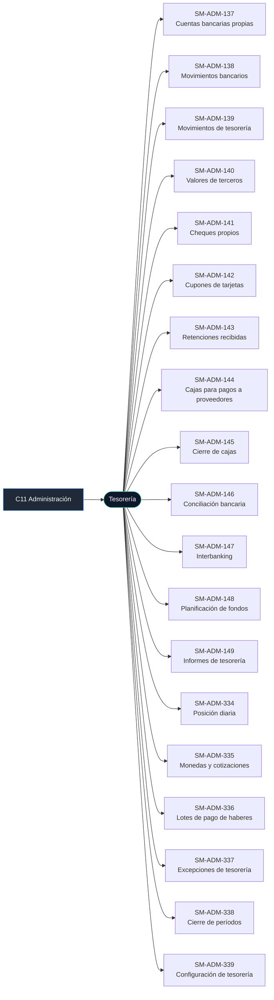

### Estructura de C11 (parte 3 de 3)

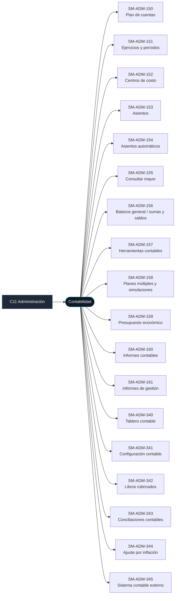

### Menú, rutas y capabilities de C11

| SM | Grupo | Ítem | Ruta canónica | Capability | Ola | PAN principal | PAN asociadas | Origen |
|---|---|---|---|---|---|---|---|---|
| SM-ADM-118 | Compras | Proveedores | `/admin/cmp/proveedores` | `cmp.proveedores.ver` | O8 | PAN-CMP-01 | PAN-CMP-02 | T03 10.8.1 y 10.9.2 |
| SM-ADM-119 | Compras | Solicitudes de aprovisionamiento | `/admin/cmp/solicitudes` | `cmp.solicitudes.ver` | O8 | PAN-CMP-04 | PAN-CMP-05 | T03 10.8.1 y 10.9.2 |
| SM-ADM-120 | Compras | Solicitudes de cotización | `/admin/cmp/cotizaciones` | `cmp.cotizaciones.ver` | O8 | PAN-CMP-06 | PAN-CMP-07 | T03 10.8.1 y 10.9.2 |
| SM-ADM-121 | Compras | Órdenes de compra | `/admin/cmp/ordenes` | `cmp.ordenes.ver` | O8 | PAN-CMP-08 | PAN-CMP-09 | T03 10.8.1 y 10.9.2 |
| SM-ADM-122 | Compras | Remitos de proveedores | `/admin/cmp/recepciones` | `cmp.recepciones.registrar` | O8 | PAN-CMP-10 | PAN-CMP-24 | T03 10.8.1 y 10.9.2 |
| SM-ADM-123 | Compras | Comprobantes de proveedores | `/admin/cmp/comprobantes` | `cmp.comprobantes.ver` | O8 | PAN-CMP-11 | PAN-CMP-12, PAN-CMP-13, PAN-CMP-17 | T03 10.8.1 y 10.9.2 |
| SM-ADM-124 | Compras | Pago a proveedores | `/admin/cmp/ordenes-pago` | `cmp.ordenesPago.ver` | O8 | PAN-CMP-14 | PAN-CMP-15, PAN-CMP-18 | T03 10.8.1 y 10.9.2 |
| SM-ADM-125 | Compras | Retenciones practicadas | `/admin/fis/withholding/applied` | `fis.retenciones.ver` | O8 | PAN-FIS-26 | — | T03 10.8.1 y 10.9.2 |
| SM-ADM-126 | Compras | Informes de compras | `/admin/cmp/reportes` | `cmp.comprobantes.ver` | O8 | PAN-CMP-22 | — | T03 10.8.1 y 10.9.2 |
| SM-ADM-127 | Compras | Correspondencia | `/admin/cmp/comunicaciones` | `cmp.proveedores.editar` | O8 | PAN-CMP-19 | — | T03 10.8.1 y 10.9.2 |
| SM-ADM-128 | Stock | Artículos y depósitos | `/admin/stk/articulos` | `stk.articulos.ver` | O3 | PAN-STK-01 | PAN-STK-02, PAN-STK-03, PAN-STK-04 | T03 10.8.1 y 10.9.2 |
| SM-ADM-129 | Stock | Movimientos de stock | `/admin/stk/documentos` | `stk.movimientos.ver` | O3 | PAN-STK-09 | PAN-STK-10 | T03 10.8.1 y 10.9.2 |
| SM-ADM-130 | Stock | Equipos serializados y comodatos | `/admin/stk/series` | `stk.series.ver` | O3 | PAN-STK-11 | PAN-STK-12, PAN-STK-17, PAN-STK-18, PAN-STK-19, PAN-CAT-19 | T03 10.8.1 y 10.9.2 |
| SM-ADM-131 | Stock | Trazabilidad | `/admin/stk/kardex` | `stk.movimientos.ver` | O8 | PAN-STK-08 | — | T03 10.8.1 y 10.9.2 |
| SM-ADM-132 | Stock | Operaciones especiales | `/admin/stk/revaluaciones` | `stk.revaluaciones.crear` | O8 | PAN-STK-23 | PAN-STK-22, PAN-STK-24 | T03 10.8.1 y 10.9.2 |
| SM-ADM-133 | Stock | Bienes de uso | `/admin/stk/bienes-uso` | `stk.bienesUso.ver` | O8 | PAN-STK-25 | PAN-STK-26, PAN-STK-27 | T03 10.8.1 y 10.9.2 |
| SM-ADM-134 | Stock | Fabricación | `/admin/stk/fabricacion/ordenes` | `stk.fabricacion.ordenes.ver` | O10 | PAN-STK-32 | PAN-STK-31, PAN-STK-33, PAN-STK-34 | T03 10.8.1 y 10.9.2 |
| SM-ADM-135 | Stock | RMA | `/admin/stk/rma` | `stk.rma.ver` | O8 | PAN-STK-28 | PAN-STK-29, PAN-STK-30 | T03 10.8.1 y 10.9.2 |
| SM-ADM-136 | Stock | Informes de stock | `/admin/stk/informes` | `stk.informes.ver` | O8 | PAN-STK-35 | — | T03 10.8.1 y 10.9.2 |
| SM-ADM-137 | Tesorería | Cuentas bancarias propias | `/admin/tes/cuentas` | `tes.cuentas.ver` | O8 | PAN-TES-02 | PAN-TES-03, PAN-TES-04 | T03 10.8.1 y 10.9.2 |
| SM-ADM-138 | Tesorería | Movimientos bancarios | `/admin/tes/cuentas/:id/libro` | `tes.movimientos.ver` | O8 | PAN-TES-07 | PAN-TES-08 | T03 10.8.1 y 10.9.2 |
| SM-ADM-139 | Tesorería | Movimientos de tesorería | `/admin/tes/movimientos` | `tes.movimientos.ver` | O8 | PAN-TES-06 | PAN-TES-05, PAN-TES-37 | T03 10.8.1 y 10.9.2 |
| SM-ADM-140 | Tesorería | Valores de terceros | `/admin/tes/valores` | `tes.valores.ver` | O8 | PAN-TES-14 | PAN-TES-15, PAN-TES-16, PAN-TES-17 | T03 10.8.1 y 10.9.2 |
| SM-ADM-141 | Tesorería | Cheques propios | `/admin/tes/chequeras` | `tes.chequeras.ver` | O8 | PAN-TES-18 | PAN-TES-19, PAN-TES-20 | T03 10.8.1 y 10.9.2 |
| SM-ADM-142 | Tesorería | Cupones de tarjetas | `/admin/tes/cupones` | `tes.cupones.ver` | O8 | PAN-TES-22 | PAN-TES-21, PAN-TES-23 | T03 10.8.1 y 10.9.2 |
| SM-ADM-143 | Tesorería | Retenciones recibidas | `/admin/tes/retenciones-recibidas` | `tes.retencionesRecibidas.ver` | O8 | PAN-TES-24 | — | T03 10.8.1 y 10.9.2 |
| SM-ADM-144 | Tesorería | Cajas para pagos a proveedores | `/admin/tes/cajas-pago` | `tes.cajasPago.abrir` | O8 | PAN-TES-25 | PAN-TES-26, PAN-TES-27 | T03 10.8.1 y 10.9.2 |
| SM-ADM-145 | Tesorería | Cierre de cajas | `/admin/tes/cierre-caja` | `tes.cierreCaja.cerrar` | O5 | PAN-TES-29 | PAN-TES-28 | T03 10.8.1 y 10.9.2 |
| SM-ADM-146 | Tesorería | Conciliación bancaria | `/admin/tes/conciliacion/:cuenta` | `tes.conciliacion.conciliar` | O8 | PAN-TES-09 | PAN-TES-10 | T03 10.8.1 y 10.9.2 |
| SM-ADM-147 | Tesorería | Interbanking | `/admin/tes/interbanking` | `tes.interbanking.configurar` | O8 | PAN-TES-11 | PAN-TES-12, PAN-TES-13 | T03 10.8.1 y 10.9.2 |
| SM-ADM-148 | Tesorería | Planificación de fondos | `/admin/tes/flujo` | `tes.flujo.ver` | O8 | PAN-TES-32 | PAN-TES-33, PAN-TES-34 | T03 10.8.1 y 10.9.2 |
| SM-ADM-149 | Tesorería | Informes de tesorería | `/admin/tes/informes` | `tes.informes.ver` | O8 | PAN-TES-36 | — | T03 10.8.1 y 10.9.2 |
| SM-ADM-150 | Contabilidad | Plan de cuentas | `/admin/con/planes` | `con.planes.ver` | O5 | PAN-CON-03 | PAN-CON-04, PAN-CON-05, PAN-CON-06, PAN-CON-07, PAN-CON-32, PAN-CON-38 | T03 10.8.1 y 10.9.2 |
| SM-ADM-151 | Contabilidad | Ejercicios y períodos | `/admin/con/ejercicios` | `con.ejercicios.ver` | O5 | PAN-CON-10 | PAN-CON-11, PAN-CON-31 | T03 10.8.1 y 10.9.2 |
| SM-ADM-152 | Contabilidad | Centros de costo | `/admin/con/centros` | `con.centros.ver` | O5 | PAN-CON-24 | PAN-CON-25, PAN-CON-26 | T03 10.8.1 y 10.9.2 |
| SM-ADM-153 | Contabilidad | Asientos | `/admin/con/asientos` | `con.asientos.ver` | O5 | PAN-CON-12 | PAN-CON-13, PAN-CON-14, PAN-CON-15, PAN-CON-18 | T03 10.8.1 y 10.9.2 |
| SM-ADM-154 | Contabilidad | Asientos automáticos | `/admin/con/reglas` | `con.reglas.ver` | O5 | PAN-CON-08 | PAN-CON-09, PAN-CON-16, PAN-CON-17 | T03 10.8.1 y 10.9.2 |
| SM-ADM-155 | Contabilidad | Consultar mayor | `/admin/con/reportes/mayor` | `con.reportes.ver` | O5 | PAN-CON-20 | — | T03 10.8.1 y 10.9.2 |
| SM-ADM-156 | Contabilidad | Balance general / sumas y saldos | `/admin/con/reportes/sumas-saldos` | `con.reportes.ver` | O8 | PAN-CON-21 | PAN-CON-36 | T03 10.8.1 y 10.9.2 |
| SM-ADM-157 | Contabilidad | Herramientas contables | `/admin/con/salud` | `con.config.ver` | O8 | PAN-CON-40 | PAN-CON-06, PAN-CON-19 | T03 10.8.1 y 10.9.2 |
| SM-ADM-158 | Contabilidad | Planes múltiples y simulaciones | `/admin/con/simulaciones` | `con.simulaciones.ver` | O8 | PAN-CON-33 | — | T03 10.8.1 y 10.9.2 |
| SM-ADM-159 | Contabilidad | Presupuesto económico | `/admin/con/presupuestos` | `con.presupuestos.ver` | O8 | PAN-CON-34 | PAN-CON-35 | T03 10.8.1 y 10.9.2 |
| SM-ADM-160 | Contabilidad | Informes contables | `/admin/con/reportes` | `con.reportes.ver` | O8 | PAN-CON-22 | PAN-CON-39 | T03 10.8.1 y 10.9.2 |
| SM-ADM-161 | Contabilidad | Informes de gestión | `/admin/con/reportes/resultado-servicio` | `con.reportes.ver` | O8 | PAN-CON-27 | — | T03 10.8.1 y 10.9.2 |
| SM-ADM-324 | Compras | Cuenta corriente de proveedores | `/admin/cmp/cuenta-corriente` | `cmp.comprobantes.ver` | O8 | PAN-CMP-16 | — | T03 10.9.3 |
| SM-ADM-325 | Compras | Configuración de compras | `/admin/cmp/config` | `cmp.config.configurar` | O8 | PAN-CMP-21 | PAN-CMP-03, PAN-CMP-20 | T03 10.9.3 |
| SM-ADM-326 | Stock | Depósitos y ubicaciones | `/admin/stk/depositos` | `stk.depositos.ver` | O3 | PAN-STK-05 | PAN-STK-06 | T03 10.9.3 |
| SM-ADM-327 | Stock | Existencias | `/admin/stk/existencias` | `stk.saldos.ver` | O3 | PAN-STK-07 | — | T03 10.9.3 |
| SM-ADM-328 | Stock | Reservas | `/admin/stk/reservas` | `stk.reservas.ver` | O3 | PAN-STK-13 | — | T03 10.9.3 |
| SM-ADM-329 | Stock | Custodias de cuadrillas | `/admin/stk/cuadrillas` | `stk.custodias.ver` | O3 | PAN-STK-14 | PAN-STK-15 | T03 10.9.3 |
| SM-ADM-330 | Stock | Conflictos de campo | `/admin/stk/conflictos` | `stk.consumos.validar` | O3 | PAN-STK-16 | — | T03 10.9.3 |
| SM-ADM-331 | Stock | Inventarios físicos | `/admin/stk/inventarios` | `stk.inventarios.ver` | O8 | PAN-STK-20 | — | T03 10.9.3 |
| SM-ADM-332 | Stock | Sugerencias de compra | `/admin/stk/reposicion` | `stk.sugerencias.ver` | O8 | PAN-STK-21 | — | T03 10.9.3 |
| SM-ADM-333 | Stock | Configuración de stock | `/admin/stk/configuracion` | `stk.config.configurar` | O3 | PAN-STK-36 | — | T03 10.9.3 |
| SM-ADM-334 | Tesorería | Posición diaria | `/admin/tes/tablero` | `tes.posicion.ver` | O8 | PAN-TES-01 | — | T03 10.9.3 |
| SM-ADM-335 | Tesorería | Monedas y cotizaciones | `/admin/tes/monedas` | `tes.monedas.configurar` | O8 | PAN-TES-30 | PAN-CFG-18 | T03 10.9.3 |
| SM-ADM-336 | Tesorería | Lotes de pago de haberes | `/admin/tes/haberes` | `tes.haberes.ejecutar` | O9 | PAN-TES-35 | — | T03 10.9.3 |
| SM-ADM-337 | Tesorería | Excepciones de tesorería | `/admin/tes/excepciones` | `tes.movimientos.ver` | O8 | PAN-TES-38 | — | T03 10.9.3 |
| SM-ADM-338 | Tesorería | Cierre de períodos | `/admin/tes/periodos` | `tes.periodos.cerrar` | O8 | PAN-TES-42 | — | T03 10.9.3 |
| SM-ADM-339 | Tesorería | Configuración de tesorería | `/admin/tes/configuracion` | `tes.configuracion.configurar` | O8 | PAN-TES-39 | PAN-TES-31 | T03 10.9.3 |
| SM-ADM-340 | Contabilidad | Tablero contable | `/admin/con` | `con.asientos.ver` | O5 | PAN-CON-01 | — | T03 10.9.3 |
| SM-ADM-341 | Contabilidad | Configuración contable | `/admin/con/configuracion` | `con.config.ver` | O5 | PAN-CON-02 | — | T03 10.9.3 |
| SM-ADM-342 | Contabilidad | Libros rubricados | `/admin/con/libros` | `con.libros.ver` | O8 | PAN-CON-23 | — | T03 10.9.3 |
| SM-ADM-343 | Contabilidad | Conciliaciones contables | `/admin/con/conciliaciones` | `con.conciliaciones.ver` | O8 | PAN-CON-28 | — | T03 10.9.3 |
| SM-ADM-344 | Contabilidad | Ajuste por inflación | `/admin/con/inflacion/corridas` | `con.inflacion.ejecutar` | O8 | PAN-CON-30 | PAN-CON-29 | T03 10.9.3 |
| SM-ADM-345 | Contabilidad | Sistema contable externo | `/admin/con/externo` | `con.externo.ver` | O5 | PAN-CON-37 | — | T03 10.9.3 |
| SM-ADM-397 | Compras | Abastecimiento mayorista y balance | `/admin/cmp/abastecimiento` | `cmp.comprobantes.ver` | O8 | PAN-CMP-25 | — | T03 10.9.3 |
| SM-ADM-398 | Compras | Derechos de señales | `/admin/cmp/derechos-senales` | `cmp.comprobantes.ver` | O10 | PAN-CMP-26 | — | T03 10.9.3 |

## 2. C12 Personal

Clave `nav.cluster.personal`. 5 grupos y 19 ítems. Origen de dominio: M16 SUE.

### Estructura de C12

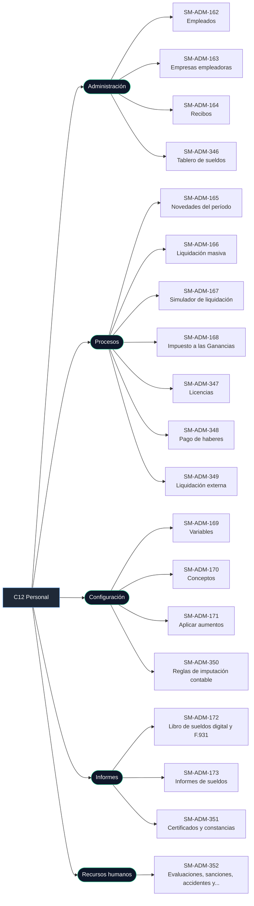

### Menú, rutas y capabilities de C12

| SM | Grupo | Ítem | Ruta canónica | Capability | Ola | PAN principal | PAN asociadas | Origen |
|---|---|---|---|---|---|---|---|---|
| SM-ADM-162 | Administración | Empleados | `/admin/sue/empleados` | `sue.legajos.ver` | O9 | PAN-SUE-02 | PAN-SUE-03, PAN-SUE-04, PAN-SUE-28 | T03 10.8.1 y 10.9.2 |
| SM-ADM-163 | Administración | Empresas empleadoras | `/admin/sue/empresas` | `sue.estructura.configurar` | O9 | PAN-SUE-05 | PAN-SUE-06, PAN-SUE-07, PAN-SUE-08, PAN-SUE-09, PAN-SUE-10 | T03 10.8.1 y 10.9.2 |
| SM-ADM-164 | Administración | Recibos | `/admin/sue/recibos/:id` (listado en SUE-25) | `sue.recibos.ver` | O9 | PAN-SUE-27 | — | T03 10.8.1 y 10.9.2 |
| SM-ADM-165 | Procesos | Novedades del período | `/admin/sue/novedades` | `sue.novedades.ver` | O9 | PAN-SUE-18 | PAN-SUE-17, PAN-SUE-19, PAN-SUE-20, PAN-SUE-21 | T03 10.8.1 y 10.9.2 |
| SM-ADM-166 | Procesos | Liquidación masiva | `/admin/sue/liquidaciones` | `sue.liquidaciones.ver` | O9 | PAN-SUE-24 | PAN-SUE-14, PAN-SUE-23, PAN-SUE-25, PAN-SUE-40 | T03 10.8.1 y 10.9.2 |
| SM-ADM-167 | Procesos | Simulador de liquidación | `/admin/sue/simulador` | `sue.liquidaciones.simular` | O9 | PAN-SUE-26 | — | T03 10.8.1 y 10.9.2 |
| SM-ADM-168 | Procesos | Impuesto a las Ganancias | `/admin/sue/ganancias` | `sue.ganancias.ver` | O9 | PAN-SUE-29 | — | T03 10.8.1 y 10.9.2 |
| SM-ADM-169 | Configuración | Variables | `/admin/sue/config/variables` | `sue.variables.configurar` | O9 | PAN-SUE-12 | — | T03 10.8.1 y 10.9.2 |
| SM-ADM-170 | Configuración | Conceptos | `/admin/sue/config/conceptos` | `sue.conceptos.configurar` | O9 | PAN-SUE-13 | PAN-SUE-15 | T03 10.8.1 y 10.9.2 |
| SM-ADM-171 | Configuración | Aplicar aumentos | `/admin/sue/config/aumentos` | `sue.aumentos.aplicar` | O9 | PAN-SUE-16 | — | T03 10.8.1 y 10.9.2 |
| SM-ADM-172 | Informes | Libro de sueldos digital y F.931 | `/admin/sue/presentaciones` | `sue.presentaciones.generar` | O9 | PAN-SUE-30 | — | T03 10.8.1 y 10.9.2 |
| SM-ADM-173 | Informes | Informes de sueldos | `/admin/sue/informes` | `sue.reportes.ver` | O9 | PAN-SUE-38 | PAN-SUE-11 | T03 10.8.1 y 10.9.2 |
| SM-ADM-346 | Administración | Tablero de sueldos | `/admin/sue` | `sue.reportes.ver` | O9 | PAN-SUE-01 | — | T03 10.9.3 |
| SM-ADM-347 | Procesos | Licencias | `/admin/sue/licencias` | `sue.licencias.ver` | O9 | PAN-SUE-22 | — | T03 10.9.3 |
| SM-ADM-348 | Procesos | Pago de haberes | `/admin/sue/pagos` | `sue.pagos.ver` | O9 | PAN-SUE-31 | PAN-TES-35 | T03 10.9.3 |
| SM-ADM-349 | Procesos | Liquidación externa | `/admin/sue/importacion-externa` | `sue.importacionExterna.ver` | O9 | PAN-SUE-39 | — | T03 10.9.3 |
| SM-ADM-350 | Configuración | Reglas de imputación contable | `/admin/sue/config/contabilidad` | `sue.reglasContables.configurar` | O9 | PAN-SUE-32 | — | T03 10.9.3 |
| SM-ADM-351 | Informes | Certificados y constancias | `/admin/sue/certificados` | `sue.certificados.emitir` | O9 | PAN-SUE-33 | — | T03 10.9.3 |
| SM-ADM-352 | Recursos humanos (grupo nuevo en 10.9.3) | Evaluaciones, sanciones, accidentes y juicios | `/admin/sue/rrhh/evaluaciones` | `sue.rrhh.evaluaciones.ver` | O9 | PAN-SUE-34 | PAN-SUE-35, PAN-SUE-36, PAN-SUE-37 | T03 10.9.3 |

## 3. C13 Institucional

Clave `nav.cluster.institucional`. 1 grupos y 8 ítems. Origen de dominio: M17 INS.

### Estructura de C13

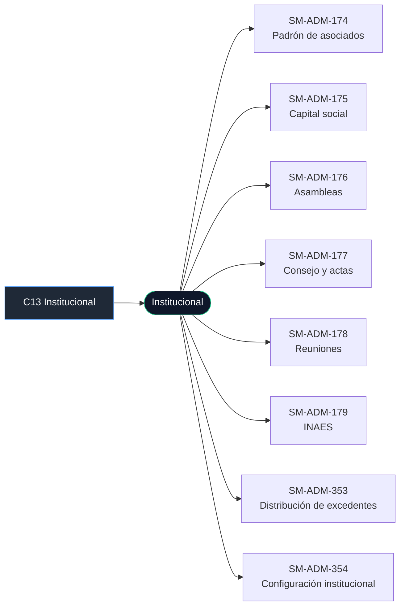

### Menú, rutas y capabilities de C13

| SM | Grupo | Ítem | Ruta canónica | Capability | Ola | PAN principal | PAN asociadas | Origen |
|---|---|---|---|---|---|---|---|---|
| SM-ADM-174 | Institucional | Padrón de asociados | `/admin/ins/asociados` | `ins.asociados.ver` | O10 | PAN-INS-01 | PAN-INS-02, PAN-INS-03, PAN-INS-04, PAN-INS-05, PAN-INS-19, PAN-INS-27 | T03 10.8.1 y 10.9.2 |
| SM-ADM-175 | Institucional | Capital social | `/admin/ins/capital/movimientos` | `ins.capital.ver` | O10 | PAN-INS-07 | PAN-INS-06, PAN-INS-08, PAN-INS-09, PAN-INS-10, PAN-INS-11, PAN-INS-12, PAN-INS-13 | T03 10.8.1 y 10.9.2 |
| SM-ADM-176 | Institucional | Asambleas | `/admin/ins/reuniones?tipo=asamblea` | `ins.reuniones.ver` | O10 | PAN-INS-18 | PAN-INS-16, PAN-INS-21, PAN-INS-22, PAN-INS-29 | T03 10.8.1 y 10.9.2 |
| SM-ADM-177 | Institucional | Consejo y actas | `/admin/ins/organos` | `ins.organos.gestionar` | O10 | PAN-INS-15 | PAN-INS-23, PAN-INS-24, PAN-INS-25 | T03 10.8.1 y 10.9.2 |
| SM-ADM-178 | Institucional | Reuniones | `/admin/ins/reuniones` | `ins.reuniones.ver` | O10 | PAN-INS-16 | PAN-INS-17 | T03 10.8.1 y 10.9.2 |
| SM-ADM-179 | Institucional | INAES | `/admin/ins/inaes` | `ins.inaes.exportar` | O10 | PAN-INS-26 | — | T03 10.8.1 y 10.9.2 |
| SM-ADM-353 | Institucional | Distribución de excedentes | `/admin/ins/excedentes` | `ins.excedentes.calcular` | O10 | PAN-INS-14 | — | T03 10.9.3 |
| SM-ADM-354 | Institucional | Configuración institucional | `/admin/ins/config` | `ins.config.configurar` | O10 | PAN-INS-28 | — | T03 10.9.3 |

## 4. C14 Servicios sociales

Clave `nav.cluster.servicios`. 4 grupos y 19 ítems. Origen de dominio: M18 SOC.

### Estructura de C14

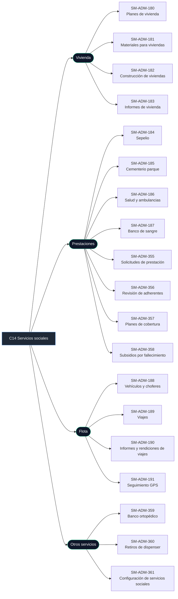

### Menú, rutas y capabilities de C14

| SM | Grupo | Ítem | Ruta canónica | Capability | Ola | PAN principal | PAN asociadas | Origen |
|---|---|---|---|---|---|---|---|---|
| SM-ADM-180 | Vivienda | Planes de vivienda | `/admin/soc/vivienda/planes` | `soc.vivienda.configurar` | O10 | PAN-SOC-17 | PAN-SOC-18, PAN-SOC-19 | T03 10.8.1 y 10.9.2 |
| SM-ADM-181 | Vivienda | Materiales para viviendas | `/admin/soc/vivienda/planes?tab=materiales` | `soc.vivienda.configurar` | O10 | PAN-SOC-17 | PAN-TAR-29 | T03 10.8.1 y 10.9.2 |
| SM-ADM-182 | Vivienda | Construcción de viviendas | `/admin/soc/vivienda/certificados` | `soc.obra.gestionar` | O10 | PAN-SOC-20 | — | T03 10.8.1 y 10.9.2 |
| SM-ADM-183 | Vivienda | Informes de vivienda | `/admin/soc/vivienda/informes` | `soc.reportes.ver` | O10 | PAN-SOC-21 | — | T03 10.8.1 y 10.9.2 |
| SM-ADM-184 | Prestaciones | Sepelio | `/admin/soc/solicitudes?tipo=sepelio` | `soc.sepelio.gestionar` | O10 | PAN-SOC-07 | PAN-SOC-05 | T03 10.8.1 y 10.9.2 |
| SM-ADM-185 | Prestaciones | Cementerio parque | `/admin/soc/cementerio/:cemeteryId/plano` | `soc.cementerio.ver` | O10 | PAN-SOC-09 | PAN-SOC-10, PAN-SOC-11, PAN-SOC-12 | T03 10.8.1 y 10.9.2 |
| SM-ADM-186 | Prestaciones | Salud y ambulancias | `/admin/soc/autorizaciones` | `soc.autorizaciones.gestionar` | O10 | PAN-SOC-16 | PAN-SOC-04 | T03 10.8.1 y 10.9.2 |
| SM-ADM-187 | Prestaciones | Banco de sangre | `/admin/soc/sangre` | `soc.sangre.ver` | O10 | PAN-SOC-13 | — | T03 10.8.1 y 10.9.2 |
| SM-ADM-188 | Flota | Vehículos y choferes | `/admin/soc/flota/vehiculos` | `soc.flota.ver` | O10 | PAN-SOC-22 | PAN-SOC-23, PAN-SOC-24 | T03 10.8.1 y 10.9.2 |
| SM-ADM-189 | Flota | Viajes | `/admin/soc/traslados` | `soc.traslados.ver` | O10 | PAN-SOC-14 | — | T03 10.8.1 y 10.9.2 |
| SM-ADM-190 | Flota | Informes y rendiciones de viajes | `/admin/soc/traslados/informes` | `soc.reportes.ver` | O10 | PAN-SOC-15 | PAN-SOC-25 | T03 10.8.1 y 10.9.2 |
| SM-ADM-191 | Flota | Seguimiento GPS | `/admin/soc/flota/gps` | `soc.gps.ver` | O10 | PAN-SOC-26 | — | T03 10.8.1 y 10.9.2 |
| SM-ADM-355 | Prestaciones | Solicitudes de prestación | `/admin/soc/solicitudes` | `soc.solicitudes.ver` | O10 | PAN-SOC-05 | PAN-SOC-06 | T03 10.9.3 |
| SM-ADM-356 | Prestaciones | Revisión de adherentes | `/admin/soc/adherentes/revision` | `soc.adherentes.gestionar` | O10 | PAN-SOC-02 | — | T03 10.9.3 |
| SM-ADM-357 | Prestaciones | Planes de cobertura | `/admin/soc/config/planes` | `soc.planes.configurar` | O10 | PAN-SOC-03 | — | T03 10.9.3 |
| SM-ADM-358 | Prestaciones | Subsidios por fallecimiento | `/admin/soc/subsidios` | `soc.subsidios.crear` | O10 | PAN-SOC-08 | — | T03 10.9.3 |
| SM-ADM-359 | Otros servicios (grupo nuevo en 10.9.3) | Banco ortopédico | `/admin/soc/otros/ortopedia` | `soc.ortopedia.gestionar` | O10 | PAN-SOC-27 | — | T03 10.9.3 |
| SM-ADM-360 | Otros servicios | Retiros de dispenser | `/admin/soc/otros/dispenser` | `soc.dispenser.registrar` | O10 | PAN-SOC-28 | — | T03 10.9.3 |
| SM-ADM-361 | Otros servicios | Configuración de servicios sociales | `/admin/soc/config` | `soc.config.configurar` | O10 | PAN-SOC-29 | — | T03 10.9.3 |

## 5. C15 Comunidad

Clave `nav.cluster.comunidad`. 5 grupos y 17 ítems. Origen de dominio: T09 COM.

### Estructura de C15

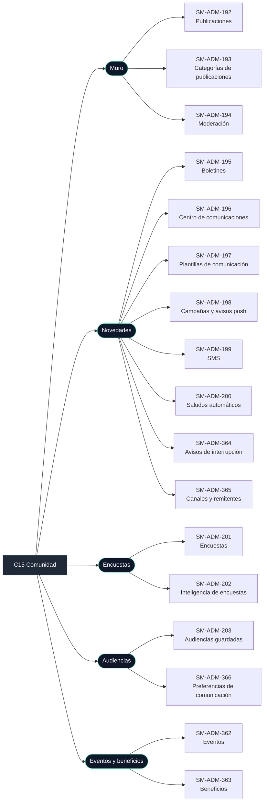

### Menú, rutas y capabilities de C15

| SM | Grupo | Ítem | Ruta canónica | Capability | Ola | PAN principal | PAN asociadas | Origen |
|---|---|---|---|---|---|---|---|---|
| SM-ADM-192 | Muro | Publicaciones | `/admin/com/publicaciones` | `com.posts.ver` | O2 | PAN-COM-01 | PAN-COM-02 | T03 10.8.1 y 10.9.2 |
| SM-ADM-193 | Muro | Categorías de publicaciones | `/admin/com/categorias` | `com.posts.configurar` | O2 | PAN-COM-03 | — | T03 10.8.1 y 10.9.2 |
| SM-ADM-194 | Muro | Moderación | `/admin/com/moderacion` | `com.moderation.ver` | O2 | PAN-COM-04 | PAN-COM-05, PAN-COM-06, PAN-COM-07 | T03 10.8.1 y 10.9.2 |
| SM-ADM-195 | Novedades | Boletines | `/admin/com/boletines` | `com.newsletters.ver` | O2 | PAN-COM-08 | PAN-COM-09 | T03 10.8.1 y 10.9.2 |
| SM-ADM-196 | Novedades | Centro de comunicaciones | `/admin/com/historial` | `com.communications.ver` | O2 | PAN-COM-24 | PAN-COM-18, PAN-COM-23, PAN-COM-29, PAN-COM-30 | T03 10.8.1 y 10.9.2 |
| SM-ADM-197 | Novedades | Plantillas de comunicación | `/admin/com/plantillas` | `com.templates.ver` | O2 | PAN-COM-19 | PAN-COM-20 | T03 10.8.1 y 10.9.2 |
| SM-ADM-198 | Novedades | Campañas y avisos push | `/admin/com/campanas` | `com.campaigns.ver` | O2 | PAN-COM-21 | PAN-COM-22, PAN-COM-31 | T03 10.8.1 y 10.9.2 |
| SM-ADM-199 | Novedades | SMS | `/admin/com/campanas?canal=sms` | `com.campaigns.ver` | O2 | PAN-COM-21 | PAN-COM-26, PAN-COM-28 | T03 10.8.1 y 10.9.2 |
| SM-ADM-200 | Novedades | Saludos automáticos | `/admin/com/categorias?tab=saludos` | `com.posts.configurar` (AL-01) | O2 | PAN-COM-03 | — | T03 10.8.1 y 10.9.2 |
| SM-ADM-201 | Encuestas | Encuestas | `/admin/com/encuestas` | `com.surveys.ver` | O2 | PAN-COM-10 | PAN-COM-11, PAN-COM-13 | T03 10.8.1 y 10.9.2 |
| SM-ADM-202 | Encuestas | Inteligencia de encuestas | `/admin/com/encuestas/:id/resultados` | `com.surveys.resultados` | O11 | PAN-COM-12 | — | T03 10.8.1 y 10.9.2 |
| SM-ADM-203 | Audiencias | Audiencias guardadas | `/admin/com/segmentos` | `com.audiences.usar` | O2 | PAN-COM-17 | — | T03 10.8.1 y 10.9.2 |
| SM-ADM-362 | Eventos y beneficios (grupo nuevo en 10.9.3) | Eventos | `/admin/com/eventos` | `com.events.ver` | O2 | PAN-COM-14 | — | T03 10.9.3 |
| SM-ADM-363 | Eventos y beneficios | Beneficios | `/admin/com/beneficios` | `com.benefits.ver` | O2 | PAN-COM-15 | — | T03 10.9.3 |
| SM-ADM-364 | Novedades | Avisos de interrupción | `/admin/com/avisos-corte` | `com.outages.ver` (AL-01) | O2 | PAN-COM-27 | PAN-TEC-28 | T03 10.9.3 |
| SM-ADM-365 | Novedades | Canales y remitentes | `/admin/com/canales` | `com.channels.configurar` | O2 | PAN-COM-26 | PAN-COM-28 | T03 10.9.3 |
| SM-ADM-366 | Audiencias | Preferencias de comunicación | `/admin/com/preferencias` | `com.consents.ver` | O2 | PAN-COM-25 | PAN-NFR-04 | T03 10.9.3 |

## 6. C16 Sitio y portal

Clave `nav.cluster.sitio`. 2 grupos y 13 ítems. Origen de dominio: M19 POR.

### Estructura de C16

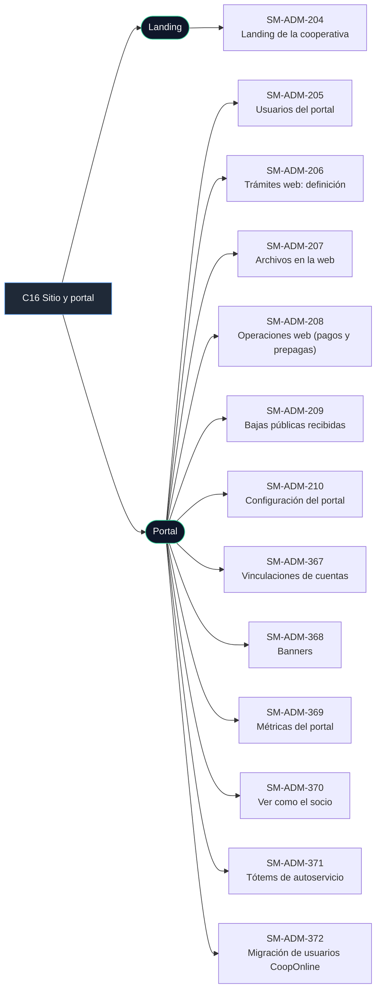

### Menú, rutas y capabilities de C16

| SM | Grupo | Ítem | Ruta canónica | Capability | Ola | PAN principal | PAN asociadas | Origen |
|---|---|---|---|---|---|---|---|---|
| SM-ADM-204 | Landing | Landing de la cooperativa | `/admin/portal/landing` | `por.landing.editar` | O2 | PAN-POR-85 | PAN-POR-86 | T03 10.8.1 y 10.9.2 |
| SM-ADM-205 | Portal | Usuarios del portal | `/admin/iam/portal-usuarios` | `iam.portal.usuarios.ver` | O2 | PAN-IAM-25 | PAN-POR-90 | T03 10.8.1 y 10.9.2 |
| SM-ADM-206 | Portal | Trámites web: definición | `/admin/portal/formularios` | `por.formularios.ver` | O2 | PAN-POR-87 | PAN-POR-88, PAN-WFL-07 | T03 10.8.1 y 10.9.2 |
| SM-ADM-207 | Portal | Archivos en la web | `/admin/portal/landing?bloque=descargas` | `por.landing.editar` | O2 | PAN-POR-85 | PAN-POR-08 | T03 10.8.1 y 10.9.2 |
| SM-ADM-208 | Portal | Operaciones web (pagos y prepagas) | `/admin/cob/pasarelas/intenciones` | `cob.intenciones.ver` | O5 | PAN-COB-24 | PAN-MED-25 | T03 10.8.1 y 10.9.2 |
| SM-ADM-209 | Portal | Bajas públicas recibidas | `/admin/portal/recepcion-publica` | `por.recepcionPublica.ver` | O2 | PAN-POR-91 | — | T03 10.8.1 y 10.9.2 |
| SM-ADM-210 | Portal | Configuración del portal | `/admin/portal/configuracion` | `por.parametros.configurar` | O2 | PAN-POR-84 | — | T03 10.8.1 y 10.9.2 |
| SM-ADM-367 | Portal | Vinculaciones de cuentas | `/admin/portal/vinculaciones` | `por.vinculaciones.ver` | O2 | PAN-POR-89 | — | T03 10.9.3 |
| SM-ADM-368 | Portal | Banners | `/admin/portal/banners` | `por.banners.configurar` | O2 | PAN-POR-93 | — | T03 10.9.3 |
| SM-ADM-369 | Portal | Métricas del portal | `/admin/portal/metricas` | `por.metricas.ver` | O2 | PAN-POR-94 | — | T03 10.9.3 |
| SM-ADM-370 | Portal | Ver como el socio | `/admin/portal/vista-socio/:accountId` | `por.vistaSocio.ver` | O2 | PAN-POR-95 | — | T03 10.9.3 |
| SM-ADM-371 | Portal | Tótems de autoservicio | `/admin/portal/totems` | `por.totems.configurar` | O5 | PAN-POR-96 | — | T03 10.9.3 |
| SM-ADM-372 | Portal | Migración de usuarios CoopOnline | `/admin/portal/migracion` | `por.migracion.ejecutar` | O11 | PAN-POR-92 | — | T03 10.9.3 |

## 7. C17 Reportes

Clave `nav.cluster.reportes`. 1 grupos y 13 ítems. Origen de dominio: T10 BIA.

### Estructura de C17

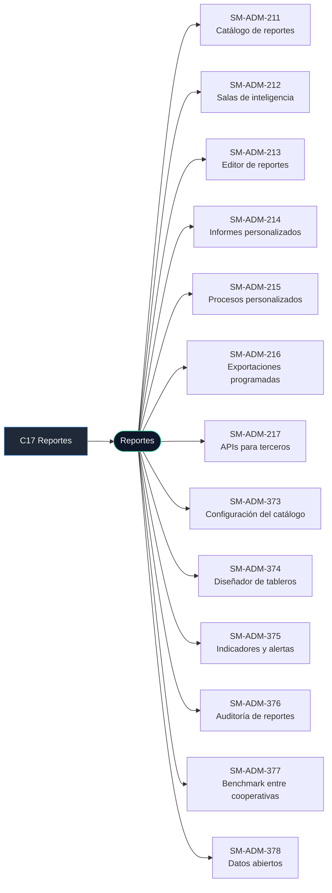

### Menú, rutas y capabilities de C17

| SM | Grupo | Ítem | Ruta canónica | Capability | Ola | PAN principal | PAN asociadas | Origen |
|---|---|---|---|---|---|---|---|---|
| SM-ADM-211 | Reportes | Catálogo de reportes | `/admin/reportes` | `bia.reportes.ver` | O1 | PAN-BIA-01 | PAN-BIA-02, PAN-BIA-03, PAN-BIA-06, PAN-BIA-22 | T03 10.8.1 y 10.9.2 |
| SM-ADM-212 | Reportes | Salas de inteligencia | `/admin/bi/:room` | `bia.bi.ver` | O11 | PAN-BIA-12 | PAN-BIA-18 | T03 10.8.1 y 10.9.2 |
| SM-ADM-213 | Reportes | Editor de reportes | `/admin/reportes/disenador` | `bia.disenador.usar` | O11 | PAN-BIA-09 | PAN-BIA-08 | T03 10.8.1 y 10.9.2 |
| SM-ADM-214 | Reportes | Informes personalizados | `/admin/reportes?origen=tenant` | `bia.reportes.ver` | O11 | PAN-BIA-01 | — | T03 10.8.1 y 10.9.2 |
| SM-ADM-215 | Reportes | Procesos personalizados | `/admin/reportes/programaciones` | `bia.reportes.programar` | O11 | PAN-BIA-05 | — | T03 10.8.1 y 10.9.2 |
| SM-ADM-216 | Reportes | Exportaciones programadas | `/admin/reportes/exportaciones` | `bia.exportaciones.ver` | O11 | PAN-BIA-04 | — | T03 10.8.1 y 10.9.2 |
| SM-ADM-217 | Reportes | APIs para terceros | `/admin/api/clientes` | `bia.api.clientes.ver` | O11 | PAN-BIA-15 | PAN-BIA-16, PAN-BIA-17, PAN-IAM-24 | T03 10.8.1 y 10.9.2 |
| SM-ADM-373 | Reportes | Configuración del catálogo | `/admin/reportes/configuracion` | `bia.reportes.configurar` | O1 | PAN-BIA-07 | — | T03 10.9.3 |
| SM-ADM-374 | Reportes | Diseñador de tableros | `/admin/tableros/disenar` | `bia.tableros.disenar` | O11 | PAN-BIA-11 | — | T03 10.9.3 |
| SM-ADM-375 | Reportes | Indicadores y alertas | `/admin/indicadores` | `bia.indicadores.ver` | O1 | PAN-BIA-13 | PAN-BIA-14 | T03 10.9.3 |
| SM-ADM-376 | Reportes | Auditoría de reportes | `/admin/reportes/auditoria` | `bia.auditoria.ver` | O1 | PAN-BIA-19 | — | T03 10.9.3 |
| SM-ADM-377 | Reportes | Benchmark entre cooperativas | `/admin/bi/benchmark` | `bia.benchmark.ver` | O11 | PAN-BIA-20 | — | T03 10.9.3 |
| SM-ADM-378 | Reportes | Datos abiertos | `/admin/bi/datos-abiertos` | `bia.datosAbiertos.publicar` (PAN-BIA-21, AL-01) | O11 | PAN-BIA-21 | — | T03 10.9.3 |

## 8. C18 Configuración

Clave `nav.cluster.configuracion`. 8 grupos y 54 ítems. Origen de dominio: T01, T02, T03, T04, T06, T07, T11.

### Estructura de C18 (parte 1 de 2)

```mermaid
flowchart LR
    R_C18["C18 Configuración"]
    R_C18_Seguridad(["Seguridad"])
    R_C18 --> R_C18_Seguridad
    SM_ADM_218["SM-ADM-218<br/>Usuarios"]
    R_C18_Seguridad --> SM_ADM_218
    SM_ADM_219["SM-ADM-219<br/>Roles"]
    R_C18_Seguridad --> SM_ADM_219
    SM_ADM_220["SM-ADM-220<br/>Perfiles de pantallas"]
    R_C18_Seguridad --> SM_ADM_220
    SM_ADM_221["SM-ADM-221<br/>Alcances"]
    R_C18_Seguridad --> SM_ADM_221
    SM_ADM_222["SM-ADM-222<br/>Auditoría de ingresos"]
    R_C18_Seguridad --> SM_ADM_222
    SM_ADM_223["SM-ADM-223<br/>Auditoría de cambios"]
    R_C18_Seguridad --> SM_ADM_223
    SM_ADM_224["SM-ADM-224<br/>Sesiones y dispositivos"]
    R_C18_Seguridad --> SM_ADM_224
    SM_ADM_379["SM-ADM-379<br/>Segregación de funciones"]
    R_C18_Seguridad --> SM_ADM_379
    SM_ADM_380["SM-ADM-380<br/>Explicador de permisos"]
    R_C18_Seguridad --> SM_ADM_380
    SM_ADM_381["SM-ADM-381<br/>Políticas de seguridad"]
    R_C18_Seguridad --> SM_ADM_381
    SM_ADM_382["SM-ADM-382<br/>Proveedores de identidad (SSO)"]
    R_C18_Seguridad --> SM_ADM_382
    R_C18_Organizaci_n(["Organización"])
    R_C18 --> R_C18_Organizaci_n
    SM_ADM_225["SM-ADM-225<br/>Datos de la cooperativa"]
    R_C18_Organizaci_n --> SM_ADM_225
    SM_ADM_226["SM-ADM-226<br/>Sucursales y puntos de venta"]
    R_C18_Organizaci_n --> SM_ADM_226
    SM_ADM_227["SM-ADM-227<br/>Tablas del sistema"]
    R_C18_Organizaci_n --> SM_ADM_227
    SM_ADM_228["SM-ADM-228<br/>Parámetros del sistema"]
    R_C18_Organizaci_n --> SM_ADM_228
    SM_ADM_229["SM-ADM-229<br/>Parámetros externos"]
    R_C18_Organizaci_n --> SM_ADM_229
    SM_ADM_230["SM-ADM-230<br/>Geografía y calles"]
    R_C18_Organizaci_n --> SM_ADM_230
    SM_ADM_231["SM-ADM-231<br/>Calendario y feriados"]
    R_C18_Organizaci_n --> SM_ADM_231
    SM_ADM_232["SM-ADM-232<br/>Índices económicos"]
    R_C18_Organizaci_n --> SM_ADM_232
    SM_ADM_233["SM-ADM-233<br/>Publicaciones de configuración"]
    R_C18_Organizaci_n --> SM_ADM_233
    SM_ADM_383["SM-ADM-383<br/>Monedas"]
    R_C18_Organizaci_n --> SM_ADM_383
    SM_ADM_384["SM-ADM-384<br/>Enumeraciones"]
    R_C18_Organizaci_n --> SM_ADM_384
    SM_ADM_385["SM-ADM-385<br/>Campos extra"]
    R_C18_Organizaci_n --> SM_ADM_385
    SM_ADM_386["SM-ADM-386<br/>Formularios del registro"]
    R_C18_Organizaci_n --> SM_ADM_386
    SM_ADM_387["SM-ADM-387<br/>Vistas guardadas"]
    R_C18_Organizaci_n --> SM_ADM_387
    SM_ADM_395["SM-ADM-395<br/>Entidades jurídicas"]
    R_C18_Organizaci_n --> SM_ADM_395
    SM_ADM_396["SM-ADM-396<br/>Puestos y equipos"]
    R_C18_Organizaci_n --> SM_ADM_396
    R_C18_Experiencia(["Experiencia"])
    R_C18 --> R_C18_Experiencia
    SM_ADM_234["SM-ADM-234<br/>Marca e identidad"]
    R_C18_Experiencia --> SM_ADM_234
    SM_ADM_235["SM-ADM-235<br/>Diccionario de términos"]
    R_C18_Experiencia --> SM_ADM_235
    SM_ADM_236["SM-ADM-236<br/>Publicaciones del diccionario"]
    R_C18_Experiencia --> SM_ADM_236
    SM_ADM_237["SM-ADM-237<br/>Navegación de las apps"]
    R_C18_Experiencia --> SM_ADM_237
    SM_ADM_238["SM-ADM-238<br/>Ayudas contextuales"]
    R_C18_Experiencia --> SM_ADM_238
    SM_ADM_239["SM-ADM-239<br/>Flags de interfaz"]
    R_C18_Experiencia --> SM_ADM_239
    classDef raiz fill:#1f2937,stroke:#60a5fa,color:#f9fafb;
    classDef grupo fill:#0f172a,stroke:#34d399,color:#f9fafb;
    class R_C18 raiz;
    class R_C18_Seguridad,R_C18_Organizaci_n,R_C18_Experiencia grupo;
```

### Estructura de C18 (parte 2 de 2)

```mermaid
flowchart LR
    R_C18["C18 Configuración"]
    R_C18_Procesos(["Procesos"])
    R_C18 --> R_C18_Procesos
    SM_ADM_240["SM-ADM-240<br/>Autorización de operaciones"]
    R_C18_Procesos --> SM_ADM_240
    SM_ADM_241["SM-ADM-241<br/>Workflows"]
    R_C18_Procesos --> SM_ADM_241
    SM_ADM_242["SM-ADM-242<br/>Plantillas de documentos"]
    R_C18_Procesos --> SM_ADM_242
    SM_ADM_243["SM-ADM-243<br/>Expediente documental"]
    R_C18_Procesos --> SM_ADM_243
    SM_ADM_244["SM-ADM-244<br/>Procesos y jobs"]
    R_C18_Procesos --> SM_ADM_244
    SM_ADM_388["SM-ADM-388<br/>Operaciones"]
    R_C18_Procesos --> SM_ADM_388
    R_C18_Integraciones(["Integraciones"])
    R_C18 --> R_C18_Integraciones
    SM_ADM_245["SM-ADM-245<br/>Integraciones"]
    R_C18_Integraciones --> SM_ADM_245
    SM_ADM_246["SM-ADM-246<br/>Bóveda de credenciales"]
    R_C18_Integraciones --> SM_ADM_246
    SM_ADM_247["SM-ADM-247<br/>Webhooks"]
    R_C18_Integraciones --> SM_ADM_247
    SM_ADM_248["SM-ADM-248<br/>Agente local y hardware"]
    R_C18_Integraciones --> SM_ADM_248
    R_C18_Migraci_n(["Migración"])
    R_C18 --> R_C18_Migraci_n
    SM_ADM_249["SM-ADM-249<br/>Migración desde ProCoop"]
    R_C18_Migraci_n --> SM_ADM_249
    SM_ADM_250["SM-ADM-250<br/>Paralelo y by-pass"]
    R_C18_Migraci_n --> SM_ADM_250
    R_C18_Cuenta_SaaS(["Cuenta SaaS"])
    R_C18 --> R_C18_Cuenta_SaaS
    SM_ADM_251["SM-ADM-251<br/>Soporte y accesos temporales"]
    R_C18_Cuenta_SaaS --> SM_ADM_251
    SM_ADM_252["SM-ADM-252<br/>Licencia y módulos contratados"]
    R_C18_Cuenta_SaaS --> SM_ADM_252
    SM_ADM_253["SM-ADM-253<br/>Respaldos y exportación de datos"]
    R_C18_Cuenta_SaaS --> SM_ADM_253
    SM_ADM_254["SM-ADM-254<br/>Ambiente de prueba"]
    R_C18_Cuenta_SaaS --> SM_ADM_254
    SM_ADM_393["SM-ADM-393<br/>Novedades de la plataforma"]
    R_C18_Cuenta_SaaS --> SM_ADM_393
    R_C18_Privacidad_y_salud(["Privacidad y salud"])
    R_C18 --> R_C18_Privacidad_y_salud
    SM_ADM_389["SM-ADM-389<br/>Tratamientos y datos personales"]
    R_C18_Privacidad_y_salud --> SM_ADM_389
    SM_ADM_390["SM-ADM-390<br/>Consentimientos"]
    R_C18_Privacidad_y_salud --> SM_ADM_390
    SM_ADM_391["SM-ADM-391<br/>Solicitudes de derechos"]
    R_C18_Privacidad_y_salud --> SM_ADM_391
    SM_ADM_392["SM-ADM-392<br/>Salud del servicio"]
    R_C18_Privacidad_y_salud --> SM_ADM_392
    classDef raiz fill:#1f2937,stroke:#60a5fa,color:#f9fafb;
    classDef grupo fill:#0f172a,stroke:#34d399,color:#f9fafb;
    class R_C18 raiz;
    class R_C18_Procesos,R_C18_Integraciones,R_C18_Migraci_n,R_C18_Cuenta_SaaS,R_C18_Privacidad_y_salud grupo;
```

### Menú, rutas y capabilities de C18

| SM | Grupo | Ítem | Ruta canónica | Capability | Ola | PAN principal | PAN asociadas | Origen |
|---|---|---|---|---|---|---|---|---|
| SM-ADM-218 | Seguridad | Usuarios | `/admin/iam/usuarios` | `iam.usuarios.ver` | O1 | PAN-IAM-09 | PAN-IAM-10, PAN-IAM-31 | T03 10.8.1 y 10.9.2 |
| SM-ADM-219 | Seguridad | Roles | `/admin/iam/roles` | `iam.roles.ver` | O1 | PAN-IAM-11 | — | T03 10.8.1 y 10.9.2 |
| SM-ADM-220 | Seguridad | Perfiles de pantallas | `/admin/iam/perfiles` | `iam.perfiles.ver` | O1 | PAN-IAM-12 | — | T03 10.8.1 y 10.9.2 |
| SM-ADM-221 | Seguridad | Alcances | `/admin/iam/usuarios/:id?tab=alcances` | `iam.usuarios.ver` | O1 | PAN-IAM-10 | — | T03 10.8.1 y 10.9.2 |
| SM-ADM-222 | Seguridad | Auditoría de ingresos | `/admin/auditoria/accesos` | `iam.auditoria.accesos.ver` | O1 | PAN-IAM-18 | — | T03 10.8.1 y 10.9.2 |
| SM-ADM-223 | Seguridad | Auditoría de cambios | `/admin/auditoria/cambios` | `iam.auditoria.cambios.ver` | O0 | PAN-IAM-17 | PAN-IAM-19, PAN-IAM-20, PAN-IAM-21 | T03 10.8.1 y 10.9.2 |
| SM-ADM-224 | Seguridad | Sesiones y dispositivos | `/admin/iam/sesiones` | `iam.sesiones.ver` | O1 | PAN-IAM-29 | — | T03 10.8.1 y 10.9.2 |
| SM-ADM-225 | Organización | Datos de la cooperativa | `/admin/cfg` | `cfg.parametros.ver` | O1 | PAN-CFG-01 | — | T03 10.8.1 y 10.9.2 |
| SM-ADM-226 | Organización | Sucursales y puntos de venta | `/admin/cfg/sucursales` | `cfg.sucursales.ver` (AL-01) | O1 | PAN-CFG-34 | PAN-FIS-08 | T03 10.8.1 y 10.9.2 |
| SM-ADM-227 | Organización | Tablas del sistema | `/admin/cfg/tablas` | `cfg.maestros.ver` | O1 | PAN-CFG-07 | PAN-CFG-08, PAN-CFG-09, PAN-CFG-30 | T03 10.8.1 y 10.9.2 |
| SM-ADM-228 | Organización | Parámetros del sistema | `/admin/cfg/parametros` | `cfg.parametros.ver` | O1 | PAN-CFG-02 | PAN-CFG-03, PAN-CFG-29 | T03 10.8.1 y 10.9.2 |
| SM-ADM-229 | Organización | Parámetros externos | `/admin/cfg/tecnica` | `cfg.tecnica.ver` | O1 | PAN-CFG-28 | — | T03 10.8.1 y 10.9.2 |
| SM-ADM-230 | Organización | Geografía y calles | `/admin/cfg/geografia` | `cfg.geo.ver` | O1 | PAN-CFG-11 | PAN-CFG-12, PAN-CFG-13, PAN-CFG-14, PAN-CFG-15, PAN-CFG-32 | T03 10.8.1 y 10.9.2 |
| SM-ADM-231 | Organización | Calendario y feriados | `/admin/cfg/calendarios` | `cfg.calendarios.ver` | O1 | PAN-CFG-16 | — | T03 10.8.1 y 10.9.2 |
| SM-ADM-232 | Organización | Índices económicos | `/admin/cfg/indices` | `cfg.indices.ver` | O1 | PAN-CFG-17 | PAN-MOR-04, PAN-CON-29 | T03 10.8.1 y 10.9.2 |
| SM-ADM-233 | Organización | Publicaciones de configuración | `/admin/cfg/versiones` | `cfg.versiones.ver` | O1 | PAN-CFG-04 | PAN-CFG-05, PAN-CFG-06 | T03 10.8.1 y 10.9.2 |
| SM-ADM-234 | Experiencia | Marca e identidad | `/admin/configuracion/experiencia/marca` | `uxd.marca.ver` | O1 | PAN-UXD-01 | — | T03 10.8.1 y 10.9.2 |
| SM-ADM-235 | Experiencia | Diccionario de términos | `/admin/configuracion/experiencia/diccionario` | `uxd.diccionario.ver` | O1 | PAN-UXD-02 | — | T03 10.8.1 y 10.9.2 |
| SM-ADM-236 | Experiencia | Publicaciones del diccionario | `/admin/configuracion/experiencia/diccionario/publicaciones` | `uxd.diccionario.ver` | O1 | PAN-UXD-03 | — | T03 10.8.1 y 10.9.2 |
| SM-ADM-237 | Experiencia | Navegación de las apps | `/admin/configuracion/experiencia/navegacion` | `uxd.navegacion.configurar` | O1 | PAN-UXD-05 | — | T03 10.8.1 y 10.9.2 |
| SM-ADM-238 | Experiencia | Ayudas contextuales | `/admin/configuracion/experiencia/ayudas` | `uxd.ayuda.editar` | O1 | PAN-UXD-06 | — | T03 10.8.1 y 10.9.2 |
| SM-ADM-239 | Experiencia | Flags de interfaz | `/admin/configuracion/experiencia/flags` | `uxd.flags.configurar` | O1 | PAN-UXD-07 | PAN-UXD-04 | T03 10.8.1 y 10.9.2 |
| SM-ADM-240 | Procesos | Autorización de operaciones | `/admin/configuracion/operaciones` | `wfl.flujos.configurar` | O1 | PAN-WFL-12 | PAN-WFL-09 | T03 10.8.1 y 10.9.2 |
| SM-ADM-241 | Procesos | Workflows | `/admin/configuracion/workflows` | `wfl.flujos.configurar` | O1 | PAN-WFL-06 | PAN-WFL-05, PAN-WFL-07, PAN-WFL-20 | T03 10.8.1 y 10.9.2 |
| SM-ADM-242 | Procesos | Plantillas de documentos | `/admin/configuracion/plantillas` | `wfl.plantillas.ver` | O1 | PAN-WFL-17 | PAN-WFL-16, PAN-WFL-18, PAN-WFL-19 | T03 10.8.1 y 10.9.2 |
| SM-ADM-243 | Procesos | Expediente documental | `/admin/expedientes/formales` | `wfl.expedientes.gestionar` | O1 | PAN-WFL-15 | PAN-WFL-14 | T03 10.8.1 y 10.9.2 |
| SM-ADM-244 | Procesos | Procesos y jobs | `/admin/configuracion/procesos` | `wfl.jobs.ver` | O0 | PAN-WFL-21 | — | T03 10.8.1 y 10.9.2 |
| SM-ADM-245 | Integraciones | Integraciones | `/admin/integraciones/conexiones` | `int.conexiones.ver` | O1 | PAN-INT-03 | PAN-INT-02, PAN-INT-04, PAN-INT-08, PAN-INT-09, PAN-INT-10, PAN-INT-12, PAN-INT-13, PAN-INT-14, PAN-INT-15, PAN-INT-16, PAN-INT-18, PAN-INT-19, PAN-INT-20 | T03 10.8.1 y 10.9.2 |
| SM-ADM-246 | Integraciones | Bóveda de credenciales | `/admin/integraciones/credenciales` | `int.credenciales.gestionar` | O1 | PAN-INT-06 | PAN-INT-07 | T03 10.8.1 y 10.9.2 |
| SM-ADM-247 | Integraciones | Webhooks | `/admin/integraciones/webhooks` | `int.webhooks.configurar` | O1 | PAN-INT-11 | PAN-BIA-17 | T03 10.8.1 y 10.9.2 |
| SM-ADM-248 | Integraciones | Agente local y hardware | `/admin/integraciones/agentes` | `int.agentes.gestionar` | O10 | PAN-INT-17 | — | T03 10.8.1 y 10.9.2 |
| SM-ADM-249 | Migración | Migración desde ProCoop | `/admin/migration/reconciliations` | `mig.conciliacion.ver` | O11 | PAN-MIG-13 | PAN-MIG-06, PAN-MIG-08, PAN-MIG-10, PAN-MIG-11, PAN-MIG-12, PAN-MIG-17, PAN-MIG-18, PAN-MIG-19, PAN-MIG-23 | T03 10.8.1 y 10.9.2 |
| SM-ADM-250 | Migración | Paralelo y by-pass | `/admin/migration/parallel` | `mig.paralelo.ver` | O11 | PAN-MIG-14 | PAN-MIG-15, PAN-MIG-16 | T03 10.8.1 y 10.9.2 |
| SM-ADM-251 | Cuenta SaaS | Soporte y accesos temporales | `/admin/pla/soporte` | `pla.soporte.ver` | O1 | PAN-PLA-17 | PAN-PLA-18 | T03 10.8.1 y 10.9.2 |
| SM-ADM-252 | Cuenta SaaS | Licencia y módulos contratados | `/admin/pla/suscripcion` | `pla.miSuscripcion.ver` | O1 | PAN-PLA-15 | PAN-PLA-16 | T03 10.8.1 y 10.9.2 |
| SM-ADM-253 | Cuenta SaaS | Respaldos y exportación de datos | `/admin/pla/exportaciones` | `pla.exportacion.solicitar` | O1 | PAN-PLA-23 | — | T03 10.8.1 y 10.9.2 |
| SM-ADM-254 | Cuenta SaaS | Ambiente de prueba | `/admin/pla/suscripcion?tab=ambientes` | `pla.miSuscripcion.ver` | O1 | PAN-PLA-15 | PAN-PLA-14, PAN-PLA-14 | T03 10.8.1 y 10.9.2 |
| SM-ADM-379 | Seguridad | Segregación de funciones | `/admin/iam/sod` | `iam.sod.configurar` | O1 | PAN-IAM-13 | — | T03 10.9.3 |
| SM-ADM-380 | Seguridad | Explicador de permisos | `/admin/iam/explicar` | `iam.permisos.explicar` | O1 | PAN-IAM-14 | — | T03 10.9.3 |
| SM-ADM-381 | Seguridad | Políticas de seguridad | `/admin/iam/politicas` | `iam.politicas.ver` | O1 | PAN-IAM-22 | — | T03 10.9.3 |
| SM-ADM-382 | Seguridad | Proveedores de identidad (SSO) | `/admin/iam/sso` | `iam.idp.configurar` | O1 | PAN-IAM-23 | — | T03 10.9.3 |
| SM-ADM-383 | Organización | Monedas | `/admin/cfg/monedas` | `cfg.maestros.editar` | O1 | PAN-CFG-18 | — | T03 10.9.3 |
| SM-ADM-384 | Organización | Enumeraciones | `/admin/cfg/enumeraciones` | `cfg.enumeraciones.configurar` | O1 | PAN-CFG-20 | — | T03 10.9.3 |
| SM-ADM-385 | Organización | Campos extra | `/admin/cfg/campos-extra` | `cfg.camposExtra.configurar` | O1 | PAN-CFG-21 | — | T03 10.9.3 |
| SM-ADM-386 | Organización | Formularios del registro | `/admin/cfg/formularios` | `cfg.formularios.configurar` | O1 | PAN-CFG-22 | — | T03 10.9.3 |
| SM-ADM-387 | Organización | Vistas guardadas | `/admin/cfg/vistas` | `cfg.vistas.crear` | O1 | PAN-CFG-23 | — | T03 10.9.3 |
| SM-ADM-388 | Procesos | Operaciones | `/admin/operaciones` | `wfl.operaciones.ver` | O1 | PAN-WFL-13 | — | T03 10.9.3 |
| SM-ADM-389 | Privacidad y salud (grupo nuevo en 10.9.3) | Tratamientos y datos personales | `/admin/privacidad/tratamientos` | `nfr.tratamientos.ver` | O1 | PAN-NFR-01 | PAN-NFR-02, PAN-NFR-03, PAN-NFR-06 | T03 10.9.3 |
| SM-ADM-390 | Privacidad y salud | Consentimientos | `/admin/privacidad/consentimientos` | `nfr.consentimientos.ver` | O1 | PAN-NFR-04 | — | T03 10.9.3 |
| SM-ADM-391 | Privacidad y salud | Solicitudes de derechos | `/admin/privacidad/solicitudes` | `nfr.solicitudesDerechos.ver` | O1 | PAN-NFR-05 | — | T03 10.9.3 |
| SM-ADM-392 | Privacidad y salud | Salud del servicio | `/admin/salud` | `nfr.salud.ver` | O1 | PAN-NFR-07 | PAN-NFR-08 | T03 10.9.3 |
| SM-ADM-393 | Cuenta SaaS | Novedades de la plataforma | `/admin/pla/novedades` | `pla.novedadesPlataforma.ver` | O1 | PAN-PLA-19 | — | T03 10.9.3 |
| SM-ADM-395 | Organización | Entidades jurídicas | `/admin/cfg/entidades-juridicas` | `cfg.entidadesJuridicas.ver` | O0 | PAN-CFG-33 | — | T03 10.9.3 |
| SM-ADM-396 | Organización | Puestos y equipos | `/admin/cfg/puestos` | `cfg.puestos.editar` | O1 | PAN-CFG-35 | — | T03 10.9.3 |
