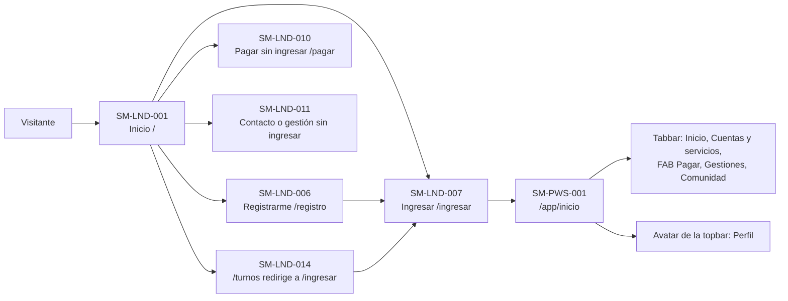
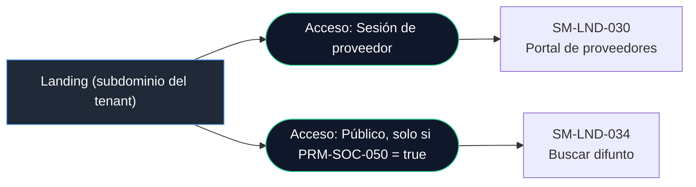
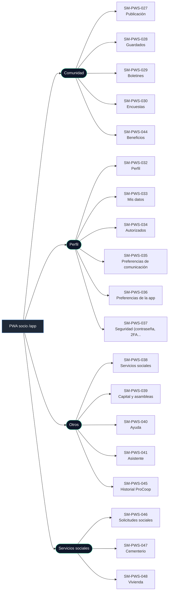

# Portal del socio (M19): landing y PWA socio

Parte del entregable [22 Mapa de navegación y arquitectura de información](../22-mapa-navegacion.md) (artefacto 4.1). Generado con `_trabajo/gen_22_navegacion.py` desde T03 §10.8 y §10.9 y las pantallas (PAN) de los anexos; revisado a mano. Ante cualquier diferencia prevalece T03 y el anexo dueño de la pantalla.

M19 es dueño del shell de la landing (`apps/landing`, por subdominio del tenant) y de la PWA del socio (`apps/pwa`, base `/app/`; T03 AL-04 y AL-06). La ruta la fija M19 y la capability el anexo del dominio. Roles: visitante anónimo, C-VIS, C-SOC, C-REP y C-ADH.

## 1. Recorrido entre landing y PWA

## 2. Landing

### Estructura de la landing (parte 1 de 2)

```mermaid
flowchart LR
    R_LND["Landing (subdominio del tenant)"]
    R_LND_Acceso__P_blico(["Acceso: Público"])
    R_LND --> R_LND_Acceso__P_blico
    SM_LND_001["SM-LND-001<br/>Inicio"]
    R_LND_Acceso__P_blico --> SM_LND_001
    SM_LND_002["SM-LND-002<br/>Servicios"]
    R_LND_Acceso__P_blico --> SM_LND_002
    SM_LND_003["SM-LND-003<br/>Detalle de servicio (requisitos..."]
    R_LND_Acceso__P_blico --> SM_LND_003
    SM_LND_004["SM-LND-004<br/>Noticias"]
    R_LND_Acceso__P_blico --> SM_LND_004
    SM_LND_005["SM-LND-005<br/>Noticia"]
    R_LND_Acceso__P_blico --> SM_LND_005
    SM_LND_006["SM-LND-006<br/>Registrarme"]
    R_LND_Acceso__P_blico --> SM_LND_006
    SM_LND_007["SM-LND-007<br/>Ingresar"]
    R_LND_Acceso__P_blico --> SM_LND_007
    SM_LND_008["SM-LND-008<br/>Recuperar acceso"]
    R_LND_Acceso__P_blico --> SM_LND_008
    SM_LND_014["SM-LND-014<br/>Turno online"]
    R_LND_Acceso__P_blico --> SM_LND_014
    SM_LND_015["SM-LND-015<br/>Trámites y requisitos"]
    R_LND_Acceso__P_blico --> SM_LND_015
    SM_LND_017["SM-LND-017<br/>Contacto y sucursales"]
    R_LND_Acceso__P_blico --> SM_LND_017
    SM_LND_018["SM-LND-018<br/>Legales"]
    R_LND_Acceso__P_blico --> SM_LND_018
    SM_LND_019["SM-LND-019<br/>Instalar la app"]
    R_LND_Acceso__P_blico --> SM_LND_019
    SM_LND_020["SM-LND-020<br/>Cobertura"]
    R_LND_Acceso__P_blico --> SM_LND_020
    SM_LND_021["SM-LND-021<br/>Avisos de corte"]
    R_LND_Acceso__P_blico --> SM_LND_021
    SM_LND_022["SM-LND-022<br/>Ayuda"]
    R_LND_Acceso__P_blico --> SM_LND_022
    SM_LND_023["SM-LND-023<br/>Cuadros tarifarios"]
    R_LND_Acceso__P_blico --> SM_LND_023
    SM_LND_024["SM-LND-024<br/>Asambleas y convocatorias"]
    R_LND_Acceso__P_blico --> SM_LND_024
    SM_LND_028["SM-LND-028<br/>Verificar documento"]
    R_LND_Acceso__P_blico --> SM_LND_028
    SM_LND_031["SM-LND-031<br/>Directorio de cooperativas"]
    R_LND_Acceso__P_blico --> SM_LND_031
    SM_LND_032["SM-LND-032<br/>Estado del servicio"]
    R_LND_Acceso__P_blico --> SM_LND_032
    SM_LND_033["SM-LND-033<br/>Portal para desarrolladores"]
    R_LND_Acceso__P_blico --> SM_LND_033
    R_LND_Acceso__P_blico_con_verificaci_n(["Acceso: Público con verificación"])
    R_LND --> R_LND_Acceso__P_blico_con_verificaci_n
    SM_LND_009["SM-LND-009<br/>Consultar deuda"]
    R_LND_Acceso__P_blico_con_verificaci_n --> SM_LND_009
    SM_LND_010["SM-LND-010<br/>Pagar sin ingresar"]
    R_LND_Acceso__P_blico_con_verificaci_n --> SM_LND_010
    SM_LND_011["SM-LND-011<br/>Reclamo o solicitud sin ingresar"]
    R_LND_Acceso__P_blico_con_verificaci_n --> SM_LND_011
    SM_LND_013["SM-LND-013<br/>Baja de un servicio"]
    R_LND_Acceso__P_blico_con_verificaci_n --> SM_LND_013
    R_LND_Acceso__P_blico_con_c_digo(["Acceso: Público con código"])
    R_LND --> R_LND_Acceso__P_blico_con_c_digo
    SM_LND_012["SM-LND-012<br/>Seguimiento de gestión por código"]
    R_LND_Acceso__P_blico_con_c_digo --> SM_LND_012
    R_LND_Acceso__Token(["Acceso: Token"])
    R_LND --> R_LND_Acceso__Token
    SM_LND_016["SM-LND-016<br/>Encuesta externa"]
    R_LND_Acceso__Token --> SM_LND_016
    SM_LND_025["SM-LND-025<br/>Preferencias por enlace (reemplazado..."]
    R_LND_Acceso__Token --> SM_LND_025
    SM_LND_026["SM-LND-026<br/>Comunicación por enlace"]
    R_LND_Acceso__Token --> SM_LND_026
    SM_LND_027["SM-LND-027<br/>Aceptar presupuesto"]
    R_LND_Acceso__Token --> SM_LND_027
    SM_LND_029["SM-LND-029<br/>Documento por enlace"]
    R_LND_Acceso__Token --> SM_LND_029
    classDef raiz fill:#1f2937,stroke:#60a5fa,color:#f9fafb;
    classDef grupo fill:#0f172a,stroke:#34d399,color:#f9fafb;
    class R_LND raiz;
    class R_LND_Acceso__P_blico,R_LND_Acceso__P_blico_con_verificaci_n,R_LND_Acceso__P_blico_con_c_digo,R_LND_Acceso__Token grupo;
```

### Estructura de la landing (parte 2 de 2)

### Ítems, rutas y acceso de la landing

| SM | Ítem | Ruta canónica | Acceso | Ola | PAN principal | PAN asociadas | Origen |
|---|---|---|---|---|---|---|---|
| SM-LND-001 | Inicio | `/` | Público | O2 | PAN-POR-01 | — | T03 10.8.5 y 10.9.7 |
| SM-LND-002 | Servicios | `/servicios` | Público | O2 | PAN-POR-02 | PAN-CAT-23, PAN-POR-03 | T03 10.8.5 y 10.9.7 |
| SM-LND-003 | Detalle de servicio (requisitos, contratar) | `/servicios/:serviceCode` | Público | O2 | PAN-POR-03 | — | T03 10.8.5 y 10.9.7 |
| SM-LND-004 | Noticias | `/noticias` | Público | O2 | PAN-POR-05 | PAN-COM-53 | T03 10.8.5 y 10.9.7 |
| SM-LND-005 | Noticia | `/noticias/:slug` | Público | O2 | PAN-POR-06 | PAN-COM-53 | T03 10.8.5 y 10.9.7 |
| SM-LND-006 | Registrarme | `/registro` | Público | O2 | PAN-POR-18 | PAN-POR-20, PAN-IAM-06 | T03 10.8.5 y 10.9.7 |
| SM-LND-007 | Ingresar | `/ingresar` (alias `/login`) | Público | O0 | PAN-POR-19 | PAN-IAM-02, PAN-IAM-03, PAN-IAM-04 | T03 10.8.5 y 10.9.7 |
| SM-LND-008 | Recuperar acceso | `/recuperar`, `/restablecer/:token` | Público | O0 | PAN-POR-19 | PAN-IAM-05 | T03 10.8.5 y 10.9.7 |
| SM-LND-009 | Consultar deuda | `/factura` | Público con verificación | O5 | PAN-FAC-45 | — | T03 10.8.5 y 10.9.7 |
| SM-LND-010 | Pagar sin ingresar | `/pagar` | Público con verificación | O5 | PAN-POR-12 | PAN-POR-22 | T03 10.8.5 y 10.9.7 |
| SM-LND-011 | Reclamo o solicitud sin ingresar | `/contacto` | Público con verificación | O2 | PAN-POR-13 | PAN-POR-91 | T03 10.8.5 y 10.9.7 |
| SM-LND-012 | Seguimiento de gestión por código | `/baja/seguimiento` (alias `/seguimiento`) | Público con código | O2 | PAN-POR-11 | PAN-POR-10 | T03 10.8.5 y 10.9.7 |
| SM-LND-013 | Baja de un servicio | `/baja` | Público con verificación | O2 | PAN-POR-09 | PAN-POR-10 | T03 10.8.5 y 10.9.7 |
| SM-LND-014 | Turno online | `/ingresar?next=/app/turnos` (ruta de POR-19 con destino, AL-09; `/turnos` queda como alias que redirige) | Público | O10 | PAN-POR-19 | PAN-POR-52, PAN-CRM-26 | T03 10.8.5 y 10.9.7 |
| SM-LND-015 | Trámites y requisitos | `/tramites` | Público | O2 | PAN-POR-08 | — | T03 10.8.5 y 10.9.7 |
| SM-LND-016 | Encuesta externa | `/e/:token` | Token | O2 | PAN-COM-49 | PAN-POR-17 | T03 10.8.5 y 10.9.7 |
| SM-LND-017 | Contacto y sucursales | `/contacto` | Público | O2 | PAN-POR-13 | PAN-POR-14 | T03 10.8.5 y 10.9.7 |
| SM-LND-018 | Legales | `/legal/:tipo` | Público | O1 | PAN-POR-16 | PAN-NFR-10 | T03 10.8.5 y 10.9.7 |
| SM-LND-019 | Instalar la app | `/instalar` | Público | O0 | PAN-UXD-14 | — | T03 10.8.5 y 10.9.7 |
| SM-LND-020 | Cobertura | `/cobertura` | Público | O2 | PAN-POR-04 | — | T03 10.9.7 |
| SM-LND-021 | Avisos de corte | `/avisos-de-corte` | Público | O2 | PAN-POR-07 | — | T03 10.9.7 |
| SM-LND-022 | Ayuda | `/ayuda` | Público | O2 | PAN-POR-15 | — | T03 10.9.7 |
| SM-LND-023 | Cuadros tarifarios | `/tarifas` | Público | O4 | PAN-TAR-24 | — | T03 10.9.7 |
| SM-LND-024 | Asambleas y convocatorias | `/asambleas` | Público | O10 | PAN-INS-33 | — | T03 10.9.7 |
| SM-LND-025 | Preferencias por enlace (reemplazado por SM-LND-026: T09 gestiona las preferencias por enlace en /comunicaciones/:token) | `/preferencias/:token` (alias que redirige a `/comunicaciones/:token`) | Token | O2 | PAN-COM-50 | — | T03 10.9.7 |
| SM-LND-026 | Comunicación por enlace | `/comunicaciones/:token` | Token | O2 | PAN-COM-50 | — | T03 10.9.7 |
| SM-LND-027 | Aceptar presupuesto | `/presupuesto/:token` | Token | O5 | PAN-VEN-05 | — | T03 10.9.7 |
| SM-LND-028 | Verificar documento | `/verificar` | Público | O1 | PAN-WFL-29 | — | T03 10.9.7 |
| SM-LND-029 | Documento por enlace | `/d/:token` | Token | O1 | PAN-WFL-30 | — | T03 10.9.7 |
| SM-LND-030 | Portal de proveedores | `/proveedores` | Sesión de proveedor | O8 | PAN-CMP-23 | — | T03 10.9.7 |
| SM-LND-031 | Directorio de cooperativas | `/cooperativas` | Público (solo dominio genérico) | O2 | PAN-POR-21 | — | T03 10.9.7 |
| SM-LND-032 | Estado del servicio | `/estado` | Público (dominio de plataforma) | O1 | PAN-PLA-24 | PAN-NFR-18 | T03 10.9.7 |
| SM-LND-033 | Portal para desarrolladores | `/developers` | Público (dominio de plataforma) | O11 | PAN-BIA-24 | — | T03 10.9.7 |
| SM-LND-034 | Buscar difunto | `/cementerio/buscar` | Público, solo si PRM-SOC-050 = true (HUECO-CEM-02) | O10 | PAN-POR-104 | — | T03 10.9.7 |

## 3. PWA socio

Layout AppShell (maestra §10): topbar con marca del tenant, banners (offline, avisos de corte, deuda), contenido y tabbar con FAB contextual. La tabbar del socio (maestra §9.2, T03 RF-UXD-066 y §10.1.4, M19 §10 y RF-POR-180) tiene cinco posiciones: Inicio (SM-PWS-001), Cuentas y servicios (SM-PWS-002), FAB "+" central (Pagar por defecto; cambia por pantalla con `useCreateAction`), Gestiones (SM-PWS-017) y Comunidad (SM-PWS-026, PAN-POR-105 `/app/comunidad`, con pestañas Muro, Encuestas y Novedades según capability). Perfil se abre desde el avatar de la topbar y el tenant puede reemplazar Comunidad por configuración (RF-UXD-177). El registrado sin cuenta usa Inicio · Contratar · (+) · Gestiones · Perfil. El resto de los ítems va en el menú hamburguesa por grupo.

### Estructura de la PWA socio (parte 1 de 2)

```mermaid
flowchart LR
    R_PWS["PWA socio /app"]
    R_PWS_Tabbar(["Tabbar"])
    R_PWS --> R_PWS_Tabbar
    SM_PWS_001["SM-PWS-001<br/>Inicio"]
    R_PWS_Tabbar --> SM_PWS_001
    SM_PWS_002["SM-PWS-002<br/>Cuentas (rótulo corto de la tabbar..."]
    R_PWS_Tabbar --> SM_PWS_002
    SM_PWS_017["SM-PWS-017<br/>Gestiones"]
    R_PWS_Tabbar --> SM_PWS_017
    SM_PWS_026["SM-PWS-026<br/>Comunidad"]
    R_PWS_Tabbar --> SM_PWS_026
    R_PWS_Servicios(["Servicios"])
    R_PWS --> R_PWS_Servicios
    SM_PWS_003["SM-PWS-003<br/>Detalle de servicio"]
    R_PWS_Servicios --> SM_PWS_003
    SM_PWS_004["SM-PWS-004<br/>Vincular cuenta"]
    R_PWS_Servicios --> SM_PWS_004
    SM_PWS_005["SM-PWS-005<br/>Contratar un servicio"]
    R_PWS_Servicios --> SM_PWS_005
    SM_PWS_006["SM-PWS-006<br/>Baja, suspensión o reactivación"]
    R_PWS_Servicios --> SM_PWS_006
    R_PWS_Facturas_y_pagos(["Facturas y pagos"])
    R_PWS --> R_PWS_Facturas_y_pagos
    SM_PWS_007["SM-PWS-007<br/>Mis facturas y pagos"]
    R_PWS_Facturas_y_pagos --> SM_PWS_007
    SM_PWS_008["SM-PWS-008<br/>Detalle de factura"]
    R_PWS_Facturas_y_pagos --> SM_PWS_008
    SM_PWS_009["SM-PWS-009<br/>Pagar (FAB)"]
    R_PWS_Facturas_y_pagos --> SM_PWS_009
    SM_PWS_010["SM-PWS-010<br/>Resultado del pago"]
    R_PWS_Facturas_y_pagos --> SM_PWS_010
    SM_PWS_011["SM-PWS-011<br/>Resumen de cuenta"]
    R_PWS_Facturas_y_pagos --> SM_PWS_011
    SM_PWS_012["SM-PWS-012<br/>Débito automático y factura digital"]
    R_PWS_Facturas_y_pagos --> SM_PWS_012
    SM_PWS_013["SM-PWS-013<br/>Planes de pago y cuotas"]
    R_PWS_Facturas_y_pagos --> SM_PWS_013
    SM_PWS_042["SM-PWS-042<br/>Mi deuda y avisos"]
    R_PWS_Facturas_y_pagos --> SM_PWS_042
    SM_PWS_049["SM-PWS-049<br/>Mis presupuestos y cuotas"]
    R_PWS_Facturas_y_pagos --> SM_PWS_049
    R_PWS_Consumos(["Consumos"])
    R_PWS --> R_PWS_Consumos
    SM_PWS_014["SM-PWS-014<br/>Mis consumos"]
    R_PWS_Consumos --> SM_PWS_014
    SM_PWS_015["SM-PWS-015<br/>Autolectura con foto"]
    R_PWS_Consumos --> SM_PWS_015
    SM_PWS_016["SM-PWS-016<br/>Cargar saldo (prepago)"]
    R_PWS_Consumos --> SM_PWS_016
    R_PWS_Gestiones(["Gestiones"])
    R_PWS --> R_PWS_Gestiones
    SM_PWS_018["SM-PWS-018<br/>Nueva gestión (modal desde FAB)"]
    R_PWS_Gestiones --> SM_PWS_018
    SM_PWS_019["SM-PWS-019<br/>Detalle y seguimiento de gestión"]
    R_PWS_Gestiones --> SM_PWS_019
    SM_PWS_020["SM-PWS-020<br/>Visitas"]
    R_PWS_Gestiones --> SM_PWS_020
    SM_PWS_021["SM-PWS-021<br/>Conformidad de instalación"]
    R_PWS_Gestiones --> SM_PWS_021
    SM_PWS_022["SM-PWS-022<br/>Turnos"]
    R_PWS_Gestiones --> SM_PWS_022
    SM_PWS_023["SM-PWS-023<br/>Trámites"]
    R_PWS_Gestiones --> SM_PWS_023
    SM_PWS_024["SM-PWS-024<br/>Constancias y documentos"]
    R_PWS_Gestiones --> SM_PWS_024
    SM_PWS_043["SM-PWS-043<br/>Agenda (visitas, turnos y eventos)"]
    R_PWS_Gestiones --> SM_PWS_043
    R_PWS_Avisos(["Avisos"])
    R_PWS --> R_PWS_Avisos
    SM_PWS_025["SM-PWS-025<br/>Interrupciones y cortes programados"]
    R_PWS_Avisos --> SM_PWS_025
    SM_PWS_031["SM-PWS-031<br/>Avisos"]
    R_PWS_Avisos --> SM_PWS_031
    classDef raiz fill:#1f2937,stroke:#60a5fa,color:#f9fafb;
    classDef grupo fill:#0f172a,stroke:#34d399,color:#f9fafb;
    class R_PWS raiz;
    class R_PWS_Tabbar,R_PWS_Servicios,R_PWS_Facturas_y_pagos,R_PWS_Consumos,R_PWS_Gestiones,R_PWS_Avisos grupo;
```

### Estructura de la PWA socio (parte 2 de 2)

### Menú, rutas y capabilities de la PWA socio

| SM | Grupo | Ítem | Ruta canónica | Capability | Ola | PAN principal | PAN asociadas | Origen |
|---|---|---|---|---|---|---|---|---|
| SM-PWS-001 | Tabbar | Inicio | `/app/inicio` | `por.portal.ver` | O2 | PAN-POR-25 | PAN-POR-23, PAN-POR-24 | T03 10.8.2 y 10.9.4 |
| SM-PWS-002 | Tabbar | Cuentas (rótulo corto de la tabbar, RN-UXD-006; pantalla "Cuentas y servicios") | `/app/cuentas` | `por.portal.ver` | O2 | PAN-POR-26 | PAN-POR-28, PAN-POR-29, PAN-CAT-22 | T03 10.8.2 y 10.9.4 |
| SM-PWS-003 | Servicios | Detalle de servicio | `/app/servicios/:contractId` | `por.servicios.ver` | O2 | PAN-POR-30 | PAN-POR-66, PAN-POR-67, PAN-STK-40, PAN-POR-103 | T03 10.8.2 y 10.9.4 |
| SM-PWS-004 | Servicios | Vincular cuenta | `/app/cuentas/vincular` | `por.cuentas.vincular` | O2 | PAN-POR-27 | PAN-PER-26, PAN-IAM-32 | T03 10.8.2 y 10.9.4 |
| SM-PWS-005 | Servicios | Contratar un servicio | `/app/contratar` | `por.servicios.contratar` | O2 | PAN-POR-31 | PAN-CAT-21 | T03 10.8.2 y 10.9.4 |
| SM-PWS-006 | Servicios | Baja, suspensión o reactivación | `/app/servicios/:contractId/:accion` | `por.servicios.solicitarBaja` | O2 | PAN-POR-37 | PAN-MOR-41 | T03 10.8.2 y 10.9.4 |
| SM-PWS-007 | Facturas y pagos | Mis facturas y pagos | `/app/facturas` | `por.facturas.ver` | O4 | PAN-POR-38 | PAN-FAC-43, PAN-COB-35 | T03 10.8.2 y 10.9.4 |
| SM-PWS-008 | Facturas y pagos | Detalle de factura | `/app/facturas/:invoiceId` | `por.facturas.ver` | O4 | PAN-POR-39 | PAN-FAC-44, PAN-TAR-23 | T03 10.8.2 y 10.9.4 |
| SM-PWS-009 | Facturas y pagos | Pagar (FAB) | `/app/pagar` | `por.pagos.crear` | O5 | PAN-POR-40 | — | T03 10.8.2 y 10.9.4 |
| SM-PWS-010 | Facturas y pagos | Resultado del pago | `/app/pagos/:checkoutId` | `por.pagos.crear` | O5 | PAN-POR-41 | PAN-POR-42 | T03 10.8.2 y 10.9.4 |
| SM-PWS-011 | Facturas y pagos | Resumen de cuenta | `/app/cuentas/:accountId/movimientos` | `por.facturas.ver` | O5 | PAN-POR-43 | PAN-COB-35 | T03 10.8.2 y 10.9.4 |
| SM-PWS-012 | Facturas y pagos | Débito automático y factura digital | `/app/debito-automatico` | `por.debito.gestionar` | O5 | PAN-POR-44 | PAN-POR-45 | T03 10.8.2 y 10.9.4 |
| SM-PWS-013 | Facturas y pagos | Planes de pago y cuotas | `/app/convenios` | `por.facturas.ver` | O6 | PAN-POR-46 | PAN-MOR-40 | T03 10.8.2 y 10.9.4 |
| SM-PWS-014 | Consumos | Mis consumos | `/app/consumos(/:contractId)` | `por.consumos.ver` | O7 | PAN-POR-47 | PAN-MED-31 | T03 10.8.2 y 10.9.4 |
| SM-PWS-015 | Consumos | Autolectura con foto | `/app/autolectura/:contractId` | `por.autolectura.crear` | O7 | PAN-POR-48 | PAN-MED-32 | T03 10.8.2 y 10.9.4 |
| SM-PWS-016 | Consumos | Cargar saldo (prepago) | `/app/prepaga` | `por.prepaga.comprar` | O7 | PAN-POR-49 | PAN-MED-33 | T03 10.8.2 y 10.9.4 |
| SM-PWS-017 | Tabbar | Gestiones | `/app/gestiones` | `por.gestiones.crear` | O2 | PAN-POR-50 | — | T03 10.8.2 y 10.9.4 |
| SM-PWS-018 | Gestiones | Nueva gestión (modal desde FAB) | `/app/gestiones/nueva` | `por.gestiones.crear` | O2 | PAN-POR-51 | PAN-POR-32, PAN-POR-63 | T03 10.8.2 y 10.9.4 |
| SM-PWS-019 | Gestiones | Detalle y seguimiento de gestión | `/app/gestiones/:caseId` | `por.gestiones.crear` | O2 | PAN-POR-33 | PAN-TEC-59 | T03 10.8.2 y 10.9.4 |
| SM-PWS-020 | Gestiones | Visitas | `/app/visitas/:visitId` | `por.visitas.gestionar` | O3 | PAN-POR-35 | PAN-POR-34, PAN-TEC-57, PAN-TEC-58 | T03 10.8.2 y 10.9.4 |
| SM-PWS-021 | Gestiones | Conformidad de instalación | `/app/visitas/:visitId/conformidad` | `por.visitas.gestionar` | O3 | PAN-POR-36 | — | T03 10.8.2 y 10.9.4 |
| SM-PWS-022 | Gestiones | Turnos | `/app/turnos` | `por.turnos.gestionar` | O10 | PAN-POR-52 | — | T03 10.8.2 y 10.9.4 |
| SM-PWS-023 | Gestiones | Trámites | `/app/tramites` | sesión | O2 | PAN-WFL-25 | PAN-POR-32 | T03 10.8.2 y 10.9.4 |
| SM-PWS-024 | Gestiones | Constancias y documentos | `/app/constancias` | `por.constancias.descargar` | O4 | PAN-POR-64 | PAN-WFL-26, PAN-WFL-27 | T03 10.8.2 y 10.9.4 |
| SM-PWS-025 | Avisos | Interrupciones y cortes programados | `/app/avisos-de-corte` | `por.portal.ver` | O2 | PAN-POR-68 | PAN-COM-48 | T03 10.8.2 y 10.9.4 |
| SM-PWS-026 | Tabbar | Comunidad | `/app/comunidad` (ruta de M19, AL-04) | `por.portal.ver` y, por pestaña, la capability de T09 (`com.wall.ver` para muro y... | O2 | PAN-POR-105 | PAN-POR-55, PAN-COM-40, PAN-COM-51 | T03 10.8.2 y 10.9.4 |
| SM-PWS-027 | Comunidad | Publicación | `/app/muro(/:id)` (ruta del anexo, AL-01) | `com.wall.ver` | O2 | PAN-POR-55 | PAN-COM-41 | T03 10.8.2 y 10.9.4 |
| SM-PWS-028 | Comunidad | Guardados | `/app/guardados` | `com.wall.ver` | O2 | — (— (sin pantalla propia en esta app; pantalla relacionada...) | PAN-COM-40 | T03 10.8.2 y 10.9.4 |
| SM-PWS-029 | Comunidad | Boletines | `/app/novedades(/:id)` | `com.wall.ver` | O2 | PAN-POR-56 | PAN-COM-44 | T03 10.8.2 y 10.9.4 |
| SM-PWS-030 | Comunidad | Encuestas | `/app/encuestas(/:id)` | `com.surveys.responder` | O2 | PAN-POR-54 | PAN-COM-43 | T03 10.8.2 y 10.9.4 |
| SM-PWS-031 | Avisos | Avisos | `/app/avisos` | `com.inbox.ver` | O2 | PAN-POR-53 | PAN-COM-42 | T03 10.8.2 y 10.9.4 |
| SM-PWS-032 | Perfil | Perfil | `/app/perfil` | `por.perfil.editar` | O2 | PAN-POR-59 | — | T03 10.8.2 y 10.9.4 |
| SM-PWS-033 | Perfil | Mis datos | `/app/mis-datos` | `per.me.ver` | O2 | PAN-PER-25 | PAN-NFR-09 | T03 10.8.2 y 10.9.4 |
| SM-PWS-034 | Perfil | Autorizados | `/app/representaciones` | `por.representaciones.gestionar` | O2 | PAN-POR-57 | PAN-PER-27, PAN-POR-58 | T03 10.8.2 y 10.9.4 |
| SM-PWS-035 | Perfil | Preferencias de comunicación | `/app/perfil/comunicaciones` | `com.preferences.editar` | O2 | PAN-POR-60 | PAN-COM-47 | T03 10.8.2 y 10.9.4 |
| SM-PWS-036 | Perfil | Preferencias de la app | `/app/perfil/apariencia` | sesión | O0 | PAN-POR-62 | PAN-UXD-08 | T03 10.8.2 y 10.9.4 |
| SM-PWS-037 | Perfil | Seguridad (contraseña, 2FA, dispositivos) | `/app/perfil/seguridad` | `iam.miCuenta.gestionar` (capability implícita de todo usuario autenticado según T02; M19... | O1 | PAN-POR-61 | PAN-IAM-07 | T03 10.8.2 y 10.9.4 |
| SM-PWS-038 | Otros | Servicios sociales | `/app/mi-grupo` | `soc.mi.ver` | O10 | PAN-POR-98 | PAN-SOC-30, PAN-POR-67, PAN-SOC-31, PAN-SOC-32, PAN-SOC-33, PAN-SOC-30 | T03 10.8.2 y 10.9.4 |
| SM-PWS-039 | Otros | Capital y asambleas | `/app/mi-asociacion` | `ins.mi.ver` | O10 | PAN-POR-102 | PAN-INS-30, PAN-INS-31, PAN-INS-32, PAN-INS-30 | T03 10.8.2 y 10.9.4 |
| SM-PWS-040 | Otros | Ayuda | `/app/ayuda` | sesión | O2 | PAN-POR-65 | — | T03 10.8.2 y 10.9.4 |
| SM-PWS-041 | Otros | Asistente | `/app/asistente` | `por.asistente.ver` (flag `pwa.asistente`) | O11 | PAN-UXD-15 | — | T03 10.8.2 y 10.9.4 |
| SM-PWS-042 | Facturas y pagos | Mi deuda y avisos | `/app/deuda` | `mor.miDeuda.ver` | O6 | PAN-MOR-39 | PAN-POR-46 | T03 10.9.4 |
| SM-PWS-043 | Gestiones | Agenda (visitas, turnos y eventos) | `/app/agenda` | `com.events.ver` (AL-01) | O2 | PAN-COM-45 | — | T03 10.9.4 |
| SM-PWS-044 | Comunidad | Beneficios | `/app/beneficios(/:id)` | `com.benefits.ver` (AL-01; canjear pide `com.benefits.canjear`) | O2 | PAN-COM-46 | — | T03 10.9.4 |
| SM-PWS-045 | Otros | Historial ProCoop | `/app/history` | sesión | O11 | PAN-MIG-21 | — | T03 10.9.4 |
| SM-PWS-046 | Servicios sociales | Solicitudes sociales | `/app/solicitudes-sociales` | `soc.mi.solicitar` | O10 | PAN-POR-99 | PAN-SOC-31 | T03 10.9.4 |
| SM-PWS-047 | Servicios sociales | Cementerio | `/app/cementerio` | `soc.mi.ver` | O10 | PAN-POR-100 | PAN-SOC-32 | T03 10.9.4 |
| SM-PWS-048 | Servicios sociales | Vivienda | `/app/vivienda` | `soc.mi.ver` | O10 | PAN-POR-101 | PAN-SOC-33 | T03 10.9.4 |
| SM-PWS-049 | Facturas y pagos | Mis presupuestos y cuotas | `/app/presupuestos` | `ven.misPresupuestos.ver` | O8 | PAN-VEN-06 | — | T03 10.9.4 |

### Capabilities de acceso de la PWA socio

| Prefijo (módulo) | Ítems | Capabilities de acceso |
|---|---|---|
| `com` | 12 | `com.benefits.canjear`, `com.benefits.ver`, `com.events.ver`, `com.inbox.ver`, `com.muro.ver`, `com.preferences.editar`, `com.surveys.responder`, `com.wall.ver` |
| `iam` | 1 | `iam.miCuenta.gestionar` |
| `ins` | 1 | `ins.mi.ver` |
| `mor` | 1 | `mor.miDeuda.ver` |
| `per` | 1 | `per.me.ver` |
| `por` | 28 | `por.asistente.ver`, `por.autolectura.crear`, `por.constancias.descargar`, `por.consumos.ver`, `por.cuentas.vincular`, `por.debito.gestionar`, `por.facturas.ver`, `por.gestiones.crear`, `por.pagos.crear`, `por.perfil.editar`, `por.portal.ver`, `por.prepaga.comprar`, `por.representaciones.gestionar`, `por.servicios.contratar`, `por.servicios.solicitarBaja`, `por.servicios.ver`, `por.turnos.gestionar`, `por.visitas.gestionar` |
| `pwa` | 1 | `pwa.asistente` |
| `soc` | 4 | `soc.mi.solicitar`, `soc.mi.ver` |
| `ven` | 1 | `ven.misPresupuestos.ver` |

Ítems sin capability propia (sesión, acceso público, token o credencial de dispositivo; AL-08): SM-PWS-023, SM-PWS-036, SM-PWS-040, SM-PWS-045.
