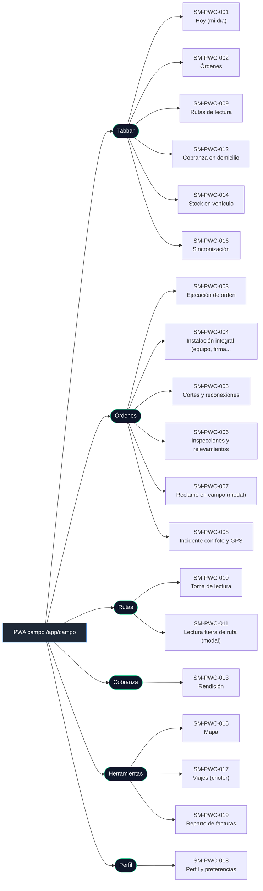

# PWA de trabajo: empleado, campo y dispositivos

Parte del entregable [22 Mapa de navegación y arquitectura de información](../22-mapa-navegacion.md) (artefacto 4.1). Generado con `_trabajo/gen_22_navegacion.py` desde T03 §10.8 y §10.9 y las pantallas (PAN) de los anexos; revisado a mano. Ante cualquier diferencia prevalece T03 y el anexo dueño de la pantalla.

Las tres superficies se sirven desde `apps/pwa`. El espacio "Mi trabajo" del empleado usa base `/app/` (AL-04); la PWA de campo usa base `/app/campo/` y es offline-first (AL-05; M10, M03, M07); los dispositivos se sirven en modo kiosco sin tabbar ni menú, con credencial de dispositivo de T02 (10.9.9).

## 1. PWA empleado

Roles: C-EMP y personal del tenant (T-*) en su espacio móvil. Tabbar (M19 §10.1, T03 §10.1.4): Inicio (PAN-POR-69) · Recibos (PAN-POR-70) · (+) · Solicitudes (PAN-POR-72 y 73) · Perfil (PAN-POR-59). Bandeja, Agenda y Avisos (SM-PWE-002, 005 y 006, antes en la tabbar) se abren desde el menú.

### Estructura de la PWA empleado

```mermaid
flowchart LR
    R_PWE["PWA empleado /app"]
    R_PWE_Tabbar(["Tabbar"])
    R_PWE --> R_PWE_Tabbar
    SM_PWE_001["SM-PWE-001<br/>Inicio (muro interno)"]
    R_PWE_Tabbar --> SM_PWE_001
    SM_PWE_013["SM-PWE-013<br/>Mis recibos de sueldo"]
    R_PWE_Tabbar --> SM_PWE_013
    SM_PWE_016["SM-PWE-016<br/>Perfil y preferencias"]
    R_PWE_Tabbar --> SM_PWE_016
    SM_PWE_018["SM-PWE-018<br/>Vacaciones y licencias"]
    R_PWE_Tabbar --> SM_PWE_018
    R_PWE_Men_(["Menú"])
    R_PWE --> R_PWE_Men_
    SM_PWE_002["SM-PWE-002<br/>Bandeja"]
    R_PWE_Men_ --> SM_PWE_002
    SM_PWE_005["SM-PWE-005<br/>Agenda"]
    R_PWE_Men_ --> SM_PWE_005
    SM_PWE_006["SM-PWE-006<br/>Avisos"]
    R_PWE_Men_ --> SM_PWE_006
    R_PWE_Trabajo(["Trabajo"])
    R_PWE --> R_PWE_Trabajo
    SM_PWE_003["SM-PWE-003<br/>Casos asignados"]
    R_PWE_Trabajo --> SM_PWE_003
    SM_PWE_004["SM-PWE-004<br/>Aprobaciones"]
    R_PWE_Trabajo --> SM_PWE_004
    SM_PWE_023["SM-PWE-023<br/>Firma de pagos"]
    R_PWE_Trabajo --> SM_PWE_023
    SM_PWE_025["SM-PWE-025<br/>Entregas de depósito"]
    R_PWE_Trabajo --> SM_PWE_025
    SM_PWE_026["SM-PWE-026<br/>Acreditación en asamblea"]
    R_PWE_Trabajo --> SM_PWE_026
    SM_PWE_027["SM-PWE-027<br/>Actos en el cementerio parque"]
    R_PWE_Trabajo --> SM_PWE_027
    R_PWE_Supervisi_n(["Supervisión"])
    R_PWE --> R_PWE_Supervisi_n
    SM_PWE_007["SM-PWE-007<br/>Pendientes sin asignar y excepciones"]
    R_PWE_Supervisi_n --> SM_PWE_007
    SM_PWE_008["SM-PWE-008<br/>Indicadores del equipo"]
    R_PWE_Supervisi_n --> SM_PWE_008
    SM_PWE_009["SM-PWE-009<br/>Publicar al equipo (modal)"]
    R_PWE_Supervisi_n --> SM_PWE_009
    SM_PWE_010["SM-PWE-010<br/>Encuesta rápida al equipo (modal)"]
    R_PWE_Supervisi_n --> SM_PWE_010
    SM_PWE_022["SM-PWE-022<br/>Mi equipo"]
    R_PWE_Supervisi_n --> SM_PWE_022
    SM_PWE_024["SM-PWE-024<br/>Posición de tesorería"]
    R_PWE_Supervisi_n --> SM_PWE_024
    R_PWE_Comunicaci_n(["Comunicación"])
    R_PWE --> R_PWE_Comunicaci_n
    SM_PWE_011["SM-PWE-011<br/>Encuestas"]
    R_PWE_Comunicaci_n --> SM_PWE_011
    SM_PWE_012["SM-PWE-012<br/>Boletines"]
    R_PWE_Comunicaci_n --> SM_PWE_012
    R_PWE_Personal(["Personal"])
    R_PWE --> R_PWE_Personal
    SM_PWE_014["SM-PWE-014<br/>Firmar recibo"]
    R_PWE_Personal --> SM_PWE_014
    SM_PWE_015["SM-PWE-015<br/>Directorio"]
    R_PWE_Personal --> SM_PWE_015
    SM_PWE_019["SM-PWE-019<br/>Mis datos y documentos"]
    R_PWE_Personal --> SM_PWE_019
    SM_PWE_020["SM-PWE-020<br/>Mis certificados"]
    R_PWE_Personal --> SM_PWE_020
    SM_PWE_021["SM-PWE-021<br/>Mis evaluaciones"]
    R_PWE_Personal --> SM_PWE_021
    R_PWE_Otros(["Otros"])
    R_PWE --> R_PWE_Otros
    SM_PWE_017["SM-PWE-017<br/>Asistente"]
    R_PWE_Otros --> SM_PWE_017
    classDef raiz fill:#1f2937,stroke:#60a5fa,color:#f9fafb;
    classDef grupo fill:#0f172a,stroke:#34d399,color:#f9fafb;
    class R_PWE raiz;
    class R_PWE_Tabbar,R_PWE_Men_,R_PWE_Trabajo,R_PWE_Supervisi_n,R_PWE_Comunicaci_n,R_PWE_Personal,R_PWE_Otros grupo;
```

### Menú, rutas y capabilities de la PWA empleado

| SM | Grupo | Ítem | Ruta canónica | Capability | Ola | PAN principal | PAN asociadas | Origen |
|---|---|---|---|---|---|---|---|---|
| SM-PWE-001 | Tabbar | Inicio (muro interno) | `/app/empleado` | `por.empleado.ver` | O2 | PAN-POR-69 | PAN-POR-75 | T03 10.8.3 y 10.9.5 |
| SM-PWE-002 | Menú | Bandeja | `/app/bandeja` | `wfl.tareas.ver` | O2 | PAN-WFL-23 | — | T03 10.8.3 y 10.9.5 |
| SM-PWE-003 | Trabajo | Casos asignados | `/app/casos` | `crm.casos.ver` | O2 | PAN-CRM-35 | — | T03 10.8.3 y 10.9.5 |
| SM-PWE-004 | Trabajo | Aprobaciones | `/app/bandeja?tipo=aprobacion` | `wfl.aprobaciones.decidir` | O1 | PAN-WFL-23 | PAN-WFL-10 | T03 10.8.3 y 10.9.5 |
| SM-PWE-005 | Menú | Agenda | `/app/agenda` | `wfl.agenda.ver` | O2 | PAN-WFL-24 | PAN-CRM-36, PAN-COM-45 | T03 10.8.3 y 10.9.5 |
| SM-PWE-006 | Menú | Avisos | `/app/empleado/avisos` | `por.empleado.ver` | O2 | PAN-POR-76 | PAN-COM-42 | T03 10.8.3 y 10.9.5 |
| SM-PWE-007 | Supervisión | Pendientes sin asignar y excepciones | `/app/bandeja?vista=equipo` | `wfl.bandeja.supervisar` | O2 | PAN-WFL-23 | PAN-WFL-02, PAN-CRM-01 | T03 10.8.3 y 10.9.5 |
| SM-PWE-008 | Supervisión | Indicadores del equipo | `/app/tablero` | `bia.tableros.ver` | O11 | PAN-BIA-25 | — | T03 10.8.3 y 10.9.5 |
| SM-PWE-009 | Supervisión | Publicar al equipo (modal) | `/app/empleado/muro` (modal publicar) | `com.posts.publicarEquipo` | O2 | PAN-COM-52 | PAN-POR-75 | T03 10.8.3 y 10.9.5 |
| SM-PWE-010 | Supervisión | Encuesta rápida al equipo (modal) | modal desde `/app/empleado/muro` y `/app/empleado/avisos` | `com.surveys.rapidaEquipo` (AL-01) | O2 | PAN-COM-52 | — | T03 10.8.3 y 10.9.5 |
| SM-PWE-011 | Comunicación | Encuestas | `/app/encuestas(/:id)` (ruta del anexo, AL-01) | `com.surveys.responder` | O2 | PAN-COM-43 | — | T03 10.8.3 y 10.9.5 |
| SM-PWE-012 | Comunicación | Boletines | `/app/novedades(/:id)` (ruta del anexo, AL-01) | `com.wall.ver` | O2 | PAN-COM-44 | PAN-POR-56 | T03 10.8.3 y 10.9.5 |
| SM-PWE-013 | Tabbar | Mis recibos de sueldo | `/app/empleado/recibos` | `sue.portal.recibos.ver` | O9 | PAN-SUE-41 | PAN-POR-70 | T03 10.8.3 y 10.9.5 |
| SM-PWE-014 | Personal | Firmar recibo | `/app/empleado/recibos/:id` | `sue.portal.recibos.ver` (capability de M16, que M19 usa en PAN-POR-71) | O9 | PAN-SUE-41 | PAN-POR-71, PAN-WFL-27 | T03 10.8.3 y 10.9.5 |
| SM-PWE-015 | Personal | Directorio | `/app/empleado/directorio` | `iam.directorio.ver` | O2 | PAN-UXD-16 | — | T03 10.8.3 y 10.9.5 |
| SM-PWE-016 | Tabbar | Perfil y preferencias | `/app/perfil` | `por.perfil.editar` | O0 | PAN-POR-59 | PAN-POR-62 | T03 10.8.3 y 10.9.5 |
| SM-PWE-017 | Otros | Asistente | `/app/asistente` | `wfl.asistente.ver` (flag) | O11 | PAN-UXD-15 | — | T03 10.8.3 y 10.9.5 |
| SM-PWE-018 | Tabbar | Vacaciones y licencias | `/app/empleado/licencias` | `sue.portal.licencias.solicitar` | O9 | PAN-SUE-42 | PAN-POR-72, PAN-POR-73 | T03 10.9.5 |
| SM-PWE-019 | Personal | Mis datos y documentos | `/app/empleado/legajo` (ruta de M19, PAN-POR-74, AL-04; `/empleado/datos` es la ruta de referencia de M16) | `sue.portal.datos.ver` | O9 | PAN-SUE-43 | PAN-POR-74 | T03 10.9.5 |
| SM-PWE-020 | Personal | Mis certificados | `/app/empleado/certificados` | `sue.portal.certificados.ver` | O9 | PAN-SUE-45 | — | T03 10.9.5 |
| SM-PWE-021 | Personal | Mis evaluaciones | `/app/empleado/evaluaciones` | `sue.portal.evaluaciones.autoevaluar` | O9 | PAN-SUE-46 | — | T03 10.9.5 |
| SM-PWE-022 | Supervisión | Mi equipo | `/app/empleado/equipo` | `sue.equipo.ver` | O9 | PAN-SUE-44 | — | T03 10.9.5 |
| SM-PWE-023 | Trabajo | Firma de pagos | `/app/tesoreria/firmas` | `tes.pagos.firmar` | O8 | PAN-TES-40 | — | T03 10.9.5 |
| SM-PWE-024 | Supervisión | Posición de tesorería | `/app/tesoreria/posicion` | `tes.posicion.ver` | O8 | PAN-TES-41 | — | T03 10.9.5 |
| SM-PWE-025 | Trabajo | Entregas de depósito | `/app/deposito/entregas` | `stk.entregas.crear` | O3 | PAN-STK-41 | — | T03 10.9.5 |
| SM-PWE-026 | Trabajo | Acreditación en asamblea | `/app/ins/acreditacion/:meetingId` | `ins.asistencia.registrar` | O10 | PAN-INS-20 | — | T03 10.9.5 |
| SM-PWE-027 | Trabajo | Actos en el cementerio parque | `/app/soc/cementerio/actos` | `soc.actos.registrar` | O10 | PAN-SOC-35 | — | T03 10.9.5 |

### Capabilities de acceso de la PWA empleado

| Prefijo (módulo) | Ítems | Capabilities de acceso |
|---|---|---|
| `bia` | 1 | `bia.tableros.ver` |
| `com` | 4 | `com.posts.publicarEquipo`, `com.surveys.rapidaEquipo`, `com.surveys.responder`, `com.wall.ver` |
| `crm` | 1 | `crm.casos.ver` |
| `iam` | 1 | `iam.directorio.ver` |
| `ins` | 1 | `ins.asistencia.registrar` |
| `por` | 3 | `por.empleado.ver`, `por.perfil.editar` |
| `soc` | 1 | `soc.actos.registrar` |
| `stk` | 1 | `stk.entregas.crear` |
| `sue` | 7 | `sue.equipo.ver`, `sue.portal.certificados.ver`, `sue.portal.datos.ver`, `sue.portal.evaluaciones.autoevaluar`, `sue.portal.licencias.solicitar`, `sue.portal.recibos.ver` |
| `tes` | 2 | `tes.pagos.firmar`, `tes.posicion.ver` |
| `wfl` | 5 | `wfl.agenda.ver`, `wfl.aprobaciones.decidir`, `wfl.asistente.ver`, `wfl.bandeja.supervisar`, `wfl.tareas.ver` |

## 2. PWA campo

Roles: T-TEC, T-LEC y T-CBR, más chofer (M18) y repartidor (M05). La tabbar de la maestra §9.3 es Hoy, Órdenes / Rutas / Cobranza según el rol, Nuevo (FAB contextual), Stock en vehículo y Sincronización. El FAB "Nuevo" no tiene ítem propio: abre el menú de altas del rol (T03 RF-UXD-067 y §10.1.4), por ejemplo reclamo en campo (SM-PWC-007), incidente u OT nueva (SM-PWC-008) y lectura fuera de ruta (SM-PWC-011).

### Estructura de la PWA campo

### Menú, rutas y capabilities de la PWA campo

| SM | Grupo | Ítem | Ruta canónica | Capability | Ola | Rol | PAN principal | PAN asociadas | Origen |
|---|---|---|---|---|---|---|---|---|---|
| SM-PWC-001 | Tabbar | Hoy (mi día) | `/app/campo/today` | cualquiera de las capabilities de campo (M10, `med.campo.leer`, `cob.cobranzaCampo.ver`) | med.campo.leer (antes med.campo.ver) \ | cob.cobranzaCampo.ver (antes cob.campo.ver) | PAN-TEC-50 | PAN-POR-77, PAN-TEC-60 | T03 10.8.4 y 10.9.6 |
| SM-PWC-002 | Tabbar | Órdenes | `/app/campo/today?vista=ordenes` | `tec.ordenes.ver` | O3 | técnico | PAN-TEC-50 | — | T03 10.8.4 y 10.9.6 |
| SM-PWC-003 | Órdenes | Ejecución de orden | `/app/campo/work-orders/:id` | `tec.campo.ejecutar` (PAN-TEC-51, AL-01) | O3 | técnico | PAN-TEC-51 | PAN-STK-38, PAN-VEN-07, PAN-WFL-28 | T03 10.8.4 y 10.9.6 |
| SM-PWC-004 | Órdenes | Instalación integral (equipo, firma, encuesta) | `/app/campo/work-orders/:id?tipo=instalacion` | `tec.ordenes.editar` | O3 | técnico | PAN-TEC-51 | PAN-TEC-25 | T03 10.8.4 y 10.9.6 |
| SM-PWC-005 | Órdenes | Cortes y reconexiones | `/app/campo/work-orders/:id?tipo=corte` | `tec.ordenes.editar` | O6 | técnico | PAN-TEC-51 | PAN-MOR-27 | T03 10.8.4 y 10.9.6 |
| SM-PWC-006 | Órdenes | Inspecciones y relevamientos | `/app/campo/inspections/:id` | `tec.inspecciones.editar` (PAN-TEC-54, AL-01) | O3 | técnico | PAN-TEC-54 | PAN-TEC-41 | T03 10.8.4 y 10.9.6 |
| SM-PWC-007 | Órdenes | Reclamo en campo (modal) | modal | `crm.casos.crear` | O3 | técnico | PAN-CRM-04 | — | T03 10.8.4 y 10.9.6 |
| SM-PWC-008 | Órdenes | Incidente con foto y GPS | `/app/campo/work-orders/new` | `tec.campo.crearOrden` (PAN-TEC-55, AL-01) | O3 | todos | PAN-TEC-55 | PAN-CRM-07 | T03 10.8.4 y 10.9.6 |
| SM-PWC-009 | Tabbar | Rutas de lectura | `/app/campo/lecturas` | `med.campo.leer` | O7 | lecturista | PAN-MED-28 | — | T03 10.8.4 y 10.9.6 |
| SM-PWC-010 | Rutas | Toma de lectura | `/app/campo/lecturas/:batchId/:taskId` | `med.campo.leer` | O7 | lecturista | PAN-MED-29 | — | T03 10.8.4 y 10.9.6 |
| SM-PWC-011 | Rutas | Lectura fuera de ruta (modal) | modal | `med.campo.leer` | O7 | lecturista | PAN-MED-29 | — | T03 10.8.4 y 10.9.6 |
| SM-PWC-012 | Tabbar | Cobranza en domicilio | `/app/campo/cobrador` | `cob.cobranzaCampo.ver` | O5 | cobrador | PAN-COB-29 | — | T03 10.8.4 y 10.9.6 |
| SM-PWC-013 | Cobranza | Rendición | `/app/campo/cobrador?tab=rendicion` | `cob.cobranzaCampo.ver` | O5 | cobrador | PAN-COB-29 | PAN-COB-13 | T03 10.8.4 y 10.9.6 |
| SM-PWC-014 | Tabbar | Stock en vehículo | `/app/campo/mi-stock` | `stk.miStock.ver` | O3 | técnico | PAN-STK-37 | PAN-TEC-52, PAN-STK-39 | T03 10.8.4 y 10.9.6 |
| SM-PWC-015 | Herramientas | Mapa | `/app/campo/map` | `tec.campo.ver` (PAN-TEC-56, AL-01) | O3 | todos | PAN-TEC-56 | — | T03 10.8.4 y 10.9.6 |
| SM-PWC-016 | Tabbar | Sincronización | `/app/campo/sync` | sesión de campo | med.campo.leer (antes med.campo.ver) \ | cob.cobranzaCampo.ver (antes cob.campo.ver) | PAN-TEC-53 | PAN-MED-30 | T03 10.8.4 y 10.9.6 |
| SM-PWC-017 | Herramientas | Viajes (chofer) | `/app/campo/viajes` | `soc.mi.viajes.ver` | O10 | chofer | PAN-SOC-34 | — | T03 10.8.4 y 10.9.6 |
| SM-PWC-018 | Perfil | Perfil y preferencias | `/app/perfil` | `por.perfil.editar` | O0 | todos | PAN-POR-59 | — | T03 10.8.4 y 10.9.6 |
| SM-PWC-019 | Herramientas | Reparto de facturas | `/app/campo/reparto` | `fac.reparto.registrarEntrega` | O4 | repartidor | PAN-FAC-46 | — | T03 10.9.6 |

### Capabilities de acceso de la PWA campo

| Prefijo (módulo) | Ítems | Capabilities de acceso |
|---|---|---|
| `cob` | 3 | `cob.cobranzaCampo.ver` |
| `crm` | 1 | `crm.casos.crear` |
| `fac` | 1 | `fac.reparto.registrarEntrega` |
| `med` | 4 | `med.campo.leer` |
| `por` | 1 | `por.perfil.editar` |
| `soc` | 1 | `soc.mi.viajes.ver` |
| `stk` | 1 | `stk.miStock.ver` |
| `tec` | 7 | `tec.campo.crearOrden`, `tec.campo.ejecutar`, `tec.campo.ver`, `tec.inspecciones.editar`, `tec.ordenes.editar`, `tec.ordenes.ver` |

Ítems sin capability propia (sesión, acceso público, token o credencial de dispositivo; AL-08): SM-PWC-016.

## 3. Superficies de dispositivo

Actor S-KSK (dispositivo kiosco, tótem o turnero).

| SM | Ítem | Ruta canónica | Acceso | Ola | PAN principal | PAN asociadas | Origen |
|---|---|---|---|---|---|---|---|
| SM-DSP-001 | Tótem de autoservicio y turnos | `/totem` | por.totem.operar (identidad del dispositivo, M19 PAN-POR-78) | O5 | PAN-POR-78 | PAN-POR-79, PAN-POR-80, PAN-POR-81, PAN-POR-82, PAN-POR-83, PAN-CRM-26 | T03 10.9.9 |
| SM-DSP-002 | Pantalla de llamados del turnero | `/pantalla/:displayId` | Token de pantalla | O10 | PAN-CRM-25 | — | T03 10.9.9 |
