# Consola de plataforma

Parte del entregable [22 Mapa de navegación y arquitectura de información](../22-mapa-navegacion.md) (artefacto 4.1). Generado con `_trabajo/gen_22_navegacion.py` desde T03 §10.8 y §10.9 y las pantallas (PAN) de los anexos; revisado a mano. Ante cualquier diferencia prevalece T03 y el anexo dueño de la pantalla.

AdminShell con contexto `PLATFORM` y estética diferenciada (maestra §10), rutas `meta.platformOnly` con base canónica `/admin/plataforma/` (T03 AL-03, T01). Roles del espacio plataforma (P-*), con MFA; el acceso a datos de un tenant requiere acceso de soporte vigente (T02).

## Estructura de la consola de plataforma

```mermaid
flowchart LR
    R_PLT["Plataforma /admin/plataforma"]
    R_PLT_Inicio(["Inicio"])
    R_PLT --> R_PLT_Inicio
    SM_PLT_001["SM-PLT-001<br/>Dashboard global"]
    R_PLT_Inicio --> SM_PLT_001
    R_PLT_Cooperativas(["Cooperativas"])
    R_PLT --> R_PLT_Cooperativas
    SM_PLT_002["SM-PLT-002<br/>Tenants"]
    R_PLT_Cooperativas --> SM_PLT_002
    SM_PLT_003["SM-PLT-003<br/>Alta asistida de tenant"]
    R_PLT_Cooperativas --> SM_PLT_003
    SM_PLT_004["SM-PLT-004<br/>Licencias y packs"]
    R_PLT_Cooperativas --> SM_PLT_004
    SM_PLT_005["SM-PLT-005<br/>Contratos SaaS"]
    R_PLT_Cooperativas --> SM_PLT_005
    SM_PLT_021["SM-PLT-021<br/>Proyectos de migración"]
    R_PLT_Cooperativas --> SM_PLT_021
    SM_PLT_022["SM-PLT-022<br/>Uso por tenant"]
    R_PLT_Cooperativas --> SM_PLT_022
    R_PLT_Cat_logos(["Catálogos"])
    R_PLT --> R_PLT_Cat_logos
    SM_PLT_006["SM-PLT-006<br/>Catálogo de módulos"]
    R_PLT_Cat_logos --> SM_PLT_006
    SM_PLT_007["SM-PLT-007<br/>Catálogo global de servicios y..."]
    R_PLT_Cat_logos --> SM_PLT_007
    SM_PLT_008["SM-PLT-008<br/>Tablas comunes (fiscales, índices..."]
    R_PLT_Cat_logos --> SM_PLT_008
    SM_PLT_009["SM-PLT-009<br/>Conectores de integración"]
    R_PLT_Cat_logos --> SM_PLT_009
    R_PLT_Operaci_n(["Operación"])
    R_PLT --> R_PLT_Operaci_n
    SM_PLT_010["SM-PLT-010<br/>Soporte y accesos temporales"]
    R_PLT_Operaci_n --> SM_PLT_010
    SM_PLT_011["SM-PLT-011<br/>Salud del sistema"]
    R_PLT_Operaci_n --> SM_PLT_011
    SM_PLT_012["SM-PLT-012<br/>Colas y jobs"]
    R_PLT_Operaci_n --> SM_PLT_012
    SM_PLT_013["SM-PLT-013<br/>Respaldos y restauración"]
    R_PLT_Operaci_n --> SM_PLT_013
    SM_PLT_014["SM-PLT-014<br/>Ambientes"]
    R_PLT_Operaci_n --> SM_PLT_014
    SM_PLT_015["SM-PLT-015<br/>Versiones del producto"]
    R_PLT_Operaci_n --> SM_PLT_015
    SM_PLT_023["SM-PLT-023<br/>Avisos de plataforma"]
    R_PLT_Operaci_n --> SM_PLT_023
    SM_PLT_024["SM-PLT-024<br/>Consumo de mensajería"]
    R_PLT_Operaci_n --> SM_PLT_024
    SM_PLT_025["SM-PLT-025<br/>Monitoreo de BI y API"]
    R_PLT_Operaci_n --> SM_PLT_025
    R_PLT_Seguridad(["Seguridad"])
    R_PLT --> R_PLT_Seguridad
    SM_PLT_016["SM-PLT-016<br/>Usuarios de plataforma"]
    R_PLT_Seguridad --> SM_PLT_016
    SM_PLT_017["SM-PLT-017<br/>Auditoría de plataforma"]
    R_PLT_Seguridad --> SM_PLT_017
    R_PLT_Experiencia(["Experiencia"])
    R_PLT --> R_PLT_Experiencia
    SM_PLT_018["SM-PLT-018<br/>Diccionario base y plantillas"]
    R_PLT_Experiencia --> SM_PLT_018
    SM_PLT_019["SM-PLT-019<br/>Design system"]
    R_PLT_Experiencia --> SM_PLT_019
    SM_PLT_020["SM-PLT-020<br/>Flags globales"]
    R_PLT_Experiencia --> SM_PLT_020
    classDef raiz fill:#1f2937,stroke:#60a5fa,color:#f9fafb;
    classDef grupo fill:#0f172a,stroke:#34d399,color:#f9fafb;
    class R_PLT raiz;
    class R_PLT_Inicio,R_PLT_Cooperativas,R_PLT_Cat_logos,R_PLT_Operaci_n,R_PLT_Seguridad,R_PLT_Experiencia grupo;
```

## Menú, rutas y capabilities de la plataforma

| SM | Grupo | Ítem | Ruta canónica | Capability | Ola | PAN principal | PAN asociadas | Origen |
|---|---|---|---|---|---|---|---|---|
| SM-PLT-001 | Inicio | Dashboard global | `/admin/plataforma/dashboard` | `pla.dashboard.ver` | O1 | PAN-PLA-01 | — | T03 10.8.6 y 10.9.8 |
| SM-PLT-002 | Cooperativas | Tenants | `/admin/plataforma/tenants` | `pla.tenants.ver` | O1 | PAN-PLA-02 | PAN-PLA-03 | T03 10.8.6 y 10.9.8 |
| SM-PLT-003 | Cooperativas | Alta asistida de tenant | `/admin/plataforma/tenants/alta` | `pla.altaAsistida.usar` | O1 | PAN-PLA-04 | — | T03 10.8.6 y 10.9.8 |
| SM-PLT-004 | Cooperativas | Licencias y packs | `/admin/plataforma/planes` | `pla.planes.ver` | O1 | PAN-PLA-06 | PAN-CAT-02 | T03 10.8.6 y 10.9.8 |
| SM-PLT-005 | Cooperativas | Contratos SaaS | `/admin/plataforma/contratos` | `pla.contratos.ver` | O1 | PAN-PLA-07 | — | T03 10.8.6 y 10.9.8 |
| SM-PLT-006 | Catálogos | Catálogo de módulos | `/admin/plataforma/catalogo` | `pla.catalogo.ver` | O1 | PAN-PLA-05 | — | T03 10.8.6 y 10.9.8 |
| SM-PLT-007 | Catálogos | Catálogo global de servicios y plantillas | `/admin/plataforma/cat/capabilities` | `cat.capacidades.ver` | O2 | PAN-CAT-01 | PAN-CFG-24 | T03 10.8.6 y 10.9.8 |
| SM-PLT-008 | Catálogos | Tablas comunes (fiscales, índices, geografía) | `/admin/plataforma/cfg/tablas` | `pla.cfg.tablasPlataforma.editar` | O1 | PAN-CFG-26 | PAN-FIS-01, PAN-FIS-02, PAN-SUE-47, PAN-CFG-25, PAN-CFG-27 | T03 10.8.6 y 10.9.8 |
| SM-PLT-009 | Catálogos | Conectores de integración | `/admin/plataforma/integraciones/proveedores` | `int.proveedores.configurar` | O1 | PAN-INT-01 | PAN-INT-05, PAN-INT-13 | T03 10.8.6 y 10.9.8 |
| SM-PLT-010 | Operación | Soporte y accesos temporales | `/admin/plataforma/soporte/casos` | `pla.soporte.ver` | O1 | PAN-PLA-21 | PAN-PLA-08, PAN-IAM-27 | T03 10.8.6 y 10.9.8 |
| SM-PLT-011 | Operación | Salud del sistema | `/admin/plataforma/salud` | `nfr.saludPlataforma.ver` | O0 | PAN-NFR-11 | PAN-PLA-25, PAN-NFR-12, PAN-PLA-13, PAN-NFR-15, PAN-PLA-12 | T03 10.8.6 y 10.9.8 |
| SM-PLT-012 | Operación | Colas y jobs | `/admin/plataforma/operacion/jobs` | `pla.jobs.ver` | O0 | PAN-PLA-09 | — | T03 10.8.6 y 10.9.8 |
| SM-PLT-013 | Operación | Respaldos y restauración | `/admin/plataforma/operacion/backups` | `pla.backups.ver` | O1 | PAN-PLA-10 | PAN-PLA-11, PAN-NFR-13 | T03 10.8.6 y 10.9.8 |
| SM-PLT-014 | Operación | Ambientes | `/admin/plataforma/sandboxes` | `pla.sandbox.crear` | O1 | PAN-PLA-14 | — | T03 10.8.6 y 10.9.8 |
| SM-PLT-015 | Operación | Versiones del producto | `/admin/plataforma/releases` | `pla.releases.ver` | O1 | PAN-PLA-20 | — | T03 10.8.6 y 10.9.8 |
| SM-PLT-016 | Seguridad | Usuarios de plataforma | `/admin/plataforma/iam/usuarios` | `iam.plataforma.usuarios.gestionar` | O1 | PAN-IAM-26 | — | T03 10.8.6 y 10.9.8 |
| SM-PLT-017 | Seguridad | Auditoría de plataforma | `/admin/plataforma/seguridad` | `iam.plataforma.auditoria.ver` | O1 | PAN-IAM-28 | PAN-NFR-14, PAN-NFR-16, PAN-NFR-17 | T03 10.8.6 y 10.9.8 |
| SM-PLT-018 | Experiencia | Diccionario base y plantillas | `/admin/plataforma/experiencia/diccionario-base` | `uxd.plataforma.diccionarioBase.ver` | O0 | PAN-UXD-09 | — | T03 10.8.6 y 10.9.8 |
| SM-PLT-019 | Experiencia | Design system | `/admin/plataforma/experiencia/design-system` | `uxd.plataforma.tokens.ver` | O0 | PAN-UXD-10 | — | T03 10.8.6 y 10.9.8 |
| SM-PLT-020 | Experiencia | Flags globales | `/admin/plataforma/experiencia/flags` | `uxd.plataforma.flags.configurar` | O0 | PAN-UXD-11 | — | T03 10.8.6 y 10.9.8 |
| SM-PLT-021 | Cooperativas | Proyectos de migración | `/admin/plataforma/migrations` | `mig.proyectos.ver` | O11 | PAN-MIG-01 | PAN-MIG-02, PAN-MIG-03, PAN-MIG-04, PAN-MIG-05, PAN-MIG-07, PAN-MIG-09, PAN-MIG-22 | T03 10.9.8 |
| SM-PLT-022 | Cooperativas | Uso por tenant | `/admin/plataforma/uso` | `pla.uso.ver` | O1 | PAN-PLA-22 | — | T03 10.9.8 |
| SM-PLT-023 | Operación | Avisos de plataforma | `/admin/plataforma/avisos` | `pla.notices.publicar` | O1 | PAN-COM-33 | — | T03 10.9.8 |
| SM-PLT-024 | Operación | Consumo de mensajería | `/admin/plataforma/mensajeria` | `pla.messaging.consumo.ver` | O2 | PAN-COM-34 | — | T03 10.9.8 |
| SM-PLT-025 | Operación | Monitoreo de BI y API | `/admin/plataforma/bia` | `pla.bia.api.monitorear` | O11 | PAN-BIA-23 | — | T03 10.9.8 |

## Capabilities de acceso de la plataforma

| Prefijo (módulo) | Ítems | Capabilities de acceso |
|---|---|---|
| `cat` | 1 | `cat.capacidades.ver` |
| `iam` | 2 | `iam.plataforma.auditoria.ver`, `iam.plataforma.usuarios.gestionar` |
| `int` | 1 | `int.proveedores.configurar` |
| `mig` | 1 | `mig.proyectos.ver` |
| `nfr` | 1 | `nfr.saludPlataforma.ver` |
| `pla` | 16 | `pla.altaAsistida.usar`, `pla.backups.ver`, `pla.bia.api.monitorear`, `pla.catalogo.ver`, `pla.cfg.tablasPlataforma.editar`, `pla.contratos.ver`, `pla.dashboard.ver`, `pla.jobs.ver`, `pla.messaging.consumo.ver`, `pla.notices.publicar`, `pla.planes.ver`, `pla.releases.ver`, `pla.sandbox.crear`, `pla.soporte.ver`, `pla.tenants.ver`, `pla.uso.ver` |
| `uxd` | 3 | `uxd.plataforma.diccionarioBase.ver`, `uxd.plataforma.flags.configurar`, `uxd.plataforma.tokens.ver` |
