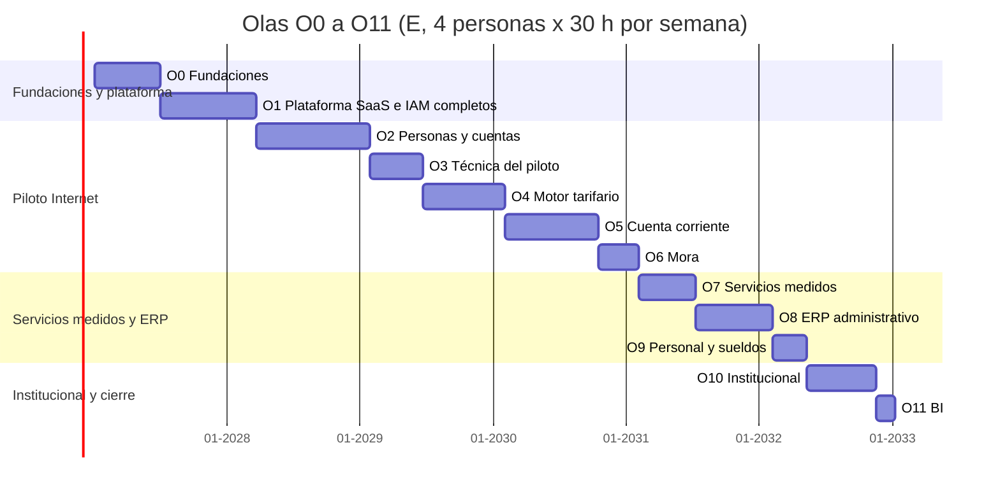

# 23. Estimación de esfuerzo por prompt y por ola

Entregable del artefacto 10.1. Estima el esfuerzo de los 172 prompts del plan de construcción (`docs/especificacion/03-plan-de-olas-y-prompts.md`), agrupados en las olas O0 a O11, con un método de puntos reproducible y un rango optimista, probable y pesimista (PERT). Es una estimación paramétrica de referencia para planificar: **no es un compromiso de plazo ni una cotización**. Todas las cifras dependen de los supuestos de la sección 2, que son parámetros a calibrar. Generado con `_trabajo/gen_23_estimacion.py`; ante cualquier diferencia prevalece la especificación.

## 1. Método

1. **Universo.** Los 172 prompts `PRO-Ox-NN` del plan (no se estiman los 3 prompts generales reutilizables PRO-GEN, que no construyen RF). Para cada prompt se leen los IDs de la línea `IMPLEMENTAR:`; el texto entre paréntesis o corchetes es aclaración y no se cuenta.
2. **RF nuevos y extensiones.** Un RF cuenta como nuevo en el primer prompt que lo cita, igual que la regla 6 del plan ("un RF cuenta una sola vez, en la ola donde empieza"). Si otro prompt lo vuelve a citar ("extensión de …"), suma una fracción de su peso.
3. **Puntos.** Por prompt: suma de pesos de sus RF nuevos según la prioridad del anexo (Núcleo, Estándar, Extensión), más las extensiones, más los RNF citados, más los artefactos que construye: colecciones a crear de T05, pantallas (PAN), endpoints (API) e integraciones (fichas FI-INT de T06).
4. **Reparto de artefactos.** Los anexos no asignan ola a PAN y API (regla 4 del plan: se construyen en el primer prompt que los necesita). Se reparten entre los prompts en proporción a los RF del anexo que construye cada uno. Las colecciones se reparten entre los prompts de su ola (T05 §7.9) con RF del anexo dueño; si ninguno tiene RF de ese anexo en esa ola, van al prompt de la ola que cita el anexo con más RF. Cada integración va al prompt que cita su ficha `FI-INT-NN` (preferentemente de su ola); si ningún prompt la cita, al prompt de su ola (T06, fila "Ola / Prioridad") cuyo título u objetivo comparte términos con el grupo y el nombre de la ficha (por ejemplo "pasarelas"), y si no hay, al prompt de su ola con más RF del módulo dueño.
5. **Prompts de integración de ola.** Los que no construyen RF propios (por ejemplo PRO-O0-21 "0 (verifica 305)") reciben una fracción fija de los puntos del resto de la ola.
6. **Horas y PERT.** Probable M = puntos × horas por punto. Optimista O = factor optimista × M. Pesimista P = M × (factor base + recargo por la fracción de RF en estado "A validar" + recargo por integración, con tope). Esperado E = (O + 4M + P) / 6; desviación σ = (P − O) / 6. Por ola y en total, σ = raíz de la suma de σ² (prompts independientes). P80 ≈ E + 0,84 σ.
7. **Duración.** Semanas = E / (personas × horas productivas por semana). El gantt encadena las olas por sus dependencias (§1 del plan) con un único equipo.

## 2. Supuestos y parámetros

Ningún valor de esta tabla sale de la especificación: son supuestos declarados para que el cálculo sea reproducible. Para recalcular, cambiar el valor en `_trabajo/gen_23_estimacion.py` y volver a ejecutarlo. La velocidad del equipo (horas por punto, personas y horas productivas) debe calibrarse con los primeros prompts de O0.

| Parámetro | Valor | Significado |
|---|---|---|
| Peso RF Núcleo / Estándar / Extensión | 3,0 / 2,0 / 1,0 puntos | Complejidad relativa por prioridad del anexo |
| Peso de extensión | 0,25 del peso del RF | RF ya construido que otro prompt amplía |
| Peso RNF | 1,0 punto | Requisito no funcional citado en el prompt |
| Peso colección | 2,0 puntos | Esquema, validador, índices y prueba de aislamiento (T05 CU-DAT-01) |
| Peso pantalla (PAN) | 1,5 puntos | Pantalla con estados, filtros, modales y ayuda (T03) |
| Peso endpoint (API) | 0,5 puntos | Contrato, validación y prueba |
| Peso integración (FI-INT) | 6,0 puntos | Conector con simulador, reintentos e idempotencia (T06) |
| Fracción para prompts de integración de ola | 0,10 | De los puntos del resto de la ola |
| Horas por punto | 2,0 h-persona | **Supuesto de velocidad; calibrar** |
| Factor optimista | 0,75 | O = factor × M |
| Factor pesimista base | 1,60 | Retrabajo, revisión y pruebas no previstas |
| Recargo por RF "A validar" | + 0,80 × fracción | Requisitos sujetos a preguntas abiertas (PA) |
| Recargo por integración | + 0,05 por FI-INT, tope 0,40 | Dependencia de terceros (homologación, credenciales) |
| Personas | 4 | Desarrollo dedicado, un solo equipo; **supuesto** |
| Horas productivas por persona y semana | 30 | **Supuesto** (descuenta reuniones, soporte y ausencias) |
| Inicio del gantt | 2027-01-04 | Fecha ficticia, solo para dibujar |

Otros supuestos: el esfuerzo incluye desarrollo asistido con Cursor, revisión, pruebas automatizadas y PR según R1–R20 del plan; no incluye gestión de proyecto, homologaciones externas (ARCA, bancos, entes), migración real de datos de cooperativas, capacitación ni soporte posterior. Las olas se ejecutan en secuencia; la paralelización posible se comenta en la sección 6.

## 3. Resumen por ola

| Ola | Contenido | Prompts | RF nuevos | RNF | Colecciones | PAN | API | FI-INT | Puntos | O (h) | M (h) | P (h) | E (h) | σ (h) | Semanas (E) | Semanas (P80) |
|---|---|---|---|---|---|---|---|---|---|---|---|---|---|---|---|---|
| O0 | Fundaciones | 21 | 305 | 144 | 63 | 54 | 127 | 3 | 1.460 | 2.190 | 2.920 | 4.733 | 3.101 | 102 | 25,8 | 26,6 |
| O1 | Plataforma SaaS e IAM completos | 20 | 458 | 72 | 134 | 111 | 270 | 5 | 2.089 | 3.134 | 4.178 | 7.065 | 4.485 | 158 | 37,4 | 38,5 |
| O2 | Personas y cuentas | 19 | 614 | 15 | 138 | 173 | 348 | 3 | 2.505 | 3.758 | 5.011 | 8.300 | 5.350 | 187 | 44,6 | 45,9 |
| O3 | Técnica del piloto | 13 | 319 | 9 | 64 | 85 | 120 | 10 | 1.160 | 1.740 | 2.321 | 3.929 | 2.492 | 113 | 20,8 | 21,6 |
| O4 | Motor tarifario | 16 | 424 | 23 | 96 | 107 | 254 | 10 | 1.806 | 2.710 | 3.613 | 6.133 | 3.882 | 152 | 32,4 | 33,4 |
| O5 | Cuenta corriente | 14 | 469 | 13 | 104 | 108 | 240 | 19 | 2.030 | 3.045 | 4.060 | 7.085 | 4.395 | 199 | 36,6 | 38,0 |
| O6 | Mora | 11 | 244 | 2 | 35 | 51 | 109 | 1 | 874 | 1.311 | 1.748 | 2.966 | 1.879 | 88 | 15,7 | 16,3 |
| O7 | Servicios medidos | 12 | 298 | 1 | 72 | 80 | 153 | 13 | 1.231 | 1.846 | 2.462 | 4.278 | 2.662 | 127 | 22,2 | 23,1 |
| O8 | ERP administrativo | 15 | 462 | 1 | 99 | 112 | 256 | 17 | 1.694 | 2.540 | 3.387 | 5.947 | 3.673 | 157 | 30,6 | 31,7 |
| O9 | Personal y sueldos | 9 | 163 | 0 | 65 | 53 | 97 | 1 | 747 | 1.121 | 1.495 | 2.486 | 1.598 | 83 | 13,3 | 13,9 |
| O10 | Institucional | 14 | 383 | 6 | 125 | 99 | 187 | 15 | 1.490 | 2.236 | 2.981 | 5.262 | 3.237 | 149 | 27,0 | 28,0 |
| O11 | BI | 8 | 65 | 6 | 62 | 17 | 61 | 9 | 416 | 624 | 832 | 1.526 | 913 | 67 | 7,6 | 8,1 |
| **Total** | | **172** | **4.204** | **292** | **1.057** | **1.051** | **2.223** | **106** | **17.504** | **26.256** | **35.008** | **59.711** | **37.666** | **477** | **313,9** | **317,2** |

Con los supuestos de la sección 2, el esfuerzo esperado total es de unas 37.666 horas-persona (rango optimista 26.256 a pesimista 59.711), equivalente a 313,9 semanas de un equipo de 4 personas (72,5 meses aproximadamente). La σ total es baja porque supone prompts independientes; el riesgo real es mayor si un supuesto sistemático (por ejemplo, las horas por punto) está mal calibrado, por eso la sección 5 muestra la sensibilidad.

## 4. Hoja de ruta (gantt)

Duraciones con el esfuerzo esperado E y la capacidad de la sección 2. O8 se encadena después de O7 (dependencia recomendada en el plan); O10 después de O9.

| Ola | Depende de (plan §1) | Hito de salida | Semanas (E) | Semanas acumuladas |
|---|---|---|---|---|
| O0 | — | Tenant demo con login, menú vacío filtrado por capability y suite de aislamiento verde en CI | 25,8 | 25,8 |
| O1 | O0 | Alta asistida de una cooperativa con usuarios, roles y configuración publicada | 37,4 | 63,2 |
| O2 | O0, O1 | Un socio se registra en la landing y solicita Internet; el contrato queda `requested` | 44,6 | 107,8 |
| O3 | O2 | El servicio queda instalado, con ONT en comodato y aprovisionamiento confirmado | 20,8 | 128,6 |
| O4 | O3 | Primera factura electrónica con CAE (ESC-SRV-INT-01) | 32,4 | 160,9 |
| O5 | O4 | Pago online imputado, rendido y asentado | 36,6 | 197,5 |
| O6 | O5 | **Piloto Internet completo de punta a punta** (DEC-005) | 15,7 | 213,2 |
| O7 | O6 | Facturación de energía con lecturas; herramientas de paralelo y corte comercial listas para electricidad, gas y prepago de la piloto (DEC-089) | 22,2 | 235,4 |
| O8 | O5, O7 | Cierre contable mensual | 30,6 | 266,0 |
| O9 | O8 | Liquidación mensual con F.931 y LSD, en paralelo dos períodos (DEC-058) | 13,3 | 279,3 |
| O10 | O8, O9 | Asamblea y servicios sociales operativos | 27,0 | 306,3 |
| O11 | O10 | Corte administrativo y apagado de ProCoop en una cooperativa (DEC-089; antes "Corte comercial y luego corte administrativo de ProCoop en una cooperativa") | 7,6 | 313,9 |

## 5. Sensibilidad a los supuestos de velocidad

Semanas totales (esperado E) según horas por punto y tamaño del equipo, con 30 horas productivas por persona y semana.

| Horas por punto | 3 personas | 4 personas | 6 personas | 8 personas |
|---|---|---|---|---|
| 1,5 | 313,9 | 235,4 | 156,9 | 117,7 |
| 2,0 | 418,5 | 313,9 | 209,3 | 156,9 |
| 2,5 | 523,1 | 392,4 | 261,6 | 196,2 |
| 3,0 | 627,8 | 470,8 | 313,9 | 235,4 |

El tamaño de equipo no escala linealmente en la práctica (coordinación, revisiones, dependencias entre prompts de la misma ola); la tabla es una cota inferior para equipos grandes.

## 6. Paralelización posible

- O7 (servicios medidos) y O8 (ERP administrativo) dependen de O5; el plan recomienda O7 antes de O8, pero con dos equipos pueden solaparse, siempre que M15 y M14 de O8 no requieran tarifas medidas de O7.
- O9 (sueldos) y la parte de O10 que no usa honorarios ni legajos pueden avanzar en paralelo después de O8.
- Dentro de una ola, los prompts siguen el orden del plan; los que tocan anexos distintos sin dependencias de colecciones pueden repartirse entre personas.

## 7. Detalle por prompt

Columnas: RF nuevos por prioridad (N Núcleo, E Estándar, X Extensión), extensiones (RF ya construidos que el prompt amplía), RNF citados, artefactos repartidos (colecciones, PAN, API) e integraciones asignadas; puntos y horas O, M, P, E. "RF plan" es la columna RF de la tabla de secuencia de la ola en el plan.

### O0 — Fundaciones

| Prompt | Título | RF plan | RF nuevos (N/E/X) | Ext. | RNF | Col. | PAN | API | FI-INT | Puntos | O (h) | M (h) | P (h) | E (h) |
|---|---|---|---|---|---|---|---|---|---|---|---|---|---|---|
| PRO-O0-01 | Monorepo, monolito modular, Docker y ambientes | 19 | 19 (18/1/0) | 0 | 11 | 4,0 | 3,1 | 7,7 | 0 | 83,4 | 125 | 167 | 267 | 177 |
| PRO-O0-02 | CI/CD, estrategia de pruebas y trazabilidad | 4 | 4 (4/0/0) | 0 | 37 | 1,9 | 1,3 | 3,2 | 0 | 56,2 | 84 | 112 | 180 | 119 |
| PRO-O0-03 | Núcleo compartido: Zod, errores RFC 9457, paginación, dinero, fechas... | 4 | 4 (4/0/0) | 0 | 23 | 1,0 | 1,0 | 2,3 | 0 | 39,7 | 60 | 79 | 127 | 84 |
| PRO-O0-04 | Multitenancy forzada y aislamiento | 21 | 21 (21/0/0) | 0 | 6 | 4,4 | 3,2 | 8,5 | 0 | 86,9 | 130 | 174 | 278 | 184 |
| PRO-O0-05 | Observabilidad, salud y continuidad base | 6 | 6 (5/1/0) | 0 | 26 | 1,2 | 1,0 | 2,6 | 0 | 48,3 | 72 | 97 | 154 | 102 |
| PRO-O0-06 | Seguridad HTTP, cifrado y cargas seguras | 3 | 3 (1/2/0) | 0 | 25 | 3,8 | 2,2 | 5,3 | 0 | 45,4 | 68 | 91 | 145 | 96 |
| PRO-O0-07 | Outbox y bus de eventos de dominio | 13 | 13 (13/0/0) | 0 | 3 | 6,5 | 2,4 | 7,4 | 1 (61) | 68,4 | 103 | 137 | 226 | 146 |
| PRO-O0-08 | Jobs BullMQ, programación por tenant y patrón de operaciones | 10 | 10 (10/0/0) | 0 | 0 | 4,6 | 1,8 | 5,4 | 0 | 44,8 | 67 | 90 | 143 | 95 |
| PRO-O0-09 | Almacenamiento privado S3 y repositorio documental base | 8 | 8 (8/0/0) | 0 | 0 | 3,9 | 1,5 | 4,5 | 1 (102) | 42,3 | 63 | 85 | 140 | 90 |
| PRO-O0-10 | Bóveda de secretos (DEC-074) y marco de integraciones | 26 | 26 (25/1/0) | 0 | 2 | 4,6 | 6,0 | 15,1 | 0 | 104,9 | 157 | 210 | 342 | 223 |
| PRO-O0-11 | IAM base: identidades, pertenencias, login staff, sesión y... | 21 | 21 (21/0/0) | 0 | 1 | 6,5 | 7,2 | 15,4 | 0 | 95,6 | 143 | 191 | 306 | 202 |
| PRO-O0-12 | Auditoría inmutable | 7 | 7 (7/0/0) | 0 | 5 | 2,1 | 2,2 | 4,8 | 0 | 35,9 | 54 | 72 | 115 | 76 |
| PRO-O0-13 | Registro de parámetros tipados y `legalEntities` (DEC-064) | 14 | 14 (14/0/0) | 0 | 0 | 2,6 | 3,4 | 5,7 | 0 | 55,2 | 83 | 110 | 177 | 117 |
| PRO-O0-14 | Design system admin y PWA, tokens y branding runtime base | 26 | 26 (24/2/0) | 0 | 0 | 1,0 | 2,5 | 5,4 | 0 | 84,5 | 127 | 169 | 276 | 180 |
| PRO-O0-15 | Layouts: AdminShell, AppShell, landing, plataforma, login UX y mapa... | 40 | 40 (32/8/0) | 0 | 1 | 1,6 | 3,8 | 8,3 | 0 | 126,0 | 189 | 252 | 423 | 270 |
| PRO-O0-16 | Componentes genéricos, reglas UX y accesibilidad | 40 | 40 (37/3/0) | 0 | 4 | 1,6 | 3,8 | 8,3 | 0 | 134,0 | 201 | 268 | 429 | 284 |
| PRO-O0-17 | Diccionario de términos base | 19 | 19 (18/1/0) | 0 | 0 | 0,8 | 1,8 | 3,9 | 0 | 62,2 | 93 | 124 | 199 | 132 |
| PRO-O0-18 | Plantillas, motor PDF (DEC-080) y numeración de documentos | 9 | 9 (8/1/0) | 0 | 0 | 4,8 | 1,7 | 5,2 | 0 | 40,7 | 61 | 81 | 145 | 89 |
| PRO-O0-19 | Notificaciones base y bandeja in-app | 8 | 8 (7/1/0) | 0 | 0 | 4,0 | 2,4 | 5,1 | 0 | 37,2 | 56 | 74 | 119 | 79 |
| PRO-O0-20 | Convenciones de migración `legacy` | 7 | 7 (7/0/0) | 0 | 0 | 2,0 | 2,1 | 3,4 | 1 (97) | 35,8 | 54 | 72 | 118 | 76 |
| PRO-O0-21 | Integración de O0: demo y suite de aislamiento | 0 | 0 (0/0/0) | 0 | 0 | 0,0 | 0,0 | 0,0 | 0 integración de ola | 132,7 | 199 | 265 | 425 | 281 |
| **O0** | | | **305** | | **144** | **63,0** | **54,4** | **127,3** | **3** | **1.460,0** | **2.190** | **2.920** | **4.733** | **3.101** |

### O1 — Plataforma SaaS e IAM completos, configuración versionada, maestros, geografía, conexiones de integración, workflow de aprobaciones, expediente, reportes base, herramienta de migración base

| Prompt | Título | RF plan | RF nuevos (N/E/X) | Ext. | RNF | Col. | PAN | API | FI-INT | Puntos | O (h) | M (h) | P (h) | E (h) |
|---|---|---|---|---|---|---|---|---|---|---|---|---|---|---|
| PRO-O1-01 | Ciclo de vida del tenant y tenant PLATFORM | 20 | 20 (18/2/0) | 0 | 0 | 3,6 | 3,0 | 8,1 | 0 | 73,7 | 111 | 147 | 248 | 158 |
| PRO-O1-02 | Licenciamiento en capas y catálogo de módulos | 14 | 14 (12/2/0) | 0 | 0 | 2,5 | 2,1 | 5,7 | 0 | 51,0 | 76 | 102 | 163 | 108 |
| PRO-O1-03 | Contrato SaaS, medición de uso y prefactura (DEC-065) | 8 | 8 (2/6/0) | 0 | 0 | 1,4 | 1,2 | 3,2 | 0 | 24,3 | 36 | 49 | 87 | 53 |
| PRO-O1-04 | Alta asistida con IA y ambientes por tenant | 11 | 11 (5/6/0) | 0 | 0 | 2,0 | 1,7 | 4,5 | 0 | 35,6 | 53 | 71 | 124 | 77 |
| PRO-O1-05 | Soporte de plataforma con acceso temporal auditado | 18 | 18 (12/5/1) | 0 | 0 | 4,0 | 3,7 | 8,9 | 1 (67) | 71,0 | 106 | 142 | 259 | 156 |
| PRO-O1-06 | Tableros, alertas, operación, capacidad y actualizaciones | 24 | 24 (12/12/0) | 0 | 18 | 4,3 | 3,6 | 9,7 | 0 | 96,9 | 145 | 194 | 316 | 206 |
| PRO-O1-07 | Backups, restauración por tenant y salida de datos | 17 | 17 (12/5/0) | 0 | 9 | 3,0 | 2,6 | 6,9 | 0 | 68,4 | 103 | 137 | 225 | 146 |
| PRO-O1-08 | Autenticación completa: 2FA, Google, federado (CiDi), OTP del socio | 26 | 26 (11/15/0) | 0 | 7 | 7,9 | 7,9 | 16,9 | 1 (68) | 112,2 | 168 | 224 | 398 | 244 |
| PRO-O1-09 | Roles, perfiles, alcance, separación de funciones y auditoría avanzada | 36 | 36 (25/11/0) | 0 | 8 | 12,0 | 12,4 | 26,3 | 0 | 160,7 | 241 | 321 | 557 | 347 |
| PRO-O1-10 | Configuración versionada, ámbitos y publicación | 38 | 38 (33/5/0) | 0 | 7 | 12,4 | 9,3 | 15,4 | 0 | 162,4 | 244 | 325 | 533 | 346 |
| PRO-O1-11 | Tablas maestras, enumeraciones, importaciones y reemplazo del motor... | 26 | 26 (21/5/0) | 0 | 1 | 8,5 | 6,4 | 10,5 | 1 (96) | 111,8 | 168 | 224 | 376 | 240 |
| PRO-O1-12 | Geografía, calles, mapas (DEC-046) y calendarios | 25 | 25 (20/5/0) | 0 | 0 | 8,1 | 6,1 | 10,1 | 2 (71, 106) | 112,5 | 169 | 225 | 397 | 244 |
| PRO-O1-13 | Editor de marca, diccionario versionado y preferencias | 32 | 32 (13/17/2) | 0 | 2 | 4,4 | 3,0 | 6,6 | 0 | 93,8 | 141 | 188 | 323 | 202 |
| PRO-O1-14 | Conexiones de integración, credenciales, certificados y monitoreo | 25 | 25 (19/6/0) | 0 | 2 | 8,0 | 5,8 | 14,5 | 0 | 103,0 | 154 | 206 | 336 | 219 |
| PRO-O1-15 | Eventos y jobs avanzados, operaciones aprobables y máquinas de estado | 20 | 20 (13/7/0) | 0 | 1 | 6,0 | 3,8 | 11,6 | 0 | 77,5 | 116 | 155 | 254 | 165 |
| PRO-O1-16 | Aprobaciones, delegaciones, bandeja del empleado, retención y... | 30 | 30 (19/11/0) | 0 | 1 | 9,0 | 5,7 | 17,4 | 0 | 115,3 | 173 | 231 | 394 | 248 |
| PRO-O1-17 | Motor de reportes base y preferencias de notificación | 37 | 37 (27/10/0) | 0 | 0 | 13,0 | 9,2 | 44,5 | 0 | 163,0 | 245 | 326 | 536 | 347 |
| PRO-O1-18 | Privacidad (Ley 25.326) y requisitos de seguridad operativos | 19 | 19 (14/5/0) | 0 | 16 | 12,0 | 13,7 | 33,4 | 0 | 129,2 | 194 | 258 | 457 | 281 |
| PRO-O1-19 | Herramienta de migración base | 32 | 32 (27/5/0) | 0 | 0 | 12,0 | 9,4 | 15,6 | 0 | 136,9 | 205 | 274 | 472 | 296 |
| PRO-O1-20 | Integración de O1: alta asistida de una cooperativa | 0 | 0 (0/0/0) | 0 | 0 | 0,0 | 0,0 | 0,0 | 0 integración de ola | 189,9 | 285 | 380 | 608 | 402 |
| **O1** | | | **458** | | **72** | **134,0** | **110,7** | **270,1** | **5** | **2.089,1** | **3.134** | **4.178** | **7.065** | **4.485** |

### O2 — Personas y cuentas, catálogo de servicios, asociados mínimos, CRM de solicitudes, comunidad, landing, registro y portal base

| Prompt | Título | RF plan | RF nuevos (N/E/X) | Ext. | RNF | Col. | PAN | API | FI-INT | Puntos | O (h) | M (h) | P (h) | E (h) |
|---|---|---|---|---|---|---|---|---|---|---|---|---|---|---|
| PRO-O2-01 | Trámites configurables, formularios dinámicos, SLA, agenda y... | 40 | 40 (20/18/2) | 0 | 0 | 13,0 | 7,6 | 23,2 | 0 | 147,1 | 221 | 294 | 512 | 318 |
| PRO-O2-02 | Campos extra tipados, precargas y perfil de configuración por servicio | 21 | 21 (16/5/0) | 0 | 0 | 2,0 | 5,1 | 8,5 | 0 | 74,0 | 111 | 148 | 254 | 159 |
| PRO-O2-03 | Personas e identificación fiscal | 26 | 26 (16/9/1) | 0 | 2 | 3,1 | 4,2 | 11,4 | 0 | 87,2 | 131 | 174 | 295 | 187 |
| PRO-O2-04 | Contactos, consentimientos, titulares y cuentas | 36 | 36 (19/15/2) | 0 | 0 | 4,3 | 5,8 | 15,8 | 0 | 114,3 | 171 | 229 | 381 | 244 |
| PRO-O2-05 | Domicilios, geolocalización, inmuebles y puntos de prestación | 22 | 22 (17/5/0) | 0 | 0 | 2,6 | 3,6 | 9,7 | 0 | 76,4 | 115 | 153 | 245 | 162 |
| PRO-O2-06 | Relaciones, notas, bloqueos, documentación y transferencias | 27 | 27 (18/8/1) | 0 | 0 | 3,2 | 4,4 | 11,9 | 0 | 90,0 | 135 | 180 | 299 | 192 |
| PRO-O2-07 | Ficha 360, padrón, historia, duplicados, privacidad e importación | 31 | 31 (22/8/1) | 0 | 0 | 3,7 | 5,0 | 13,6 | 0 | 104,8 | 157 | 210 | 351 | 224 |
| PRO-O2-08 | Registro básico de asociados (M17) | 11 | 11 (11/0/0) | 0 | 0 | 3,0 | 3,4 | 7,1 | 0 | 47,6 | 71 | 95 | 152 | 101 |
| PRO-O2-09 | Catálogo de servicios, perfil por servicio y versionado | 35 | 35 (25/9/1) | 0 | 0 | 9,1 | 7,9 | 16,5 | 0 | 132,3 | 198 | 265 | 423 | 280 |
| PRO-O2-10 | Productos, planes, categorías, estados y contrato de servicio | 47 | 47 (33/12/2) | 0 | 0 | 11,9 | 11,0 | 22,7 | 0 | 176,7 | 265 | 353 | 565 | 374 |
| PRO-O2-11 | CRM: expediente, bandejas y tickets | 35 | 35 (30/5/0) | 0 | 3 | 10,9 | 6,5 | 14,5 | 0 | 141,9 | 213 | 284 | 454 | 300 |
| PRO-O2-12 | CRM: solicitudes comerciales | 13 | 13 (13/0/0) | 0 | 0 | 4,1 | 2,4 | 5,4 | 0 | 53,5 | 80 | 107 | 171 | 113 |
| PRO-O2-13 | Comunidad: muro, reacciones y moderación | 52 | 52 (26/20/6) | 0 | 0 | 19,4 | 15,9 | 33,1 | 1 (64) | 209,2 | 314 | 418 | 723 | 452 |
| PRO-O2-14 | Boletines, encuestas, eventos, beneficios y audiencias | 40 | 40 (16/23/1) | 0 | 0 | 14,9 | 12,2 | 25,5 | 0 | 155,9 | 234 | 312 | 505 | 331 |
| PRO-O2-15 | Motor de comunicaciones multicanal, preferencias y campañas | 37 | 37 (28/6/3) | 0 | 0 | 13,7 | 11,1 | 23,4 | 2 (63, 65) | 166,7 | 250 | 333 | 588 | 362 |
| PRO-O2-16 | Landing pública, registro y vinculación de cuentas | 44 | 44 (3/41/0) | 0 | 1 | 4,5 | 23,7 | 29,0 | 0 | 151,2 | 227 | 302 | 500 | 323 |
| PRO-O2-17 | Portal del socio: inicio, servicios, gestiones, comunidad y... | 65 | 65 (6/59/0) | 0 | 9 | 7,5 | 34,0 | 41,9 | 0 | 231,9 | 348 | 464 | 753 | 493 |
| PRO-O2-18 | Reportes programados, privacidad del socio y mapeos de migración | 32 | 32 (10/20/2) | 0 | 0 | 7,0 | 9,1 | 35,0 | 0 | 117,2 | 176 | 234 | 398 | 252 |
| PRO-O2-19 | Integración de O2: el socio se registra y solicita Internet | 0 | 0 (0/0/0) | 0 | 0 | 0,0 | 0,0 | 0,0 | 0 integración de ola | 227,8 | 342 | 456 | 729 | 482 |
| **O2** | | | **614** | | **15** | **138,0** | **173,1** | **348,2** | **3** | **2.505,5** | **3.758** | **5.011** | **8.300** | **5.350** |

### O3 — Técnica del piloto

| Prompt | Título | RF plan | RF nuevos (N/E/X) | Ext. | RNF | Col. | PAN | API | FI-INT | Puntos | O (h) | M (h) | P (h) | E (h) |
|---|---|---|---|---|---|---|---|---|---|---|---|---|---|---|
| PRO-O3-01 | Cuadrillas, recursos, tipos de trabajo y legajo mínimo | 11 | 11 (6/5/0) | 0 | 0 | 5,3 | 3,0 | 2,9 | 0 | 44,6 | 67 | 89 | 143 | 94 |
| PRO-O3-02 | Stock: artículos, depósitos y movimientos | 29 | 29 (0/29/0) | 0 | 0 | 7,4 | 8,6 | 15,0 | 0 | 93,0 | 140 | 186 | 298 | 197 |
| PRO-O3-03 | Stock: series, reservas, custodia de cuadrilla y comodatos | 46 | 46 (2/44/0) | 0 | 0 | 11,6 | 13,3 | 24,1 | 0 | 149,3 | 224 | 299 | 519 | 323 |
| PRO-O3-04 | Factibilidad y estimación técnica | 24 | 24 (16/8/0) | 0 | 0 | 4,9 | 6,1 | 6,2 | 2 (70, 113) | 98,0 | 147 | 196 | 346 | 213 |
| PRO-O3-05 | Órdenes de trabajo y materiales | 45 | 45 (23/22/0) | 0 | 0 | 11,6 | 11,9 | 11,2 | 2 (72, 89) | 171,6 | 257 | 343 | 596 | 371 |
| PRO-O3-06 | Agenda, visitas y portal de visitas | 20 | 20 (10/10/0) | 0 | 0 | 3,6 | 7,5 | 8,3 | 0 | 72,6 | 109 | 145 | 238 | 155 |
| PRO-O3-07 | Instalación integral, firma y activación del contrato | 31 | 31 (26/5/0) | 0 | 0 | 6,3 | 8,1 | 12,0 | 0 | 118,7 | 178 | 237 | 398 | 254 |
| PRO-O3-08 | App de campo offline-first | 20 | 20 (14/6/0) | 0 | 9 | 4,2 | 5,0 | 4,6 | 1 (69) | 87,2 | 131 | 174 | 288 | 186 |
| PRO-O3-09 | Equipos de red y aprovisionamiento de Internet | 16 | 16 (11/5/0) | 0 | 0 | 3,7 | 4,3 | 3,7 | 5 (79, 80, 81, 82, 83) | 88,7 | 133 | 177 | 337 | 197 |
| PRO-O3-10 | Geolocalización operativa e informes técnicos | 16 | 16 (8/8/0) | 0 | 0 | 3,5 | 4,3 | 4,8 | 0 | 55,7 | 84 | 111 | 178 | 118 |
| PRO-O3-11 | Reclamos e incidentes | 29 | 29 (13/16/0) | 0 | 0 | 0,9 | 6,0 | 13,1 | 0 | 88,4 | 133 | 177 | 288 | 188 |
| PRO-O3-12 | Completar expediente, solicitudes y canales del CRM | 31 | 31 (8/23/0) | 0 | 0 | 1,1 | 6,6 | 13,4 | 0 | 88,8 | 133 | 178 | 289 | 189 |
| PRO-O3-13 | Integración de O3: instalación y reclamo del piloto Internet | 1 | 1 (1/0/0) | 0 | 0 | 0,0 | 0,3 | 0,5 | 0 | 3,7 | 6 | 7 | 12 | 8 |
| **O3** | | | **319** | | **9** | **64,0** | **84,9** | **120,0** | **10** | **1.160,3** | **1.740** | **2.321** | **3.929** | **2.492** |

### O4 — Motor tarifario, facturación, ARCA, IVA e IIBB Córdoba, cargos por operación, adherentes mínimos

| Prompt | Título | RF plan | RF nuevos (N/E/X) | Ext. | RNF | Col. | PAN | API | FI-INT | Puntos | O (h) | M (h) | P (h) | E (h) |
|---|---|---|---|---|---|---|---|---|---|---|---|---|---|---|
| PRO-O4-01 | Tablas normativas, perfil fiscal del tenant y padrones | 27 | 27 (8/19/0) | 0 | 0 | 5,8 | 6,6 | 12,8 | 0 | 89,8 | 135 | 180 | 309 | 194 |
| PRO-O4-02 | Credenciales ARCA, certificados y WSAA | 15 | 15 (6/9/0) | 0 | 1 | 3,7 | 3,6 | 7,8 | 1 (01) | 59,6 | 89 | 119 | 209 | 129 |
| PRO-O4-03 | Puntos de venta, cola CAE (WSFEv1) y CAEA | 40 | 40 (3/37/0) | 0 | 5 | 11,1 | 9,7 | 19,6 | 1 (02) | 140,6 | 211 | 281 | 487 | 304 |
| PRO-O4-04 | IVA, IIBB, percepciones básicas, libros y conceptos de terceros | 28 | 28 (0/27/1) | 0 | 0 | 7,4 | 6,7 | 13,4 | 6 (03, 06, 07, 08, 10, 18) | 122,6 | 184 | 245 | 501 | 278 |
| PRO-O4-05 | Cuadros tarifarios versionados y precios | 24 | 24 (17/6/1) | 0 | 0 | 6,1 | 5,7 | 13,2 | 0 | 91,3 | 137 | 183 | 304 | 195 |
| PRO-O4-06 | Motor de cálculo, reglas, fórmulas y beneficios | 36 | 36 (28/8/0) | 0 | 5 | 9,1 | 8,6 | 19,8 | 0 | 145,9 | 219 | 292 | 480 | 311 |
| PRO-O4-07 | Explicabilidad, simulación, retroactivos y perfil tarifario del... | 27 | 27 (15/12/0) | 0 | 0 | 5,8 | 6,4 | 14,3 | 0 | 97,3 | 146 | 195 | 317 | 207 |
| PRO-O4-08 | Ciclos, universos y lote congelado | 27 | 27 (21/6/0) | 0 | 4 | 6,1 | 6,9 | 19,0 | 0 | 111,0 | 166 | 222 | 355 | 235 |
| PRO-O4-09 | Prefacturación, excepciones y aprobación | 24 | 24 (21/3/0) | 0 | 0 | 5,6 | 6,2 | 17,0 | 0 | 97,9 | 147 | 196 | 333 | 210 |
| PRO-O4-10 | Emisión, estado fiscal, modalidades y numeración | 41 | 41 (36/5/0) | 0 | 3 | 9,9 | 10,6 | 29,3 | 0 | 171,3 | 257 | 343 | 568 | 366 |
| PRO-O4-11 | Vencimientos, bloqueo, notas, recategorización, ítems y factura manual | 36 | 36 (25/10/1) | 0 | 0 | 9,1 | 9,2 | 24,8 | 0 | 140,3 | 211 | 281 | 455 | 298 |
| PRO-O4-12 | PDF, QR, talones, distribución y cierre de ciclo | 41 | 41 (26/14/1) | 0 | 3 | 9,4 | 10,7 | 28,6 | 2 (19, 34) | 171,0 | 257 | 342 | 615 | 373 |
| PRO-O4-13 | Cargos por operación y financiación comercial | 26 | 26 (18/8/0) | 0 | 0 | 4,0 | 6,6 | 16,1 | 0 | 96,0 | 144 | 192 | 307 | 203 |
| PRO-O4-14 | Adherentes mínimos (DEC-071) | 9 | 9 (7/2/0) | 0 | 0 | 3,0 | 2,1 | 3,7 | 0 | 36,0 | 54 | 72 | 128 | 78 |
| PRO-O4-15 | Portal de facturas, efectos en personas, reportes y mapeos | 23 | 23 (5/17/1) | 0 | 2 | 0,0 | 8,0 | 14,6 | 0 | 71,3 | 107 | 143 | 238 | 153 |
| PRO-O4-16 | Integración de O4: primera factura con CAE | 0 | 0 (0/0/0) | 0 | 0 | 0,0 | 0,0 | 0,0 | 0 integración de ola | 164,2 | 246 | 328 | 526 | 348 |
| **O4** | | | **424** | | **23** | **96,0** | **107,4** | **254,1** | **10** | **1.806,4** | **2.710** | **3.613** | **6.133** | **3.882** |

### O5 — Cuenta corriente, caja, entes, débitos, pasarelas (DEC-015), tesorería básica (DEC-059), núcleo contable (DEC-009), capital mínimo (DEC-019)

| Prompt | Título | RF plan | RF nuevos (N/E/X) | Ext. | RNF | Col. | PAN | API | FI-INT | Puntos | O (h) | M (h) | P (h) | E (h) |
|---|---|---|---|---|---|---|---|---|---|---|---|---|---|---|
| PRO-O5-01 | Motor común de interés, recargos al cobrar e índices | 37 | 37 (23/13/1) | 0 | 0 | 9,0 | 7,3 | 16,0 | 0 | 132,9 | 199 | 266 | 443 | 284 |
| PRO-O5-02 | Auxiliar comercial, saldos y resumen de cuenta | 34 | 34 (20/12/2) | 0 | 0 | 7,3 | 6,3 | 15,9 | 0 | 117,9 | 177 | 236 | 388 | 251 |
| PRO-O5-03 | Imputación, saldos a favor y cobros no identificados | 27 | 27 (18/8/1) | 0 | 0 | 5,4 | 4,9 | 12,6 | 0 | 95,6 | 143 | 191 | 317 | 204 |
| PRO-O5-04 | Caja, recibos y bloqueos de cobro | 38 | 38 (25/11/2) | 0 | 7 | 7,7 | 7,4 | 18,8 | 0 | 141,9 | 213 | 284 | 466 | 302 |
| PRO-O5-05 | Cobradores y entes recaudadores | 31 | 31 (20/7/4) | 0 | 0 | 5,7 | 6,0 | 15,2 | 3 (39, 41, 42) | 124,0 | 186 | 248 | 447 | 271 |
| PRO-O5-06 | Débito automático, pagos online y pasarelas prioritarias (DEC-015) | 48 | 48 (32/16/0) | 0 | 2 | 7,9 | 9,5 | 24,1 | 6 (43, 44, 45, 54, 55, 57) | 208,3 | 312 | 417 | 798 | 463 |
| PRO-O5-07 | Cupón, devoluciones, conciliación, efectos contables, terceros y... | 57 | 57 (31/23/3) | 0 | 4 | 11,6 | 12,3 | 28,3 | 8 (32, 35, 36, 37, 38, 40, 107, 108) | 249,8 | 375 | 500 | 1.027 | 567 |
| PRO-O5-08 | Tesorería básica: cuentas, movimientos y conciliación bancaria | 38 | 38 (30/8/0) | 0 | 0 | 11,2 | 8,5 | 17,6 | 2 (56, 60) | 162,0 | 243 | 324 | 564 | 351 |
| PRO-O5-09 | Rendiciones, cierre de cajas, cotizaciones e informes de tesorería | 33 | 33 (21/12/0) | 0 | 0 | 9,8 | 7,4 | 15,3 | 0 | 125,2 | 188 | 250 | 407 | 266 |
| PRO-O5-10 | Núcleo contable: configuración, plan de cuentas, ejercicios y centros... | 30 | 30 (27/3/0) | 0 | 0 | 7,4 | 7,4 | 16,5 | 0 | 121,2 | 182 | 242 | 394 | 258 |
| PRO-O5-11 | Asientos manuales y automáticos, conciliaciones e informes base | 57 | 57 (46/11/0) | 0 | 0 | 13,2 | 14,1 | 34,1 | 0 | 224,5 | 337 | 449 | 731 | 477 |
| PRO-O5-12 | Capital social mínimo (DEC-019) | 18 | 18 (12/6/0) | 0 | 0 | 7,7 | 5,3 | 11,4 | 0 | 77,2 | 116 | 154 | 288 | 170 |
| PRO-O5-13 | Pagos en el portal y facturación del SaaS (DEC-065) | 21 | 21 (0/20/1) | 0 | 0 | 0,0 | 11,4 | 14,2 | 0 | 65,2 | 98 | 130 | 224 | 140 |
| PRO-O5-14 | Integración de O5: pago online imputado, rendido y asentado | 0 | 0 (0/0/0) | 0 | 0 | 0,0 | 0,0 | 0,0 | 0 integración de ola | 184,6 | 277 | 369 | 591 | 391 |
| **O5** | | | **469** | | **13** | **104,0** | **107,8** | **239,9** | **19** | **2.030,1** | **3.045** | **4.060** | **7.085** | **4.395** |

### O6 — Mora, suspensión, corte y reconexión, convenios, garantías, incobrables, IA de atención, omnicanal

| Prompt | Título | RF plan | RF nuevos (N/E/X) | Ext. | RNF | Col. | PAN | API | FI-INT | Puntos | O (h) | M (h) | P (h) | E (h) |
|---|---|---|---|---|---|---|---|---|---|---|---|---|---|---|
| PRO-O6-01 | Intereses masivos, bloqueos y recargos restantes | 25 | 25 (6/15/4) | 0 | 1 | 4,0 | 4,8 | 11,2 | 0 | 73,7 | 110 | 147 | 250 | 158 |
| PRO-O6-02 | Política de mora, instancias y candidatos | 20 | 20 (16/4/0) | 0 | 0 | 3,1 | 3,8 | 8,8 | 0 | 72,4 | 109 | 145 | 243 | 155 |
| PRO-O6-03 | Notificaciones con constancia, tratamiento de morosos y protecciones | 38 | 38 (20/15/3) | 0 | 0 | 5,6 | 7,6 | 17,4 | 1 (90) | 130,3 | 195 | 261 | 446 | 281 |
| PRO-O6-04 | Corte y reconexión con aprovisionamiento | 27 | 27 (16/11/0) | 0 | 0 | 2,1 | 6,0 | 10,9 | 0 | 88,8 | 133 | 178 | 310 | 192 |
| PRO-O6-05 | Baja, suspensión y reactivación | 12 | 12 (7/5/0) | 0 | 0 | 1,6 | 2,2 | 5,3 | 0 | 40,2 | 60 | 80 | 129 | 85 |
| PRO-O6-06 | Planes de pago y convenios | 31 | 31 (20/10/1) | 0 | 0 | 4,9 | 5,9 | 13,8 | 0 | 106,7 | 160 | 213 | 352 | 228 |
| PRO-O6-07 | Planes de cuotas, garantías, incobrables y prescripción | 26 | 26 (3/22/1) | 0 | 0 | 4,1 | 4,9 | 11,5 | 0 | 75,4 | 113 | 151 | 264 | 163 |
| PRO-O6-08 | Informes, portal de mora, auditoría y migración desde CoopOnline | 31 | 31 (8/21/2) | 0 | 0 | 3,5 | 9,8 | 16,2 | 0 | 97,7 | 147 | 195 | 323 | 208 |
| PRO-O6-09 | IA supervisada y canales omnicanal (DEC-055, DEC-056) | 23 | 23 (14/8/1) | 0 | 1 | 4,1 | 4,2 | 9,3 | 0 | 79,2 | 119 | 158 | 292 | 174 |
| PRO-O6-10 | CRM: cierre de piloto, circulares y plantillas | 11 | 11 (1/8/2) | 0 | 0 | 1,9 | 2,2 | 4,8 | 0 | 30,4 | 46 | 61 | 102 | 65 |
| PRO-O6-11 | Integración de O6: piloto Internet de punta a punta | 0 | 0 (0/0/0) | 0 | 0 | 0,0 | 0,0 | 0,0 | 0 integración de ola | 79,5 | 119 | 159 | 254 | 168 |
| **O6** | | | **244** | | **2** | **35,0** | **51,4** | **109,2** | **1** | **874,2** | **1.311** | **1.748** | **2.966** | **1.879** |

### O7 — Servicios medidos

| Prompt | Título | RF plan | RF nuevos (N/E/X) | Ext. | RNF | Col. | PAN | API | FI-INT | Puntos | O (h) | M (h) | P (h) | E (h) |
|---|---|---|---|---|---|---|---|---|---|---|---|---|---|---|
| PRO-O7-01 | Medidores, puntos de medición e instalaciones | 37 | 37 (14/22/1) | 0 | 0 | 9,4 | 9,4 | 20,8 | 0 | 130,3 | 195 | 261 | 417 | 276 |
| PRO-O7-02 | Rutas, lotes, captura de lecturas y app de lecturista | 37 | 37 (20/16/1) | 0 | 0 | 9,9 | 10,0 | 22,0 | 0 | 138,9 | 208 | 278 | 463 | 297 |
| PRO-O7-03 | Cálculo y validación de consumos, estimaciones, prorrateos y demanda | 33 | 33 (20/13/0) | 0 | 0 | 8,8 | 9,0 | 20,0 | 0 | 126,9 | 190 | 254 | 425 | 272 |
| PRO-O7-04 | Inyección, medición propia, telemedición AMI/MDM y prepago | 26 | 26 (12/11/3) | 0 | 0 | 6,9 | 7,1 | 15,7 | 5 (73, 75, 76, 77, 78) | 123,3 | 185 | 247 | 486 | 276 |
| PRO-O7-05 | Portal de consumos, autolectura y facturación in situ | 17 | 17 (0/16/1) | 0 | 0 | 2,1 | 7,0 | 11,1 | 0 | 53,3 | 80 | 107 | 186 | 115 |
| PRO-O7-06 | Tarifas medidas | 30 | 30 (7/20/3) | 0 | 0 | 8,4 | 7,1 | 16,3 | 0 | 99,7 | 150 | 199 | 335 | 214 |
| PRO-O7-07 | Facturación medida, CESP/LQSP e informes a reguladores | 25 | 25 (1/21/3) | 0 | 0 | 3,7 | 6,3 | 15,2 | 6 (24, 25, 26, 27, 28, 29) | 108,5 | 163 | 217 | 454 | 247 |
| PRO-O7-08 | Red GIS, mantenimiento, obras, inspecciones y costeo de OT | 52 | 52 (27/25/0) | 0 | 0 | 19,5 | 13,9 | 12,4 | 0 | 197,1 | 296 | 394 | 655 | 421 |
| PRO-O7-09 | Mora, cobranza en campo, CRM y ventas de medidos | 17 | 17 (1/12/4) | 0 | 0 | 2,4 | 3,3 | 7,4 | 0 | 44,5 | 67 | 89 | 155 | 96 |
| PRO-O7-11 | Migración comercial vigente y corrida paralela (DEC-089) | 15 | 15 (10/5/0) | 0 | 1 | 0,8 | 4,2 | 7,4 | 1 (114) | 58,7 | 88 | 117 | 200 | 126 |
| PRO-O7-12 | Congelamiento, by-pass, corte comercial por servicio y rollback... | 9 | 9 (7/2/0) | 0 | 0 | 0,0 | 2,9 | 4,6 | 1 (110) | 37,7 | 57 | 75 | 145 | 84 |
| PRO-O7-10 | Integración de O7: facturación de energía con lecturas | 0 | 0 (0/0/0) | 0 | 0 | 0,0 | 0,0 | 0,0 | 0 integración de ola | 111,9 | 168 | 224 | 358 | 237 |
| **O7** | | | **298** | | **1** | **72,0** | **80,3** | **153,0** | **13** | **1.230,9** | **1.846** | **2.462** | **4.278** | **2.662** |

### O8 — ERP administrativo

| Prompt | Título | RF plan | RF nuevos (N/E/X) | Ext. | RNF | Col. | PAN | API | FI-INT | Puntos | O (h) | M (h) | P (h) | E (h) |
|---|---|---|---|---|---|---|---|---|---|---|---|---|---|---|
| PRO-O8-01 | Proveedores, catálogos, solicitudes y cotizaciones | 40 | 40 (1/37/2) | 0 | 0 | 7,2 | 9,0 | 25,0 | 1 (17) | 125,4 | 188 | 251 | 424 | 269 |
| PRO-O8-02 | Órdenes de compra, recepción, comprobantes de proveedor y 3 vías | 44 | 44 (17/26/1) | 0 | 0 | 7,7 | 10,0 | 27,5 | 3 (11, 12, 115) | 166,2 | 249 | 332 | 618 | 366 |
| PRO-O8-03 | Órdenes de pago, Mis Comprobantes, informes y retenciones como agente | 36 | 36 (11/24/1) | 0 | 0 | 7,5 | 8,4 | 20,7 | 0 | 119,9 | 180 | 240 | 400 | 257 |
| PRO-O8-04 | Fiscal administrativo: agentes, percepciones, libros IVA digitales y... | 29 | 29 (0/29/0) | 0 | 0 | 7,6 | 7,1 | 14,0 | 10 (04, 05, 13, 14, 15, 20, 21, 22, 23, 33) | 150,8 | 226 | 302 | 645 | 346 |
| PRO-O8-05 | Stock completo: artículos, movimientos, inventario, mínimos y... | 29 | 29 (0/29/0) | 0 | 0 | 6,8 | 8,5 | 14,5 | 0 | 91,5 | 137 | 183 | 298 | 194 |
| PRO-O8-06 | Bienes de uso, RMA y stock por unidad de gasto | 21 | 21 (0/21/0) | 0 | 0 | 5,2 | 6,2 | 10,9 | 0 | 67,2 | 101 | 134 | 220 | 143 |
| PRO-O8-07 | Tesorería: maestros restantes, extractos e Interbanking | 22 | 22 (0/22/0) | 0 | 0 | 4,0 | 4,9 | 10,2 | 1 (58) | 70,4 | 106 | 141 | 243 | 152 |
| PRO-O8-08 | Valores de terceros, cheques, eCheq, tarjetas y retenciones recibidas | 46 | 46 (5/37/4) | 0 | 0 | 8,3 | 10,3 | 21,3 | 0 | 135,6 | 203 | 271 | 472 | 293 |
| PRO-O8-09 | Pagos a proveedores, cotizaciones, flujo de fondos, compromisos e... | 43 | 43 (2/37/4) | 1 | 0 | 7,7 | 9,6 | 19,9 | 1 (59) | 130,6 | 196 | 261 | 470 | 285 |
| PRO-O8-10 | Contabilidad: planes, asientos, motor y centros de costo restantes | 30 | 30 (0/27/3) | 0 | 0 | 7,0 | 7,4 | 16,5 | 0 | 90,4 | 136 | 181 | 299 | 193 |
| PRO-O8-11 | Múltiples planes, estados contables, ajuste por inflación, cierre... | 34 | 34 (1/30/3) | 0 | 0 | 8,0 | 8,4 | 18,7 | 1 (99) | 109,9 | 165 | 220 | 399 | 240 |
| PRO-O8-12 | Presupuestos de venta | 28 | 28 (0/28/0) | 0 | 0 | 4,2 | 7,1 | 18,8 | 0 | 84,5 | 127 | 169 | 280 | 180 |
| PRO-O8-13 | Venta de productos, financiación, vendedores, POS y efectos restantes | 48 | 48 (0/40/8) | 0 | 0 | 5,8 | 12,3 | 31,2 | 0 | 133,7 | 200 | 267 | 477 | 291 |
| PRO-O8-14 | Importación de sueldos externa, firma de pagos y flota contable... | 12 | 12 (7/4/1) | 0 | 1 | 12,0 | 3,2 | 7,4 | 0 | 63,5 | 95 | 127 | 212 | 136 |
| PRO-O8-15 | Integración de O8: cierre contable mensual | 0 | 0 (0/0/0) | 0 | 0 | 0,0 | 0,0 | 0,0 | 0 integración de ola | 154,0 | 231 | 308 | 493 | 326 |
| **O8** | | | **462** | | **1** | **99,0** | **112,4** | **256,5** | **17** | **1.693,6** | **2.540** | **3.387** | **5.947** | **3.673** |

### O9 — Personal y sueldos

| Prompt | Título | RF plan | RF nuevos (N/E/X) | Ext. | RNF | Col. | PAN | API | FI-INT | Puntos | O (h) | M (h) | P (h) | E (h) |
|---|---|---|---|---|---|---|---|---|---|---|---|---|---|---|
| PRO-O9-01 | Legajo completo, multiempleador y estructura laboral | 36 | 36 (25/8/3) | 0 | 0 | 18,6 | 11,5 | 21,3 | 0 | 159,1 | 239 | 318 | 523 | 339 |
| PRO-O9-02 | Conceptos, fórmulas, novedades, licencias y vacaciones | 30 | 30 (20/10/0) | 0 | 0 | 16,3 | 9,6 | 17,7 | 0 | 135,7 | 204 | 271 | 449 | 290 |
| PRO-O9-03 | Liquidaciones | 19 | 19 (15/3/1) | 0 | 0 | 7,4 | 6,1 | 11,3 | 0 | 81,6 | 122 | 163 | 275 | 175 |
| PRO-O9-04 | Ganancias de 4.ª categoría | 11 | 11 (6/3/2) | 0 | 0 | 4,3 | 3,5 | 6,6 | 0 | 43,1 | 65 | 86 | 138 | 91 |
| PRO-O9-05 | Seguridad social: F.931 y Libro de Sueldos Digital | 8 | 8 (6/2/0) | 0 | 0 | 3,1 | 2,6 | 4,8 | 1 (16) | 40,5 | 61 | 81 | 142 | 88 |
| PRO-O9-06 | Recibos y portal del empleado | 17 | 17 (7/10/0) | 0 | 0 | 3,1 | 7,0 | 10,9 | 0 | 63,2 | 95 | 126 | 208 | 135 |
| PRO-O9-07 | Pago de haberes y contabilización | 22 | 22 (8/13/1) | 0 | 0 | 4,5 | 5,9 | 12,1 | 0 | 74,9 | 112 | 150 | 262 | 162 |
| PRO-O9-08 | Certificaciones, egreso, RRHH, aprobaciones, reportes y paralelo | 20 | 20 (10/10/0) | 0 | 0 | 7,8 | 6,4 | 11,9 | 0 | 81,2 | 122 | 162 | 273 | 174 |
| PRO-O9-09 | Integración de O9: dos períodos en paralelo | 0 | 0 (0/0/0) | 0 | 0 | 0,0 | 0,0 | 0,0 | 0 integración de ola | 67,9 | 102 | 136 | 217 | 144 |
| **O9** | | | **163** | | **0** | **65,0** | **52,7** | **96,5** | **1** | **747,3** | **1.121** | **1.495** | **2.486** | **1.598** |

### O10 — Institucional, servicios sociales, flota, telefonía, TV, fabricación, turnero, agente local, actividades

| Prompt | Título | RF plan | RF nuevos (N/E/X) | Ext. | RNF | Col. | PAN | API | FI-INT | Puntos | O (h) | M (h) | P (h) | E (h) |
|---|---|---|---|---|---|---|---|---|---|---|---|---|---|---|
| PRO-O10-01 | Registro de asociados completo y Libro de Registro e INAES | 21 | 21 (1/18/2) | 0 | 0 | 6,5 | 6,4 | 13,6 | 0 | 70,4 | 106 | 141 | 236 | 151 |
| PRO-O10-02 | Capital social completo, excedentes y retornos | 29 | 29 (1/26/2) | 0 | 0 | 6,8 | 8,5 | 18,1 | 0 | 92,3 | 138 | 185 | 336 | 202 |
| PRO-O10-03 | Órganos sociales, asambleas, votaciones, actas y honorarios | 41 | 41 (2/36/3) | 0 | 0 | 11,7 | 12,2 | 26,4 | 0 | 135,9 | 204 | 272 | 472 | 294 |
| PRO-O10-04 | Planes de cobertura, prestadores, adherentes y prestaciones | 52 | 52 (18/27/7) | 0 | 0 | 10,5 | 11,8 | 22,4 | 1 (88) | 170,9 | 256 | 342 | 574 | 366 |
| PRO-O10-05 | Sepelio y cementerio parque | 29 | 29 (10/15/4) | 0 | 0 | 8,1 | 7,2 | 12,6 | 2 (30, 31) | 109,3 | 164 | 219 | 390 | 238 |
| PRO-O10-06 | Banco de sangre y salud | 21 | 21 (8/11/2) | 0 | 3 | 6,1 | 4,9 | 8,7 | 0 | 74,9 | 112 | 150 | 257 | 161 |
| PRO-O10-07 | Vivienda y otros servicios | 38 | 38 (3/25/10) | 0 | 0 | 9,6 | 8,9 | 16,1 | 0 | 109,6 | 164 | 219 | 369 | 235 |
| PRO-O10-08 | Flota, combustibles, viajes, rendiciones y GPS | 23 | 23 (3/17/3) | 0 | 0 | 6,9 | 5,4 | 9,7 | 0 | 72,8 | 109 | 146 | 248 | 157 |
| PRO-O10-09 | Telefonía y TV avanzadas | 36 | 36 (9/21/6) | 0 | 0 | 27,0 | 9,6 | 12,8 | 6 (84, 85, 86, 87, 109, 112) | 185,7 | 279 | 371 | 730 | 416 |
| PRO-O10-10 | Fabricación | 17 | 17 (0/15/2) | 0 | 0 | 9,0 | 4,9 | 9,1 | 1 (95) | 68,0 | 102 | 136 | 224 | 145 |
| PRO-O10-11 | Mesa de entradas, turnero y tótem | 40 | 40 (0/38/2) | 0 | 0 | 11,1 | 11,9 | 20,4 | 3 (66, 91, 94) | 146,2 | 219 | 292 | 588 | 329 |
| PRO-O10-12 | Actividades y tareas internas, omnicanal restante | 26 | 26 (0/19/7) | 0 | 2 | 8,7 | 4,8 | 10,8 | 0 | 77,0 | 115 | 154 | 261 | 165 |
| PRO-O10-13 | Facturación y cobranza de terceros restantes | 10 | 10 (0/6/4) | 0 | 1 | 3,1 | 2,6 | 5,9 | 2 (92, 93) | 42,0 | 63 | 84 | 143 | 90 |
| PRO-O10-14 | Integración de O10: asamblea y servicios sociales | 0 | 0 (0/0/0) | 0 | 0 | 0,0 | 0,0 | 0,0 | 0 integración de ola | 135,5 | 203 | 271 | 434 | 287 |
| **O10** | | | **383** | | **6** | **125,0** | **99,1** | **186,7** | **15** | **1.490,5** | **2.236** | **2.981** | **5.262** | **3.237** |

### O11 — BI, generador de reportes, API de terceros, pasarelas restantes, migración repetible con históricos y corte administrativo (DEC-068; el paralelo, el by-pass y el corte comercial pasan a O7, DEC-089)

| Prompt | Título | RF plan | RF nuevos (N/E/X) | Ext. | RNF | Col. | PAN | API | FI-INT | Puntos | O (h) | M (h) | P (h) | E (h) |
|---|---|---|---|---|---|---|---|---|---|---|---|---|---|---|
| PRO-O11-01 | Almacén analítico y modelo dimensional | 12 | 12 (2/8/2) | 0 | 0 | 13,8 | 2,9 | 13,4 | 0 | 62,5 | 94 | 125 | 225 | 137 |
| PRO-O11-02 | Generador de reportes y salas BI | 9 | 9 (2/5/2) | 0 | 1 | 11,5 | 2,5 | 10,7 | 0 | 51,1 | 77 | 102 | 191 | 113 |
| PRO-O11-03 | API para terceros, medición y tableros avanzados | 26 | 26 (14/8/4) | 0 | 4 | 25,7 | 6,2 | 27,3 | 1 (111) | 146,4 | 220 | 293 | 537 | 321 |
| PRO-O11-04 | Pasarelas y billeteras restantes (DEC-015) | 0 | 0 (0/0/0) | 0 | 0 | 0,0 | 0,0 | 0,0 | 8 (46, 47, 48, 49, 50, 51, 52, 53) | 48,0 | 72 | 96 | 192 | 108 |
| PRO-O11-05 | Modo pasarela fiscal, IA de compras y auditoría de plataforma | 9 | 9 (0/5/4) | 0 | 0 | 2,8 | 2,2 | 5,2 | 0 | 25,4 | 38 | 51 | 109 | 58 |
| PRO-O11-06 | Migración por dominio: históricos y equivalencias | 9 | 9 (1/8/0) | 9 | 0 | 8,3 | 2,9 | 4,8 | 0 | 48,2 | 72 | 96 | 163 | 103 |
| PRO-O11-09 | Ensayo de corte comercial (M01–M09) | 0 | 0 (0/0/0) | 0 | 0 | 0,0 | 0,0 | 0,0 | 0 integración de ola | 33,5 | 50 | 67 | 107 | 71 |
| PRO-O11-10 | Ensayo de corte administrativo y cierre del plan | 0 | 0 (0/0/0) | 0 | 1 | 0,0 | 0,0 | 0,0 | 0 | 1,0 | 2 | 2 | 3 | 2 |
| **O11** | | | **65** | | **6** | **62,0** | **16,8** | **61,4** | **9** | **416,1** | **624** | **832** | **1.526** | **913** |

## 8. Inconsistencias detectadas en la especificación

La especificación no se modificó. Estas observaciones quedan para el coordinador.

| # | Tipo | Detalle | Tratamiento |
|---|---|---|---|
| 1 | RF sin ola en el anexo | 7 RF no tienen ola válida en su anexo: RF-CAT-010, RF-COM-180, RF-CRM-254, RF-MIG-060, RF-TEC-157, RF-UXD-026, RF-VEN-106. El plan los reasigna (§18). | Se estiman en el prompt que los cita. |
| 2 | Ola del anexo distinta de la del prompt | 3 RF se construyen en un prompt de una ola distinta de la primera ola de su anexo (reasignaciones del plan §18 y §21): RF-CRM-260 (O7→O3), RF-MOR-222 (O10→O7), RF-TEC-231 (O7→O3). | Se respeta el plan (se estiman en el prompt). |

## 9. Tabla de cobertura

| Universo | Cómo se contó | En la especificación | Incluidos | Excluidos (motivo) |
|---|---|---|---|---|
| Prompts | Encabezados `#### PRO-Ox-NN` del plan | 172 (plan §1: 172) | 172 | 0 (los 3 PRO-GEN no construyen RF) |
| RF | Filas `RF-<COD>-NNN` de la sección 5 de los anexos | 4.204 | 4.204 con prompt | 0 |
| RNF citados en prompts | IDs `RNF-*` de las líneas `IMPLEMENTAR` | 292 | 292 | 0 |
| Colecciones a crear | Filas del catálogo de T05 con estado C, R o N y ola | 1.057 | 1.057 | 0 |
| PAN | Pantallas definidas en los anexos | 1.051 | 1.051 repartidas | 0 |
| API | Filas `API-<COD>-NN` de los anexos | 2.223 | 2.223 repartidas | 0 |
| Integraciones | Fichas `FI-INT-NN` de T06 | 115 | 106 | 9 (sin ola propia en "Ola / Prioridad": reemplazadas por otra ficha o remitidas a T10, cuyo esfuerzo ya está en sus RF: FI-INT-09, FI-INT-62, FI-INT-74, FI-INT-98, FI-INT-100, FI-INT-101, FI-INT-103, FI-INT-104, FI-INT-105) |
| Olas | O0 a O11 | 12 | 12 | 0 |
