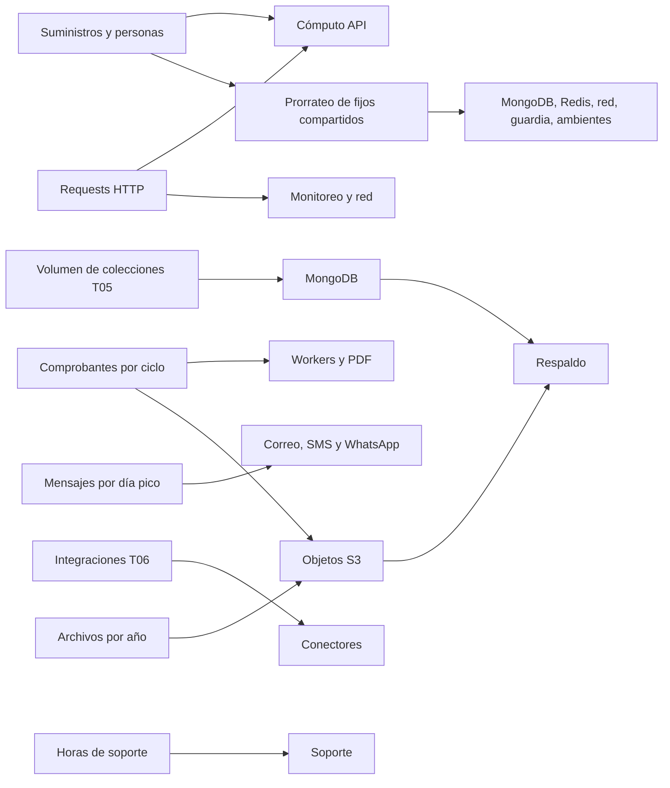
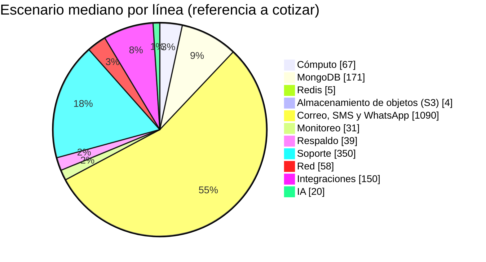

# 24. Modelo de costos de operación por cooperativa

Entregable del artefacto 10.3. Modelo paramétrico del costo mensual de operar GoodApps para una cooperativa (tenant), con sus drivers de uso, la estructura de costos, las fórmulas y tres escenarios: cooperativa chica, mediana y grande. Generado con `_trabajo/gen_24_costos.py`; ante cualquier diferencia prevalece la especificación.

**Advertencia.** Todos los precios unitarios y costos fijos de este documento son **valores de referencia a cotizar**: sirven para ver el orden de magnitud y la sensibilidad del modelo, no son una cotización, no comprometen precios del SaaS (T01 RN-PLA-017: el precio comercial lo fija una decisión comercial) y deben reemplazarse por cotizaciones del proveedor de nube (AWS sa-east-1, DEC-062, con diseño agnóstico DEC-004) y de los proveedores de mensajería e IA. Moneda de referencia: USD por mes.

## 1. Alcance y supuestos generales

- Arquitectura de referencia del entregable [02 Arquitectura C4](02-arquitectura-c4.md) §9: contenedores api, worker, admin, pwa y landing; MongoDB replica set de 3 nodos en 3 zonas con nodo oculto analítico; Redis 7 con réplica; almacenamiento de objetos con versionado, réplica y bloqueo; KMS y gestor de secretos; correo, SMS y WhatsApp por conectores; observabilidad con OpenTelemetry.
- Multitenancy compartida (DEC-002): la mayoría de los recursos son compartidos y se prorratean. Los costos fijos compartidos se reparten en proporción a los suministros del tenant sobre los 3.000.000 de la plataforma de diseño (100 tenants, T08 §7.1, DEC-075).
- Continuidad y servicio según DEC-063: disponibilidad 99,5 % mensual, RPO ≤ 15 min, RTO ≤ 4 h por tenant, soporte L–V 8–18 con P1 24×7 (RNF-NFR-030, 035, 036, 252).
- Volumen almacenado al año 3 de operación (ejercicio en curso más 24 meses, T05 §7.8.2); el detalle archivable de más de 36 meses pasa a archivo en frío (DEC-087) y facturas, recibos y asientos quedan en línea 10 años.
- Mensajería (DEC-077): con conector propio del tenant, SMS y WhatsApp los paga el tenant al proveedor; con proveedor de plataforma se revenden con consumo medido como complemento del pack (DEC-065). Por eso esas líneas se marcan como **trasladables**. Lo mismo vale para IA (tope PRM-NFR-096) y abonos de conectores.
- Fuera del modelo: comisiones de pasarelas y bancos (las paga la cooperativa en su contrato), homologaciones, licencias de software de terceros del tenant, impuestos, margen comercial, desarrollo evolutivo y migración inicial (ver [23 Estimación de esfuerzo](23-estimacion-esfuerzo.md)).

## 2. Drivers por escenario

Los escenarios mediano y grande son los tenants estándar y grande del perfil de carga de T08 §7.1 (DEC-075). El escenario chico es un **supuesto** (20 % del estándar), porque la especificación no define un tenant chico.

| Driver | Chica | Mediana | Grande | Origen |
|---|---|---|---|---|
| Suministros o servicios contratados activos | 5.000 | 25.000 | 150.000 | T08 §7.1 (DEC-075); chica: supuesto 20 % del estándar |
| Personas y titulares | 4.000 | 20.000 | 120.000 | T08 §7.1 |
| Comprobantes por ciclo mensual | 6.000 | 30.000 | 180.000 | T08 §7.1 |
| Movimientos de cuenta corriente por año | 200.000 | 1.000.000 | 6.000.000 | T08 §7.1 |
| Usuarios administrativos concurrentes | 6 | 30 | 150 | T08 §7.1 |
| Socios activos en el día pico de vencimiento | 1.000 | 5.000 | 30.000 | T08 §7.1 |
| Técnicos y lecturistas con app de campo simultáneos | 2 | 10 | 60 | T08 §7.1 |
| Lecturas por ciclo (servicios medidos) | 4.000 | 20.000 | 150.000 | T08 §7.1 |
| Archivos nuevos por año (GB) | 3 | 15 | 80 | T08 §7.1 |
| Clientes de API de BI | 1 | 3 | 10 | T08 §7.1 |
| Mensajes salientes por día pico | 6.000 | 30.000 | 200.000 | T08 §7.1 |
| Requests HTTP por segundo sostenidas | 1 | 5 | 25 | T08 §7.1 |
| Requests HTTP por segundo en el pico del tenant | 6 | 30 | 150 | T08 §7.1; chica: 20 % del estándar |
| Integraciones activas (fichas FI-INT en uso) | 8 | 15 | 25 | Supuesto sobre T06 (ARCA, padrones, bancos y débitos, pasarelas, entes, mensajería, telemedición) |
| Conectores con abono mensual de terceros | 1 | 3 | 6 | Supuesto sobre T06 |
| Tokens de IA por mes (millones) | 2 | 10 | 60 | Supuesto; cupo por plan T01 RF-PLA-078, tope PRM-NFR-096 |

Volumen anual de las colecciones de alto volumen (T05 §7.8.2, millones de documentos por año) y tamaño medio supuesto por documento:

| Colección | Chica | Mediana | Grande | KB por documento (supuesto) | Archivo a 36 meses (DEC-087) |
|---|---|---|---|---|---|
| `invoices` | 0,08 | 0,4 | 2,3 | 8,0 | No (en línea 10 años) |
| `billableItems` | 0,60 | 3,0 | 18,0 | 1,0 | Sí |
| `obligations` | 0,10 | 0,5 | 3,0 | 0,8 | No (en línea 10 años) |
| `ledgerEntries` | 0,30 | 1,5 | 9,0 | 0,6 | No (en línea 10 años) |
| `allocations` | 0,20 | 1,0 | 6,0 | 0,4 | No (en línea 10 años) |
| `meterReadings` | 0,06 | 0,3 | 1,8 | 0,5 | No (en línea 10 años) |
| `consumptions` | 0,06 | 0,3 | 1,8 | 0,5 | No (en línea 10 años) |
| `intervalReadings` | 7,00 | 35,0 | 210,0 | 0,1 | Sí |
| `callRecords` | 0,80 | 4,0 | 24,0 | 0,4 | Sí |
| `gpsPositions` | 6,00 | 30,0 | 90,0 | 0,1 | Sí |
| `auditLogs` | 2,00 | 10,0 | 60,0 | 1,2 | Sí |
| `journalLines` | 0,60 | 3,0 | 18,0 | 0,4 | No (en línea 10 años) |
| `agencySettlementLines` | 0,40 | 2,0 | 12,0 | 0,5 | Sí |
| `paymentIntents` | 0,10 | 0,5 | 3,0 | 1,0 | Sí |
| `treasuryMovements` | 0,06 | 0,3 | 1,5 | 0,6 | No (en línea 10 años) |
| `bankStatementLines` | 0,06 | 0,3 | 1,5 | 0,5 | No (en línea 10 años) |
| `stockMovements` | 0,02 | 0,1 | 0,5 | 0,6 | No (en línea 10 años) |

## 3. Estructura de costos y fórmulas

Notación: S suministros del tenant; Splat suministros de la plataforma de diseño; share = S / Splat; precios Px; factores Fx de la sección 4.

| Línea | Fórmula mensual | Origen del driver |
|---|---|---|
| Cómputo: API | vCPU = max(FVCPU_MIN_API, rps / FRPS_POR_VCPU); costo = vCPU × 730 × FFACTOR_PICO × (PVCPU_H + FGB_RAM_POR_VCPU × PGB_RAM_H) | T08 §7.1 throughput |
| Cómputo: workers | horas = FWORKERS_REF × comprobantes / FCOMP_REF + comprobantes × FSEG_PDF / 3.600 + (FVCPU_JOBS_BASE + FVCPU_JOBS_10K × S / 10.000) × 730 | RNF-NFR-010, DEC-080, RNF-NFR-020 |
| MongoDB | GB = Σ (documentos por año × KB × años en línea) × (1 + FRESTO) × (1 + FINDICES); costo = GB × FNODOS × PMONGO_GB_MES + share × fijo del cluster | T05 §7.8.2, RNF-NFR-048, DEC-087 |
| Redis | share × fijo del cluster | RNF-NFR-048 |
| Objetos (S3) | GB = archivos por año × años + comprobantes × 12 × años × FKB_PDF; costo = GB × PS3_GB_MES + solicitudes | T08 §7.1, DEC-080 |
| Colas | 0: BullMQ sobre Redis (incluido en Redis y workers) | T11, T01 |
| Correo, SMS y WhatsApp | mensajes = pico diario × FDIAS_PICO_EQ; costo = Σ canal (mensajes × fracción × precio) | T08 §7.1, DEC-077, RNF-NFR-251 |
| Monitoreo | logs GB = rps × 2.592.000 × FKB_LOG_REQ × 1,2 / 106; costo = logs × PLOG_GB + PMON_TENANT + share × base | RNF-NFR-250, T08 §9 |
| Respaldo | GBMongo × FFACTOR_BACKUP × PBACKUP + GBS3 × PREPL + GB nuevos por mes × PXREG | RNF-NFR-038, 039 |
| Soporte | horas × PHORA_SOPORTE + share × guardia 24×7 | DEC-063, RNF-NFR-252 |
| Red | rps × 2.592.000 × FKB_RESP / 106 × PEGRESS_GB + share × red base | T08 §7.1 |
| Integraciones | conectores con abono × PCONECTOR_MES; la ejecución va en workers | T06 |
| IA | millones de tokens × PIA_MTOK | T01 RF-PLA-078, PRM-NFR-096 |

## 4. Parámetros

### 4.1 Factores de conversión (supuestos)

| Parámetro | Valor | Significado |
|---|---|---|
| FRPS_POR_VCPU | 10 | Requests por segundo que atiende 1 vCPU de API |
| FVCPU_MIN_API | 0,25 | vCPU mínima de API asignable por tenant |
| FFACTOR_PICO | 1,30 | Sobreprovisión media por autoescalado en picos |
| FGB_RAM_POR_VCPU | 2 | GB de memoria por vCPU |
| FWORKERS_REF | 4 | Workers de RNF-NFR-010 para 50.000 comprobantes en 60 min |
| FCOMP_REF | 50.000 | Comprobantes de referencia de RNF-NFR-010 |
| FSEG_PDF | 1 | Segundos de vCPU por PDF de comprobante (Chromium, DEC-080) |
| FVCPU_JOBS_BASE | 0,10 | vCPU continua de jobs por tenant (outbox, programados, integraciones) |
| FVCPU_JOBS_10K | 0,10 | vCPU continua adicional de jobs por cada 10.000 suministros |
| FRESTO_COLECCIONES | 0,30 | Volumen adicional del resto de las colecciones sobre las de T05 §7.8.2 |
| FINDICES | 0,50 | Sobrecarga de índices sobre los datos |
| FNODOS_MONGO | 3 | Nodos del replica set (RNF-NFR-048) |
| FKB_PDF | 80 | KB por PDF de comprobante |
| FFACTOR_BACKUP | 2 | Almacenamiento de backup / datos (PITR 7 días, diarios 35, semanales 12, mensuales 13; RNF-NFR-038) |
| FDIAS_PICO_EQ | 6 | Días pico equivalentes por mes para pasar del pico diario al total mensual |
| FPCT_EMAIL | 0,55 | Fracción de mensajes por correo |
| FPCT_PUSH | 0,30 | Fracción de mensajes push o in-app (sin costo unitario) |
| FPCT_SMS | 0,05 | Fracción de mensajes por SMS |
| FPCT_WA | 0,10 | Fracción de mensajes por WhatsApp |
| FKB_LOG_REQ | 1 | KB de log por request |
| FKB_RESP | 30 | KB de transferencia saliente por request |
| FHORAS_SOPORTE | 4 / 12 / 40 | Horas de soporte de plataforma por mes (chica, mediana, grande) |
| FS_PLATAFORMA | 3.000.000 | Suministros de la plataforma de diseño, 100 tenants (T08 §7.1; se lee del anexo) |
| FMEZCLA | 96 / 4 | Tenants estándar y grandes de la plataforma de diseño (T08 §7.1 y T05 §7.8.2) |
| FFACTOR_SIMULT | 0,60 | Pico de plataforma / suma de los picos por tenant en las filas de simultaneidad (T08 §7.1, PA-NFR-22) |

### 4.2 Precios unitarios de referencia (a cotizar)

| Parámetro | Valor de referencia (USD) | Estado | Concepto |
|---|---|---|---|
| PVCPU_H | 0,050 | **a cotizar** | vCPU-hora de contenedor (ECS Fargate o EKS) |
| PGB_RAM_H | 0,0055 | **a cotizar** | GB-hora de memoria de contenedor |
| PMONGO_GB_MES | 0,250 | **a cotizar** | GB-mes de almacenamiento de MongoDB por nodo |
| PS3_GB_MES | 0,025 | **a cotizar** | GB-mes de almacenamiento de objetos estándar |
| PS3_1000_REQ | 0,0050 | **a cotizar** | Cada 1.000 solicitudes PUT o GET de objetos |
| PBACKUP_GB_MES | 0,100 | **a cotizar** | GB-mes de backup de MongoDB |
| PREPL_GB_MES | 0,020 | **a cotizar** | GB-mes de la copia replicada en otra región (RNF-NFR-039) |
| PXREG_GB | 0,020 | **a cotizar** | GB transferido entre regiones para la réplica |
| PEMAIL_1000 | 0,100 | **a cotizar** | Cada 1.000 correos (SES u otro) |
| PSMS | 0,050 | **a cotizar** | SMS a Argentina |
| PWA | 0,035 | **a cotizar** | Conversación o mensaje de plantilla de WhatsApp |
| PLOG_GB | 0,600 | **a cotizar** | GB de logs ingeridos |
| PMON_TENANT | 15,00 | **a cotizar** | Métricas, trazas y sondas sintéticas por tenant y mes |
| PEGRESS_GB | 0,130 | **a cotizar** | GB de transferencia saliente (CDN y balanceador) |
| PHORA_SOPORTE | 25,00 | **a cotizar** | Hora de soporte de plataforma (mesa L–V 8–18, DEC-063) |
| PCONECTOR_MES | 50,00 | **a cotizar** | Abono mensual de un conector de terceros |
| PIA_MTOK | 2,00 | **a cotizar** | Millón de tokens de IA |

### 4.3 Costos fijos compartidos de plataforma (a cotizar)

| Concepto | Valor de referencia por mes (USD) | Estado | Línea | Detalle |
|---|---|---|---|---|
| MONGO_CLUSTER | 4.000 | **a cotizar** | MongoDB | Cómputo del replica set de 3 nodos en 3 zonas más nodo oculto analítico (RNF-NFR-048; arquitectura §9) |
| REDIS | 600 | **a cotizar** | Redis | Redis 7 con réplica y failover para caché, sesiones y colas BullMQ (RNF-NFR-048) |
| RED_BASE | 900 | **a cotizar** | Red | Balanceador, WAF, NAT por zona y CDN base |
| SEGURIDAD | 150 | **a cotizar** | Cómputo | KMS y gestor de secretos (DEC-074) |
| OBS_BASE | 800 | **a cotizar** | Monitoreo | Base de observabilidad, alertas y tableros de plataforma |
| NO_PROD | 2.500 | **a cotizar** | Cómputo | Ambientes dev, staging, demo y sandbox base; CI (arquitectura §9) |
| GUARDIA | 6.000 | **a cotizar** | Soporte | Guardia P1 24×7 y operación SRE (DEC-063, RNF-NFR-252) |
| **Total** | **14.950** | | | Prorrateado por share = S / 3.000.000 |

## 5. Resultados por escenario

Costo mensual de referencia por línea (USD, valores a cotizar). "Trasladable" es la parte que, según DEC-077 y DEC-065, puede pagar el tenant directamente a su proveedor o facturarse como complemento medido.

| Línea | Chica | Mediana | Grande |
|---|---|---|---|
| Cómputo | 26 | 67 | 352 |
| MongoDB | 34 | 171 | 982 |
| Redis | 1 | 5 | 30 |
| Almacenamiento de objetos (S3) | 1 | 4 | 23 |
| Colas | 0 | 0 | 0 |
| Correo, SMS y WhatsApp | 218 | 1.090 | 7.266 |
| Monitoreo | 18 | 31 | 102 |
| Respaldo | 8 | 39 | 224 |
| Soporte | 110 | 350 | 1.300 |
| Red | 12 | 58 | 298 |
| Integraciones | 50 | 150 | 300 |
| IA | 4 | 20 | 120 |
| **Total mensual** | **481** | **1.986** | **10.996** |
| De ese total, trasladable | 272 | 1.260 | 7.686 |
| Total sin trasladables | 209 | 726 | 3.310 |
| Costo por suministro y mes | 0,096 | 0,079 | 0,073 |
| Costo por suministro y mes sin trasladables | 0,042 | 0,029 | 0,022 |
| Datos en MongoDB con índices (GB, año 3) | 36,7 | 183,6 | 1.042,2 |
| Objetos en línea (GB, año 3) | 26,3 | 131,4 | 758,4 |
| Mensajes por mes | 36.000 | 180.000 | 1.200.000 |

Distribución del escenario mediano:

### 5.1 Detalle del escenario chica

| Línea | Concepto | Cantidad | Unidad | Precio de referencia (a cotizar) | Costo mensual | Trasladable |
|---|---|---|---|---|---|---|
| Cómputo | API: vCPU-hora | 237,2 | vCPU-h | 0,050 | 11,86 | No |
| Cómputo | API: memoria | 474,5 | GB-h | 0,0055 | 2,61 | No |
| Cómputo | Workers: facturación masiva, PDF y jobs | 111,6 | vCPU-h | 0,061 | 6,81 | No |
| Cómputo | Fijos compartidos: seguridad y ambientes no productivos | 0,002 | fracción | 2.650,00 | 4,42 | No |
| MongoDB | Almacenamiento (datos e índices) x nodos | 110,2 | GB-mes | 0,250 | 27,54 | No |
| MongoDB | Cómputo del cluster compartido | 0,002 | fracción | 4.000,00 | 6,67 | No |
| Redis | Cluster compartido | 0,002 | fracción | 600,00 | 1,00 | No |
| Almacenamiento de objetos (S3) | Archivos, adjuntos y PDF en línea | 26,3 | GB-mes | 0,025 | 0,66 | No |
| Almacenamiento de objetos (S3) | Solicitudes (alta, lectura y descargas de comprobantes) | 24,0 | miles | 0,0050 | 0,12 | No |
| Colas | BullMQ sobre Redis (sin servicio de colas aparte) | 0,0 | — | 0,000 | 0,00 | No |
| Correo, SMS y WhatsApp | Correo | 19,8 | miles | 0,100 | 1,98 | Sí |
| Correo, SMS y WhatsApp | SMS | 1.800,0 | mensajes | 0,050 | 90,00 | Sí |
| Correo, SMS y WhatsApp | WhatsApp | 3.600,0 | mensajes | 0,035 | 126,00 | Sí |
| Correo, SMS y WhatsApp | Push e in-app | 10.800,0 | mensajes | 0,000 | 0,00 | No |
| Monitoreo | Logs ingeridos (API y workers) | 3,1 | GB | 0,600 | 1,87 | No |
| Monitoreo | Métricas, trazas y sondas del tenant | 1,0 | tenant | 15,00 | 15,00 | No |
| Monitoreo | Base de observabilidad compartida | 0,002 | fracción | 800,00 | 1,33 | No |
| Respaldo | Backups de MongoDB (PITR y snapshots) | 73,5 | GB-mes | 0,100 | 7,35 | No |
| Respaldo | Réplica de objetos en otra región | 26,3 | GB-mes | 0,020 | 0,53 | No |
| Respaldo | Transferencia de la réplica | 0,7 | GB | 0,020 | 0,01 | No |
| Soporte | Mesa de soporte (L–V 8–18) | 4,0 | horas | 25,00 | 100,00 | No |
| Soporte | Guardia P1 24×7 compartida | 0,002 | fracción | 6.000,00 | 10,00 | No |
| Red | Transferencia saliente | 77,8 | GB | 0,130 | 10,11 | No |
| Red | Balanceador, WAF, NAT y CDN compartidos | 0,002 | fracción | 900,00 | 1,50 | No |
| Integraciones | Abonos de conectores de terceros | 1,0 | conectores | 50,00 | 50,00 | Sí |
| Integraciones | Ejecución de conectores (incluida en workers) | 8,0 | integraciones | 0,000 | 0,00 | No |
| IA | Tokens de IA | 2,0 | millones | 2,00 | 4,00 | Sí |

### 5.2 Detalle del escenario mediana

| Línea | Concepto | Cantidad | Unidad | Precio de referencia (a cotizar) | Costo mensual | Trasladable |
|---|---|---|---|---|---|---|
| Cómputo | API: vCPU-hora | 474,5 | vCPU-h | 0,050 | 23,73 | No |
| Cómputo | API: memoria | 949,0 | GB-h | 0,0055 | 5,22 | No |
| Cómputo | Workers: facturación masiva, PDF y jobs | 266,2 | vCPU-h | 0,061 | 16,24 | No |
| Cómputo | Fijos compartidos: seguridad y ambientes no productivos | 0,008 | fracción | 2.650,00 | 22,08 | No |
| MongoDB | Almacenamiento (datos e índices) x nodos | 550,9 | GB-mes | 0,250 | 137,72 | No |
| MongoDB | Cómputo del cluster compartido | 0,008 | fracción | 4.000,00 | 33,33 | No |
| Redis | Cluster compartido | 0,008 | fracción | 600,00 | 5,00 | No |
| Almacenamiento de objetos (S3) | Archivos, adjuntos y PDF en línea | 131,4 | GB-mes | 0,025 | 3,29 | No |
| Almacenamiento de objetos (S3) | Solicitudes (alta, lectura y descargas de comprobantes) | 120,0 | miles | 0,0050 | 0,60 | No |
| Colas | BullMQ sobre Redis (sin servicio de colas aparte) | 0,0 | — | 0,000 | 0,00 | No |
| Correo, SMS y WhatsApp | Correo | 99,0 | miles | 0,100 | 9,90 | Sí |
| Correo, SMS y WhatsApp | SMS | 9.000,0 | mensajes | 0,050 | 450,00 | Sí |
| Correo, SMS y WhatsApp | WhatsApp | 18.000,0 | mensajes | 0,035 | 630,00 | Sí |
| Correo, SMS y WhatsApp | Push e in-app | 54.000,0 | mensajes | 0,000 | 0,00 | No |
| Monitoreo | Logs ingeridos (API y workers) | 15,6 | GB | 0,600 | 9,33 | No |
| Monitoreo | Métricas, trazas y sondas del tenant | 1,0 | tenant | 15,00 | 15,00 | No |
| Monitoreo | Base de observabilidad compartida | 0,008 | fracción | 800,00 | 6,67 | No |
| Respaldo | Backups de MongoDB (PITR y snapshots) | 367,3 | GB-mes | 0,100 | 36,73 | No |
| Respaldo | Réplica de objetos en otra región | 131,4 | GB-mes | 0,020 | 2,63 | No |
| Respaldo | Transferencia de la réplica | 3,6 | GB | 0,020 | 0,07 | No |
| Soporte | Mesa de soporte (L–V 8–18) | 12,0 | horas | 25,00 | 300,00 | No |
| Soporte | Guardia P1 24×7 compartida | 0,008 | fracción | 6.000,00 | 50,00 | No |
| Red | Transferencia saliente | 388,8 | GB | 0,130 | 50,54 | No |
| Red | Balanceador, WAF, NAT y CDN compartidos | 0,008 | fracción | 900,00 | 7,50 | No |
| Integraciones | Abonos de conectores de terceros | 3,0 | conectores | 50,00 | 150,00 | Sí |
| Integraciones | Ejecución de conectores (incluida en workers) | 15,0 | integraciones | 0,000 | 0,00 | No |
| IA | Tokens de IA | 10,0 | millones | 2,00 | 20,00 | Sí |

### 5.3 Detalle del escenario grande

| Línea | Concepto | Cantidad | Unidad | Precio de referencia (a cotizar) | Costo mensual | Trasladable |
|---|---|---|---|---|---|---|
| Cómputo | API: vCPU-hora | 2.372,5 | vCPU-h | 0,050 | 118,62 | No |
| Cómputo | API: memoria | 4.745,0 | GB-h | 0,0055 | 26,10 | No |
| Cómputo | Workers: facturación masiva, PDF y jobs | 1.232,4 | vCPU-h | 0,061 | 75,18 | No |
| Cómputo | Fijos compartidos: seguridad y ambientes no productivos | 0,050 | fracción | 2.650,00 | 132,50 | No |
| MongoDB | Almacenamiento (datos e índices) x nodos | 3.126,5 | GB-mes | 0,250 | 781,63 | No |
| MongoDB | Cómputo del cluster compartido | 0,050 | fracción | 4.000,00 | 200,00 | No |
| Redis | Cluster compartido | 0,050 | fracción | 600,00 | 30,00 | No |
| Almacenamiento de objetos (S3) | Archivos, adjuntos y PDF en línea | 758,4 | GB-mes | 0,025 | 18,96 | No |
| Almacenamiento de objetos (S3) | Solicitudes (alta, lectura y descargas de comprobantes) | 720,0 | miles | 0,0050 | 3,60 | No |
| Colas | BullMQ sobre Redis (sin servicio de colas aparte) | 0,0 | — | 0,000 | 0,00 | No |
| Correo, SMS y WhatsApp | Correo | 660,0 | miles | 0,100 | 66,00 | Sí |
| Correo, SMS y WhatsApp | SMS | 60.000,0 | mensajes | 0,050 | 3.000,00 | Sí |
| Correo, SMS y WhatsApp | WhatsApp | 120.000,0 | mensajes | 0,035 | 4.200,00 | Sí |
| Correo, SMS y WhatsApp | Push e in-app | 360.000,0 | mensajes | 0,000 | 0,00 | No |
| Monitoreo | Logs ingeridos (API y workers) | 77,8 | GB | 0,600 | 46,66 | No |
| Monitoreo | Métricas, trazas y sondas del tenant | 1,0 | tenant | 15,00 | 15,00 | No |
| Monitoreo | Base de observabilidad compartida | 0,050 | fracción | 800,00 | 40,00 | No |
| Respaldo | Backups de MongoDB (PITR y snapshots) | 2.084,4 | GB-mes | 0,100 | 208,44 | No |
| Respaldo | Réplica de objetos en otra región | 758,4 | GB-mes | 0,020 | 15,17 | No |
| Respaldo | Transferencia de la réplica | 21,1 | GB | 0,020 | 0,42 | No |
| Soporte | Mesa de soporte (L–V 8–18) | 40,0 | horas | 25,00 | 1.000,00 | No |
| Soporte | Guardia P1 24×7 compartida | 0,050 | fracción | 6.000,00 | 300,00 | No |
| Red | Transferencia saliente | 1.944,0 | GB | 0,130 | 252,72 | No |
| Red | Balanceador, WAF, NAT y CDN compartidos | 0,050 | fracción | 900,00 | 45,00 | No |
| Integraciones | Abonos de conectores de terceros | 6,0 | conectores | 50,00 | 300,00 | Sí |
| Integraciones | Ejecución de conectores (incluida en workers) | 25,0 | integraciones | 0,000 | 0,00 | No |
| IA | Tokens de IA | 60,0 | millones | 2,00 | 120,00 | Sí |

## 6. Crecimiento del almacenamiento

Datos de MongoDB con índices (GB, sin réplicas) por año de operación. A partir del año 4 el detalle archivable deja de crecer en línea (DEC-087); el resto crece hasta 10 años.

| Año | Chica | Mediana | Grande |
|---|---|---|---|
| 1 | 12,2 | 61,2 | 347,4 |
| 2 | 24,5 | 122,4 | 694,8 |
| 3 | 36,7 | 183,6 | 1.042,2 |
| 5 | 42,0 | 210,1 | 1.196,4 |
| 10 | 55,3 | 276,3 | 1.582,0 |

## 7. Verificación con el pico HTTP de plataforma (T08 §7.1)

La corrección del 05-11-2026 fija el pico de plataforma en 0,6 × la suma de los picos por tenant en todas las filas de simultaneidad (PA-NFR-22, Asumida DEC-072, a confirmar con una prueba de carga antes de O4). El throughput HTTP de la plataforma de diseño pasa de 1.000 a **2.088 req/s pico** y de 300 a 348 req/s sostenidas; las cifras **por tenant no cambian** (5 y 30 req/s el estándar, 25 y 150 el grande).

Chequeo de la columna "Plataforma (diseño)" de T08 §7.1 con la mezcla de 96 tenants estándar y 4 grandes:

| Fila de T08 §7.1 | Suma por tenant | Factor | Calculado | T08 declara | Coincide |
|---|---|---|---|---|---|
| Suministros | 3.000.000 | 1 | 3.000.000 | 3.000.000 | Sí |
| Personas | 2.400.000 | 1 | 2.400.000 | 2.400.000 | Sí |
| Comprobantes | 3.600.000 | 1 | 3.600.000 | 3.600.000 | Sí |
| Movimientos | 120.000.000 | 1 | 120.000.000 | 120.000.000 | Sí |
| Usuarios administrativos | 3.480 | 0,6 | 2.088 | 2.088 | Sí |
| Socios activos | 600.000 | 0,6 | 360.000 | 360.000 | Sí |
| Técnicos | 1.200 | 0,6 | 720 | 720 | Sí |
| Lecturas | 2.520.000 | 1 | 2.520.000 | 2.520.000 | Sí |
| Archivos | 1.760 | 1 | 1.760 | 1.800 | Sí |
| Clientes de API | 328 | 1 | 328 | 328 | Sí |
| Mensajes | 3.680.000 | 0,6 | 2.208.000 | 2.208.000 | Sí |
| Throughput HTTP | 580 | 0,6 | 348 | 348 | Sí |
| Throughput HTTP (pico) | 3.480 | 0,6 | 2.088 | 2.088 | Sí |

Efecto en el dimensionamiento del cómputo de API (con FRPS_POR_VCPU = 10):

| Concepto | Valor |
|---|---|
| vCPU de API asignadas por el modelo (suma de los tenants, sostenido) | 58,0 |
| vCPU media facturada (× FFACTOR_PICO = 1,3) | 75,4 |
| vCPU necesarias en el pico de plataforma (2.088 req/s; antes 1.000 req/s) | 208,8 (antes 100,0) |
| Horas de pico por mes que cubre el factor actual | 84 h (antes 302 h) |
| FFACTOR_PICO necesario si el pico dura 6 días equivalentes completos (144 h) | 1,51 |

| Escenario | Cómputo de API hoy (USD/mes) | Con FFACTOR_PICO = 1,51 | Diferencia | Sobre el total |
|---|---|---|---|---|
| chica | 14,47 | 16,84 | +2,37 | +0,5 % |
| mediana | 28,94 | 33,68 | +4,74 | +0,2 % |
| grande | 144,72 | 168,42 | +23,70 | +0,2 % |

Conclusión: el costo por tenant **no cambia**, porque los drivers por tenant de T08 §7.1 son los mismos y los costos fijos se prorratean por suministros (3.000.000, sin cambios). Lo que cambia es la capacidad de pico de la plataforma: el autoescalado de la API debe llegar a unas 209 vCPU (antes 100) y el FFACTOR_PICO de 1,3 cubre hasta unas 84 horas de pico de plataforma por mes. Si la prueba de carga de PA-NFR-22 muestra picos más largos, subir FFACTOR_PICO (la tabla anterior da el impacto: como máximo +0,5 % del total si el pico dura 144 h) y revisar la cotización del balanceador y el WAF de los fijos compartidos (RED_BASE), que siguen dimensionados como base.

## 8. Cómo usar y calibrar el modelo

1. Reemplazar los precios de la sección 4.2 y los fijos de la sección 4.3 por cotizaciones vigentes (nube en sa-east-1, mensajería, IA, soporte).
2. Medir los drivers reales del tenant con `usageSnapshots` (T01 RF-PLA-079, JOB-PLA-05; RNF-NFR-250: segundos de workers por cola, GB de base y de objetos, mensajes por canal, tokens de IA, transferencia) y ajustar los factores de la sección 4.1.
3. Recalibrar el perfil de carga con la piloto Laguna Larga (LAG, DEC-088), como pide T08 §7.1 (AGR-020).
4. Volver a ejecutar `_trabajo/gen_24_costos.py`.

## 9. Inconsistencias detectadas en la especificación

La especificación no se modificó. Estas observaciones quedan para el coordinador.

| # | Tipo | Detalle | Tratamiento |
|---|---|---|---|
| 1 | Perfil de plataforma (resuelta) | Antes T05 §7.8.2 usaba la mezcla 85 %/15 % (13,1 M de suministros con 300 tenants) contra los 9 M de T08 §7.1. Ahora T05 y T08 usan 96 estándar y 4 grandes por cada 100 tenants: 3.000.000 suministros, igual a los 3.000.000 que declara T08 §7.1. | Se prorratea con 3.000.000 suministros, leídos de T08 §7.1. |
| 2 | Estado del perfil (resuelta) | T08 §7.1 ya se titula "Adoptado, DEC-075" (antes "A validar PA-NFR-03"). | Sin cambios en el modelo. |
| 3 | Backups anuales (resuelta) | RNF-NFR-038 ya excluye las copias anuales de 10 años (PA-NFR-23, Asumida DEC-072; antes "a validar PA-NFR-06"): la conservación legal la dan los datos en línea 10 años y el archivo en frío de DEC-087. | El modelo no incluye copias anuales, como antes. |
| 4 | Tenant chico | La especificación define solo los tenants estándar y grande (DEC-075); el pedido requiere un escenario chico. | Se agrega como supuesto (20 % del estándar) y se marca en la tabla de drivers. |

## 10. Tabla de cobertura

| Universo | Cómo se contó | En el pedido o la especificación | Incluidos | Excluidos (motivo) |
|---|---|---|---|---|
| Drivers pedidos | Socios, servicios, lecturas, comprobantes, almacenamiento, mensajes, integraciones | 7 | 7 | 0 |
| Líneas de costo pedidas | Cómputo, MongoDB, Redis, S3, colas, correo y SMS, monitoreo, respaldo, soporte | 9 | 9 (más red, integraciones e IA) | 0 |
| Escenarios | Chica, mediana, grande | 3 | 3 | 0 |
| Dimensiones del perfil de carga | Filas de T08 §7.1 por tenant (sin "Tenants activos") | 11 | 11 | 0 |
| Colecciones de alto volumen | Filas de T05 §7.8.2 (las agrupadas se cuentan por colección) | 20 | 17 | 3 (`outboxEvents`, `inboxReceipts`, `jobRuns`: en tránsito con TTL de días, volumen despreciable en régimen) |
| Precios unitarios | Parámetros de la sección 4.2 | 17 | 17 marcados "a cotizar" | 0 |
| Costos fijos compartidos | Parámetros de la sección 4.3 | 7 | 7 marcados "a cotizar" | 0 |
