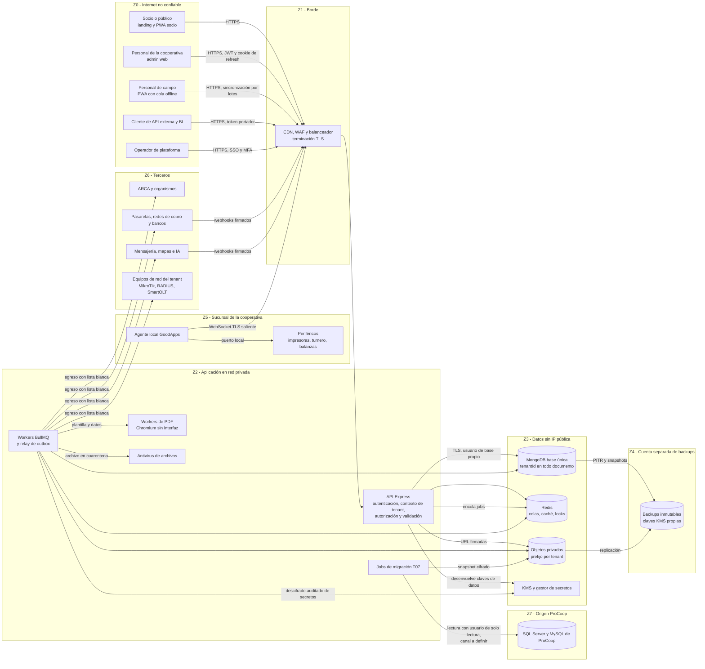

# Diseño de seguridad y modelo de amenazas — GoodApps Cooperativas

**Entregable de Análisis y Diseño Detallado — Artefacto 5.6 (Diseño de seguridad y modelo de amenazas)**

| Campo | Valor |
|---|---|
| Producto | GoodApps Cooperativas — plataforma SaaS multitenant de gestión para cooperativas de servicios, reemplazo de ProCoop |
| Documento | Diseño de seguridad y modelo de amenazas de la plataforma (STRIDE) |
| Artefacto | 5.6 Diseño de seguridad y modelo de amenazas del índice `00-INDICE.md` |
| Versión | 1.0 |
| Fecha | 05-11-2026 |
| Estado | Borrador para revisión |
| Fuentes | `docs/especificacion/01-registro-decisiones.md` (DEC-001 a DEC-089); `00-ESPECIFICACION-MAESTRA.md` §3, §5, §6 y §14; anexos T01 (plataforma), T02 (identidad, roles y auditoría), T05 (modelo de datos y clasificación), T06 (integraciones y bóveda `integrationSecrets`), T07 (migración), T08 (no funcionales, seguridad, privacidad y auditoría); `02-preguntas-abiertas.md`; documentos `02-arquitectura-c4.md` y `27-registro-adr.md` de esta carpeta |
| Carácter | Documento derivado. No reemplaza la especificación: ante cualquier diferencia prevalecen la maestra, los anexos y el registro de decisiones `01`. No contiene secretos, valores de credenciales ni código de ProCoop; todo ejemplo es ficticio. |

> **Norma stack CoopApps (C-10).** Activos y amenazas STRIDE que citan MongoDB, drivers o Redis se leen contra el **almacén relacional Azure SQL** y servicios Azure de la DEC-111/112 (misma semántica de confidencialidad, integridad y aislamiento por `TenantId`). Controles en T08 y T02 priman. Impacto: `06` §12.3.

## Control de versiones

| Versión | Fecha | Autor | Cambios |
|---|---|---|---|
| 1.0 | 05-11-2026 | Equipo de análisis y diseño (a definir nominalmente) | Versión inicial: activos, actores de amenaza, límites de confianza con diagrama de flujo de datos, análisis STRIDE de diez componentes con 80 amenazas, aislamiento multitenant, datos personales y sensibles, secretos, auditoría, controles por ola y observaciones. |

## Aprobaciones

| Rol | Nombre | Fecha | Firma |
|---|---|---|---|
| Responsable de seguridad (P-SEC) | A definir | — | — |
| Responsable de arquitectura | A definir | — | — |
| Responsable de privacidad | A definir | — | — |
| Responsable de operaciones (P-OPS) | A definir | — | — |
| Representante del solicitante | A definir | — | — |

## Índice

1. Propósito, alcance y método
2. Activos
3. Actores de amenaza
4. Límites de confianza y flujo de datos
5. Análisis STRIDE por componente
6. Aislamiento multitenant
7. Datos personales y sensibles (Ley 25.326 y AAIP)
8. Gestión de secretos
9. Registro y auditoría
10. Controles por ola
11. Resumen de riesgos residuales
12. Observaciones e inconsistencias detectadas
13. Referencias

---

## 1. Propósito, alcance y método

### 1.1 Propósito

Identificar las amenazas a la plataforma GoodApps Cooperativas, vincular cada una con los controles que la especificación ya exige (RNF-NFR de T08, RF-IAM de T02, RF-PLA de T01, RF-INT de T06, RF-MIG de T07), estimar el riesgo residual y definir la acción pendiente. Cumple a nivel de plataforma lo que pide RNF-NFR-051 (modelado de amenazas STRIDE con riesgos, controles y riesgos residuales aceptados por responsable) y sirve de base a los modelos por módulo e integración que ese mismo requisito exige antes de cada ola.

### 1.2 Alcance

- **Incluido**: los contenedores y límites de `02-arquitectura-c4.md` (borde, admin, PWA, landing, API, workers, relay, workers de PDF, antivirus, MongoDB, Redis, almacenamiento de objetos, KMS y gestor de secretos, observabilidad, agente local), la API externa `/api/v1/ext`, los conectores e integraciones de T06, la migración desde ProCoop de T07 y la operación de plataforma y soporte.
- **Excluido**: amenazas de reglas de negocio propias de cada módulo (por ejemplo fraude tarifario en M04 o manipulación de lecturas en M03 más allá de la sincronización offline), que corresponden a los modelos por anexo M01–M19 y por ficha FI-INT (RNF-NFR-051). Seguridad física de las sucursales de las cooperativas.
- **Marco de referencia**: OWASP ASVS 5.0 nivel 2 como mínimo y nivel 3 para bóveda, firma de tokens, auditoría y datos de salud (T08 §9; RNF-NFR-050).

### 1.3 Método y escalas

Cada amenaza se clasifica con STRIDE: **S** suplantación, **T** manipulación, **R** repudio, **I** divulgación de información, **D** denegación de servicio, **E** elevación de privilegios. Las columnas **P** (probabilidad) e **I** (impacto) son inherentes, es decir, sin considerar los controles. El **riesgo residual** estima el nivel después de aplicar los controles existentes en la especificación.

| Probabilidad | Criterio |
|---|---|
| Alta | Ataque habitual en Internet o error probable sin control específico; se espera al menos una vez al año. |
| Media | Requiere conocimiento, acceso parcial o una combinación de condiciones. |
| Baja | Requiere acceso privilegiado, varios controles fallando a la vez o un actor sofisticado. |

| Impacto | Criterio |
|---|---|
| Crítico | Exposición de datos entre tenants, de datos de salud o de credenciales; pérdida de integridad fiscal o contable. |
| Alto | Exposición de datos personales de un tenant, fraude económico, indisponibilidad en días críticos. |
| Medio | Exposición acotada, degradación parcial o efecto reversible. |
| Bajo | Molestia operativa sin exposición de datos ni pérdida económica. |

Matriz de riesgo (probabilidad × impacto):

| Probabilidad \ Impacto | Crítico | Alto | Medio | Bajo |
|---|---|---|---|---|
| Alta | Crítico | Alto | Medio | Bajo |
| Media | Alto | Alto | Medio | Bajo |
| Baja | Medio | Medio | Bajo | Bajo |

Acciones posibles: **Aceptar** (residual Bajo, sin acción adicional), **Verificar** (el control existe en la especificación; se exige prueba o evidencia en la ola), **Completar** (falta una definición en la especificación; se registra en la sección 12), **Definir** (depende de una elección de proveedor o infraestructura marcada "a definir").

---

## 2. Activos

| ID | Activo | Clasificación (T05 §7.1.12) | Prioridad (C/I/D) | Ubicación principal |
|---|---|---|---|---|
| AC-01 | Datos identificatorios y de contacto de socios, empleados y terceros (nombre, DNI, CUIT, correo, teléfono, domicilio) | `ID`, `CT`, `UB` | C alta, I alta | MongoDB (M01, T02, M16) |
| AC-02 | Datos sensibles: salud, discapacidad, electrodependencia, causa de muerte en sepelio, certificados médicos, afiliación sindical, antecedentes | `SE` | C crítica | Colecciones propias del módulo dueño con cifrado de campo (RNF-NFR-100) |
| AC-03 | Datos financieros: CBU/CVU, deuda, pagos, sueldos, tarjeta tokenizada | `FI` | C alta, I crítica | M07, M14, M16 |
| AC-04 | Documentos económicos y fiscales: facturas con CAE, recibos, asientos, movimientos | `OP` con retención `legal10y` | I crítica, D alta | MongoDB y PDF en objetos con WORM |
| AC-05 | Secretos de integración por tenant: credenciales de ARCA, pasarelas, bancos, mensajería, red; certificados y claves privadas | `SC` | C crítica | Bóveda `integrationSecrets` (T06 §7.3) |
| AC-06 | Secretos de plataforma: claves de firma de tokens, cadenas de conexión, claves maestras | `SC` | C crítica | Gestor de secretos y KMS por ambiente |
| AC-07 | Credenciales y sesiones de usuarios: hash de contraseñas, refresh tokens hasheados, semillas TOTP, códigos de recuperación, credenciales de clientes API y de dispositivos | `SC` | C crítica | T02 (`sessions`, factores), cifrado de campo |
| AC-08 | Registros de auditoría y bitácoras | `AU` | I crítica | `auditLogs`, `auditAccess`, `auditReads`, `auditMessages`, `auditAi`; anclaje WORM |
| AC-09 | Configuración publicada del tenant: tarifas, reglas, plantillas, marca, roles | `CF` | I alta | T04, T02, T03 |
| AC-10 | Backups, snapshots y exportaciones | Hereda la del contenido | C crítica, D alta | Cuenta o región separada de backups; bucket `exports` |
| AC-11 | Snapshot de origen ProCoop y `legacyRecords` | Hereda la del contenido | C alta | Almacenamiento privado cifrado (RF-MIG-011, RF-MIG-062) |
| AC-12 | Disponibilidad del servicio en días de vencimiento y facturación masiva | — | D alta | Toda la plataforma |
| AC-13 | Código, dependencias e imágenes de contenedor | — | I crítica | Repositorio, registro de imágenes, pipeline |
| AC-14 | Datos offline en dispositivos de campo | `ID`, `UB`, `OP` | C media | IndexedDB de la PWA |

---

## 3. Actores de amenaza

| ID | Actor | Motivación y capacidad | Componentes expuestos |
|---|---|---|---|
| AD-01 | Atacante externo anónimo | Automatización, credenciales filtradas de otros sitios, explotación de vulnerabilidades web | Landing, portal, admin, API, webhooks |
| AD-02 | Socio malicioso o cuenta de socio comprometida | Acceder a datos o deuda de otro socio, manipular pagos, abusar de formularios públicos | Portal, PWA socio, `/api/public` |
| AD-03 | Usuario interno de la cooperativa que excede su alcance | Fraude en caja, consulta o exportación indebida de datos, cambios sin autorización | Admin, PWA empleado |
| AD-04 | Administrador o usuario de un tenant que intenta ver otro tenant | Curiosidad o competencia entre cooperativas; manipulación de identificadores | API, archivos, caché, búsqueda |
| AD-05 | Operador o soporte de plataforma (interno privilegiado) | Acceso a datos de cualquier tenant, abuso del acceso de emergencia | Consola de plataforma, infraestructura |
| AD-06 | Tercero comprometido o suplantado | Webhooks falsos, respuestas manipuladas, proveedor de IA o mensajería con fuga | Integraciones, webhooks |
| AD-07 | Ladrón de dispositivo | Celular de campo, tótem o puesto con agente local | PWA offline, kiosco, agente |
| AD-08 | Cadena de suministro maliciosa | Dependencia npm o imagen base comprometida | Pipeline, imágenes |
| AD-09 | Autor de contenido malicioso | Inyección de instrucciones en mensajes, adjuntos o comentarios procesados por IA; plantillas o archivos maliciosos | IA, workers de PDF, antivirus, muro |

---

## 4. Límites de confianza y flujo de datos

### 4.1 Diagrama de flujo de datos con zonas de confianza

Las zonas Z0 a Z7 son de confianza decreciente hacia afuera del núcleo de datos (Z3). Cada flecha que cruza el borde de un subgrafo cruza un límite de confianza de la tabla 4.2. La correspondencia con contenedores sigue `02-arquitectura-c4.md` §4 y §9.

### 4.2 Límites de confianza

| ID | Límite | Flujos que lo cruzan | Controles en el límite |
|---|---|---|---|
| LC-01 | Internet (Z0) → borde (Z1) | Todo tráfico de usuarios, clientes de API, webhooks y agentes | TLS 1.3 preferido y 1.2 mínimo con HSTS (RNF-NFR-052); WAF con reglas OWASP (RNF-NFR-096); headers y CSP (RNF-NFR-072, RNF-NFR-073); rate limiting por IP, usuario, tenant y token (RNF-NFR-075); CAPTCHA progresivo (RNF-NFR-076) |
| LC-02 | Borde (Z1) → API (Z2) | Requests HTTP de las cinco familias de rutas | Autenticación y validación de firma, `iss`, `aud`, `exp` (RNF-NFR-063); tenant del token (RF-PLA-019); Zod `.strict()` (RNF-NFR-082); CORS con lista blanca (RNF-NFR-074); CSRF en rutas con cookie (RNF-NFR-065); autorización en servidor (RNF-NFR-090) |
| LC-03 | Aplicación (Z2) → datos (Z3) | Lecturas y escrituras, colas, objetos, descifrado | Red privada sin IP pública y TLS interno (RNF-NFR-053); usuario de base por componente con mínimo privilegio (RNF-NFR-097; RNF-PLA-005); plugin de tenancy (RF-PLA-020; RNF-NFR-238); identidad de servicio para KMS y secretos (RNF-NFR-067) |
| LC-04 | Aplicación (Z2) → terceros (Z6) | Llamadas salientes de conectores | Cliente HTTP único con lista blanca y bloqueo de rangos privados y metadatos (RNF-NFR-087; RF-INT-079); TLS con validación siempre activa (RF-INT-080); credenciales desde la bóveda (RNF-NFR-068); bitácora saneada (RF-INT-048); minimización (RF-INT-082) |
| LC-05 | Terceros (Z6) → API (Z2) por webhooks | Notificaciones de pagos, mensajería y estados | Endpoint por conexión con clave aleatoria (RF-INT-053); firma y anti-repetición (RF-INT-054; RNF-NFR-088); bandeja durable con deduplicación (RF-INT-055); reconsulta al proveedor antes del efecto económico (RF-INT-056) |
| LC-06 | Sucursal (Z5) → plataforma | Canal del agente local y dispositivos enrolados | Canal saliente sin puertos entrantes, identidad de dispositivo, comandos firmados con expiración (RF-INT-084; RNF-NFR-258); dispositivo enrolado revocable (RF-IAM-049) |
| LC-07 | Tenant A ↔ tenant B (límite lógico dentro de Z2 y Z3) | Toda consulta, job, objeto, clave de caché, evento y cifrado | Ver sección 6 (RNF-NFR-148, RNF-NFR-149, RNF-NFR-238, RNF-NFR-056) |
| LC-08 | Plataforma ↔ datos de un tenant | Soporte, tableros globales, operaciones `runAsPlatform` | Acceso de soporte temporal, mínimo y auditado (RF-PLA-101 a RF-PLA-106); `runAsPlatform` con motivo (RF-PLA-022); auditoría de lecturas de soporte (RNF-NFR-114) |
| LC-09 | Producción (Z3) → backups (Z4) | PITR, snapshots, backups lógicos, replicación de objetos | Cuenta separada, escritura sin borrado, claves distintas, lectura solo por rol de restauración con doble aprobación (RNF-NFR-040); WORM (RNF-NFR-039) |
| LC-10 | Origen ProCoop (Z7) → GoodApps | Extracciones y deltas de migración | Usuario de solo lectura sin bloqueos (RF-MIG-010); snapshot inmutable cifrado con manifiesto y hash (RF-MIG-011); credenciales suprimidas (RN-MIG-013); anonimización para ensayos (RF-MIG-095, RF-MIG-096) |
| LC-11 | Producción ↔ no producción | Promoción de imágenes, datos de prueba | Cuentas de nube separadas sin rutas de red, credenciales productivas inaccesibles (RNF-NFR-099; RF-PLA-109); datos ficticios (RN-NFR-014); conexiones solo en modo prueba (RF-INT-030) |
| LC-12 | Dispositivo del usuario ↔ servidor | Datos cacheados y cola offline en IndexedDB | Minimización, vencimiento ≤ 7 días, borrado al cerrar o revocar sesión, evidencias sensibles cifradas con WebCrypto (RNF-NFR-189); NetworkOnly para `/api` (RNF-NFR-186) |
| LC-13 | Workers (Z2) → procesadores de contenido no confiable | Render de PDF, análisis antivirus, procesamiento de imágenes, prompts de IA | Cuarentena y reencodificación (RNF-NFR-079, RNF-NFR-080); contenido como datos para IA (RN-NFR-011); el aislamiento del navegador sin interfaz no está especificado (OBS-TM-02) |

---

## 5. Análisis STRIDE por componente

Formato de cada tabla: **ID**, categoría **STRIDE**, **amenaza**, **P** e **I** inherentes, **controles existentes** (requisitos de la especificación), **residual** y **acción**.

### 5.1 Portal del socio y landing pública

Alcance: `apps/landing`, PWA en modo socio, rutas `/api` del socio y `/api/public/<tenantSlug>` (registro, consulta y pago sin login, baja pública). Activos: AC-01, AC-03, AC-04.

| ID | STRIDE | Amenaza | P | I | Controles existentes | Residual | Acción |
|---|---|---|---|---|---|---|---|
| TM-001 | S | Relleno de credenciales o fuerza bruta contra el login del socio, cuyo identificador (DNI o CUIT) es predecible | Alta | Alto | Bloqueo por intentos (RF-IAM-033; RNF-NFR-066); rate limit por IP, identificador y tenant (RF-IAM-034; RNF-NFR-075); bloqueo de contraseñas comprometidas (RNF-NFR-061); errores genéricos (RF-IAM-045); alerta por picos de fallos (RNF-NFR-133) | Medio | Verificar en O1 con pruebas de abuso; revisar la longitud mínima de contraseña de socio (OBS-TM-11) |
| TM-002 | S | Vinculación fraudulenta de un usuario a la cuenta de un titular ajeno usando datos de una factura | Media | Alto | Prueba de vínculo con código de factura + documento, código al contacto o validación presencial, con intentos limitados (DEC-043; RF-IAM-048); sin fusión por coincidencia de datos (RF-IAM-006) | Medio | Completar en el modelo de M19 si se notifica al titular cada nueva vinculación |
| TM-003 | I | Enumeración de socios o de deudas mediante la consulta pública y el pago sin login | Alta | Medio | Anti-enumeración con respuestas idénticas y consulta pública con dos factores (RNF-NFR-077); CAPTCHA progresivo (RNF-NFR-076); rate limit (RNF-NFR-075) | Bajo | Verificar |
| TM-004 | T | Manipulación del importe o confirmación de un pago desde el navegador o la página de retorno | Alta | Alto | Confirmación solo por canal servidor a servidor o webhook firmado (RN-NFR-008); reconsulta al proveedor (RF-INT-056); el retorno del navegador nunca confirma (RF-INT-057) | Bajo | Verificar en O5 |
| TM-005 | I | Acceso a comprobantes o documentos de otro socio cambiando identificadores o reutilizando enlaces | Media | Alto | Autorización por objeto y alcance (RNF-NFR-090; RF-IAM-070); 404 ante recurso ajeno (RF-PLA-033); URL firmadas de un solo objeto ≤ 5 min (RNF-NFR-081); enlaces públicos solo firmados o revocables (RN-NFR-026) | Bajo | Verificar con la matriz de permisos negativos (RNF-NFR-150) |
| TM-006 | T | XSS almacenado en comentarios del muro, novedades, plantillas o textos de marca | Media | Alto | Escape por defecto y `v-html` solo con `SafeHtml` y DOMPurify (RNF-NFR-086); CSP estricta sin `unsafe-inline` (RNF-NFR-073); moderación (DEC-008) | Bajo | Verificar |
| TM-007 | S | Suplantación del sitio de la cooperativa por dominio propio abandonado (CNAME colgante) o redirección abierta | Media | Alto | Dominio propio verificado con TLS automático (PA-PLA-11); redirecciones solo a la lista blanca (RNF-NFR-089); HSTS (RNF-NFR-052) | Medio | Completar: retiro y monitoreo de dominios propios al cambiar o dar de baja un tenant (OBS-TM-12) |
| TM-008 | D | Saturación del portal por bots o picos en días de vencimiento | Media | Alto | Rate limiting y CAPTCHA (RNF-NFR-075, RNF-NFR-076); WAF (RNF-NFR-096); autoescalado (RNF-NFR-023); degradación controlada (RNF-NFR-029); SLO 99,5 % (DEC-063) | Medio | Verificar con pruebas de carga k6 (RNF-NFR-145) |
| TM-009 | R | El socio niega haber pedido una baja, aceptado un convenio o firmado una conformidad | Media | Medio | Firma electrónica con OTP (DEC-078); hash de documentos emitidos (RNF-NFR-230); auditoría de accesos y cambios (RF-IAM-130, RF-IAM-134); estados verificables de comunicaciones (RNF-NFR-253) | Bajo | Aceptar |
| TM-010 | I | Robo de sesión por token expuesto en almacenamiento del navegador o por XSS | Media | Alto | Access token solo en memoria y refresh en cookie `__Host-` `HttpOnly; Secure; SameSite=Strict` (RNF-NFR-064); refresh rotativo con detección de reutilización (RNF-NFR-062); CSP (RNF-NFR-073) | Bajo | Verificar con e2e (RNF-NFR-144) |
| TM-011 | S | Abuso del OTP por SMS: intercambio de SIM o bombardeo de mensajes con costo para la cooperativa | Media | Medio | Rate limit de OTP (RF-IAM-034); límites de mensajes por socio y día (RNF-NFR-234); topes de costo (RNF-NFR-251); OTP habilitable por tenant (DEC-066) | Medio | Aceptar con monitoreo de consumo |

### 5.2 Admin web y operación del personal

Alcance: `apps/admin`, PWA en modo empleado, rutas `/api/admin`. Activos: AC-01 a AC-04, AC-09.

| ID | STRIDE | Amenaza | P | I | Controles existentes | Residual | Acción |
|---|---|---|---|---|---|---|---|
| TM-012 | E | Usuario interno accede a datos u operaciones fuera de su sucursal, zona o capability | Media | Alto | Denegación por defecto y endpoint sin capability no montado (RF-IAM-061); alcance por asignación y filtro en consultas (RF-IAM-065, RF-IAM-070); verificación en cada request (RNF-NFR-090); matriz de permisos negativos (RNF-NFR-150) | Bajo | Verificar |
| TM-013 | E | Autoasignación de roles o ampliación de alcance por un administrador del tenant | Media | Alto | Autoasignación prohibida y delegación acotada (RF-IAM-072); separación de funciones estática (RF-IAM-091); alerta por alta de rol administrador (RNF-NFR-133); recertificación periódica (RF-IAM-075) | Bajo | Verificar |
| TM-014 | T | Fraude interno en caja: anular el propio cobro, ajustar saldos o superar límites | Media | Alto | Separación de funciones dinámica (RF-IAM-090); límites de importe con autorización de supervisor (RF-IAM-066, RF-IAM-092); saldo derivado de movimientos, nunca editable (RNF-NFR-205); documentos inmutables (RN-DAT-004); auditoría de autorizaciones (RF-IAM-095) | Bajo | Verificar |
| TM-015 | S | Toma de cuenta del personal por phishing de contraseña y OTP | Media | Alto | MFA obligatoria para T-ADM, T-USR y capabilities sensibles y de dinero (RF-IAM-043; RNF-NFR-231); step-up (RF-IAM-042); SMS prohibido para roles de plataforma y T-ADM (RF-IAM-044); SSO del tenant (RF-IAM-028); alertas de login inusual (RF-IAM-142) | Medio | Aceptar; recomendar passkeys para roles críticos (PA-IAM-11) |
| TM-016 | I | Exportación masiva de datos personales por un usuario legítimo | Media | Alto | Restricción y registro de exportaciones con tope de filas y marca de agua (RF-NFR-024); auditoría de lecturas y exportaciones (RF-IAM-135; RNF-NFR-114); exclusión de salud y datos bancarios completos (RN-NFR-019); alerta de exportaciones masivas (RF-IAM-142) | Medio | Aceptar con revisión de alertas |
| TM-017 | T | Falsificación de solicitudes entre sitios en rutas que usan cookie | Media | Medio | Verificación de `Origin`/`Sec-Fetch-Site` y token (RNF-NFR-065); `SameSite=Strict` (RNF-NFR-064) | Bajo | Aceptar |
| TM-018 | R | Un usuario niega haber cambiado una tarifa, un rol o una configuración | Media | Medio | Auditoría de todo cambio con valores antes y después (RNF-NFR-110; RF-IAM-130); atomicidad (RNF-NFR-111); cadena de hash (RNF-NFR-113) | Bajo | Aceptar |
| TM-019 | T | Inyección NoSQL o asignación masiva de campos protegidos (`tenantId`, `status`, importes) | Media | Crítico | `sanitizeFilter` y `strictQuery`, rechazo de claves con `$` (RNF-NFR-084); campos protegidos nunca del cliente (RNF-NFR-235); Zod `.strict()` (RNF-NFR-082); SAST con reglas propias (RNF-NFR-094) | Medio | Verificar con la suite de inyección por PR (RNF-NFR-147) |
| TM-020 | I | Sesión abierta en un puesto compartido de caja o atención | Alta | Medio | Bloqueo por inactividad (RF-IAM-037); gestión y cierre de sesiones (RF-IAM-038); contexto operativo por caja (RF-IAM-009) | Medio | Aceptar |

### 5.3 API externa y BI

Alcance: `/api/v1/ext` para terceros y BI (T10 §11.2), clientes API por tenant (RF-IAM-113). Activos: AC-01, AC-03, AC-07.

| ID | STRIDE | Amenaza | P | I | Controles existentes | Residual | Acción |
|---|---|---|---|---|---|---|---|
| TM-021 | S | Robo o filtración de la credencial de un cliente API | Media | Alto | Credenciales guardadas como hash, mostradas una vez, con alcance, vencimiento ≤ 12 meses, rotación sin corte y revocación ≤ 60 s (RNF-NFR-233); lista de IP opcional (RF-IAM-113); redacción en logs (RNF-NFR-121) | Medio | Verificar; confirmar el formato de token asumido en PA-BIA-02 |
| TM-022 | I | La API expone más datos de los necesarios (DNI, teléfono, domicilio, salud) | Media | Alto | Minimización con identificadores internos por defecto (RNF-NFR-103); salud excluida de APIs (RNF-NFR-102; RN-NFR-019); scopes como subconjunto de capabilities (RF-IAM-113) | Bajo | Verificar en el contrato OpenAPI (RNF-NFR-177) |
| TM-023 | D | Extracción abusiva que degrada a otros tenants | Media | Medio | Límite por defecto 60 req/min y 50.000 registros/día por cliente (RNF-NFR-019); lecturas en secundarios (RNF-NFR-022); cuotas por tenant (RNF-NFR-020) | Bajo | Aceptar |
| TM-024 | E | Token de un cliente usado contra otro tenant o con alcance ampliado | Baja | Crítico | Tenant del token (RF-PLA-019); validación de `aud` y algoritmos (RNF-NFR-063); suite de aislamiento que incluye rutas `ext` (RNF-NFR-148) | Medio | Verificar |
| TM-025 | R | Un integrador niega operaciones realizadas con su credencial | Baja | Medio | Auditoría de emisión y revocación de tokens (RNF-NFR-115); correlación `requestId` y `traceId` (RNF-NFR-119); diferenciación de cliente servidor a servidor y acceso delegado (RF-IAM-114) | Bajo | Aceptar |
| TM-026 | T | Uso de `/api/v1/ext` con cookies del navegador para forzar acciones | Baja | Medio | Rutas `/api/v1/ext` solo con token portador, sin cookies (RNF-NFR-065) | Bajo | Aceptar |

### 5.4 Workers, relay de outbox y procesadores de contenido

Alcance: `apps/worker`, relay y scheduler, workers de PDF, antivirus y llamadas de IA no interactivas. Activos: AC-01 a AC-05, AC-12.

| ID | STRIDE | Amenaza | P | I | Controles existentes | Residual | Acción |
|---|---|---|---|---|---|---|---|
| TM-027 | E | Un job se ejecuta con el contexto de tenant equivocado y lee o escribe datos de otro | Baja | Crítico | `tenantId` en el payload y contexto restablecido por el worker (RF-PLA-024); suite de aislamiento sobre jobs (RNF-NFR-148, RNF-NFR-238); IDs deterministas con tenant (RNF-NFR-215) | Medio | Verificar |
| TM-028 | T | Efectos duplicados por la entrega "al menos una vez" o por reintentos | Media | Alto | Inbox idempotente (RNF-NFR-214); jobs reanudables (RNF-NFR-215); pruebas de interrupción y doble envío (RNF-NFR-151) | Bajo | Verificar |
| TM-029 | D | Un lote de un tenant grande satura colas o base y degrada a otros | Media | Alto | Colas por clase con concurrencia por tenant (RF-PLA-129 a RF-PLA-135); cuotas (RNF-NFR-020); separación API/workers (RNF-NFR-021); rechazo temprano (RNF-NFR-029) | Medio | Completar la unificación de clases de cola (DT-01 de `02-arquitectura-c4.md`) |
| TM-030 | D | Pérdida o retraso de eventos en el relay único | Media | Alto | Change stream con sondeo de respaldo y elección de líder (T01 §7.6); alerta de lag > 60 s (RNF-NFR-014); Redis no es fuente de verdad (RNF-NFR-041) | Medio | Verificar con pruebas de caos (RNF-NFR-146) |
| TM-031 | I | Secretos o datos personales en `deadLetters`, payloads de jobs o logs | Media | Alto | Bandeja técnica sin secretos (RF-PLA-141); redacción automática (RNF-NFR-121); logs sin cuerpos de integraciones (RF-INT-052) | Bajo | Verificar con el escáner de logs en CI |
| TM-032 | E | Plantilla o dato inyectado en un PDF hace que Chromium lea archivos locales o acceda a la red interna o al servicio de metadatos | Media | Alto | Plantillas tratadas como texto y `SafeHtml` (RNF-NFR-086); egreso con lista blanca (RNF-NFR-087); contenedores endurecidos (RNF-NFR-096) | Medio | Completar: aislamiento de red y de sistema de archivos del navegador sin interfaz (OBS-TM-02) |
| TM-033 | T | Archivo malicioso (malware, políglota, imagen con carga oculta) procesado por workers | Media | Alto | Firma de contenido (RNF-NFR-078); cuarentena y antivirus con firmas ≤ 24 h (RNF-NFR-079); reencodificación (RNF-NFR-080) | Medio | Definir el producto antivirus de producción |
| TM-034 | E | Ejecución de procesos por nombre o reflexión, heredada de ProCoop | Baja | Crítico | Sin modos por línea de comandos ni ejecución por nombre (RF-PLA-155); prohibida la invocación dinámica de código (RNF-NFR-238) | Medio | Verificar con SAST (RNF-NFR-094) |
| TM-035 | I | Inyección de instrucciones en mensajes o adjuntos que lleva a la IA a filtrar datos o proponer acciones indebidas | Alta | Alto | Contenido como datos (RN-NFR-011); la IA solo propone (RN-NFR-012; RF-IAM-152); herramientas limitadas al permiso del usuario (RF-IAM-150; RNF-NFR-098); batería adversarial en CI (RNF-NFR-098) | Medio | Verificar en O2 y O6 |
| TM-036 | I | Envío de datos personales o de salud a un proveedor de IA sin garantías | Media | Crítico | Sin datos personales sin acuerdo y redacción; salud nunca (RN-NFR-010; RF-IAM-153); exclusión de salud del bot e IA (RNF-NFR-102); proveedor sin entrenamiento con datos (PA-NFR-09) | Medio | Verificar; registrar al proveedor como subencargado (RF-NFR-013) |

### 5.5 Integraciones salientes y webhooks entrantes

Alcance: conectores de T06 (ARCA, pasarelas, redes de cobro, bancos, mensajería, red, telemedición), bóveda y webhooks. Activos: AC-03 a AC-05, AC-12.

| ID | STRIDE | Amenaza | P | I | Controles existentes | Residual | Acción |
|---|---|---|---|---|---|---|---|
| TM-037 | S | Webhook falsificado que intenta confirmar un pago inexistente | Alta | Alto | Firma del proveedor con anti-repetición (RF-INT-054; RNF-NFR-088); reconsulta con credenciales propias (RF-INT-056); confirmación solo verificada (RN-NFR-008) | Bajo | Verificar en O5 |
| TM-038 | T | Repetición de un webhook o reprocesamiento de un archivo de rendición que duplica cobros | Media | Alto | Bandeja durable con deduplicación (RF-INT-055); dedupe por identificador y hash de archivo (RNF-NFR-218; RF-INT-063); clave natural única de pago externo (RNF-NFR-213) | Bajo | Verificar |
| TM-039 | E | Webhook de un tenant aceptado en la ruta de otro | Baja | Crítico | Webhooks resueltos por tenant; firma de A rechazada en B (RF-PLA-031); endpoint por conexión (RF-INT-053) | Medio | Completar la regla de resolución de tenant en rutas públicas de webhook (OBS-TM-04) |
| TM-040 | I | SSRF mediante la URL base configurable de un conector genérico | Media | Alto | Lista blanca de egreso por conector, bloqueo de rangos privados y metadatos (RF-INT-079; RNF-NFR-087); sin proxies genéricos (RNF-PLA-003) | Medio | Verificar con la suite SSRF por PR (RNF-NFR-147) |
| TM-041 | I | Credenciales o tokens (por ejemplo `sign`/`token` de WSAA o `Authorization`) en la bitácora de integraciones | Media | Crítico | Saneamiento antes de persistir (RF-INT-048); ver cuerpos requiere capability auditada (RF-INT-050); sin secretos en auditoría (RNF-NFR-118) | Medio | Verificar con la prueba de inyección de secretos conocidos (criterio de RF-INT-048) |
| TM-042 | T | Interceptación con proveedores o servidor SFTP suplantado | Baja | Alto | TLS 1.2+ con validación siempre activa (RF-INT-080); SFTP con huella de host fijada y FTP prohibido (RF-INT-065); TLS interno (RNF-NFR-053) | Medio | Aceptar |
| TM-043 | D | Caída de ARCA o de una pasarela detiene la facturación o el cobro, o provoca tormentas de reintentos | Alta | Alto | Circuit breaker (RF-INT-039); límite de tasa saliente (RF-INT-040); operación degradada y estados inciertos (RNF-NFR-047); backoff con jitter (RNF-NFR-227); emitir y encolar con CAEA (DEC-038) | Medio | Aceptar; ensayar contingencia (RF-INT-074) |
| TM-044 | T | Doble numeración o doble CAE ante un timeout incierto | Media | Crítico | Consulta de reconciliación antes de reintentar (RF-INT-038; RN-INT-005); numeración atómica sin huecos (RNF-NFR-217); mismo número ante rechazo (DEC-035) | Medio | Verificar en O4 |
| TM-045 | E | Comando de corte o reconexión erróneo o malicioso sobre equipos de red del tenant | Baja | Alto | Capacidades declaradas por conector (RF-INT-005); verificación de estado antes de repetir (RN-INT-065); comandos remotos solo por operaciones declaradas (RN-INT-040); la IA no ejecuta cortes (RF-IAM-152) | Medio | Verificar en el modelo de M10 y de las fichas de red |
| TM-046 | I | Emisión fiscal, cobro o mensaje real desde un ambiente no productivo | Media | Alto | Sin efectos reales desde no producción (RN-NFR-015); bloqueo duro de conexiones `production` fuera de producción (RF-INT-030); claves maestras separadas por ambiente (RF-INT-021) | Bajo | Verificar |
| TM-047 | R | Un proveedor disputa una entrega, un pago o una rendición | Media | Medio | Bitácora de mensajes (RF-INT-047); conciliación con acta (RF-INT-067); estados verificables de comunicaciones (RNF-NFR-253) | Bajo | Aceptar |

### 5.6 Agente local y dispositivos enrolados

Alcance: agente GoodApps en sucursales (O10), kioscos y tótems (RF-IAM-049), periféricos. Activos: AC-04, AC-07, AC-12.

| ID | STRIDE | Amenaza | P | I | Controles existentes | Residual | Acción |
|---|---|---|---|---|---|---|---|
| TM-048 | S | Agente falso o clonado que se conecta con una credencial de dispositivo robada | Media | Alto | Emparejamiento por código de un solo uso e identidad de dispositivo (RF-INT-084); certificado por dispositivo revocable desde el admin, revocación ≤ 5 min (RNF-NFR-258); dispositivo enrolado revocable (RF-IAM-049) | Medio | Completar la emisión y el ciclo de vida de la credencial de dispositivo (OBS-TM-03) |
| TM-049 | T | Comando alterado o repetido para imprimir, dispensar o leer periféricos | Media | Medio | Comandos firmados con expiración (RF-INT-084); solo comandos de una lista declarada (RNF-NFR-258) | Bajo | Verificar en O10 |
| TM-050 | E | Ejecución arbitraria en el puesto mediante el agente o una actualización maliciosa | Baja | Crítico | Sin ejecución arbitraria ni reflexión; actualizaciones firmadas y verificadas (RNF-NFR-258; RN-NFR-023); sin puertos en escucha (RNF-NFR-258) | Medio | Verificar en laboratorio de hardware |
| TM-051 | I | Captura de datos de tarjeta en tótems o en el agente | Baja | Crítico | Datos de tarjeta nunca en GoodApps, formularios alojados o tokenización (RN-NFR-009; RF-INT-081); el agente no almacena datos de tarjeta (RNF-NFR-258) | Medio | Completar el alcance PCI DSS por pasarela, marcado [VERIFICAR] (OBS-TM-15) |
| TM-052 | D | Corte de red en la sucursal detiene turnero e impresión | Media | Medio | Cola local cifrada ante corte y latido cada 60 s (RNF-NFR-258) | Bajo | Aceptar |
| TM-053 | E | Un usuario abandona el modo kiosco y usa la sesión del tótem | Media | Medio | Salir del modo kiosco exige autenticación (RF-IAM-049) | Bajo | Aceptar |

### 5.7 PWA de campo offline

Alcance: PWA en modo técnico, lecturista y cobrador con cola offline en IndexedDB (O3). Activos: AC-14, AC-04.

| ID | STRIDE | Amenaza | P | I | Controles existentes | Residual | Acción |
|---|---|---|---|---|---|---|---|
| TM-054 | I | Robo o pérdida de un celular con datos de tareas descargadas | Alta | Medio | Solo datos de tareas asignadas, vencimiento ≤ 7 días, borrado al cerrar o revocar sesión, evidencias sensibles cifradas con WebCrypto, sin tokens de larga duración (RNF-NFR-189); revocación de sesiones y dispositivos en la baja del empleado (RF-IAM-077) | Medio | Aceptar con validación de PA-NFR-14 (los datos no sensibles de tareas quedan sin cifrado propio) |
| TM-055 | T | Manipulación de la hora o del contenido de una intervención registrada offline | Media | Medio | Hora del dispositivo solo como dato declarado junto a la de recepción (RNF-NFR-138); conflictos con evidencia derivados a bandeja (RNF-NFR-190); cobros y anulaciones nunca offline (RNF-NFR-191) | Medio | Verificar en los modelos de M03 y M10 |
| TM-056 | T | Reenvío o duplicación de un lote de sincronización | Media | Medio | `clientMutationId` por mutación y resultado previo si ya se procesó (RNF-NFR-187, RNF-NFR-219) | Bajo | Aceptar |

### 5.8 Almacenamiento: MongoDB, Redis, objetos, KMS y backups

Alcance: zona Z3 y Z4. Activos: todos.

| ID | STRIDE | Amenaza | P | I | Controles existentes | Residual | Acción |
|---|---|---|---|---|---|---|---|
| TM-057 | I | Fuga entre tenants por una consulta o agregación sin filtro de `tenantId` | Media | Crítico | Plugin que lanza error sin contexto e incluye `$lookup`, `$unionWith`, `$graphLookup` y `bulkWrite` (RN-NFR-002; RNF-NFR-149, RNF-NFR-238); índices con `tenantId` primero (RNF-NFR-025); suite de aislamiento que bloquea el merge y prueba de mutación del plugin (RNF-NFR-148, RNF-NFR-238); cifrado con AAD por tenant (RNF-NFR-056) | Medio | Verificar en cada ola; es el riesgo RA-01 de `02-arquitectura-c4.md` |
| TM-058 | I | Acceso a la base cruda, a un snapshot o a un volcado expone datos personales | Baja | Crítico | Cifrado en reposo con KMS (RNF-NFR-054); cifrado de campo para sensibles (RNF-NFR-055, RNF-NFR-056); backups con claves distintas en cuenta separada (RNF-NFR-040); usuarios de base por componente (RNF-NFR-097) | Medio | Aceptar; DNI y CUIT no se cifran a nivel de campo por diseño (RNF-NFR-055) |
| TM-059 | T | Borrado o alteración de auditoría o de documentos económicos por la aplicación comprometida | Baja | Crítico | Identidad de base del API solo inserta en `auditLogs` (RNF-NFR-112); cadena de hash con anclaje WORM (RNF-NFR-113); rol sin privilegio `remove` sobre documentos económicos (T05 §7.1.6); WORM de comprobantes (RNF-NFR-039) | Medio | Verificar con la prueba de permisos del usuario de base |
| TM-060 | D | Cifrado o borrado de backups por ransomware o por una identidad comprometida | Baja | Crítico | Cuenta separada con escritura sin borrado, inmutables durante la retención, lectura con doble aprobación (RNF-NFR-040); Object Lock (RNF-NFR-039); simulacros (RNF-NFR-043) | Medio | Definir la cuenta o región de backups y la región de DR |
| TM-061 | I | URL firmada filtrada o reutilizada; bucket expuesto públicamente | Media | Alto | Bloqueo de acceso público y claves sin datos personales (RNF-NFR-058); URL de un objeto con vigencia ≤ 5 min tras verificar permiso (RNF-NFR-081) | Bajo | Aceptar |
| TM-062 | I | Colisión de claves de caché entre tenants o caché compartida con datos personales | Baja | Alto | Prefijos `t:<tenantId>:` y `p:`; prohibido cachear respuestas con datos personales en caché compartida (RF-PLA-026; RNF-NFR-028) | Bajo | Verificar |
| TM-063 | E | Compromiso o pérdida de una clave maestra o de una clave de datos; uso de KMS por una identidad indebida | Baja | Crítico | Identidad de servicio por componente (RNF-NFR-067); claves separadas por ambiente (RF-INT-021); rotación y re-envoltura (RNF-NFR-069); continuidad de claves documentada (RNF-NFR-042); consola de claves con doble aprobación (RF-NFR-023) | Medio | Verificar con el simulacro anual de rotación (RNF-NFR-049) |
| TM-064 | T | Una restauración reintroduce datos suprimidos o repite efectos externos | Media | Alto | Reaplicación de supresiones desde `erasureLedger` fuera de la base restaurada (RNF-NFR-045); conciliación con ARCA, pasarelas y mensajería antes de reanudar (RNF-NFR-044; RN-NFR-016) | Bajo | Verificar en los simulacros (RNF-NFR-157) |
| TM-065 | T | La restauración de un tenant modifica datos de otro | Baja | Crítico | Restauración en cluster aislado con aplicación controlada; hash de las colecciones de otro tenant inalterado (RF-PLA-122) | Medio | Verificar |

### 5.9 Migración desde ProCoop

Alcance: extracción, transformación y carga de T07, snapshots, ensayos y paralelo. Activos: AC-01 a AC-05, AC-11.

| ID | STRIDE | Amenaza | P | I | Controles existentes | Residual | Acción |
|---|---|---|---|---|---|---|---|
| TM-066 | I | Exposición del snapshot de ProCoop con datos personales en almacenamiento o en ambientes de ensayo | Media | Crítico | Snapshot cifrado en almacenamiento privado (RF-MIG-011); acceso restringido y auditado (RF-MIG-062); perfiles de anonimización y rechazo de snapshots no anonimizados fuera de producción y del tenant de ensayo (RF-MIG-095, RF-MIG-096); adjuntos anonimizados (RF-MIG-097) | Alto | Completar la definición del ambiente aislado de migración (OBS-TM-06) |
| TM-067 | I | Migración o exposición de contraseñas y credenciales almacenadas en tablas de ProCoop | Media | Crítico | Nunca se migran ni se copian en claro; se suprimen en la extracción (RN-MIG-013); credenciales heredadas consideradas comprometidas (RF-INT-023); usuarios sin contraseña con invitación (PA-MIG-07) | Medio | Completar: exigir regeneración y no reingreso del mismo valor (OBS-TM-07) |
| TM-068 | T | Escrituras accidentales o bloqueos en la base de origen durante la extracción | Media | Alto | Usuario de solo lectura, lectura con instantánea o desde backup restaurado (RF-MIG-010) | Bajo | Verificar |
| TM-069 | T | Carga incompleta o alterada sin detección | Media | Alto | Manifiesto con hash SHA-256 por tabla (RF-MIG-011); conciliación de socios, contratos y saldos (RNF-NFR-154); paralelo de cálculo con ProCoop (RNF-NFR-153) | Bajo | Verificar |
| TM-070 | I | Canal de extracción entre la cooperativa y la nube expuesto o mal protegido | Media | Alto | Inventario de fuentes con medio de acceso de solo lectura (RF-MIG-002); TLS en todo tráfico (RNF-NFR-052, RNF-NFR-053) | Medio | Completar la especificación del canal (OBS-TM-05) |
| TM-071 | E | Usuarios migrados con roles excesivos por la traducción de banderas heredadas | Media | Alto | Banderas de usuario traducidas a roles y alcances (T07 §19.27); invitación de staff (RF-IAM-047); recertificación de accesos (RF-IAM-075) | Medio | Verificar: recertificación obligatoria tras cada corte |
| TM-072 | S | Activación de cuentas del portal migradas por un tercero que controla un correo desactualizado | Media | Alto | Invitación de activación sin contraseñas (RF-MIG-090; PA-MIG-07); vinculación con prueba (DEC-043) | Medio | Completar en el modelo de M19 la validación del contacto antes de enviar la invitación |

### 5.10 Plataforma, soporte y cadena de suministro

Alcance: tenant `PLATFORM`, consola de plataforma, acceso de soporte, infraestructura y pipeline. Activos: AC-05, AC-06, AC-13.

| ID | STRIDE | Amenaza | P | I | Controles existentes | Residual | Acción |
|---|---|---|---|---|---|---|---|
| TM-073 | E | Un operador de plataforma accede a datos de un tenant sin acceso temporal vigente | Baja | Crítico | Sin acceso a datos operativos por defecto (RF-PLA-038; RF-IAM-111); sin acceso permanente (RF-PLA-106); auditoría de lecturas de soporte (RNF-NFR-114); aviso al tenant (RNF-NFR-133) | Medio | Verificar |
| TM-074 | R | Soporte niega acciones realizadas en una sesión de soporte | Baja | Medio | Identidad del agente y del tenant en cada acción (`actorType: 'support'`, `supportGrantId`) (RF-PLA-103); consulta y revocación por el tenant (RF-PLA-104) | Bajo | Aceptar |
| TM-075 | E | Abuso del acceso de emergencia | Baja | Crítico | Doble aprobación de plataforma y notificación al tenant (RF-PLA-105); SSO + MFA, segundo aprobador, sesión grabada, vigencia ≤ 4 h (RNF-NFR-237) | Medio | Completar la regla de aprobación (OBS-TM-08) |
| TM-076 | T | Dependencia npm o imagen base comprometida | Media | Crítico | Lockfile y SCA por PR (RNF-NFR-092); SBOM, imágenes por digest, escaneo y firma (RNF-NFR-093, RNF-NFR-236); política de admisión de imágenes firmadas (RNF-NFR-236) | Alto | Verificar; riesgo inherente a toda cadena de suministro |
| TM-077 | I | Secreto incluido en el repositorio o en una imagen | Media | Crítico | Secret scanning en pre-commit, CI e imágenes que bloquea el merge (RF-INT-083; RNF-NFR-094); ningún secreto en código (RN-NFR-003) | Medio | Verificar |
| TM-078 | E | Compromiso del acceso administrativo a la infraestructura | Baja | Crítico | Sin SSH directo, acceso por SSO + MFA (RNF-NFR-096); acceso de emergencia controlado (RNF-NFR-237); infraestructura como código con detección de deriva (RNF-NFR-171) | Medio | Verificar con la conciliación mensual de accesos privilegiados |
| TM-079 | S | Usuarios demo con clave conocida o precarga de demostración en producción | Baja | Alto | La precarga se niega a ejecutar en producción (RF-PLA-110); sin usuarios demo con clave conocida (RNF-PLA-004); sin contraseñas por defecto (RN-NFR-004) | Bajo | Aceptar |
| TM-080 | I | Proveedores de observabilidad reciben datos personales | Media | Alto | Proveedores como subencargados que solo reciben datos redactados (RNF-NFR-139); redacción automática (RNF-NFR-121); logs sin datos personales (RF-PLA-030) | Bajo | Definir el backend de observabilidad |

---

## 6. Aislamiento multitenant

### 6.1 Principio

La base es única y compartida (DEC-002, ADR-009 de `27-registro-adr.md`), por lo que el aislamiento no lo da la infraestructura sino la aplicación de controles en cada capa, verificados en CI. Ninguna capa confía en la anterior (defensa en profundidad, RNF-NFR-238).

### 6.2 Controles por capa

| Capa | Control | Requisitos | Verificación | Brecha o riesgo residual |
|---|---|---|---|---|
| Identidad y token | Tenant del claim `tid`; cambio de ámbito con token nuevo; pertenencias privadas por tenant | RF-PLA-019; RF-IAM-002 a RF-IAM-004; RN-NFR-001 | Token alterado → 401 | Las colecciones globales `identities` y `federatedLinks` deben excluirse de toda respuesta de tenant (OBS-TM-10) |
| Request | `tenantId` de body o query ignorado salvo en `/api/platform`; campos protegidos nunca del cliente | RF-PLA-019; RNF-NFR-235 | Body con `tenantId` ajeno ignorado | — |
| Rutas públicas | Resolución por slug o host; solo datos públicos; webhooks por `endpointKey` | RF-PLA-019; RF-INT-053 | Slug inexistente → 404 genérico | Regla de resolución de tenant en webhooks (OBS-TM-04) |
| Consultas | Plugin de tenancy con error sin contexto; agregaciones con `$match` inicial | RF-PLA-020; RNF-NFR-149, RNF-NFR-238 | Prueba que invoca cada método sin contexto; profiler de staging sin consultas sin `tenantId` | Uso de `runAsPlatform` debe revisarse por código con doble revisión (RNF-NFR-166) |
| Índices | `tenantId` primero en todo índice compuesto | RF-PLA-018; RNF-NFR-025 | `check:indexes` en CI | — |
| Transacciones | Una sesión no mezcla tenants | `02-arquitectura-c4.md` §6.3 | Escritura de dos tenants en una sesión → error | — |
| Jobs y eventos | `tenantId` en el sobre y en el payload; contexto restablecido; semáforo por tenant | RF-PLA-024; T11 §12.1 | Job de A no lee datos de B | `outboxEvents` y `jobRuns` del despachador se consultan sin filtro (T05 §7.1.3) |
| Archivos | Prefijo `tenants/<tenantId>/...`; `storedFiles.tenantId`; URL de un objeto | RF-PLA-025; RNF-NFR-058, RNF-NFR-081 | URL de B con token de A → 404 | — |
| Caché y rate limit | Prefijos `t:<tenantId>:` / `p:`; límites por tenant | RF-PLA-026; RNF-NFR-075 | Colisión de identificadores entre tenants | — |
| Búsqueda e IA | Helper con tenant; contexto de IA solo del tenant, sin caché compartida | RF-PLA-028, RF-PLA-029 | Búsqueda cruzada de un apellido; inspección del prompt | Un motor de búsqueda externo futuro debe repetir el aislamiento (RF-PLA-028) |
| Exportaciones y BI | Job con `tenantId`, prefijo propio; `bi_*` con tenant y seudónimos | RF-PLA-027; RNF-NFR-106 | Exportación de A inaccesible para B | — |
| Cifrado de campo | Clave de datos por tenant; AAD con `tenantId`, colección, campo e `_id` | RNF-NFR-056 | Cifrado de TEN-001 copiado a TEN-002 no descifra | Categorías de clave no unificadas (OBS-TM-09) |
| Bóveda | El worker solo accede al secreto del tenant y conector del job | RNF-NFR-068 | Worker de TEN-001 no lee secretos de TEN-002 | — |
| Logs y métricas | `tenantId` en cada línea, sin datos personales; cardinalidad controlada | RF-PLA-030; RNF-NFR-120, RNF-NFR-126 | Escáner de logs en CI | — |
| Backups y restauración | Backup lógico y restauración por `tenantId` | RF-PLA-119, RF-PLA-122 | Hash de B inalterado tras restaurar A | — |
| Plataforma y soporte | `runAsPlatform` con motivo; acceso de soporte temporal | RF-PLA-022, RF-PLA-101 a RF-PLA-106 | Sin grant activo → 403 | Regla de acceso de emergencia (OBS-TM-08) |

### 6.3 Respuesta ante intento de acceso cruzado

Respuesta 404 (no 403) para no revelar existencia (RF-PLA-033); auditoría del intento (RNF-NFR-115) y alerta de seguridad SEV2 inmediata (RNF-NFR-133). La suite de aislamiento, la de permisos y la de idempotencia nunca se ponen en cuarentena por inestables (RNF-NFR-162).

### 6.4 Evidencia exigida

Suite genérica que recorre las rutas `admin`, socio, `platform`, `public` y `ext` con TEN-001 y TEN-002 (RNF-NFR-148), cubriendo además cachés, colas, push, outbox, logs y métricas, y prueba de mutación que deshabilita el plugin (RNF-NFR-238). Bloquea el merge desde O0.

---

## 7. Datos personales y sensibles (Ley 25.326 y AAIP)

### 7.1 Roles

| Parte | Rol | Fuente |
|---|---|---|
| Cooperativa (tenant) | Responsable del tratamiento de los datos de sus socios, empleados y terceros | DEC-076; CTR-NFR-16 |
| GoodApps (plataforma) | Prestador de servicios de tratamiento por cuenta de la cooperativa (art. 25 Ley 25.326): contrato tipo de encargo, registro público de subencargados, devolución o destrucción al fin del encargo | DEC-076; PA-NFR-07 |
| Proveedores de nube, observabilidad, IA, mensajería, firma y mapas | Subencargados registrados con país y garantía de transferencia, visibles para cada tenant con aviso previo de cambios | RF-NFR-013; RNF-NFR-105, RNF-NFR-139 |

### 7.2 Clasificación y tratamiento

| Código | Categoría | Tratamiento técnico | Fuente |
|---|---|---|---|
| `ID` | Identificatorio (nombre, DNI, CUIT/CUIL, fecha de nacimiento) | Enmascarado en logs y exportaciones sin permiso; no se cifra a nivel de campo porque es clave de búsqueda y fiscal | T05 §7.1.12; RNF-NFR-055 |
| `CT` | Contacto (correo, teléfono, domicilio postal) | Enmascarado en logs; consentimiento para usos no transaccionales | T05 §7.1.12; RF-NFR-005 |
| `UB` | Ubicación (GPS, domicilio de suministro, flota) | Acceso por alcance geográfico; EXIF de ubicación eliminado en imágenes públicas | T05 §7.1.12; RNF-NFR-080 |
| `FI` | Financiero (deuda, pagos, CBU, sueldos) | CBU/CVU y cuentas cifrados con últimos 4 en claro; nunca número de tarjeta | RNF-NFR-055; RN-NFR-009 |
| `SE` | Sensible (salud, discapacidad, electrodependencia, afiliación sindical, antecedentes) | Cifrado de campo por categoría, colecciones propias, la entidad comercial solo ve "condición acreditada"; lectura auditada; excluido de BI, APIs, exportaciones genéricas, notificaciones con contenido, bot e IA | RNF-NFR-100 a RNF-NFR-102; RF-IAM-074 |
| `SC` | Secreto | Solo en la bóveda (sección 8) | T05 §7.1.12; DEC-074 |
| `AU` | Auditoría | Inmutable con retención legal | RNF-NFR-112, RNF-NFR-116 |

El banco de sangre es solo administrativo por convenio, sin datos clínicos (DEC-024). Los datos de menores se tratan con consentimiento del representante y sin uso comercial (RNF-NFR-104).

### 7.3 Controles por principio

| Principio u obligación | Control | Requisitos |
|---|---|---|
| Inventario y registro de actividades | Inventario de datos por colección con categoría y sensibilidad; anotación `x-pii` obligatoria; registro de actividades por tenant | RF-NFR-001, RF-NFR-002; RN-DAT-009 |
| Información y finalidad | Avisos de privacidad versionados por tenant y canal con el contenido del art. 6 | RF-NFR-003 |
| Consentimiento | Registro de consentimientos con evidencia y revocación; separación de comunicaciones transaccionales y promocionales | RF-NFR-004, RF-NFR-005 |
| Minimización | APIs, exportaciones, BI, bot e IA solo con los campos de la finalidad; datos mínimos a cada proveedor; datos offline solo de tareas asignadas | RNF-NFR-103; RF-INT-082; RNF-NFR-189 |
| Seguridad y confidencialidad | Cifrado en tránsito, en reposo y de campo; auditoría de lecturas sensibles; enmascarado por capability | RNF-NFR-052 a RNF-NFR-057; RNF-NFR-114; RF-IAM-074 |
| Derechos de acceso, rectificación, supresión y oposición | Bandeja de solicitudes con verificación de identidad; informe de acceso automático; portal "Mis datos y privacidad"; plazos: acceso ≤ 10 días corridos, rectificación y supresión ≤ 5 días hábiles | RF-NFR-006, RF-NFR-007, RF-NFR-012; RNF-NFR-107 |
| Supresión compatible con conservación | Bloqueo del tratamiento y anonimización de lo no obligatorio; documentos económicos nunca se borran; bloqueos legales | RF-NFR-008, RF-NFR-010; RN-NFR-017; CTR-NFR-17 |
| Conservación | Políticas por categoría parametrizables dentro de mínimos y máximos, con validación legal previa | RF-NFR-009; PA-NFR-06 (asumida) |
| Transferencias internacionales | Alojamiento en AWS sa-east-1 con cláusulas contractuales según la AAIP, informadas en avisos y en el registro de subencargados | DEC-062; RNF-NFR-105 |
| Privacidad por diseño | Evaluación de impacto antes de tratar datos sensibles, perfilar, usar IA, geolocalizar o compartir con terceros | RNF-NFR-109 |
| Datos fuera de producción | Ambientes no productivos con datos ficticios; sandbox con copia anonimizada solo con aprobación | RN-NFR-014; PA-PLA-07 |
| Incidentes | Registro y gestión de incidentes de seguridad y de datos con notificación a la cooperativa: aviso ≤ 24 h desde la confirmación, informe preliminar ≤ 72 h y final ≤ 15 días; la cooperativa decide la comunicación a titulares y a la AAIP con soporte de la plataforma | RF-NFR-014; T08 §10.5; PA-NFR-08 (asumida) |
| Fin del encargo | Exportación de salida y destrucción en ≤ 30 días desde su aceptación (o conservación cifrada hasta 2 años con autorización), constancia de destrucción | RNF-NFR-108; RF-PLA-156, RF-PLA-159 |

### 7.4 Validaciones legales pendientes

T08 marca [VERIFICAR] las citas al art. 12 (transferencias, RNF-NFR-105) y al art. 25 (fin del encargo, RNF-NFR-108) de la Ley 25.326; los plazos de conservación (PA-NFR-06) y de notificación de incidentes (PA-NFR-08) están asumidos con la opción recomendada. El alcance PCI DSS con cada pasarela está marcado [VERIFICAR] (RL-08 de `02-arquitectura-c4.md`). Se registran en OBS-TM-15.

---

## 8. Gestión de secretos

### 8.1 Reglas generales

- Ningún secreto se guarda en código, repositorio, logs, auditoría, mensajes de error, URL ni almacenamiento del navegador accesible a JavaScript (RN-NFR-003). Este documento no transcribe valores.
- No existen contraseñas maestras, contraseñas por defecto ni credenciales de depuración precargadas en ningún ambiente (RN-NFR-004).
- Las colecciones de negocio solo guardan una referencia `credentialRef` a la bóveda (RN-DAT-010; T06 §7.3).
- En producción el proceso no arranca si falta un secreto, si su entropía es insuficiente o si coincide con un valor de ejemplo (RNF-NFR-070).
- Los runbooks de rotación de emergencia y de fuga de credenciales se prueban al menos una vez al año (RNF-NFR-049).

### 8.2 Inventario de tipos de secreto

| Tipo de secreto | Dónde reside | Quién lo usa | Rotación y vencimiento | Requisitos |
|---|---|---|---|---|
| Credenciales de integración por tenant (pasarelas, bancos, redes de cobro, mensajería, telemedición, equipos de red, SFTP) | Bóveda `integrationSecrets`, cifrado por sobre categoría `secreto` | Solo el worker del job para el tenant y conector correspondientes; descifrado auditado | Política por tipo, doble versión `pending`/`active`, rotación forzada ante incidente; alertas de vencimiento | DEC-074; RF-INT-015 a RF-INT-020; RNF-NFR-068, RNF-NFR-069 |
| Certificados y claves privadas de ARCA | Bóveda, clave privada generada en la plataforma o PFX importado | Conector fiscal | Varios certificados por conexión para renovar sin corte; alertas a 30, 14, 7, 3 y 1 días | DEC-053; RF-INT-024 a RF-INT-027; RNF-NFR-071 |
| Tokens de sesión de proveedores (TA de WSAA, OAuth) | Caché cifrada compartida entre workers | Conectores | Renovación según `expires_in` con margen | RF-INT-022; RN-INT-013 |
| Claves de firma de tokens de acceso | Gestor de secretos de plataforma | API | Cada 90 días con superposición de verificación | RNF-NFR-063, RNF-NFR-069 |
| Cadenas de conexión a MongoDB y Redis; credenciales de proveedores de plataforma | Gestor de secretos por ambiente con identidad de servicio por componente | API, worker, migraciones, analítica | Con rotación; separados por ambiente | RNF-PLA-001, RNF-PLA-005; RNF-NFR-067 |
| Claves maestras (KEK) | KMS por ambiente, distintas para backups | Bóveda y cifrado de campo | Rotación anual automática | RNF-NFR-040, RNF-NFR-069; RF-INT-021 |
| Claves de datos por tenant y categoría (DEK) | `encryptionKeys`, envueltas por la KEK | `packages/shared/crypto` | Anual y ante incidente, con re-envoltura sin indisponibilidad y re-cifrado en job de fondo | RNF-NFR-056, RNF-NFR-069; T05 §7.1.12 |
| Claves de índice ciego y de huella | Por tenant (índice ciego) y de plataforma (huella HMAC de la bóveda) | Búsqueda exacta sobre campos cifrados; huella de secretos | A definir en la consola de claves | RNF-NFR-057; T06 §7.3; RF-NFR-023 |
| Semillas TOTP y códigos de recuperación | Cifrado de campo | T02 | Regeneración por el usuario | RNF-NFR-055; RF-IAM-022 |
| Refresh tokens | Hasheados en `sessions` | T02 | Rotativos de un solo uso, ≤ 30 días (≤ 12 h para plataforma) | RF-IAM-035; RNF-NFR-062 |
| Credenciales de clientes API | Hasheadas, mostradas una sola vez | Integradores del tenant | Vencimiento ≤ 12 meses, dos vigentes en paralelo, revocación ≤ 60 s | RNF-NFR-233 |
| Credenciales de dispositivos y agentes locales | Identidad de dispositivo con clave pública registrada; certificado por dispositivo | Agente, kioscos y tótems | Revocables desde el admin (≤ 5 min para el agente) | RF-INT-084; RF-IAM-049; RNF-NFR-258; T06 §7.15 |
| Secretos de verificación de webhooks | Bóveda por conexión | Bandeja de webhooks | Rotación del endpoint y del secreto | RF-INT-053, RF-INT-054 |
| Claves de mapas e IA de plataforma | Conexiones del tenant `PLATFORM` en la bóveda; opción de clave propia del tenant | Conectores compartidos | Política por tipo | DEC-020; RF-INT-012 |
| Credenciales heredadas de ProCoop | No se migran: se suprimen en la extracción | — | Regeneración en cada proveedor antes de operar en producción | RN-MIG-013; RF-INT-023; OBS-TM-07 |

### 8.3 Operación

- La API de la bóveda es de solo escritura: devuelve nombre, tipo, huella y últimos 4 caracteres cuando el tipo lo permite; no existe endpoint que devuelva un valor (RF-INT-016; RNF-NFR-068).
- La consola de claves muestra metadatos (nunca material) y exige doble aprobación para rotaciones manuales (RF-NFR-023).
- Rotación de emergencia de claves en ≤ 4 h (`02-arquitectura-c4.md` §8.4; RNF-NFR-069).
- El escaneo de secretos en commits, CI e imágenes bloquea el merge (RF-INT-083; RNF-NFR-094).

---

## 9. Registro y auditoría

### 9.1 Registros

| Registro | Contenido | Protección | Requisitos |
|---|---|---|---|
| `auditLogs` | Todo cambio persistente con actor humano y técnico, objeto, valores antes y después (secretos redactados), motivo y resultado; intentos fallidos relevantes diferenciados | Misma transacción que el cambio; solo inserción; cadena de hash por tenant con anclaje diario WORM | RNF-NFR-110 a RNF-NFR-113; RF-IAM-130 a RF-IAM-133 |
| `auditAccess` | Pre-login, login, MFA, recuperación, sesiones, refresh reutilizado, bloqueos, accesos de soporte | Igual a `auditLogs` | RF-IAM-134; RNF-NFR-115 |
| `auditReads` | Lecturas de salud, datos bancarios completos, informes de acceso, exportaciones, soporte, documentos de identidad y bóveda | Igual a `auditLogs` | RF-IAM-135; RNF-NFR-114 (PA-NFR-16 asumida) |
| `auditMessages` | Mensajes por canal con destinatario enmascarado y hash | Igual a `auditLogs` | RF-IAM-136 |
| `auditAi` | Función, proveedor, modelo, entrada minimizada, salida y decisión humana | Igual a `auditLogs` | RF-IAM-137; RNF-NFR-098 |
| Bitácora de integraciones | Mensajes saneados por operación, cuerpos grandes en almacenamiento privado con hash | Saneamiento obligatorio; ver cuerpos requiere capability auditada | RF-INT-047 a RF-INT-052; PA-INT-15 |
| Logs de aplicación | JSON en una línea con `tenantId`, `requestId`, `traceId` | Redacción automática; sin datos personales ni cuerpos de integraciones | RNF-NFR-120 a RNF-NFR-122; RF-INT-052 |
| Incidentes de seguridad | Detección, contención, evaluación, notificación y cierre | Gestión con plazos (sección 7.3) | RF-NFR-014; T08 §10.5 |

### 9.2 Eventos de seguridad obligatorios

Login exitoso y fallido, alta, baja y uso de MFA, recuperación iniciada y completada, cambio de contraseña, emisión y revocación de tokens de API, cambios de roles y alcance, accesos de soporte, denegaciones de autorización y cada intento de acceso cruzado entre tenants (RNF-NFR-115).

### 9.3 Alertas de seguridad

Acceso cruzado entre tenants (SEV2 inmediata), picos de logins fallidos por IP o tenant, uso de un refresh revocado, alta de rol administrador, acceso de soporte a un tenant con aviso, acceso de emergencia, desactivación de MFA, exportaciones masivas, login desde país inusual, firma inválida de webhooks y ruptura de la cadena de hash (RNF-NFR-133; RF-IAM-142; RF-INT-054; RNF-NFR-113). Guardia SEV1 con reconocimiento ≤ 15 min 24×7 y SEV2 ≤ 30 min (RNF-NFR-134).

### 9.4 Reglas

- Nunca se registran contraseñas, OTP, semillas, tokens ni secretos como valores; se reemplazan por `"[REDACTED]"` con indicador de cambio y huella (RF-IAM-132; RNF-NFR-118).
- La `Idempotency-Key` se registra solo como hash (RNF-NFR-121).
- Correlación extremo a extremo entre auditoría, logs, trazas, outbox, jobs e integraciones (RNF-NFR-119, RNF-NFR-123).
- Un tenant nunca ve eventos de otro; la consulta y exportación de auditoría están sujetas a permiso y se auditan (RNF-NFR-117; RF-IAM-138).
- Conservación según PRM-NFR-042/043 con archivo en frío recuperable en ≤ 48 h (RNF-NFR-116); una restauración no revierte la auditoría (RF-PLA-124).
- Los errores técnicos nunca se envían por correo a casillas externas o personales (RN-NFR-021; RF-PLA-143).

---

## 10. Controles por ola

Ola de cada control según su anexo. Un control de ola temprana debe mantenerse verde en todas las olas posteriores; la lista ASVS nivel 2 se revisa al cierre de cada ola (RNF-NFR-050) y el modelo de amenazas del módulo o integración debe existir antes de ejecutar su prompt (RNF-NFR-051).

| Ola | Controles de seguridad y privacidad que entran | Amenazas que mitigan |
|---|---|---|
| O0 | Lista ASVS y modelado de amenazas (RNF-NFR-050, RNF-NFR-051); TLS, cifrado en reposo y de campo con AAD por tenant (RNF-NFR-052 a RNF-NFR-056, RNF-NFR-058, RNF-NFR-059); hash de contraseñas (RNF-NFR-060); secretos de plataforma y arranque seguro (RNF-NFR-067, RNF-NFR-070); headers, CSP, CORS y rate limiting (RNF-NFR-072 a RNF-NFR-075); archivos seguros (RNF-NFR-078 a RNF-NFR-081); validación e inyecciones (RNF-NFR-082 a RNF-NFR-087); autorización y errores (RNF-NFR-090, RNF-NFR-091); cadena de suministro (RNF-NFR-092 a RNF-NFR-094, RNF-NFR-236); contenedores y base endurecidos (RNF-NFR-096, RNF-NFR-097); separación de ambientes (RNF-NFR-099); auditoría atómica e inmutable (RNF-NFR-110 a RNF-NFR-112, RNF-NFR-118, RNF-NFR-119); logs redactados (RNF-NFR-120 a RNF-NFR-122); acceso de emergencia (RNF-NFR-237); aislamiento: tenant del token, plugin, `runAsPlatform`, 404 y suite en CI (RF-PLA-019, RF-PLA-020, RF-PLA-022, RF-PLA-033, RF-PLA-034; RNF-NFR-148, RNF-NFR-149, RNF-NFR-238); sesión JWT y refresh (RF-IAM-035); denegación por defecto (RF-IAM-061); bóveda con cifrado por sobre y separación por ambiente (RF-INT-015, RF-INT-021); bitácora saneada, egreso y escaneo de secretos (RF-INT-048, RF-INT-079, RF-INT-083); precarga demo bloqueada en producción (RF-PLA-110); snapshot de migración cifrado (RF-MIG-011) | TM-005, TM-006, TM-010, TM-017, TM-019, TM-027, TM-031, TM-032 (parcial), TM-033, TM-034, TM-040, TM-041, TM-046, TM-057 a TM-062, TM-076 a TM-080 |
| O1 | MFA, política de contraseñas, tokens asimétricos, cookies, CSRF y antifuerza bruta (RNF-NFR-061 a RNF-NFR-066, RNF-NFR-231, RNF-NFR-232; RF-IAM-022, RF-IAM-043); federados y SSO (RF-IAM-025, RF-IAM-027, RF-IAM-028); anti-enumeración (RNF-NFR-077); bóveda por tenant con API de solo escritura y auditoría de uso (RNF-NFR-068, RNF-NFR-069; RF-INT-016, RF-INT-020); separación de funciones (RF-IAM-090); acceso de soporte y emergencia (RF-PLA-101 a RF-PLA-106; RF-IAM-112); clientes API y sus credenciales (RF-IAM-113; RNF-NFR-233); dispositivos enrolados (RF-IAM-049); cadena de hash y auditoría de lecturas (RNF-NFR-113, RNF-NFR-114; RF-IAM-135); eventos y alertas de seguridad (RNF-NFR-115, RNF-NFR-133; RF-IAM-142); IA con permisos del usuario (RF-IAM-150); minimización y derechos (RNF-NFR-103, RNF-NFR-107 a RNF-NFR-109); incidentes y consola de claves (RF-NFR-014, RF-NFR-023); pruebas de penetración previas al go-live (RNF-NFR-095); backup lógico y restauración por tenant (RF-PLA-119, RF-PLA-122); webhooks resueltos por tenant (RF-PLA-031); extracción de solo lectura, archivo del snapshot y anonimización (RF-MIG-010, RF-MIG-062, RF-MIG-095, RF-MIG-096) | TM-001, TM-012 a TM-016, TM-018, TM-021, TM-024, TM-025, TM-063 a TM-065, TM-066, TM-068, TM-073 a TM-075 |
| O2 | CAPTCHA progresivo (RNF-NFR-076); seguridad de IA (RNF-NFR-098); cifrado de categoría salud (RNF-NFR-100); límites de abuso de negocio (RNF-NFR-234); operaciones no encolables offline (RNF-NFR-191); CiDi al publicar el portal (DEC-067); migración de usuarios del portal sin contraseñas (RF-MIG-090) | TM-002, TM-003, TM-008, TM-011, TM-035, TM-036, TM-072 |
| O3 | Cola offline única e idempotente y seguridad de datos offline (RNF-NFR-187, RNF-NFR-189); conectores de red MikroTik, RADIUS y SmartOLT (DEC-042); proveedor de firma elegido (DEC-078) | TM-045, TM-054 a TM-056 |
| O4 | Certificados ARCA generados en plataforma y alertas de vencimiento (RF-INT-024 a RF-INT-027; RNF-NFR-071); estado incierto y reconciliación fiscal (RF-INT-038); integridad de documentos emitidos (RNF-NFR-230); regeneración de credenciales heredadas desde O4 (RF-INT-023) | TM-009, TM-044, TM-067 (parcial) |
| O5 | Webhooks firmados con bandeja y reconsulta (RF-INT-053 a RF-INT-057; RNF-NFR-088); tarjetas solo tokenizadas (RF-INT-081); índice ciego para CBU (RNF-NFR-057); pasarelas prioritarias (DEC-015) | TM-004, TM-037 a TM-039, TM-051 (parcial) |
| O6 | IA en atención apagada hasta aceptación del tenant (DEC-056); recorrido completo del piloto Internet en e2e (RNF-NFR-144) | TM-035 |
| O7 | Verificación del cifrado de electrodependencia (RNF-NFR-100); migración de servicios medidos de LAG tras el cierre de O7 (DEC-088, DEC-089) | TM-066, TM-069 a TM-071 |
| O8 – O9 | Firma digital con proveedor licenciado para recibos de sueldo y actas (DEC-078); verificación del cifrado del legajo (RNF-NFR-100) | TM-009 |
| O10 | Acceso a salud con capability, motivo y auditoría de cada lectura; exclusión de salud de BI, APIs e IA; menores (RNF-NFR-101, RNF-NFR-102, RNF-NFR-104); agente local (RF-INT-084; RNF-NFR-258) | TM-048 a TM-053 |
| O11 | BI con seudónimos y supresión de celdas reidentificables (RNF-NFR-106); API externa versionada (RF-PLA-153); migración repetible, paralelo y corte (T07; DEC-068) | TM-022, TM-023, TM-026, TM-069, TM-070 |

---

## 11. Resumen de riesgos residuales

| Nivel residual | Cantidad | Amenazas |
|---|---|---|
| Crítico | 0 | — |
| Alto | 2 | TM-066 (snapshot de ProCoop en ensayos), TM-076 (cadena de suministro) |
| Medio | 45 | TM-001, TM-002, TM-007, TM-008, TM-011, TM-015, TM-016, TM-019, TM-020, TM-021, TM-024, TM-027, TM-029, TM-030, TM-032, TM-033, TM-034, TM-035, TM-036, TM-039, TM-040, TM-041, TM-042, TM-043, TM-044, TM-045, TM-048, TM-050, TM-051, TM-054, TM-055, TM-057, TM-058, TM-059, TM-060, TM-063, TM-065, TM-067, TM-070, TM-071, TM-072, TM-073, TM-075, TM-077, TM-078 |
| Bajo | 33 | Resto |

Los riesgos medios con impacto inherente crítico (aislamiento entre tenants, bóveda, auditoría, backups, claves, cadena de suministro) no bajan de "Medio" por la matriz aunque sus controles sean fuertes: su aceptación corresponde al responsable de seguridad (P-SEC) al cierre de cada ola, según RNF-NFR-051.

---

## 12. Observaciones e inconsistencias detectadas

Faltantes o diferencias de la especificación encontradas al elaborar el modelo. No se corrige la especificación; se registran para su resolución por el responsable de cada anexo. Siguen vigentes las inconsistencias DT-01 a DT-10 de `02-arquitectura-c4.md` §11.2 y OBS-ADR-01 a OBS-ADR-11 de `27-registro-adr.md` §4; aquí se repiten solo las que afectan a la seguridad.

| ID | Tema | Observación | Amenazas |
|---|---|---|---|
| OBS-TM-01 | Modelos por módulo | RNF-NFR-051 exige un modelo de amenazas por anexo M01–M19 y por ficha de integración de T06 antes de la ola, como condición para ejecutar el prompt. La especificación no contiene esos modelos ni una plantilla; este documento es de plataforma y no los reemplaza. | Todas |
| OBS-TM-02 | Aislamiento del motor de PDF | DEC-080 y RNF-NFR-199 fijan Chromium sin interfaz en workers dedicados, pero ningún requisito especifica su aislamiento: bloqueo de red y de recursos externos durante el render, deshabilitación de JavaScript, acceso al sistema de archivos ni ejecución en contenedor separado. T01 tampoco declara su imagen ni su cola (DT-10). **Resuelta (DEC-092):** RNF-NFR-199 exige render aislado: contenedor sin privilegios, sin red de salida, recursos inyectados, JavaScript deshabilitado y límites de tiempo y memoria. | TM-032 |
| OBS-TM-03 | Credencial del agente local | RF-INT-084 describe emparejamiento por código de un solo uso e identidad de dispositivo; T06 §7.15 guarda `publicKey` y `pairingCodeHash`; RNF-NFR-258 exige certificado por dispositivo (mTLS) emitido desde el admin. No se especifica quién emite los certificados, su vigencia ni su renovación. La revocación del agente (≤ 5 min, RNF-NFR-258) difiere de la revocación general de sesiones (≤ 60 s, RF-IAM-035). **Resuelta (DEC-092):** RNF-NFR-258 fija CA privada con emisor por tenant, vigencia 90 días, renovación automática desde 30 días antes y revocación efectiva en menos de 5 minutos. | TM-048 |
| OBS-TM-04 | Tenant en webhooks públicos | Los webhooks llegan a `/api/public/{tenantSlug}/webhooks/{endpointKey}` (RF-INT-053), una familia de rutas que según T01 resuelve el tenant por slug y expone solo datos públicos; los webhooks, en cambio, producen escrituras. No se explicita que el tenant se derive de la conexión asociada al `endpointKey` ni que se rechace la discordancia entre slug y conexión. **Resuelta (DEC-092):** RF-INT-053 toma el tenant de la conexión dueña del `endpointKey`; slug distinto = 404 sin procesar y auditado. | TM-039 |
| OBS-TM-05 | Canal de extracción de ProCoop | RF-MIG-010 y RF-MIG-002 exigen un usuario o medio de acceso de solo lectura, pero no definen cómo viajan los datos desde el servidor SQL Server de la cooperativa hasta la nube (conexión directa, túnel, transferencia de backup) ni sus controles de red. **Resuelta (DEC-092):** RF-MIG-010 exige conexión saliente cifrada desde la red de la cooperativa o backup cifrado con URL prefirmada de un solo uso; SQL Server nunca expuesto. | TM-070 |
| OBS-TM-06 | Datos reales en ensayos de migración | RN-NFR-014 prohíbe datos reales fuera de producción; PA-NFR-19 (asumida) admite copia real "en un ambiente aislado de migración" y RF-MIG-096 admite snapshots no anonimizados en "el tenant de ensayo de la propia cooperativa". Ese ambiente no figura entre los siete de RF-PLA-109 y sus controles de acceso no están definidos (OBS-ADR-07). | TM-066 |
| OBS-TM-07 | Credenciales heredadas | RF-INT-023 las considera comprometidas y exige regenerarlas; RN-MIG-013 dice que "se reingresan en la bóveda", lo que admite reutilizar el mismo valor (OBS-ADR-08). RF-INT-023 está asignado a O4–O11, mientras que la extracción que las suprime es de O1. **Resuelta (DEC-092):** RN-MIG-013 dice ahora que se regeneran en cada proveedor y solo el valor nuevo entra a la bóveda. | TM-067 |
| OBS-TM-08 | Acceso de emergencia | RF-PLA-105 exige doble aprobación de plataforma (Soporte N2 + Seguridad); PA-IAM-06 (asumida) admite emergencia por P-SUP con aviso inmediato y revisión posterior; RNF-NFR-237 pide un segundo operador y vigencia ≤ 4 h. RF-PLA-105 figura además "A validar (PA-PLA-05)" (OBS-ADR-06). | TM-075 |
| OBS-TM-09 | Categorías de clave de datos | T08 RNF-NFR-056 define claves de datos `salud`, `financiero` y `secreto`; T05 §7.1.12 define `dek-salud`, `dek-laboral`, `dek-judicial` y `dek-financiero` (OBS-ADR-02). **Resuelta (DEC-092):** RNF-NFR-056 adopta `salud`, `laboral`, `judicial`, `financiero` y `secreto` con los nombres `dek-<categoría>` de T05. | TM-058 |
| OBS-TM-10 | Colecciones globales | La lista blanca de RF-PLA-023 no coincide con la de T05 §7.1.3, que agrega `identities`, `federatedLinks`, `outboxEvents`, `jobRuns` del despachador y `erasureLedger` (OBS-ADR-03). La suite de aislamiento depende de esa lista para saber qué colecciones exentar. **Resuelta (DEC-092):** RF-PLA-023 y T05 §7.1.3 tienen la misma lista; T05 suma la fila de configuración de plataforma. | TM-057 |
| OBS-TM-11 | Contraseña del socio | RF-IAM-040 fija mínimo 10 caracteres para socios; RNF-NFR-061 fija mínimo 12 (8 con MFA obligatoria) sin distinguir socios (OBS-ADR-09). **Resuelta (DEC-092):** RNF-NFR-061 alineado con RF-IAM-040: 12 para personal y 10 para socios, máximo 128; se quita la excepción de 8 con MFA, que RF-IAM-040 no admite. | TM-001 |
| OBS-TM-12 | Dominios propios | PA-PLA-11 admite dominio propio verificado por CNAME con TLS automático, pero ningún requisito trata el retiro del dominio al cambiarlo o al cerrar el tenant ni el monitoreo de registros colgantes (toma de subdominio). **Resuelta (DEC-092):** T01 (DNS/TLS) exige retirar ruta y certificado, control diario de CNAME colgantes y nueva verificación TXT para reasignar. | TM-007 |
| OBS-TM-13 | Pruebas de penetración | RNF-NFR-095 y PA-NFR-17 piden pruebas "antes del go-live del piloto" con ola O1; el piloto Internet cierra en O6 (DEC-005) y la migración de LAG ocurre después de O7 (DEC-088), por lo que no queda claro a qué puesta en marcha se refiere. **Resuelta (DEC-092):** RNF-NFR-095 ubica el pentest antes de la primera salida con datos reales de socios y antes del corte comercial de LAG (DEC-089). | TM-076, TM-078 |
| OBS-TM-14 | Tenants de prueba de aislamiento | La suite de aislamiento con TEN-001 y TEN-002 es de O0 (RF-PLA-034; RNF-NFR-148) y el hito de O0 exige "pruebas de aislamiento verdes", pero RF-PLA-054 crea los dos tenants de prueba "desde la ola O1". **Resuelta (DEC-092):** RF-PLA-054 crea la semilla mínima de TEN-001 y TEN-002 desde O0 para RF-PLA-034. | TM-057 |
| OBS-TM-15 | Validaciones legales y PCI | Las citas a los arts. 12 y 25 de la Ley 25.326 (RNF-NFR-105, RNF-NFR-108) y el alcance PCI DSS por pasarela (RN-NFR-009) están marcados [VERIFICAR]; los plazos de notificación de incidentes (PA-NFR-08) y de conservación (PA-NFR-06) están asumidos sin validación legal. | TM-051; sección 7 |
| OBS-TM-16 | Elecciones de infraestructura con efecto en seguridad | Quedan a definir el producto antivirus de producción, el backend de observabilidad, la cuenta o región de backups, la región de DR, el orquestador y la tecnología del agente local (`02-arquitectura-c4.md` §4.2, §9). Cada uno condiciona controles de este modelo y su proveedor será subencargado. | TM-033, TM-060, TM-080 |

---

## 13. Referencias

| Documento | Secciones usadas |
|---|---|
| `docs/especificacion/01-registro-decisiones.md` | DEC-002, DEC-004, DEC-008, DEC-015, DEC-020, DEC-024, DEC-035, DEC-038, DEC-042, DEC-043, DEC-053, DEC-056, DEC-062, DEC-063, DEC-066 a DEC-068, DEC-074, DEC-076, DEC-078, DEC-080, DEC-088, DEC-089 |
| `docs/especificacion/00-ESPECIFICACION-MAESTRA.md` | §3, §5.3 (ARQ-01 a ARQ-08), §6, §14 |
| `docs/especificacion/02-preguntas-abiertas.md` | PA-BIA-02, PA-IAM-06, PA-IAM-11, PA-IAM-13, PA-INT-09, PA-INT-15, PA-MIG-07, PA-NFR-05 a PA-NFR-09, PA-NFR-14 a PA-NFR-19, PA-PLA-05, PA-PLA-07, PA-PLA-11 |
| `anexos/T01-PLA-plataforma-saas.md` | RF-PLA-018 a RF-PLA-038, RF-PLA-054, RF-PLA-101 a RF-PLA-110, RF-PLA-119 a RF-PLA-124, RF-PLA-141, RF-PLA-143, RF-PLA-153, RF-PLA-155 a RF-PLA-159; RNF-PLA-001 a RNF-PLA-005; §7.6 |
| `anexos/T02-IAM-identidad-roles-auditoria.md` | RF-IAM-002 a RF-IAM-006, RF-IAM-009, RF-IAM-022 a RF-IAM-049, RF-IAM-061 a RF-IAM-077, RF-IAM-090 a RF-IAM-095, RF-IAM-111 a RF-IAM-114, RF-IAM-130 a RF-IAM-142, RF-IAM-150 a RF-IAM-153; §7.17 |
| `anexos/T05-DAT-modelo-datos.md` | RN-DAT-009, RN-DAT-010; §7.1.3, §7.1.6, §7.1.12, §7.1.13 |
| `anexos/T06-INT-integraciones.md` | RF-INT-005, RF-INT-012, RF-INT-015 a RF-INT-030, RF-INT-038 a RF-INT-057, RF-INT-063, RF-INT-065, RF-INT-067, RF-INT-074, RF-INT-079 a RF-INT-084; RN-INT-005, RN-INT-013, RN-INT-040, RN-INT-065; §7.3, §7.15 |
| `anexos/T07-MIG-migracion-procoop.md` | RF-MIG-002, RF-MIG-010, RF-MIG-011, RF-MIG-062, RF-MIG-090, RF-MIG-095 a RF-MIG-097; RN-MIG-013; §19.27 |
| `anexos/T08-NFR-no-funcionales-seguridad.md` | RN-NFR-001 a RN-NFR-026; RNF-NFR-008 a RNF-NFR-029, RNF-NFR-039 a RNF-NFR-139, RNF-NFR-144 a RNF-NFR-166, RNF-NFR-171, RNF-NFR-186 a RNF-NFR-191, RNF-NFR-199, RNF-NFR-205, RNF-NFR-213 a RNF-NFR-238, RNF-NFR-253, RNF-NFR-258; RF-NFR-001 a RF-NFR-024; §9, §10, §11 |
| `docs/entregables-analisis-diseno/02-arquitectura-c4.md` | §4 contenedores, §6 multitenancy, §8 seguridad, §9 despliegue, §11 riesgos y deuda técnica |
| `docs/entregables-analisis-diseno/27-registro-adr.md` | ADR-009, ADR-010, ADR-030 a ADR-035, ADR-044, ADR-048, ADR-049, ADR-052, ADR-053; observaciones OBS-ADR |
