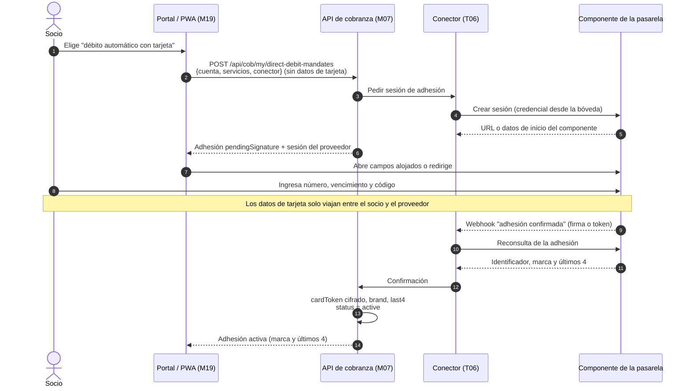
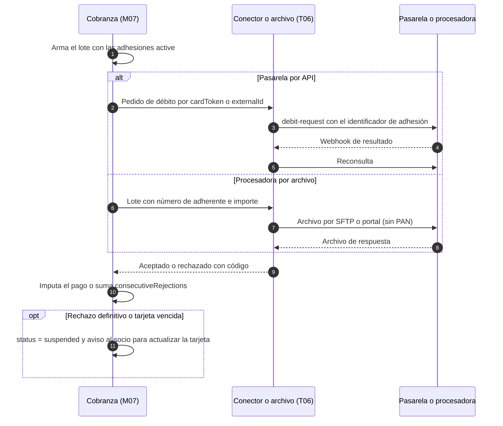
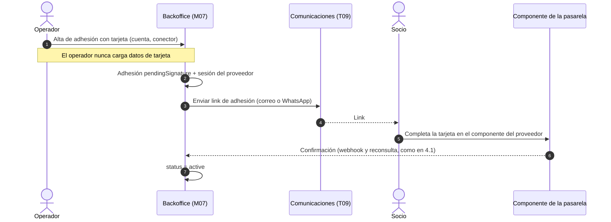

# Tokenización y datos de medios de pago

Ficha de diseño transversal que complementa las fichas de interfaces externas (artefacto 7.5, T06) y los diagramas de secuencia (artefacto 7.3). Reúne en un solo lugar cómo GoodApps trata los datos de tarjeta y de CBU en cada canal y cada proveedor. Fuente: DEC-091 del registro de decisiones, M07 (COL-COB-30, RN-COB-109, RF-COB-144, API-COB-55 y API-COB-81), T06 (§12.8, FI-INT-43, 44, 56, 57 y 93), T07 (RN-MIG-056), T08 (RN-NFR-009) y M19 (RN-POR-039). Si esta ficha y la especificación difieren, prevalece la especificación.

Versión 1.0, 05-11-2026.

## 1. Reglas

1. **El número de tarjeta, el vencimiento y el código de seguridad nunca entran a GoodApps.** Ningún servidor, agente local, bóveda, log, cola, archivo de presentación ni proceso de migración los recibe, ni en claro ni cifrados. Se capturan solo en el componente del proveedor: campos o formulario alojados, checkout por redirección, terminal certificada o el sistema de la procesadora.
2. **Para débito automático con tarjeta se guardan solo cuatro datos**: `cardToken` (identificador opaco del proveedor, cifrado a nivel de campo), `cardTokenType`, `brand` y `last4`.
3. **El CBU sí entra a GoodApps** (lo necesita la presentación bancaria): se valida, se guarda cifrado con la clave de datos financieros del tenant (`cbuEncrypted`) y en adelante solo se muestra enmascarado (`cbuMasked`).
4. **Alcance PCI DSS de GoodApps: SAQ A** (SAQ P2PE para terminales certificadas). Para mantenerlo, cada proveedor tiene certificación PCI DSS vigente (AOC) registrada en la conexión, y las páginas que embeben su componente aplican los controles de scripts de PCI DSS 4.0 (6.4.3 y 11.6.1).
5. **No se integra** una pasarela que solo acepte el número de tarjeta por API de servidor a servidor, ni una procesadora cuyo archivo exija el número completo.

## 2. Qué guarda GoodApps de cada medio

| Medio | Qué se guarda | Cómo se protege | Qué se muestra |
|---|---|---|---|
| Adhesión con CBU | `cbuEncrypted`, `cbuMasked`, `holderName`, `holderCuit` | Cifrado de campo con la clave de datos financieros del tenant (RNF-NFR-055, DEC-074); se descifra solo al generar la presentación | `******************1234` |
| Adhesión con tarjeta por pasarela | `cardToken` (identificador de adhesión, suscripción o tarjeta guardada), `cardTokenType` = `gatewayToken`, `brand`, `last4`, `externalId` | `cardToken` con cifrado de campo determinístico (permite buscar por igualdad); nunca se expone por API ni se registra en logs | Marca y últimos 4 |
| Adhesión con tarjeta por procesadora | `cardToken` = número de adherente asignado por la procesadora, `cardTokenType` = `processorAdherentId`, `brand`, `last4` | Igual que la anterior | Marca y últimos 4 |
| Pago único con tarjeta (portal, link, QR, caja, tótem) | Nada de la tarjeta; en la transacción, autorización, marca y últimos 4 (`gatewayTransactions.payerMasked`) | — | Marca y últimos 4 en el recibo |
| Credenciales de la pasarela | `credentialRef` y `webhookTokenRef` (referencias) | Secreto en la bóveda de T06 con cifrado por sobre (DEC-074) | Nunca |

No se guarda el vencimiento. Una tarjeta vencida o reemplazada se detecta por el rechazo del débito o por el aviso de actualización del proveedor, y genera un pedido al socio para actualizarla en el componente del proveedor.

## 3. Flujo por proveedor

| Proveedor | Ficha | Ola / prioridad | Pago único con tarjeta | Débito automático con tarjeta | Modo de captura (`cardDataMode`) | Qué recibe GoodApps |
|---|---|---|---|---|---|---|
| Pagos360 | FI-INT-43 | O5 / Estándar | Link o botón de pago del proveedor | Adhesión por API con alta en el componente de Pagos360; **condicionada** a confirmarlo en el ambiente de pruebas: si exige enviar el número desde el servidor, el conector se usa solo para CBU | `redirect` | Estado del pago; identificador de la adhesión, marca y últimos 4 |
| Mercado Pago | FI-INT-44 | O5 / Estándar | Checkout (preferencia), link y QR | Suscripción con la tarjeta tokenizada en el navegador por los campos seguros del SDK | `hostedFields` (suscripción) y `redirect` (checkout) | Token de un uso (solo para crear la suscripción); identificador de la suscripción, marca y últimos 4 |
| SIRO API | FI-INT-37 | O5 / Núcleo | Botón de pago y QR del proveedor | No | `redirect` | Estado y datos del pago |
| QR interoperable y billeteras | FI-INT-45 | O5 / Estándar | La billetera del pagador | No | `none` | Estado y datos del pago |
| Macro, NaranjaX, PayFun, Pagos TIC, SiPago, Helipagos, ProntoPago, ProvinciaNet | FI-INT-46 a 53 | Extensión, bajo demanda (CTR-INT-23) | Checkout o botón del proveedor | Solo si el proveedor ofrece adhesión con alta en su propio componente; se evalúa al pedirlo un tenant | `redirect` o `hostedFields` | Estado del pago; si hay débito, identificador, marca y últimos 4 |
| Procesadoras por archivo (Visa, Mastercard, Cabal, Naranja) | FI-INT-57 | O5 / Estándar | No aplica | Archivo mensual **solo** con diseños que identifican al adherente por número de la procesadora; el alta de la tarjeta la hace la procesadora o una pasarela | No aplica | Número de adherente, marca, últimos 4 y respuesta del débito |
| Bancos por archivo (CBU) | FI-INT-56 | O5 / Estándar | No aplica | No aplica (débito con CBU) | No aplica | Respuesta con código interbancario |
| Terminales POS y tótem | FI-INT-93 | O10 / Extensión | Terminal certificada del adquirente, integrada por el agente local | No | `terminal` | Autorización, marca y últimos 4 |

Al habilitar un conector o una procesadora se registra en la conexión: certificación PCI DSS del proveedor, modo de captura y, para procesadoras, el diseño de registro verificado.

## 4. Secuencias

### 4.1 Adhesión del socio con tarjeta por pasarela



### 4.2 Cobro mensual de las adhesiones con tarjeta



### 4.3 Adhesión cargada por el operador



Para procesadoras por archivo el operador registra el número de adherente que informa la procesadora, nunca el número de tarjeta.

### 4.4 Migración de las tarjetas de ProCoop

```mermaid
sequenceDiagram
    autonumber
    participant SQL as SQL Server ProCoop (origen)
    participant X as mig-extractor (T07)
    participant V as Validación de ingesta
    participant M07 as directDebitMandates
    participant T09 as Comunicaciones (T09)
    X->>SQL: SELECT con marca y RIGHT(NUM_TARJ, 4)<br/>(no selecciona NUM_TARJ)
    SQL-->>X: Filas sin número de tarjeta
    X->>V: Snapshot
    V->>V: Rechaza el snapshot si detecta un PAN válido por Luhn
    alt Hay identificador del proveedor (DEBITO_360_ID o número de adherente)
        V->>M07: cardToken = identificador, status = active
    else El proveedor ofrece tokenización masiva
        Note over SQL,M07: La cooperativa la ejecuta con la herramienta del proveedor
        V->>M07: Importa token, marca y últimos 4, status = active
    else Sin identificador
        V->>M07: status = pendingSignature
        M07->>T09: Campaña de re-adhesión al socio
    end
    Note over SQL,M07: Durante la convivencia ProCoop sigue debitando las pendientes;<br/>al corte, las no re-adheridas se listan por cuenta
```

## 5. Controles y pruebas

| Control | Dónde se especifica | Cómo se verifica |
|---|---|---|
| Ninguna colección, log, cola ni archivo contiene PAN, vencimiento ni código | RF-COB-144, RN-NFR-009 | Barrido de patrones de PAN con Luhn sobre bases, logs y archivos de presentación en cada ambiente |
| La migración no transporta PAN | RN-MIG-056 | La validación de ingesta rechaza el snapshot con PAN; revisión de la consulta de extracción |
| Las páginas de pago solo cargan scripts autorizados | DEC-091, T06 §12.8 | Política de seguridad de contenido restringida, inventario e integridad de scripts, alerta ante cambios |
| El token no sale por API ni por logs | COL-COB-30 (`cardToken`) | Prueba de contrato (el esquema de respuesta no lo incluye) y filtro de logs |
| CBU válido y protegido | RF-COB-119, COL-COB-30 (`cbuEncrypted`) | Rechazo de dígitos verificadores inválidos; lectura de la base sin la clave muestra el campo cifrado |
| Webhook auténtico | T06 §12.8, `webhookTokenRef` | Firma o token por conector y confirmación solo por reconsulta |

## 6. Pendientes de construcción

Estos puntos no son huecos de diseño: la decisión ya fija qué hacer en cada resultado.

| Punto | Cuándo se verifica | Si se cumple | Si no se cumple |
|---|---|---|---|
| El alta de adhesión con tarjeta de Pagos360 ocurre en su componente | Al construir FI-INT-43 en O5 (ambiente de pruebas) | Pagos360 cubre CBU y tarjeta | Pagos360 solo para CBU; la tarjeta va por Mercado Pago |
| El diseño de registro de cada procesadora identifica al adherente sin el número completo | Al habilitar cada procesadora (FI-INT-57) | Integración por archivo | Adhesión por pasarela o en el sistema de la procesadora |
| El proveedor de la cooperativa ofrece tokenización masiva para migrar | En el perfilado de migración (T07, fase F1) | Migran como `active` | Re-adhesión por campaña de T09 |
