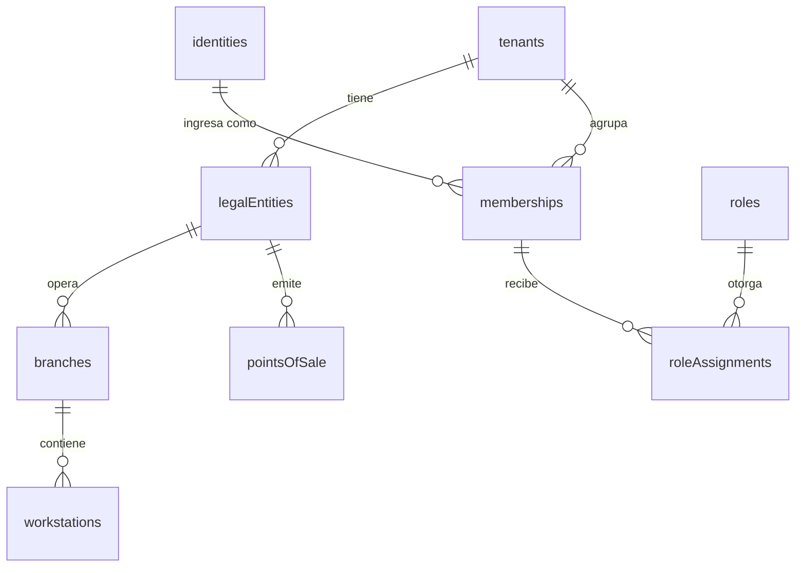
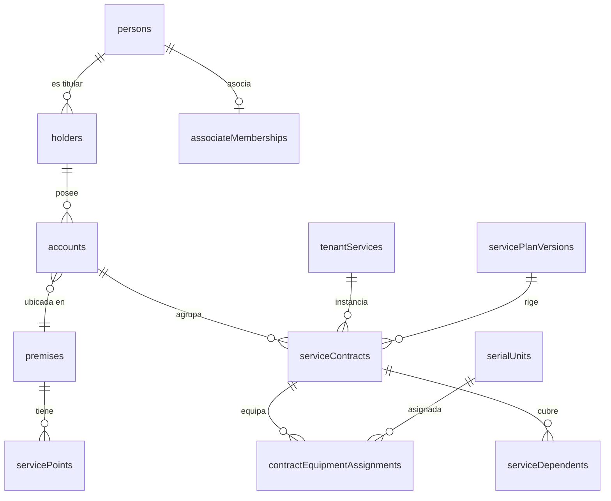
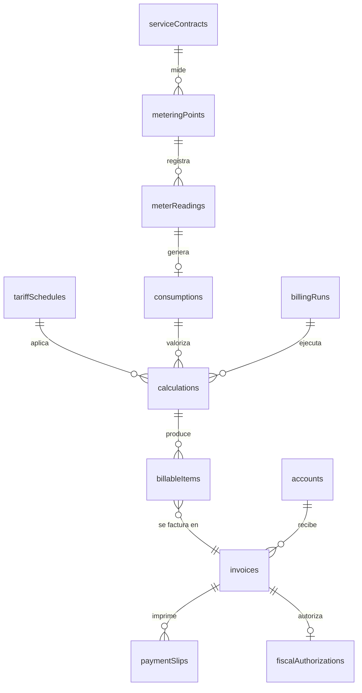
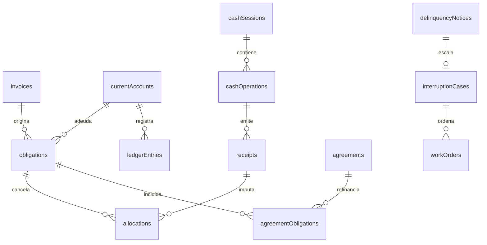
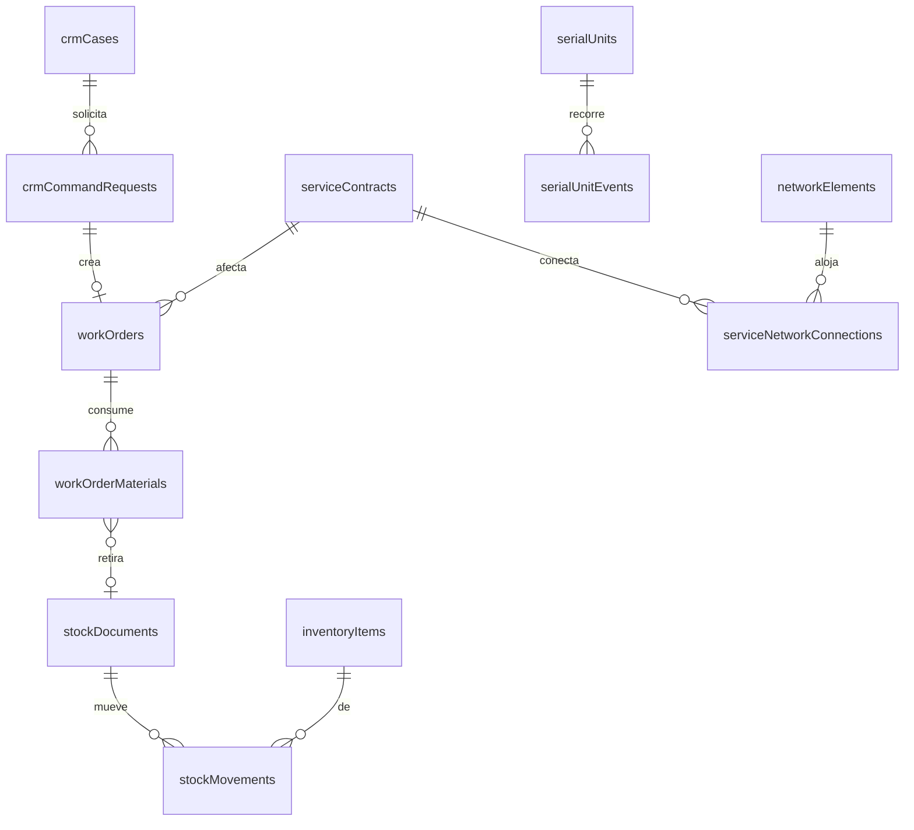
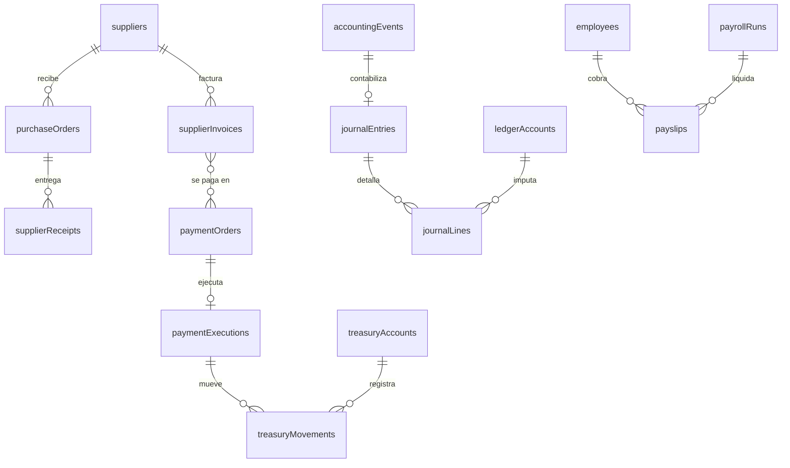

# T05 DAT — Modelo de datos canónico consolidado

| Campo | Valor |
|---|---|
| Versión | 1.0 (lógico); alineación física **1.1-impacto** 19-11-2026 (§6.1, §7.0, DDL `07-ddl`) |
| Estado | Especificación consolidada, actualizada con la fase 1 de huecos, DEC-085 a DEC-087, el barrido final y DEC-096 y DEC-100 (10-11-2026: entidad jurídica en asociados, centros de costo, alcance, auditoría y parámetros; integridad referencial sin claves foráneas, §7.1.16, y CTR-DAT-81) y la sincronización del 10-11-2026 con los anexos dueños de DEC-093, DEC-095, DEC-096, DEC-097, DEC-098, DEC-099, DEC-102 y DEC-104 (colección nueva COL-FIS-48 `ownTaxObligations`; PA-DAT-05), más la última ronda del 10-11-2026 con DEC-105, DEC-106 y DEC-107 y los campos nuevos de M01, M05, M06, M07, M04 y M14 (sin colecciones nuevas; PA-DAT-05) — 82 contraposiciones resueltas en §20 (antes 81 y 80), cada una marcada **Aplicada** en su anexo destino salvo las cuatro sin destino (CTR-DAT-62 aplicada en T11 §7 y §19; CTR-DAT-78 aplicada en T07 §19.16, T11 §7 y M12 §19.2; texto anterior: "salvo CTR-DAT-62 (pendiente en T11), CTR-DAT-78 (pendiente en T07 y T11) y las cuatro sin destino"); PA-DAT-01 y PA-DAT-02 de §21 Asumidas (DEC-087). Texto anterior de la fase 1: "77 contraposiciones resueltas en §20 (aplicar en los anexos dueños)". Texto anterior original: "74 contraposiciones resueltas en §20 (aplicar en los anexos dueños); 2 preguntas abiertas de negocio en §21 (PA-DAT-01 y PA-DAT-02, se asume la recomendada)" |
| Solución (BASE §105) | Plataforma (transversal a ERP / CRM / Landing-autogestión / Cobranza / Pasarelas / Impuestos / APIs) |
| Olas | **O0** (convenciones, plugins de tenancy/auditoría/dinero/fechas/PII, colecciones técnicas, tenant `PLATFORM`, `legalEntities`, `branches`), **O1–O11** (cada colección se crea en la ola de su anexo dueño; orden en §7.9) |
| Dueño de datos | **Ninguna colección.** T05 consolida, normaliza nombres y resuelve contradicciones. Cada colección pertenece al anexo indicado en el catálogo (§7.3–§7.7); ante duda manda el dueño funcional y, sobre él, las DEC. |
| Fuentes consolidadas | `_GUIA-REDACCION-ANEXOS.md` §3–§7; `00-ESPECIFICACION-MAESTRA.md` §3 y §12; `07-modelo-relacional-azure-sql.md` (físico); `01-registro-decisiones.md` DEC-001 a DEC-087 (en especial DEC-002, 007, 011, 012, 017, 050, 052, 064, 065, 070, 071, 074, 075, 076, 083, 085, 086, 087); `_trabajo/huecos-informes-fase1.md` (G1 a G5); `05-registro-huecos.md` (HUE-SRV-01/03, HUECO-TRV-01/02/06, HUECO-SEP-02, HUECO-SAL-02, HUECO-CAP-03, HUECO-VIV-02/03, HUECO-OBR-05, HUE-GAS-03, HUE-TEL-01); §7 y §8 de T01, T02, T03, T04, T04b (partes 1–4, solo claves), T06, T07, T08, T09, T10, T11, T12 (sin colecciones), M01 a M19 |

> **Norma física (DEC-117, DEC-111).** Este anexo define el **modelo lógico** (entidades, dueños, cardinalidad). La implementación en **Azure SQL** y **EF Core** se documenta en `07-modelo-relacional-azure-sql.md`. En export al cliente, usar redacción afirmativa (**DIR-13**).

> **Norma de implementación (DEC-111, DEC-112, DEC-110, DEC-113).** Construcción GoodApps: **.NET 10**, **ASP.NET Core**, **EF Core**, **Azure SQL** (base compartida, `TenantId` en tablas de negocio), front **React 19**, **Microsoft Azure** (Container Apps, Blob, Queue, Key Vault, Application Insights), identidad **OpenIddict**. Modelo físico: `07-modelo-relacional-azure-sql.md` y `07-catalogo-tablas-sql.md`. Checklist e impacto: `06-impacto-adaptacion-stack-goodapps.md` (**DIR-13**).
>
> **Lectura:** «colección» en este anexo = **entidad lógica**; tablas, columnas y FK en `07-*`. RF/RN/CU del anexo **no cambian** por el stack.

## 1. Objetivo

Dar a quien desarrolla una **vista única y normalizada** del modelo de datos de CoopApps para trazar entidades y reglas sin leer cada anexo (implementación SQL vía `07-*`): convenciones obligatorias, catálogo completo de colecciones con su dueño, claves, índices únicos, alcance (tenant o `PLATFORM`), clasificación de datos, ola y origen ProCoop; mapa de relaciones; estrategia de índices, volumen y retención; orden de creación por ola, y la resolución de duplicados, nombres divergentes y dueños en conflicto entre anexos.

El detalle campo por campo sigue viviendo en el §7 del anexo dueño. T05 manda sobre los **nombres canónicos** de colecciones y campos de referencia, sobre las **convenciones transversales** y sobre **qué colección se crea y cuál se absorbe**.

## 2. Límite y responsabilidades

| Hace | No hace | Delega en |
|---|---|---|
| Fija convenciones de modelado obligatorias (§7.1) y nombres canónicos de referencias (§7.2). | No define campos de negocio que no estén en un anexo dueño. | Anexo dueño de cada colección. |
| Cataloga todas las colecciones (§7.3–§7.7) y marca las que se absorben o renombran. | No es dueño de ninguna colección, evento, pantalla ni API. | — |
| Resuelve contraposiciones de datos entre anexos (§20). | No edita otros anexos: las correcciones se aplican en el anexo dueño en su próxima versión. | Responsable de cada anexo. |
| Define estrategia de índices, volumen, particionado lógico y TTL (§7.8). | No define metas de rendimiento ni capacidad. | T08 (RNF), DEC-075. |
| Ordena la creación de colecciones por ola (§7.9). | No define el plan de olas. | `03-plan-de-olas-y-prompts.md`. |
| Fija el contrato de datos de migración común (`legacy`, mapas de IDs) (§19). | No define cargadores ni reglas de mapeo por tabla. | T07. |

## 3. Glosario

| Término | Definición | Clave de diccionario | Equivalente ProCoop |
|---|---|---|---|
| Colección canónica | Colección que se crea con el nombre y dueño fijados por T05. | `dict:dat.term.canonicalCollection` | Tabla SQL Server |
| Colección absorbida | Colección declarada en un anexo que **no se crea**: su contenido vive en otra colección canónica. | `dict:dat.term.absorbedCollection` | — |
| Tenant `PLATFORM` | Tenant técnico reservado que contiene catálogos y tablas de plataforma compartidas (DEC-002). | `dict:dat.term.platformTenant` | Tablas comunes a todas las bases |
| Colección global | Colección sin `tenantId` en lista blanca (solo infraestructura o identidad federada). | `dict:dat.term.globalCollection` | — |
| Documento económico | Documento con efecto patrimonial o fiscal (factura, recibo, movimiento, asiento, recibo de sueldo, retención). Nunca se borra ni se edita tras emitirse. | `dict:dat.term.economicDocument` | `FACTURAS`, `PAG_SOC`, `ASIENTOS`… |
| Snapshot | Copia desnormalizada de datos de referencia guardada en un documento emitido para representarlo como fue. | `dict:dat.term.snapshot` | Columnas copiadas en `FACTURAS` |
| Entidad jurídica | Persona jurídica emisora dentro del tenant (DEC-064). | `dict:dat.term.legalEntity` | `EMPRESAS`, `SU_EMPRESAS` |
| Subdocumento `legacy` | Traza del registro ProCoop de origen en el documento migrado (T07). | `dict:dat.term.legacy` | Clave primaria ProCoop |
| DEK | Clave de cifrado de datos por categoría y tenant, envuelta por la clave maestra en KMS (DEC-074). | `dict:dat.term.dek` | — |

## 4. Actores, permisos y alcance

No aplica (T05 no es dueño de pantallas ni capabilities). Los permisos sobre datos se rigen por T02 (capabilities y alcance) y T08 (clasificación y acceso a datos sensibles).

## 5. Requisitos funcionales

> **Barrido transversal (19-11-2026, DEC-111).** Los RF/RN de **§5–§6** definen comportamiento aceptado. Citas a MongoDB, Mongoose, BullMQ, Vue o npm son **mecanismos históricos Connectia** o columnas de contraste; en build GoodApps prevalecen `03-norma-ejecucion-goodapps.md` §3–§4, `07-ddl` y §7 de este anexo. No reinterpretar alcance sin nueva DEC.

No aplica (T05 no es dueño de funcionalidad). Las obligaciones técnicas de modelado se expresan como reglas RN-DAT en §6 y son criterio de aceptación de cada ola.

## 6. Reglas de modelado

| ID | Regla | Comportamiento ProCoop (fuente) | Decisión en CoopApps | Parámetros |
|---|---|---|---|---|
| RN-DAT-001 | Toda colección de negocio lleva `tenantId` (ObjectId, obligatorio, inmutable) y todo índice compuesto empieza por `tenantId`. | Una base por cooperativa (CAT). | **Reemplazar** (DEC-002). | — |
| RN-DAT-002 | Ninguna consulta, actualización, borrado ni agregación se ejecuta sin contexto de tenant; el plugin `tenancyPlugin` lo fuerza y rechaza la operación si falta. Solo las colecciones globales de §7.1.3 y las operaciones `runAsPlatform` auditadas quedan exceptuadas. | — | **Nuevo**. | — |
| RN-DAT-003 | Un módulo solo escribe sus colecciones (ARQ-01); lee las ajenas por servicio de dominio o proyección, nunca por escritura directa. | Procedimientos que escriben cualquier tabla. | **Reemplazar**. | — |
| RN-DAT-004 | Los documentos económicos no se borran ni se editan tras emitirse; se corrigen por contrapartida (NC/ND, reverso, contraasiento, movimiento inverso). | `ANUFAC`, `ANUPAG_SOC` como tablas espejo. | **Mejorar**. | — |
| RN-DAT-005 | Dinero y cantidades físicas en `Decimal128`, operados con `decimal.js`; nunca `Number` de JavaScript. | `money`/`float` en SQL Server. | **Mejorar**. | PRM-TAR-150 (precisiones) |
| RN-DAT-006 | Instantes en UTC (`Date`); fechas de negocio sin hora como texto `YYYY-MM-DD` interpretado en la zona del tenant; períodos como `YYYY-MM`. | `datetime` local. | **Mejorar**. | `tenants.timezone` |
| RN-DAT-007 | Referencias por `ObjectId`; los documentos emitidos guardan snapshot de los datos que representan. La integridad de las referencias sin claves foráneas se garantiza como dice §7.1.16, con el verificador nocturno de DEC-100 que informa las referencias rotas sin corregirlas. | Claves naturales compuestas (`COD_COM`+`SUC_COM`+`NUM_COM`); sin claves foráneas declaradas (reglas en `INTEGRIDAD`). | **Mejorar**. | — |
| RN-DAT-008 | Todo documento económico o fiscal lleva `legalEntityId` desde O0. | `EMPRESAS` / `COD_EMP`. | **Replicar** (DEC-064). | — |
| RN-DAT-009 | Todo campo con datos personales declara su categoría con `x-pii`; las categorías `SE` (salud, judicial, sindical) y los datos bancarios completos se cifran por campo. | Datos en claro; contraseñas reversibles. | **Reemplazar** (T08). | — |
| RN-DAT-010 | Ningún secreto (contraseña, token, clave privada, certificado) se guarda en colecciones de negocio: solo `credentialRef`/`vaultRef` a la bóveda de T06. | `TELEMEDICION.PASS_TEL`, `INTERNET.USER_PASS`. | **Reemplazar** (DEC-074). | — |
| RN-DAT-011 | Los arreglos embebidos deben estar acotados por diseño; si pueden crecer sin límite se modelan como colección hija. | — | **Nuevo**. | Ver §7.8.4 |
| RN-DAT-012 | Cada cambio de esquema que afecte datos existentes se hace por migración versionada, idempotente y en modo expandir/contraer. | Scripts manuales por versión. | **Reemplazar**. | — |

### 6.1 Norma física vigente (impacto stack — no altera RF/RN)

Las filas de §6 conservan la redacción lógica del catálogo. En **implementación GoodApps** (DEC-111, DEC-110, DEC-117) se interpretan así:

| RN-DAT | Semántica (igual) | Implementación vigente |
|---|---|---|
| RN-DAT-001, RN-DAT-002 | Aislamiento por cooperativa; ninguna operación sin tenant | `TenantId` en tablas de negocio; filtros globales EF; DEC-110 |
| RN-DAT-003 | Solo el dueño escribe | Esquema SQL por módulo; APIs/servicios entre módulos |
| RN-DAT-004–006, RN-DAT-008–010 | Emisión, dinero, fechas, entidad jurídica, PII, bóveda | Igual comportamiento; tipos en `07-*` y dominio .NET |
| RN-DAT-005 | Precisión decimal | `decimal` en SQL / `decimal` en .NET (no `float`) |
| RN-DAT-007 | Referencias y snapshot | FK + índices en `07-ddl`; snapshot en columnas/json según `07`; **más** §7.1.16 (DEC-100) |
| RN-DAT-012 | Migraciones de esquema | EF Core migrations + `pla.SchemaMigrations` |

Catálogo ejecutable: [`07-catalogo-tablas-sql.md`](../07-catalogo-tablas-sql.md) (**1.058** tablas) y [`07-ddl/deploy-coopapps-full.sql`](../07-ddl/deploy-coopapps-full.sql). Seguimiento: `06-impacto-adaptacion-stack-goodapps.md` §12.

## 7. Modelo de datos
> **Barrido C-05 (DEC-111).** En las tablas de este capítulo los tipos objetivo son **Azure SQL** (columnas `uniqueidentifier`, `DECIMAL`, `DATETIME2`, etc.; ver `07-ddl`). Menciones puntuales de Mongo/Mongoose/BullMQ sin tipo de columna = **comparativa histórica** Connectia, sin efecto en build.

### 7.0 Mapeo lógico → físico (DEC-111, DEC-117, DIR-13)

Este §7 conserva el **modelo lógico** redactado sobre nomenclatura documental («colección», `TenantId`, tipos documento). La **norma de implementación** es **Azure SQL** + **EF Core** (`07-modelo-relacional-azure-sql.md`, `07-catalogo-tablas-sql.md`). Al leer §7.1, traducir:

| En este anexo (lógico / histórico) | En implementación (vigente) |
|---|---|
| Colección | Tabla en esquema del módulo dueño (`per`, `iam`, `fac`, …) |
| Documento / fila | Registro (`Id` PK, usualmente `uniqueidentifier` o `bigint` según `07`) |
| `TenantId` (uniqueidentifier) | `TenantId` (`uniqueidentifier` o FK a `pla.Tenants`) |
| `_id` uniqueidentifier | `Id` PK; códigos visibles `Code` / `Number` con unicidad por tenant |
| Plugin Mongoose / consulta sin tenant | Filtro global EF + interceptores; pruebas CI de aislamiento (T08) |
| DECIMAL(18,4) / `decimal.js` | `decimal(p,s)` en SQL; tipos money en dominio .NET |
| Transacción multi-documento + outbox | Transacción SQL única + tabla `OutboxEvents` (T01) |
| BullMQ job | Mensaje Azure Queue + worker .NET idempotente |
| `$jsonSchema` en Mongo | Constraints, CHECK, FK en SQL (DEC-117; DEC-100 adaptado) |
| Índice parcial `isDeleted` | Índice filtrado / constraint en SQL |

El detalle campo a campo de §7.1 **sigue siendo normativo en semántica** (obligatoriedad, estados, PII, vigencias). El **tipo físico** prevalece en `07-*` ante divergencia.

| Capa | Artefacto | Contenido |
|---|---|---|
| A — Inventario | `07-catalogo-tablas-sql.md` | 1.058 tablas, dueño, ola, `TenantId` |
| B — Diseño legible | `07-modelo-relacional-azure-sql.md` §2 | Tipos/FK por módulo (incremental) |
| C — DDL | `07-ddl/` | `CREATE TABLE`, índices únicos (~878), FK (~1912 full / ~942 intra) |

Tras §7.0, los párrafos que citan Mongoose, `uniqueidentifier`, BullMQ o `$jsonSchema` son **descripción lógica o histórica**; la fila equivalente en la tabla de arriba es la norma de build.

### 7.1 Convenciones de modelado (obligatorias para todas las colecciones)

#### 7.1.1 Bases, nombres y tipos

- **Almacenamiento (vigente):** una base **Azure SQL** compartida por ambiente (`CoopApps_<ambiente>` o equivalente operativo), multitenant con **`TenantId`** en tablas de negocio (DEC-110). Esquema analítico/BI y tablas `bi_*` según T10 en la misma instancia o réplica de lectura. Libro de supresiones `erasureLedger` (T08) en esquema/control excluido de restauraciones masivas. *Redacción histórica Mongo:* clúster `goodapps_<ambiente>` — solo referencia de origen 04-11, sin efecto en build.
- **Nombres**: colecciones en inglés, camelCase, plural (`serviceContracts`); campos en inglés, camelCase; valores de enum en camelCase (`pendingApproval`). Prefijo de módulo solo cuando el nombre genérico choca (`crmCases`, `insNumberingSeries` → ver §20). Las etiquetas visibles nunca se guardan como texto fijo: se guarda la clave `labelKey` del diccionario (T03) salvo datos ingresados por usuarios.
- **Identificadores**: PK `Id` (GUID o entero según tabla en `07`). El identificador visible es `code` (catálogos) o `number` (documentos), texto, único por tenant y, si corresponde, por entidad jurídica, punto de venta o serie. *Histórico:* `_id` uniqueidentifier.
- **Tipos compartidos** (dominio + `07`): `Money` (`decimal`), cantidades `Dec`, `DateOnly`, `Period`, `LabelKey`, geografía según módulo, `Snapshot<T>`, `LegacyRef` (§19.1), `AuditFields`, `Validity` (`validFrom`, `validTo`).

#### 7.1.2 Tenancy

- **Vigente (SQL/EF):** `TenantId` obligatorio e inmutable en tablas de negocio; primero en índices compuestos y únicos con `TenantId` (DEC-110). Filtro global en consultas; sin mezcla de tenants en una transacción (T01 §7.8, T08).
- *Histórico (texto lógico):* `TenantId` uniqueidentifier, plugin `tenancyPlugin` / agregaciones Mongo — equivalencias en §7.0. Las pruebas de aislamiento multitenant de CI (T08) cubren toda tabla nueva.
- **Tenant `PLATFORM`**: tenant técnico sembrado en O0 con `tenants.code = 'PLATFORM'` y `_id` fijo por ambiente. Contiene catálogos de plataforma (alcance `P` en el catálogo). Los tenants los leen mediante el servicio de catálogo de T04, que combina filas de `PLATFORM` (solo lectura) con filas propias del tenant (alcance `T+P`, con `platformRef` cuando extienden o adoptan una fila de plataforma).
- **Operación cruzada**: solo el operador de plataforma, mediante `runAsPlatform(reason, tenantIds)`, con concesión de soporte vigente (T02) y auditoría (T02 `auditAccess`).

#### 7.1.3 Colecciones globales (lista blanca sin `TenantId`)

Solo las de la tabla. Cualquier otra colección sin `TenantId` es un defecto bloqueante de revisión.

| Colección | Dueño | Motivo |
|---|---|---|
| `tenants` | T01 | Registro de tenants (raíz). |
| `moduleCatalog` | T01 | Catálogo de módulos y capabilities licenciables. |
| `platformPlans`, `releases`, `featureFlags`, `backupPolicies`, `alertRules` de ámbito plataforma | T01 (RF-PLA-023; DEC-092) | Configuración de la plataforma, común a todos los tenants. |
| `identities`, `federatedLinks` | T02 | Una persona que inicia sesión puede tener membresía en varios tenants. |
| `outboxEvents` (índice `{status, nextAttemptAt}` del despachador), `jobRuns` del despachador | T01 | Llevan `TenantId` como campo, pero el despachador consulta sin filtro de tenant con `runAsPlatform` técnico. |
| `schemaMigrations` | T01 (§7.11.28; COL-PLA-32; antes "nueva, §7.3") | Registro de migraciones de esquema aplicadas. |
| `erasureLedger` | T08 | Base separada, fuera de restauraciones. |

#### 7.1.4 Auditoría y concurrencia

- Campos comunes (`AuditFields`): `createdAt`, `createdBy`, `updatedAt`, `updatedBy` (uniqueidentifier de `memberships` de T02; `system` como uniqueidentifier reservado para jobs) y `version` (entero, control optimista: toda actualización filtra por `{_id, version}` e incrementa `version`; Mongoose `optimisticConcurrency` activo y `versionKey: 'version'`).
- Plugin `auditPlugin` (O0, T02): registra en `auditLogs` creación, cambio (diferencia antes/después con campos `x-pii` enmascarados) y baja lógica de toda colección marcada `audited: true` (por defecto todas las de negocio y configuración).
- Colecciones de historia propia (`serviceContractHistory`, `fixedAssetHistory`, `perRevisions`, `invoiceBlockHistory`…) son **historia de negocio**, consultable en pantallas; no reemplazan a `auditLogs` ni viceversa.

#### 7.1.5 Estados, baja lógica y vigencias

- `status`: enum propio de cada entidad (los valores los fija el §8 del anexo dueño). Nunca se usa un booleano `active` si la entidad tiene más de dos estados.
- **Baja lógica** solo en configuración y maestros: `deletedAt`, `deletedBy`, `deleteReason` y el espejo booleano `isDeleted` (los índices únicos de catálogos son parciales con `partialFilterExpression: {isDeleted: false}`, porque MongoDB no admite `deletedAt: null` en filtros parciales). Un maestro referenciado por un documento emitido no se da de baja: se pasa a `inactive`.
- **Vigencias**: `validFrom` (inclusiva) y `validTo` (exclusiva, nula = abierta), ambas `DateOnly` salvo que el anexo dueño exija instante. Sin solapamiento por clave natural en versiones `active`/`scheduled` (validación de servicio, no de índice).
- **Bitemporalidad** (AGR-010): los hechos con efecto retroactivo llevan `effectiveAt` (fecha efectiva) y `recordedAt` (registro); las versiones reemplazadas llevan `supersededAt` y `supersededById`.
- **Versiones publicadas** (cuadros tarifarios, plantillas, políticas, configuración): `version` de negocio (`number`/`templateVersion`, distinta del contador optimista), `status` (`draft` → `published`/`active` → `superseded`), `contentHash` SHA-256 del contenido canónico; una versión publicada es inmutable.

#### 7.1.6 Documentos económicos y anulación por contrapartida

- Son documentos económicos (no se borran, no se editan después de emitidos; solo cambian campos de estado por transición auditada): `invoices`, `invoiceRelations`, `billedPeriods`, `paymentSlips`, `billingCycleClosures` (M05); `obligations`, `ledgerEntries`, `allocations`, `receipts`, `cashOperations`, `paymentTenders`, `creditBalances` (M07); `interestCalculations`, `agreements`, `agreementInstallments`, `writeOffs` (M08); `fiscalAuthorizations`, `withholdingsApplied`, `vatLedgers` cerrados, `regimeFilings` presentados (M06); `journalEntries`, `journalLines` (M15); `stockMovements`, `fixedAssetDepreciations` (M13); `treasuryMovements`, `ownChecks`, `thirdPartyChecks` (M14); `supplierInvoices`, `paymentOrders`, `supplierLedgerEntries` (M12); `payslips`, `payrollRuns` cerrados (M16); `capitalMovements`, `shareCertificates`, `minutes` firmadas (M17); `salesOrders` facturadas (M11); `meterReadings`, `consumptions` facturados (M03).
- Corrección: documento de signo contrario con `reversalOf` (uniqueidentifier del original) y, en el original, `reversedBy[]` y el estado comercial correspondiente. Las tablas espejo de anulación de ProCoop (`ANUFAC`, `ANUITEMSFAC`, `ANUPAG_SOC`, `ANUPLAN_CAJ`, `ANUIT_PAGSO`) **no** se replican: se migran como documentos en estado anulado.
- Protección técnica: el modelo Mongoose de estas colecciones bloquea `deleteOne`/`deleteMany` y la actualización de campos fuera de la lista blanca de transición; el usuario de base de la aplicación no tiene privilegio `remove` sobre ellas (rol MongoDB `appEconomicWriter`).

#### 7.1.7 Dinero, cantidades y moneda

- Tipo `Money`: `DECIMAL(18,4)`; aritmética con `decimal.js` (`precision: 34`, `rounding: ROUND_HALF_UP` salvo política de redondeo de M04 `roundingPolicies`).
- Precisión de almacenamiento (PRM-TAR-150): importe 2 decimales; precio unitario 6; cantidad 4; fracción de prorrateo 6; tasas y alícuotas 6; cotización 6.
- `currency`: ISO 4217 de 3 letras, a nivel de documento (por defecto `ARS`); a nivel de renglón solo en documentos multimoneda. Toda conversión guarda `exchangeRate` (Dec) y `exchangeRateDate` (`DateOnly`) con referencia a `exchangeRates` de M14.
- Cantidades físicas (estados de medidor, consumos, demanda, factores) también en `Dec` (M03).
- Prohibido: `Number` para dinero, `Double` en agregaciones de importes (usar `$toDecimal`), redondear antes de sumar renglones.

#### 7.1.8 Fechas y períodos

- Instantes: `Date` en UTC (`createdAt`, `recordedAt`, `effectiveAt` con hora, marcas de proceso).
- Fechas de negocio: `DateOnly` (`issueDate`, `dueDate`, `validFrom`, `businessDate`, `birthDate`), interpretadas en `tenants.timezone` (por defecto `America/Argentina/Cordoba`).
- Períodos: `Period` `YYYY-MM` con `sequence` entero cuando hay más de una pasada (M05). Los períodos en objeto `{year, month}` de M05 se normalizan a `period` texto + `sequence` (CTR-DAT-31).
- Días hábiles y feriados: siempre desde `calendars`/`holidays` de T04.

#### 7.1.9 Referencias, snapshots y desnormalización

- Referencias por `uniqueidentifier` con el nombre canónico de §7.2. Una referencia a otro módulo nunca se resuelve con `populate` en escritura; en lectura, solo dentro del mismo tenant.
- **Snapshots obligatorios** en documentos emitidos: datos del cliente (nombre, tipo y número de documento, condición fiscal, domicilios a la fecha), del emisor (entidad jurídica, CUIT, punto de venta), de conceptos (etiqueta impresa, unidad, alícuota) y de la versión tarifaria y reglas usadas. Un cambio posterior en el maestro no altera el documento.
- **Proyecciones** (campos derivados de otro módulo, como `serviceContracts.lastBilledPeriod` o `meteringPoints.lastValues`): solo las escribe un consumidor de eventos del módulo dueño de la colección que las contiene, con `projectedAt`; nunca se editan en pantalla.

#### 7.1.10 Entidad jurídica (DEC-064)

- `legalEntities` (T04, nueva, §7.3): una o más por tenant; la primera se crea con el alta del tenant a partir de los datos fiscales de `tenants`.
- `legalEntityId` obligatorio en: `pointsOfSale`, `numberSequences`, `fiscalProfiles`, `arcaCredentials`, `invoices`, `invoiceDrafts`, `paymentSlips`, `receipts`, `obligations`, `ledgerEntries`, `currentAccounts`, `fiscalAuthorizations`, `withholdingsApplied`, `vatLedgers`, `regimeFilings`, `taxObligations`, `journalEntries`, `chartOfAccounts`, `fiscalYears`, `treasuryAccounts`, `treasuryMovements`, `supplierInvoices`, `paymentOrders`, `purchaseOrders`, `salesOrders`, `payrollRuns`, `payslips`, `employees` (como empleador), `statutoryFilings`, `capitalMovements` y en toda colección que el anexo dueño declare con efecto fiscal o contable.
- `employers` de M16 se absorbe en `legalEntities` con un subdocumento `employer` (CTR-DAT-06).
- Alcance completo de varias entidades por tenant (DEC-096, que completa DEC-064): `legalEntityId` también en `associateMemberships` (obligatorio, con una asociación por persona y entidad: una persona puede ser socia de la cooperativa y afiliada de la mutual a la vez; COL-INS-01), en `costCenters` (COL-CON-16; entidad dueña obligatoria más `sharedWithLegalEntityIds[]` para compartir el centro con otras entidades, M15 RF-CON-081 y RN-CON-127) y en los registros de auditoría `auditLogs` cuando la acción recae sobre un documento o configuración con entidad (COL-IAM-24) y `auditReads` (entidad del recurso leído o del filtro del informe o exportación, COL-IAM-26); la dimensión "entidad jurídica" en el alcance de las asignaciones de roles (`roleAssignments.scope.legalEntities[]`, COL-IAM-07; nombre de T02 §7, antes "`scope.legalEntityIds[]`"), y el ámbito `legalEntity` de los parámetros, entre `tenant` y `branch` (`parameterValues.scope.type`, COL-CFG-02). En M17, además de `associateMemberships` y `capitalMovements`, llevan `legalEntityId` obligatorio (10-11-2026, M17 RN-INS-053): `capitalSubscriptionRules`, `capitalShareValues`, `capitalClosings`, `surplusDistributions`, `governanceBodies`, `meetings`, `rosters`, `inaesReports`, `associateRegisterEditions` y `capitalBalances` (COL-INS-06, 07, 12, 14, 16, 18, 24, 33, 34 y 36); también llevan `legalEntityId` obligatorio, copiado de la membresía, del órgano o de la reunión y coincidente con ella (10-11-2026, cierre; M17 §7.10, §7.11, §7.13, §7.17, §7.22, §7.23 y §7.28, CTR-INS-14), `shareCertificates`, `minutes`, `resolutions`, `capitalTransfers`, `capitalRefunds`, `bodyMandates` e `institutionalFeeSettlements` (COL-INS-13, 22, 23, 10, 11, 17 y 31), con índice único por entidad en `shareCertificates` `{tenantId, legalEntityId, number}` y en `minutes` `{tenantId, legalEntityId, bookType, number}` (series por entidad de T11 §18.6); los demás registros derivados de la membresía (`capitalReserves`, `surplusAllocations`, `rosterEntries`, `memberCredentials`) heredan la entidad de la membresía y deben coincidir con ella; M17 §7 no les declara un campo `legalEntityId` propio. *Reemplazado (10-11-2026, cierre): "los demás registros derivados de la membresía (`capitalReserves`, `capitalTransfers`, `capitalRefunds`, `shareCertificates`, `surplusAllocations`, `bodyMandates`, `rosterEntries`, `memberCredentials`, `institutionalFeeSettlements`) heredan la entidad de la membresía y deben coincidir con ella; M17 §7 no les declara un campo `legalEntityId` propio."* Las personas (M01) siguen sin `legalEntityId`: son del tenant.

#### 7.1.11 Migración (`legacy`)

- Subdocumento `legacy` (T07 §7.6) en todo documento migrado: `{system: 'procoop', table, key, displayKey, runId, hash, readOnly, priorMigration}`; índice disperso `{tenantId: 1, 'legacy.table': 1, 'legacy.key': 1}` en toda colección destino de migración.
- Mapa transversal en `legacyIdMap` y alias de claves en `legacyKeyAliases` (T07). Los campos ad hoc (`legacyCode` de M01, `migration` de M02, `legacy.procoopIdRec` de M05, `legacyRef` de M10) se normalizan a `legacy` (CTR-DAT-32). Detalle en §19.

#### 7.1.12 Clasificación, PII y cifrado por campo

| Código | Categoría | Ejemplos | Tratamiento |
|---|---|---|---|
| `ID` | Identificatorio | Nombre, tipo y número de documento, CUIT/CUIL, fecha de nacimiento | `x-pii: ID`; enmascarado en logs y exportaciones sin permiso; no cifrado (se busca por él). |
| `CT` | Contacto | Email, teléfono, domicilio postal | `x-pii: CT`; enmascarado en logs; consentimiento para usos no transaccionales (T08). |
| `UB` | Ubicación | Coordenadas GPS, domicilio de suministro, posiciones de flota | `x-pii: UB`; acceso por alcance geográfico. |
| `FI` | Financiero | Deuda, pagos, CBU, tarjeta tokenizada, sueldos | `x-pii: FI`; CBU/CVU y número de cuenta cifrados con `dek-financiero` y últimos 4 en claro; nunca PAN de tarjeta. |
| `SE` | Sensible | Salud, discapacidad, electrodependencia, afiliación sindical, antecedentes judiciales, sanciones laborales, biometría | `x-pii: SE`; cifrado por campo con `dek-salud` / `dek-laboral` / `dek-judicial`; lectura auditada en `auditReads` (T02). |
| `OP` | Operativo | Estados, cantidades, referencias | Sin tratamiento especial. |
| `CF` | Configuración | Parámetros, catálogos, plantillas | Sin PII. |
| `TE` | Técnico | Bitácoras, colas, métricas | Sin PII o con PII seudonimizada; TTL. |
| `SC` | Secreto | Credenciales y certificados | Solo en `integrationSecrets` (T06), cifrado por sobre con KMS (DEC-074); nunca se lee en claro fuera del adaptador. |
| `AU` | Auditoría | Bitácoras de acceso y cambio | Inmutable; retención legal. |

- Cifrado por campo: AES-256-GCM en la aplicación (`packages/crypto`), DEK por categoría y tenant guardada envuelta en `encryptionKeys` (T08) y desenvuelta con KMS. Campo cifrado = objeto `{ct, iv, tag, dekId, v}`; si debe buscarse, índice ciego `<campo>Hmac` (HMAC-SHA-256 con clave del tenant). Rotación de DEK por reencriptado diferido (job de T08).
- La anotación `x-pii` es obligatoria en el esquema y alimenta `dataCatalogEntries` (T08) y el enmascarado automático de logs y exportaciones.

#### 7.1.13 Retención

- Cada colección declara `retentionClass` en sus opciones de esquema, que referencia una política de `retentionPolicies` (T08): `legal10y` (documentos económicos y contables: 10 años desde el cierre del ejercicio), `fiscal10y`, `labor10y` (legajos y recibos), `health` (según T08), `operational` (24 meses tras inactividad), `technical` (TTL), `audit` (según T08) y `legacy` (copia de origen 10 años, DEC-070).
- TTL de MongoDB solo para colecciones técnicas (§7.8.3). La supresión de datos de negocio la ejecuta `retentionRuns` (T08) respetando `legalHolds`; lo suprimido queda en `erasureLedger` para reaplicarlo tras una restauración.

#### 7.1.14 Versionado de esquemas y migraciones

- Cada documento lleva `schemaVersion` (entero, por colección). Los lectores aceptan la versión actual y la anterior.
- Migraciones en `packages/db-migrations`, nombradas `AAAAMMDDhhmm-<mod>-<descripcion>`, idempotentes, registradas en `schemaMigrations` (global) con `appliedAt`, `checksum`, `durationMs`.
- Patrón **expandir/contraer**: 1) agregar campo o colección opcional; 2) escribir en ambos formatos; 3) job de relleno por lotes por tenant (BullMQ, reanudable); 4) leer del nuevo formato; 5) quitar el viejo en una versión posterior. Prohibido renombrar campos en caliente.
- Índices declarados en el código de cada módulo; se crean en el despliegue con `createIndexes` en segundo plano por colección; un índice nuevo sobre colección de alto volumen se construye antes del despliegue de código que lo usa.
- Validación: Mongoose en la aplicación para todas; además validador `$jsonSchema` en base (nivel `moderate`) para las colecciones económicas de §7.1.6.

#### 7.1.15 Transacciones y outbox

- Una operación de negocio escribe sus colecciones y su evento en `outboxEvents` (T01) en la **misma transacción** multi-documento; el consumidor idempotente registra la recepción en `inboxReceipts` (T01). Las transacciones no cruzan módulos: la coordinación entre módulos es por eventos o por `operations` de T11.
- Contadores y numeración se actualizan con `findOneAndUpdate` + `$inc` dentro de la transacción del documento que numeran.

#### 7.1.16 Integridad referencial (DEC-100, actualizado DEC-117)

En **Azure SQL** (DEC-111, DEC-117) las relaciones dueñas del modelo llevan **PK/FK y constraints** en `07-*`. **DEC-100** sigue vigente en **comportamiento**: la integridad entre módulos no se delega solo a la base; se garantiza con **cinco mecanismos de aplicación** que se suman a las FK (ninguno corrige datos a ciegas). *Contexto 04-11:* sin FK en Mongo (DEC-001) — superado en implementación, no en reglas de negocio.

1. **Módulo dueño** (RN-DAT-003, ARQ-01). Solo el módulo dueño escribe su colección. Al grabar una referencia a una entidad de otro módulo, el servicio que escribe pide al servicio del módulo dueño de la entidad que confirme que existe, que es del mismo tenant y que su estado admite la referencia; nunca lee la colección ajena directamente. Un maestro referenciado por un documento emitido no se borra: pasa a `inactive` (§7.1.5). Entre módulos, los efectos viajan por eventos del outbox en la misma transacción del cambio (§7.1.15) y los consumidores son idempotentes (`inboxReceipts`), de modo que una referencia derivada no queda a medio escribir.
2. **`uniqueidentifier` y foto en lo emitido** (RN-DAT-007, §7.1.9). Las referencias son `uniqueidentifier` con el nombre canónico de §7.2 y el destino de §7.2.1; las polimórficas se guardan tipadas (`{type, id}` o `entityType` + `entityId`) con la lista cerrada de tipos que declara el anexo dueño. Los documentos emitidos guardan la foto de los datos que representan, así que una referencia que se rompa después no altera lo emitido ni impide reimprimirlo.
3. **`$jsonSchema`** (§7.1.14). Mongoose valida todas las colecciones en la aplicación; además, las colecciones económicas de §7.1.6 tienen validador `$jsonSchema` en la base que exige el tipo `objectId` y la presencia de sus campos de referencia obligatorios (`TenantId`, `legalEntityId` y los que el catálogo marca como obligatorios), aunque la escritura no pase por la aplicación.
4. **Control optimista** (§7.1.4). Toda actualización filtra por `{_id, version}`; dos escrituras concurrentes sobre el mismo documento no se pisan (RNF-NFR-210 de T08) y una baja que compite con un alta de referencia falla con conflicto en lugar de dejar un huérfano.
5. **Verificador nocturno** (DEC-100; requisito operativo en T08, RNF-NFR-260 y JOB-NFR-25). Proceso por tenant que recorre las referencias declaradas en la columna "Claves y referencias" del catálogo (§7.3 a §7.7), con el destino de §7.2 y §7.2.1, y **informa** cada referencia rota (colección y `_id` de origen, campo, colección de destino y `_id` inexistente) **sin corregirla**. El registro de referencias que lee se genera desde los esquemas Mongoose (opción `ref` y tipos de las polimórficas) y CI lo compara con este catálogo (RNF-NFR-244 de T08), de modo que una referencia nueva sin declarar hace fallar el build. Quedan fuera los campos marcados "No es referencia" en §7.2.1, los datos de la foto de lo emitido, el subdocumento `legacy` y las colecciones absorbidas (`A→`); las referencias a colecciones globales (§7.1.3) se verifican sin filtro de tenant y una referencia que apunta a un documento de otro tenant se informa como hallazgo de aislamiento. Cada hallazgo va a la bandeja de integridad del tenant y genera alerta a operaciones (T08).

En la migración, además, el perfilado informa los huérfanos del origen, el orden topológico de carga impide referenciar un `_id` inexistente y la validación posterior a la carga controla la integridad referencial (T07 RF-MIG-020, RF-MIG-045 y fase F8).

### 7.2 Nombres canónicos de campos de referencia

Toda referencia a una entidad de otro módulo usa el nombre de la tabla. Las variantes de la columna "Reemplaza" se corrigen en el anexo dueño de la colección que las contiene (CTR-DAT-30).

| Campo canónico | Apunta a | Dueño | Reemplaza (variantes detectadas) |
|---|---|---|---|
| `TenantId` | `tenants` | T01 | — |
| `legalEntityId` | `legalEntities` | T04 | `employerId` (M16), `companyId`, `COD_EMP` |
| `branchId` | `branches` | T04 | `sucursalId`, `SUC_*` como sucursal, `branchOfficeId` (M14; alias histórico, CTR-DAT-80) |
| `bankBranchId` | `bankBranches` (sucursal bancaria) | M14 | `branchId` cuando apunta a la sucursal de un banco (M14), `COD_SUC` de `CTASUCE`/`VALORES` (CTR-DAT-80) |
| `documentTypeId` | `identityDocumentTypes` (T04) en `persons.identifiers` y `personIdentifierIndex` de M01; `documentTypes` (T11) en `documents` | T04 / T11 | Nunca para tipo de comprobante: ahí es `voucherTypeId` (CTR-DAT-14) |
| `userId`, `createdBy`, `updatedBy`, `assigneeId` | `memberships` (identidad dentro del tenant) | T02 | `users`, `USERS.COD_USU` |
| `identityId` | `identities` (global) | T02 | — |
| `membershipId` | `memberships` (usuario dentro del tenant) | T02 | Nunca para el asociado de M17 (PA 9 del cierre de la corrección, dueño M17, Asumida DEC-072; antes "En M17 (colecciones y eventos del padrón de asociados) apunta a `associateMemberships` (M17, CTR-DAT-09) hasta que se resuelva la PA de renombrarlo a `associateMembershipId`") |
| `associateMembershipId` | `associateMemberships` (asociado de la cooperativa) | M17 | `membershipId` en M17 y en los eventos `ins.membership.*` (EVT-INS-01 a 07); con rol: `fromAssociateMembershipId`, `toAssociateMembershipId`, `grantorAssociateMembershipId`, `proxyAssociateMembershipId` (PA 9 del cierre, dueño M17) |
| `personId` | `persons` | M01 | `COD_PER` |
| `holderId` | `holders` | M01 | `holderPersonId` cuando apunta al titular (M02, M10 → usar `holderId` + `personId` si se necesita la persona) |
| `accountId` | `accounts` (cuenta de servicios, ex `SUMSOC`) | M01 | `supplyId` (M04, M05), `COD_SUM` |
| `currentAccountId` | `currentAccounts` (cuenta corriente) | M07 | — |
| `premiseId` | `premises` (inmueble) | M01 | `propertyId` (M02, M10), `properties` |
| `servicePointId` | `servicePoints` | M01 | `serviceAddress.propertyId` como punto |
| `serviceId` | `tenantServices` | M02 | `tenantServiceId` (M02), `services`, `serviceCode` como referencia (M10). `serviceCode` se conserva solo como código público del servicio en la API externa de T10 (CTR-DAT-32) |
| `contractId` | `serviceContracts` | M02 | `serviceContractId` (M03, M08, M17, M18), `ID_SERSOC` |
| `planId` / `planVersionId` | `servicePlans` / `servicePlanVersions` | M02 | `plans`, `tariffPlans` (M10) |
| `categoryId` | `serviceCategories` | M02 | `categoryCode` como referencia (M03) |
| `conceptId` | `billableConcepts` | M02 | `billingConceptCode` (M03), `COD_PRO` como concepto |
| `serviceProductId` | `serviceProducts` | M02 | `productId` cuando apunta al producto comercial |
| `meteringPointId` / `meterId` | `meteringPoints` / `meters` | M03 | — |
| `tariffScheduleId` | `tariffSchedules` | M04 | `scheduleId` (se admite dentro de M04) |
| `invoiceId` | `invoices` | M05 | `documentId` cuando apunta a factura |
| `voucherTypeId` | `voucherTypes` | M05 | `documentTypeId` (M06, M07, M08) cuando apunta a tipo de comprobante |
| `pointOfSaleId` | `pointsOfSale` | M06 | `fiscalPointOfSaleId` |
| `obligationId` | `obligations` | M07 | — |
| `receiptId` | `receipts` | M07 | — |
| `workOrderId` | `workOrders` | M10 | — |
| `crmCaseId` | `crmCases` | M09 | `caseId`, `cases` |
| `inventoryItemId` | `inventoryItems` | M13 | `stockItemId` (M02, M03), `stockProductRef`, `stockItems` |
| `serialUnitId` | `serialUnits` | M13 | `stockUnitId` (M02), `serialItems` (M03) |
| `warehouseId` | `warehouses` | M13 | `depotId` (M05), `depots`, `COD_DPS` |
| `supplierId` | `suppliers` | M12 | — |
| `treasuryAccountId` | `treasuryAccounts` | M14 | `bankAccountId`, `bankAccountRef` |
| `ledgerAccountId` | `ledgerAccounts` | M15 | `accountingAccountRef`, `accountId` cuando apunta a cuenta contable (prohibido: choca con M01) |
| `costCenterId` | `costCenters` | M15 | — |
| `employeeId` | `employees` | M16 | — |
| `vehicleId` | `fleetVehicles` | M18 | `vehicles` (M10) |
| `documentRefId` / `documentIds[]` | `documents` (expediente T11) | T11 | `fileDocId`, `evidenceDocId` (se admiten como nombres de rol, siempre apuntan a `documents`) |
| `storedFileId` | `storedFiles` | T01 | `fileId`, `fileKey`, `fileAssetId`, `assetId` cuando apunta a binario; derivados con rol (`imageFileId`, `declarationFileId`, `evidenceFileIds`) → `<rol>StoredFileId` / `<rol>StoredFileIds` (por ejemplo `declarationStoredFileId`, `evidenceStoredFileIds`) |
| `credentialRef` | `integrationSecrets` | T06 | `vaultRef`, `csrVaultRef`, `accessSecretRef`, `webhookTokenRef` |
| `workflowInstanceId` / `approvalRequestId` | `workflowInstances` / `approvalRequests` | T11 | `workflowId`, `approvalId` |
| `communicationId` | `communications` | T09 | — |
| `tableId` (grillas) / `screenId` (pantallas) | Clave de la grilla `DataTable` registrada en el código (ej. `per.titulares.list`) / ID de pantalla `PAN-<COD>-NN` | T03 | `screenCode` (nombre que usaba T05 en COL-UXD-07, COL-UXD-10 y COL-CFG-34). Se adopta el nombre de T03 (`tableId` en `dataTableViews`, §7.B.10 y API-UXD-31; `screenId` en `screenHelpArticles`, §7.B.7); en `formCustomizations` rige `formKey`/`fieldKey` de T04. `screenCode` queda solo como alias de documentación y no se usa en código |

#### 7.2.1 Destinos de campos de referencia frecuentes

Agregado el 5-11-2026 a partir de `docs/entregables-analisis-diseno/_trabajo/er-verificacion.json` (referencias sin destino del diagrama entidad-relación). Declara el destino de los campos `*Id` que aparecen en dos o más colecciones sin destino declarado y de los que tienen destino distinto según el contexto. "No es referencia" indica un dato o un identificador externo. Los anexos dueños pueden renombrar el campo al canónico de §7.2 cuando la columna lo indica; mientras tanto el destino rige con el nombre actual.

| Campo | Contexto (colecciones) | Apunta a | Dueño |
|---|---|---|---|
| `templateId` | M01 `documentRequirementTypes`, M08 `agreements`, M18 `housingPlanChanges` y bajas de vivienda | `documentTemplates` | T11 |
| `templateId` | M12 `supplierCorrespondence`, T02 `auditMessages` | `messageTemplates` (COL-COM-36; PA-DAT-04, Asumida DEC-072; antes "`messageTemplates` [VERIFICAR]") | T09 |
| `templateId` | M15 `journalEntries` | `entryTemplates` | M15 |
| `templateId` | M08 `suspensionRestrictionRules` | `code` de la fila de plataforma de la misma colección (alcance `T+P`): clave natural, no uniqueidentifier (PA-DAT-04, Asumida DEC-072; antes "Código de plantilla de plataforma: no es referencia [VERIFICAR]") | M08 |
| `templateId` | M10 `connectionEstimates`, M17 `memberCredentials` | `documentTemplates` (COL-WFL-41; PA-DAT-04, Asumida DEC-072; antes "`documentTemplates` [VERIFICAR]") | T11 |
| `productId` | M04 `productPrices`, M07 `thirdPartyBillers`, M11 `salesDiscountRules` (producto comercial) | `serviceProducts`; canónico `serviceProductId` | M02 |
| `productId` | M12 `purchaseForecasts` (artículo de stock); M18 ya usa `inventoryItemId` en `housingPlans` y materiales de vivienda (PA-SOC-16; antes "M12 `purchaseForecasts`, M18 materiales de vivienda") | `inventoryItems`; canónico `inventoryItemId` | M13 |
| `requestId` | M18 casos de sepelio, subsidio, salud, traslado y ortopedia | `benefitRequests` | M18 |
| `requestId` | T10 `apiUsageLogs` | Identificador de la petición HTTP: no es referencia | — |
| `connectionId`, `connectorId`, `providerConnectionId` | M03, M07, M09, M14, T09, T11 (5-11-2026, sincronización: incluye M10 `provisioningSystems.connectorId`) | `integrationConnections` | T06 |
| `taxId` | M05, M08, M12, T09 (5-11-2026, sincronización: incluye M08 `debtCollectionAgencies.taxId`, que deja de ser uniqueidentifier) | CUIT o documento: no es referencia | — |
| `deviceId` | M10 `syncMutations`, M03 `readingTasks` | `fieldDevices` (COL-TEC-28): M03 usa los mismos dispositivos de campo de M10 (PA-DAT-04, Asumida DEC-072; antes "`fieldDevices` (M03 [VERIFICAR])") | M10 |
| `deviceId` | M16 `timePunches`, T06 `localAgentCommands` | `deviceId` del dispositivo embebido en `localAgents.devices[]` (COL-INT-16): identificador del subdocumento, no uniqueidentifier de colección; M16 lo usa para el reloj de fichada (PA-DAT-04, Asumida DEC-072; antes "Dispositivo de `localAgents` (M16 [VERIFICAR])") | T06 |
| `relationshipTypeId`, `maritalStatusId`, `occupationId`, `closeReasonId`, `noteTypeId`, `usageId`, `stateId` | M01, M04, M18 y catálogos simples de M01 §7.18 | `enumerationItems` (CTR-DAT-12) | T04 |
| `districtSectionId` | M01 | `cadastralDistricts` | T04 |
| `postalCompanyId` | M01 | `postalCarriers` | M05 |
| `reasonId` | M01 `blocks`, M08 `documentHolds` | `holdReasons` (5-11-2026, sincronización: M08 ya usa `holdReasonId`) | M08 |
| `runId` | M13 `fixedAssetDepreciations` | `depreciationRuns` | M13 |
| `runId`, `lastRunId`, `firstRunId` | T07 (`migStagingRecords`, `rollbackJournal`, `legacyRecords`, `legacyIdMap`) | `migrationRuns` | T07 |
| `lastRunId` | T10 `reportSchedules` | `reportRuns` | T10 |
| `reprocessRunId` | M05 `billingExceptions` | `billingRuns` | M05 |
| `reprocessRunId` | T11 `bulkRunItems` | `bulkRuns` | T11 |
| `creditAccountId`, `debitAccountId` | M10 `incidentCategories`, `workGroups`; M16 `payrollAccountingRules` | `ledgerAccounts`; canónico `<rol>LedgerAccountId` | M15 |
| `sourceAccountId`, `targetAccountId` | M15 `accountMappings`, `resultTargets` | `ledgerAccounts` | M15 |
| `sourceAccountId`, `originAccountId` | M14 `bankDeposits`, `paymentFiles`, `payrollPaymentBatches` | `treasuryAccounts`; canónico `<rol>TreasuryAccountId` (5-11-2026, sincronización: M14 ya usa `originTreasuryAccountId` en `payrollPaymentBatches`) | M14 |
| `targetAccountId` | M08 `agreements` | `accounts` (COL-PER-05, cuenta de servicios destino del convenio; PA-DAT-04, Asumida DEC-072; antes "`accounts` (cuenta de servicios) [VERIFICAR]") | M01 |
| `targetChartId`, `sourceChartId`, `copiedFromChartId` | M15 | `chartOfAccounts` | M15 |
| `importBatchId` | T02 `legacyAuditRecords`, M11 `salesOrders` | `migrationBatches` (PA-DAT-04, Asumida DEC-072; antes la fila incluía M08 `interestIndexValues` y decía "`migrationBatches` [VERIFICAR para M08 y M11: puede ser un lote de importación propio]") | T07 |
| `importBatchId` | M08 `interestIndexValues` | `masterImportJobs` (COL-CFG-36): importación de índices desde planilla, no migración (PA-DAT-04, Asumida DEC-072) | T04 |
| `path`, `ancestorIds` | M13 `itemClassifications`, `itemGroups`; M15 `ledgerAccounts`; M10 `networkElements` | Ancestros en la misma colección | Dueño de la colección |
| `projectId` | M11 `salesQuotes` | `crmProjects` (PA-DAT-04, Asumida DEC-072; antes la fila incluía M13 y decía "`crmProjects` [VERIFICAR: M13 puede referirse a obras de M18]") | M09 |
| `projectId` | M13 `stockMovements`, `revaluations` | `works` (COL-TEC-46): obra a la que se imputa el material (PA-DAT-04, Asumida DEC-072) | M10 |
| `sourceEventIds` | M15 `journalEntries`, `journalLines`; T02 `securityAlerts` | `eventId` de `outboxEvents` | T01 |
| `taxRateIds` | M04 `tariffCategoryRates`, `tariffRows`, `productPrices` | `vatRates` (COL-FIS-16), solo alícuotas de IVA; los demás tributos y percepciones del renglón van en `taxIds` → `taxDefinitions` (PA-DAT-04, Asumida DEC-072; antes "`vatRates` o `taxDefinitions` según el tributo (confirmado por PA-TAR-20, Asumida DEC-072)"). M04 debe separar los dos campos (5-11-2026, sincronización: M04 ya separa `taxRateIds` y `taxIds`, PA-TAR-21) | M06 |
| `taxIds` | M07 `collectionReportSchemes`, M08 `interestPolicies` (5-11-2026, sincronización: agrega M04 `tariffCategoryRates`, `tariffRows` y `productPrices`, y M08 `interestPolicies.base.excludedTaxIds`) | `taxDefinitions` | M06 |
| `versionId`, `signedVersionId`, `acceptedVersionIds` | T11 `shareLinks`, `renderRequests`, `signatureRequests`, `documents` | `documentVersions` | T11 |
| `basedOnTemplateId`, `platformTemplateId` | T11 `workflowDefinitions`, `documentTemplates`; T09 `surveyTemplates`, `messageTemplates` | La misma colección (fila de plataforma) | Dueño de la colección |
| `catalogId`, `commandId`, `echeqId`, `dataKeyId`, `kmsKeyId` | T11, M10, T06, M14, T01 | Identificador de documentación o externo: no es referencia | — |
| `checklistFormIds` | M10 `workOrderOperationTypes`, `maintenancePlans` | `fieldForms` | M10 |
| `costCenterModelId` | M15 `accountRoles`, `postingRules`, `entryTemplates.lines[]` | `costCenterModels` (COL-CON-39), que M15 declara en su §7.19.1 (PA-CON-18, Asumida DEC-072; prevalece el anexo dueño). Antes `distributionModels` (COL-CON-19), y antes de eso "Sin colección destino en el catálogo [VERIFICAR; ver PA]" | M15 |
| `defaultAreaId` | M09 `crmCaseTypes`, `crmChannels` | `crmAreas` | M09 |
| `responsibleAreaId` | T11 `operationalInboxItems`, `dossiers` | `crmAreas` (PA-WFL-22 de T11, Asumida DEC-072; antes "`crmAreas` (M09) o `workAreas` (M16) [VERIFICAR; ver PA]") | M09 |
| `evidenceId`, `evidenceIds` | M06 `determinedRates`, `taxExemptions`; M05 `invoiceAnnulmentRequests`; M10 `syncConflicts` | `documents`; canónico `evidenceDocumentId(s)` | T11 |
| `formVersion` | M19 `portalFormSubmissions` (número de lectura) | Número de versión de `formVersions` (no es uniqueidentifier). La referencia es `formVersionId` → `formVersions` (T11) en `portalForms`, `portalFormSubmissions` y `portalDrafts`; `portalForms.versions` y `currentVersion` quedan reemplazados por `formVersions` (PA-POR-21 de M19; antes "M19 `portalFormSubmissions`, `portalDrafts`") | T11 |
| `invoiceTypeId` | M04 `roundingPolicies`, `calculations` | `voucherTypes`; canónico `voucherTypeId` | M05 |
| `lineId` | M13 `stockMovements` | Renglón embebido del mismo documento | M13 |
| `lineId` | T10 `bi_fact_invoiceLine` | Renglón embebido `invoices.lines[].lineId` (COL-FAC-13): la fila analítica es un renglón de factura, no un ítem facturable (PA-DAT-04, Asumida DEC-072; antes "`billableItems` [VERIFICAR]") | M05 |
| `memberId` | M05 `billingRunItems`, M09 `crmProcedureRecords` | `associateMemberships` (COL-INS-01); canónico `associateMembershipId` (PA 9 del cierre); M05 y M09 deben renombrar (PA-DAT-04, Asumida DEC-072; antes "`associateMemberships` [VERIFICAR]") (5-11-2026, sincronización: M05 `billingRunItems` e `invoices.customer` y M09 ya usan `associateMembershipId`) | M17 |
| `paymentId` | T10 `bi_fact_payment`, `bi_fact_allocation` | `receipts` (COL-COB-12): el hecho analítico es el cobro con recibo; canónico `receiptId` (PA-DAT-04, Asumida DEC-072; antes "`cashOperations` o `receipts` [VERIFICAR]") | M07 |
| `pendingChargeId` | M08 `deferredInterests`, `agreementInstallments` | `billableItems`; canónico `billableItemId` (5-11-2026, sincronización: M08 ya usa `billableItemId`) | M05 |
| `seriesId` | M15 `inflationAdjustmentRuns`, T04 `economicIndexValues` | `economicIndexSeries` | T04 (nota del 5-11-2026: T04 §7 nombra `seriesCode` → `economicIndexSeries.code` en `economicIndexValues`, `platformTableReleases` y `platformTableAdoptions`. Rige `seriesId` (uniqueidentifier) como referencia en las colecciones; `seriesCode` se admite solo como clave natural de la serie en payloads de eventos (EVT-CFG-12), en las tablas de plataforma y en la API, igual que `serviceCode` en §7.2. T04 debe renombrar el campo de `economicIndexValues`) |
| `shortageMovementId` | M14 `cashRemittances`, `treasuryCashClosings` | `treasuryMovements` | M14 |
| `unitId` | M01 `servicePoints` | Subdocumento `premises.units` (COL-PER-08; M01 §7 lo declara así): identificador de la unidad dentro del inmueble, no uniqueidentifier de colección (PA-DAT-04, Asumida DEC-072; antes "Unidad embebida en `premises` [VERIFICAR]") | M01 |
| `unitId` | M18 `cemeteryActs` | `burialUnits` | M18 |
| `rightId` | M04 `worksInstallmentPlans` (`planKind = right_acquisition`) | `burialRights` (COL-SOC-22) (PA-DAT-04, Asumida DEC-072; agregado el 5-11-2026) | M18 |
| `paymentOrderRef` | M17 `capitalRefunds` (5-11-2026, sincronización: agrega M17 `surplusAllocations` e `institutionalFeeSettlements`) | `paymentOrders` (COL-CMP-15): orden de pago del reembolso (PA-DAT-04, Asumida DEC-072; agregado el 5-11-2026) | M12 |
| `accountingGroupId` | M01 `accounts` | `collectionAccountingGroups` (COL-COB-47, M07): grupos contables de cobranza, origen `GRU_CON` (PA-PER-17, Asumida DEC-072; decisión del coordinador del 5-11-2026, que sigue a M15 RN-CON-028 y §7.39). Antes "Grupos contables de M15 … [VERIFICAR: M15 no declara la colección en su §7; …]", con dueño M15 | M07 |
| `exceptionId` | M01 `personIdentifierIndex` | `approvalRequests` (T11, COL-WFL-24): la excepción de unicidad de RN-PER-005 es un pedido de aprobación aprobado; nulo en el caso general (PA-PER-18, Asumida DEC-072). Antes "Excepción de unicidad aprobada de RN-PER-005 (M01; PA-PER-17) [VERIFICAR: M01 no declara una colección de excepciones]" | T11 |
| `fiscalClassId` | M02 `billableConcepts` | `fiscalClasses` (COL-FIS-47, M06 §7.38; PA-FIS-21, Asumida DEC-072). Antes "Clase fiscal de M06 (PA-CAT-21) [VERIFICAR: M06 no declara la colección]" | M06 |
| `thirdPartyId`, `authorityIds` | M02 `billableConcepts`, `serviceConcessions` | `persons`: tercero beneficiario y autoridad concedente registrados en M01 (PA-CAT-21, Asumida DEC-072) | M01 |
| `activityId` | M02 `serviceContracts` | `normativeTables` (M06) con `code = arcaActivities` (PA-CAT-22 y PA-FIS-21, Asumida DEC-072). Antes "Actividades económicas de T04 (PA-CAT-21) [VERIFICAR: T04 no declara la colección…]", con dueño T04 | M06 |
| `externalClientId` | M02 `serviceContracts` | `persons` (M01), uniqueidentifier (PA-CAT-22, Asumida DEC-072). Antes "Sin destino: PA-CAT-21 no lo fija [VERIFICAR]", en una fila compartida con `bundleSubscriptionId` | M01 |
| `bundleSubscriptionId` | M02 `serviceContracts` | `bundleSubscriptions` (COL-CAT-29, M02 §7.29; PA-CAT-22, Asumida DEC-072). Antes "Sin destino: PA-CAT-21 no lo fija [VERIFICAR]" | M02 |
| `adjustmentRequestIds` | M04 `retroactiveDiffRuns` | `invoiceAnnulmentRequests` (COL-FAC-17, M05): pedidos de ajuste (NC/ND) (PA-TAR-20 y PA-FAC-22, Asumida DEC-072). Antes "Pedidos de ajuste (NC/ND) de M05 [VERIFICAR: candidata `invoiceAnnulmentRequests`, COL-FAC-17]" | M05 |
| `m02ChangeIds` | M04 `bonusRecalcRuns` | `serviceContractHistory` (COL-CAT-19): versión del contrato con el cambio de categoría (PA-TAR-20, Asumida DEC-072) | M02 |
| `sellerId` | M05 `invoices` | `memberships` (COL-IAM-04): vendedor como usuario del tenant según el canal de venta de M11 (PA-FAC-21, Asumida DEC-072) | T02 |
| `simulationId` | M06 `normativeAdoptions` | `simulationRuns` (COL-TAR-31) de M04 (PA-FIS-20, Asumida DEC-072) | M04 |
| `externalSystemId` | M06 `gatewayDocuments` | `apiClients` (COL-IAM-22) (PA-FIS-20, Asumida DEC-072) | T02 |
| `closeGroupId`, `externalQrId`, `externalPaymentId` | M07 `cashSessions`, `staticQrCodes`, `gatewayTransactions` | No es referencia: correlación del cierre múltiple (UUID) e identificadores del proveedor (string) (5-11-2026, sincronización; Asumida DEC-072, PA-DAT-05) | M07 |
| `planSnapshot`, `noticeModelVersion`, `policyVersion`, `rates[].rateId`, `adminFee.*` | M08 `agreements`, `delinquencyNotices`, `interestCalculations`, `interestRateTables`, `interestPolicies` | No es referencia: copia del plan, números de versión, identificador del tramo y datos del cargo administrativo (5-11-2026, sincronización; Asumida DEC-072, PA-DAT-05) | M08 |
| `externalThreadId`, `targetType` | M09 `crmConversations`, `crmAiSuggestions` | No es referencia: identificador externo del hilo y discriminador de `targetId` (5-11-2026, sincronización; Asumida DEC-072, PA-DAT-05) | M09 |
| `prospect`, `cancelReason`, `entityType`, `casPackageIds`, `deviceId` | M10 `feasibilityRequests`, `fieldEvidence`, `provisioningProfiles`, `fieldDevices` | No es referencia: datos del interesado, motivo, discriminador de `entityId`, códigos del CAS externo y UUID del dispositivo (clave de COL-TEC-28; M10 lo apuntaba a `networkDevices` por error) (5-11-2026, sincronización; Asumida DEC-072, PA-DAT-05) | M10 |
| `sourceType`, `originType`, `quoteVersion`, `installmentType`, `discountAmount`, `discountReason` | M11 `operationCharges`, `salesInstallments`, `salesQuoteAcceptances` | No es referencia: discriminadores de `sourceId` y `originId` (polimórficas), número de versión, código `TIPO_FAC` y datos del descuento (5-11-2026, sincronización; Asumida DEC-072, PA-DAT-05) | M11 |
| `vendorTransactionId` | M03 `prepaidTopUps` | No es referencia: identificador del proveedor de prepago (5-11-2026, sincronización; Asumida DEC-072, PA-DAT-05) | M03 |
| `levyEventId` | M04 `worksInstallmentPlans` | No es referencia: `eventId` del sobre del evento que origina el gravamen (M04 PA-TAR-21) (5-11-2026, sincronización; Asumida DEC-072, PA-DAT-05) | M04 |
| `arcaVatId` | M06 `vatRates` | No es referencia: código ARCA de la alícuota (entero; antes uniqueidentifier) (5-11-2026, sincronización; Asumida DEC-072, PA-DAT-05) | M06 |
| `promptTemplateCode` | T02 `auditAi` | No es referencia: plantilla de prompt versionada en código (antes `promptTemplateId`) (5-11-2026, sincronización; Asumida DEC-072, PA-DAT-05) | T02 |
| `catalogQuestionCode` | T10 `aiQuestions` | No es referencia: código del catálogo de preguntas de la sala (antes `catalogQuestionId`) (5-11-2026, sincronización; Asumida DEC-072, PA-DAT-05) | T10 |
| `externalTransactionNumber` | T06 `integrationFileExchanges` | No es referencia: número de transacción del ente (antes `externalTransactionId`) (5-11-2026, sincronización; Asumida DEC-072, PA-DAT-05) | T06 |
| `ruleCode` | T07 `migrationMappingRules` | No es referencia: clave natural de la regla (antes `ruleId` en esa colección) (5-11-2026, sincronización; Asumida DEC-072, PA-DAT-05) | T07 |
| `jobId` | M02 `bulkContractOperations`, M04 `calculationRuns`, M05 `massOperations` | Identificador del job BullMQ registrado en `jobRuns.jobId` (COL-PLA-27): string, no uniqueidentifier (5-11-2026, sincronización; Asumida DEC-072, PA-DAT-05) | T01 |
| `documentRef`, `receiptRef` | M17 `capitalReserves`, `capitalRefunds` | No es referencia: número del comprobante o del recibo; `documentRef.typeId` → `voucherTypes` (M05) (5-11-2026, sincronización; Asumida DEC-072, PA-DAT-05) | M17 |
| `deviceIds` | M07 `collectors` | `fieldDevices` (COL-TEC-28) (5-11-2026, sincronización; Asumida DEC-072, PA-DAT-05) | M10 |
| `surchargeProductId`, `productIds`, `requiresProductIds`, `excludesProductIds`, `catalogProductId` | M07 `cardPlans`, `collectionReportSchemes`; M02 `serviceProducts` (autorreferencia); M13 `inventoryItems` | `serviceProducts` (COL-CAT-05) (5-11-2026, sincronización; Asumida DEC-072, PA-DAT-05) | M02 |
| `billingTypeId` | M07 `thirdPartyBillers` | `voucherTypes`; canónico `voucherTypeId` (5-11-2026, sincronización; Asumida DEC-072, PA-DAT-05) | M05 |
| `premiseAddressId` | M11 `salesQuotes` | `addresses` (COL-PER-06) (5-11-2026, sincronización; Asumida DEC-072, PA-DAT-05) | M01 |
| `creditNoteRequestId` | M11 `salesReturns` | `invoiceAnnulmentRequests` (COL-FAC-17) (5-11-2026, sincronización; Asumida DEC-072, PA-DAT-05) | M05 |
| `freightSettlementId` | M11 `salesDeliveries` | `tripSettlements` (COL-SOC-50) (5-11-2026, sincronización; Asumida DEC-072, PA-DAT-05) | M18 |
| `discountApprovalId`, `chargeProposalId` | M11 `operationCharges`; M02 `contractEquipmentAssignments` (M13 §7.17) | `approvalRequests` (COL-WFL-24) (5-11-2026, sincronización; Asumida DEC-072, PA-DAT-05) | T11 |
| `declaredAffidavitRef`, `documents`, `acceptanceActId` | M02 `serviceContracts`; M03 `meters`, `distributedGenerationContracts`; T07 `migrationProjects` | `documents` (expediente T11) (5-11-2026, sincronización; Asumida DEC-072, PA-DAT-05) | T11 |
| `feasibilityRef` | M02 `serviceContracts` | `feasibilityRequests` (COL-TEC-01) (5-11-2026, sincronización; Asumida DEC-072, PA-DAT-05) | M10 |
| `defaultReaderIds`, `readerId`, `assigneeId` | M03 `readingRoutes`, `readerWorkSessions`; M05 `billingExceptions` | `memberships` (COL-IAM-04) (5-11-2026, sincronización; Asumida DEC-072, PA-DAT-05) | T02 |
| `ownerRole` | M05 `billingExceptions` | `roles` (T02) por clave del rol, no uniqueidentifier (5-11-2026, sincronización; Asumida DEC-072, PA-DAT-05) | T02 |
| `photoIds` | M03 `meterReadings` | `storedFiles` (5-11-2026, sincronización; Asumida DEC-072, PA-DAT-05) | T01 |
| `reading.routeIds` | M03 `meteringPoints` | `readingRoutes` (COL-MED-13) (5-11-2026, sincronización; Asumida DEC-072, PA-DAT-05) | M03 |
| `serviceBlockId`, `affectedServiceBlockIds` | M05 `billedPeriods`, `invoiceRelations` | Subdocumento `invoices.serviceBlocks` (COL-FAC-13): identificador del bloque dentro de la factura, no uniqueidentifier de colección (5-11-2026, sincronización; Asumida DEC-072, PA-DAT-05) | M05 |
| `paymentOrderId`, `supplierId`, `withholdingTypeId`, `filingId`, `obligationId` | M06 `withholdingsApplied` (`filingId` también en `fiscalDeadlines`) | `paymentOrders` (M12), `suppliers` (M12), `withholdingTypes`, `regimeFilings` y `taxObligations` (M06); en esta colección `obligationId` es la obligación fiscal, no `obligations` de M07 (5-11-2026, sincronización; Asumida DEC-072, PA-DAT-05) | M06 |
| `perceptionTaxId` | M06 `vatRateMatrix` | `taxDefinitions` (COL-FIS-18) (5-11-2026, sincronización; Asumida DEC-072, PA-DAT-05) | M06 |
| `entityId` | M15 `entityAccountAssignments` | Polimórfica según `entityType`, que admite `vatRate` y `taxDefinition` (antes `tax`) (5-11-2026, sincronización; Asumida DEC-072, PA-DAT-05) y `ownTaxObligation` → `ownTaxObligations` (COL-FIS-48; 10-11-2026, DEC-095) | M15 |
| `goodappsBatchId` | T07 `parallelRuns` | `billingRuns` (M05) (5-11-2026, sincronización; Asumida DEC-072, PA-DAT-05) | M05 |
| `ruleId` | T07 `migrationIssues` | `migrationMappingRules` (COL-MIG-04) (5-11-2026, sincronización; Asumida DEC-072, PA-DAT-05) | T07 |
| `snapshotId` | T07 `migrationIssues` | `legacySnapshots` (COL-MIG-02): hallazgos del escaneo previo de secretos, anteriores a la corrida (10-11-2026, DEC-103) | T07 |
| `ownTaxObligationId` | M06 `taxObligations` | `ownTaxObligations` (COL-FIS-48, M06 §7.39): obligación propia de la cooperativa como contribuyente; excluyente con `taxAgentRegistrationId`, que pasa a condicional (10-11-2026, DEC-095) | M06 |
| `lines[].supplyUsageId` | M06 `taxCalculationTraces` | `enumerationItems` (COL-CFG-06) del catálogo `premiseUsages` de M01 §7.18, cuyo ítem lleva la clase normalizada `usageClass`; el uso se toma de `premises.usageId` del inmueble del suministro. `lines[].supplyUsageClass` (enum `residential`, `commercial`, `industrial`, `rural`, `other`) no es referencia. En `vatRateMatrix` la condición pasa a `supplyUsageClasses[]`, enum de plataforma que **no es referencia** (clase `premiseUsages.usageClass` de M01), y `supplyUsageKey` es la lista ordenada de `supplyUsageClasses[]`, solo para el índice único (10-11-2026, DEC-102; M06 §7 `vatRateMatrix`, RF-FIS-079, RN-FIS-073). *Reemplazado (10-11-2026, alineación con M06): "`supplyUsageIds[]`, `lines[].supplyUsageId` \| M06 `vatRateMatrix`, `taxCalculationTraces` \| `enumerationItems` (COL-CFG-06) del catálogo `premiseUsages` … `supplyUsageKey` (lista ordenada de `supplyUsageIds[]`) …".* | T04 / M01 |
| `accessoryApproval.approvedBy`, `accessoryApproval.evidenceId` | M06 `conceptFiscalCases` | `memberships` (COL-IAM-04) y `documents` (T11) (10-11-2026, DEC-093; M06 §7.37) | T02 / T11 |
| `tax.taxDefinitionId`, `activityScope.serviceIds[]`, `activityScope.arcaActivityCodes[]`, `evidenceIds[]`, `approvedBy` | M06 `ownTaxObligations` | `taxDefinitions` (COL-FIS-18, solo con `nature = ownTax`), `tenantServices` (COL-CAT-02), `normativeTables` (COL-FIS-01, `arcaActivities`; código, no uniqueidentifier), `documents` (T11) y `memberships` (COL-IAM-04). `capitalBase.capitalItemIds[]` → `capitalItems` (COL-INS-05, M17): `capitalBase` queda `{source: none/m17CapitalBase, component, capitalItemIds[], requireFinal}`, sin `serviceIds[]` ni `capitalEventTypes[]`, porque M17 no abre la base por servicio ni por evento (M06 §7.39; [VERIFICAR] resuelto en M06 el 10-11-2026). *Reemplazado (10-11-2026): "`capitalBase.capitalEventTypes[]` son códigos del catálogo de eventos de capital de M17, no uniqueidentifier ([VERIFICAR] en M06)".* (10-11-2026, DEC-095) | M06 |
| `capitalBaseRef.capitalClosingId`, `replacesObligationId`, `replacedByObligationId` | M06 `taxObligations` | `capitalClosings` (COL-INS-12, M17; base de capital usada en la obligación propia sobre el capital, RN-FIS-133 puntos 5 y 7) y `taxObligations` (autorreferencia: enlace entre la obligación anulada y la recalculada; `cancelReason` enum `manual`, `ownObligationRevoked`, `capitalBaseReopened`, `recalculated`, no es referencia; EVT-FIS-26) (10-11-2026, DEC-095; M06 §7.26) | M06 / M17 |
| `paymentConflict.paymentExecutionId` | M06 `taxObligations` | `paymentExecutions` (COL-TES-35, M14): ejecución de pago en curso de una obligación anulada o recalculada que queda `cancellationPending` hasta que M14 confirme si se ejecutó o se anuló (RN-FIS-133 punto 9; 10-11-2026, DEC-095, cierre) | M14 |
| `supplierPersonId` | M06 `withholdingsApplied` | `persons` (COL-PER-01): persona de M01 del sujeto retenido, copiada de `suppliers.personId` al confirmar la retención (10-11-2026, DEC-097; M06 RF-FIS-102) | M01 |
| `memberships[].associateMembershipId`, `memberships[].legalEntityId` | M01 `holders` | `associateMemberships` (COL-INS-01) y `legalEntities` (COL-CFG-41): proyección de lectura con un elemento por entidad jurídica; no confundir con `memberships` de T02 (10-11-2026, DEC-096; M01 §7.3; antes `holders.membership` objeto único con `associateMembershipId`) | M17 / T04 |
| `numberAssignments[].numberSequenceId`, `numberAssignments[].billingRunId`, `dueDateCap.perAgency[].agencyId`, `dueDateCap.perAgency[].formatId` | M05 `invoices` | `numberSequences` (COL-FAC-21), `billingRuns` (COL-FAC-05), `collectionAgencies` (COL-COB-21) y `barcodeFormats` (COL-FAC-33) (10-11-2026, DEC-106 y DEC-107; M05 §7 `invoices`, RN-FAC-163, RN-FAC-164) | M05 / M07 |
| `releases[].invoiceId` | M05 `billingRunNumberRanges` | `invoices` (COL-FAC-13): comprobante que liberó el número; `releases[].reassignedNumber` no es referencia (10-11-2026, DEC-107; RN-FAC-164) | M05 |
| `taxObligation.taxObligationId`, `taxObligation.ownTaxObligationId`, `taxObligation.taxAgentRegistrationId`, `taxObligation.legalEntityId` | M14 `paymentExecutions` | `taxObligations` (COL-FIS-30; igual a `sourceRef.docId`), `ownTaxObligations` (COL-FIS-48), `taxAgentRegistrations` (COL-FIS-06) y `legalEntities` (COL-CFG-41); obligatorio con `kind = agencyObligation` (10-11-2026, DEC-095; M14 RF-TES-122, CTR-TES-27) | M06 / T04 |
| `identificationRegularization.taskId`, `identificationRegularization.migrationBatchId` | M01 `persons` | `crmCases` (COL-CRM-01, caso de tipo de sistema `identityDocumentRegularization` abierto con `crm.openCase`, M01 §9.14; el nombre de campo `taskId` es de M01) y `migrationBatches` (COL-MIG-07, T07) (10-11-2026, DEC-099) | M09 / T07 |
| `sharedWithLegalEntityIds[]` | M15 `costCenters`, `chartOfAccounts` | `legalEntities` (COL-CFG-41); vacío = solo la entidad dueña (10-11-2026, DEC-096; M15 RN-CON-127) | T04 |
| `capitalBase.byCapitalItem[].capitalItemId`, `capitalBase.lastMovementId` | M17 `capitalClosings` (y sus copias en `capitalBaseHistory[]`) | `capitalItems` (COL-INS-05) y `capitalMovements` (COL-INS-08) (10-11-2026, DEC-095; M17 RF-INS-109) | M17 |
| `scenarioId` | T10 `indicatorSnapshots` | `simulationScenarios` (COL-CON-22) (5-11-2026, sincronización; Asumida DEC-072, PA-DAT-05) | M15 |
| `indicatorId` | T10 `indicatorSnapshots`, `kpiAlertRules` | `indicatorDefinitions` (COL-BIA-11); `indicatorCode` se conserva como código desnormalizado (5-11-2026, sincronización; Asumida DEC-072, PA-DAT-05) | T10 |
| `reentryOfAssociateMembershipId` | M17 `associateMemberships` | `associateMemberships` (autorreferencia; antes `reentryOfMembershipId`) (5-11-2026, sincronización; Asumida DEC-072, PA-DAT-05) | M17 |
| `productGroupIds` | M17 `capitalItems` | `accountRubrics` (COL-CON-03) (5-11-2026, sincronización; Asumida DEC-072, PA-DAT-05) | M15 |
| `creditRef` | M17 `surplusAllocations` | `creditBalances` (COL-COB-06) (5-11-2026, sincronización; Asumida DEC-072, PA-DAT-05) | M07 |
| `withholdingRef` | M17 `institutionalFeeSettlements` | `withholdingsApplied` (COL-FIS-28) (5-11-2026, sincronización; Asumida DEC-072, PA-DAT-05) | M06 |
| `savedFilterSetId` | M17 `rosters` | `dataTableViews` (COL-UXD-10) (5-11-2026, sincronización; Asumida DEC-072, PA-DAT-05) | T03 |
| `requisitionId`, `requisitionIds` | M13 `reorderSuggestions`, `mrpRuns` | `supplyRequests` (COL-CMP-07) (5-11-2026, sincronización; Asumida DEC-072, PA-DAT-05) | M12 |
| `purchaseReceiptId` | M13 `lots` | `supplierReceipts` (COL-CMP-11) (5-11-2026, sincronización; Asumida DEC-072, PA-DAT-05) | M12 |
| `invoiceId`, `receiptId` | M12 `matchExceptions`, `aiInvoiceExtractions`, `signalRightsSettlements` | `supplierInvoices` (COL-CMP-12) y `supplierReceipts` (COL-CMP-11), no `invoices` de M05 ni `receipts` de M07 (5-11-2026, sincronización; Asumida DEC-072, PA-DAT-05) | M12 |
| `packageIds`, `lines.packageId` | M12 `signalRightsContracts`, `signalRightsSettlements` | `serviceProducts` (COL-CAT-05, M02) (antes `servicePlans`; M02 PA-CAT-23 confirma que el paquete de TV es un producto de servicio) (5-11-2026, sincronización; Asumida DEC-072, PA-DAT-05) | M02 |
| `vatRateId` | M18 `fuelTypes` | `vatRates` (COL-FIS-16), uniqueidentifier obligatorio (antes Enum `vatRate` en M18; resuelve el [VERIFICAR] de obligatoriedad de M18) (5-11-2026, pendientes de la sincronización; Asumida DEC-072, PA-DAT-05) | M06 |
| Autorreferencias: `parentRunId`, `reversesEntryId`, `reversedByEntryId`, `reversesMovementId`, `reversedByMovementId`, `mergedIntoCaseId`, `parentCaseId`, `parentRubricId`, `subrubricId`, `previousNoticeId`, `nextNoticeId`, `reversalOfRunId`, `carriedOverToRunId`, `reservedByRunId`, `complementsRunId`, `correctsRunId`, `parentTripId`, `parentAssetId`, `replacesCertificateId`, `supersedesSubmissionId`, `supersedesSampleResultId`, `rotatedFromId`, `previousClosureId`, `previousVersionId`, `originalFilingId`, `originalReportId` | Varias | La misma colección que los contiene | Dueño de la colección |

### 7.3 Catálogo de colecciones — Plataforma y transversales (T01 a T04)

**Leyenda del catálogo (vale para §7.3 a §7.7).**

- **ID**: `COL-<MOD>-NN`, estable; no se reutiliza si una colección se absorbe.
- **Únicos**: índices únicos además de `_id`; se escriben **sin** `TenantId`, que siempre va primero (`code` = `{tenantId, code}` único). "p." = parcial; "d." = disperso. Es el mínimo canónico; el anexo dueño puede agregar índices no únicos.
- **Alc.**: `T` tenant; `P` tenant `PLATFORM`; `T+P` filas de plataforma más filas propias del tenant; `G` global (§7.1.3); `A` base analítica.
- **Clas.**: códigos de §7.1.12, el primero es el dominante.
- **Est.**: `C` canónica (crear); `R` crear con el nombre indicado en lugar del declarado (5-11-2026: no queda ninguna `R`; las 6 que había pasaron a `C (antes R)` porque sus anexos dueños ya declaran el nombre nuevo); `A→X` absorbida en la colección X (no crear); `N` nueva propuesta por T05 por faltar en el anexo dueño (crear; el dueño debe incorporarla).
- **TTL** en "Propósito" indica índice TTL (§7.8.3).

#### 7.3.1 T01 PLA — Plataforma SaaS

| ID | Colección | Dueño | Propósito | Claves y referencias | Únicos | Alc. | Clas. | Ola | Origen ProCoop | Est. |
|---|---|---|---|---|---|---|---|---|---|---|
| COL-PLA-01 | `tenants` | T01 | Registro del tenant, ciclo de vida, dominios, zona horaria | `brandingRef` → `tenantBrandings` | `code`; `{cuit, kind, environmentKind}` p.; `domains.host` | G | CF/ID | O0 | `Configuracion*.pro`, `EMPRESAS`, V2 518–527, 709 | C |
| COL-PLA-02 | `moduleCatalog` | T01 | Módulos y capabilities licenciables | — | `code` | G | CF | O0 | `MODULOS` | C |
| COL-PLA-03 | `platformPlans` | T01 | Packs y complementos comerciales (DEC-065) | `modules[]` (5-11-2026, residuales: alineado a T01 §7; antes `moduleCodes[]`) | `code` | P | CF | O1 | — | C |
| COL-PLA-04 | `tenantLicenses` | T01 | Licencia vigente y cupos | `platformPlanId` | `{status: active}` p. por tenant | T | CF | O1 | — | C |
| COL-PLA-05 | `tenantModuleActivations` | T01 | Activación de módulos por tenant | `moduleCode` | `moduleCode` | T | CF | O1 | `MODULOS` (habilitados) | C |
| COL-PLA-06 | `tenantChecklists` | T01 | Lista de puesta en marcha | — | `code` | T | OP | O1 | — | C |
| COL-PLA-07 | `onboardingDrafts` | T01 | Alta asistida antes de crear el tenant | — | `draftCode` | P | ID/CT | O1 | — | C |
| COL-PLA-08 | `saasContracts` | T01 | Contrato SaaS GoodApps–cooperativa | `customerTenantId` | `number` | P | FI | O1 | — | C |
| COL-PLA-09 | `usageSnapshots` | T01 | Consumo por tenant y período (cupos, facturación SaaS) | `period` | `{period, metric}` | T | OP | O1 | — | C |
| COL-PLA-10 | `supportCases` | T01 | Casos de soporte del tenant | `openedBy` | `number` | T | OP/CT | O1 | — | C |
| COL-PLA-11 | `supportCaseMessages` | T01 | Mensajes del caso | `supportCaseId` | — | T | OP/CT | O1 | — | C |
| COL-PLA-12 | `supportAccessGrants` | T01 | (duplicada con T02) | — | — | T | AU | O1 | — | A→COL-IAM-20 |
| COL-PLA-13 | `supportSessions` | T01 | Sesiones de soporte con acceso temporal | `supportAccessGrantId` | — | T | AU | O1 | — | C |
| COL-PLA-14 | `platformIncidents` | T01 | Incidentes operativos de plataforma | `affectedTenantIds[]` | `number` | P | TE | O1 | — | C |
| COL-PLA-15 | `alertRules` | T01 | Reglas de alerta operativas y de SLO | `sloDefinitionId` | `code` | T+P | CF | O1 | — | C |
| COL-PLA-16 | `alerts` | T01 | Alertas disparadas (absorbe `alertEvents` de T08) | `alertRuleId` | — | T+P | TE | O1 | — | C |
| COL-PLA-17 | `backupPolicies` | T01 | Políticas de respaldo | — | `code` | P | CF | O0 | — | C |
| COL-PLA-18 | `backupRuns` | T01 | Ejecuciones de respaldo y PITR | `backupPolicyId` | — | P | TE | O0 | — | C |
| COL-PLA-19 | `restoreRequests` | T01 | Pedidos de restauración por tenant | — | `number` | T | AU | O1 | — | C |
| COL-PLA-20 | `restoreTests` | T01 | Simulacros de restauración (absorbe `restoreDrills` de T08) | `backupRunId` | — | T+P | AU | O1 | — | C |
| COL-PLA-21 | `tenantExports` | T01 | Exportaciones completas del tenant | `storedFileId` | — | T | AU | O1 | — | C |
| COL-PLA-22 | `releases` | T01 | Versiones desplegadas y notas | — | `version` | P | TE | O1 | — | C |
| COL-PLA-23 | `featureFlags` | T01 | Banderas funcionales y de UI (absorbe `uiFeatureFlags` de T03) | `kind` (`functional`/`ui`) | `key` | T+P | CF | O1 | — | C |
| COL-PLA-24 | `outboxEvents` | T01 | Outbox transaccional; TTL tras publicar | `type`, `aggregateId` (5-11-2026, residuales: alineado a T01 §7; antes `eventType, aggregateId`) | `eventId` | T (+G despachador) | TE | O0 | — | C |
| COL-PLA-25 | `inboxReceipts` | T01 | Recepciones idempotentes de consumidores; TTL (absorbe `processedEvents` de T08) | `consumer`, `eventId` | `{consumer, eventId}` | T | TE | O0 | — | C |
| COL-PLA-26 | `deadLetters` | T01 | Mensajes fallidos para reproceso | `eventId` | — | T | TE | O0 | — | C |
| COL-PLA-27 | `jobRuns` | T01 | Ejecuciones de jobs BullMQ; TTL | `jobName` (5-11-2026, residuales: alineado a T01 §7; antes `jobDefinitionCode`) | `{jobKey}` p. (no terminales) (5-11-2026, residuales: alineado a T01 §7; antes `{jobId}`) | T (+G) | TE | O0 | — | C |
| COL-PLA-28 | `idempotencyKeys` | T01 | Claves de idempotencia de API; TTL (absorbe la de T08) | `scope` | `{scope, key}` | T | TE | O0 | — | C |
| COL-PLA-29 | `storedFiles` | T01 | Metadatos de binarios en almacenamiento privado | `ownerRef` | `storageKey` | T | según dueño | O0 | `ADJUNTOS` | C |
| COL-PLA-30 | `aiUsage` | T01 | Consumo agregado de IA por tenant y período (cupo) | `period` | `{period, feature}` | T | OP | O2 | — | C |
| COL-PLA-31 | `healthSnapshots` | T01 | Fotos de salud de servicios; TTL | — | — | P | TE | O1 | — | C |
| COL-PLA-32 | `schemaMigrations` | T01 | Registro de migraciones de esquema (§7.1.14); declarada en T01 §7.11.28 (antes `N`, propuesta de T05) | `releaseId` → `releases` | `name` | G | TE | O0 | — | C |

#### 7.3.2 T02 IAM — Identidad, roles y auditoría

| ID | Colección | Dueño | Propósito | Claves y referencias | Únicos | Alc. | Clas. | Ola | Origen ProCoop | Est. |
|---|---|---|---|---|---|---|---|---|---|---|
| COL-IAM-01 | `identities` | T02 | Identidad de inicio de sesión (persona humana) | — | `emailNormalized` d.; `cuilHmac` d. | G | ID/CT | O0 | `USERS` | C |
| COL-IAM-02 | `authFactors` | T02 | Factores de autenticación (contraseña hash, TOTP, passkey) | `identityId` | `{identityId, kind, label}` | P | SC | O0 | `USERS.PASS` (no se migra en claro) | C |
| COL-IAM-03 | `federatedLinks` | T02 | Vínculos Google/OIDC/CiDi | `identityId` | `{provider, subject}` | G | ID | O1 | — | C |
| COL-IAM-04 | `memberships` | T02 | Identidad dentro del tenant (staff, socio, empleado, proveedor) | `identityId`, `personId` | `identityId`; `staff.userCode` d. | T | ID | O0 | `USERS` | C |
| COL-IAM-05 | `roles` | T02 | Roles con capabilities | — | `code` | T+P | CF | O1 | `PERFILES` (parte) | C |
| COL-IAM-06 | `screenProfiles` | T02 | Perfiles de pantalla | — | `code` | T+P | CF | O1 | `PERFILES` | C |
| COL-IAM-07 | `roleAssignments` | T02 | Rol asignado con alcance de datos | `membershipId`, `roleId`; `scope.legalEntities[]` → `legalEntities` (dimensión "entidad jurídica" del alcance, DEC-096; 10-11-2026: nombre de T02 §7, antes "`scope.legalEntityIds[]`"); `scope.areas[]` → `crmAreas` (M09; área de atención, origen `USERS_AREA`, DEC-104) | — | T | CF | O1 | `USERS.COD_PER` | C |
| COL-IAM-08 | `profileAssignments` | T02 | Perfil de pantalla asignado | `membershipId`, `screenProfileId` (5-11-2026, sincronización: T02 §7 adopta el nombre canónico de T05; antes "`membershipId`, `profileId` (5-11-2026, residuales: alineado a T02 §7; antes `membershipId, screenProfileId`)") | — | T | CF | O1 | — | C |
| COL-IAM-09 | `capabilityCatalog` | T02 | Catálogo `cod.recurso.accion` | `module` (5-11-2026, residuales: alineado a T02 §7; antes `moduleCode`) | `code` | P | CF | O0 | — | C |
| COL-IAM-10 | `screenCatalog` | T02 | Pantallas y rutas | `requiredAny[]` (5-11-2026, residuales: alineado a T02 §7; antes `capabilities[]`) | `screenId` (5-11-2026, residuales: alineado a T02 §7; antes `code`) | P | CF | O1 | — | C |
| COL-IAM-11 | `sodRules` | T02 | Reglas de separación de funciones | — | `code` | T+P | CF | O1 | — | C |
| COL-IAM-12 | `sodExceptions` | T02 | Excepciones aprobadas a SoD | `sodRuleId`, `membershipId` | — | T | AU | O1 | — | C |
| COL-IAM-13 | `sessions` | T02 | Sesiones y refresh rotativo; TTL | `membershipId` | `refreshFamilyId` (5-11-2026, sincronización: T02 §7 adopta el nombre canónico de T05; antes "`familyId` (5-11-2026, residuales: alineado a T02 §7; antes `refreshFamilyId`)") | T | SC/TE | O0 | — | C |
| COL-IAM-14 | `authTransactions` | T02 | Transacciones de pre-login y login; TTL | `identityId` | `txId` | P | TE | O0 | — | C |
| COL-IAM-15 | `trustedDevices` | T02 | Dispositivos de confianza | `identityId` | `{identityId, deviceHash}` | P | TE | O1 | — | C |
| COL-IAM-16 | `otpChallenges` | T02 | Desafíos OTP; TTL | `identityId` | — | P | SC | O1 | — | C |
| COL-IAM-17 | `actionTokens` | T02 | Tokens de acción (recuperación, invitación); TTL | `membershipId` | `tokenHash` | T | SC | O0 | — | C |
| COL-IAM-18 | `editPresence` | T02 | Presencia de edición concurrente; TTL | `entity` (`{collection, id}`) (5-11-2026, residuales: alineado a T02 §7; antes `entityRef`) | `{entity.collection, entity.id, membershipId}` (5-11-2026, residuales: alineado a T02 §7; antes `{entityRef, membershipId}`) | T | TE | O1 | — | C |
| COL-IAM-19 | `authorizationRequests` | T02 | Autorizaciones de supervisor en línea | `requestedBy`, `approverId` | `number` | T | AU | O1 | `AUTORIZACIONES` | C |
| COL-IAM-20 | `supportAccessGrants` | T02 | Concesión de acceso temporal de soporte (canónica) | `supportCaseId` (T01) | — | T | AU | O1 | — | C |
| COL-IAM-21 | `identityProviderConfigs` | T02 | Configuración SSO/OIDC/CiDi | `credentialRef` | `code` | T+P | CF | O1 | — | C |
| COL-IAM-22 | `apiClients` | T02 | Clientes API de terceros (canónica; absorbe T10) | `scopes[]` | `clientId` | T | CF | O1 | `WS_KEYS` | C |
| COL-IAM-23 | `apiCredentials` | T02 | Credenciales hash de clientes API (canónica; absorbe T10) | `apiClientId` | `secretPrefix` (5-11-2026, residuales: alineado a T02 §7; antes `keyPrefix`) | T | SC | O1 | `WS_KEYS` | C |
| COL-IAM-24 | `auditLogs` | T02 | Auditoría de cambios | `entity`, `actor` (`actor.membershipId` → `memberships`) (5-11-2026, residuales: alineado a T02 §7; antes `entityRef, actorId`); `legalEntityId` (entidad jurídica del documento o configuración sobre el que recae la acción; obligatorio cuando la entidad auditada lo lleva, DEC-096) | — | T | AU | O0 | `AUDITO`, `AUDITORIA` (vía legado) | C |
| COL-IAM-25 | `auditAccess` | T02 | Auditoría de accesos y operaciones cruzadas | `actorId` | — | T | AU | O0 | — | C |
| COL-IAM-26 | `auditReads` | T02 | Lecturas de datos sensibles | `resource` (`collection`/`id` o `reportId`; antes `entityRef`, que T02 §7 no define y solo figuraba en su tabla de campos porque T05 lo citaba); `legalEntityId` (entidad del recurso leído o filtro de entidad del informe o exportación; vacío si abarca recursos compartidos o varias entidades; 10-11-2026, DEC-096, T02 §7.17) | — | T | AU | O1 | — | C |
| COL-IAM-27 | `auditMessages` | T02 | Auditoría de mensajes enviados | `communicationId` | — | T | AU | O1 | `AUDIT_MAIL` (vía legado) | C |
| COL-IAM-28 | `auditAi` | T02 | Auditoría de acciones asistidas por IA | `aiUsageLogId` (T06) | — | T | AU | O1 | `AUDIT_IA` (vía legado) | C |
| COL-IAM-29 | `legacyAuditRecords` | T02 | Auditoría ProCoop migrada solo lectura | `legacy` | — | T | AU | O11 | `AUDITO`, `AUDITORIA`, `AUDIT_IA`, `AUDIT_MAIL`, `INFO_AUD` | C |
| COL-IAM-30 | `accessReviews` | T02 | Recertificación de accesos | — | `number` | T | AU | O1 | — | C |
| COL-IAM-31 | `securityAlerts` | T02 | Alertas de seguridad de identidad | `identityId` | — | T | AU | O1 | — | C |

#### 7.3.3 T03 UXD — Experiencia, marca y diccionario

| ID | Colección | Dueño | Propósito | Claves y referencias | Únicos | Alc. | Clas. | Ola | Origen ProCoop | Est. |
|---|---|---|---|---|---|---|---|---|---|---|
| COL-UXD-01 | `tenantBrandings` | T03 | Marca publicada por canal (referida por `tenants.brandingRef`) | `brandAssetIds[]` | `{channel, version}` | T | CF | O0 | V2 709 (logo) | C |
| COL-UXD-02 | `brandAssets` | T03 | Recursos de marca (logos, íconos) | `storedFileId` | `code` | T | CF | O0 | — | C |
| COL-UXD-03 | `dictionaryKeys` | T03 | Claves de diccionario y texto base | — | `key` | P | CF | O0 | — | C |
| COL-UXD-04 | `tenantDictionaryEntries` | T03 | Textos propios del tenant | `key` | `{key, locale}` | T | CF | O1 | `VARIABLE_PMOVIL` | C |
| COL-UXD-05 | `dictionaryReleases` | T03 | Versiones publicadas del diccionario | — | `version` | T+P | CF | O1 | — | C |
| COL-UXD-06 | `dictionaryMissingKeys` | T03 | Claves faltantes detectadas | `key` | `{key, locale}` | P | TE | O1 | — | C |
| COL-UXD-07 | `screenHelpArticles` | T03 | Ayuda contextual por pantalla | `screenId` (`PAN-<COD>-NN`, nombre de T03 §7.B.7; antes `screenCode`, alias) | `{screenId, scope}` (T03; antes `{screenCode, locale}`) | T+P | CF | O1 | — | C |
| COL-UXD-08 | `uiFeatureFlags` | T03 | (duplicada con `featureFlags`; dueño de la colección canónica: T01. Lo que T03 describe para `uiFeatureFlags` se aplica a `featureFlags` con `kind = ui`) | — | — | T+P | CF | O1 | — | A→COL-PLA-23 |
| COL-UXD-09 | `userUiPreferences` | T03 | Preferencias de UI por usuario | `membershipId` | `membershipId` | T | OP | O0 | — | C |
| COL-UXD-10 | `dataTableViews` | T03 | Vistas de grilla por usuario o compartidas (absorbe `savedViews` de T04) | `tableId` (ej. `per.titulares.list`; nombre de T03 §7.B.10 y API-UXD-31; antes `screenCode`, alias), `ownerId` | `{tableId, ownerId, name}` (antes `{screenCode, ownerId, name}`) | T | CF | O0 | — | C |
| COL-UXD-11 | `pwaNavConfigs` | T03 | Navegación de la PWA por perfil | `screenProfileId` | `{app, screenProfileId}` | T+P | CF | O1 | — | C |

#### 7.3.4 T04 CFG — Configuración, parámetros y maestros

| ID | Colección | Dueño | Propósito | Claves y referencias | Únicos | Alc. | Clas. | Ola | Origen ProCoop | Est. |
|---|---|---|---|---|---|---|---|---|---|---|
| COL-CFG-01 | `parameterDefinitions` | T04 | Registro tipado de parámetros PRM | `module` (5-11-2026, residuales: alineado a T04 §7; antes `moduleCode`) | `key` | P | CF | O0 | `VARIABLE` (definición) | C |
| COL-CFG-02 | `parameterValues` | T04 | Valores por ámbito (alias `tenantParameters` de T04b) | `key`, `scope` (`scope.type` admite el ámbito `legalEntity`, entre `tenant` y `branch`, con `scope.refId` → `legalEntities`; DEC-096) | `{key, scope.type, scope.refId, validFrom}` (5-11-2026, residuales: alineado a T04 §7; antes `{key, scopeType, scopeId, validFrom}`) | T | CF | O1 | `VARIABLE`, V2 #n | C |
| COL-CFG-03 | `configVersions` | T04 | Paquetes de configuración versionados y publicados | — | `{domain, number}` | T | CF | O1 | — | C |
| COL-CFG-04 | `masterTableDefinitions` | T04 | Definición de tablas maestras | — | `code` | T+P | CF | O1 | — | C |
| COL-CFG-05 | `enumerations` | T04 | Enumeraciones configurables (incluye las claves de M01 §7.18) | — | `code` | T+P | CF | O1 | varias | C |
| COL-CFG-06 | `enumerationItems` | T04 | Ítems de enumeraciones y tablas maestras simples | `enumCode` (5-11-2026, residuales: alineado a T04 §7; antes `enumerationId`) | `{enumCode, code}` p. (5-11-2026, residuales: alineado a T04 §7; antes `{enumerationId, code} p.`) | T+P | CF | O1 | `ESTCIVIL`, `OCUPACION`, `CAUBAJA`… | C |
| COL-CFG-07 | `countries` | T04 | Países | — | `isoCode` | P | CF | O1 | `PAISES` | C |
| COL-CFG-08 | `provinces` | T04 | Provincias | `countryIso2` (5-11-2026, residuales: alineado a T04 §7; antes `countryId`) | `code` | P | CF | O1 | `PROVINCI` | C |
| COL-CFG-09 | `departments` | T04 | Departamentos/partidos | `provinceCode` (5-11-2026, residuales: alineado a T04 §7; antes `provinceId`) | `code` | P | CF | O1 | — | C |
| COL-CFG-10 | `localities` | T04 | Localidades | `departmentCode` (5-11-2026, residuales: alineado a T04 §7; antes `departmentId`) | `code` | T+P | CF/UB | O1 | `LOCALIDA` | C |
| COL-CFG-11 | `postalCodes` | T04 | Códigos postales | `localityCodes[]` (5-11-2026, residuales: alineado a T04 §7; antes `localityId`) | `code` (5-11-2026, residuales: alineado a T04 §7; antes `{code, localityId}`) | P | UB | O1 | — | C |
| COL-CFG-12 | `streets` | T04 | Calles con tramos | `localityCode` (5-11-2026, residuales: alineado a T04 §7; antes `localityId`) | `{localityCode, normalizedName}` (5-11-2026, residuales: alineado a T04 §7; antes `{localityId, code}`) | T | UB | O1 | `CALLES` | C |
| COL-CFG-13 | `streetAliases` | T04 | Alias de calles | `streetId` | `{streetId, alias}` | T | UB | O1 | — | C |
| COL-CFG-14 | `streetProposals` | T04 | Propuestas de calles nuevas | `localityId` | — | T | UB | O1 | — | C |
| COL-CFG-15 | `neighborhoods` | T04 | Barrios | `localityCode` (5-11-2026, residuales: alineado a T04 §7; antes `localityId`) | `{localityCode, code}` (5-11-2026, residuales: alineado a T04 §7; antes `{localityId, code}`) | T | UB | O1 | `BARRIOS` | C |
| COL-CFG-16 | `zones` | T04 | Zonas operativas y geográficas | `geometry` | `code` | T | UB | O1 | `ZONAS` | C |
| COL-CFG-17 | `cadastralDistricts` | T04 | Distritos y secciones catastrales (absorbe `districtSections` de M01) | `localityCode` (5-11-2026, residuales: alineado a T04 §7; antes `localityId`) | `code` | T | UB | O1 | `DISTRITO_SECCION` | C |
| COL-CFG-18 | `geocodeRequests` | T04 | Pedidos de geocodificación; TTL | — | `{provider, queryHash}` | T | UB/TE | O1 | — | C |
| COL-CFG-19 | `calendars` | T04 | Calendarios de días hábiles (canónico para `businessCalendars`) | — | `code` | T+P | CF | O1 | `CALENDARIO` | C |
| COL-CFG-20 | `holidays` | T04 | Feriados nacionales, provinciales y propios (absorbe `holidays` de M16 §7.45) | `calendarCode` (5-11-2026, residuales: alineado a T04 §7; antes `calendarId`) | `{calendarCode, date}` (5-11-2026, residuales: alineado a T04 §7; antes `{calendarId, date}`) | T+P | CF | O1 | `FERIADOS` | C |
| COL-CFG-21 | `economicIndexSeries` | T04 | Series de índices (IPC, CER, UVA, tasas BCRA, inflación contable) | — | `code` | T+P | CF | O1 | `INFLACIO`, `TABINFL` | C |
| COL-CFG-22 | `economicIndexValues` | T04 | Valores por fecha o período | `seriesId` (T04 §7 usa `seriesCode`; ver §7.2.1) | `{seriesId, date}` | T+P | CF | O1 | `INFLACIO` | C |
| COL-CFG-23 | `currencies` | T04 | Monedas ISO | — | `isoCode` | P | CF | O1 | `MONEDAS` | C |
| COL-CFG-24 | `vatConditions` | T04 | (duplicada con M06) | — | — | — | — | — | `SITIVA` | A→COL-FIS-15 |
| COL-CFG-25 | `vatRates` | T04 | (duplicada con M06) | — | — | — | — | — | `ALI_IVA` | A→COL-FIS-16 |
| COL-CFG-26 | `grossIncomeConditions` | T04 | (duplicada con M06) | — | — | — | — | — | `SITIBR` | A→COL-FIS-19 |
| COL-CFG-27 | `grossIncomeRates` | T04 | (duplicada con M06) | — | — | — | — | — | `ALI_IBR` | A→COL-FIS-19 |
| COL-CFG-28 | `identityDocumentTypes` | T04 | Tipos de documento de identidad (canónica para la clave `documentTypes` de M01) | `arcaCode` | `code` | T+P | CF | O1 | `TIPDOC` | C |
| COL-CFG-29 | `taxRegistries` | T04 | (duplicada con M06) | — | — | — | — | — | `IIBB_LUA`, `EMPAFIP` | A→COL-FIS-20 |
| COL-CFG-30 | `taxRegistryEntries` | T04 | (duplicada con M06) | — | — | — | — | — | `IIBB_LUA`, `EMPAFIP` | A→COL-FIS-21 |
| COL-CFG-31 | `platformTableReleases` | T04 | Versiones publicadas de tablas de plataforma no fiscales | `tableCode` | `{tableCode, version}` | P | CF | O1 | — | C |
| COL-CFG-32 | `platformTableAdoptions` | T04 | Adopción por tenant (absorbe `officialTableAdoptions` de M16) | `releaseId` | `{tableCode, effectiveFrom}` | T | CF | O1 | — | C |
| COL-CFG-33 | `customFieldDefinitions` | T04 | Campos extra por entidad | `entity` | `{entity, key}` | T | CF | O2 | `DATOSEXT` (definición) | C |
| COL-CFG-34 | `formCustomizations` | T04 | Personalización de formularios | `formKey`, `fieldKey` (nombres de T04 §7; antes `screenCode`, alias) | `{formKey, fieldKey}` por vigente (T04; antes `{screenCode, version}`) | T | CF | O2 | `FORMULARIOS_PERSONALIZACIONES`, `ABM_VALIDACIONES` | C |
| COL-CFG-35 | `savedViews` | T04 | (duplicada con T03 y T10) | — | — | — | — | — | — | A→COL-UXD-10 |
| COL-CFG-36 | `masterImportJobs` | T04 | Importaciones de maestros desde Excel | `storedFileId` | — | T | OP | O1 | — | C |
| COL-CFG-37 | `seedPacks` | T04 | Paquetes de precarga de demostración | — | `{code, version}` | P | CF | O1 | — | C |
| COL-CFG-38 | `seedApplications` | T04 | Paquetes aplicados por tenant | `seedPackCode` (5-11-2026, residuales: alineado a T04 §7; antes `seedPackId`) | `{seedPackCode, version}` (5-11-2026, residuales: alineado a T04 §7; antes `{seedPackId, version}`) | T | CF | O1 | — | C |
| COL-CFG-39 | `legacyParameterMappings` | T04 | Mapa `VARIABLE`/V2 → PRM | `parameterKey` | `{legacyTable, modVar, codVar}` (5-11-2026, residuales: alineado a T04 §7; antes `{legacyKey}`) | P | CF | O11 | `VARIABLE` | C |
| COL-CFG-40 | `sequences` | T04 | (duplicada con T11 `numberingSequences`) | — | — | — | — | — | — | A→COL-WFL-45 |
| COL-CFG-41 | `legalEntities` | T04 | Entidades jurídicas emisoras del tenant (DEC-064), definida en T04 §7.14: `code`, `legalName`, `tradeName`, `legalForm`, `inaesRegistration`, `fiscal{cuit, ivaConditionCode, iibbRegime, iibbNumber, activityStartDate}`, `address`, `brandingVariantKey`, `isDefault`, `status`, vigencia, `changeHistory[]` y subdocumento `employer` (esquema de M16, CTR-DAT-06). Los nombres de REQ-DEC-064 se leen como `fiscal.*` (CTR-CFG-19). **Reemplaza** la nota anterior "T04 está definiendo esta colección…" y el Est. `N` | `fiscal.cuit`, `employer.payslipSigner`, `employer.bankAgreements.treasuryAccountId` | `code`; `fiscal.cuit`; `isDefault` p. (`isDefault: true`, `status: active`) | T | ID/FI | O0 | `EMPRESAS`, `SU_EMPRESAS`, `SU_TIPOEMPLEADOR` | C |
| COL-CFG-42 | `branches` | T04 | Sucursales del tenant, definida en T04 §7.15: `code`, `name`, `legalEntityId`, `localityId`, `address`, `uses[]` (`attention`, `cashier`, `warehouse`, `pointOfSale`, `technicalBase`; los dueños validan contra estos usos), `isHeadquarters`, `openingHours[]`, `calendarCode`, `status`, vigencia, `legalEntityHistory[]` y `legacy` `{ table: 'PTOVENTA', key: 'SUC_COM', values[] }` con los valores de `SUC_COM` fusionados en la sucursal (T04 §7.15; variante de §19.1: una sucursal puede venir de varios valores; 10-11-2026, DEC-098). **Reemplaza** la nota anterior "T04 está definiendo esta colección…" y el Est. `N` | `legalEntityId`, `localityId`, `calendarCode` | `code` | T | CF/UB | O0 | Valores distintos de `PTOVENTA.SUC_COM`, con propuesta confirmada por la cooperativa antes de migrar puntos de venta y cajas (DEC-098, T04 RF-CFG-142, T07 RN-MIG-057). Texto anterior: "Sucursales de `EMPRESAS`/`CAJASJP` [VERIFICAR]" | C |
| COL-CFG-43 | `workstations` | T04 | Puestos físicos, definida en T04 §7.16: `code`, `name`, `branchId`, `kind` (`counter`, `cashier`, `office`, `kiosk`, `field`), `localAgentId`, `devices[]`, `status`; las cajas de M07 y el turnero de M09 referencian `workstationId`. **Reemplaza** el Est. `N` | `branchId`, `localAgentId` | `code` | T | CF | O1 | `EQUIPOS` / puestos [VERIFICAR] (antes "`cfg.puestos` (T04b), `PUESTOS`") | C |
| COL-CFG-44 | `payrollOfficialCodes` | T04 | Códigos oficiales de sueldos (actividad, condición, revista, siniestro, RNOS…) | `type` | `{type, code, validFrom}` | P | CF | O9 | `SU_ACTIVIDADES`, `SU_CONDICION`, `SU_CONTRATACION`, `SU_SITUACION_REVISTA`, `SU_SINIESTRADO`, `SU_BENEFICIOS_SICOSS`, `SU_TIPOEMPLEADOR`, `SU_OBRA` | C |
| COL-CFG-45 | `contributionRates` | T04 | Alícuotas de aportes y contribuciones | — | `{subsystem, regime, employerType, validFrom}` | P | CF | O9 | Clasificaciones SICOSS | C |
| COL-CFG-46 | `contributionBaseLimits` | T04 | Bases imponibles mínima y máxima | — | `{period}` | P | CF | O9 | P2437, P2438 | C |
| COL-CFG-47 | `minimumWages` | T04 | Salario mínimo vital y móvil | — | `validFrom` | P | CF | O9 | `SU_SALARIO_MINIMO` | C |
| COL-CFG-48 | `incomeTaxDeductionTables` | T04 | Deducciones de Ganancias | — | `{type, year, month}` | P | CF | O9 | `SU_DEDUCCIONES*` | C |
| COL-CFG-49 | `incomeTaxScales` | T04 | Escalas de Ganancias | — | `{type, year, month, from}` | P | CF | O9 | `SU_TRAMAS*` | C |
| COL-CFG-50 | `incomeTaxRules` | T04 | Reglas generales de Ganancias | — | `validFrom` | P | CF | O9 | `clsGanancias` | C |
| COL-CFG-51 | `cedularTaxScales` | T04 | Escala de impuesto cedular | — | `validFrom` | P | CF | O9 | `Impuesto_Cedular` | C |
| COL-CFG-52 | `garnishmentScales` | T04 | Escala de embargabilidad | — | `validFrom` | P | CF | O9 | — | C |
| COL-CFG-53 | `laborLawParameters` | T04 | Parámetros de la ley de contrato de trabajo | — | `validFrom` | P | CF | O9 | — | C |
| COL-CFG-54 | `statutoryFileLayouts` | T04 | (diseños LSD, SICOSS, SICORE: son layouts) | — | — | — | — | — | `LibroSueldoDigital` | A→COL-INT-10 |
| COL-CFG-55 | `officialTableAdoptions` | T04 | (adopción declarada en M16 §7.45) | — | — | — | — | — | — | A→COL-CFG-32 |

### 7.4 Catálogo de colecciones — Transversales técnicos (T06 a T11)

#### 7.4.1 T06 INT — Integraciones

| ID | Colección | Dueño | Propósito | Claves y referencias | Únicos | Alc. | Clas. | Ola | Origen ProCoop | Est. |
|---|---|---|---|---|---|---|---|---|---|---|
| COL-INT-01 | `integrationProviders` | T06 | Catálogo de proveedores y adaptadores | — | `code` | P | CF | O0 | `Sistemas_Telemedicion` (enum) | C |
| COL-INT-02 | `integrationConnections` | T06 | Conexión del tenant con un proveedor | `providerCode`, `secretRefs` (→ `integrationSecrets`) (5-11-2026, residuales: alineado a T06 §7; antes `providerCode, credentialRef`) | `code` | T | CF | O1 | `TELEMEDICION`, `BANCOS` (conexión) | C |
| COL-INT-03 | `integrationSecrets` | T06 | Bóveda: secretos cifrados por sobre con KMS (DEC-074) | `connectionId` | `ref` | T | SC | O0 | `PASS_TEL`, `USER_PASS`, certificados | C |
| COL-INT-04 | `integrationCertificates` | T06 | Metadatos de certificados (vence, emisor, alias) | `credentialRef` | `{issuer, serialNumber}` | T | CF | O1 | — | C |
| COL-INT-05 | `integrationTokens` | T06 | Espejo de metadatos de tokens (valor en Redis); TTL | `connectionId` | `{connectionId, scope}` | T | SC | O0 | — | C |
| COL-INT-06 | `integrationOperations` | T06 | Bitácora de operaciones con proveedores | `connectionId`, `correlationId` | `idempotencyKey` | T | TE | O0 | — | C |
| COL-INT-07 | `integrationMessages` | T06 | Mensajes saneados de request/response; TTL de cuerpos | `operationId` | — | T | TE | O0 | `AUDITORIA_TELEMEDICION` (vía M03) | C |
| COL-INT-08 | `webhookEndpoints` | T06 | Endpoints de entrada por proveedor | `connectionId`, `credentialRef` | `path` | T | CF | O1 | — | C |
| COL-INT-09 | `webhookInbox` | T06 | Webhooks recibidos crudos; TTL | `endpointId` | `{endpointId, dedupKey}` (5-11-2026, residuales: alineado a T06 §7; antes `{endpointId, dedupeKey}`) | T | TE | O1 | — | C |
| COL-INT-10 | `fileLayouts` | T06 | Motor declarativo de layouts (canónica; absorbe `fileLayouts` de M07 y `statutoryFileLayouts` de M16) | `family`, `direction` | `{code, version}` | T+P | CF | O1 | `Importador_Base.Modelos`, `Exportador_Base`, `LibroSueldoDigital` | C |
| COL-INT-11 | `integrationFileExchanges` | T06 | Archivos enviados/recibidos | `layoutCode` + `layoutVersion`, `storedFileId` (5-11-2026, residuales: alineado a T06 §7; antes `fileLayoutId, storedFileId`) | `{connectionId, sha256}` (5-11-2026, residuales: alineado a T06 §7; antes `{connectionId, fileHash}`) | T | TE | O1 | — | C |
| COL-INT-12 | `integrationReconciliations` | T06 | Conciliaciones técnicas con proveedores | `connectionId` | — | T | OP | O4 | — | C |
| COL-INT-13 | `integrationAlerts` | T06 | Alertas de integración | `connectionId` | — | T | TE | O1 | — | C |
| COL-INT-14 | `integrationContingencies` | T06 | Contingencias declaradas (ARCA caída, pasarela caída) | `connectionId` | — | T | OP | O4 | — | C |
| COL-INT-15 | `externalReferences` | T06 | Identificadores externos de entidades propias | `entity` (`{type, id}`), `system` (5-11-2026, residuales: alineado a T06 §7; antes `entityRef, providerCode`) | `{system, externalId, entity.type}` (5-11-2026, residuales: alineado a T06 §7; antes `{providerCode, externalId, entityType}`) | T | OP | O1 | — | C |
| COL-INT-16 | `localAgents` | T06 | Agentes de hardware local registrados | `workstationId` | `agentCode` | T | CF | O10 | — | C |
| COL-INT-17 | `localAgentCommands` | T06 | Comandos al agente local; TTL | `agentId` (→ `localAgents`) (5-11-2026, residuales: alineado a T06 §7; antes `localAgentId`) | `commandId` | T | TE | O10 | — | C |
| COL-INT-18 | `aiUsageLogs` | T06 | Llamadas a IA por request (costo, modelo, tokens) | `feature`, `actorId` | — | T | TE | O2 | — | C |

#### 7.4.2 T07 MIG — Migración desde ProCoop

| ID | Colección | Dueño | Propósito | Claves y referencias | Únicos | Alc. | Clas. | Ola | Origen ProCoop | Est. |
|---|---|---|---|---|---|---|---|---|---|---|
| COL-MIG-01 | `migrationProjects` | T07 | Proyecto de migración por cooperativa | `acceptanceActId` (→ `documents`, T11) (5-11-2026, sincronización: T07 §7, PA-MIG-20; antes "—") | `code` | T | OP | O1 | — | C |
| COL-MIG-02 | `legacySnapshots` | T07 | Copias del origen (metadatos; binarios en almacenamiento privado) | `storedFileId` | `{projectId, takenAt}` | T | ID/FI | O0 | Base SQL Server | C |
| COL-MIG-03 | `migrationMappingSets` | T07 | Conjuntos versionados de reglas | — | `{code, version}` | T+P | CF | O1 | — | C |
| COL-MIG-04 | `migrationMappingRules` | T07 | Reglas tabla → colección | `mappingSetId` | `{mappingSetId, sourceTable, target}` | T+P | CF | O1 | CAT completo | C |
| COL-MIG-05 | `migrationValueMaps` | T07 | Mapas de valores (enums, códigos) | `mappingSetId` | `{mappingSetId, domain, sourceValue}` | T+P | CF | O1 | — | C |
| COL-MIG-06 | `migrationRuns` | T07 | Corridas | `projectId` | `{projectId, number}` | T | OP | O1 | — | C |
| COL-MIG-07 | `migrationBatches` | T07 | Lotes por tabla y corrida | `runId` | `{runId, sourceTable, batchNo}` | T | OP | O1 | — | C |
| COL-MIG-08 | `migStagingRecords` | T07 | Registros en staging; TTL | `batchId` | `{batchId, sourceKey}` | T | ID/FI | O1 | Todas | C |
| COL-MIG-09 | `legacyIdMap` | T07 | Mapa clave ProCoop → uniqueidentifier | `targetCollection` | `{sourceTable, sourceKey}` | T | OP | O0 | Claves primarias | C |
| COL-MIG-10 | `legacyKeyAliases` | T07 | Alias de claves ProCoop vigentes (usuario, ID_FAC; DEC-050) | `targetRef` | `{kind, alias}` | T | OP | O1 | `FACTURAS.USUARIO`, `ID_FAC` | C |
| COL-MIG-11 | `migrationIssues` | T07 | Rechazos y advertencias (incluye los hallazgos del escaneo previo de secretos, sin valores; DEC-103) | `batchId`, `ruleId` (→ `migrationMappingRules`), `snapshotId` (→ `legacySnapshots`, DEC-103) (5-11-2026, sincronización: T07 §7.26 (Asumida DEC-072, PA-DAT-05): la referencia conserva `ruleId`; `ruleCode` es la clave natural de la regla; antes "`batchId`") | — | T | OP | O1 | — | C |
| COL-MIG-12 | `migrationReconciliations` | T07 | Conciliaciones origen-destino | `runId` | `{runId, check}` | T | OP | O1 | — | C |
| COL-MIG-13 | `parallelRuns` | T07 | Corrida paralela | `projectId`, `goodappsBatchId` (→ `billingRuns`, M05) (5-11-2026, sincronización: T07 §7; antes "`projectId`") | `{projectId, period, domain}` | T | OP | O11 | — | C |
| COL-MIG-14 | `parallelComparisons` | T07 | Comparación ítem a ítem (absorbe `parallelRunComparisons` de M16) | `parallelRunId` | `{parallelRunId, itemKey}` | T | FI | O11 | — | C |
| COL-MIG-15 | `bypassPlans` | T07 | By-pass por módulo | — | `{projectId, moduleCode}` | T | OP | O11 | — | C |
| COL-MIG-16 | `coexistenceSyncs` | T07 | Sincronizaciones de convivencia | — | — | T | OP | O11 | — | C |
| COL-MIG-17 | `cutoverPlans` | T07 | Plan de corte | `projectId` | `projectId` p. activo | T | OP | O11 | — | C |
| COL-MIG-18 | `rollbackJournal` | T07 | Diario de reversión | `runId` | — | T | OP | O11 | — | C |
| COL-MIG-19 | `legacyRecords` | T07 | Histórico no tipado consultable (DEC-070) | `legacy.table`, `entityRef` | `{legacy.table, legacy.key}` | T | según origen | O1 | Histórico > 24 meses | C |
| COL-MIG-20 | `anonymizationProfiles` | T07 | Perfiles de anonimización para ensayos | — | `code` | P | CF | O1 | — | C |

#### 7.4.3 T08 NFR — No funcionales, seguridad y privacidad

| ID | Colección | Dueño | Propósito | Claves y referencias | Únicos | Alc. | Clas. | Ola | Origen ProCoop | Est. |
|---|---|---|---|---|---|---|---|---|---|---|
| COL-NFR-01 | `dataCatalogEntries` | T08 | Catálogo de datos personales (de `x-pii`) | `collection`, `field` | `{collection, field}` | T+P | CF | O0 | — | C |
| COL-NFR-02 | `processingActivities` | T08 | Registro de tratamientos | — | `code` | T | CF | O1 | — | C |
| COL-NFR-03 | `privacyNotices` | T08 | Avisos de privacidad versionados | — | `{channel, version}` | T | CF | O1 | — | C |
| COL-NFR-04 | `consentRecords` | T08 | Consentimientos (canónica; absorbe `consents` de M01 y `consentRecords` de T09) | `personId`, `purposeCode`, `channel` (5-11-2026, residuales: alineado a T08 §7; antes `personId, purpose, channel`) | — | T | ID/CT | O1 | — | C |
| COL-NFR-05 | `dataSubjectRequests` | T08 | Solicitudes de derechos (canónica; absorbe la de M01) | `personId` | `number` | T | ID | O1 | — | C |
| COL-NFR-06 | `retentionPolicies` | T08 | Políticas de retención (canónica; absorbe la de T11) | `retentionClass` | `code` | T+P | CF | O1 | — | C |
| COL-NFR-07 | `legalHolds` | T08 | Retenciones legales (canónica; absorbe la de T11) | `entityRefs[]` | `number` | T | AU | O1 | — | C |
| COL-NFR-08 | `retentionRuns` | T08 | Corridas de supresión | `retentionPolicyId` | — | T | AU | O1 | — | C |
| COL-NFR-09 | `erasureLedger` | T08 | Libro de supresiones fuera de restauraciones | `TenantId` como campo | `{tenantId, entityRef}` | G | AU | O1 | — | C |
| COL-NFR-10 | `securityIncidents` | T08 | Incidentes de seguridad y privacidad | `platformIncidentId` | `number` | T+P | AU | O1 | — | C |
| COL-NFR-11 | `restoreDrills` | T08 | (duplicada con `restoreTests`) | — | — | — | — | — | — | A→COL-PLA-20 |
| COL-NFR-12 | `encryptionKeys` | T08 | DEK envueltas por categoría y tenant | `category` | `{category, version}` | T | SC | O0 | — | C |
| COL-NFR-13 | `idempotencyKeys` | T08 | (duplicada con T01) | — | — | — | — | — | — | A→COL-PLA-28 |
| COL-NFR-14 | `processedEvents` | T08 | (duplicada con `inboxReceipts`) | — | — | — | — | — | — | A→COL-PLA-25 |
| COL-NFR-15 | `locks` | T08 | Locks distribuidos de respaldo a Redis; TTL | `resource` | `resource` | T | TE | O0 | — | C |
| COL-NFR-16 | `sloDefinitions` | T08 | Objetivos de nivel de servicio | — | `code` | P | CF | O1 | — | C |
| COL-NFR-17 | `alertRules` | T08 | (duplicada con T01) | — | — | — | — | — | — | A→COL-PLA-15 |
| COL-NFR-18 | `alertEvents` | T08 | (duplicada con `alerts`) | — | — | — | — | — | — | A→COL-PLA-16 |
| COL-NFR-19 | `cspReports` | T08 | Reportes CSP; TTL | — | — | P | TE | O0 | — | C |
| COL-NFR-20 | `qualityEvidence` | T08 | Evidencias de calidad por ola | `wave` | `{wave, control}` | P | AU | O0 | — | C |
| COL-NFR-21 | `statusNotices` | T08 | Página de estado (incidentes y mantenimientos) | `incidentId` (→ `platformIncidents`) (5-11-2026, residuales: alineado a T08 §7; antes `platformIncidentId`) | — | P | TE | O1 | — | C |
| COL-NFR-22 | `tenantUsageSnapshots` | T08 | (duplicada con `usageSnapshots`) | — | — | — | — | — | — | A→COL-PLA-09 |
| COL-NFR-23 | `subprocessors` | T08 | Registro público de subencargados (DEC-076) | — | `code` | P | CF | O1 | — | C |

#### 7.4.4 T09 COM — Comunidad y comunicaciones

| ID | Colección | Dueño | Propósito | Claves y referencias | Únicos | Alc. | Clas. | Ola | Origen ProCoop | Est. |
|---|---|---|---|---|---|---|---|---|---|---|
| COL-COM-01 | `posts` | T09 | Publicaciones del muro y novedades | `categoryId`, `audienceSegmentId` | `slug` | T | OP | O2 | `NOVEDADES` [VERIFICAR] | C |
| COL-COM-02 | `postCategories` | T09 | Categorías | — | `code` | T | CF | O2 | — | C |
| COL-COM-03 | `postTemplates` | T09 | Plantillas de publicación | — | `code` | T+P | CF | O2 | — | C |
| COL-COM-04 | `postReactions` | T09 | Reacciones | `postId`, `membershipId` | `{postId, membershipId}` | T | OP | O2 | — | C |
| COL-COM-05 | `postViews` | T09 | Vistas; TTL 400 días | `postId` | — | T | TE | O2 | — | C |
| COL-COM-06 | `postDailyStats` | T09 | Estadística diaria | `postId` | `{postId, date}` | T | OP | O2 | — | C |
| COL-COM-07 | `postUserStates` | T09 | Estado por usuario (leído, guardado) | `postId`, `membershipId` | `{postId, membershipId}` | T | OP | O2 | — | C |
| COL-COM-08 | `greetingRules` | T09 | Saludos automáticos (cumpleaños, aniversario) | — | `code` | T | CF | O2 | — | C |
| COL-COM-09 | `comments` | T09 | Comentarios moderados | `postId` | — | T | OP | O2 | — | C |
| COL-COM-10 | `moderationPolicies` | T09 | Políticas de moderación | — | `code` | T+P | CF | O2 | — | C |
| COL-COM-11 | `moderationRules` | T09 | Reglas de moderación | `policyId` | `code` | T+P | CF | O2 | — | C |
| COL-COM-12 | `moderationCases` | T09 | Cola de revisión | `targetRef` | — | T | OP | O2 | — | C |
| COL-COM-13 | `contentReports` | T09 | Denuncias de contenido | `targetRef` | — | T | OP | O2 | — | C |
| COL-COM-14 | `communitySanctions` | T09 | Sanciones de comunidad | `membershipId` | — | T | OP | O2 | — | C |
| COL-COM-15 | `communityGuidelines` | T09 | Normas de convivencia versionadas | — | `version` p. (solo documentos con `version`: T09 la declara opcional y los borradores pueden no tenerla; PA-DAT-03, antes `version` sin parcial) | T | CF | O2 | — | C |
| COL-COM-16 | `guidelineAcceptances` | T09 | Aceptación de normas | `membershipId` | `{membershipId, guidelinesVersion}` (campo de T09; PA-DAT-03, antes `{membershipId, version}`) | T | AU | O2 | — | C |
| COL-COM-17 | `newsletterRules` | T09 | Reglas de boletines | — | `code` | T | CF | O2 | — | C |
| COL-COM-18 | `newsletters` | T09 | Boletines | — | `number` | T | OP | O2 | — | C |
| COL-COM-19 | `newsletterRecipients` | T09 | Destinatarios del boletín | `newsletterId` | `{newsletterId, personId}` | T | CT | O2 | — | C |
| COL-COM-20 | `surveys` | T09 | Encuestas y votaciones no vinculantes | `templateId` | `code` | T | OP | O2 | `ENCUESTAS` [VERIFICAR] | C |
| COL-COM-21 | `surveyResponses` | T09 | Respuestas | `surveyId` | `{surveyId, respondentKey}` | T | OP | O2 | — | C |
| COL-COM-22 | `surveyInvitations` | T09 | Invitaciones | `surveyId`, `personId`, `userId` | `idempotencyKey` (= encuesta + evento + persona, como T09; PA-DAT-03, antes `{surveyId, personId}`, que rompía con `personId` opcional y con invitaciones repetidas por evento) | T | CT | O2 | — | C |
| COL-COM-23 | `surveyTemplates` | T09 | Plantillas de encuesta | — | `code` | T+P | CF | O2 | — | C |
| COL-COM-24 | `surveyCategories` | T09 | Categorías de encuesta | — | `code` | T | CF | O2 | — | C |
| COL-COM-25 | `events` | T09 | Eventos de comunidad | — | `code` | T | OP | O2 | — | C |
| COL-COM-26 | `eventRegistrations` | T09 | Inscripciones a eventos | `eventId` | `{eventId, personId}` | T | CT | O2 | — | C |
| COL-COM-27 | `benefitPartners` | T09 | Comercios del club de beneficios | — | `code` | T | CF | O2 | — | C |
| COL-COM-28 | `benefits` | T09 | Beneficios del club (no tarifarios) | `benefitPartnerId` | `code` | T | CF | O2 | — | C |
| COL-COM-29 | `benefitRedemptions` | T09 | Canjes | `benefitId` | `code` | T | OP | O2 | — | C |
| COL-COM-30 | `audienceSegments` | T09 | Motor único de audiencias | — | `code` | T | CF | O2 | — | C |
| COL-COM-31 | `audienceImportLists` | T09 | Listas importadas | — | — | T | CT | O2 | — | C |
| COL-COM-32 | `audienceImportRows` | T09 | Filas importadas | `listId` | — | T | CT | O2 | — | C |
| COL-COM-33 | `audienceSnapshots` | T09 | Foto congelada de audiencia | `segmentId` | — | T | OP | O2 | — | C |
| COL-COM-34 | `audienceSnapshotMembers` | T09 | Miembros de la foto | `snapshotId` | `{snapshotId, personId}` | T | CT | O2 | — | C |
| COL-COM-35 | `communicationTypes` | T09 | Tipos de comunicación (`notifKinds`) | — | `code` | T+P | CF | O0 | — | C |
| COL-COM-36 | `messageTemplates` | T09 | Plantillas de mensaje | `communicationTypeId` | `code` | T+P | CF | O2 | `MAIL_PLANTILLAS` [VERIFICAR] | C |
| COL-COM-37 | `messageTemplateVersions` | T09 | Versiones de plantilla | `templateId` | `{templateId, versionNumber}` (campo de T09; PA-DAT-03, antes `{templateId, version}`, que choca con el campo de concurrencia) | T+P | CF | O2 | — | C |
| COL-COM-38 | `templateVariables` | T09 | Variables disponibles | — | `key` | P | CF | O2 | — | C |
| COL-COM-39 | `communications` | T09 | Comunicación enviada a un destinatario | `personId`, `sourceRef` | `idempotencyKey` | T | CT | O0 | `AUDIT_MAIL` (vía legado) | C |
| COL-COM-40 | `communicationAttempts` | T09 | Intentos por canal | `communicationId` | — | T | TE | O0 | — | C |
| COL-COM-41 | `communicationEvents` | T09 | Eventos de entrega (abierto, rebotado) | `communicationId` | `{provider, providerEventId}` | T | TE | O2 | — | C |
| COL-COM-42 | `trackedLinks` | T09 | Enlaces con seguimiento | `communicationId` | `code` | T | TE | O2 | — | C |
| COL-COM-43 | `senderIdentities` | T09 | Remitentes verificados | `credentialRef` | `{channel, address}` | T | CF | O2 | — | C |
| COL-COM-44 | `channelSettings` | T09 | Configuración por canal | `connectionId` | `channel` | T | CF | O2 | — | C |
| COL-COM-45 | `messagingUsage` | T09 | Consumo de mensajería por período | — | `{dayKey, channel, purpose, communicationTypeCode}` (como T09; PA-DAT-03, antes `{period, channel}`, demasiado grueso para el conteo diario) | T | OP | O2 | — | C |
| COL-COM-46 | `internalNotificationRules` | T09 | Reglas de avisos internos | — | `code` | T | CF | O1 | — | C |
| COL-COM-47 | `campaigns` | T09 | Campañas masivas | `audienceSnapshotId` | `code` | T | OP | O2 | — | C |
| COL-COM-48 | `invoiceMessages` | T09 | Mensajes a imprimir en factura por segmento | `segmentId` | `code` | T | CF | O4 | `MENSAJES` [VERIFICAR] | C |
| COL-COM-49 | `communicationPreferences` | T09 | Preferencias de canal por persona (no consentimientos) | `personId` | `personId` | T | CT | O2 | — | C |
| COL-COM-50 | `consentRecords` | T09 | (mismo nombre que T08, otro esquema) | — | — | — | — | — | — | A→COL-NFR-04 |
| COL-COM-51 | `suppressionEntries` | T09 | Lista de supresión por canal | — | `{channel, addressHmac}` | T | CT | O2 | — | C |
| COL-COM-52 | `appNotifications` | T09 | Bandeja in-app; TTL | `membershipId` | — | T | OP | O0 | — | C |
| COL-COM-53 | `pushSubscriptions` | T09 | Suscripciones push PWA | `membershipId` | `endpointHash` | T | TE | O2 | — | C |
| COL-COM-54 | `platformNotices` | T09 | Avisos de plataforma a administradores | — | — | P | OP | O1 | — | C |
| COL-COM-55 | `platformNoticeReads` | T09 | Lecturas de avisos | `noticeId`, `membershipId` | `{noticeId, membershipId}` | T | OP | O1 | — | C |
| COL-COM-56 | `outageNotices` | T09 | Avisos de interrupción por zona | `zoneIds[]`, `serviceIds[]` (PA-DAT-03; antes `serviceId`: un corte puede afectar varios servicios, T09) | `number`; `{source.kind, source.refId}` p. | T | OP | O2 | — | C |

#### 7.4.5 T10 BIA — Reportes, BI y APIs

| ID | Colección | Dueño | Propósito | Claves y referencias | Únicos | Alc. | Clas. | Ola | Origen ProCoop | Est. |
|---|---|---|---|---|---|---|---|---|---|---|
| COL-BIA-01 | `reportDefinitions` | T10 | Catálogo de reportes | `moduleCode` | `code` | T+P | CF | O1 | Reportes DevExpress | C |
| COL-BIA-02 | `reportPresets` | T10 | Filtros predefinidos compartidos | `reportCode` (5-11-2026, residuales: alineado a T10 §7; antes `reportDefinitionId`) | `{reportCode, name}` (5-11-2026, residuales: alineado a T10 §7; antes `{reportDefinitionId, name}`) | T | CF | O2 | — | C |
| COL-BIA-03 | `savedViews` | T10 | Vistas guardadas de reportes (canónica en T10; las de grilla van a `dataTableViews`) | `reportCode` (5-11-2026, residuales: alineado a T10 §7; antes `reportDefinitionId`) | `{ownerUserId, name}` (5-11-2026, residuales: alineado a T10 §7; antes `{ownerId, name}`) | T | CF | O1 | — | C |
| COL-BIA-04 | `reportRuns` | T10 | Ejecuciones; TTL | `reportCode` (5-11-2026, residuales: alineado a T10 §7; antes `reportDefinitionId`) | — | T | TE | O1 | — | C |
| COL-BIA-05 | `reportExports` | T10 | Archivos exportados | `runId` (→ `reportRuns`), `storedFileId` (5-11-2026, residuales: alineado a T10 §7; antes `reportRunId, storedFileId`) | — | T | según reporte | O1 | — | C |
| COL-BIA-06 | `reportSchedules` | T10 | Programaciones | `reportCode` (5-11-2026, residuales: alineado a T10 §7; antes `reportDefinitionId`) | `code` | T | CF | O2 | — | C |
| COL-BIA-07 | `reportDeliveries` | T10 | Entregas programadas | `scheduleId` | — | T | TE | O2 | — | C |
| COL-BIA-08 | `reportTemplates` | T10 | Plantillas de reporte | — | `{code, version}` | T+P | CF | O1 | — | C |
| COL-BIA-09 | `exportLayouts` | T10 | Diseños de exportación tabular | — | `code` | T+P | CF | O1 | — | C |
| COL-BIA-10 | `reportAccessLogs` | T10 | Accesos a reportes | `reportCode` (5-11-2026, residuales: alineado a T10 §7; antes `reportDefinitionId`) | — | T | AU | O1 | — | C |
| COL-BIA-11 | `indicatorDefinitions` | T10 | Indicadores con fórmula | — | `code` | T+P | CF | O2 | — | C |
| COL-BIA-12 | `indicatorSnapshots` | T10 | Valores calculados | `indicatorId` (→ `indicatorDefinitions`), `indicatorCode` (código desnormalizado), `scenarioId` (→ `simulationScenarios`, M15) (5-11-2026, sincronización: T10 §7.26 declara `indicatorId` obligatorio y `scenarioId` (PA-DAT-05); antes "`indicatorCode` (5-11-2026, residuales: alineado a T10 §7; antes `indicatorId`)") | `{indicatorCode, periodKey, dimensionKey}` (5-11-2026, residuales: alineado a T10 §7; antes `{indicatorId, date, scopeKey}`) | T | OP | O2 | — | C |
| COL-BIA-13 | `dashboards` | T10 | Tableros | — | `code` | T+P | CF | O1 | — | C |
| COL-BIA-14 | `dashboardUserPrefs` | T10 | Preferencias de tablero | `dashboardCode`, `userId` (5-11-2026, residuales: alineado a T10 §7; antes `dashboardId, membershipId`) | `{dashboardCode, userId}` (5-11-2026, residuales: alineado a T10 §7; antes `{dashboardId, membershipId}`) | T | OP | O1 | — | C |
| COL-BIA-15 | `kpiAlertRules` | T10 | Alertas sobre indicadores | `indicatorId` (→ `indicatorDefinitions`), `indicatorCode` (código desnormalizado) (5-11-2026, sincronización: T10 §7.26 declara `indicatorId` obligatorio (PA-DAT-05); antes "`indicatorCode` (5-11-2026, residuales: alineado a T10 §7; antes `indicatorId`)") | `code` | T | CF | O2 | — | C |
| COL-BIA-16 | `kpiAlerts` | T10 | Alertas disparadas | `kpiAlertRuleId` (→ `kpiAlertRules`) (5-11-2026, sincronización: T10 §7.26 adopta el nombre canónico de T05; el texto del §7.13 dice `ruleId` (PA-DAT-05); antes "`ruleId` (→ `kpiAlertRules`) (5-11-2026, residuales: alineado a T10 §7; antes `kpiAlertRuleId`)") | — | T | OP | O2 | — | C |
| COL-BIA-17 | `analyticsDatasets` | T10 | Datasets certificados | — | `code` | T+P | CF | O11 | — | C |
| COL-BIA-18 | `customReports` | T10 | Generador de reportes del tenant (MER-013) | `datasetId` | `code` | T | CF | O11 | — | C |
| COL-BIA-19 | `aiQuestions` | T10 | Preguntas analíticas a IA | `aiUsageLogId` | — | T | OP | O11 | — | C |
| COL-BIA-20 | `apiClients` | T10 | (duplicada con T02) | — | — | — | — | — | `WS_KEYS` | A→COL-IAM-22 |
| COL-BIA-21 | `apiCredentials` | T10 | (duplicada con T02) | — | — | — | — | — | `WS_KEYS` | A→COL-IAM-23 |
| COL-BIA-22 | `apiUsageLogs` | T10 | Uso de API externa; TTL | `apiClientId` | — | T | TE | O11 | — | C |
| COL-BIA-23 | `apiUsageDaily` | T10 | Uso diario agregado | `apiClientId` | `{apiClientId, date, route, status}` (5-11-2026, sincronización: T10 §7.20 es dueño y usa `date` (PA-DAT-05); antes "`{apiClientId, day}` (5-11-2026, residuales: alineado a T10 §7; antes `{apiClientId, date}`)") | T | OP | O11 | — | C |
| COL-BIA-24 | `extWebhookSubscriptions` | T10 | Suscripciones de webhooks salientes | `apiClientId` | `code` | T | CF | O11 | — | C |
| COL-BIA-25 | `extWebhookDeliveries` | T10 | Entregas de webhooks; TTL | `subscriptionId` | `{subscriptionId, eventId}` | T | TE | O11 | — | C |
| COL-BIA-26 | `extBulkExports` | T10 | Exportaciones masivas por API | `apiClientId` | — | T | según dataset | O11 | — | C |
| COL-BIA-27 | `openDataPublications` | T10 | Publicaciones de datos abiertos | — | `code` | T | OP | O11 | — | C |
| COL-BIA-28 | `benchmarkParticipations` | T10 | Adhesión al benchmarking anónimo | — | `period` | T | CF | O11 | — | C |
| COL-BIA-29 | `benchmarkAggregates` | T10 | Agregados anónimos entre tenants | — | `{indicatorCode, periodKey, segmentKey}` (5-11-2026, residuales: alineado a T10 §7; antes `{period, metric}`) | P | OP | O11 | — | C |
| COL-BIA-30 | `reportRunResults` | T10 | Resultados temporales de ejecución (reemplaza `bia_runResults_<tenant>`); TTL | `reportRunId` | `{reportRunId, rowNo}` | T | según reporte | O1 | Tablas temporales | C (antes `R`) |

Base analítica `goodapps_<ambiente>_analytics` (T10 §7, O11). Todas llevan `TenantId` primero en todo índice, se cargan por ETL incremental idempotente desde eventos y lecturas de réplica, y no se escriben desde la aplicación operativa.

| ID | Colección | Dueño | Propósito | Claves y referencias | Únicos | Alc. | Clas. | Ola | Origen ProCoop | Est. |
|---|---|---|---|---|---|---|---|---|---|---|
| COL-BIA-31 | `bi_dim_date` | T10 | Dimensión fecha | — | `dateKey` | A | OP | O11 | — | C |
| COL-BIA-32 | `bi_dim_person` | T10 | Dimensión persona (seudonimizada) | `personId` | `personId` | A | ID | O11 | — | C |
| COL-BIA-33 | `bi_dim_account` | T10 | Dimensión cuenta | `accountId` | `{accountId, validFrom}` | A | OP | O11 | — | C |
| COL-BIA-34 | `bi_dim_contract` | T10 | Dimensión contrato | `contractId` | `{contractId, validFrom}` | A | OP | O11 | — | C |
| COL-BIA-35 | `bi_dim_service` | T10 | Dimensión servicio | `serviceId` | `serviceId` | A | CF | O11 | — | C |
| COL-BIA-36 | `bi_dim_category` | T10 | Dimensión categoría | `categoryId` | `categoryId` | A | CF | O11 | — | C |
| COL-BIA-37 | `bi_dim_plan` | T10 | Dimensión plan | `planVersionId` | `planVersionId` | A | CF | O11 | — | C |
| COL-BIA-38 | `bi_dim_product` | T10 | Dimensión producto | `serviceProductId` | `serviceProductId` | A | CF | O11 | — | C |
| COL-BIA-39 | `bi_dim_concept` | T10 | Dimensión concepto | `conceptId` | `conceptId` | A | CF | O11 | — | C |
| COL-BIA-40 | `bi_dim_channel` | T10 | Dimensión canal | — | `code` | A | CF | O11 | — | C |
| COL-BIA-41 | `bi_dim_cashbox` | T10 | Dimensión caja | `cashRegisterId` | `cashRegisterId` | A | CF | O11 | — | C |
| COL-BIA-42 | `bi_dim_crew` | T10 | Dimensión cuadrilla | `crewId` | `crewId` | A | CF | O11 | — | C |
| COL-BIA-43 | `bi_dim_supplier` | T10 | Dimensión proveedor | `supplierId` | `supplierId` | A | ID | O11 | — | C |
| COL-BIA-44 | `bi_dim_glAccount` | T10 | Dimensión cuenta contable | `ledgerAccountId` | `ledgerAccountId` | A | CF | O11 | — | C |
| COL-BIA-45 | `bi_dim_costCenter` | T10 | Dimensión centro de costo | `costCenterId` | `costCenterId` | A | CF | O11 | — | C |
| COL-BIA-46 | `bi_dim_employee` | T10 | Dimensión empleado (seudonimizada) | `employeeId` | `employeeId` | A | ID | O11 | — | C |
| COL-BIA-47 | `bi_dim_branch` | T10 | Dimensión sucursal | `branchId` | `branchId` | A | CF | O11 | — | C |
| COL-BIA-48 | `bi_dim_zone` | T10 | Dimensión zona | `zoneId` | `zoneId` | A | UB | O11 | — | C |
| COL-BIA-49 | `bi_fact_invoice` | T10 | Hecho factura | `invoiceId` | `invoiceId` | A | FI | O11 | — | C |
| COL-BIA-50 | `bi_fact_invoiceLine` | T10 | Hecho renglón de factura | `invoiceId`, `lineId` | `{invoiceId, lineId}` | A | FI | O11 | — | C |
| COL-BIA-51 | `bi_fact_payment` | T10 | Hecho cobro | `receiptId` | `receiptId` | A | FI | O11 | — | C |
| COL-BIA-52 | `bi_fact_allocation` | T10 | Hecho imputación | `allocationId` | `allocationId` | A | FI | O11 | — | C |
| COL-BIA-53 | `bi_fact_ledgerEntry` | T10 | Hecho movimiento de cuenta corriente | `ledgerEntryId` | `ledgerEntryId` | A | FI | O11 | — | C |
| COL-BIA-54 | `bi_fact_consumption` | T10 | Hecho consumo | `consumptionId` | `consumptionId` | A | OP | O11 | — | C |
| COL-BIA-55 | `bi_fact_reading` | T10 | Hecho lectura | `meterReadingId` | `meterReadingId` | A | OP | O11 | — | C |
| COL-BIA-56 | `bi_fact_arrears` | T10 | Hecho deuda vencida por corte | `{accountId, cutoffDate}` | `{accountId, cutoffDate}` | A | FI | O11 | — | C |
| COL-BIA-57 | `bi_fact_agreement` | T10 | Hecho convenio | `agreementId` | `agreementId` | A | FI | O11 | — | C |
| COL-BIA-58 | `bi_fact_ticket` | T10 | Hecho caso de atención | `crmCaseId` | `crmCaseId` | A | OP | O11 | — | C |
| COL-BIA-59 | `bi_fact_workOrder` | T10 | Hecho orden de trabajo | `workOrderId` | `workOrderId` | A | OP | O11 | — | C |
| COL-BIA-60 | `bi_fact_turn` | T10 | Hecho turno de turnero | `crmQueueTicketId` | `crmQueueTicketId` | A | OP | O11 | — | C |
| COL-BIA-61 | `bi_fact_stockMovement` | T10 | Hecho movimiento de stock | `stockMovementId` | `stockMovementId` | A | OP | O11 | — | C |
| COL-BIA-62 | `bi_fact_purchase` | T10 | Hecho compra | `supplierInvoiceId` | `supplierInvoiceId` | A | FI | O11 | — | C |
| COL-BIA-63 | `bi_fact_treasury` | T10 | Hecho movimiento de tesorería | `treasuryMovementId` | `treasuryMovementId` | A | FI | O11 | — | C |
| COL-BIA-64 | `bi_fact_journalLine` | T10 | Hecho línea de asiento | `journalLineId` | `journalLineId` | A | FI | O11 | — | C |
| COL-BIA-65 | `bi_fact_payroll` | T10 | Hecho liquidación por empleado y concepto | `payslipId`, `conceptCode` | `{payslipId, conceptCode}` | A | FI | O11 | — | C |
| COL-BIA-66 | `bi_fact_member` | T10 | Hecho asociado | `associateMembershipId` | `{associateMembershipId, date}` | A | OP | O11 | — | C |
| COL-BIA-67 | `bi_fact_communication` | T10 | Hecho comunicación | `communicationId` | `communicationId` | A | OP | O11 | — | C |
| COL-BIA-68 | `bi_fact_apiUsage` | T10 | Hecho uso de API | `{apiClientId, date}` | `{apiClientId, date}` | A | TE | O11 | — | C |
| COL-BIA-69 | `bi_snap_balance` | T10 | Foto de saldos por corte | `{currentAccountId, cutoffDate}` | `{currentAccountId, cutoffDate}` | A | FI | O11 | — | C |

#### 7.4.6 T11 WFL — Workflow, eventos y documentos

| ID | Colección | Dueño | Propósito | Claves y referencias | Únicos | Alc. | Clas. | Ola | Origen ProCoop | Est. |
|---|---|---|---|---|---|---|---|---|---|---|
| COL-WFL-01 | `eventTypes` | T11 | Catálogo de eventos de dominio (contrato sobre el outbox de T01) | `producerModule` (5-11-2026: alineado a T11 §7; antes `moduleCode`, único `{name, version}`) | `{type, schemaVersion}` | P | CF | O0 | — | C |
| COL-WFL-02 | `eventSubscriptions` | T11 | Suscripciones de consumidores | `type` (5-11-2026: alineado a T11 §7; antes `eventTypeName`) | `{type, consumer}` | T+P | CF | O0 | — | C |
| COL-WFL-03 | `operationalInboxItems` | T11 | Bandeja operativa unificada | `sourceRef`, `dedupeKey` | `dedupeKey` p. (abiertos) (5-11-2026: alineado a T11 §7; antes `{sourceRef, kind}` p.) | T | OP | O1 | — | C |
| COL-WFL-04 | `jobDefinitions` | T11 | Catálogo de jobs | — | `name` (5-11-2026: alineado a T11 §7; antes `code`) | P | CF | O0 | — | C |
| COL-WFL-05 | `jobSchedules` | T11 | Programación por tenant | `jobName` (→ `jobDefinitions.name`) (5-11-2026: alineado a T11 §7; antes `jobDefinitionCode`, único `{jobDefinitionCode, key}`) | `jobName` | T | CF | O0 | — | C |
| COL-WFL-06 | `bulkRuns` | T11 | Corridas masivas | `jobName`, `sourceRef`, `approvedOperationId` (5-11-2026: alineado a T11 §7; antes `operationTypeCode`) | `idempotencyKey` | T | OP | O0 | — | C |
| COL-WFL-07 | `bulkRunItems` | T11 | Ítems de corrida masiva | `bulkRunId` | `{bulkRunId, itemKey}` | T | OP | O0 | — | C |
| COL-WFL-08 | `operationTypes` | T11 | Tipos de operación de negocio (canónica para el nombre) | — | `code` | P | CF | O0 | — | C |
| COL-WFL-09 | `operations` | T11 | Operaciones de negocio con pasos | `typeCode` (→ `operationTypes.code`), `approvalRequestId` (5-11-2026: alineado a T11 §7; antes `operationTypeCode`, único `idempotencyKey`) | `number` | T | OP | O0 | — | C |
| COL-WFL-10 | `operationSteps` | T11 | Pasos de operación | `operationId` | `{operationId, order}` (5-11-2026: alineado a T11 §7; antes `stepNo`) | T | OP | O0 | — | C |
| COL-WFL-11 | `stateMachineRegistry` | T11 | Máquinas de estado registradas | — | `{module, entity, version}` (5-11-2026: alineado a T11 §7; antes `{entity, version}`) | P | CF | O1 | — | C |
| COL-WFL-12 | `workflowDefinitions` | T11 | Workflows configurables | — | `code` | T+P | CF | O2 | — | C |
| COL-WFL-13 | `workflowVersions` | T11 | Versiones de workflow | `workflowDefinitionId` | `{workflowDefinitionId, number}` (5-11-2026: alineado a T11 §7; antes `version`, que choca con el campo de concurrencia) | T+P | CF | O2 | — | C |
| COL-WFL-14 | `workflowInstances` | T11 | Instancias en curso | `workflowVersionId`, `subjectRef` | `number` | T | OP | O2 | — | C |
| COL-WFL-15 | `workflowInstanceEvents` | T11 | Bitácora de la instancia | `workflowInstanceId` | — | T | AU | O2 | — | C |
| COL-WFL-16 | `slaPolicies` | T11 | Políticas de SLA genéricas | — | `code` | T+P | CF | O2 | — | C |
| COL-WFL-17 | `slaTimers` | T11 | Temporizadores de SLA (también los de M09) | `targetRef`, `slaPolicyId` (5-11-2026: alineado a T11 §7; antes `subjectRef`, `slaPolicyRef`, único `{subjectRef, timerKind}`) | `{targetRef, slaPolicyId}` p. (activos) | T | OP | O2 | — | C |
| COL-WFL-18 | `formDefinitions` | T11 | Formularios dinámicos | — | `code` | T+P | CF | O2 | — | C |
| COL-WFL-19 | `formVersions` | T11 | Versiones de formulario (las usan M10 y M19) | `formDefinitionId` | `{formDefinitionId, version}` | T+P | CF | O2 | — | C |
| COL-WFL-20 | `formSubmissions` | T11 | Envíos de formulario | `formVersionId` | `clientMutationId` d. | T | según formulario | O2 | — | C |
| COL-WFL-21 | `actionCatalog` | T11 | Acciones invocables desde workflows | `module` (5-11-2026: alineado a T11 §7; antes `moduleCode`) | `code` | P | CF | O2 | — | C |
| COL-WFL-22 | `dataSourceCatalog` | T11 | Fuentes de datos para formularios | — | `code` | P | CF | O2 | — | C |
| COL-WFL-23 | `approvalPolicies` | T11 | Políticas de aprobación (monto, niveles, SoD) | — | `code` | T | CF | O1 | `AUTORIZACIONES` (configuración) | C |
| COL-WFL-24 | `approvalRequests` | T11 | Pedidos de aprobación | `sourceRef` (5-11-2026: alineado a T11 §7; antes `subjectRef`), `approvalPolicyId` | `number` | T | AU | O1 | — | C |
| COL-WFL-25 | `approvalSteps` | T11 | Pasos de aprobación | `approvalRequestId` | `{approvalRequestId, order}` (5-11-2026: alineado a T11 §7; antes `stepNo`) | T | AU | O1 | — | C |
| COL-WFL-26 | `approvalDecisions` | T11 | Decisiones | `approvalStepId`, `decidedBy` | `{approvalStepId, decidedBy}` (5-11-2026: alineado a T11 §7; antes `approverId`) | T | AU | O1 | — | C |
| COL-WFL-27 | `delegations` | T11 | Delegaciones de aprobación | `delegatorUserId`, `delegateUserId` (5-11-2026: alineado a T11 §7; antes `fromUserId`, `toUserId`) | — | T | AU | O1 | — | C |
| COL-WFL-28 | `tasks` | T11 | Tareas | `subjectRefs[]`, `assignee` `{kind, id}`, `workflowInstanceId` (5-11-2026: alineado a T11 §7; antes `subjectRef`, `assigneeId`) | — | T | OP | O1 | — | C |
| COL-WFL-29 | `taskComments` | T11 | Comentarios de tareas | `taskId` | — | T | OP | O1 | — | C |
| COL-WFL-30 | `workItems` | T11 | Ítems de trabajo de bandeja | `sourceType`, `sourceId` | `{sourceType, sourceId}` (5-11-2026: alineado a T11 §7; antes `sourceRef`, único `{sourceRef, assigneeId}`) | T | OP | O1 | — | C |
| COL-WFL-31 | `agendaEntries` | T11 | Agenda unificada | `userId`, `sourceType`, `sourceId` | `{sourceType, sourceId, userId}` (5-11-2026: alineado a T11 §7; antes `ownerId`, `sourceRef`) | T | OP | O2 | — | C |
| COL-WFL-32 | `agendaFeeds` | T11 | Feeds de calendario externos | `userId` (5-11-2026: alineado a T11 §7; antes `ownerId`) | `tokenHash` | T | SC | O2 | — | C |
| COL-WFL-33 | `documentTypes` | T11 | Clases documentales del expediente (no tipos de identidad ni comprobantes) | `retentionPolicyCode` (→ `retentionPolicies.code`, T08 COL-NFR-06; nombre de T11 §7.7; antes `retentionClass`, que en §7.1.13 es la clase de retención de la colección y no la política del tipo documental) | `code` | T+P | CF | O0 | — | C |
| COL-WFL-34 | `documents` | T11 | Documentos del expediente | `documentTypeId` (vínculos con sujetos en `documentLinks`; antes `ownerRef`, que T11 no usa) | `number` | T | según clase | O0 | `ADJUNTOS`, `DOCUMENTOS` [VERIFICAR] | C |
| COL-WFL-35 | `documentVersions` | T11 | Versiones del documento | `documentId`, `storedFileId` | `{documentId, number}` (5-11-2026: alineado a T11 §7; antes `version`, que choca con el campo de concurrencia) | T | según clase | O0 | — | C |
| COL-WFL-36 | `documentLinks` | T11 | Vínculos documento–entidad | `documentId`, `subjectType`, `subjectId` | `{documentId, subjectType, subjectId}` (5-11-2026: alineado a T11 §7; antes `entityRef`) | T | OP | O0 | — | C |
| COL-WFL-37 | `shareLinks` | T11 | Enlaces firmados de acceso | `documentId` | `tokenHash` | T | SC | O1 | — | C |
| COL-WFL-38 | `retentionPolicies` | T11 | (duplicada con T08) | — | — | — | — | — | — | A→COL-NFR-06 |
| COL-WFL-39 | `legalHolds` | T11 | (duplicada con T08) | — | — | — | — | — | — | A→COL-NFR-07 |
| COL-WFL-40 | `documentAccessLogs` | T11 | Accesos a documentos; TTL | `documentId` | — | T | AU | O1 | — | C |
| COL-WFL-41 | `documentTemplates` | T11 | Plantillas de documentos (incluye factura: ver CTR-DAT-41) | — | `code` | T+P | CF | O0 | Plantillas DevExpress | C |
| COL-WFL-42 | `templateVersions` | T11 | Versiones de plantilla | `documentTemplateId` | `{documentTemplateId, number}` (5-11-2026: alineado a T11 §7; antes `version`, que choca con el campo de concurrencia) | T+P | CF | O0 | — | C |
| COL-WFL-43 | `templateDataContracts` | T11 | Contratos de datos de plantillas | — | `{code, version}` | P | CF | O0 | — | C |
| COL-WFL-44 | `renderRequests` | T11 | Pedidos de render HTML→PDF | `templateVersionId` | `idempotencyKey` | T | TE | O0 | — | C |
| COL-WFL-45 | `numberingSequences` | T11 | Numeración no fiscal (canónica; absorbe `sequences` de T04 e `insNumberingSeries` de M17) | `scopeKeys`, `scopeValues`, `scopeHash` | `{code, scopeHash}` (5-11-2026: alineado a T11 §7; antes `scope`, único `{code, legalEntityId, periodKey}`; la entidad y el período van en `scopeValues`) | T | CF | O0 | Contadores en `VARIABLE` | C |
| COL-WFL-46 | `numberingAssignments` | T11 | Números asignados | `numberingSequenceId`, `assignedTo` | `{numberingSequenceId, value}` (5-11-2026: alineado a T11 §7; antes `subjectRef`, `number`) | T | AU | O0 | — | C |
| COL-WFL-47 | `signatureProfiles` | T11 | Perfiles de firma | — | `code` | T | CF | O3 | — | C |
| COL-WFL-48 | `signatureRequests` | T11 | Pedidos de firma (convenios M08, recibos M16, conformidad M10) | `documentId` | `number` | T | AU | O3 | `PPAGOS_FIRMAS` | C |
| COL-WFL-49 | `signatureParticipants` | T11 | Firmantes de un pedido de firma (toma los firmantes vigentes de `treasuryAccountSigners` de M14 cuando la firma es conjunta) | `signatureRequestId`, `party` `{kind, id}` | `{signatureRequestId, order}` (5-11-2026: alineado a T11 §7; antes `personId`, único `{signatureRequestId, personId, role}`: el firmante puede ser usuario, persona, empleado, externo o firmante registrado) | T | ID | O3 | — (**reemplaza** el origen anterior `PPAGOS_FIRMANTES`, que va a COL-TES-04, CTR-DAT-78) | C |
| COL-WFL-50 | `signatureEvidences` | T11 | Evidencias de firma | `signatureParticipantId` | — | T | AU/SE | O3 | — | C |
| COL-WFL-51 | `dossiers` | T11 | Expedientes digitales | `subjectRef` | `number` | T | según contenido | O1 | — (`EXPEDIENTES` va a `technicalProcedures` de M10, CTR-DAT-62) | C |
| COL-WFL-52 | `dossierEntries` | T11 | Entradas del expediente | `dossierId` | — | T | según contenido | O1 | — | C |
| COL-WFL-53 | `dossierTimeline` | T11 | Proyección de línea de tiempo del expediente | `subjectRef`, `dossierId` (opcional), `eventId` | `{subjectRef, eventId}` (5-11-2026: alineado a T11 §7; antes `dossierId` obligatorio, único `{dossierId, sourceRef}`: el expediente por sujeto no tiene `dossiers`) | T | OP | O1 | — | C |

### 7.5 Catálogo de colecciones — Núcleo comercial (M01 a M05)

#### 7.5.1 M01 PER — Personas, titulares y cuentas

Los catálogos de M01 §7.18 (`documentTypes`, `maritalStatuses`, `occupations`, `relationshipTypes`, `holderCloseReasons`, `blockReasons`, `noteTypes`, `premiseUsages`, `premiseStates`, `premiseItemTypes`, `districtSections`, `postalCompanies`) **no son colecciones**: viven en `enumerations`/`enumerationItems` de T04, salvo `documentTypes` → `identityDocumentTypes` (T04), `districtSections` → `cadastralDistricts` (T04), `postalCompanies` → `postalCarriers` (M05) y `blockReasons` → `holdReasons` (M08) (CTR-DAT-12). Los ítems de `premiseUsages` llevan el atributo `usageClass` (enum `residential`, `commercial`, `industrial`, `rural`, `other`), la clase normalizada que M06 usa como condición opcional de la alícuota de IVA sin depender de los nombres propios del tenant (10-11-2026, DEC-102; M01 RF-PER-089 y §7.18). Origen `USOINM`.

| ID | Colección | Dueño | Propósito | Claves y referencias | Únicos | Alc. | Clas. | Ola | Origen ProCoop | Est. |
|---|---|---|---|---|---|---|---|---|---|---|
| COL-PER-01 | `persons` | M01 | Persona humana o jurídica (datos de identidad y contacto). `identificationStatus` (`identified`, `approvedException`, `documentPending`; indexado para la bandeja de regularización): `documentPending` solo lo asigna la migración a una persona de ProCoop sin ningún documento, que queda fuera de `personIdentifierIndex` (M01 RN-PER-136, DEC-099); `identificationRegularization` `{taskId, migrationBatchId, regularizedAt, regularizedBy}` sigue su regularización. `addresses[].role` admite `commercial` (domicilio comercial que M12 lee de M01, DEC-097). Es la persona única de los maestros de rol (`suppliers`, `salesReps`, `drivers`, `medicalProfessionals`, `employees`), que la crean o reutilizan con `per.findOrCreatePerson` (M01 RF-PER-174) (10-11-2026) | `identifiers[]`, `contacts[]`, `addresses[].addressId`, `identificationRegularization.taskId` (→ `crmCases`), `identificationRegularization.migrationBatchId` (→ `migrationBatches`) | — (ver COL-PER-02) | T | ID/CT | O2 | `PERSONAS` [VERIFICAR], datos de `SOCIOS`; identidad de `PROVEED`, `VENDEDOR`, `CHOFERES` y `MEDICOS` (vincular o crear, DEC-097) | C |
| COL-PER-02 | `personIdentifierIndex` | M01 | Índice auxiliar de unicidad de documentos | `personId`, `documentTypeId` | `{documentTypeId, number, exceptionId}` | T | ID | O2 | — | C |
| COL-PER-03 | `personSensitiveData` | M01 | Datos sensibles separados y cifrados (discapacidad, electrodependencia, salud) | `personId` | `personId` | T | SE | O2 | Columnas sensibles de `SOCIOS` | C |
| COL-PER-04 | `holders` | M01 | Titular (rol comercial de la persona). Proyección de lectura `memberships[]` de los vínculos de asociado informados por M17, **uno por entidad jurídica** (como máximo un elemento no terminal por `legalEntityId`) (10-11-2026, DEC-096; M01 §7.3; *antes `membership`, objeto único*) | `personId`, `memberships[].associateMembershipId` (→ `associateMemberships`), `memberships[].legalEntityId` (→ `legalEntities`) | `holderNumber` (DEC-017) | T | ID/FI | O2 | `SOCIOS` | C |
| COL-PER-05 | `accounts` | M01 | Cuenta de servicios (agrupa contratos y domicilio postal) | `holderId`, `postalAddressId` | `accountNumber`; `{holderId, isPrincipal: true}` p. | T | OP/CT | O2 | `SUMSOC` | C |
| COL-PER-06 | `addresses` | M01 | Domicilios normalizados con `geoReference` | `streetId`, `localityId` | — | T | UB/CT | O2 | Columnas de domicilio de `SOCIOS`/`SUMSOC` | C |
| COL-PER-07 | `addressGeoEvents` | M01 | Historia de geocodificación | `addressId` | — | T | UB | O2 | — | C |
| COL-PER-08 | `premises` | M01 | Inmuebles (canónica para `properties`) | `addressId` (la sección catastral está en `addresses.districtSectionId` → `cadastralDistricts`; antes `cadastralDistrictId`, que `premises` no tiene) | `{cadastre.normalizedKey}` p. (`status = active`, RN-PER-073); `premisesCode` (antes `{cadastralKey}` d.) | T | UB | O2 | `PROPIEDA` | C |
| COL-PER-09 | `servicePoints` | M01 | Punto de suministro en un inmueble (domicilio de servicio) | `premiseId`, `addressId` | `code` | T | UB | O2 | Domicilio de `SERSOC` | C |
| COL-PER-10 | `relationships` | M01 | Vínculos entre personas | `subjectPersonId`, `target` (`{type, id}` tipado: persona, titular, cuenta, contrato, inmueble o punto), `relationshipTypeId` (antes `fromPersonId`, `toPersonId`) | `{subjectPersonId, target.type, target.id, relationshipTypeId, validFrom}` (antes `{fromPersonId, toPersonId, relationshipTypeId, validFrom}`) | T | ID | O2 | `VINCULOS`, `RELACION_ENTIDADES` | C |
| COL-PER-11 | `adherents` | M01 | (adherentes y beneficiarios: DEC-071; `ADHSOC` → COL-SOC-01 y `BENSOC` → COL-SOC-02, DEC-086. **Reemplaza** el destino único anterior "A→COL-SOC-01") | — | — | — | — | — | `ADHSOC`, `BENSOC` | A→COL-SOC-01 / COL-SOC-02 |
| COL-PER-12 | `notes` | M01 | Notas de cuenta, titular o persona | `subjectRef`, `noteTypeId` | — | T | OP | O2 | `NOTA_SUM` | C |
| COL-PER-13 | `blocks` | M01 | Bloqueos de cuenta, titular o contrato con efectos (no facturar, no cobrar, no operar); absorbe `billingHolds` de M05 | `subjectRef`, `holdReasonId` | `{subjectRef, holdReasonId, status: active}` p. | T | OP | O2 | `SUMNOFAC` (los motivos `CAUBLOQ` van a COL-MOR-11 `holdReasons` de M08, CTR-DAT-36; **reemplaza** el origen anterior "`SUMNOFAC`, `CAUBLOQ` (motivos)") | C |
| COL-PER-14 | `documentRequirementTypes` | M01 | Requisitos documentales por trámite | — | `code` | T | CF | O2 | `TRAMITES`, `REQUISITOS` | C |
| COL-PER-15 | `documentSubmissions` | M01 | Documentos presentados por persona | `target` (destino tipado), `documentIds[]` (T11) (antes `personId`, `documentId`) | — | T | ID | O2 | `PTRAMITES` | C |
| COL-PER-16 | `transfers` | M01 | Transferencias de titularidad (no confundir con transferencias de stock) | `origin.holderId`, `destination.holderId` (antes `fromHolderId`, `toHolderId`) | `number` | T | ID/FI | O2 | `TRANSFER` (titularidad) | C |
| COL-PER-17 | `duplicateCases` | M01 | Casos de posibles duplicados | `personIds[]` | — | T | ID | O2 | — | C |
| COL-PER-18 | `perRevisions` | M01 | Revisiones versionadas de persona/titular | `entityType` + `entityId` (antes `subjectRef`) | `{entityType, entityId, revision}` (antes `{subjectRef, revision}`) | T | ID | O2 | — | C |
| COL-PER-19 | `consents` | M01 | (duplicada con T08) | — | — | — | — | — | — | A→COL-NFR-04 |
| COL-PER-20 | `dataSubjectRequests` | M01 | (duplicada con T08) | — | — | — | — | — | — | A→COL-NFR-05 |
| COL-PER-21 | `personUserLinks` | M01 | (vínculo persona–usuario: `memberships.personId` + evidencia) | — | — | — | — | — | — | A→COL-IAM-04 |

#### 7.5.2 M02 CAT — Catálogo de servicios y contratos

| ID | Colección | Dueño | Propósito | Claves y referencias | Únicos | Alc. | Clas. | Ola | Origen ProCoop | Est. |
|---|---|---|---|---|---|---|---|---|---|---|
| COL-CAT-01 | `serviceCapabilities` | M02 | Capacidades de servicio de plataforma (INT, ELE, AG…) | — | `code` | P | CF | O2 | Implícito en `SERVICIO`, `TIP_SERVI` | C |
| COL-CAT-02 | `tenantServices` | M02 | Servicio habilitado por el tenant y su perfil; `legalEntityId` obligatorio (entidad que presta y factura, DEC-064, CTR-DAT-79) | `capabilityId`, `defaultBillingGroupId`, `legalEntityId` | `code` | T | CF | O2 | `SERVICIO`, `SERVICIO_EXTRAS`, `TIP_SERVI` | C |
| COL-CAT-03 | `serviceConfigVersions` | M02 | Paquete versionado publicable del servicio | `serviceId` | `{serviceId, number}` | T | CF | O2 | `HIS_SERVICIO*` | C |
| COL-CAT-04 | `serviceConcessions` | M02 | Concesiones | `serviceIds[]` | `code` | T | CF | O2 | `CONCESIO` | C |
| COL-CAT-05 | `serviceProducts` | M02 | Productos y subservicios (faceta comercial) | `serviceId`, `inventoryItemId` | `{serviceId, code}` | T | CF | O2 | `PROD_SER` (comercial), `TEL_SERVICIO`, `SERTEL` | C |
| COL-CAT-06 | `billableConcepts` | M02 | Conceptos facturables (sin precio) | `serviceId`, `fiscalClassId` | `code` | T | CF | O2 | `PROD_SER`, `SERTEL`, `RUBCAPI` | C |
| COL-CAT-07 | `servicePlans` | M02 | Planes comerciales | `serviceId`, `serviceProductId` | `{serviceId, code}` | T | CF | O2 | — | C |
| COL-CAT-08 | `servicePlanVersions` | M02 | Versiones de plan (DEC-012) | `planId`, `configVersionId` | `{planId, number}` | T | CF | O2 | — | C |
| COL-CAT-09 | `serviceBundles` | M02 | Paquetes multiservicio | `planVersionIds[]` | `code` | T | CF | O2 | — | C |
| COL-CAT-10 | `serviceCategories` | M02 | Categorías estructurales | `serviceId`, `groupId` | `{serviceId, code}` | T | CF | O2 | `CATE_SER`, `CATE_SER_EXTRAS`, `HIS_CATE_SER*` | C |
| COL-CAT-11 | `serviceCategoryGroups` | M02 | Grupos de categorías | `serviceId` | `{serviceId, code}` | T | CF | O2 | `GRP_CAT` | C |
| COL-CAT-12 | `serviceClasses` | M02 | Clases de servicio | `serviceId` | `{serviceId, code}` | T | CF | O2 | `CLASESER` | C |
| COL-CAT-13 | `serviceProperties` | M02 | Propiedades del servicio | `serviceId` | `{serviceId, code}` | T | CF | O2 | `PROPIESER`, `abm_propieItems` | C |
| COL-CAT-14 | `serviceStatuses` | M02 | Estados operativos por servicio | `serviceId` | `{serviceId, code}` | T | CF | O2 | `ESTASER` | C |
| COL-CAT-15 | `eventChargeRules` | M02 | (duplicada con `eventCharges` de M04) | — | — | — | — | — | `CONEXION` | A→COL-TAR-07 |
| COL-CAT-16 | `eventChargeWaivers` | M02 | (duplicada con `eventChargeBonuses` de M04) | — | — | — | — | — | `CONE_BONIF` | A→COL-TAR-08 |
| COL-CAT-17 | `autoServiceRules` | M02 | Altas automáticas de servicios (DEC-023) | `sourceServiceId`, `targetServiceId` | `code` | T | CF | O2 | `ALTASEAU` | C |
| COL-CAT-18 | `serviceContracts` | M02 | Contrato de servicio (DEC-011). `domainAttributes` tipados incluyen AG `meteringRegime[]` con vigencia (HUE-AG-03), ALU `agreement{municipalityRef, claimHandler}` (HUE-ALU-03) y OBR `workRef`/`levyRef` (contrato creado por JOB-CAT-13, HUECO-OBR-01). Las columnas `SERSOC_EXTRAS.CNT_*` (cuotas de obra) van a COL-TAR-20 `worksInstallmentPlans`, no al contrato. `legalEntityId` opcional: excepción a la entidad del servicio (CTR-DAT-79). Foto `holderIdentifierSnapshot` `{documentTypeId, number, verificationStatus, identificationStatus}` al activar, que M01 exige del contrato (M01 §7, contrato de interfaz); `identificationStatus` agregado el 10-11-2026 por DEC-099: con `documentPending`, `documentTypeId` y `number` van vacíos. M02 §7.18 declara la foto desde el 10-11-2026 (*antes: "M02 §7 todavía no declara la foto (ver PA-DAT-05)"*) | `serviceId`, `holderId`, `accountId`, `servicePointId`, `planVersionId`, `categoryId`, `legalEntityId` | `number`; `{serviceId, supplyCode}` p. (estado vigente) | T | OP/UB | O2 | `SERSOC`, `SERSOC_EXTRAS` (salvo `CNT_*`), `INTERNET` (sin secretos), `TEL_SERSOC` | C |
| COL-CAT-19 | `serviceContractHistory` | M02 | Historia de eventos del contrato (solo agregado) | `contractId` | — | T | OP | O2 | `SERSOC_HST` | C |
| COL-CAT-20 | `contractEquipmentAssignments` | M02 | Equipos asignados al contrato (canónica; absorbe `equipmentAssignments` de M13) | `contractId`, `inventoryItemId` (artículo de M13; antes `serviceProductId`), `serialUnitId`, `warehouseId` | `serialUnitId` p. (`assigned`/`delivered`/`returnPending`) | T | OP | O3 | `SERSOC_PRODUCTOS` | C |
| COL-CAT-21 | `applianceTypes` | M02 | Tipos de artefacto | — | `code` | T | CF | O7 | `ARTEFACTO` | C |
| COL-CAT-22 | `contractDeclaredAppliances` | M02 | Artefactos declarados por contrato (DDJJ): `templateRef` de la plantilla del servicio, `power` + `powerUnit` obligatorios en GAS y ELE, `vehicle{plate, model}` solo para `electricVehicle` (HUE-GAS-01); M02 es dueño de `ARTEFSUMS` | `contractId`, `applianceTypeId` | — | T | OP | O7 | `ARTEFSUMS`, `HIS_ARTEFSUMS` | C |
| COL-CAT-23 | `contractMembers` | M02 | (**reemplazada** en M02 por DEC-071 y HUECO-TRV-01: adherentes en COL-SOC-01 y beneficiarios en COL-SOC-02, destino único de `BENSOC` por DEC-086; no se crea) | — | — | — | — | — | `ADHSOC`, `BENSOC` | A→COL-SOC-01 / COL-SOC-02 |
| COL-CAT-24 | `generationAgreements` | M02 | (duplicada con `distributedGenerationContracts` de M03) | — | — | — | — | — | MER-001 | A→COL-MED-35 |
| COL-CAT-25 | `contractSpecialConditions` | M02 | Condiciones especiales de grandes usuarios (MER-003) | `contractId` | `{contractId, version}` | T | FI | O7 | — | C |
| COL-CAT-26 | `serviceCopyRuns` | M02 | Copia de servicios entre tenants | `sourceTenantId`, `targetServiceId` | `idempotencyKey` | T | CF | O2 | — | C |
| COL-CAT-27 | `bulkContractOperations` | M02 | Operaciones masivas sobre contratos | `contractIds[]`, `jobId` | — | T | OP | O2 | `clsTramites` | C |
| COL-CAT-28 | `serviceTemplates` | M02 | Plantillas de servicio de plataforma | `capabilityId` | `{code, version}` | P | CF | O2 | — | C |
| COL-CAT-29 | `bundleSubscriptions` | M02 | Suscripciones a combos: agrupa los contratos de un paquete (RF-CAT-044; agregada el 5-11-2026 por PA-CAT-22, M02 §7.29) | `bundleId`, `holderId`, `accountId`, `contractIds[]` | — (índice `{accountId, bundleId, validFrom}`) | T | OP | O4 | — (no existe en ProCoop) | C |

#### 7.5.3 M03 MED — Medición y consumos

| ID | Colección | Dueño | Propósito | Claves y referencias | Únicos | Alc. | Clas. | Ola | Origen ProCoop | Est. |
|---|---|---|---|---|---|---|---|---|---|---|
| COL-MED-01 | `meterBrands` | M03 | Marcas de medidor | — | `code` | T | CF | O7 | `MARMED` | C |
| COL-MED-02 | `meterTypes` | M03 | Tipos/modelos con registros | `brandId`, `meteringSystemId`, `inventoryItemId` | `code` | T | CF | O7 | `TIPMED`, `ESPE_MED` | C |
| COL-MED-03 | `readingObservationCodes` | M03 | Observaciones de lectura | — | `code` | T | CF | O7 | `OBSESTAD` | C |
| COL-MED-04 | `readingResultCodes` | M03 | Resultados de lectura | — | `code` | T | CF | O7 | `RESESTAD` | C |
| COL-MED-05 | `readingConditionCodes` | M03 | Condiciones de lectura | — | `code` | T | CF | O7 | `CERESTAD` | C |
| COL-MED-06 | `meterObservationCodes` | M03 | Observaciones de medidor | — | `code` | T | CF | O7 | `OBSMED` | C |
| COL-MED-07 | `meters` | M03 | Ficha metrológica | `meterTypeId`, `serialUnitId` | `{serviceId, brandId, number}`; `serialUnitId` p. | T | OP | O7 | `DISPOSI`, campos de `SERSOC` | C |
| COL-MED-08 | `meteringPoints` | M03 | Punto de medición | `contractId`, `accountId`, `premiseId`, `servicePointId` | `code` | T | UB/OP | O7 | `SERSOC`, `MED_TESTIGO`, `MEDIDORP` | C |
| COL-MED-09 | `meteringChannels` | M03 | Canales del punto | `meteringPointId`, `conceptId` | `{meteringPointId, channelType, touBand, validFrom}` | T | OP | O7 | `MEDSOC`, `HIS_MEDSOC` | C |
| COL-MED-10 | `meterInstallations` | M03 | Colocación y retiro | `meterId`, `meteringPointId`, `installWorkOrderId`, `removalWorkOrderId` (→ `workOrders`; antes `workOrderId`) | `meterId` p. (`active`) | T | OP | O7 | `HIS_MEDSOC`, `MEDSOC` | C |
| COL-MED-11 | `meterSeals` | M03 | (precintos: canónica `seals` de M10) | — | — | — | — | — | — | A→COL-TEC-50 |
| COL-MED-12 | `meterTests` | M03 | Ensayos y contrastes | `meterId`, `crmCaseId` | — | T | OP | O7 | — | C |
| COL-MED-13 | `readingRoutes` | M03 | Rutas de lectura | `serviceIds[]` | `code` | T | UB | O7 | `CONNRUTA`, `CONNZONA` | C |
| COL-MED-14 | `readingCalendars` | M03 | Cronograma de lectura | `cycleCode` | `{serviceId, cycleCode, period}` | T | CF | O7 | — | C |
| COL-MED-15 | `readingBatches` | M03 | Lotes de lectura | `routeId` | `{routeId, period}` p. (≠ `cancelled`) | T | OP | O7 | `IMP_WORK` | C |
| COL-MED-16 | `readingTasks` | M03 | Tareas de lectura | `batchId`, `meteringPointId` | `{meteringPointId, batchId}` | T | OP/UB | O7 | `IMP_WORK`, `HISWORK` | C |
| COL-MED-17 | `readerWorkSessions` | M03 | Jornadas del lecturista | `readerId` (→ `memberships`) (5-11-2026, sincronización: M03 PA-MED-15: el lecturista es usuario de la app de campo; antes "`readerId` (`employeeId`)") | `{readerId, date}` | T | OP | O7 | `SU_HORAS_LECTOR` | C |
| COL-MED-18 | `meterReadings` | M03 | Lecturas (alto volumen) | `channelId`, `meterId`, `batchId` | `clientMutationId` p. | T | OP/UB | O7 | `CONS_SER`, `CONS_SER_TESTIGO` | C |
| COL-MED-19 | `consumptions` | M03 | Consumos por canal e intervalo (alto volumen) | `meteringPointId`, `channelId`, `contractId` | — | T | OP | O7 | `CONS_SER`, `CONSUMOP` | C |
| COL-MED-20 | `consumptionExceptions` | M03 | Excepciones de consumo | `consumptionId`, `readingId` | — | T | OP | O7 | `CTRLCNC` | C |
| COL-MED-21 | `consumptionAdjustments` | M03 | Ajustes y regularizaciones | `contractId`, `consumptionIds[]` | — | T | OP | O7 | `SERSOC.CONS_BONIF` | C |
| COL-MED-22 | `consumptionDistributions` | M03 | Distribución padre-hijos | `parentPointId` | `children.pointId` vigente (validación) | T | OP | O7 | `DST_CONSUMO` | C |
| COL-MED-23 | `demandDeclarations` | M03 | Demanda contratada y declarada | `meteringPointId` | `{channelId, period}` | T | OP | O7 | `SERSOC_DEMANDASXPERIODO` | C |
| COL-MED-24 | `demandTransgressions` | M03 | Transgresiones de demanda | `meteringPointId` | `{channelId, period}` | T | OP | O7 | `clsTransgresiones` | C |
| COL-MED-25 | `gasCorrectionFactors` | M03 | (factores de gas: canónica `gasCalorificFactors` de M04, DEC-085 y HUE-GAS-03 opción A; M03 los lee por API y conserva solo `meteringPoints.gasCorrectionCoefficient` de `SERSOC.COEF_CORRECTOR`. **Reemplaza** el texto anterior: "Factores de corrección de gas (canónica; absorbe `gasCalorificFactors` de M04, HUE-GAS-03)", Est. `C`, O7) | — | — | — | — | — | `FACTOR_CAL`, `CORREGAS` | A→COL-TAR-10 |
| COL-MED-26 | `readingImportProfiles` | M03 | Perfiles de importación (referencian `fileLayouts`) | `fileLayoutId` | `code` | T | CF | O7 | `clsImportacion_AC` | C |
| COL-MED-27 | `readingImportJobs` | M03 | Archivos de lecturas importados | `profileId`, `storedFileId` | `{profileId, fileHash}` | T | OP | O7 | — | C |
| COL-MED-28 | `meteringSystems` | M03 | Sistemas de telemedición/prepago (dominio sobre `integrationConnections`) | `connectionId`, `credentialRef` | `code` | T | CF | O7 | `TELEMEDICION` (sin `PASS_TEL`) | C |
| COL-MED-29 | `telemetryRegisterMappings` | M03 | Mapeo de registros remotos | `meteringSystemId`, `meterTypeId` | `{meteringSystemId, meterTypeId, categoryId, channelType, touBand}` | T | CF | O7 | `LEC_MEDTEL` | C |
| COL-MED-30 | `remoteMeterOperations` | M03 | Comandos remotos a medidores | `meteringPointId`, `integrationOperationId` | `idempotencyKey` | T | OP | O7 | `TELEMED_COMM` | C |
| COL-MED-31 | `meteringConnectorLogs` | M03 | (bitácora técnica de llamadas: T06) | — | — | — | — | — | `AUDITORIA_TELEMEDICION` | A→COL-INT-07 |
| COL-MED-32 | `intervalReadings` | M03 | Curvas de carga (colección time series, PA-MED-03) | `metaField {tenantId, channelId}` | — (time series) | T | OP | O7 | — | C |
| COL-MED-33 | `prepaidAccounts` | M03 | Cuenta prepaga técnica del punto | `meteringPointId`, `contractId` | `meteringPointId` p. (`active`) | T | FI | O7 | `CATE_SER.PREPAGA` | C |
| COL-MED-34 | `prepaidTopUps` | M03 | Recargas prepagas (token cifrado) | `prepaidAccountId`, `receiptId`, `invoiceId` | `idempotencyKey` | T | FI/SC | O7 | `CargaCreditoPrepago` | C |
| COL-MED-35 | `distributedGenerationContracts` | M03 | Contrato técnico del usuario-generador (canónica; absorbe `generationAgreements` de M02) | `contractId`, `meteringPointId` | `contractId` p. (vigente) | T | OP | O7 | MER-001 | C |
| COL-MED-36 | `injectionBalances` | M03 | Balance de energía inyectada por período | `distributedGenerationContractId` | `{meteringPointId, period}` | T | OP | O7 | `GetTotalConsumoInyectada` | C |
| COL-MED-37 | `consumptionClassReviews` | M03 | Propuestas de cambio de clase por consumo | `candidates.contractId` | — | T | OP | O7 | — | C |

#### 7.5.4 M04 TAR — Tarifas y motor de cálculo

| ID | Colección | Dueño | Propósito | Claves y referencias | Únicos | Alc. | Clas. | Ola | Origen ProCoop | Est. |
|---|---|---|---|---|---|---|---|---|---|---|
| COL-TAR-01 | `tariffSchedules` | M04 | Versión de cuadro tarifario | `serviceId`, `normativeRefs[]` | `{code, version}` | T | CF | O4 | `CUADROS`, `HIS_*`, `CUADRI` | C |
| COL-TAR-02 | `tariffServiceSettings` | M04 | Configuración tarifaria del servicio | `serviceId` | `{serviceId, version}` | T | CF | O4 | `SERVICIO*`, `PROPIESER` | C |
| COL-TAR-03 | `tariffCategoryRates` | M04 | Tarifa por categoría | `tariffScheduleId`, `categoryId`, `taxRateIds` (→ `vatRates`, solo IVA), `taxIds` (→ `taxDefinitions`) (5-11-2026, pendientes de la sincronización: M04 §7 separa los dos campos, PA-TAR-21; antes sin ellos) | `{tariffScheduleId, categoryId}` | T | CF | O4 | `CATE_SER` (tarifario) | C |
| COL-TAR-04 | `tariffRows` | M04 | Tramos y escalones | `tariffScheduleId`, `categoryId`, `conceptId`, `taxRateIds` (→ `vatRates`, solo IVA), `taxIds` (→ `taxDefinitions`) (5-11-2026, pendientes de la sincronización: M04 §7 separa los dos campos, PA-TAR-21; antes sin ellos) | `{tariffScheduleId, categoryId, energyType, conceptId, timeBand, stepMin}` | T | CF | O4 | `CATTARIF`, `HIS_CATTARIF`, `CATTMC` | C |
| COL-TAR-05 | `adherentRates` | M04 | Tarifas por adherente | `tariffScheduleId`, `categoryId` | — | T | CF | O4 | `TAR_ADHE` | C |
| COL-TAR-06 | `productPrices` | M04 | Precios por versión; `kind` incluye los precios de cementerio. Los precios de vivienda son COL-SOC-30 `housingPrices` de M18 (HUECO-VIV-02). **Reemplaza** el texto anterior: "(incluye vivienda; absorbe `housingPrices` de M18, HUECO-VIV-02)", con `housingPlanId` y `PRECIOSVIV` | `serviceProductId`, `tariffScheduleId`, `taxRateIds` (→ `vatRates`, solo IVA), `taxIds` (→ `taxDefinitions`) (5-11-2026, pendientes de la sincronización: M04 §7 separa los dos campos, PA-TAR-21; antes sin ellos) | `{serviceProductId, kind, categoryId, validFrom}` | T | CF | O4 | `PROD_SER` (precios), `HIS_PROD_SER`, `POSTALES` (precio) | C |
| COL-TAR-07 | `eventCharges` | M04 | Cargos por evento con filtros (canónica; absorbe `eventChargeRules` de M02). Disparadores `equipment_not_returned` (con `equipmentKinds` y `returnGraceDays`, deshabilitado por PRM-TAR-169), `social_act` y `social_trip` con subdocumento `tripPricing` (HUECO-SAL-01, RN-TAR-249) | `serviceIds[]`, `conceptId` | `{code, version}` | T | CF | O4 | `CONEXION`, `abm_Conexion` | C |
| COL-TAR-08 | `eventChargeBonuses` | M04 | Bonificaciones de cargos por evento (absorbe `eventChargeWaivers` de M02) | `eventChargeId`, `accountId` | — | T | FI | O4 | `CONE_BONIF` | C |
| COL-TAR-09 | `categoryCoefficients` | M04 | Coeficientes por categoría | `tariffScheduleId`, `categoryId` | `{tariffScheduleId, categoryId, code, validFrom}` | T | CF | O7 | `CATE_SER_COEFICIENTES` | C |
| COL-TAR-10 | `gasCalorificFactors` | M04 | Factores de gas por período y categoría (poder calorífico, presión, temperatura, aprobación); canónica por DEC-085 y HUE-GAS-03 opción A: M04 aplica la corrección en el cálculo (RN-TAR-035) y M03 los lee para estimar y validar. **Reemplaza** el texto anterior: "(duplicada con M03)", Est. "A→COL-MED-25" | `serviceId`, `zoneId`, `categoryId` | `{serviceId, zoneId, categoryId, period}` | T | CF | O7 | `FACTOR_CAL`, `CORREGAS` | C |
| COL-TAR-11 | `chargeRules` | M04 | Reglas declarativas (cargos, beneficios, tributos). `formulaJustification {usesFormula (derivado), kind: declarative_insufficient/migrated_pending_review, text, justifiedBy, justifiedAt, needsReview}`, obligatorio para enviar a aprobación una regla que usa fórmula (10-11-2026, DEC-105; M04 RN-TAR-252, REP-TAR-18) | `scope`, `conceptId` | `{code, version}` | T | CF | O4 | `CARGOS_ADICIONALES`, `RECARGOS`, `DESCPOS`, `PROD_SER_REC_DES`, `IMPUESTO` (regla). `CON_TASAS` ya no viene acá: es un concepto de compra con tasa y columna del libro de compras y va a COL-CMP-05 `purchaseConcepts` (M12; HUECO-TAS-03, T07 §19.2). Texto anterior: "…`PROD_SER_REC_DES`, `CON_TASAS`, `IMPUESTO` (regla)" | C |
| COL-TAR-12 | `formulaFunctions` | M04 | Funciones GFL nativas y declarativas | — | `name` | T+P | CF | O4 | `frmEditorFormulas` | C |
| COL-TAR-13 | `benefitGroups` | M04 | Grupos de beneficio tarifario | — | `code` | T | CF | O7 | — | C |
| COL-TAR-14 | `benefitGroupMembers` | M04 | Miembros de grupos de beneficio tarifario (historia inmutable); se cargan por regla o alta del tenant, no desde `BENSOC`. **Reemplaza** el texto anterior: "destino de `BENSOC` tarifario (HUECO-SEP-02)" y origen "`BENSOC` (tarifa social)": `BENSOC` no es tarifa social y va solo a COL-SOC-02 (DEC-086) | `groupId`, `contractId`, `personId` | — | T | FI | O7 | — | C |
| COL-TAR-15 | `subsidyRegimes` | M04 | Regímenes de subsidio | `serviceIds[]` | `{code, version}` | T | CF | O7 | — | C |
| COL-TAR-16 | `subsidyRollImports` | M04 | Padrones de subsidio importados | `regimeId`, `storedFileId` | `{regimeId, period, fileHash}` | T | ID | O7 | `frmTarifaSocial_*` | C |
| COL-TAR-17 | `subsidyEnrollments` | M04 | Inscripciones a subsidio | `regimeId`, `contractId`, `personId` | — | T | ID/SE | O7 | Columnas de `SERSOC` | C |
| COL-TAR-18 | `promotions` | M04 | Promociones | `serviceIds[]`, `planIds[]` | `{code, version}` | T | CF | O4 | — | C |
| COL-TAR-19 | `promotionAssignments` | M04 | Promociones asignadas a contratos | `promotionId`, `contractId` | — | T | FI | O4 | — | C |
| COL-TAR-20 | `worksInstallmentPlans` | M04 | Cuotas de obra (tipo 17; HUECO-OBR-05); se crea por obra + inmueble aunque el contrato de obra de M02 esté pendiente (HUECO-OBR-01) | `contractId`, `workId` (M10), `premiseId` (§7.2; M04 ya lo usa, antes `propertyId`), `rightId` → `burialRights` (COL-SOC-22, M18; cuotas de adquisición de derecho, `right_acquisition`; PA-DAT-04) | `{contractId, workCode}`; `{workId, premiseId}` p. (`planKind = works`) | T | FI | O7 | `SERSOC_EXTRAS.CNT_*` (obra) | C |
| COL-TAR-21 | `roundingPolicies` | M04 | Políticas de redondeo | `voucherTypeId` | `{scope, voucherTypeId, version}` | T | CF | O4 | `TIPO_FAC.REDONDEAR` | C |
| COL-TAR-22 | `roundingCarryEntries` | M04 | Proyección de arrastre de redondeo (saldo fuente en M07) | `accountId`, `invoiceId` | — | T | FI | O4 | Arrastre de redondeo de `TIPO_FAC` | C |
| COL-TAR-23 | `phoneRatePlans` | M04 | Planes de tasación telefónica | `serviceId` | `{code, version}` | T | CF | O10 | — | C |
| COL-TAR-24 | `phoneTimeBands` | M04 | Bandas horarias | — | `code` | T | CF | O10 | `TiempoBandas` | C |
| COL-TAR-25 | `phoneBandAssignments` | M04 | Asignación de bandas | `ratePlanId`, `bandId` | `{ratePlanId, callTypeCode, bandTypeCode}` | T | CF | O10 | `TiempoTipoBandas` | C |
| COL-TAR-26 | `phoneRates` | M04 | Precios por destino y banda | `ratePlanId` | `{ratePlanId, destinationKey, callTypeCode, bandTypeCode, validFrom}` | T | CF | O10 | `Tasacion` | C |
| COL-TAR-27 | `phoneDiscountPlans` | M04 | Planes de descuento telefónico | — | `code` | T | CF | O10 | `TipoPlanDescuento` | C |
| COL-TAR-28 | `phoneFreeNumbers` | M04 | Números gratuitos | — | `{number, validFrom}` | T | CF | O10 | `clsLlamadas` | C |
| COL-TAR-29 | `calculationRuns` | M04 | Ejecuciones del motor | `billingRunId` | `jobId` | T | OP | O4 | — | C |
| COL-TAR-30 | `calculations` | M04 | Resultado de cálculo por cuenta con traza (alto volumen) | `calculationRunId`, `accountId`, `invoiceId` | `{calculationRunId, accountId}` | T | FI | O4 | Tablas temporales de facturación | C |
| COL-TAR-31 | `simulationRuns` | M04 | Simulaciones | `linkedScheduleId` | — | T | OP | O4 | — | C |
| COL-TAR-32 | `simulationResults` | M04 | Resultado de simulación por cuenta; TTL por `expiresAt` | `simulationRunId`, `accountId` | `{simulationRunId, accountId}` | T | FI | O4 | — | C |
| COL-TAR-33 | `retroactiveDiffRuns` | M04 | Diferencias retroactivas | `tariffScheduleId` | — | T | FI | O4 | — | C |
| COL-TAR-34 | `normativeDocuments` | M04 | Documentos normativos tarifarios | `storedFileId` | `{kind, authority, number}` | T | CF | O4 | — | C |
| COL-TAR-35 | `preloadedCharges` | M04 | (duplicada con `billableItems` de M05) | — | — | — | — | — | `PRCAGAS` | A→COL-FAC-11 |
| COL-TAR-36 | `bonusRecalcRuns` | M04 | Recálculo masivo de bonificaciones | `rows.contractId` | — | T | OP | O7 | `TEMPMODIFBONIF` | C |

#### 7.5.5 M05 FAC — Facturación

| ID | Colección | Dueño | Propósito | Claves y referencias | Únicos | Alc. | Clas. | Ola | Origen ProCoop | Est. |
|---|---|---|---|---|---|---|---|---|---|---|
| COL-FAC-01 | `billingCycles` | M05 | Ciclo de facturación por servicio y universo | `serviceId`, `universeId`, `templateId` | `code` | T | CF | O4 | `TIPO_FAC` (calendario), `CALENDARIO` | C |
| COL-FAC-02 | `billingUniverses` | M05 | Criterio de pertenencia | `members.contractId` | `code` | T | CF | O4 | `CONJUNTO` | C |
| COL-FAC-03 | `billingTemplates` | M05 | Plantilla de corrida versionada | `services.serviceId` | `{code, templateVersion}` | T | CF | O4 | `TIPO_FAC`, `PARSERFA` | C |
| COL-FAC-04 | `billingHolds` | M05 | (no facturar: canónica `blocks` de M01) | — | — | — | — | — | `SUMNOFAC` | A→COL-PER-13 |
| COL-FAC-05 | `billingRuns` | M05 | Lote de facturación | `cycleId`, `templateId` | `code`; `lockKey` p. (estados activos) | T | OP | O4 | `FACTMES`, `SFACTME`, `FACTMES_CTAS` | C |
| COL-FAC-06 | `billingRunItems` | M05 | Caso del universo congelado (alto volumen); `preReview` (HUE-ELE-02) y `serviceDependencies[]` entre servicios relacionados (HUE-CLO-02) | `runId`, `accountId` | `{runId, itemCode}`; `idempotencyKey` | T | FI | O4 | — | C |
| COL-FAC-07 | `billingRunNumberRanges` | M05 | Rangos de numeración emitidos (números definitivos; provisorio mientras haya comprobantes CAE sin autorizar). `authorizationType` admite `none`; `releases[] {number, invoiceId, reason: arcaRejected/sequenceRelease, releasedAt, reassignedNumber}` registra los números liberados por un rechazo de ARCA (10-11-2026, DEC-107; M05 RN-FAC-164) | `runId`, `pointOfSaleId`, `releases[].invoiceId` (→ `invoices`) | — | T | FI | O4 | `FACTMES_COMP` | C |
| COL-FAC-08 | `billingExceptions` | M05 | Bandeja de excepciones | `runId`, `accountId` | `code` | T | OP | O4 | — | C |
| COL-FAC-09 | `billingExceptionReasons` | M05 | Motivos de excepción | — | `code` | T+P | CF | O4 | — | C |
| COL-FAC-10 | `billedPeriods` | M05 | Marca anti doble facturación | `contractId`, `invoiceId` | `{contractId, serviceId, period, sequence}` p. (`active`) | T | FI | O4 | `SERSOC.ULT_FAC`, `SEC_PER`, `CNT_FAC` | C |
| COL-FAC-11 | `billableItems` | M05 | Ítems facturables pendientes (canónica; absorbe `preloadedCharges` de M04) | `accountId`, `contractId`, `conceptId` | `{sourceModule, sourceRef.id}` d. | T | FI | O4 | `PRCAGAS`, `DEUDAVTA` (proyección), `INTERNAC` | C |
| COL-FAC-12 | `invoiceDrafts` | M05 | Borradores de factura manual | `legalEntityId` | — | T | FI | O4 | — | C |
| COL-FAC-13 | `invoices` | M05 | Comprobante emitido con renglones embebidos (alto volumen). Con DEC-107 el comprobante con CAE en línea que ARCA rechaza vuelve a borrador y libera su número (`commercialStatus` suma `returnedToDraft` y `requeued`; `number` y `fullNumber` nulos en esos estados), con historial `numberAssignments[] {number, numberSequenceId, assignedAt, releasedAt, reason, arcaCode, billingRunId, actor}`, `issueAttempt` (int, +1 en cada reemisión) y `emissionSeq` (orden en el lote para renumerar). Con DEC-106 `dueDates` va de 1 a N (tope de PRM-FAC-163, 4 por defecto) y `dueDateCap {effective, source, perAgency[{agencyId, formatId, published}]}` guarda el tope aplicado (10-11-2026; M05 §7 `invoices`, RN-FAC-163, RN-FAC-164). `lateAuthorizationGraceDays` (int) y `lateAuthorizationShift {authorizedAt, graceDays, shiftDays, originalDueDates[], originalNextDueDate}`: vencimientos corridos cuando la autorización llega después del primero (10-11-2026, cierre; DEC-107, M05 RN-FAC-165) | `legalEntityId`, `voucherTypeId`, `pointOfSaleId`, `numberSequenceId`, `customer.accountId`, `numberAssignments[].numberSequenceId`, `numberAssignments[].billingRunId`, `dueDateCap.perAgency[].agencyId` (→ `collectionAgencies`), `dueDateCap.perAgency[].formatId` (→ `barcodeFormats`) | `{numberSequenceId, number}` **parcial** sobre `number` no nulo, para que un número liberado pueda reasignarse (10-11-2026, DEC-107; antes único total); `idempotencyKey` | T | FI/ID | O4 | `FACTURAS`, `ITEMSFAC*`, `FACTURAS_EXTRAS`, `OB_FACT`, `ANUFAC*` | C |
| COL-FAC-14 | `invoiceRelations` | M05 | Relaciones entre comprobantes | `originInvoiceId`, `generatedInvoiceId` | `{originInvoiceId, generatedInvoiceId, relationType}` | T | FI | O4 | `RELACION_COMP`, `COMPROBANTES_ADM` (relación) | C |
| COL-FAC-15 | `invoiceBlockReasons` | M05 | (motivos de bloqueo: canónica `holdReasons` de M08) | — | — | — | — | — | `CAUBLOQ` | A→COL-MOR-11 |
| COL-FAC-16 | `invoiceBlockHistory` | M05 | (historia de bloqueos: canónica `documentHolds` de M08) | — | — | — | — | — | `HISBLOQ` | A→COL-MOR-12 |
| COL-FAC-17 | `invoiceAnnulmentRequests` | M05 | Solicitudes de anulación o reversión | `invoiceIds[]`, `workflowInstanceId` | `number` | T | FI | O4 | `clsAnulacionFacturas` | C |
| COL-FAC-18 | `voucherTypes` | M05 | Tipos de comprobante (canónica para `COMPROB`) | `reversalVoucherTypeId` | `code` | T+P | CF | O4 | `COMPROB`, `TIP_COMP` | C |
| COL-FAC-19 | `voucherResolutionRules` | M05 | Matriz tipo de comprobante por condición fiscal | `vatConditionSettingId` | `{taxCondition, matrixVersion}` | T | CF | O4 | `SITIVA` (columnas de comprobantes) | C |
| COL-FAC-20 | `pointsOfSale` | M05 | (punto de venta único: canónica en M06) | — | — | — | — | — | `PTOVENTA` | A→COL-FIS-09 |
| COL-FAC-21 | `numberSequences` | M05 | Numeración fiscal por tipo, punto de venta y talonario (`$inc` en la emisión). `authorizationType` (`CAE`, `CAEA`, `CAI`, `CESP`, `none`): `CESP` para los numeradores de la liquidación de servicios públicos (10-11-2026, DEC-094 y DEC-104) y `none` para recibos de M07 y comprobantes internos (10-11-2026, alineación de M05; antes `CAE`, `CAEA`, `CAI`, `CESP`, y antes `CAE`, `CAEA`, `CAI`). `lastAuthorizedNumber` (int, obligatorio en numeradores CAE): último número autorizado por ARCA, referencia para renumerar tras un rechazo; ningún número igual o menor se libera (10-11-2026, DEC-107; M05 RN-FAC-164) | `legalEntityId`, `numberingVoucherTypeId` (→ `voucherTypes`; antes `voucherTypeId`, distinto del campo del índice único), `pointOfSaleId`, `billingGroupId` (**opcional**: talonario propio del grupo, `billingGroups.numberingMode = own`; `null` = numeración general y en los numeradores de recibos de M07; 10-11-2026, DEC-104, M05 §7) | `{legalEntityId, numberingVoucherTypeId, pointOfSaleId, billingGroupId}`, con `billingGroupId = null` explícito en el numerador general, de modo que hay uno solo por entidad, tipo y punto de venta (DEC-104) | T | FI | O4 | `COMPPOS` (`ULT_NUM`) | C |
| COL-FAC-22 | `billingModePolicies` | M05 | Modalidad separada/agrupada | — | `policyVersion` | T | CF | O4 | — | C |
| COL-FAC-23 | `billingGroups` | M05 | Grupos de facturación (FAC-006) | `holderId`, `accountId`, `pointOfSaleId` | `{holderId, code}` | T | FI | O4 | `GRUPOS_FACTURA` | C |
| COL-FAC-24 | `dueDateSchemes` | M05 | Esquema de vencimientos (fechas; el recargo vive en M08); `lateAuthorizationGraceDays` opcional (días de gracia para correr vencimientos por autorización tardía; vacío = PRM-FAC-164; 10-11-2026, DEC-107, M05 RN-FAC-165) | `serviceIds[]`, `cycleIds[]` | `{code, schemeVersion}` | T | CF | O4 | `TRAMASREC` (espaciado) | C |
| COL-FAC-25 | `massOperations` | M05 | Operaciones masivas | `jobId` | — | T | OP | O4 | `clsRecategorizacion`, `clsRetroactivos` | C |
| COL-FAC-26 | `massOperationItems` | M05 | Ítems de operación masiva | `operationId`, `targetId` | `{operationId, targetId}` | T | OP | O4 | — | C |
| COL-FAC-27 | `billingImports` | M05 | Importaciones de facturación | `storedFileId`, `conceptId` | `{format, fileHash}` | T | OP | O4 | Formatos EMA, SAM, CEL… | C |
| COL-FAC-28 | `billingImportRows` | M05 | Filas importadas | `importId` | `{importId, rowNo}` | T | FI | O4 | — | C |
| COL-FAC-29 | `invoiceExternalData` | M05 | Datos de terceros a imprimir | `invoiceId` | `{invoiceId, providerCode}` | T | FI | O4 | `FAC_EXTRAS`, `FAC_EXTRAS_ITEMS` | C |
| COL-FAC-30 | `invoiceTemplates` | M05 | Reglas de selección de plantilla (el diseño vive en T11 `templateVersions`) | `documentTemplateId` (T11) + `templateVersion` (número de `templateVersions`; antes `templateVersionId`, que no coincidía con el índice único) | `{code, templateVersion}` | T+P | CF | O4 | Plantillas DevExpress | C |
| COL-FAC-31 | `invoiceLineOrders` | M05 | Orden de renglones | — | `code` | T | CF | O4 | `ITEMSORD` | C |
| COL-FAC-32 | `consumptionChartGroups` | M05 | Grupos de gráfico de consumo | `serviceIds[]` | `code` | T | CF | O4 | `GRUPOS_GRAFICO`, `GRAFTAB` | C |
| COL-FAC-33 | `barcodeFormats` | M05 | Formatos declarativos de código de barras. `dueDateCapacity` (int ≥ 1): vencimientos que el formato codifica, derivada de sus segmentos y confirmada al publicar; valida el tope de PRM-FAC-163 (10-11-2026, DEC-106; M05 RF-FAC-140, RN-FAC-163) | — | `{code, formatVersion}` | T+P | CF | O4 | V2 2055, 2255 | C |
| COL-FAC-34 | `barcodeAssignments` | M05 | Asignación de formatos por recaudador | `formatId` | `{collectorCode, documentTypes}` | T | CF | O4 | `BANCOS.ID_CODBAR`, `BANCOS.CONVENIO` | C |
| COL-FAC-35 | `paymentSlips` | M05 | Talones sumados y de cuota (el cupón único vive en M07). `dueDates[] {index, date, amount}` de 1 a N, hasta el tope efectivo de los comprobantes que agrupa (PRM-FAC-163, 4 por defecto; 10-11-2026, DEC-106; antes hasta 4) | `accountId`, `invoiceIds[]`, `legalEntityId` | `number` | T | FI | O4 | `TALONFAC`, `TALONFAC_HST` | C |
| COL-FAC-36 | `invoiceDocuments` | M05 | PDF por versión del comprobante (índice hacia `storedFiles`/`documents`) | `invoiceId`, `storedFileId` | `{invoiceId, kind, templateVersion}` | T | FI | O4 | — | C |
| COL-FAC-37 | `deliveryPreferences` | M05 | Canal de entrega de factura (contactos referidos a M01) | `holderId`, `accountId`, `billingGroupId` | `{holderId, accountId, billingGroupId}` | T | CT | O4 | — | C |
| COL-FAC-38 | `distributionRuns` | M05 | Corridas de distribución | `billingRunId` | `code` | T | OP | O4 | — | C |
| COL-FAC-39 | `invoiceDeliveries` | M05 | Entrega por comprobante y canal (alto volumen) | `invoiceId`, `communicationId` | `idempotencyKey`; `clientMutationId` d. | T | CT | O4 | — | C |
| COL-FAC-40 | `distributionRoutes` | M05 | Recorridos de reparto | `stops.accountId` | `code` | T | UB | O4 | Zona/sector/recorrido postal de `SUMSOC` | C |
| COL-FAC-41 | `postalCarriers` | M05 | Empresas postales y fletes (canónica para `postalCompanies` de M01) | — | `code` | T | CF | O4 | `POSTALES` | C |
| COL-FAC-42 | `billingCycleClosures` | M05 | Acta de cierre de ciclo | `cycleId`, `runIds[]` | `{cycleId, period, sequence, closureVersion}` | T | FI | O4 | — | C |

### 7.6 Catálogo de colecciones — Fiscal, cuenta corriente, mora, atención y técnica (M06 a M10)

En "Origen ProCoop", `s/d` indica que el §7 del anexo dueño no declara tabla de origen para esa colección; el mapeo queda en su §19 o en T07.

#### 7.6.1 M06 FIS — Fiscal e impuestos

| ID | Colección | Dueño | Propósito | Claves y referencias | Únicos | Alc. | Clas. | Ola | Origen ProCoop | Est. |
|---|---|---|---|---|---|---|---|---|---|---|
| COL-FIS-01 | `normativeTables` | M06 | Catálogo de tablas normativas fiscales y regulatorias | — | `code` | P | CF | O4 | `ACTAFIP` y tablas ARCA | C |
| COL-FIS-02 | `normativeTableVersions` | M06 | Versiones publicadas con filas | `tableCode` | `{tableCode, versionNumber}` | P | CF | O4 | — | C |
| COL-FIS-03 | `normativeAdoptions` | M06 | Adopción por tenant con filas propias | `platformVersionId` | `{tableCode, effectiveFrom}` | T | CF | O4 | — | C |
| COL-FIS-04 | `fiscalProfiles` | M06 | Perfil fiscal del emisor por entidad jurídica | `legalEntityId`, `surveyId` | `{legalEntityId, validFrom}` | T | ID/CF | O4 | V2 518, 519, 526, 527, 706, 709 | C |
| COL-FIS-05 | `fiscalSurveys` | M06 | Relevamiento fiscal (BASE §52.4) | `legalEntityId` | — | T | CF | O4 | — | C |
| COL-FIS-06 | `taxAgentRegistrations` | M06 | Condiciones de agente de retención/percepción | `legalEntityId` | `{legalEntityId, organism, tax, regime, validFrom}` | T | CF | O4 | V2 2008–2011 | C |
| COL-FIS-07 | `arcaCredentials` | M06 | Metadatos de certificado ARCA (el secreto en T06) | `legalEntityId`, `credentialRef` | `{legalEntityId, environment, alias}` | T | CF | O4 | V2 2925 | C |
| COL-FIS-08 | `arcaAccessTickets` | M06 | Ticket WSAA cifrado; TTL por `expirationTime` | `arcaCredentialId` | `{arcaCredentialId, service, environment}` | T | SC | O4 | — | C |
| COL-FIS-09 | `pointsOfSale` | M06 | Punto de venta único (fiscal y operativo); absorbe `pointsOfSale` de M05; declarado en M06 como `fiscalPointsOfSale` | `legalEntityId`, `branchId`, `serviceIds[]` | `{legalEntityId, number}` | T | CF | O4 | `PTOVENTA`, `COMPPOS` (modos) | C (antes `R`) |
| COL-FIS-10 | `fiscalAuthorizations` | M06 | Cola de autorización CAE/CAEA/CAI/CESP. Con DEC-107: `issueAttempt` (int, intento de emisión de `invoices.issueAttempt`; cada número asignado al mismo comprobante crea una autorización nueva), `rejectionKind` (`dataError`, `sequenceOnly`; obligatorio en `rejected`) y `cancelReason` (`annulledBeforeSend`, `numberReleased`; obligatorio en `cancelled`) (10-11-2026; M06 §7, RF-FIS-053) | `documentRef`, `pointOfSaleId` | `idempotencyKey` **parcial** sobre los estados distintos de `rejected` y `cancelled`, porque un número liberado puede reasignarse a otro comprobante y la autorización anterior queda como evidencia (10-11-2026, DEC-107; antes único total); `{documentRef, issueAttempt}` único (DEC-107) | T | FI | O4 | `FACTURAS` (CAE) | C |
| COL-FIS-11 | `arcaSubmissions` | M06 | Envíos a ARCA (cuerpos saneados en almacenamiento privado) | `integrationOperationId` | — | T | TE | O4 | — | C |
| COL-FIS-12 | `caeaPeriods` | M06 | Períodos CAEA | `legalEntityId` | `{legalEntityId, period, order}` | T | FI | O4 | `CESPAFIP` (`CAEA = 1`) | C |
| COL-FIS-13 | `cespAuthorizations` | M06 | Autorizaciones CESP | `pointOfSaleId` | — (no superposición por validación) | T | FI | O7 | `CESPAFIP` (`CAEA = 0`) | C |
| COL-FIS-14 | `provincialValidationCodes` | M06 | Códigos de validación provincial | `pointOfSaleId`, `voucherTypeId` | `{pointOfSaleId, voucherTypeId, validFrom}` | T | CF | O4 | `CVPIIBB` | C |
| COL-FIS-15 | `vatConditionSettings` | M06 | Condiciones IVA del tenant (canónica; absorbe `vatConditions` de T04) | `arcaConditionId` | `{arcaConditionId, validFrom}` | T+P | CF | O4 | `SITIVA` | C |
| COL-FIS-16 | `vatRates` | M06 | Alícuotas de IVA (canónica; absorbe la de T04) | Cuentas contables en `entityAccountAssignments` (COL-CON-38, `entityType = vatRate`, `usage` `sales`, `purchases`, `salesPerception`; PA-DAT-04, Asumida DEC-072; M06 no guarda `ledgerAccountId`). Antes "`accounts{sales, purchases, salesPerception}` → `ledgerAccounts` (antes `ledgerAccountIds`) [VERIFICAR con COL-CON-38: las cuentas por entidad van a `entityAccountAssignments`]" | `{arcaVatId, validFrom}` | T+P | CF | O4 | `ALI_IVA` | C |
| COL-FIS-17 | `vatRateMatrix` | M06 | Matriz alícuota × condición; condición opcional por uso del suministro, desactivada por defecto (PRM-FIS-125; DEC-102, PA-FIS-26). La condición es `supplyUsageClasses[]` (enum de plataforma `residential`, `commercial`, `industrial`, `rural`, `other`: la clase `premiseUsages.usageClass` de M01; vacío = cualquier uso; no es referencia) (10-11-2026, alineación de M06 con M01; *antes `supplyUsageIds[]` → `enumerationItems` de `premiseUsages`*) | `vatRateId`, `vatConditionSettingId`, `perceptionTaxId` | `{vatRateId, vatConditionSettingId, supplyUsageKey, validFrom}` (`supplyUsageKey` = `supplyUsageClasses[]` ordenado, vacío en la fila sin uso; antes, de `supplyUsageIds[]`; la superposición de clases se valida al guardar, RN-FIS-073) (10-11-2026, DEC-102, M06 §7; antes `{vatRateId, vatConditionSettingId, validFrom}`) | T | CF | O4 | `ALI_IVA_CF` | C |
| COL-FIS-18 | `taxDefinitions` | M06 | Tributos, percepciones y conceptos fiscales; `nature` (incluye `thirdPartyTax` y `pendingClassification`, no publicable) y `classification` con la traza de RN-FIS-126 (HUECO-TAS-03) | Cuentas contables en `entityAccountAssignments` (COL-CON-38, `entityType = taxDefinition`; PA-DAT-04, Asumida DEC-072; M06 no guarda `ledgerAccountId`). Antes "`accountMap` → `ledgerAccounts` (antes `ledgerAccountIds`) [VERIFICAR con COL-CON-38]" | `code` | T+P | CF | O4 | `IMPUESTO`, `ALI_IBR` | C |
| COL-FIS-19 | `grossIncomeSettings` | M06 | Ingresos brutos versionado (absorbe `grossIncomeConditions`/`grossIncomeRates` de T04) | `jurisdiction` | `{jurisdiction, validFrom}` | T | CF | O4 | `SITIBR`, `ALI_IBR*` | C |
| COL-FIS-20 | `taxpayerRegistries` | M06 | Padrones importados (absorbe `taxRegistries` de T04) | `storedFileId` | `{kind, jurisdiction, regime, validFrom}` | T+P | ID | O4 | `IIBB_LUA`, `EMPAFIP` | C |
| COL-FIS-21 | `taxpayerRegistryEntries` | M06 | Filas de padrón (alto volumen) | `registryId`, `accountId` | `{registryId, cuit}` | T+P | ID | O4 | `IIBB_LUA`, `EMPAFIP` | C |
| COL-FIS-22 | `determinedRates` | M06 | Alícuota determinada por cuenta | `accountId` | `{accountId, jurisdiction, regime, validFrom}` | T | FI | O4 | `frmAlicuotaDeterminada` | C |
| COL-FIS-23 | `taxExemptions` | M06 | Exclusiones y certificados | `partyId` | `{partyId, tax, regime, validFrom}` | T | FI | O4 | `SUMSOC.NO_COBRAR_PERCEPCION` | C |
| COL-FIS-24 | `taxCalculationTraces` | M06 | Traza de cálculo fiscal por documento; `lines[].supplyUsageId` guarda el uso del suministro aplicado por la matriz de IVA, nulo si la condición está apagada o la fila no tiene uso, y `lines[].supplyUsageClass` su clase `premiseUsages.usageClass`, que es la que compara `vatRateMatrix.supplyUsageClasses[]` (10-11-2026, DEC-102; `supplyUsageClass` agregado en la alineación de M06 con M01) | `documentRef`, `lines[].taxDefinitionId`, `lines[].supplyUsageId` (→ `enumerationItems` de `premiseUsages`) | `documentRef.id` | T | FI | O4 | — | C |
| COL-FIS-25 | `withholdingTypes` | M06 | Tipos de retención | `taxAgentRegistrationId`, `ledgerAccountId` | `code` | T | CF | O8 | `RETE_TIPO`, `RETE_TIPO_BASE` | C |
| COL-FIS-26 | `withholdingScales` | M06 | Escalas de retención | `withholdingTypeId` | `{withholdingTypeId, from, validFrom}` | T | CF | O8 | `CAT_RETG` | C |
| COL-FIS-27 | `withholdingAssignments` | M06 | Asignación de retenciones | `targetId` | `{targetType, targetId, withholdingTypeId, validFrom}` | T | CF | O8 | `PROVEED_RET`, `PROD_SER_RET`, `CON_COM_RET` | C |
| COL-FIS-28 | `withholdingsApplied` | M06 | Retenciones practicadas con certificado; la identidad fiscal del retenido es la persona de M01 del proveedor (`supplierPersonId`, obligatorio, copiado de `suppliers.personId` al confirmar; 10-11-2026, DEC-097; M06 RF-FIS-102) | `paymentOrderId`, `supplierId`, `supplierPersonId` (→ `persons`), `legalEntityId` | `{legalEntityId, withholdingTypeId, certificate.internalNumber}` | T | FI | O8 | `RET_COM` | C |
| COL-FIS-29 | `withholdingSufferedTypes` | M06 | Tipos de retención sufrida | `ledgerAccountId` | `code` | T | CF | O5 | `RETS_TIPO` | C |
| COL-FIS-30 | `taxObligations` | M06 | Obligaciones fiscales a pagar, como agente o como contribuyente; exactamente una de las dos referencias de origen (10-11-2026, DEC-095). Para las propias sobre el capital, `capitalBaseRef {capitalClosingId, asOf, component, baseAmount, final}` copiado de M17; anulación y recálculo con `cancelReason` (`manual`, `ownObligationRevoked`, `capitalBaseReopened`, `recalculated`), `replacesObligationId` y `replacedByObligationId` (EVT-FIS-26 `fis.obligation.cancelled`; 10-11-2026, M06 §7.26, RN-FIS-133 puntos 5, 7 y 8); estado `cancellationPending` con `paymentConflict {requestedReason, requestedAt, requestedBy, paymentExecutionId, resolution, resolvedAt, resolvedByEventId}` y `creditBalanceAmount` (saldo a favor ante el organismo si el pago se ejecutó igual) cuando se anula una obligación con el pago en curso en M14 (10-11-2026, cierre; M06 RN-FIS-133 punto 9) | `legalEntityId`, `taxAgentRegistrationId` (**condicional**: obligatorio si la obligación nace como agente; antes obligatorio), `ownTaxObligationId` (condicional: obligación propia como contribuyente, → `ownTaxObligations`, COL-FIS-48; excluyente con la anterior), `capitalBaseRef.capitalClosingId` (→ `capitalClosings`), `replacesObligationId` y `replacedByObligationId` (→ `taxObligations`), `paymentConflict.paymentExecutionId` (→ `paymentExecutions`, M14; 10-11-2026, cierre), `treasuryMovementId`, `journalEntryId` | `{legalEntityId, regime, period}` | T | FI | O5 | — | C |
| COL-FIS-31 | `vatLedgers` | M06 | Libros IVA por período | `legalEntityId` | `{legalEntityId, kind, period, rectificationNo}` | T | FI | O8 | `IVAVTA` | C |
| COL-FIS-32 | `vatLedgerLines` | M06 | Líneas del libro (alto volumen) | `ledgerId`, `documentRef` | `{ledgerId, documentRef.id}` | T | FI | O8 | `IVAVTA` | C |
| COL-FIS-33 | `arcaReceivedImports` | M06 | Importación de Mis Comprobantes | `storedFileId` | `{legalEntityId, kind, period, fileHash}` | T | FI | O8 | — | C |
| COL-FIS-34 | `vatReconciliations` | M06 | Conciliación con ARCA | `importId`, `ledgerId` | — | T | FI | O8 | — | C |
| COL-FIS-35 | `informationRegimes` | M06 | Regímenes informativos (referencia `fileLayouts`) | `fileLayoutId` | `{code, formatVersion}` | P | CF | O8 | — | C |
| COL-FIS-36 | `regimeFilings` | M06 | Presentaciones de regímenes | `regimeCode`, `files[].storedFileId` (antes `storedFileIds[]`) | `{legalEntityId, regimeCode, period, rectificationNumber}` | T | FI | O8 | — | C |
| COL-FIS-37 | `thirdPartyAgreements` | M06 | Convenios de cobro por cuenta de terceros; `moraPolicy` (saldo de terceros en mora y recargo, HUECO-TAS-02); los conceptos de terceros siempre cuelgan de un contrato (DEC-083) | `liabilityLedgerAccountId` | `code` | T | CF | O4 | `TERCEROS` | C |
| COL-FIS-38 | `thirdPartyCharges` | M06 | Cargos de terceros facturados | `agreementId`, `invoiceId` | `{agreementId, invoiceId, conceptIndex}` | T | FI | O4 | `FACTURAS_TERCEROS` | C |
| COL-FIS-39 | `thirdPartyRemittances` | M06 | Rendiciones a terceros | `agreementId`, `paymentOrderId` | `{agreementId, periodFrom}` | T | FI | O5 | — | C |
| COL-FIS-40 | `regulatoryReports` | M06 | Catálogo de informes a reguladores | — | `code` | P | CF | O7 | `ENACOM_Config.txt` | C |
| COL-FIS-41 | `regulatoryReportRuns` | M06 | Presentaciones a reguladores | `reportCode` | `{reportCode, period, rectificationNo}` | T | OP | O7 | — | C |
| COL-FIS-42 | `regulatoryConceptMaps` | M06 | Mapeo de conceptos por informe | `reportCode` | `{reportCode, serviceKind, validFrom}` | T | CF | O7 | `frmEnargasConceptos`, V2 2254–2260 | C |
| COL-FIS-43 | `publicAdminSelections` | M06 | Selecciones de comprobantes de administración pública | `items.documentRef` | `{selectionKey, period, issueDate}` p. (`active`) | T | FI | O5 | `COMPROBANTES_ADM` | C |
| COL-FIS-44 | `gatewayDocuments` | M06 | Documentos en modo pasarela | `fiscalAuthorizationId` | `{arcaCbteType, pointOfSale, number}` | T | FI | O11 | `ELECTRONICA_FC`, `_IVA`, `_TRIB`, `_RELCOMP` | C |
| COL-FIS-45 | `fiscalDeadlines` | M06 | Vencimientos fiscales | `regimeCode` | `{regimeCode, period}` | T | CF | O8 | — | C |
| COL-FIS-46 | `conceptFiscalCases` | M06 | Casos fiscales por concepto: aporte de capital no gravado (`ImpTotConc`) y derechos de sepultura por concepto (M06 §7.37; RF-FIS-161, RF-FIS-162; HUECO-CAP-04, HUECO-CEM-01). Marca de concepto accesorio de la LQSP `publicServiceAccessory` (bool, default `false`) con `accessoryApproval` `{basis, approvedBy, approvedAt, evidenceId}` obligatorio si la marca es `true`, y caso `publicServiceAccessoryOnly` cuando el registro solo lleva la marca; M05 separa los comprobantes por clase con esta marca (10-11-2026, DEC-093; RN-FIS-122, PA-FIS-23) | `conceptId` (M02), `vatRateId`, `normativeVersionId`, `accessoryApproval.approvedBy` (→ `memberships`), `accessoryApproval.evidenceId` (→ `documents`) | `{conceptId, validFrom}` | T | CF | O4 | — | C |
| COL-FIS-47 | `fiscalClasses` | M06 | Clases fiscales (las usa `billableConcepts.fiscalClassId` de M02; agregada el 5-11-2026 por PA-FIS-21, M06 §7.38) | — | `{code, validFrom}` | T | CF | O2 (antes O4; decisión del coordinador del 5-11-2026 para que `billableConcepts.fiscalClassId` no apunte a una ola posterior) | — | C |
| COL-FIS-48 | `ownTaxObligations` | M06 | Obligaciones y exenciones propias de la cooperativa como contribuyente, no como agente (tipo `exemption`, `partialExemption`, `contribution`, `specialRegime`, `otherObligation`; impuesto, jurisdicción, actividad o servicio, fundamento normativo, dictamen del contador, vigencia y adjunto). Sin filas precargadas: cada registro se da de alta cuando el contador lo confirma; una contribución sobre el capital pide la base a M17 (`ins.capitalBase.get`) y crea la obligación a pagar en `taxObligations` con `ownTaxObligationId`. No reemplaza a `taxExemptions` (exclusiones de terceros). Agregada el 10-11-2026 (DEC-095; M06 §7.39, RF-FIS-169, RN-FIS-133) | `legalEntityId`, `tax.taxDefinitionId` (opcional, `nature = ownTax`), `activityScope.serviceIds[]`, `capitalBase.capitalItemIds[]` (→ `capitalItems` de M17; `capitalBase` sin `serviceIds[]` ni `capitalEventTypes[]`, que M06 quitó el 10-11-2026 porque M17 no abre la base por servicio ni por evento; *antes `capitalBase.serviceIds[]`*), `evidenceIds[]` (→ `documents`), `approvedBy` (→ `memberships`) | — (índices `{legalEntityId, kind, jurisdiction.code, validFrom}` y `{status, validTo}`; la no superposición de registros activos del mismo tipo y alcance se valida al activar, RN-FIS-133) | T | CF | O8 (la de RF-FIS-169; `taxObligations.ownTaxObligationId`, de O5, es opcional hasta O8) | — (sin equivalente en ProCoop) | C |

#### 7.6.2 M07 COB — Cuenta corriente y cobranza

| ID | Colección | Dueño | Propósito | Claves y referencias | Únicos | Alc. | Clas. | Ola | Origen ProCoop | Est. |
|---|---|---|---|---|---|---|---|---|---|---|
| COL-COB-01 | `currentAccounts` | M07 | Cuenta corriente (auxiliar de saldo) de titular o grupo de facturación, una por titular y entidad jurídica (`legalEntityId` obligatorio; la imputación no cruza entidades, DEC-087) | `holderId`, `accountIds[]`, `billingGroupId`, `legalEntityId` | `code` | T | FI | O5 | `SUMSOC` (saldo), `GRUPOS_FACTURA` | C |
| COL-COB-02 | `obligations` | M07 | Obligaciones exigibles por bloque de servicio (alto volumen). `dueSchedule [{seq: 1..N, dueDate, amount}]` copiado de `invoices.dueDates` (N = tope efectivo del comprobante; DEC-106; antes `seq: 1..4`) y compuerta fiscal `fiscalGate {status: notRequired/pendingAuthorization/authorized/released, authorizationKind, authorizedAt, issueAttempt}`: con `pendingAuthorization` o `released` la obligación no genera débito, no se cobra ni se publica (DEC-107; M07 RN-COB-158) (10-11-2026). `fiscalGate.lateAuthorizationGraceDays` y `dueScheduleShift {authorizedAt, graceDays, shiftDays, originalDueDates[]}`: si la autorización llega después del primer vencimiento, `dueSchedule` se corre al habilitar la compuerta y M08 cuenta la mora desde las fechas corridas (10-11-2026, cierre; M07 RN-COB-158 punto 3, M05 RN-FAC-165) | `sourceDocumentId`, `currentAccountId`, `serviceId` | `{sourceDocumentId, sourceLineKey}` (la reemisión de un comprobante devuelto a borrador actualiza la misma obligación; DEC-107); `{fiscalGate.status, issueDate}` (DEC-107) | T | FI | O5 | `FACTURAS`, `DEUDAVTA`, `COMPNOTI`, `CAPITAL` | C |
| COL-COB-03 | `ledgerEntries` | M07 | Libro auxiliar de movimientos (alto volumen, solo agregado) | `currentAccountId`, `obligationId`, `operationId` | `{operationId, kind}`; `entryNo` | T | FI | O5 | `FACTURAS`, `IT_PAGSO`, `ANTICIPOS`, `ANUPAG_SOC` | C |
| COL-COB-04 | `allocations` | M07 | Imputaciones (alto volumen) | `obligationId`, `creditRef` | `{operationId, sequence}` | T | FI | O5 | `IT_PAGSO`, `TALONFAC_PAGO`, `ANUIT_PAGSO`, `IT_PAGSO_INTERES*` | C |
| COL-COB-05 | `allocationPolicies` | M07 | Políticas de imputación versionadas | — | `{code, version}` | T | CF | O5 | V2 321, 324, 375, 462, 2263, 2355 | C |
| COL-COB-06 | `creditBalances` | M07 | Saldos a favor y anticipos; `origin` incluye `guaranteeRefund` (devolución de depósito en garantía con `refundMode = accountCredit` de M08, HUECO-OTR-04) | `currentAccountId` | — | T | FI | O5 | `ANTICIPOS`, `ANTIFACTU`, `CREDITOS_NOAUTOMATICOS` | C |
| COL-COB-07 | `unidentifiedReceipts` | M07 | Cobros no identificados | `sourceRef` | `sourceRef.id` | T | FI | O5 | — | C |
| COL-COB-08 | `accountStatements` | M07 | Resúmenes de cuenta | `currentAccountId`, `paymentCouponId` | `number` | T | FI | O5 | Resumen / talón sumado | C |
| COL-COB-09 | `cashRegisters` | M07 | Cajas | `branchId`, `workstationId` | `code` | T | CF | O5 | `CAJASJP`, `BANCOS.CAJA`, `USERS.COD_CAJ` | C |
| COL-COB-10 | `cashSessions` | M07 | Turnos de caja | `cashRegisterId`, `userId` | `cashRegisterId` p. (`open`) | T | FI | O5 | `CAJAS`, `CIERRE` | C |
| COL-COB-11 | `cashOperations` | M07 | Operaciones de caja | `cashSessionId`, `receiptIds[]` (5-11-2026, sincronización: alineado a M07 §7.37 y a los payloads de EVT-COB-12, 14 y 25; antes "`sessionId`, `receiptIds[]`") | `operationId`; `operationNo` | T | FI | O5 | `PLAN_CAJ`, `ANUPLAN_CAJ` | C |
| COL-COB-12 | `receipts` | M07 | Recibos; un cobro que cubre facturas de varias entidades emite un recibo por entidad (DEC-087) | `cashOperationId`, `currentAccountId`, `pointOfSaleId`, `voucherTypeId`, `legalEntityId` | `{legalEntityId, number.pointOfSale, number.number, number.voucherTypeId}` (CTR-DAT-74); `validationCode` | T | FI | O5 | `PAG_SOC`, `IT_PAGSO`, `REC_CON`, `IT_RECCO`, `ANUPAG_SOC` | C |
| COL-COB-13 | `paymentTenders` | M07 | Medios de pago aplicados | `cashOperationId`, `thirdPartyCheckId`, `settlementId` (→ `agencySettlements`), `gatewayTransactionId`, `directDebitBatchId` (5-11-2026, sincronización: alineado a M07 §7.37: `transactionId` y `batchId` pasan a `gatewayTransactionId` y `directDebitBatchId`; antes "`cashOperationId`, `thirdPartyCheckId`") | — | T | FI | O5 | `EFEC_OP`, `TRAN_OP`, `VALORES`, `RETENCIO`, `CUPONTAR`, `PAGOTAR` | C |
| COL-COB-14 | `paymentMethods` | M07 | Catálogo de medios de pago | `ledgerAccountId` | `code` | T | CF | O5 | `TIP_VAL`, `FORMAPA`, `FPITEMS` | C |
| COL-COB-15 | `cardPlans` | M07 | Tarjetas, planes de cuotas y recargos (canónica; absorbe `cardPlans` de M14) | `surchargeConceptId` | `{brand, name}` | T | CF | O5 | `TARJETAS`, `TARJETAS_RECARGO` | C |
| COL-COB-16 | `cashDiscountRules` | M07 | (descuento por pronto pago: canónica en M08) | — | — | — | — | — | `DESCUENTO_CAJA` | A→COL-MOR-06 |
| COL-COB-17 | `staticQrCodes` | M07 | QR estáticos por caja | `cashRegisterId`, `gatewayConnectorId` | `externalQrId` | T | CF | O5 | `CAJAS_QR` | C |
| COL-COB-18 | `collectors` | M07 | Cobradores (MER-007) | `personId`, `cashRegisterId` | `code` | T | CF | O10 | — | C |
| COL-COB-19 | `collectionRounds` | M07 | Rondas de cobro | `collectorId` | `items.clientMutationId` d. | T | FI/UB | O10 | — | C |
| COL-COB-20 | `collectorSettlements` | M07 | Rendiciones de cobradores | `collectorId`, `roundIds[]` | — | T | FI | O10 | — | C |
| COL-COB-21 | `collectionAgencies` | M07 | Entes recaudadores (redes, bancos, pasarelas por archivo). `dueDateCapacity` (int ≥ 1, obligatoria para habilitar el ente): vencimientos que admite según `fileLayouts.dueDateCapacity` de T06 de su layout de exportación o el convenio si es menor; `maxAcceptedDue` queda como dato de migración (10-11-2026, DEC-106; M07 RF-COB-099, RN-COB-159) | `exportLayoutId`, `importLayoutId`, `controlLayoutId` (5-11-2026, residuales: alineado a M07 §7; antes `fileLayoutIds[]`) | `code` | T | CF | O5 | `ENTIDADES`, `ENTIDACOL*`, `BANCOS` (ente) | C |
| COL-COB-22 | `fileLayouts` | M07 | (duplicada con T06) | — | — | — | — | — | `Importador_Base.Modelos` | A→COL-INT-10 |
| COL-COB-23 | `paymentReferences` | M07 | Identificadores de pago autocontenidos (DEC-050) | `targetId` | `code` | T | FI | O5 | — | C |
| COL-COB-24 | `externalKeyAliases` | M07 | Alias de claves de entes externos (las claves ProCoop van a `legacyKeyAliases`) | `currentAccountId`, `agencyId` | `{source, agencyId, externalKey}` | T | OP | O5 | Identificador Red Link | C |
| COL-COB-25 | `agencyDebtExports` | M07 | Exportaciones de deuda a entes. `totals.byDue[] {seq, amount}` para layouts con más de tres vencimientos (`due1..due3` se conservan por SIRO) y `publishedDueCount` por ítem (mínimo entre `dueSchedule` y `collectionAgencies.dueDateCapacity`) (10-11-2026, DEC-106; M07 RN-COB-159) | `agencyId`, `storedFileId` | `{agencyId, period, sequence}` | T | FI | O5 | `RED_LINK` | C |
| COL-COB-26 | `agencyPublishedDebts` | M07 | Deuda publicada por ente | `agencyId`, `targetRef` | `{agencyId, period, concept, identifier}` | T | FI | O5 | `RED_LINK`, `DEUDARED`, `DEUDARED_TIPO` | C |
| COL-COB-27 | `agencySettlements` | M07 | Rendiciones de entes | `agencyId`, `storedFileId` | `{agencyId, fileHash}` | T | FI | O5 | `LogCobranzaEntidades` | C |
| COL-COB-28 | `agencySettlementLines` | M07 | Líneas de rendición (alto volumen) | `settlementId`, `receiptId` | `{settlementId, lineNo}` | T | FI | O5 | `RECHAZOS` | C |
| COL-COB-29 | `agencyNoveltyFiles` | M07 | Novedades y morosidad de entes | `agencyId` | `{agencyId, fileHash}` | T | FI | O5 | s/d | C |
| COL-COB-30 | `directDebitMandates` | M07 | Adhesiones a débito automático (CBU cifrado; tarjeta solo como token o número de adherente del proveedor, marca y últimos 4, DEC-091) | `currentAccountId`, `gatewayConnectorId` | `{currentAccountId, channel, status: active}` p. | T | FI | O5 | s/d | C |
| COL-COB-31 | `directDebitBatches` | M07 | Lotes de débito | `agencyId` | `{agencyId, presentationDate, sequence}` | T | FI | O5 | s/d | C |
| COL-COB-32 | `gatewayConnectors` | M07 | Pasarelas (dominio sobre `integrationConnections`) | `connectionId`, `credentialRef` | `{provider, environment, name}` | T | CF | O5 | `PAGOS360` (configuración) | C |
| COL-COB-33 | `paymentChannels` | M07 | Canales de pago habilitados | `gatewayConnectorId` | `code` | T | CF | O5 | — | C |
| COL-COB-34 | `paymentIntents` | M07 | Intenciones de pago | `items.obligationId`, `gatewayConnectorId` (5-11-2026, sincronización: M07 §7.37 adopta el nombre de T05; antes "`items.obligationId`, `connectorId` (5-11-2026, residuales: alineado a M07 §7; antes `items.obligationId, gatewayConnectorId`)") | `intentNo`; `{gatewayConnectorId, externalId}` d. (5-11-2026, sincronización: M07 §7.37; antes "`intentNo`; `{connectorId, externalId}` d.") | T | FI | O5 | `PAGOS360`, `PAGOS360_ITEMS`, `PAGOS360_EXTRAS` | C |
| COL-COB-35 | `gatewayTransactions` | M07 | Transacciones de pasarela | `intentId`, `cashOperationId` | `{connectorId, externalPaymentId, type}` | T | FI | O5 | `PAGOS360_PAGOS` | C |
| COL-COB-36 | `gatewayWebhookEvents` | M07 | Webhooks de pasarela; retención 18 meses | `connectorId` | `{connectorId, dedupeKey}` | T | TE | O5 | — | C |
| COL-COB-37 | `paymentCoupons` | M07 | Cupón de pago único (canónica para la modalidad `singleCoupon` de `paymentSlips`) | `obligationIds[]`, `paymentReferenceId` | `number` | T | FI | O5 | Talón sumado (cuota 0) | C |
| COL-COB-38 | `refundCases` | M07 | Devoluciones | `currentAccountId`, `paymentOrderId` | `number` | T | FI | O5 | s/d | C |
| COL-COB-39 | `chargebacks` | M07 | Contracargos | `gatewayTransactionId` | `{connectorId, externalId}` | T | FI | O5 | — | C |
| COL-COB-40 | `collectionReconciliations` | M07 | Conciliación de cobranza | `agencyId`, `treasuryMovementIds[]` | — | T | FI | O5 | — | C |
| COL-COB-41 | `treasuryHandovers` | M07 | Entrega de fondos de caja a tesorería (M14 la recibe en `cashRemittances`) | `cashSessionIds[]` | `number` | T | FI | O5 | `CIERRE` (entrega) | C |
| COL-COB-42 | `thirdPartyBillers` | M07 | Empresas que facturan por su cuenta y cobra la cooperativa | — | `code` | T | CF | O5 | Empresas Tercerizadas (REL) | C |
| COL-COB-43 | `thirdPartyCollections` | M07 | Cobros de terceros | `thirdPartyBillerId`, `cashOperationId` | — | T | FI | O5 | s/d | C |
| COL-COB-44 | `externalObligationImports` | M07 | Importación de obligaciones externas | `storedFileId` | `{source, fileHash}` | T | FI | O5 | s/d | C |
| COL-COB-45 | `collectionReportSchemes` | M07 | Esquemas de informe de cobranza | — | `code` | T | CF | O5 | s/d | C |
| COL-COB-46 | `collectionExceptions` | M07 | Excepciones de cobranza | `sourceRef` | — | T | OP | O5 | — | C |
| COL-COB-47 | `collectionAccountingGroups` | M07 | Grupos contables de cobranza (los usa `accounts.accountingGroupId` de M01; sus cuentas viven en `entityAccountAssignments` con `entityType = collectionAccountingGroup`, COL-CON-38; agregada el 5-11-2026 por decisión del coordinador) | — | `code` | T | CF | O5 | `GRU_CON` | C |

#### 7.6.3 M08 MOR — Mora y financiación

| ID | Colección | Dueño | Propósito | Claves y referencias | Únicos | Alc. | Clas. | Ola | Origen ProCoop | Est. |
|---|---|---|---|---|---|---|---|---|---|---|
| COL-MOR-01 | `interestPolicies` | M08 | Políticas de interés | `scope.serviceId` | `code` | T | CF | O5 | V2 (intereses) | C |
| COL-MOR-02 | `interestRateTables` | M08 | Tablas de tasas por vigencia | `serviceId`, `voucherTypeId`, `rates[].categoryIds` (5-11-2026, sincronización: M08 §7.2 y §7.38: `policyId` no existe, la relación es `interestPolicies.lateInterest.rateTableId`; antes "`policyId`") | `code` (5-11-2026, sincronización: M08 §7.2: la vigencia es por tramo `rates[].from`, sin superposición por RN-MOR-010; antes "`{code, validFrom}`") | T | CF | O5 | s/d | C |
| COL-MOR-03 | `interestIndexTables` | M08 | Índices de recargo por mora propios (las series de inflación van a `economicIndexSeries`) | `voucherTypeIds[]` | `code` | T | CF | O5 | `TABMORA` | C |
| COL-MOR-04 | `interestIndexValues` | M08 | Valores de índice | `tableId` | `{tableId, date}` | T | CF | O5 | `INDICESMORA` | C |
| COL-MOR-05 | `dueDateSurchargeSchemes` | M08 | Recargo entre vencimientos (canónica para las tramas de recargo de `TRAMASREC`) | `scope.serviceId`, `conceptId` | `{code, validFrom}` | T | CF | O4 | `TRAMASREC`, V2 74, 578 | C |
| COL-MOR-06 | `earlyPaymentDiscountRules` | M08 | Descuento por pronto pago (canónica; absorbe `cashDiscountRules` de M07) | `voucherTypeId`, `conceptId` | `{voucherTypeId, dayFrom, validFrom}` | T | CF | O5 | `DESCUENTO_CAJA` | C |
| COL-MOR-07 | `interestCalculations` | M08 | Cálculos de interés inmutables | `documentRef`, `operationRef`, `accountId` | — | T | FI | O5 | `IT_PAGSO_INTERES`, `IT_PAGSO_INTERES_TRAMAS` | C |
| COL-MOR-08 | `deferredInterests` | M08 | Intereses diferidos | `accountId`, `billableItemId` | — | T | FI | O5 | `INT_DIFE`, `DEUDAVTA` (`TPCUOTA = 1`) | C |
| COL-MOR-09 | `interestBillingRuns` | M08 | Corridas de intereses a facturar | — | `number`; `idempotencyKey` | T | FI | O6 | s/d | C |
| COL-MOR-10 | `interestBillingRunItems` | M08 | Ítems de la corrida | `runId`, `accountId` | `{runId, documentRef.id}` | T | FI | O6 | — | C |
| COL-MOR-11 | `holdReasons` | M08 | Motivos de bloqueo de documento, cuenta o contrato (canónica; absorbe `invoiceBlockReasons` de M05 y `blockReasons` de M01) | `appliesTo[]` | `code` | T | CF | O5 | `CAUBLOQ` | C |
| COL-MOR-12 | `documentHolds` | M08 | Bloqueos de documentos (historial por documentos sucesivos; absorbe `invoiceBlockHistory` de M05) | `documentRef`, `holdReasonId` | `{documentRef.id, status: active}` p. | T | FI | O5 | `HISBLOQ`, `FACTURAS.ID_BLO` | C |
| COL-MOR-13 | `delinquencyPolicies` | M08 | Políticas de mora (BASE §68) | `scope.serviceId`, `scope.categoryIds` (5-11-2026, sincronización: alineado a M08 §7.38; antes "`scope`") | `{code, version}` | T | CF | O6 | — | C |
| COL-MOR-14 | `delinquencyStages` | M08 | Instancias de mora | `policyId` | `{policyId, code}` | T | CF | O6 | Instancias de `NOTIFICA` | C |
| COL-MOR-15 | `delinquencyNoticeModels` | M08 | Modelos de aviso | `templateVersionId` | `code` | T | CF | O6 | s/d | C |
| COL-MOR-16 | `delinquencyBatches` | M08 | Lotes de mora | `stageId` | `number` | T | OP | O6 | Lote de `NOTIFICA` | C |
| COL-MOR-17 | `delinquencyNotices` | M08 | Notificaciones de mora con promesa embebida | `accountId`, `delinquencyBatchId`, `stageId` (5-11-2026, sincronización: alineado a M08 §7.38; antes "`accountId`, `batchId`, `stageId`") | — | T | FI/CT | O6 | `NOTIFICA` (incluye `PROMESA`) | C |
| COL-MOR-18 | `delinquencyNoticeEvents` | M08 | Bitácora estructurada de notificaciones | `noticeId` | — | T | AU | O6 | `OBSERVA2` | C |
| COL-MOR-19 | `delinquencyExceptions` | M08 | Excepciones de mora | `scope.accountId`, `scope.contractId` (5-11-2026, sincronización: alineado a M08 §7.38; antes "`accountId`, `contractId`") | — | T | OP | O6 | s/d | C |
| COL-MOR-20 | `serviceProtections` | M08 | Protecciones normativas acreditadas (electrodependientes, entes públicos) | `scope.contractId`, `personSensitiveDataId` (5-11-2026, sincronización: alineado a M08 §7.38, que declara `personSensitiveDataId`; antes "`contractId`, `personSensitiveDataId`") | — | T | SE | O6 | — | C |
| COL-MOR-21 | `suspensionRestrictionRules` | M08 | Matriz de restricciones de suspensión | — | `code` | T | CF | O6 | — | C |
| COL-MOR-22 | `delinquencyReasons` | M08 | Causas de mora y de baja de notificación | — | `code` | T | CF | O6 | s/d | C |
| COL-MOR-23 | `delinquencyEvaluations` | M08 | Evaluaciones de mora | `accountId` | — | T | FI | O6 | s/d | C |
| COL-MOR-24 | `interruptionCases` | M08 | Suspensión, corte, reconexión, baja por mora | `contractId`, `origin.noticeId`, `execution.workOrderId`, `execution.remoteActionIds` (→ `provisioningCommands` de M10, que ejecuta T06) (5-11-2026, sincronización: alineado a M08 §7.38; antes "`contractId`, `noticeId`, `workOrderId`, `provisioningCommandId`") | `number` | T | OP | O6 | s/d | C |
| COL-MOR-25 | `interruptionChargeRules` | M08 | Cargos de suspensión y reconexión | `eventChargeId` | `code` | T | CF | O6 | — | C |
| COL-MOR-26 | `paymentPlans` | M08 | Planes y tipos de financiación | — (5-11-2026, sincronización: M08 §7.38: `financialInstitutionId` es de COL-MOR-27 `financingInstitutionPlans`, no de `paymentPlans`; antes "`financialInstitutionId`") | `code` | T | CF | O6 | s/d | C |
| COL-MOR-27 | `financingInstitutionPlans` | M08 | Planes de financiación de entidades financieras (M08 §7.24); nombre anterior `financialEntities` (5-11-2026: la columna Colección registraba el nombre anterior y no el creado): la entidad es `financialInstitutions` de M14 (CTR-DAT-43). **Reemplaza** el texto anterior: "(entidades financieras: canónica `financialInstitutions` de M14)", Est. "A→COL-TES-01" | `financialInstitutionId` (M14), `collectionEntityId` (M07) | — | T | CF | O6 | `ENTFIN` (planes), `TIP_FIN` | C (antes `R`) |
| COL-MOR-28 | `agreementSimulations` | M08 | Simulaciones de convenio | `accountId` | — | T | FI | O6 | — | C |
| COL-MOR-29 | `agreements` | M08 | Convenios con firmantes embebidos | `accountId`, `signatureRequestId` | `number` | T | FI | O6 | `REC_CON`, `IT_RECCO`, `REC_CON.COD_GAR` (`PPAGOS*` no: ver CTR-DAT-52) | C |
| COL-MOR-30 | `agreementObligations` | M08 | Obligaciones incluidas | `agreementId`, `obligationId` | `{agreementId, obligationId}` | T | FI | O6 | `IT_RECCO` | C |
| COL-MOR-31 | `agreementInstallments` | M08 | Cuotas de convenio | `agreementId`, `billableItemId` | `{agreementId, number}` | T | FI | O6 | `DEUDAVTA` (cuotas) | C |
| COL-MOR-32 | `guarantees` | M08 | Garantías y garantes | `agreementId`, `personId` | — | T | ID/FI | O6 | `REC_CON.COD_GAR` | C |
| COL-MOR-33 | `guaranteeRequirementRules` | M08 | Reglas de exigencia de garantía | — | `code` | T | CF | O6 | — | C |
| COL-MOR-34 | `debtCollectionAgencies` | M08 | Estudios y agencias de gestión de deuda; declarada en M08 como `collectionAgencies`, que choca con M07 (CTR-DAT-07). 5-11-2026: la columna Colección registraba el nombre declarado y no el creado | `supplierId` | `code` | T | CF | O6 | s/d | C (antes `R`) |
| COL-MOR-35 | `collectionCases` | M08 | Expedientes de gestión externa y judicial | `debtCollectionAgencyId`, `dossierId` | `number` | T | SE/FI | O6 | — | C |
| COL-MOR-36 | `writeOffs` | M08 | Incobrables | `obligationIds[]`, `journalEntryId` | `number` | T | FI | O6 | — | C |
| COL-MOR-37 | `prescriptionRules` | M08 | Plazos por tipo de obligación (DEC-052) | `serviceId`, `ledgerAccountId` | `{obligationType, validFrom}` | T | CF | O6 | V2 104, 2158 | C |
| COL-MOR-38 | `prescriptionRuns` | M08 | Corridas de prescripción | `prescriptionRuleIds[]` | `number` | T | FI | O6 | — | C |
| COL-MOR-39 | `collectionFollowUps` | M08 | Expedientes de seguimiento de deuda (BASE §14) | `accountId`, `crmCaseId` | — | T | FI | O6 | — | C |

#### 7.6.4 M09 CRM — Atención

| ID | Colección | Dueño | Propósito | Claves y referencias | Únicos | Alc. | Clas. | Ola | Origen ProCoop | Est. |
|---|---|---|---|---|---|---|---|---|---|---|
| COL-CRM-01 | `crmCases` | M09 | Expediente único de gestión (solicitudes, reclamos, mesa de entradas) | `requester.personId`, `context.accountId`, `context.contractId`, `areaId` | `number`; `deskEntry.registerNumber` p.; `cancellationRequest.receiptCode` p. | T | OP/CT | O2 | `RECLAMOS`, `TICKETS`, `SOLICITUDES` [VERIFICAR] | C |
| COL-CRM-02 | `crmCaseEvents` | M09 | Historial inmutable del caso | `crmCaseId` (5-11-2026, residuales: alineado a M09 §7; antes `caseId`) | `{crmCaseId, seq}` (5-11-2026, residuales: alineado a M09 §7; antes `{caseId, seq}`) | T | AU | O2 | `RECLAMOS_HIST`, `TICKETS_ASIGNACIONES` | C |
| COL-CRM-03 | `crmConversations` | M09 | Hilos por canal | `channelId`, `participant.personId` | `{channelId, externalThreadId}` | T | CT | O6 | — | C |
| COL-CRM-04 | `crmMessages` | M09 | Mensajes y notas | `crmCaseId`, `conversationId` (5-11-2026, residuales: alineado a M09 §7; antes `caseId, conversationId`) | `providerMessageId` p. | T | CT | O2 | `TICKETS_NOTAS`, `RECLAMOS_NOTAS` | C |
| COL-CRM-05 | `crmInteractions` | M09 | Historial unificado de interacciones | `personId`, `accountId` | — | T | CT | O2 | s/d | C |
| COL-CRM-06 | `crmCaseTypes` | M09 | Tipos de gestión | — | `code` | T | CF | O2 | s/d | C |
| COL-CRM-07 | `crmCaseSubtypes` | M09 | Subtipos y motivos; `claimTypeKey` (`dict:crm.claimType`), `externalDerivation` según el convenio de M02 (HUE-CLO-03, HUE-ALU-03) y `regulatoryReasonCode` | `caseTypeId` | `{caseTypeId, code}` | T | CF | O2 | s/d | C |
| COL-CRM-08 | `crmStatusSets` | M09 | Conjuntos de estados visibles | — | `code` | T | CF | O2 | s/d | C |
| COL-CRM-09 | `crmAreas` | M09 | Áreas de atención, turnero y actividades (canónica para `areaId` de atención) | `branchIds[]` (5-11-2026, residuales: alineado a M09 §7; antes `branchId`) | `code` | T | CF | O2 | s/d | C |
| COL-CRM-10 | `crmSlaPolicies` | M09 | SLA de atención (temporizadores en `slaTimers` de T11); `templateCode` de plantillas de plataforma (ENACOM Res. 733/2017, `safety.emergency`) que el tenant adopta por copia, `legalValidation` (nace `pending`, HUE-INT-03) y modo corrido 24x7 para SLA de seguridad (RF-CRM-260). **Reemplaza** el alcance anterior `T` por `T+P` (plantillas en `PLATFORM`) | `scope.caseSubtypeIds[]` (5-11-2026, sincronización: alineado a M09 §7.45; antes "`caseSubtypeId`") | `code` | T+P | CF | O2 | s/d | C |
| COL-CRM-11 | `crmRoutingRules` | M09 | Derivación sugerida y guardias | `target.areaId` (5-11-2026, sincronización: alineado a M09 §7.45; antes "`areaId`") | `code` | T | CF | O2 | `RESPONSA_NOTIFICA` | C |
| COL-CRM-12 | `crmCommandRequests` | M09 | Comandos a módulos dueños | `crmCaseId`, `dependsOnCommandId` (autorreferencia) (5-11-2026, sincronización: M09 §7.45 no declara `operationId`; antes "`crmCaseId`, `operationId` (5-11-2026, residuales: alineado a M09 §7; antes `caseId, operationId`)") | `idempotencyKey` | T | OP | O2 | `TRAMITES_ACCIONES`, `clsTramites` | C |
| COL-CRM-13 | `crmContacts` | M09 | Contactos no titulares | `personId` | — | T | ID/CT | O2 | s/d | C |
| COL-CRM-14 | `crmIncidents` | M09 | Incidentes comunes por zona | `serviceId`, `scope.zoneIds` | `number` | T | OP | O3 | s/d | C |
| COL-CRM-15 | `crmIncidentClasses` | M09 | Clases de incidente | — | `code` | T | CF | O3 | s/d | C |
| COL-CRM-16 | `crmProcedureTypes` | M09 | Tipos de trámite con vencimiento | — (5-11-2026, sincronización: M09 §7.45 no declara `documentRequirementTypeIds[]`: los requisitos van en `crmCaseTypes.requirementsTemplate`; antes "`documentRequirementTypeIds[]`") | `code` | T | CF | O7 | s/d | C |
| COL-CRM-17 | `crmProcedureRecords` | M09 | Trámites presentados | `procedureTypeId`, `crmCaseId` (5-11-2026, residuales: alineado a M09 §7; antes `procedureTypeId, caseId`) | — | T | OP | O7 | s/d | C |
| COL-CRM-18 | `crmProjects` | M09 | Proyectos | — | `code` | T | OP | O10 | s/d | C |
| COL-CRM-19 | `crmWorkLogs` | M09 | Registro de tiempo | `crmCaseId`, `userId` (5-11-2026, sincronización: M09 §7.45: el proyecto se toma de `crmCases.projectId`; antes "`crmCaseId`, `projectId`, `userId` (5-11-2026, residuales: alineado a M09 §7; antes `caseId, projectId, userId`)") | — | T | OP | O10 | `TICKETS_NOTAS` (pausas) | C |
| COL-CRM-20 | `crmHourBanks` | M09 | Bolsas de horas | `accountId` | — | T | OP | O10 | s/d | C |
| COL-CRM-21 | `crmAccountAssignments` | M09 | Responsables por cuenta | `accountId`, `userId` | `{accountId, role}` | T | OP | O2 | s/d | C |
| COL-CRM-22 | `crmQuickReplies` | M09 | Respuestas rápidas | — | `code` | T | CF | O2 | — | C |
| COL-CRM-23 | `crmChannels` | M09 | Canales del tenant (único global `{kind, address}` para resolver el tenant de webhooks) | `providerConnectionId` (5-11-2026, residuales: alineado a M09 §7; antes `connectionId`) | `{kind, address}`; global `{kind, address}` | T | CF | O2 | `TICKETS_MEDIOSATENCION`, `VIAINGTE` | C |
| COL-CRM-24 | `crmBotFlows` | M09 | Flujos de bot | — | `{code, version}` | T | CF | O6 | — | C |
| COL-CRM-25 | `crmBotSessions` | M09 | Sesiones de bot; TTL | `conversationId` | — | T | CT | O6 | — | C |
| COL-CRM-26 | `crmAiSuggestions` | M09 | Sugerencias de IA supervisada | `targetType` + `targetId` (polimórfica: `crmCases`, `crmConversations`, `crmMessages`, `storedFiles`), `aiUsageLogId` (5-11-2026, sincronización: M09 §7.45: el caso es `targetType = case` + `targetId`; antes "`crmCaseId`, `aiUsageLogId` (5-11-2026, residuales: alineado a M09 §7; antes `caseId, aiUsageLogId`)") | — | T | OP | O6 | — | C |
| COL-CRM-27 | `crmQueueTickets` | M09 | Turnos del turnero | `branchId`, `areaId` | `{branchId, serviceDate, originAreaId, seq}` | T | OP | O10 | `TURNOS` [VERIFICAR] | C |
| COL-CRM-28 | `crmQueueTicketEvents` | M09 | Historial del turno | `queueTicketId` | — | T | OP | O10 | s/d | C |
| COL-CRM-29 | `crmQueueDeskTypes` | M09 | Tipos de box | — | `code` | T | CF | O10 | `TUR_TBOX` [VERIFICAR] | C |
| COL-CRM-30 | `crmQueueDesks` | M09 | Boxes | `branchId`, `deskTypeId` | `{branchId, number}` | T | CF | O10 | `TUR_BOX` | C |
| COL-CRM-31 | `crmQueueDeskSessions` | M09 | Apertura y cierre de boxes | `deskId`, `userId` | `deskId` p. (`isOpen: true`) | T | OP | O10 | `TUR_BOX_HISTORIAL` | C |
| COL-CRM-32 | `crmQueueDisplays` | M09 | Pantallas del turnero | `branchId`, `localAgentId` | `code` | T | CF | O10 | s/d | C |
| COL-CRM-33 | `crmQueueAppointments` | M09 | Reservas de turno | `branchId`, `personId` | — | T | CT | O10 | s/d | C |
| COL-CRM-34 | `crmActivityFrequencies` | M09 | Frecuencias de actividades internas | — | `{kind, days}` | T | CF | O10 | `ACT_FREC` | C |
| COL-CRM-35 | `crmActivityRubros` | M09 | Rubros de actividades | — | `code` | T | CF | O10 | s/d | C |
| COL-CRM-36 | `crmActivityTypes` | M09 | Tipos de actividad | `rubroId` | `code` | T | CF | O10 | s/d | C |
| COL-CRM-37 | `crmActivities` | M09 | Actividades internas | `typeId`, `frequencyId` | `code` | T | OP | O10 | s/d | C |
| COL-CRM-38 | `crmActivityOccurrences` | M09 | Ocurrencias de actividades | `activityId` | `{activityId, dueDate}` | T | OP | O10 | `ACTIV_SEG` | C |
| COL-CRM-39 | `crmCalendarEventTypes` | M09 | Tipos de evento de calendario | — | `code` | T | CF | O10 | s/d | C |
| COL-CRM-40 | `crmCalendarEvents` | M09 | Eventos de calendario (se proyectan en `agendaEntries` de T11) | `typeId` | — | T | OP | O10 | s/d | C |
| COL-CRM-41 | `crmCirculars` | M09 | Modelos de circular | `templateVersionId` | `code` | T | CF | O6 | s/d | C |
| COL-CRM-42 | `crmCircularRuns` | M09 | Corridas de circulares | `circularId`, `audienceSnapshotId` | — | T | OP | O6 | s/d | C |

#### 7.6.5 M10 TEC — Técnica, campo y redes

| ID | Colección | Dueño | Propósito | Claves y referencias | Únicos | Alc. | Clas. | Ola | Origen ProCoop | Est. |
|---|---|---|---|---|---|---|---|---|---|---|
| COL-TEC-01 | `feasibilityRequests` | M10 | Factibilidades | `personId`, `usedByContractId`, `servicePoint.geo` | `number` | T | UB | O3 | `FACTIBIL` | C |
| COL-TEC-02 | `connectionEstimates` | M10 | Estimación técnica de conexión | `feasibilityRequestId` | — | T | FI | O3 | s/d | C |
| COL-TEC-03 | `technicalNotes` | M10 | Notas técnicas de solo agregado | `subjectRef` | — | T | OP | O3 | s/d | C |
| COL-TEC-04 | `workOrderOperationTypes` | M10 | Tipos de transacción de OT; declarada en M10 como `operationTypes`, que choca con T11 (CTR-DAT-15). 5-11-2026: la columna Colección registraba el nombre declarado y no el creado | `serviceId` | `{serviceId, code}` | T | CF | O3 | `COD_TRAN` | C (antes `R`) |
| COL-TEC-05 | `workTypes` | M10 | Tipos de trabajo | — | `code` | T | CF | O3 | `TPTRAB` | C |
| COL-TEC-06 | `incidentCategories` | M10 | Categorías de incidencia técnica | — | `code` | T | CF | O3 | `TIP_INCI` | C |
| COL-TEC-07 | `resolutionCodes` | M10 | Códigos de resolución | — | `code` | T | CF | O3 | s/d | C |
| COL-TEC-08 | `taskCatalog` | M10 | Catálogo único de tareas | `taskGroupId` | `code` | T | CF | O3 | `TAREAS`, `TAREASOM` | C |
| COL-TEC-09 | `taskGroups` | M10 | Grupos de tareas | — | `code` | T | CF | O3 | s/d | C |
| COL-TEC-10 | `workOrderPrintTemplates` | M10 | Modelos de impresión de OT | `operationTypeId`, `templateVersionId` | `{serviceId, operationTypeId}` | T | CF | O3 | `OT_REPORTE` | C |
| COL-TEC-11 | `chainedOrderRules` | M10 | Reglas de OT encadenadas | `operationTypeId` | `code` | T | CF | O3 | s/d | C |
| COL-TEC-12 | `workOrders` | M10 | Órdenes de trabajo (instalación como subdocumento) | `contractId`, `crmCaseId`, `assignment.crewId` (5-11-2026, sincronización: alineado a M10 §7.23; antes "`contractId`, `crmCaseId`, `crewId`") | `number` | T | OP/UB | O3 | `TECNICA`, `TECNICA_EXTRAS` | C |
| COL-TEC-13 | `workOrderMaterials` | M10 | Materiales y necesidades | `workOrderId`, `workId`, `inventoryItemId` | `clientMutationId` p. | T | OP | O3 | `RETI_MAT` (necesidad) | C |
| COL-TEC-14 | `fieldEvidence` | M10 | Evidencias de campo | `entityType` + `entityId`, `storedFileId` (5-11-2026, residuales: alineado a M10 §7; antes `entityRef, storedFileId`) | `clientMutationId` p. | T | UB | O3 | s/d | C |
| COL-TEC-15 | `serviceConformities` | M10 | Conformidad y firma | `workOrderId`, `signatureRequestId` | `workOrderId` | T | ID | O3 | — | C |
| COL-TEC-16 | `damageAssessments` | M10 | Reclamos por daños | `crmCaseId` | — | T | FI | O7 | `TECNICA_EXTRAS` | C |
| COL-TEC-17 | `technicalProcedures` | M10 | Expedientes técnicos (vinculados a `dossiers` de T11) | `dossierId` | `number` | T | OP | O7 | `EXPEDIENTES`, `EXPEDIENTES_TRAM` | C |
| COL-TEC-18 | `visitTypes` | M10 | Tipos de visita | — | `code` | T | CF | O3 | s/d | C |
| COL-TEC-19 | `schedulingZones` | M10 | Zonas de agenda | `zoneIds[]` | `code` | T | UB | O3 | s/d | C |
| COL-TEC-20 | `resourceCalendars` | M10 | Calendario de recursos | `resourceType` + `resourceId` (`crews` o `fieldResources`) (5-11-2026, sincronización: M10 §7.23: `calendarId` no existe, las excepciones van en `exceptions[]`; antes "`crewId`, `calendarId`") | — | T | OP | O3 | s/d | C |
| COL-TEC-21 | `visitBookings` | M10 | Reservas de visita | `slotKey`, `targetRef.workOrderId` (5-11-2026, sincronización: alineado a M10 §7.23; antes "`slotKey`, `workOrderId`") | — | T | OP | O3 | s/d | C |
| COL-TEC-22 | `visits` | M10 | Visitas | `workOrderId`, `assignedCrewId`, `assignedResourceIds[]` (5-11-2026, sincronización: alineado a M10 §7.23; antes "`workOrderId`, `crewId`") | — | T | UB | O3 | s/d | C |
| COL-TEC-23 | `crews` | M10 | Cuadrillas | `employeeIds[]`, `warehouseId` | `code` | T | CF | O3 | s/d | C |
| COL-TEC-24 | `fieldResources` | M10 | Recursos de campo (los vehículos se refieren a `fleetVehicles`) | `employeeId`, `vehicleId` | `code` | T | CF | O3 | s/d | C |
| COL-TEC-25 | `responsibleNotificationRules` | M10 | Avisos a responsables | — | `code` | T | CF | O3 | `RESPONSA_NOTIFICA` | C |
| COL-TEC-26 | `certifiedInstallers` | M10 | Instaladores habilitados (persona única, `personId` obligatorio y único por tenant; DEC-097, 10-11-2026) | `personId` | `licenseNumber` | T | ID | O7 | `PROFESIO` | C |
| COL-TEC-27 | `fieldForms` | M10 | Formularios de campo (sobre `formVersions` de T11) | `formVersionId` | `code` | T | CF | O3 | — | C |
| COL-TEC-28 | `fieldDevices` | M10 | Dispositivos de campo | `userId` (5-11-2026, sincronización: alineado a M10 §7.23; antes "`membershipId`") | `deviceId` | T | TE | O3 | — | C |
| COL-TEC-29 | `syncMutations` | M10 | Mutaciones offline recibidas | `deviceId` | `clientMutationId` | T | TE | O3 | — | C |
| COL-TEC-30 | `syncConflicts` | M10 | Conflictos de sincronización | `syncMutationId` | — | T | TE | O3 | — | C |
| COL-TEC-31 | `maintenancePlans` | M10 | Planes de mantenimiento | `networkElementIds[]` | `code` | T | OP | O7 | s/d | C |
| COL-TEC-32 | `outagePlans` | M10 | Cortes programados | `outageNoticeId` (T09) | `number` | T | OP | O7 | s/d | C |
| COL-TEC-33 | `networks` | M10 | Redes | `serviceId` | `code` | T | CF | O7 | `REDES` | C |
| COL-TEC-34 | `networkLayers` | M10 | Capas | `networkId` | `{networkId, code}` | T | CF | O7 | s/d | C |
| COL-TEC-35 | `networkComponentTypes` | M10 | Tipos de componente | `networkId` | `{networkId, code}` | T | CF | O7 | `NIV_REDES` (tipos) | C |
| COL-TEC-36 | `networkComponentRelations` | M10 | Relaciones padre-hijo de tipos | `networkId` | `{networkId, layerId, parentTypeId, childTypeId}` | T | CF | O7 | `ID_PADRE`, `ID_HIJO` | C |
| COL-TEC-37 | `networkAttributeDefs` | M10 | Atributos de componente | `componentTypeId` | `{componentTypeId, code}` | T | CF | O7 | `REDES_ATRIBUTOS` | C |
| COL-TEC-38 | `networkElements` | M10 | Elementos instalados (GIS) | `networkId`, `parentId`, `ancestorIds[]` | `code` | T | UB | O7 | `NIV_REDES` | C |
| COL-TEC-39 | `serviceNetworkConnections` | M10 | Conexión contrato–elemento | `contractId`, `networkElementId` | `{networkElementId, position}` p. (`connected`) | T | OP | O3 | `ID_RED_INSTALADA` | C |
| COL-TEC-40 | `gisExportTemplates` | M10 | Plantillas de exportación GIS | — | `code` | T | CF | O7 | — | C |
| COL-TEC-41 | `networkDevices` | M10 | Equipos de red (OLT, nodos) | `serialUnitId`, `networkElementId` | `{kind, serial}` | T | OP | O3 | s/d | C |
| COL-TEC-42 | `provisioningSystems` | M10 | Sistemas de aprovisionamiento (sobre `integrationConnections`) | `connectorId`, `credentialRef` (5-11-2026, sincronización: alineado a M10 §7.23 (→ `integrationConnections`); antes "`connectionId`, `credentialRef`") | `code` | T | CF | O3 | s/d | C |
| COL-TEC-43 | `provisioningProfiles` | M10 | Perfiles por plan | `provisioningSystemId`, `planId` | `{provisioningSystemId, planId, validFrom}` | T | CF | O3 | `CATE_SER_EXTRAS` (perfil MikroTik) | C |
| COL-TEC-44 | `serviceTechnicalProfiles` | M10 | Perfil técnico del contrato (secretos en bóveda); `decoders[]` con estado CAS y paquetes, solo TV (HUE-TV-04) | `contractId`, `credentialRef` | `contractId` | T | TE | O3 | `INTERNET` (`USER_ID`, `MAC_ADR`, `IP_ADR`…) | C |
| COL-TEC-45 | `provisioningCommands` | M10 | Comandos de aprovisionamiento | `contractId`, `workOrderId` | `commandId` | T | OP | O3 | `TELEMED_COMM` | C |
| COL-TEC-46 | `works` | M10 | Obras y contribución por mejoras | `serviceId` | `code` | T | OP | O7 | s/d | C |
| COL-TEC-47 | `workGroups` | M10 | Grupos de obra | `workId` | `code` | T | OP | O7 | s/d | C |
| COL-TEC-48 | `workBeneficiaries` | M10 | Frentistas beneficiarios | `workId`, `premiseId`, `accountId` | `{workId, premiseId}` | T | FI | O7 | s/d | C |
| COL-TEC-49 | `inspectionCases` | M10 | Inspecciones y consumo no registrado | `contractId`, `meteringPointId` | `number` | T | OP | O7 | s/d | C |
| COL-TEC-50 | `seals` | M10 | Precintos numerados con colocación (canónica; absorbe `meterSeals` de M03) | `placement.meterId`, `placement.contractId` | `number` | T | OP | O7 | — | C |
| COL-TEC-51 | `phoneExchanges` | M10 | Centrales telefónicas | — | `code` | T | CF | O10 | s/d | C |
| COL-TEC-52 | `phoneFrames` | M10 | Repartidores | `exchangeId` | `{exchangeId, code}` | T | CF | O10 | s/d | C |
| COL-TEC-53 | `phoneFrameGroups` | M10 | Grupos de repartidor | `frameId` | `{frameId, code}` | T | CF | O10 | s/d | C |
| COL-TEC-54 | `phoneStrips` | M10 | Regletas | `frameGroupId` | `{frameGroupId, code}` | T | CF | O10 | s/d | C |
| COL-TEC-55 | `phoneStripPositions` | M10 | Posiciones de regleta | `stripId` | `{stripId, position}` | T | OP | O10 | s/d | C |
| COL-TEC-56 | `phoneBoxes` | M10 | Cajas telefónicas | `networkElementId` | `code` | T | UB | O10 | s/d | C |
| COL-TEC-57 | `dslams` | M10 | DSLAM | `exchangeId` | `code` | T | CF | O10 | s/d | C |
| COL-TEC-58 | `phonePorts` | M10 | Puertos | `dslamId` | `{dslamId, port}` | T | OP | O10 | s/d | C |
| COL-TEC-59 | `phonePrefixes` | M10 | Prefijos | — | `code` | T | CF | O10 | s/d | C |
| COL-TEC-60 | `phoneNumbers` | M10 | Numeración | `prefixId` | `{prefixId, number}` | T | OP | O10 | s/d | C |
| COL-TEC-61 | `phoneLines` | M10 | Líneas | `contractId`, `phoneNumberId` | `phoneNumberId` p. (`active`) | T | OP | O10 | `TEL_SERSOC` | C |
| COL-TEC-62 | `numberingPlan` | M10 | Plan de numeración (clave de destino de `phoneRates`) | — | `destinationKey` | T+P | CF | O10 | s/d | C |
| COL-TEC-63 | `telecomOperators` | M10 | Operadoras | — | `code` | T+P | CF | O10 | s/d | C |
| COL-TEC-64 | `telecomServiceTypes` | M10 | Tipos de servicio TIC | — | `code` | T | CF | O10 | s/d | C |
| COL-TEC-65 | `telecomModalities` | M10 | Modalidades | — | `code` | T | CF | O10 | s/d | C |
| COL-TEC-66 | `cdrImports` | M10 | Importaciones de CDR | `exchangeId`, `operatorId` | `fileHash` | T | OP | O10 | `LOTE` | C |
| COL-TEC-67 | `callRecords` | M10 | Llamadas (alto volumen; dueño único de CDR, HUE-TEL-01) | `cdrImportId`, `attributedLineId`, `attributedContractId` | `dedupeKey` | T | CT | O10 | `LLAMADAS`, `RECHAZOS` [VERIFICAR] | C |
| COL-TEC-68 | `mobileUsageImports` | M10 | Consumos de telefonía móvil importados y, con `kind = ticQuota`, consumo del período de correo y pack SMS informado por T06 (EVT-INT-24) para el cupo de M04 (RF-TEC-195, RN-TAR-251, DEC-084) | `contractId` | `{operatorId, period, fileHash}` | T | OP | O10 | `LLA_CEL` | C |
| COL-TEC-69 | `providedMailboxes` | M10 | Casillas de correo provistas (secretos en bóveda) | `contractId`, `credentialRef` | `address` | T | CT | O10 | s/d | C |
| COL-TEC-70 | `slotCounters` | M10 | Contador atómico de cupos de agenda (declarada en M10 §7.12, fuera de la lista de dueño) | `slotKey` | `slotKey` | T | TE | O3 | — | C |
| COL-TEC-71 | `onCallShifts` | M10 | Turnos de guardia por servicio y zona con titular, suplente, jefe y teléfono publicado (HUE-GAS-05, RF-TEC-231; O3 para servicios con red, O7 GAS y ELE) | `serviceCodes[]`, `zoneIds[]`, `primaryResourceId`, `backupResourceId`, `chiefResourceId` | — | T | OP/CT | O3 | — | C |
| COL-TEC-72 | `emergencyProtocols` | M10 | Protocolos de emergencia por servicio (fuga de gas, riesgo eléctrico, cable caído, pérdida grave; RF-TEC-233) | `serviceCodes[]`, `noticeTemplateKey` (T09) | `code` [VERIFICAR] | T+P | CF | O7 | — | C |
| COL-TEC-73 | `numberPortings` | M10 | Portabilidad numérica entrante y saliente; solo con PRM-TEC-156 (RF-TEC-234, PA-TEC-19) | `phoneNumberId`, `contractId`, `counterpartOperatorId`, `documentIds[]`, `workOrderId` | `portId` | T | OP | O10 | — | C |
| COL-TEC-74 | `waterSamplingPoints` | M10 | Puntos de muestreo de calidad del agua con parámetros y límites; solo con PRM-TEC-157 (RF-TEC-235, HUE-AG-01) | `networkElementId` | `code` [VERIFICAR] | T | CF/UB | O7 | — | C |
| COL-TEC-75 | `waterSamples` | M10 | Muestras, cadena de custodia, resultados por parámetro y acciones correctivas (RF-TEC-236); corrección = nuevo resultado | `samplingPointId`, `workOrderId`, `labReportDocumentId` (T11), `supersedesSampleResultId` | — | T | OP | O7 | — | C |
| COL-TEC-76 | `intakeChannels` | M10 | (vías de ingreso compartidas con M09: canónica `crmChannels`) | — | — | — | — | — | `VIAINGTE` | A→COL-CRM-23 |

### 7.7 Catálogo de colecciones — ERP administrativo, institucional, servicios sociales y portal (M11 a M19)

#### 7.7.1 M11 VEN — Ventas y presupuestos

| ID | Colección | Dueño | Propósito | Claves y referencias | Únicos | Alc. | Clas. | Ola | Origen ProCoop | Est. |
|---|---|---|---|---|---|---|---|---|---|---|
| COL-VEN-01 | `operationCharges` | M11 | Cargos por operación con titulares (a facturar por M05) | `accountId`, `contractId` | `idempotencyKey` | T | FI | O4 | `PRCAGAS` (cargos pendientes), cargos de reconexión | C |
| COL-VEN-02 | `salesConditions` | M11 | Condiciones de venta | — | `code` | T | CF | O8 | `PRESUPU_CONDICION` | C |
| COL-VEN-03 | `salesQuotes` | M11 | Presupuestos con versiones, ítems y notas | `customer.accountId`, `salesRepId` | `number` | T | FI | O8 | `PRESUPU`, `PRESUIT`, `PRESUIT_CONJUNTOS`, `PRESUPU_NOTAS`, `PRESUPU_COMPROBANTES` | C |
| COL-VEN-04 | `salesQuoteAcceptances` | M11 | Evidencia de aceptación o rechazo online | `quoteId` | — | T | ID | O8 | — | C |
| COL-VEN-05 | `salesOrders` | M11 | Ventas de productos y servicios adicionales (no fiscales) | `accountId`, `legalEntityId`, `workOrderId` | `number` | T | FI | O4 | `COMP_VEN`, `IT_COMPV`, `OB_COMPV`, `CMPORDE`, `MAQUINAS` (parte comercial) | C |
| COL-VEN-06 | `salesDeliveries` | M11 | Entregas | `salesOrderId`, `warehouseId` | `number` | T | OP | O8 | s/d | C |
| COL-VEN-07 | `salesReturns` | M11 | Devoluciones de venta | `salesOrderId` | `number` | T | FI | O8 | s/d | C |
| COL-VEN-08 | `salesFinancingPlans` | M11 | Planes de financiación comercial | — | `code` | T | CF | O4 | s/d | C |
| COL-VEN-09 | `salesInstallments` | M11 | Cuotas de venta (a facturar por M05) | `accountId`, `originId` | `{originType, originId, number}` | T | FI | O4 | `DEUDAVTA` (origen venta), `IVAVTA` (IVA de cuota) | C |
| COL-VEN-10 | `salesReps` | M11 | Vendedores: rol de una persona de M01; nombre, domicilio y contactos se leen de la persona (10-11-2026, DEC-097, M11 §7.9) | `personId` (obligatorio), `userId` (opcional), `employeeId` (opcional), `branchIds[]` (antes "`userId`, `employeeId`") | `code`; `personId` (una ficha de vendedor por persona; DEC-097) | T | CT | O8 | `VENDEDOR` | C |
| COL-VEN-11 | `salesPriceLists` | M11 | Listas de precios de productos | `items.inventoryItemId` | `code` | T | CF | O8 | `PROD_SER` (precios de venta) | C |
| COL-VEN-12 | `salesDiscountRules` | M11 | Recargos y descuentos comerciales | — | `code` | T | CF | O8 | `clsProdSer` (recargos/descuentos) | C |
| COL-VEN-13 | `posTerminals` | M11 | Terminales de punto de venta | `branchId`, `pointOfSaleId`, `cashRegisterId` | `code` | T | CF | O8 | POS / R-Pos | C |
| COL-VEN-14 | `posSessions` | M11 | Sesiones de punto de venta | `posTerminalId`, `cashSessionId` | `posTerminalId` p. (`open`) | T | OP | O8 | — | C |
| COL-VEN-15 | `freightSettlements` | M11 | (rendición de viaje de una venta: canónica `tripSettlements` de M18, con `source.kind = salesDocument`) | — | — | — | — | — | `COMP_VEN_RENDICION`, `_ITEMS` | A→COL-SOC-50 |

#### 7.7.2 M12 CMP — Compras y proveedores

| ID | Colección | Dueño | Propósito | Claves y referencias | Únicos | Alc. | Clas. | Ola | Origen ProCoop | Est. |
|---|---|---|---|---|---|---|---|---|---|---|
| COL-CMP-01 | `suppliers` | M12 | Proveedores (CBU cifrado): rol de una persona de M01; razón social, CUIT, condición IVA y domicilios se leen de la persona, con copia de solo lectura `identitySnapshot` `{displayName, tradeName, taxId, vatConditionId, refreshedAt}` refrescada por `per.person.updated` y `per.taxId.verified` (10-11-2026, DEC-097, M12 §7.1) | `personId` (**obligatorio**; antes opcional), `categoryAssignments.categoryId`, `employeeId` (proveedor-empleado, opcional) | `personId` (una ficha por persona); `code` (10-11-2026, DEC-097; antes "`taxId`; `code`": la CUIT es de la persona, única por RN-PER-005 de M01, y en `suppliers` queda solo `identitySnapshot.taxId`, con índice no único; CTR-DAT-82) | T | ID/FI | O3 | `PROVEED`, `PROVEED_CBU`, `PROVEED_AUT`, `PROVEED_TIPPROD`, `RUBXPRO`, `RPSXPROV`, `OBS_PRO`, `PROVSUM` | C |
| COL-CMP-02 | `supplierCategories` | M12 | Rubros de proveedor y de productos/servicios comprados | — | `{kind, code}` | T | CF | O8 | `RUBPROV`, `RPSPROV` | C |
| COL-CMP-03 | `supplierEvaluations` | M12 | Valoraciones de proveedores | `supplierId`, `userId` | — | T | OP | O8 | `PROVEED_VALORACIONES` | C |
| COL-CMP-04 | `supplierCorrespondence` | M12 | Circulares y envíos a proveedores (entrega real por T09) | `supplierIds[]`, `communicationId` | — | T | CT | O8 | `CIRCUPRO` | C |
| COL-CMP-05 | `purchaseConcepts` | M12 | Conceptos de compra, incluidos los conceptos asociados a tasas (descripción, tasa y columna del libro de compras) | `vatRateId` | `code` | T | CF | O8 | `CON_COM`, `CON_TASAS` (antes en COL-TAR-11; HUECO-TAS-03) | C |
| COL-CMP-06 | `purchaseLookups` | M12 | Catálogos menores de compras (destinatarios, modalidades, lugares de entrega); los tipos `spendingUnit` y `fuel` no se cargan aquí (CTR-DAT-54) | — | `{kind, code}` | T | CF | O8 | `DESTINATARIO_SAPROV` | C |
| COL-CMP-07 | `supplyRequests` | M12 | Solicitudes de abastecimiento | `requesterId` | `number` | T | OP | O8 | `SAPROV` | C |
| COL-CMP-08 | `quoteRequests` | M12 | Pedidos de cotización | `supplierIds[]` | `number` | T | OP | O8 | s/d | C |
| COL-CMP-09 | `sourcingEvents` | M12 | Concursos y comparativas | `quoteRequestId` | `number` | T | OP | O8 | s/d | C |
| COL-CMP-10 | `purchaseOrders` | M12 | Órdenes de compra | `supplierId`, `legalEntityId` | `number` | T | FI | O8 | `OCOMPRA`, `NPEDIDO`, `IT_NPED` | C |
| COL-CMP-11 | `supplierReceipts` | M12 | Recepciones de bienes y servicios | `supplierId`, `warehouseId`, `stockMovementIds[]` | — | T | OP | O8 | `COMP_COM`, `IT_COMPC` | C |
| COL-CMP-12 | `supplierInvoices` | M12 | Comprobantes de proveedor; `wholesaleSupply` (factura mayorista de energía o gas con control contra la medición de M03, HUE-ELE-01, HUE-GAS-04) y `signalRightsSettlementId` (HUE-TV-01); destino de `FACT_EPEC` (CTR-DAT-75) | `supplierId`, `legalEntityId` | `{supplierId, documentType, pointOfSale, number}` p. (`status ≠ voided`) | T | FI | O8 | `IVACOM`, `FPITEMS`, `FPALIC_IVA`, `IVACOM_COMBUSTIBLES`, `FACT_EPEC` | C |
| COL-CMP-13 | `purchaseDocumentLinks` | M12 | Relaciones entre documentos de compra | `originId`, `targetId` | — | T | OP | O8 | `COMPRAS_RELACION` | C |
| COL-CMP-14 | `matchExceptions` | M12 | Excepciones de conciliación de tres vías | `invoiceId`, `purchaseOrderId` | — | T | OP | O8 | — | C |
| COL-CMP-15 | `paymentOrders` | M12 | Órdenes de pago a proveedores | `supplierId`, `legalEntityId`, `execution.paymentExecutionId` | `number` | T | FI | O8 | `PPAGOS` (cabecera), `PPITEMS` | C |
| COL-CMP-16 | `supplierAdvances` | M12 | Anticipos a proveedores | `supplierId`, `paymentOrderId` | — | T | FI | O8 | s/d | C |
| COL-CMP-17 | `purchaseForecasts` | M12 | Previsiones de compra | `supplierId`, `costCenterId` | — | T | FI | O8 | `PREV_COM` | C |
| COL-CMP-18 | `supplierPortalSubmissions` | M12 | Comprobantes cargados por proveedores en el portal | `supplierId`, `storedFileId` | `{taxId, documentType, pointOfSale, number}` | T | FI | O8 | `IVACOM_WEB` | C |
| COL-CMP-19 | `aiInvoiceExtractions` | M12 | Extracción asistida por IA (sin prompts con datos personales) | `storedFileId`, `aiUsageLogId` | — | T | TE | O11 | `AUDIT_IA` (conceptual; no se migra) | C |
| COL-CMP-20 | `supplierLedgerEntries` | M12 | Proyección de cuenta corriente de proveedores (reconstruible) | `supplierId`, `documentId` | — | T | FI | O8 | — | C |
| COL-CMP-21 | `supplyBalances` | M12 | Balance mensual de compra mayorista de energía o gas: comprado, medido en frontera, facturado a usuarios y pérdida (RF-CMP-151; EVT-CMP-16 `balanceId`) | `serviceId`, `zoneId`, `invoiceIds[]` | `{kind, serviceId, zoneId, period}` | T | FI | O8 | — | C |
| COL-CMP-22 | `signalRightsContracts` | M12 | Contratos de derechos de señales de TV por programadora (RF-CMP-154, HUE-TV-01) | `supplierId`, `packageIds[]` (→ `serviceProducts`, M02; antes → `servicePlans`, corregido por M02 PA-CAT-23) (5-11-2026, sincronización: M12 §7.13.21, PA-CMP-16; antes "`supplierId`, `packageIds[]` (M02)") | — | T | CF | O10 | — | C |
| COL-CMP-23 | `signalRightsSettlements` | M12 | Liquidación mensual de derechos de señales por abonados activos (RF-CMP-155; EVT-CMP-17 `settlementId`) | `contractId` (contrato de señales), `supplierId`, `lines.packageId`, `declarationStoredFileId` (5-11-2026, sincronización: M12 §7.13.22 ya usa este nombre; antes "(en M12 `declarationFileId`, §7.2)"), `invoiceId` | `{contractId, period, adjustsSettlementId}` | T | FI | O10 | — | C |

#### 7.7.3 M13 STK — Stock, bienes de uso y fabricación

| ID | Colección | Dueño | Propósito | Claves y referencias | Únicos | Alc. | Clas. | Ola | Origen ProCoop | Est. |
|---|---|---|---|---|---|---|---|---|---|---|
| COL-STK-01 | `itemTypes` | M13 | Tipos de artículo | — | `code` | T | CF | O3 | `TIP_PROD` | C |
| COL-STK-02 | `itemClassifications` | M13 | Clasificación jerárquica de artículos (dueño M13; M05 la cita en M06, CTR-DAT-44) | `parentId` | `code` | T | CF | O3 | `CLASIFICACION_ITEMS` | C |
| COL-STK-03 | `itemGroups` | M13 | Rubros de artículos | — | `code` | T | CF | O3 | `RUB_PYS` | C |
| COL-STK-04 | `itemDepartments` | M13 | Departamentos | — | `code` | T | CF | O3 | `DEPAPROD` | C |
| COL-STK-05 | `inventoryItems` | M13 | Artículos de inventario (faceta de stock; la comercial es `serviceProducts` de M02) | `itemGroupId`, `serviceIds[]` | `code`; `registrationNumber` p. | T | CF | O3 | `PROD_SER` (stock), `DATOSEXT` | C |
| COL-STK-06 | `itemKits` | M13 | Composición de kits | `inventoryItemId` | `{kitItemId, componentItemId}` | T | CF | O3 | `COMBOS` | C |
| COL-STK-07 | `warehouses` | M13 | Depósitos, depósitos móviles y custodios | `branchId`, `crewId`, `employeeId` | `code` | T | CF | O3 | `DEPOSITO` | C |
| COL-STK-08 | `warehouseLocations` | M13 | Ubicaciones dentro del depósito | `warehouseId` | `{warehouseId, code}` | T | CF | O3 | `UBICACIONES` | C |
| COL-STK-09 | `itemLocationDefaults` | M13 | Ubicación por defecto del artículo | `inventoryItemId`, `warehouseLocationId` | `{inventoryItemId, warehouseId}` | T | CF | O3 | `PROD_SER_UBICACION` | C |
| COL-STK-10 | `stockDocuments` | M13 | Documentos de stock (vales, remitos internos, transferencias entre depósitos) | `origin.refId`, `destination.refId` | `{docType, number.display}`; `clientMutationId` p. | T | OP | O3 | `RETI_MAT`, `IT_RETM`, `TRANSFER` (de stock; homónimo de M01, CTR-DAT-45) | C |
| COL-STK-11 | `stockMovements` | M13 | Libro de movimientos (alto volumen, solo agregado) | `stockDocumentId`, `inventoryItemId`, `warehouseId` | — | T | OP | O3 | `MOV_PRO`, `MOV_TRH` | C |
| COL-STK-12 | `stockBalances` | M13 | Saldos materializados (reconstruibles) | `inventoryItemId`, `warehouseId` | `{inventoryItemId, warehouseId, locationId, lotId}` | T | OP | O3 | — | C |
| COL-STK-13 | `serialUnits` | M13 | Unidades serializadas (equipos) | `inventoryItemId`, `currentContractId` | `{inventoryItemId, serialNumber}`; `{secondaryIds.type, secondaryIds.value}` | T | OP | O3 | `PROD_TRH` | C |
| COL-STK-14 | `serialUnitEvents` | M13 | Trayectoria de la unidad | `serialUnitId` | — | T | OP | O3 | `MOV_TRH` | C |
| COL-STK-15 | `lotTypes` | M13 | Tipos de lote (dueño M13; M04 lo atribuye a M05, CTR-DAT-46) | — | `code` | T | CF | O3 | `TIPOLOTE` | C |
| COL-STK-16 | `lots` | M13 | Lotes | `lotTypeId`, `inventoryItemId` | `{inventoryItemId, code}` | T | OP | O3 | s/d | C |
| COL-STK-17 | `stockReservations` | M13 | Reservas | `inventoryItemId`, `sourceRef` | — | T | OP | O3 | — | C |
| COL-STK-18 | `equipmentAssignments` | M13 | (equipos en contratos: canónica `contractEquipmentAssignments` de M02) | — | — | — | — | — | `SERSOC_PRODUCTOS` | A→COL-CAT-20 |
| COL-STK-19 | `crewSettlements` | M13 | Rendiciones de material de cuadrilla | `crewId`, `warehouseId` | `number` | T | OP | O3 | — | C |
| COL-STK-20 | `physicalCounts` | M13 | Inventarios físicos | `warehouseId` | `number` | T | OP | O8 | Conciliación de stock (operación 4) | C |
| COL-STK-21 | `itemCostStates` | M13 | Costo perpetuo por artículo | `inventoryItemId` | `{inventoryItemId, warehouseId}` | T | FI | O8 | — | C |
| COL-STK-22 | `costLayers` | M13 | Capas de costo | `inventoryItemId`, `stockMovementId` | — | T | FI | O8 | — | C |
| COL-STK-23 | `revaluations` | M13 | Revaluaciones | `inventoryItemIds[]` | `number` | T | FI | O8 | `clsRevaluacion` | C |
| COL-STK-24 | `reorderSuggestions` | M13 | Sugerencias de compra | `inventoryItemId`, `supplyRequestId` | — | T | OP | O8 | — | C |
| COL-STK-25 | `expenseUnits` | M13 | Unidades de gasto (canónica; absorbe el tipo `spendingUnit` de `purchaseLookups`) | `costCenterId` | `code` | T | CF | O8 | `UNIDADES_GASTOS` | C |
| COL-STK-26 | `fixedAssets` | M13 | Bienes de uso | `itemGroupId`, `serialUnitId`, `costCenterAllocation[].costCenterId` (5-11-2026, residuales: alineado a M13 §7; antes `itemGroupId, serialUnitId, costCenterId`) | `assetNumber` | T | FI | O8 | `BIENES_USO` | C |
| COL-STK-27 | `fixedAssetHistory` | M13 | Historia del bien | `fixedAssetId` | — | T | OP | O8 | `BIENES_USO_HST` | C |
| COL-STK-28 | `fixedAssetValueChanges` | M13 | Mejoras, disminuciones y ajustes | `fixedAssetId`, `journalEntryId` | — | T | FI | O8 | `BIENES_USO_DISM` | C |
| COL-STK-29 | `depreciationRuns` | M13 | Corridas de amortización | `fiscalYearId` | `{fiscalYearId, period}` | T | FI | O8 | `BIENES_USO_AMORT` | C |
| COL-STK-30 | `fixedAssetDepreciations` | M13 | Amortizaciones por bien | `depreciationRunId`, `fixedAssetId` | `{depreciationRunId, fixedAssetId}` | T | FI | O8 | `BIENES_USO_AMORT` | C |
| COL-STK-31 | `rmaCases` | M13 | RMA de equipos con proveedores | `serialUnitId`, `supplierId` | `number` | T | OP | O8 | `RMA_PRODUCTOS`, `RMA_HISTORIAL` | C |
| COL-STK-32 | `receptionStatuses` | M13 | Estados de recepción de servicio técnico | — | `code` | T | CF | O10 | `ESTADOS_RECEP` | C |
| COL-STK-33 | `serviceReceptions` | M13 | Equipos de clientes recibidos para reparación | `accountId`, `serialUnitId` | `number` | T | OP | O10 | `RECEPCIONES`, `ITRE_PRO`, `ITRE_EST` | C |
| COL-STK-34 | `bomStructures` | M13 | Estructuras de producto | `inventoryItemId` | `{inventoryItemId, code}` | T | CF | O10 | `PRODFAB` | C |
| COL-STK-35 | `bomStructureVersions` | M13 | Versiones de estructura | `bomStructureId` | `{bomStructureId, version}` | T | CF | O10 | `HIS_PRODFAB` | C |
| COL-STK-36 | `productDivisions` | M13 | Divisiones de producto | `bomStructureId` | `code` | T | CF | O10 | `PRODFAB_DIVISIONES`, `HIS_PRODFAB_DIVISIONES` | C |
| COL-STK-37 | `manufacturingStages` | M13 | Etapas de fabricación | — | `code` | T | CF | O10 | `ETAFAB` | C |
| COL-STK-38 | `manufacturingOrders` | M13 | Órdenes de fabricación | `bomStructureVersionId` | `number.display` | T | OP | O10 | `ORDEFAB`, `ORPRFAB`, `ORCOFAB`, `ORDAFAB`, `ORDEFAB_EXT` | C |
| COL-STK-39 | `productionReports` | M13 | Partes de producción | `manufacturingOrderId` | `number` | T | OP | O10 | `OF_PARTE_PRODUCCION`, `OF_PARTE_ITEM`, `OF_PARTE_COMPONENTE` | C |
| COL-STK-40 | `mrpRuns` | M13 | Aprovisionamiento de fabricación | `manufacturingOrderIds[]` | — | T | OP | O10 | — | C |

#### 7.7.4 M14 TES — Tesorería y bancos

| ID | Colección | Dueño | Propósito | Claves y referencias | Únicos | Alc. | Clas. | Ola | Origen ProCoop | Est. |
|---|---|---|---|---|---|---|---|---|---|---|
| COL-TES-01 | `financialInstitutions` | M14 | Entidades financieras (canónica; absorbe `financialEntities` de M08) | — | `bcraCode` | T+P | CF | O5 | `ENTFIN` | C |
| COL-TES-02 | `bankBranches` | M14 | Sucursales bancarias | `institutionId` | `{institutionId, branchCode}` | T+P | CF | O5 | `SUCENT` | C |
| COL-TES-03 | `treasuryAccounts` | M14 | Cuentas financieras (bancos, cajas de tesorería y de pagos, tránsito) | `legalEntityId`, `institutionId` | `code`; `cbu` p. (`status ≠ closed`) | T | FI | O5 | `BANKOS` | C |
| COL-TES-04 | `treasuryAccountSigners` | M14 | Firmantes autorizados de cuentas y órdenes de pago, con vigencia, tope y regla de firmas conjuntas (RF-TES-008; CTR-DAT-78; absorbe `paymentOrderSigners` de T07) | `treasuryAccountId`, `personId`, `employeeId`, `legalEntityId` | `{treasuryAccountId, personId, validFrom}` | T | ID | O5 | `PPAGOS_FIRMANTES` (**reemplaza** "s/d") | C |
| COL-TES-05 | `treasuryCategories` | M14 | Categorías de movimiento | — | `code` | T | CF | O5 | `CAT_BANC`, `CATB_MOVS` | C |
| COL-TES-06 | `treasuryConcepts` | M14 | Conceptos de tesorería | — | `code` | T | CF | O5 | `CONTES` | C |
| COL-TES-07 | `instrumentTypes` | M14 | Tipos de valor (clase de instrumento); `paymentMethods` de M07 lo referencia | — | `code` | T | CF | O5 | `TIP_VAL` | C |
| COL-TES-08 | `checkDrawerAccounts` | M14 | Cuentas libradoras de cheques de terceros | `institutionId`, `bankBranchId` | `{institutionId, bankBranchId, accountNumber}` (CTR-DAT-80; antes `branchId`) | T | FI | O8 | `CTASUCE` | C |
| COL-TES-09 | `treasuryOperations` | M14 | Operaciones de tesorería | `origin.docId`, `legalEntityId` | `number`; `idempotencyKey` p. | T | FI | O5 | `TESORE` (cabecera) | C |
| COL-TES-10 | `treasuryMovements` | M14 | Libro único de movimientos de fondos (alto volumen) | `treasuryAccountId`, `operationId` | — | T | FI | O5 | `TESORE`, `RESBAN` | C |
| COL-TES-11 | `bankDeposits` | M14 | Depósitos bancarios | `treasuryAccountId` | `number` | T | FI | O5 | s/d | C |
| COL-TES-12 | `statementImportProfiles` | M14 | Perfiles de importación de extractos | `institutionId` | `name` | T | CF | O5 | — | C |
| COL-TES-13 | `bankStatementImports` | M14 | Importaciones de extractos | `treasuryAccountId`, `storedFileId` | `storedFileId` p. (el duplicado se controla por el `sha256` de `storedFiles`, T01, antes del alta) (5-11-2026, sincronización: M14 PA-TES-19; antes "`fileRef.hash` p.") | T | FI | O5 | — | C |
| COL-TES-14 | `bankStatementLines` | M14 | Líneas de extracto (alto volumen, inmutables) | `treasuryAccountId`, `importId` | `{treasuryAccountId, fingerprint}` (5-11-2026, residuales: alineado a M14 §7; antes `{accountId, fingerprint}`) | T | FI | O5 | `MOV_INTERBANKING` | C |
| COL-TES-15 | `reconciliations` | M14 | Conciliaciones bancarias | `treasuryAccountId` | `{accountId, cutoffDate}` | T | FI | O5 | s/d | C |
| COL-TES-16 | `reconciliationMatches` | M14 | Pareos | `reconciliationId`, `statementLineIds[]`, `movementIds[]` | — | T | FI | O5 | — | C |
| COL-TES-17 | `reconciliationRules` | M14 | Reglas de pareo | — | `code` | T | CF | O5 | — | C |
| COL-TES-18 | `interbankingConnections` | M14 | Conexión Interbanking (secreto en bóveda) | `connectionId`, `credentialRef` | `{legalEntityId}` | T | CF | O8 | `CTA_INTERBANKING` | C |
| COL-TES-19 | `interbankingSyncRuns` | M14 | Sincronizaciones | `connectionId` | — | T | TE | O8 | — | C |
| COL-TES-20 | `interbankingBalanceSnapshots` | M14 | Saldos informados | `treasuryAccountId` | `{accountId, at}` | T | FI | O8 | — | C |
| COL-TES-21 | `paymentFiles` | M14 | Archivos de pago masivo | `originTreasuryAccountId` (canónico de §7.2.1; M14 lo llama `originAccountId` y debe renombrarlo), `storedFileId` (5-11-2026, residuales: alineado a M14 §7; antes `treasuryAccountId, storedFileId`) | `{originTreasuryAccountId, sequence}` (5-11-2026, residuales: alineado a M14 §7; antes `{accountId, sequence}`) | T | FI | O8 | s/d | C |
| COL-TES-22 | `thirdPartyChecks` | M14 | Cheques y eCheq de terceros | `institutionId`, `origin` | `{institutionId, bankBranchId, accountNumber, checkNumber}` p.; `echeqId` p. (5-11-2026, residuales: alineado a M14 §7; antes `{institutionId, branchId, accountNumber, checkNumber} p.; echeqId p.`) | T | FI | O8 | `VALORES`, `VALORES1`, `VAL_ESTA` | C |
| COL-TES-23 | `checkEvents` | M14 | Historia de cheques | `checkId` | — | T | FI | O8 | `VAL_ESTA` | C |
| COL-TES-24 | `checkbooks` | M14 | Chequeras | `treasuryAccountId` | `{accountId, code}` | T | FI | O8 | `CHEQUERAS` (cabecera) | C |
| COL-TES-25 | `ownChecks` | M14 | Cheques propios | `checkbookId`, `paymentExecutionId` | `{accountId, number}` p. (`number > 0`) | T | FI | O8 | `CHEQUERAS` | C |
| COL-TES-26 | `cardPlans` | M14 | (duplicada con M07) | — | — | — | — | — | `TARJETAS`, `TARJETAS_RECARGO` | A→COL-COB-15 |
| COL-TES-27 | `cardVouchers` | M14 | Cupones de tarjeta (sin PAN, vencimiento ni código) | `cardPlanId`, `origin.receiptId` | `{cardPlanId, voucherNumber, authorizationCode}` | T | FI | O8 | `CUPONTAR` | C |
| COL-TES-28 | `cardPresentations` | M14 | Presentaciones a procesadoras | `cardPlanId` | `number` | T | FI | O8 | s/d | C |
| COL-TES-29 | `cardSettlements` | M14 | Liquidaciones de tarjetas | `cardPlanId`, `treasuryMovementId` | `{cardPlanId, settlementNumber}` | T | FI | O8 | `PAGOTAR` [VERIFICAR] | C |
| COL-TES-30 | `receivedWithholdings` | M14 | Retenciones sufridas en cartera | `withholdingSufferedTypeId`, `origin` | `{agent.cuit, withholdingType, certificateNumber}` p. | T | FI | O8 | `RETENCIO` | C |
| COL-TES-31 | `withholdingPresentations` | M14 | Presentación de retenciones sufridas | `receivedWithholdingIds[]` | `number` | T | FI | O8 | — | C |
| COL-TES-32 | `paymentCashSessions` | M14 | Turnos de la caja de pagos | `treasuryAccountId`, `userId` | `{accountId, date}` | T | FI | O8 | `CAJAPAGO` | C |
| COL-TES-33 | `cashRemittances` | M14 | Recepción en tesorería de la entrega de caja de M07 (`treasuryHandovers`) | `cashSessionId`, `treasuryHandoverId` | `cashSessionId` | T | FI | O5 | `CAJAS` (totales), `EFEC_OP`, `TRAN_OP` | C |
| COL-TES-34 | `treasuryCashClosings` | M14 | Arqueos de caja de tesorería | `treasuryAccountId` | `{accountId, date}` | T | FI | O5 | s/d | C |
| COL-TES-35 | `paymentExecutions` | M14 | Ejecución de pagos (firma, entrega, medios). Con `kind = agencyObligation`, subdocumento obligatorio `taxObligation {taxObligationId, ownTaxObligationId, taxAgentRegistrationId, legalEntityId, tax, period}` que identifica la obligación de M06 que cancela (10-11-2026, DEC-095; M14 RF-TES-122, CTR-TES-27) | `sourceRef.docId`, `taxObligation.taxObligationId` (→ `taxObligations`), `taxObligation.ownTaxObligationId` (→ `ownTaxObligations`), `taxObligation.taxAgentRegistrationId` (→ `taxAgentRegistrations`), `taxObligation.legalEntityId` (→ `legalEntities`) | `{sourceRef.module, sourceRef.docId}` p. (`status ≠ voided`) | T | FI | O8 | `PPAGOS` (firma y entrega), `PPAGOS_FIRMAS`, `FIRMASELECTRONICAS*` | C |
| COL-TES-36 | `tenantCurrencySettings` | M14 | Monedas habilitadas del tenant (sobre `currencies` de T04) | `currency` | `currency` | T | CF | O5 | `TIP_MON` | C |
| COL-TES-37 | `exchangeRates` | M14 | Cotizaciones (canónica para toda conversión) | `currency` | `{currency, source, quotedAt}` | T+P | CF | O5 | `COT_DOL`, `TIP_MON.COT_PES` | C |
| COL-TES-38 | `plannedCashItems` | M14 | Partidas planificadas del flujo de fondos | `sourceRef` | — | T | FI | O8 | s/d | C |
| COL-TES-39 | `fundCommitments` | M14 | Compromisos de fondos | `sourceRef.docId`, `commitmentRef` | `{sourceRef.module, sourceRef.docId}` | T | FI | O8 | — | C |
| COL-TES-40 | `cashFlowScenarios` | M14 | Escenarios de flujo de fondos | — | `code` | T | FI | O8 | — | C |
| COL-TES-41 | `cashFlowSnapshots` | M14 | Instantáneas del flujo | `scenarioId` | — | T | FI | O8 | — | C |
| COL-TES-42 | `payrollPaymentBatches` | M14 | Lotes de pago de haberes (confidenciales) | `payrollRunId`, `originTreasuryAccountId` (5-11-2026, sincronización: M14 §7 adopta los nombres de T05; antes "`payrollRunId`, `originAccountId`") | `payrollRunId` (5-11-2026, sincronización: M14 PA-TES-19; antes "`payrollRunRef`") | T | FI | O9 | `SU_EMP_CBU` (vía M16), `SU_AUDIT_TRA_INTERBANKING` | C |
| COL-TES-43 | `treasurySettings` | M14 | Parámetros de tesorería (documento único por tenant) | — | `{}` (uno por tenant) | T | CF | O5 | `CON_COM.COD_IB` (mapeo) | C |

#### 7.7.5 M15 CON — Contabilidad

| ID | Colección | Dueño | Propósito | Claves y referencias | Únicos | Alc. | Clas. | Ola | Origen ProCoop | Est. |
|---|---|---|---|---|---|---|---|---|---|---|
| COL-CON-01 | `accountingSettings` | M15 | Parámetros contables (uno por tenant) | — | `{}` (uno por tenant) | T | CF | O5 | Parámetros V2 de contabilidad | C |
| COL-CON-02 | `chartOfAccounts` | M15 | Planes de cuentas (uno operativo por ejercicio) | `legalEntityId` | `{code, versionNumber}` | T | CF | O5 | `CTPLAN` | C |
| COL-CON-03 | `accountRubrics` | M15 | Rubros contables | `chartId` | `{chartId, kind, code}` | T | CF | O5 | `CTRUBRO` [VERIFICAR] | C |
| COL-CON-04 | `ledgerAccounts` | M15 | Cuentas contables (sin saldos) | `chartId`, `parentId` | `{chartId, code}` | T | CF | O5 | `CTCUENTA` [VERIFICAR] | C |
| COL-CON-05 | `accountRoles` | M15 | Roles contables (cuenta por función); incluye `ownTaxExpense` y `ownTaxPayable` (gasto y deuda por impuestos y contribuciones propias, PRM-CON-196 y PRM-CON-197, con ámbito `legalEntity`) para cuando el registro de `ownTaxObligations` no tiene cuenta asignada (10-11-2026, DEC-095; M15 RN-CON-128, M-137, M-138) | `chartId` | `{chartId, roleKey, validFrom}` | T | CF | O5 | — | C |
| COL-CON-06 | `postingRules` | M15 | Reglas de contabilización | `chartId` | `code` | T | CF | O5 | `SU_ASIENTOS` (sueldos), reglas implícitas | C |
| COL-CON-07 | `accountingEvents` | M15 | Bandeja de eventos a contabilizar (alto volumen) | `sourceDocument.id` | `sourceEventId` | T | FI | O5 | — | C |
| COL-CON-08 | `journalEntries` | M15 | Asientos | `fiscalYearId`, `legalEntityId` | `{fiscalYearId, entryNumber}` p.; `internalNumber` | T | FI | O5 | `ASIENTOS` | C |
| COL-CON-09 | `journalLines` | M15 | Renglones de asiento (alto volumen) | `entryId`, `ledgerAccountId` | `{entryId, lineNo}` | T | FI | O5 | `ASIENTOS` (renglones) | C |
| COL-CON-10 | `entryTemplates` | M15 | Modelos de asiento | `chartId` | `code` | T | CF | O5 | s/d | C |
| COL-CON-11 | `postingBatches` | M15 | Lotes de contabilización | — | `number` | T | OP | O5 | "Cierre automático" | C |
| COL-CON-12 | `fiscalYears` | M15 | Ejercicios | `legalEntityId` | `number` | T | CF | O5 | `CTEJER` | C |
| COL-CON-13 | `accountingPeriods` | M15 | Períodos contables | `fiscalYearId` | `{year, month}` | T | CF | O5 | P2528 (bloqueo) | C |
| COL-CON-14 | `resultTargets` | M15 | Destinos de resultado | `targetAccountId` (→ `ledgerAccounts`, §7.2.1) (5-11-2026, residuales: alineado a M15 §7; antes `ledgerAccountId`) | s/d | T | CF | O8 | s/d | C |
| COL-CON-15 | `capitalRubricAccounts` | M15 | (cuentas de rubros de capital: van a `entityAccountAssignments` con `entityType: capitalRubric`; el rubro es `capitalItems` de M17) | — | — | — | — | — | `RUBCAPI` | A→COL-CON-38 |
| COL-CON-16 | `costCenters` | M15 | Centros de costo | `legalEntityId` (entidad jurídica dueña del centro de costo, obligatoria; DEC-096; antes "—"), `sharedWithLegalEntityIds[]` (→ `legalEntities`: otras entidades que pueden imputar al centro, sin repetir la dueña; vacío = solo la dueña; mismo criterio que el plan de cuentas; 10-11-2026, M15 RF-CON-081 y RN-CON-127; reemplaza la nota anterior "M15 fija si un centro puede compartirse entre entidades, como el plan de cuentas de RF-CFG-136") | `code` (único en el tenant: un centro compartido es uno solo) | T | CF | O5 | `CTSECCION` [VERIFICAR], `SECCION` (en migración cada sección se crea con la entidad por defecto como dueña y compartida con las demás, M15 §7.16) | C |
| COL-CON-17 | `costCenterGroups` | M15 | Grupos de centros | `costCenterIds[]` | `code` | T | CF | O5 | `CTSECCION_GRUPOS`, `CTSECCION_GP_ASIGNA` | C |
| COL-CON-18 | `costAllocationRules` | M15 | Reglas de imputación a centros | `elementId` | `{operationType, elementType, elementId, validFrom}` | T | CF | O8 | s/d | C |
| COL-CON-19 | `distributionModels` | M15 | Modelos de reparto | — | `{code, version}` | T | CF | O8 | — | C |
| COL-CON-20 | `costDistributionRuns` | M15 | Corridas de reparto | `distributionModelId` | `number` | T | FI | O8 | — | C |
| COL-CON-21 | `accountMappings` | M15 | Equivalencias entre planes | `sourceChartId`, `targetChartId` | `{sourceChartId, targetChartId, sourceAccountId, validFrom}` | T | CF | O8 | — | C |
| COL-CON-22 | `simulationScenarios` | M15 | Escenarios de simulación | `chartId` | `code` | T | FI | O8 | — | C |
| COL-CON-23 | `simulatedJournalLines` | M15 | Renglones simulados | `scenarioId` | — | T | FI | O8 | — | C |
| COL-CON-24 | `ledgerProjections` | M15 | Proyecciones de mayor | `targetChartId` (5-11-2026, residuales: alineado a M15 §7; antes `chartId`) | — | T | FI | O8 | — | C |
| COL-CON-25 | `ledgerBalances` | M15 | Saldos reconstruibles desde `journalLines` | `ledgerAccountId`, `periodId` | `{chartId, ledgerAccountId, periodId, costCenterId, serviceId}` (5-11-2026, residuales: alineado a M15 §7; antes `{chartId, accountId, periodId, costCenterId, serviceId}`) | T | FI | O5 | — | C |
| COL-CON-26 | `budgets` | M15 | Presupuestos | `fiscalYearId` | `{fiscalYearId, code, versionNumber}` | T | FI | O8 | s/d | C |
| COL-CON-27 | `budgetLines` | M15 | Líneas de presupuesto | `budgetId`, `ledgerAccountId` | `{budgetId, ledgerAccountId, costCenterId, serviceId, month}` (5-11-2026, residuales: alineado a M15 §7; antes `{budgetId, accountId, costCenterId, serviceId, month}`) | T | FI | O8 | s/d | C |
| COL-CON-28 | `commitments` | M15 | Compromisos presupuestarios | `sourceDocument.id` | `{sourceDocument.type, sourceDocument.id}` | T | FI | O8 | — | C |
| COL-CON-29 | `inflationIndexSeries` | M15 | (series de inflación: canónica en T04) | — | — | — | — | — | `TABINFL` | A→COL-CFG-21 |
| COL-CON-30 | `inflationIndexValues` | M15 | (valores de inflación: canónica en T04) | — | — | — | — | — | `INFLACIO` | A→COL-CFG-22 |
| COL-CON-31 | `inflationAdjustmentRuns` | M15 | Ajuste por inflación contable | `fiscalYearId`, `seriesId` (→ `economicIndexSeries`, §7.2.1; antes `economicIndexSeriesId`) | `{fiscalYearId, version}` | T | FI | O8 | — | C |
| COL-CON-32 | `reconciliationRuns` | M15 | Conciliación contable con auxiliares | `fiscalYearId` | — | T | FI | O5 | — | C |
| COL-CON-33 | `rubricatedBooks` | M15 | Libros rubricados | `fiscalYearId`, `storedFileId` | `{bookType, fiscalYearId, volume}` | T | FI | O8 | — | C |
| COL-CON-34 | `statementTemplates` | M15 | Modelos de estados contables | — | `{code, version}` | T+P | CF | O8 | — | C |
| COL-CON-35 | `financialStatementRuns` | M15 | Emisión de estados contables | `fiscalYearId` | — | T | FI | O8 | — | C |
| COL-CON-36 | `externalLedgerMappings` | M15 | Mapeo con contabilidad externa | `ledgerAccountId` | `{externalSystem, operationCode}` | T | CF | O5 | `SISCONT` | C |
| COL-CON-37 | `externalLedgerTransfers` | M15 | Exportación/importación con contabilidad externa (convivencia DEC-069) | `layoutId`, `storedFileId` (5-11-2026, residuales: alineado a M15 §7; antes `fileLayoutId, storedFileId`) | `idempotencyKey` | T | FI | O5 | — | C |
| COL-CON-38 | `entityAccountAssignments` | M15 | Cuentas asignadas a entidades de otros módulos (los dueños no guardan `ledgerAccountId`) | `entityType` + `entityId` (polimórfica: `vatRate` → `vatRates`, `taxDefinition` → `taxDefinitions` (antes `tax`), `ownTaxObligation` → `ownTaxObligations` (COL-FIS-48, con `usage` `expense` y `payable`; 10-11-2026, DEC-095, M15 §7.39), y las demás entidades de M15 §7), `ledgerAccountId` (5-11-2026, pendientes de la sincronización: M15 §7 admite `vatRate` y `taxDefinition`; antes "`entityId`, `ledgerAccountId`") | `{chartId, entityType, entityId, usage, validFrom}` | T | CF | O5 | Columnas de cuenta de `PROVEED`, `BANKOS`, `ALI_IVA`, `TIPO_FAC`, `GRU_CON`, `RUB_PYS`, `RUBCAPI`, `RETS_TIPO`, `RETE_TIPO`, `SU_*`, `GRPOBRA`, `CAT_INCI`, `TIP_VAL`, `CAT_BANC` | C |
| COL-CON-39 | `costCenterModels` | M15 | Modelos de centro de costo: reparto fijo (`splits`) o delegado en `distributionModels` (agregada el 5-11-2026 por PA-CON-18 de M15, §7.19.1) | `splits.costCenterId`, `distributionModelId` | `{code, version}` | T | CF | O5 | — | C |

#### 7.7.6 M16 SUE — Personal y sueldos

Datos laborales: `FI` por defecto; los campos de salud, discapacidad, afiliación sindical, sanciones y juicios son `SE` (cifrado con `dek-laboral`, `dek-salud` o `dek-judicial`).

| ID | Colección | Dueño | Propósito | Claves y referencias | Únicos | Alc. | Clas. | Ola | Origen ProCoop | Est. |
|---|---|---|---|---|---|---|---|---|---|---|
| COL-SUE-01 | `employers` | M16 | (empresa empleadora: subdocumento `employer` de `legalEntities`) | — | — | — | — | — | `SU_EMPRESAS` | A→COL-CFG-41 |
| COL-SUE-02 | `employees` | M16 | Legajos | `personId`, `legalEntityId` | `{legalEntityId, fileNumber}`; `{personId, legalEntityId}` p. (legajos no egresados, `status` distinto de `terminated`: una persona tiene a lo sumo un legajo no egresado por empresa empleadora; 10-11-2026, DEC-097, M16 RN-SUE-001 y §7.2) | T | ID/FI | O3 | `SU_EMPLEADOS` [VERIFICAR] | C |
| COL-SUE-03 | `employeeAssignments` | M16 | Historia de categoría, puesto y área | `employeeId` | `{employeeId, validFrom}` | T | FI | O3 | `SU_EMP_HISCAT_EMP` | C |
| COL-SUE-04 | `employeeCostAllocations` | M16 | Distribución por centro de costo | `employeeId`, `costCenterId` | `{employeeId, validFrom}` | T | FI | O9 | `SU_EMPLEADOS_SEC` | C |
| COL-SUE-05 | `employeeFamilyMembers` | M16 | Familiares a cargo | `employeeId`, `personId` | `{employeeId, personId}` | T | ID/SE | O9 | `SU_EMP_FAMILIARES`, `SU_EMP_FAMILIARES_EXTRAS` | C |
| COL-SUE-06 | `employeePayAccounts` | M16 | Cuentas de cobro (CBU cifrado) | `employeeId` | `{employeeId, cbuHmac}` (5-11-2026, pendientes de la sincronización: sin cambio de clave: M16 §7 declara `cbuHmac` y el índice `{tenantId, employeeId, cbuHmac}` (antes con `cbu`, PA-SUE-18); antes "`{employeeId, cbuHmac}`") | T | FI | O9 | `SU_EMP_CBU` | C |
| COL-SUE-07 | `employeeDocuments` | M16 | Documentación del legajo | `employeeId`, `documentRefId` | — | T | ID/SE | O9 | s/d | C |
| COL-SUE-08 | `employeeNotes` | M16 | Notas del legajo | `employeeId` | — | T | OP | O9 | s/d | C |
| COL-SUE-09 | `supervisionLinks` | M16 | Supervisores | `supervisorEmployeeId`, `employeeId` | `{supervisorEmployeeId, employeeId, validFrom}` | T | OP | O9 | `SU_EMP_OPER` | C |
| COL-SUE-10 | `shifts` | M16 | Turnos de trabajo | — | `code` | T | CF | O9 | s/d | C |
| COL-SUE-11 | `employeeShiftAssignments` | M16 | Turnos por empleado | `employeeId`, `shiftId` | `{employeeId, validFrom}` | T | OP | O9 | s/d | C |
| COL-SUE-12 | `employmentStatusPeriods` | M16 | Situación de revista | `employeeId` | `{employeeId, validFrom}` | T | FI | O9 | `SU_SIT_REVISTA_EMPLEADO`, `SU_SITUACION_REVISTA` | C |
| COL-SUE-13 | `extraGroups` | M16 | Grupos de extras | — | `code` | T | CF | O9 | `SU_EXTRAS_GRUPOS` | C |
| COL-SUE-14 | `extraItems` | M16 | Extras | `groupId` (→ `extraGroups`) (5-11-2026, residuales: alineado a M16 §7; antes `extraGroupId`) | `code` | T | CF | O9 | `SU_EXTRAS` | C |
| COL-SUE-15 | `employeeExtras` | M16 | Extras por empleado | `employeeId`, `extraItemId` | `{employeeId, extraItemId, validFrom}` | T | FI | O9 | `SU_EMP_EXTRAS` | C |
| COL-SUE-16 | `deductionPlans` | M16 | Descuentos en cuotas (préstamos, embargos) | `employeeId` | — | T | FI/SE | O9 | s/d | C |
| COL-SUE-17 | `unions` | M16 | Sindicatos | — | `code` | T+P | CF | O9 | `SU_SINDICATO` | C |
| COL-SUE-18 | `laborAgreements` | M16 | Convenios colectivos | `unionId` | `code` | T+P | CF | O9 | s/d | C |
| COL-SUE-19 | `salaryCategories` | M16 | Categorías salariales | `laborAgreementId` | `{laborAgreementId, code}` | T | CF | O9 | `SU_CATEGORIAS` [VERIFICAR] | C |
| COL-SUE-20 | `salaryScales` | M16 | Escalas salariales | `salaryCategoryId` | `{salaryCategoryId, validFrom}` | T | CF | O9 | s/d | C |
| COL-SUE-21 | `seniorityScales` | M16 | Escalas de antigüedad | `laborAgreementId` | `{laborAgreementId, validFrom}` | T | CF | O9 | s/d | C |
| COL-SUE-22 | `positions` | M16 | Puestos | — | `code` | T | CF | O9 | s/d | C |
| COL-SUE-23 | `workAreas` | M16 | Áreas laborales (distintas de `crmAreas`) | `costCenterId` | `code` | T | CF | O3 | s/d | C |
| COL-SUE-24 | `healthInsurerAdoptions` | M16 | Obras sociales adoptadas (catálogo oficial en `payrollOfficialCodes`) | `officialCode` (código de `payrollOfficialCodes`, no uniqueidentifier) (5-11-2026, residuales: alineado a M16 §7; antes `officialCodeId`) | `officialCode` | T | CF | O9 | s/d | C |
| COL-SUE-25 | `terminationReasons` | M16 | Causas de egreso | — | `code` | T | CF | O9 | s/d | C |
| COL-SUE-26 | `payrollVariables` | M16 | Variables de liquidación | `configVersionId` | `{configVersionId, name}` | T | CF | O9 | `SU_VARIABLES` | C |
| COL-SUE-27 | `payrollConcepts` | M16 | Conceptos de liquidación | `configVersionId` | `{configVersionId, code}` | T | CF | O9 | `SU_CONCEPTOS` | C |
| COL-SUE-28 | `payrollTypes` | M16 | Tipos de liquidación | — | `code` | T | CF | O9 | s/d | C |
| COL-SUE-29 | `payrollConfigVersions` | M16 | Versiones publicadas de configuración | — | `number` | T | CF | O9 | — | C |
| COL-SUE-30 | `noveltyTypes` | M16 | Tipos de novedad | — | `code` | T | CF | O9 | s/d | C |
| COL-SUE-31 | `novelties` | M16 | Novedades | `employeeId`, `sourceRef` | `sourceRef` p. | T | FI | O9 | s/d | C |
| COL-SUE-32 | `noveltyImportBatches` | M16 | Lotes de importación de novedades | `storedFileId` | `fileHash` | T | OP | O9 | — | C |
| COL-SUE-33 | `timePunches` | M16 | Fichadas | `employeeId`, `deviceId` | `{employeeId, at}` | T | OP/SE | O9 | `SU_HORAS_LECTOR` | C |
| COL-SUE-34 | `extraTasks` | M16 | Tareas extraordinarias | `employeeId`, `workOrderId` | — | T | OP | O9 | s/d | C |
| COL-SUE-35 | `leaveCauses` | M16 | Causas de licencia | — | `code` | T | CF | O9 | s/d | C |
| COL-SUE-36 | `leaveRequests` | M16 | Licencias (diagnóstico nunca en claro) | `employeeId`, `leaveCauseId` | — | T | SE | O9 | s/d | C |
| COL-SUE-37 | `vacationBalances` | M16 | Saldos de vacaciones | `employeeId` | `{employeeId, vacationYear}` | T | FI | O9 | — | C |
| COL-SUE-38 | `payPeriods` | M16 | Períodos de liquidación | `legalEntityId` | `{legalEntityId, periodKey, frequency}` | T | CF | O9 | P2376 | C |
| COL-SUE-39 | `payrollRuns` | M16 | Liquidaciones | `legalEntityId`, `periodKey` (5-11-2026, residuales: alineado a M16 §7; antes `legalEntityId, payPeriodId`) | `number` | T | FI | O9 | s/d | C |
| COL-SUE-40 | `payslips` | M16 | Recibos de sueldo | `employeeId`, `payrollRunId`, `legalEntityId` | `{employeeId, periodKey, payrollTypeId, legalEntityId}` p. | T | FI | O9 | `SU_RECIBOS` [VERIFICAR] | C |
| COL-SUE-41 | `incomeTaxCalculations` | M16 | Cálculo de Ganancias 4.ª categoría | `employeeId`, `payslipId` | — | T | FI | O9 | s/d | C |
| COL-SUE-42 | `incomeTaxDeclarations` | M16 | Formularios del empleado (F.572) | `employeeId` | `{employeeId, fiscalYear, formVersion}` | T | FI/SE | O9 | s/d | C |
| COL-SUE-43 | `statutoryFilings` | M16 | Presentaciones (LSD, F.931) | `legalEntityId`, `storedFileId` | `{legalEntityId, kind, periodKey, rectificationNo}` | T | FI | O9 | s/d | C |
| COL-SUE-44 | `payrollPaymentRequests` | M16 | Solicitudes de pago a M14 | `payrollRunId`, `treasuryRequestId` | `idempotencyKey` | T | FI | O9 | `GenerarPago` | C |
| COL-SUE-45 | `payrollAccountingRules` | M16 | Reglas de asiento de sueldos (resuelven contra `postingRules`) | `payrollConceptId` | `code` | T | CF | O9 | `SU_ASIENTOS` | C |
| COL-SUE-46 | `terminations` | M16 | Egresos y liquidación final | `employeeId`, `terminationReasonId` | `employeeId` p. (no anulado) | T | FI | O9 | s/d | C |
| COL-SUE-47 | `employmentCertificates` | M16 | Certificados de trabajo | `employeeId`, `storedFileId` | — | T | FI | O9 | s/d | C |
| COL-SUE-48 | `payslipNotifications` | M16 | Entrega y firma de recibos | `payslipId`, `signatureRequestId` | `payslipId` | T | OP | O9 | — | C |
| COL-SUE-49 | `performanceTemplates` | M16 | Plantillas de evaluación | — | `code` | T | CF | O9 | — | C |
| COL-SUE-50 | `performanceCycles` | M16 | Ciclos de evaluación | `templateId` | `code` | T | OP | O9 | — | C |
| COL-SUE-51 | `performanceReviews` | M16 | Evaluaciones | `cycleId`, `employeeId` | `{cycleId, employeeId}` | T | SE | O9 | — | C |
| COL-SUE-52 | `objectives` | M16 | Objetivos | `employeeId`, `cycleId` | — | T | OP | O9 | — | C |
| COL-SUE-53 | `disciplinaryActions` | M16 | Sanciones | `employeeId` | — | T | SE | O9 | s/d | C |
| COL-SUE-54 | `administrativeInquiries` | M16 | Sumarios | `employeeIds[]` | `number` | T | SE | O9 | — | C |
| COL-SUE-55 | `workAccidents` | M16 | Accidentes de trabajo | `employeeId` | `number` | T | SE | O9 | s/d | C |
| COL-SUE-56 | `laborLawsuits` | M16 | Juicios laborales | `employeeId`, `dossierId` | `number` | T | SE | O9 | — | C |
| COL-SUE-57 | `reportGroups` | M16 | Agrupaciones de conceptos para informes | — | `code` | T | CF | O9 | `SU_GRUPO_GRAFICO` | C |
| COL-SUE-58 | `salaryIncreaseBatches` | M16 | Aumentos masivos | `salaryScaleIds[]` | `number` | T | FI | O9 | — | C |
| COL-SUE-59 | `externalPayrollImports` | M16 | Liquidaciones de liquidador externo (DEC-058) | `legalEntityId`, `layoutId` | `{legalEntityId, periodKey, payrollKind, reference}`; `fileHash` | T | FI | O8 | — | C |
| COL-SUE-60 | `externalPayrollLayouts` | M16 | Formatos del liquidador externo (sobre `fileLayouts` de T06) | `fileLayoutId` | `code` | T | CF | O8 | — | C |
| COL-SUE-61 | `parallelRunComparisons` | M16 | (comparación de liquidaciones en paralelo: canónica de T07) | — | — | — | — | — | — | A→COL-MIG-14 |

#### 7.7.7 M17 INS — Institucional

| ID | Colección | Dueño | Propósito | Claves y referencias | Únicos | Alc. | Clas. | Ola | Origen ProCoop | Est. |
|---|---|---|---|---|---|---|---|---|---|---|
| COL-INS-01 | `associateMemberships` | M17 | Relación institucional del asociado; declarada en M17 como `memberships`, que choca con `memberships` de T02 (CTR-DAT-09). 5-11-2026: la columna Colección registraba el nombre declarado y no el creado. Rige `associateMemberships` (PA 9 del cierre, Asumida DEC-072): M17 debe declarar la colección con ese nombre y la fila pasa de `R` a `C` cuando lo haga (5-11-2026: M17 ya la declara como `associateMemberships`; pasa a `C`) | `personId`, `legalEntityId` (obligatorio: entidad jurídica de la que es asociado o afiliado; DEC-096), `electoralDistrictId`, `inaesCategoryId`, `reentryOfAssociateMembershipId` (autorreferencia) (5-11-2026, sincronización: M17 §7.1, PA-INS-13; antes "`personId`, `electoralDistrictId`, `inaesCategoryId`") | `{legalEntityId, memberNumber}` p.; `{legalEntityId, personId}` p. (estados no terminales): una persona puede ser socia de la cooperativa y afiliada de la mutual del mismo tenant, con una asociación por entidad (DEC-096; antes "`memberNumber` p.; `personId` p. (estados no terminales)") | T | ID | O2 | `SOCIOS` | C (antes `R`) |
| COL-INS-02 | `membershipEvents` | M17 | Historia de la membresía | `associateMembershipId` | — | T | AU | O2 | `SOCIOS` (altas, bajas) | C |
| COL-INS-03 | `insNumberingSeries` | M17 | (series de numeración: `numberingSequences` de T11) | — | — | — | — | — | — | A→COL-WFL-45 |
| COL-INS-04 | `electoralDistricts` | M17 | Distritos electorales | `assignmentRule.refIds` | `code` | T | CF | O10 | Filtros de `frmPadronTitulares` | C |
| COL-INS-05 | `capitalItems` | M17 | Rubros de capital (sin `ledgerAccountId`: la cuenta va a `entityAccountAssignments`) | `productGroupIds[]` | `code`; `productGroupIds` (multiclave) | T | CF | O5 | `RUBCAPI` | C |
| COL-INS-06 | `capitalSubscriptionRules` | M17 | Reglas de suscripción | `legalEntityId` (entidad cuyo capital regula la regla; 10-11-2026, DEC-096), `serviceId`, `categoryId`, `capitalItemId` | — (índice `{legalEntityId, trigger, serviceId, validFrom}`) | T | CF | O5 | `SERSOC.IMP_CAPITAL`, `abm_Capital` | C |
| COL-INS-07 | `capitalShareValues` | M17 | Valor nominal de la cuota social, por entidad jurídica | `legalEntityId` (10-11-2026, DEC-096), `resolutionId` | `{legalEntityId, validFrom}` (10-11-2026, DEC-096, M17 RF-INS-033; antes `validFrom`) | T | CF | O5 | — | C |
| COL-INS-08 | `capitalMovements` | M17 | Libro mayor de capital (económico) | `associateMembershipId`, `accountId`, `contractId`, `capitalItemId`, `legalEntityId` | `idempotencyKey` | T | FI | O5 | `CAPITAL` | C |
| COL-INS-09 | `capitalReserves` | M17 | Reservas de capital | `associateMembershipId` | — | T | FI | O5 | `CAPITAL_RES` | C |
| COL-INS-10 | `capitalTransfers` | M17 | Transferencias de capital | `fromAssociateMembershipId`, `toAssociateMembershipId`, `legalEntityId` (obligatorio: entidad de cedente y cesionario, que debe ser la misma; 10-11-2026, DEC-096, M17 §7.10) | — | T | FI | O10 | `TRANSFER` (`TIPO_TRA = 3`) | C |
| COL-INS-11 | `capitalRefunds` | M17 | Reembolsos de capital | `associateMembershipId`, `legalEntityId` (obligatorio: entidad de la membresía; cola y límite anual por entidad; 10-11-2026, DEC-096, M17 §7.11), `paymentOrderRef` → `paymentOrders` (COL-CMP-15, M12; PA-DAT-04) | `number` (por tenant: secuencia `ins.refundRequest`, T11 §18.6) | T | FI | O10 | `Rescate_Acciones` | C |
| COL-INS-12 | `capitalClosings` | M17 | Cierres de capital por entidad jurídica. Al cerrar se congela la base de capital de la entidad en `capitalBase` (`asOf`, suscripto, integrado, pendiente, reservado, reembolsado en el ejercicio, rescates aprobados no pagados, membresías activas, apertura `byCapitalItem[]`, estado de conciliación con M15); las copias reemplazadas al volver a cerrar tras una reapertura quedan en `capitalBaseHistory[]`. M06 la lee con `ins.capitalBase.get` (10-11-2026, DEC-095 y DEC-096; M17 RF-INS-053, RF-INS-109, RN-INS-054) | `legalEntityId` (10-11-2026; antes "—"), `capitalBase.byCapitalItem[].capitalItemId`, `capitalBase.lastMovementId` | `{legalEntityId, closingDate}` (10-11-2026, DEC-096; antes `closingDate`) | T | OP | O5 | V2 2785 | C |
| COL-INS-13 | `shareCertificates` | M17 | Certificados de aportación | `associateMembershipId`, `legalEntityId` (obligatorio: entidad emisora, igual a la de la membresía; 10-11-2026, DEC-096, M17 §7.13), `storedFileId` | `{legalEntityId, number}` (secuencia `ins.shareCertificate:<legalEntityCode>`; 10-11-2026, DEC-096, M17 RF-INS-026; antes `number`) | T | FI | O10 | `Get_Certificados_Acciones` | C |
| COL-INS-14 | `surplusDistributions` | M17 | Distribución de excedentes | `legalEntityId` (entidad cuyo ejercicio se distribuye; 10-11-2026, DEC-096), `resultRef`, `resolutionId` | `{legalEntityId, fiscalYear}` p. (no anuladas) (10-11-2026, DEC-096; antes `fiscalYear` p.) | T | FI | O10 | — | C |
| COL-INS-15 | `surplusAllocations` | M17 | Retornos por asociado | `distributionId`, `associateMembershipId` | — | T | FI | O10 | — | C |
| COL-INS-16 | `governanceBodies` | M17 | Órganos (consejo, sindicatura, comisiones) de cada entidad jurídica | `legalEntityId` (10-11-2026, DEC-096; antes "—") | `{legalEntityId, type}` [VERIFICAR] (M17 RF-INS-067 declara el índice sin decir si es único; antes `type` [VERIFICAR]) | T | CF | O10 | `CONSEJO.TIP_CSJ` | C |
| COL-INS-17 | `bodyMandates` | M17 | Mandatos | `bodyId`, `personId`, `associateMembershipId`, `legalEntityId` (obligatorio: copia de `governanceBodies.legalEntityId`; 10-11-2026, DEC-096, M17 §7.17) | — | T | ID | O10 | `CONSEJO` | C |
| COL-INS-18 | `meetings` | M17 | Reuniones y asambleas | `legalEntityId` (igual a la del órgano; 10-11-2026, DEC-096), `bodyId`, `rosterId`, `dossierId` | — | T | OP | O10 | `REUNIONES` | C |
| COL-INS-19 | `meetingAgendaItems` | M17 | Orden del día | `meetingId` | `{meetingId, order}` | T | OP | O10 | `REUNIONES_TEMAS` | C |
| COL-INS-20 | `meetingParticipants` | M17 | Asistencia | `meetingId`, `mandateId`, `employeeId`, `associateMembershipId` | `{meetingId, associateMembershipId}` p. | T | ID | O10 | `REUNIONES_ASIST` | C |
| COL-INS-21 | `meetingPermissions` | M17 | Acceso a reuniones reservadas | `meetingId`, `userId` | `{meetingId, userId}` | T | CF | O10 | `REUNIONES_PERMISOS` | C |
| COL-INS-22 | `minutes` | M17 | Actas | `meetingId`, `legalEntityId` (obligatorio: copia de `meetings.legalEntityId`; 10-11-2026, DEC-096, M17 §7.22), `storedFileId` | `{legalEntityId, bookType, number}` (secuencia `ins.minuteBook:<bookType>:<legalEntityCode>`; 10-11-2026, DEC-096, M17 RF-INS-087; antes `{bookType, number}`) | T | OP | O10 | `ACTAS` | C |
| COL-INS-23 | `resolutions` | M17 | Resoluciones | `meetingId`, `agendaItemId`, `minuteId`, `legalEntityId` (obligatorio: copia de `meetings.legalEntityId`; 10-11-2026, DEC-096, M17 §7.23) | s/d | T | OP | O10 | `REUNIONES_TEMAS.RESOLUCION` | C |
| COL-INS-24 | `rosters` | M17 | Padrones (solo membresías de la entidad de la asamblea) | `legalEntityId` (copia de `meetings.legalEntityId`; 10-11-2026, DEC-096), `meetingId` | `{meetingId, version}` | T | ID | O10 | `clsPadronTitular`, `Filtro_Padron` | C |
| COL-INS-25 | `rosterEntries` | M17 | Renglones del padrón (alto volumen por asamblea) | `rosterId`, `associateMembershipId` | — | T | ID | O10 | `Get_Padron` | C |
| COL-INS-26 | `proxies` | M17 | Poderes | `meetingId`, `grantorAssociateMembershipId`, `proxyAssociateMembershipId` | `{meetingId, grantorAssociateMembershipId}` p. (no revocados) | T | ID | O10 | — | C |
| COL-INS-27 | `electoralLists` | M17 | Listas electorales | `meetingId` | — | T | ID | O10 | — | C |
| COL-INS-28 | `votingSessions` | M17 | Votaciones | `meetingId`, `agendaItemId` | — | T | OP | O10 | `Get_Informe_Votacion` | C |
| COL-INS-29 | `voteTallies` | M17 | Escrutinios (sin voto nominal en voto secreto) | `votingSessionId` | — | T | OP | O10 | — | C |
| COL-INS-30 | `institutionalFees` | M17 | Retribuciones a consejeros | `resolutionId`, `bodyId` | — | T | CF | O10 | — | C |
| COL-INS-31 | `institutionalFeeSettlements` | M17 | Liquidación de retribuciones | `feeId`, `mandateId`, `personId`, `legalEntityId` (obligatorio: entidad del órgano y del mandato, donde se contabiliza y paga; 10-11-2026, DEC-096, M17 §7.28) | — | T | FI | O10 | — | C |
| COL-INS-32 | `inaesCategories` | M17 | Categorías INAES | — | `code` | T+P | CF | O2 | `CAT_INAES` | C |
| COL-INS-33 | `inaesReports` | M17 | Presentaciones INAES | `legalEntityId` (entidad presentante, con su matrícula INAES; 10-11-2026, DEC-096), `storedFileIds[]` | — | T | OP | O10 | — | C |
| COL-INS-34 | `associateRegisterEditions` | M17 | Ediciones del registro de asociados (folios y ediciones correlativos por entidad) | `legalEntityId` (10-11-2026, DEC-096), `storedFileId` | — | T | ID | O10 | V2 3027 | C |
| COL-INS-35 | `memberCredentials` | M17 | Credenciales del asociado | `associateMembershipId` | `qrTokenHash` (único **global**, §7.8.1) | T | ID | O10 | `Credencial_Tipo` | C |
| COL-INS-36 | `capitalBalances` | M17 | Saldo de capital por asociado (proyección materializada de `capitalMovements`, no es fuente de verdad; RF-INS-046, HUECO-CAP-03) | `legalEntityId` (la de los movimientos; 10-11-2026, DEC-096), `associateMembershipId`, `personId`, `accountId`, `contractId` (§7.2; antes `serviceContractId` en M17), `capitalItemId`, `lastMovementId` | `{legalEntityId, associateMembershipId, capitalItemId, accountId, contractId}` (10-11-2026, DEC-096; antes `{associateMembershipId, capitalItemId, accountId, contractId}`) | T | FI | O5 | — (reconstruible) | C |

Nota del 5-11-2026 (PA 9 del cierre de la corrección, dueño M17, Asumida DEC-072): en esta tabla `membershipId` pasa a `associateMembershipId` (COL-INS-02, 08, 09, 11, 13, 15, 17, 20, 25, 35 y 36) y los nombres con rol `fromMembershipId`, `toMembershipId`, `grantorMembershipId` y `proxyMembershipId` pasan a `fromAssociateMembershipId`, `toAssociateMembershipId`, `grantorAssociateMembershipId` y `proxyAssociateMembershipId` (COL-INS-10 y 26). Todos apuntan a `associateMemberships` (COL-INS-01); `membershipId` queda reservado para `memberships` de T02 (§7.2). M17 aplica el renombre en su §7.

#### 7.7.8 M18 SOC — Servicios sociales y flota

Los campos de salud y discapacidad son `SE` (cifrado con `dek-salud`); M18 usa `contractId` y `holderId` (§7.2; antes `serviceContractId` y `holderPersonId`, CTR-DAT-30, CTR-DAT-67).

| ID | Colección | Dueño | Propósito | Claves y referencias | Únicos | Alc. | Clas. | Ola | Origen ProCoop | Est. |
|---|---|---|---|---|---|---|---|---|---|---|
| COL-SOC-01 | `serviceDependents` | M18 | Adherentes (canónica, DEC-071, HUECO-TRV-01) | `contractId`, `holderId`, `personId`, `relationshipTypeId` | `{contractId, personId}` p. (`status ≠ ended`) | T | ID/SE | O4 | `ADHSOC` | C |
| COL-SOC-02 | `serviceBeneficiaries` | M18 | Beneficiarios del contrato; destino único de `BENSOC` (DEC-086, HUECO-SEP-02): ninguna fila va a M04 y `benefitType` no admite `socialTariff`; `legacy.codBen` y `legacy.codCse` (código compuesto del servicio, solo trazabilidad, no causa). **Reemplaza** el texto anterior: "Beneficiarios de cobertura (la parte tarifaria de `BENSOC` va a `benefitGroupMembers` de M04, HUECO-SEP-02)" | `contractId` (M02; §7.2; antes `serviceContractId` en M18), `holderId`, `personId`, `relationshipTypeId` | — | T | ID | O4 | `BENSOC` (destino único) | C |
| COL-SOC-03 | `dependentEvents` | M18 | Historia de adherentes y beneficiarios | `dependentId` | — | T | AU | O4 | — | C |
| COL-SOC-04 | `coveragePlans` | M18 | Planes de cobertura | `serviceId`, `categoryId` | `{serviceId, code}` [VERIFICAR] | T | CF | O10 | s/d | C |
| COL-SOC-05 | `careProviders` | M18 | Prestadores | `supplierId`, `localityId` | — | T | CF | O10 | `AMBULANC` (empresas y nosocomios) | C |
| COL-SOC-06 | `providerAgreements` | M18 | Convenios con prestadores | `providerId`, `documentRefId` | — | T | CF | O10 | — | C |
| COL-SOC-07 | `medicalSpecialties` | M18 | Especialidades | — | `code` | T | CF | O10 | `ESPECIAL` [VERIFICAR] | C |
| COL-SOC-08 | `medicalProfessionals` | M18 | Profesionales: rol de una persona de M01; el nombre se lee de la persona (10-11-2026, DEC-097, M18 §7.2) | `personId` (obligatorio; antes opcional en M18), `specialtyId`, `providerId` | `personId` (una ficha por persona; 10-11-2026, DEC-097; antes "—") | T | ID | O10 | `MEDICOS` [VERIFICAR], `AMBUMED` | C |
| COL-SOC-09 | `benefitRequests` | M18 | Solicitudes de prestación | `contractId`, `beneficiaryPersonId` | `number` | T | SE | O10 | s/d | C |
| COL-SOC-10 | `burialServiceCases` | M18 | Casos de sepelio | `requestId`, `deceasedPersonId` | — | T | SE | O10 | s/d | C |
| COL-SOC-11 | `deathSubsidyCases` | M18 | Subsidios por fallecimiento | `requestId`, `deceasedPersonId` | — | T | FI | O10 | — | C |
| COL-SOC-12 | `bloodCoverageRequests` | M18 | Cobertura de sangre (sin datos clínicos) | `requestId`, `agreementId` | — | T | SE | O10 | — | C |
| COL-SOC-13 | `donationCampaigns` | M18 | Campañas de donación | `agreementId` | — | T | OP | O10 | — | C |
| COL-SOC-14 | `donationAppointments` | M18 | Turnos de donación (sin aptitud ni resultados) | `campaignId`, `personId` | — | T | SE | O10 | — | C |
| COL-SOC-15 | `healthAuthorizations` | M18 | Autorizaciones de internación y prácticas (sin diagnóstico) | `requestId`, `providerId` | — | T | SE | O10 | — | C |
| COL-SOC-16 | `transportTrips` | M18 | Traslados sanitarios y generales (canónica, HUECO-SAL-02) | `passengerPersonId`, `vehicleId`, `driverId` | `number` | T | SE/UB | O10 | `AMBULANC` | C |
| COL-SOC-17 | `tripLegs` | M18 | Tramos de traslado | `tripId` | `{tripId, order}` | T | UB | O10 | — | C |
| COL-SOC-18 | `tripCharacteristics` | M18 | Características del traslado | — | `code` | T | CF | O10 | `AMBUCARACTE` | C |
| COL-SOC-19 | `cemeteries` | M18 | Cementerios parque | — | `name` | T | CF | O10 | — | C |
| COL-SOC-20 | `cemeteryRegulations` | M18 | Reglamentos | `cemeteryId`, `documentRefId` | `{cemeteryId, validFrom}` | T | CF | O10 | — | C |
| COL-SOC-21 | `burialUnits` | M18 | Parcelas y nichos | `cemeteryId`, `currentRightId` | `{cemeteryId, code}` | T | OP/UB | O10 | s/d | C |
| COL-SOC-22 | `burialRights` | M18 | Derechos de sepultura | `unitId`, `holders.personId`, `payerAccountId`, `maintenanceContractId` (contrato de mantenimiento de M02) | `number` [VERIFICAR] | T | ID/FI | O10 | s/d | C |
| COL-SOC-23 | `burialRightEvents` | M18 | Historia de derechos | `rightId` | — | T | AU | O10 | — | C |
| COL-SOC-24 | `burialOccupancies` | M18 | Ocupaciones | `unitId`, `deceasedPersonId` | — | T | ID | O10 | s/d | C |
| COL-SOC-25 | `cemeteryActs` | M18 | Inhumaciones, exhumaciones, traslados | `unitId`, `rightId` | `number` | T | ID | O10 | s/d | C |
| COL-SOC-26 | `orthopedicItems` | M18 | Elementos ortopédicos | `fixedAssetId`, `branchId` | `code` | T | OP | O10 | s/d | C |
| COL-SOC-27 | `orthopedicLoans` | M18 | Préstamos ortopédicos | `itemId`, `borrowerPersonId` | `itemId` p. (`active`) [VERIFICAR] | T | SE | O10 | s/d | C |
| COL-SOC-28 | `dispenserWithdrawals` | M18 | Retiros de dispenser | `contractId`, `personId` | — | T | OP | O10 | `clsDispenser` | C |
| COL-SOC-29 | `housingPlans` | M18 | Planes de vivienda | `serviceId` | `serviceId` [VERIFICAR] | T | CF | O10 | `PLANESVIV`, `CATE_SER_EXTRAS` (`VIV_*`) | C |
| COL-SOC-30 | `housingPrices` | M18 | Precios de vivienda por plan, categoría y fecha, con aprobación (colección propia de M18, HUECO-VIV-02). **Reemplaza** el texto anterior: "(precios de vivienda: canónica `productPrices` de M04, HUECO-VIV-02)", Est. "A→COL-TAR-06" | `planId`, `categoryId`, `approvalId`, `batchId` | — | T | CF | O10 | `PRECIOSVIV` | C |
| COL-SOC-31 | `housingUnits` | M18 | Viviendas adjudicables | `contractId`, `holderId`, `accountId`, `planId` | `contractId` | T | FI/UB | O10 | `VIVIENDAS` | C |
| COL-SOC-32 | `housingContributions` | M18 | Aportes por período | `unitId`, `invoiceId` | `{unitId, period, source}` [VERIFICAR] | T | FI | O10 | Ítems subtipo 27 de facturas | C |
| COL-SOC-33 | `housingStages` | M18 | Etapas de obra | `planId`, `categoryId` | `{categoryId, order}` | T | CF | O10 | `VIV_ETAPA` | C |
| COL-SOC-34 | `housingActivities` | M18 | Actividades de obra | `stageId` | `{stageId, order}` | T | CF | O10 | `VIV_ACTIVIDAD` | C |
| COL-SOC-35 | `housingActivityMaterials` | M18 | Materiales por actividad | `activityId`, `inventoryItemId` | `{activityId, inventoryItemId}` | T | CF | O10 | `VIV_MATACT` | C |
| COL-SOC-36 | `housingProgress` | M18 | Avance de obra | `unitId`, `activityId`, `supplierId` | — | T | OP | O10 | `VIV_PROGRESO` | C |
| COL-SOC-37 | `housingProgressMaterials` | M18 | Materiales usados en el avance | `progressId`, `inventoryItemId` | — | T | OP | O10 | `VIV_PROGMAT` | C |
| COL-SOC-38 | `housingMaterialAllocations` | M18 | Materiales asignados a la vivienda | `unitId`, `inventoryItemId`, `stockMovementRef` | — | T | OP | O10 | `VIV_MAT` | C |
| COL-SOC-39 | `housingMaterialWithdrawals` | M18 | Retiros de materiales (el movimiento lo hace M13) | `unitId`, `warehouseId` | — | T | OP | O10 | `VIV_RETM`, `VIV_RET_IT` | C |
| COL-SOC-40 | `housingCertificates` | M18 | Certificados de obra | `unitId`, `supplierId` | `number` | T | FI | O10 | `GetCertificado(s)` | C |
| COL-SOC-41 | `housingPlanChanges` | M18 | Cambios de plan | `unitId` | — | T | FI | O10 | `Get_InformeCambioPlan` | C |
| COL-SOC-42 | `housingTerminations` | M18 | Bajas y rescisiones | `unitId` | `unitId` p. (no anuladas) [VERIFICAR] | T | FI | O10 | `Baja_Plan` | C |
| COL-SOC-43 | `fleetVehicles` | M18 | Vehículos (canónica para `vehicleId`) | `fixedAssetId`, `costCenterId`, `gpsDeviceId` | `plate` | T | OP | O8 | `MOVIL` | C |
| COL-SOC-44 | `drivers` | M18 | Choferes: rol de una persona de M01; el nombre se lee de la persona (10-11-2026, DEC-097, M18 §7.7) | `personId` (obligatorio), `employeeId` (**opcional**: solo si el chofer es empleado de M16; RF-SOC-119 admite choferes externos; antes obligatorio en M18) | `code`; `personId` (una ficha por persona; 10-11-2026, DEC-097) | T | ID | O8 | `CHOFERES` | C |
| COL-SOC-45 | `vehicleDocuments` | M18 | Seguros, VTV, habilitaciones | `vehicleId`, `documentRefId` | — | T | OP | O8 | — | C |
| COL-SOC-46 | `vehicleMaintenances` | M18 | Mantenimientos | `vehicleId`, `supplierId` | — | T | OP | O8 | — | C |
| COL-SOC-47 | `vehicleUsages` | M18 | Usos (OT, traslado, interno) | `vehicleId`, `driverId`, `source.id` | — | T | OP | O8 | — | C |
| COL-SOC-48 | `fuelTypes` | M18 | Combustibles (canónica; absorbe el tipo `fuel` de `purchaseLookups`) | `vatRateId` (→ `vatRates`, uniqueidentifier obligatorio) (5-11-2026, pendientes de la sincronización: M18 §7 cambia `vatRate` (Enum) por `vatRateId` (PA-SOC-19); el [VERIFICAR] de obligatoriedad de M18 se resuelve como obligatorio: todo combustible liquida IVA con una alícuota; antes "`vatRateId`") | `code` | T | CF | O8 | `COMBUSTIBLES` | C |
| COL-SOC-49 | `fuelLoads` | M18 | Cargas de combustible | `vehicleId`, `fuelTypeId`, `supplierInvoiceId` | — | T | OP | O8 | `IVACOM_COMBUSTIBLES` | C |
| COL-SOC-50 | `tripSettlements` | M18 | Rendiciones de viaje (canónica; absorbe `freightSettlements` de M11) | `source.id` (venta, traslado u OT), `vehicleId`, `driverId` | `{source.kind, source.id}` | T | FI | O8 | `COMP_VEN_RENDICION`, `COMP_VEN_RENDICION_ITEMS` | C |
| COL-SOC-51 | `gpsDevices` | M18 | Dispositivos AVL | `vehicleId` | `{providerAdapter, externalUnitId}` | T | TE | O8 | `MOVIL.NOM_AVL` | C |
| COL-SOC-52 | `gpsPositions` | M18 | Posiciones GPS (*time series*, TTL por PRM-SOC-035) | `meta.tenantId`, `meta.vehicleId` | `{meta.tenantId, meta.vehicleId, at}` | T | UB | O8 | `AVL_REG` | C |
| COL-SOC-53 | `contractRegistrations` | M18 | Registraciones del contrato: vehículo eléctrico, dispositivo u otro tipo habilitado por la ficha de M02 (RF-SOC-148, HUECO-OTR-05); reemplaza la registración como dispositivo de M01 | `contractId` (M02; §7.2; antes figuraba como `serviceContractId` en M18); valida el tipo contra `tenantServices.registrations` | — (índices `{contractId, status}`, `{type, vehicle.plate}`, `{device.serialNumber}`) | T | OP | O10 | Configuración de vehículo eléctrico (V2 75) [VERIFICAR] | C |

#### 7.7.9 M19 POR — Portal del socio y landing

| ID | Colección | Dueño | Propósito | Claves y referencias | Únicos | Alc. | Clas. | Ola | Origen ProCoop | Est. |
|---|---|---|---|---|---|---|---|---|---|---|
| COL-POR-01 | `landingPages` | M19 | Landing del tenant | `tenantBrandingId` | `locale`; `slug` (único **global**); `customDomain` (único **global** p.) | T | CF | O2 | CoopOnline (contenido) | C |
| COL-POR-02 | `landingPageVersions` | M19 | Versiones publicadas de la landing | `landingPageId` | `{landingPageId, version}` | T | CF | O2 | — | C |
| COL-POR-03 | `portalAccountAccess` | M19 | Vínculo usuario del portal–cuenta (DEC-043) | `userId`, `accountId` | `{userId, accountId}` p. (activo o pendiente) | T | ID | O2 | `CoopOnline` (usuarios vinculados) | C |
| COL-POR-04 | `portalLinkAttempts` | M19 | Intentos de vinculación; TTL `expiresAt` | `userId` | — | T | TE | O2 | — | C |
| COL-POR-05 | `portalDelegationInvites` | M19 | Invitaciones de delegación | `accountId` | `tokenHash` (único **global**) | T | CT | O2 | — | C |
| COL-POR-06 | `portalForms` | M19 | Formularios del portal (sobre `formVersions` de T11) | `formVersionId`, `serviceId` | `code` | T | CF | O2 | — | C |
| COL-POR-07 | `portalFormSubmissions` | M19 | Envíos de formularios (generan caso en M09) | `formId`, `formVersionId` (PA-POR-21), `userId`, `crmCaseId` | `idempotencyKey` | T | CT | O2 | — | C |
| COL-POR-08 | `portalDrafts` | M19 | Borradores; TTL `expiresAt` | `userId`, `formVersionId` (PA-POR-21) | — | T | CT | O2 | — | C |
| COL-POR-09 | `publicSubmissions` | M19 | Envíos públicos sin sesión | `crmCaseId` | `publicCode` | T | CT | O2 | — | C |
| COL-POR-10 | `portalUserPreferences` | M19 | Preferencias del usuario | `userId` | `userId` | T | CF | O2 | — | C |
| COL-POR-11 | `portalBanners` | M19 | Avisos y banners | — | — | T | CF | O2 | — | C |
| COL-POR-12 | `legacyPortalImports` | M19 | Importación de usuarios de CoopOnline | `migrationRunId` | — | T | TE | O11 | CoopOnline | C |
| COL-POR-13 | `legacyPortalUserMap` | M19 | Mapa de usuarios heredados | `userId` | `legacyCodUser` | T | ID | O11 | `USERS` de CoopOnline | C |
| COL-POR-14 | `kioskDevices` | M19 | Terminales de autoconsulta | `branchId`, `localAgentId` | `code` | T | TE | O10 | — | C |

#### 7.7.10 Tabla de control: colecciones por anexo

"Declaradas en el anexo" son las filas del catálogo que provienen del §7 del anexo (todas salvo las `N`). "A crear" = `C` + `R` + `N`. Las cifras se obtuvieron contando las filas de §7.3 a §7.7.9 de este documento.

| Anexo | Prefijo | Filas en T05 | Declaradas en el anexo | A crear | Absorbidas (`A→`) | Renombradas (`R`) | Nuevas T05 (`N`) |
|---|---|---|---|---|---|---|---|
| T01 | PLA | 32 | 32 | 31 | 1 | 0 | 0 |
| T02 | IAM | 31 | 31 | 31 | 0 | 0 | 0 |
| T03 | UXD | 11 | 11 | 10 | 1 | 0 | 0 |
| T04 | CFG | 55 | 55 | 45 | 10 | 0 | 0 |
| T06 | INT | 18 | 18 | 18 | 0 | 0 | 0 |
| T07 | MIG | 20 | 20 | 20 | 0 | 0 | 0 |
| T08 | NFR | 23 | 23 | 17 | 6 | 0 | 0 |
| T09 | COM | 56 | 56 | 55 | 1 | 0 | 0 |
| T10 | BIA | 69 | 69 | 67 | 2 | 0 (antes 1) | 0 |
| T11 | WFL | 53 | 53 | 51 | 2 | 0 | 0 |
| M01 | PER | 21 | 21 | 17 | 4 | 0 | 0 |
| M02 | CAT | 29 | 29 | 25 | 4 | 0 | 0 |
| M03 | MED | 37 | 37 | 34 | 3 | 0 | 0 |
| M04 | TAR | 36 | 36 | 35 | 1 | 0 | 0 |
| M05 | FAC | 42 | 42 | 38 | 4 | 0 | 0 |
| M06 | FIS | 48 (antes 47) | 48 (antes 47) | 48 (antes 47) | 0 | 0 (antes 1) | 0 |
| M07 | COB | 47 | 47 | 45 | 2 | 0 | 0 |
| M08 | MOR | 39 | 39 | 39 | 0 | 0 (antes 2) | 0 |
| M09 | CRM | 42 | 42 | 42 | 0 | 0 | 0 |
| M10 | TEC | 76 | 76 | 75 | 1 | 0 (antes 1) | 0 |
| M11 | VEN | 15 | 15 | 14 | 1 | 0 | 0 |
| M12 | CMP | 23 | 23 | 23 | 0 | 0 | 0 |
| M13 | STK | 40 | 40 | 39 | 1 | 0 | 0 |
| M14 | TES | 43 | 43 | 42 | 1 | 0 | 0 |
| M15 | CON | 39 | 39 | 36 | 3 | 0 | 0 |
| M16 | SUE | 61 | 61 | 59 | 2 | 0 | 0 |
| M17 | INS | 36 | 36 | 35 | 1 | 0 (antes 1) | 0 |
| M18 | SOC | 53 | 53 | 53 | 0 | 0 | 0 |
| M19 | POR | 14 | 14 | 14 | 0 | 0 | 0 |
| **Total** | — | **1.109** (antes 1.108) | **1.109** (antes 1.108) | **1.058** (antes 1.057) | **51** | **0** (antes 6) | **0** |

Actualización por la fase 1 de huecos (`_trabajo/huecos-informes-fase1.md`, DEC-085 a DEC-087): se agregan 12 filas (COL-FIS-46, COL-TEC-71 a 76, COL-CMP-21 a 23, COL-INS-36, COL-SOC-53); `housingPrices` pasa de absorbida a creada (COL-SOC-30) y los factores de gas invierten el dueño (COL-TAR-10 creada, COL-MED-25 absorbida). Cifras anteriores: 1.092 filas, 1.078 declaradas, 1.040 a crear.

Actualización por el barrido final (fase 3, `_trabajo/pendientes-barrido-final.md`): T04 declara ahora en su §7.14 a §7.17 las 13 colecciones que T05 había propuesto (COL-CFG-41 a 53), que pasan de `N` a `C`; `financialEntities` de M08 deja de ser absorbida y se crea como `financingInstitutionPlans` (COL-MOR-27, `R`). El nuevo barrido de los §7 no encontró otras colecciones fuera del catálogo: `entityAccountAssignments`, `workstations`, `reportRunResults`, `expenseUnits`, `fuelTypes`, `legacyAuditRecords`, `agencyPublishedDebts` y `financialInstitutions` ya estaban (COL-CON-38, COL-CFG-43, COL-BIA-30, COL-STK-25, COL-SOC-48, COL-IAM-29, COL-COB-26, COL-TES-01). La única `N` que queda es `schemaMigrations` (COL-PLA-32), que T01 no declara. Cifras anteriores: 1.090 declaradas, 1.052 a crear, 52 absorbidas, 5 renombradas, 14 nuevas.

Actualización por el cierre de residuales de la fase 3 (`_trabajo/residuales-fase3.md`): T01 declara `schemaMigrations` en su §7.11.28, así que COL-PLA-32 pasa de `N` a `C` y no queda ninguna `N`; las colecciones a crear no cambian (1.053). En la misma pasada: `CON_TASAS` sale de COL-TAR-11 y pasa a COL-CMP-05 `purchaseConcepts` (HUECO-TAS-03); COL-TEC-68 `mobileUsageImports` suma el consumo de correo y pack SMS (`kind = ticQuota`, RN-TAR-251); COL-UXD-07, COL-UXD-10 y COL-CFG-34 adoptan los nombres de campo de sus anexos dueños (`screenId`, `tableId`, `formKey`/`fieldKey`) y `screenCode` queda como alias (§7.2). Cifras anteriores: 1.103 declaradas, 1 nueva.

Actualización por el cierre de la corrección (5-11-2026): M15 declara `costCenterModels` en su §7.19.1 (PA-CON-18) y se agrega COL-CON-39 (`C`, O5); `costCenterModelId` deja de apuntar a `distributionModels`. Cifras anteriores: 1.104 filas, 1.104 declaradas, 1.053 a crear.

Actualización por el cierre de la corrección, segunda ronda de M01-M09 (5-11-2026): M02 declara `bundleSubscriptions` (§7.29, PA-CAT-22) y M06 `fiscalClasses` (§7.38, PA-FIS-21); se agregan COL-CAT-29 y COL-FIS-47 (`C`, O4). Cifras anteriores: 1.105 filas, 1.105 declaradas, 1.054 a crear.

Actualización por decisión del coordinador (5-11-2026): se agrega COL-COB-47 `collectionAccountingGroups` (M07, `C`, O5), destino de `accountingGroupId`; `fiscalClasses` (COL-FIS-47) pasa de O4 a O2. Cifras anteriores: 1.107 filas, 1.107 declaradas, 1.056 a crear.

Actualización por los residuales del 5-11-2026: las 6 filas `R` (COL-BIA-30, COL-FIS-09, COL-MOR-27, COL-MOR-34, COL-TEC-04 y COL-INS-01) pasan a `C` porque sus anexos dueños ya declaran la colección con el nombre del catálogo (misma regla que fijaba COL-INS-01). No cambian las filas (1.108), las declaradas (1.108), las colecciones a crear (1.057) ni las absorbidas (51); las renombradas pasan de 6 a 0.

Actualización por la sincronización del 10-11-2026 con los anexos dueños de DEC-093 a DEC-104: M06 declara `ownTaxObligations` en su §7.39 (DEC-095, RF-FIS-169) y se agrega COL-FIS-48 (`C`, O8). Cifras anteriores: 1.108 filas, 1.108 declaradas, 1.057 a crear; las absorbidas (51) y renombradas (0) no cambian.

- T05, T12 y T04b no declaran colecciones (T04b solo claves de parámetros, que viven en `parameterDefinitions`/`parameterValues`).
- De las 1.058 colecciones a crear (antes 1.057, 1.056, 1.054 y 1.053), 39 son `bi_*` de la base analítica (T10, alcance `A`) y 1.019 (antes 1.018, 1.017, 1.015 y 1.014) van en la base operativa (incluida `erasureLedger`, que va en la base `_privacy`).
- Las 6 que eran renombradas (hoy `C`, 5-11-2026): `reportRunResults` (T10, en lugar de `bia_runResults_<tenant>`), `pointsOfSale` (M06, en lugar de `fiscalPointsOfSale`), `debtCollectionAgencies` y `financingInstitutionPlans` (M08), `workOrderOperationTypes` (M10) y `associateMemberships` (M17).

### 7.8 Índices, volumen, particionado y retención

#### 7.8.1 Estrategia de índices

- **Orden de campos** (igualdad → orden → rango): `TenantId` siempre primero, luego igualdades (`status`, `accountId`), luego el campo de orden (`issueDate`, `createdAt`) y al final los rangos. Toda pantalla de lista y todo job por lote tiene un índice que cubre su filtro principal; la revisión de código exige `explain('executionStats')` sin `COLLSCAN` para colecciones de más de 10.000 documentos por tenant.
- **Únicos**: los del catálogo son el mínimo. En catálogos con baja lógica, parciales con `{isDeleted: false}`; en documentos con anulación, parciales por `status` cuando el anexo dueño lo pide (por ejemplo, `supplierInvoices`).
- **Migración**: `{tenantId, 'legacy.table', 'legacy.key'}` disperso en toda colección destino (§7.1.11).
- **Texto**: como máximo un índice de texto por colección (personas, artículos, proveedores, casos); la búsqueda difusa de personas usa `personIdentifierIndex` (M01), no el índice de texto.
- **Geoespacial**: `2dsphere` compuesto con `TenantId` en `servicePoints`, `premises`, `networkElements`, `feasibilityRequests`, `visits`, `burialUnits`; las posiciones de flota se consultan por `meta.vehicleId` y rango de tiempo (serie temporal).
- **Límite práctico**: hasta 12 índices en colecciones de alto volumen (§7.8.2) y hasta 20 en el resto; cada índice adicional en una colección de alto volumen se justifica con el patrón de consulta que lo usa.
- **Excepciones de índices únicos globales** (sin `TenantId` adelante). Solo sirven para **resolver el tenant** antes de tener contexto (subdominio, webhook, token o QR); la colección conserva `TenantId` en cada documento, la consulta se hace solo por la función `resolveTenantBy*` del módulo dueño, con `runAsPlatform` técnico auditado, y devuelve únicamente `{tenantId, _id}`. Cualquier otro índice global es un defecto bloqueante.

| Colección | Índice único global | Dueño | Uso |
|---|---|---|---|
| `crmChannels` | `{kind, address}` | M09 | Resolver el tenant de un webhook de WhatsApp, correo o SMS por la dirección del canal. |
| `landingPages` | `{slug}`; `{customDomain}` parcial | M19 | Resolver el tenant desde el subdominio o el dominio propio. |
| `portalDelegationInvites` | `{tokenHash}` | M19 | Aceptar una invitación de delegación desde un enlace. |
| `memberCredentials` | `{qrTokenHash}` | M17 | Validar la credencial del asociado por QR. |
| `tenants` | `{code}`; `{domains.host}` | T01 | Colección global (§7.1.3); `domains.host` resuelve el tenant de la PWA. |
| `identities` | `{emailNormalized}` d.; `{cuilHmac}` d. | T02 | Colección global (§7.1.3). |

  Si T02 (`actionTokens`), T06 (`webhookEndpoints`) o T11 (`shareLinks`) necesitan resolver el tenant por token, se agregan a esta tabla con la misma regla; mientras no lo declaren, el token se emite con el `TenantId` codificado y el índice es `{tenantId, tokenHash}`.

#### 7.8.2 Volumen y particionado (DEC-075)

Perfil: tenant estándar 25.000 suministros (`accounts`) y grande 150.000; diseño para 100 tenants y hasta 300 sin rediseño. Supuestos del cálculo (órdenes de magnitud, para dimensionar índices y particionado, no metas): 1,6 contratos por suministro, facturación mensual, 8 renglones por factura, 60 % de contratos con medición, histórico tipado = ejercicio en curso + 24 meses (DEC-070).

| Colección | Estándar / año | Grande / año | Retención | Tratamiento |
|---|---|---|---|---|
| `invoices` | 0,4 M | 2,3 M | `legal10y` | Índices `{tenantId, accountId, issueDate}`, `{tenantId, billingRunId}`; renglones embebidos acotados (§7.8.4). |
| `billableItems` | 3 M | 18 M | `legal10y` | Colección hija; se archiva el detalle facturado de ejercicios cerrados (ver abajo). |
| `obligations`, `ledgerEntries`, `allocations` | 0,5 M / 1,5 M / 1 M | 3 M / 9 M / 6 M | `legal10y` | Solo agregado; saldos por proyección en `currentAccounts`. |
| `meterReadings`, `consumptions` | 0,3 M c/u | 1,8 M c/u | `legal10y` | `{tenantId, meteringPointId, period}`. |
| `intervalReadings` | 35 M (1.000 medidores telemedidos, 15 min) | 210 M | 36 meses en línea | **Serie temporal** (`timeField: at`, `metaField: {tenantId, meteringChannelId}`), granularidad `minutes`. |
| `callRecords` | 4 M (3.000 líneas) | 24 M | `fiscal10y` del detalle facturado [VERIFICAR] | `{tenantId, attributedLineId, startedAt}`; agregado mensual en `bi_*`. |
| `gpsPositions` | 30 M (30 vehículos, cada 30 s) | 90 M | PRM-SOC-035 | **Serie temporal**; ver TTL en §7.8.3. |
| `auditLogs` | 10 M | 60 M | `audit` | Índice `{tenantId, entity, entityId, at}`; sin lecturas en pantallas operativas salvo por entidad. |
| `outboxEvents`, `inboxReceipts`, `jobRuns` | 20 M en tránsito | 120 M en tránsito | TTL | Siempre chicas en régimen: el TTL las mantiene en días. |
| `journalLines` | 3 M | 18 M | `legal10y` | `{tenantId, ledgerAccountId, entryDate}`. |
| `agencySettlementLines`, `paymentIntents` | 2 M / 0,5 M | 12 M / 3 M | `legal10y` | 36 meses en línea y archivo en frío (DEC-087, RF-COB-191); `{tenantId, settlementId, lineNo}`. |
| `treasuryMovements`, `bankStatementLines` | 0,3 M c/u | 1,5 M c/u | `legal10y` | — |
| `stockMovements` | 0,1 M | 0,5 M | `legal10y` | — |

- **Plataforma completa** (300 tenants: 288 estándar y 12 grandes, 9 M de suministros como en T08 §7.1; con 100 tenants, 96 y 4, 3 M): del orden de 143 M facturas y 1.080 M renglones por año (≈ 1.430 M facturas y 10.800 M renglones en 10 años) y hasta 12.600 M lecturas de intervalo por año (≈ 37.800 M en 36 meses) si todos los tenants tienen la telemedición del perfil. Esto excede lo razonable para un replica set único a partir de los 100 tenants. Corregido el 5-11-2026: antes la mezcla era 85 % estándar y 15 % grandes, que da 13,1 M de suministros e incompatible con los 9 M de T08; las cifras "200 M facturas y 1.700 M renglones en 10 años" correspondían en realidad a un año de esa mezcla, y las "10.000–15.000 M lecturas en 36 meses" no salían de la tabla.
- **Preparado para sharding desde O0**: no se fragmenta al inicio, pero las colecciones de alto volumen de la tabla nacen con una clave candidata `{tenantId: 1, _id: 1}` (o `{tenantId: 1, <fecha>: 1}` en las de orden temporal) y todo índice único las incluye como prefijo, para poder fragmentar por `TenantId` con zonas (tenants grandes en su propio shard) sin reescribir índices. Las series temporales se fragmentan por `metaField.tenantId`.
- **Archivo en frío** de ejercicios cerrados (asumido por DEC-087, PA-DAT-02): `billableItems`, `intervalReadings`, `callRecords`, `auditLogs`, `integrationMessages` y el detalle accesorio de cobranzas de M07 (`agencySettlementLines`, `agencyNoveltyFiles`, `paymentIntents`, `gatewayTransactions` cerradas y bitácoras de entes; RF-COB-191) con más de 36 meses pasan a almacenamiento de objetos (formato columnar, cifrado, por tenant y período) mediante `retentionRuns` (T08); el documento operativo deja un resumen y la referencia al archivo. Las facturas, recibos, asientos y movimientos **no** se archivan: quedan en línea los 10 años. En cobranzas tampoco se archivan `obligations`, `allocations`, `ledgerEntries`, `receipts` ni sus PDF: el saldo y la deuda a una fecha nunca dependen del archivo; el detalle archivado se pide como consulta diferida y se entrega por notificación con enlace (M07 RF-COB-191, M19 API-POR-122).
- La base analítica (`bi_*`) se reconstruye desde la operativa; no tiene retención legal propia.

#### 7.8.3 TTL

| Colección | Dueño | Campo | Plazo |
|---|---|---|---|
| `outboxEvents` | T01 | `publishedAt` | 7 días tras publicar (las fallidas pasan a `deadLetters`, sin TTL) |
| `inboxReceipts` | T01 | `receivedAt` | 30 días |
| `jobRuns` | T01 | `finishedAt` | 30 días |
| `idempotencyKeys` | T01 | `expiresAt` | 24 h (API) o lo que fije el endpoint |
| `healthSnapshots` | T01 | `at` | 30 días |
| `sessions`, `authTransactions`, `otpChallenges`, `actionTokens` | T02 | `expiresAt` | Según T02 |
| `editPresence` | T02 | `lastSeenAt` | 2 minutos |
| `geocodeRequests` | T04 | `createdAt` | 90 días |
| `integrationTokens` | T06 | `expiresAt` | Vencimiento del token |
| `integrationMessages` | T06 | `bodyExpiresAt` (solo cuerpos; la cabecera queda) | Según T06 |
| `webhookInbox` | T06 | `receivedAt` | Según T06 |
| `localAgentCommands` | T06 | `expiresAt` | Según T06 |
| `migStagingRecords` | T07 | `expiresAt` | Fin del proyecto de migración + 90 días |
| `locks` | T08 | `expiresAt` | Duración del lock |
| `cspReports` | T08 | `receivedAt` | 30 días |
| `postViews` | T09 | `viewedAt` | 400 días |
| `appNotifications` | T09 | `expiresAt` | Según T09 |
| `reportRuns`, `reportRunResults` | T10 | `expiresAt` | Según T10 (resultados: horas) |
| `apiUsageLogs`, `extWebhookDeliveries` | T10 | `at` | Según T10 (el agregado diario queda en `apiUsageDaily`) |
| `documentAccessLogs` | T11 | `at` | Según T11 |
| `simulationResults` | M04 | `expiresAt` | Según M04 |
| `arcaAccessTickets` | M06 | `expirationTime` | Vencimiento del ticket WSAA |
| `gatewayWebhookEvents` | M07 | `receivedAt` | 18 meses |
| `crmBotSessions` | M09 | `expiresAt` | Según M09 |
| `portalLinkAttempts`, `portalDrafts` | M19 | `expiresAt` | Según M19 |
| `gpsPositions` | M18 | `expireAfterSeconds` de la serie temporal | Máximo admitido en la plataforma; el plazo menor por tenant (PRM-SOC-035) lo aplica un job de purga por `meta.tenantId` (CTR-DAT-55) |

Ninguna colección de negocio con datos personales usa TTL: su supresión es por `retentionRuns` (§7.1.13).

#### 7.8.4 Arreglos embebidos acotados

| Arreglo | Límite de diseño | Si se supera |
|---|---|---|
| Renglones de `invoices` (`lines`) | 300 | La factura referencia `billableItems` y guarda solo el resumen impreso. |
| `obligationIds` de `receipts`, `paymentCoupons`, `paymentIntents` | 500 | Se divide la operación o se usa `allocations` como fuente. |
| `items` de `stockDocuments`, `purchaseOrders`, `supplierInvoices`, `salesOrders`, `salesQuotes` | 500 | Se divide el documento. |
| `serials` por renglón | 1.000 | Colección hija `serialUnitEvents`. |
| Historia embebida (`history`, `events`, `notes`) | Prohibida en entidades de vida larga | Colección hija (`*Events`, `*History`). |
| `accountIds`/`contractIds` de grupos | 1.000 | Colección de pertenencia (`benefitGroupMembers`, `billingGroups`). |
| `rosterEntries`, `audienceSnapshotMembers`, `billingRunItems`, `bulkRunItems` | Siempre colección hija | — |

El tamaño máximo de documento de MongoDB es 16 MB; el límite de diseño es 1 MB por documento salvo plantillas y snapshots de configuración publicados (hasta 4 MB).

### 7.9 Orden de creación de colecciones por ola

Una colección se crea (esquema, validador, índices y pruebas de aislamiento) en la ola de su fila del catálogo; una referencia a una colección de una ola posterior es opcional hasta esa ola. Las cantidades salen del catálogo (solo `C`, `R` y `N`). Se usan los nombres con los que se crean.

| Ola | Cant. | Colecciones a crear (por anexo) |
|---|---|---|
| O0 Cimientos | 63 | **T01**: `tenants`, `moduleCatalog`, `backupPolicies`, `backupRuns`, `outboxEvents`, `inboxReceipts`, `deadLetters`, `jobRuns`, `idempotencyKeys`, `storedFiles`, `schemaMigrations`. **T02**: `identities`, `authFactors`, `memberships`, `capabilityCatalog`, `sessions`, `authTransactions`, `actionTokens`, `auditLogs`, `auditAccess`. **T03**: `tenantBrandings`, `brandAssets`, `dictionaryKeys`, `userUiPreferences`, `dataTableViews`. **T04**: `parameterDefinitions`, `legalEntities`, `branches`. **T06**: `integrationProviders`, `integrationSecrets`, `integrationTokens`, `integrationOperations`, `integrationMessages`. **T07**: `legacySnapshots`, `legacyIdMap`. **T08**: `dataCatalogEntries`, `encryptionKeys`, `locks`, `cspReports`, `qualityEvidence`. **T09**: `communicationTypes`, `communications`, `communicationAttempts`, `appNotifications`. **T11**: `eventTypes`, `eventSubscriptions`, `jobDefinitions`, `jobSchedules`, `bulkRuns`, `bulkRunItems`, `operationTypes`, `operations`, `operationSteps`, `documentTypes`, `documents`, `documentVersions`, `documentLinks`, `documentTemplates`, `templateVersions`, `templateDataContracts`, `renderRequests`, `numberingSequences`, `numberingAssignments`. Además, semilla del tenant `PLATFORM` y de los tenants demo `TEN-001` y `TEN-002` (§18). |
| O1 Plataforma, IAM y configuración | 134 | **T01** (19): planes, licencias, activaciones, onboarding, contratos SaaS, `usageSnapshots`, soporte, incidentes, alertas, restauraciones, exportaciones, `releases`, `featureFlags`, `healthSnapshots`. **T02** (21): `federatedLinks`, roles, perfiles, asignaciones, SoD, dispositivos, OTP, `supportAccessGrants`, `identityProviderConfigs`, `apiClients`, `apiCredentials`, `auditReads`, `auditMessages`, `auditAi`, revisiones y alertas. **T03** (5). **T04** (29): parámetros, enumeraciones, geografía (`countries` a `cadastralDistricts`), `calendars`, `holidays`, `economicIndexSeries`/`Values`, `currencies`, `identityDocumentTypes`, tablas de plataforma, semillas, `workstations`. **T06** (8). **T07** (12). **T08** (12, incluida `erasureLedger` en base `_privacy`). **T09** (3). **T10** (10, incluida `reportRunResults`). **T11** (15: bandeja, aprobaciones, tareas, expedientes). |
| O2 Personas, catálogo, CRM y comunidad | 138 (antes 137) | **M01** (17), **M02** (20, sin `contractEquipmentAssignments`), **M06** `fiscalClasses` (antes en O4), **M09** (15: casos, mensajes, tipos, áreas, SLA, canales), **M17** (3: `associateMemberships`, `membershipEvents`, `inaesCategories`), **M19** (11), **T09** (47: comunidad, encuestas, beneficios, audiencias, plantillas, campañas, preferencias, `outageNotices`), **T10** (7), **T11** (13: workflow, SLA, formularios, agenda), **T04** (2), **T01** `aiUsage`, **T06** `aiUsageLogs`. |
| O3 Internet: técnica y equipos | 64 | **M10** (35: factibilidad, OT, agenda, cuadrillas, campo offline, aprovisionamiento, `workOrderOperationTypes`, `slotCounters`, `onCallShifts`), **M13** (18: artículos, depósitos, documentos y movimientos de stock, unidades serializadas, lotes, reservas, rendiciones de cuadrilla), **M02** `contractEquipmentAssignments`, **M09** (2: incidentes), **M12** `suppliers`, **M16** (3: `employees`, `employeeAssignments`, `workAreas` mínimos), **T11** (4: firma). |
| O4 Tarifas, facturación y ARCA | 96 (antes 97 y 95) | **M04** (20), **M05** (38), **M06** (26: perfiles fiscales, credenciales y tickets ARCA, `pointsOfSale`, autorizaciones, IVA, IIBB, padrones, cargos de terceros, `conceptFiscalCases`; antes 27 con `fiscalClasses`, que pasó a O2), **M02** `bundleSubscriptions`, **M08** `dueDateSurchargeSchemes`, **M11** (4: `operationCharges`, `salesOrders`, planes y cuotas de venta), **M18** (3: adherentes, beneficiarios y sus eventos, DEC-071), **T06** (2), **T09** `invoiceMessages`. |
| O5 Cobranza y núcleo contable | 104 (antes 103) | **M07** (42, incluida `collectionAccountingGroups`; antes 41), **M08** (9: intereses, descuento por pronto pago, `holdReasons`, `documentHolds`), **M14** (21, DEC-059), **M15** (21, incluida `costCenterModels`; antes 20 y 102 en la ola), **M17** (7: capital, incluida `capitalBalances`), **M06** (4). |
| O6 Mora | 35 | **M08** (29, incluidas `debtCollectionAgencies` y `financingInstitutionPlans`), **M09** (6: conversaciones, bot, IA, circulares). |
| O7 Servicios medidos | 72 | **M03** (34), **M04** (9, incluida `gasCalorificFactors`, DEC-085), **M10** (20: redes, obras, inspecciones, `seals`, expedientes técnicos, `emergencyProtocols`, `waterSamplingPoints`, `waterSamples`), **M06** (4: CESP e informes regulatorios), **M09** (2: trámites), **M02** (3: artefactos y condiciones especiales). |
| O8 ERP administrativo | 100 (antes 99) | **M12** (19, incluida `supplyBalances`), **M14** (20), **M15** (15), **M13** (12: costeo, bienes de uso, RMA), **M06** (12: retenciones, libros IVA, regímenes y `ownTaxObligations`, DEC-095; antes 11), **M11** (10), **M18** (10: flota, combustible, `tripSettlements`, GPS), **M16** (2: liquidador externo, DEC-058). |
| O9 Sueldos | 65 | **M16** (54), **T04** (10: tablas legales de sueldos), **M14** `payrollPaymentBatches`. |
| O10 Institucional, social, telefonía y fabricación | 125 | **M17** (25), **M18** (40, incluidas `housingPrices` y `contractRegistrations`), **M10** (20: telefonía, CDR y `numberPortings`), **M12** (2: `signalRightsContracts`, `signalRightsSettlements`), **M09** (17: proyectos, turnero, actividades, calendario), **M13** (9: servicio técnico y fabricación), **M04** (6: tarifas telefónicas), **M07** (3: cobradores), **T06** (2: agente local), **M19** `kioskDevices`. |
| O11 BI, migración y paralelo | 62 | **T10** (50, de las cuales 39 `bi_*` en la base analítica), **T07** (6: paralelo, convivencia, corte, reversión), **M19** (2: CoopOnline), **T02** `legacyAuditRecords`, **T04** `legacyParameterMappings`, **M06** `gatewayDocuments`, **M12** `aiInvoiceExtractions`. |
| **Total** | **1.058** (antes 1.057) | — |

Las olas de migración (T07) cargan cada colección en su ola de creación; los datos de olas posteriores quedan en `legacyRecords` hasta entonces (DEC-070).

### 7.10 Mapa de relaciones

Relaciones principales por dominio (cardinalidad de negocio; el detalle está en el §7 del dueño). Se omiten las referencias de auditoría (`createdBy`, `updatedBy`), `TenantId` y `legalEntityId`, que están en todas las colecciones o documentos económicos.

**Plataforma e identidad.** `tenants` 1–N `legalEntities` 1–N `branches` 1–N `workstations`; `identities` (global) 1–N `memberships` (una por tenant) N–N `roles` por `roleAssignments`; `tenants` 1–N `tenantModuleActivations`; toda operación de negocio 1–N `outboxEvents`.

**Núcleo comercial.** `persons` 1–N `holders` 1–N `accounts` (suministro) N–1 `premises` 1–N `servicePoints`; `accounts` 1–N `serviceContracts` N–1 `tenantServices`; `serviceContracts` N–1 `servicePlanVersions` y N–1 `serviceCategories`; `serviceContracts` 1–N `contractEquipmentAssignments` N–1 `serialUnits`; `serviceContracts` 1–N `serviceDependents` (M18); `persons` 1–N `associateMemberships` (M17), con a lo sumo una vigente por entidad jurídica (DEC-096; antes "1–0..1"); `persons` 1–0..1 `suppliers` (M12), `salesReps` (M11), `drivers` y `medicalProfessionals` (M18): una persona, varios roles (DEC-097).

**Medición, tarifa y facturación.** `serviceContracts` 1–N `meteringPoints` 1–N `meterInstallations` N–1 `meters`; `meteringPoints` 1–N `meterReadings` → `consumptions`; `tariffSchedules` 1–N `tariffRows`; `billingRuns` 1–N `billingRunItems` → `calculations` → `billableItems` → `invoices` (N–1 `accounts`, N–1 `pointsOfSale`, N–1 `voucherTypes`) 1–N `paymentSlips`; `invoices` 1–1 `fiscalAuthorizations`.

**Cuenta corriente, cobranza y mora.** `invoices` 1–N `obligations` N–1 `currentAccounts`; `currentAccounts` 1–N `ledgerEntries`; `cashSessions` 1–N `cashOperations` 1–N `receipts` 1–N `allocations` N–1 `obligations`; `paymentIntents` 1–N `gatewayTransactions` → `cashOperations`; `agreements` 1–N `agreementObligations` (N–1 `obligations`) y 1–N `agreementInstallments` → `billableItems`; `delinquencyNotices` 1–0..1 `interruptionCases` 1–N `workOrders`.

**Atención, técnica y stock.** `crmCases` 1–N `crmCommandRequests` → `workOrders` (N–1 `serviceContracts`) 1–N `workOrderMaterials` → `stockDocuments` 1–N `stockMovements` (N–1 `inventoryItems`, N–1 `warehouses`); `serialUnits` 1–N `serialUnitEvents`; `serviceContracts` 1–N `serviceNetworkConnections` N–1 `networkElements`; `serviceContracts` 1–0..1 `serviceTechnicalProfiles` 1–N `provisioningCommands`.

**ERP administrativo.** `suppliers` 1–N `purchaseOrders` → `supplierReceipts` → `supplierInvoices` N–N `paymentOrders` (por `applications`) 1–1 `paymentExecutions` 1–N `treasuryMovements` N–1 `treasuryAccounts`; todo documento económico 1–N `accountingEvents` → `journalEntries` 1–N `journalLines` N–1 `ledgerAccounts`; `payrollRuns` 1–N `payslips` N–1 `employees` N–1 `persons`; `payrollRuns` 1–0..1 `payrollPaymentBatches`.

## 8. Estados y transiciones

No aplica (T05 no es dueño de entidades con estados). Reglas comunes de modelado de estados en §7.1.5; cada máquina de estados se registra en `stateMachineRegistry` (T11) y la define el §8 del anexo dueño.

### 8.1 Registro de valores de `status` asumidos en el cierre de la corrección

Agregado el 5-11-2026. Copia de referencia de los valores que los anexos dueños fijaron como Asumidos (DEC-072) en colecciones que no tenían valores; si difieren, prevalece el §8 del anexo dueño.

| Colección | ID | Dueño | Valores de `status` | Inicial | Fuente |
|---|---|---|---|---|---|
| `collectorSettlements` | COL-COB-20 | M07 | `open`, `delivered`, `withDifference`, `closed` | `open` | M07 §8.17 (PA-COB-19) |
| `gatewayTransactions` | COL-COB-35 | M07 | `received`, `confirmed`, `rejected`, `applied`, `unmatched`, `reconciled` | `received` | M07 §8.17 (PA-COB-19) |
| `thirdPartyCollections` | COL-COB-43 | M07 | `collected`, `inSummary`, `rendered`, `voided` | `collected` | M07 §8.17 (PA-COB-19) |
| `externalObligationImports` | COL-COB-44 | M07 | `uploaded`, `rejected`, `validated`, `applied`, `partiallyApplied`, `cancelled` | `uploaded` | M07 §8.17 (PA-COB-19) |
| `agreementInstallments` | COL-MOR-31 | M08 | `scheduled`, `billed`, `due`, `partiallyPaid`, `overdue`, `paid`, `accelerated`, `cancelledEarly`, `refinanced`, `annulled` | `scheduled` | M08 §7.28 y §8.14 (PA-COB-19 de M07) |
| `crmCalendarEvents` | COL-CRM-40 | M09 | `scheduled`, `completed`, `cancelled`, `missed` | `scheduled` | M09 §8.13 (PA-COB-19 de M07) |
| `benefitGroups` | COL-TAR-13 | M04 | `active`, `inactive` | `active` | M04 §8 (PA-TAR-20) |
| `calculationRuns` | COL-TAR-29 | M04 | Los de M04 §8.6, con `failed` agregado | Según M04 §8.6 | M04 §8 (PA-TAR-20) |
| `dueDateSchemes`, `invoiceTemplates`, `barcodeFormats` | COL-FAC-24, COL-FAC-30, COL-FAC-33 | M05 | `draft`, `published`, `retired` | `draft` | M05 §8 (PA-FAC-21) |
| `distributionRoutes` | COL-FAC-40 | M05 | `active`, `inactive` | `active` | M05 §8 (PA-FAC-21) |
| `billableConcepts`, `serviceCategories`, `autoServiceRules` | COL-CAT-06, COL-CAT-10, COL-CAT-17 | M02 | `active`, `inactive` | `active` | M02 §8 (PA-CAT-21) |
| `serviceBundles` | COL-CAT-09 | M02 | `draft`, `published`, `discontinued`, `retired` | `draft` | M02 §8 (PA-CAT-21) |
| `contractDeclaredAppliances` | COL-CAT-22 | M02 | `active`, `removed` | `active` | M02 §8 (PA-CAT-21) |
| `contractSpecialConditions` | COL-CAT-25 | M02 | `draft`, `approved`, `expired`, `cancelled` | `draft` | M02 §8 (PA-CAT-21) |
| `serviceTemplates` | COL-CAT-28 | M02 | `draft`, `published`, `deprecated` | `draft` | M02 §8 (PA-CAT-21) |
| `technicalProcedures` | COL-TEC-17 | M10 | `open`, `inReview`, `observed`, `approved`, `rejected`, `cancelled` | `open` | M10 §8.15 (PA-TEC-22) |
| `fixedAssetValueChanges` | COL-STK-28 | M13 | `draft`, `posted`, `voided` | `draft` | M13 §8.13 (PA-STK-10) |
| `mrpRuns` | COL-STK-40 | M13 | `calculated`, `failed`, `confirmed`, `discarded` (String; antes el §7 de M13 lo tipaba `Date`) | `calculated` (`failed` si el cálculo no termina) | M13 §8.13 (PA-STK-10) |
| `cashFlowScenarios` | COL-TES-40 | M14 | `draft`, `active`, `archived` | `draft` | M14 §8.16.10 (PA-TES-18) |
| `payslipNotifications` | COL-SUE-48 | M16 | `sent`, `viewed`, `signed`, `disagreed` | `sent` | M16 §8.12.8 (PA-SUE-17) |
| `performanceReviews` | COL-SUE-51 | M16 | `draft`, `inEvaluation`, `completed`, `acknowledged` | `draft` | M16 §8.12.9 (PA-SUE-17) |
| `objectives` | COL-SUE-52 | M16 | `draft`, `active`, `closed`, `cancelled` | `draft` | M16 §8.12.10 (PA-SUE-17) |
| `providerAgreements` | COL-SOC-06 | M18 | `draft`, `active`, `ended` | `draft` | M18 §8.1.6 (PA-SOC-18) |
| `donationCampaigns` | COL-SOC-13 | M18 | `planned`, `open`, `closed`, `cancelled` | `planned` | M18 §8.1.7 (PA-SOC-18) |
| `housingPlans` | COL-SOC-29 | M18 | `draft`, `active`, `closed` | `draft` | M18 §8.1.8 (PA-SOC-18) |
| `costCenterModels` | COL-CON-39 | M15 | `active`, `inactive` | `active` | M15 §8.11.8 (PA-CON-18) |
| `premises` | COL-PER-08 | M01 | `active`, `merged`, `archived` (`active` → `archived` es la baja lógica sin puntos de prestación activos) | `active` | M01 §8.14 (PA-PER-18) |
| `meteringSystems` | COL-MED-28 | M03 | `active`, `inactive` (distinto de `health.status`) | `active` | M03 §8 (PA-MED-14) |
| `provincialValidationCodes` | COL-FIS-14 | M06 | `active`, `expired` (vence por `validTo`) | `active` | M06 §8.11 (PA-FIS-21) |
| `bundleSubscriptions` | COL-CAT-29 | M02 | `active`, `partial`, `terminated` (`active` → `partial` → `terminated`; `active` → `terminated`) | `active` | M02 §8.3 (PA-CAT-22) |
| `fiscalClasses` | COL-FIS-47 | M06 | `active`, `inactive` | `active` | M06 §8.11 (PA-FIS-21) |
| `collectionAccountingGroups` | COL-COB-47 | M07 | `active`, `inactive` | `active` | M07 §7.36 y §8.18, PA-COB-20 (antes "declaración en curso; decisión del coordinador del 5-11-2026") |
| `collectors`, `gatewayConnectors` | COL-COB-18, COL-COB-32 | M07 | `active`, `suspended`, `inactive` | `active` | M07 §8.19 (PA-COB-21) |
| `interestIndexTables` | COL-MOR-03 | M08 | `active`, `inactive` | `active` | M08 §8.15 (PA-MOR-22) |
| `debtCollectionAgencies` | COL-MOR-34 | M08 | `active`, `suspended`, `inactive` | `active` | M08 §8.15 (PA-MOR-22) |
| `regulatoryReportRuns` | COL-FIS-41 | M06 | `draft`, `generated`, `validated`, `validationFailed`, `approved`, `submitted`, `accepted`, `rejected`, `rectified` | `draft` | M06 §8.7 (PA-FIS-22) |
| `revaluations` | COL-STK-23 | M13 | `draft`, `approved`, `posted`, `cancelled` | `draft` | M13 §8.14.3 (PA-STK-11) |
| `serviceReceptions` | COL-STK-33 | M13 | `open`, `closed`, `cancelled` (el avance de cada equipo va en `items[].currentStatusId` → `receptionStatuses`) | `open` | M13 §8.14.4 (PA-STK-11) |
| `signalRightsContracts` | COL-CMP-22 | M12 | `draft`, `active`, `ended` | `draft` | M12 §8.8 (PA-CMP-16) |
| `matchExceptions` | COL-CMP-14 | M12 | `decision`: `pending`, `accepted`, `claimCreditNote`, `rejected` (el estado es `decision`, no `status`) | `pending` | M12 §8.7 (PA-CMP-16) |
| `shifts` | COL-SUE-10 | M16 | `active`, `inactive` | `active` | M16 §8.12.11 (PA-SUE-18) |
| `extraTasks` | COL-SUE-34 | M16 | `draft`, `confirmed`, `voided` | `draft` | M16 §8.12.12 (PA-SUE-18) |
| `ownTaxObligations` | COL-FIS-48 | M06 | `draft`, `active`, `expired`, `revoked` (`draft` → `active` con fundamento, dictamen, adjunto y MFA; vence por `validTo`; revocación con motivo) | `draft` | M06 §8.13 (DEC-095; agregado el 10-11-2026) |

## 9. Procesos y flujos

No aplica (T05 no es dueño de procesos). El flujo técnico de cambio de esquema (expandir/contraer) está en §7.1.14.

## 10. Pantallas y componentes

No aplica (T05 no es dueño de pantallas).

## 11. API

No aplica (T05 no es dueño de endpoints). Regla de datos para toda API: los identificadores expuestos son `_id` (ObjectId en texto) y `code`/`number`; nunca `legacy.key` ni índices ciegos.

## 12. Eventos

No aplica (T05 no es dueño de eventos). El sobre de evento y su persistencia están en T11 y T01 (`outboxEvents`).

## 13. Jobs y procesos por lotes

No aplica (T05 no es dueño de jobs). Los jobs técnicos de datos (relleno de migraciones de esquema, reencriptado de DEK, purga por retención, construcción de índices) pertenecen a T01 y T08. El verificador nocturno de integridad referencial (DEC-100, §7.1.16) es JOB-NFR-25 de T08 y lee el registro de referencias de este catálogo.

## 14. Parámetros

No aplica (T05 no es dueño de parámetros). Los plazos de retención y TTL configurables viven en `retentionPolicies` (T08) y en los PRM de cada anexo dueño.

## 15. Integraciones

No aplica (T05 no es dueño de integraciones).

## 16. Casos de uso (técnicos de datos)

| ID | Caso | Actor | Pasos clave | Resultado |
|---|---|---|---|---|
| CU-DAT-01 | Crear una colección nueva | Desarrollador | 1) Verificar que figure en el catálogo con estado `C`, `R` o `N` y en su ola; 2) esquema con `tenancyPlugin`, `auditPlugin`, `AuditFields`, `schemaVersion`, `retentionClass` y `x-pii`; 3) índices del catálogo con `tenantId` primero; 4) validador `$jsonSchema` si es económica; 5) prueba de aislamiento. | Colección lista y registrada en `dataCatalogEntries`. |
| CU-DAT-02 | Alta de tenant | Operador de plataforma (T01) | Crea `tenants`, la primera `legalEntities`, `branches` inicial, adopciones de tablas de plataforma y semillas (`seedApplications`). | Tenant operativo sin datos de otros tenants. |
| CU-DAT-03 | Cambio de esquema con datos | Desarrollador | Migración expandir/contraer (§7.1.14) registrada en `schemaMigrations`; relleno por lotes por tenant. | Sin corte de servicio ni pérdida de datos. |
| CU-DAT-04 | Supresión por retención o derecho del titular | T08 | `retentionRuns` aplica la política, respeta `legalHolds`, registra en `erasureLedger`. | Datos suprimidos y reaplicables tras restaurar. |
| CU-DAT-05 | Cargar datos migrados | T07 | Cada documento con `legacy`; `legacyIdMap` resuelve referencias; lo que no tiene estructura tipada en la ola va a `legacyRecords`. | Trazabilidad registro a registro. |

## 17. Criterios de aceptación

| ID | Criterio | Verificación |
|---|---|---|
| CA-DAT-01 | Ninguna colección fuera de la lista blanca de §7.1.3 existe sin `tenantId` obligatorio. | Prueba automática que recorre los modelos registrados. |
| CA-DAT-02 | Una consulta sin contexto de tenant sobre una colección de negocio falla con error y no devuelve datos. | Prueba de aislamiento por colección (CI, T08). |
| CA-DAT-03 | Con dos tenants demo cargados (`TEN-001`, `TEN-002`), ningún endpoint, job, exportación ni reporte devuelve documentos del otro tenant. | Suite de aislamiento con datos de §18. |
| CA-DAT-04 | Todo índice compuesto empieza por `tenantId`, salvo los de §7.1.3 y la tabla de excepciones de §7.8.1. | Script que lee `listIndexes()` en el entorno de prueba. |
| CA-DAT-05 | Las colecciones `A→` del catálogo no existen en la base. | Script comparando colecciones contra el catálogo. |
| CA-DAT-06 | Un `deleteOne` o la edición de un campo protegido en una colección económica de §7.1.6 se rechaza en el modelo y en la base (rol `appEconomicWriter`). | Prueba de integración. |
| CA-DAT-07 | Ningún importe se guarda como `Double`. | Validador `$jsonSchema` y prueba que suma 0,1 + 0,2 en un renglón y obtiene 0,30 exacto. |
| CA-DAT-08 | Las consultas de las pantallas de lista sobre colecciones de alto volumen no hacen `COLLSCAN` con el volumen de tenant grande (§7.8.2). | `explain` en pruebas de carga (T08). |
| CA-DAT-09 | Todo campo `x-pii: SE` y todo CBU se guarda cifrado; en la base se ve `{ct, iv, tag, dekId, v}`. | Inspección directa en el entorno de prueba. |
| CA-DAT-10 | Ningún documento de negocio contiene un secreto en claro (contraseña, token, clave privada). | Escáner de patrones sobre un volcado de prueba. |
| CA-DAT-11 | Todo documento migrado tiene `legacy.table` y `legacy.key`, y `legacyIdMap` resuelve cada referencia. | Conciliación de T07. |
| CA-DAT-12 | Los tiempos de TTL de §7.8.3 están configurados como índices TTL y no hay TTL en colecciones con datos personales de negocio. | Script sobre `listIndexes()`. |
| CA-DAT-13 | Una referencia rota inyectada en `TEN-001` (por ejemplo, un `serviceContracts.accountId` que apunta a un `_id` inexistente) aparece en la bandeja de integridad tras la corrida del verificador nocturno, con colección, campo y `_id` de origen y de destino, y el documento de origen queda sin cambios; ninguna referencia de `TEN-002` se informa en `TEN-001` (§7.1.16, DEC-100). | Prueba de integración del verificador (T08 RNF-NFR-260). |

## 18. Datos de demostración

Datos **ficticios**; ningún nombre, documento, CUIT, CBU, domicilio ni credencial corresponde a personas o entidades reales. Los CUIT y documentos usan rangos reservados de prueba que no superan la validación de dígito verificador en producción (marcados `demo: true`).

| Colección | Documento demo | Datos |
|---|---|---|
| `tenants` | `PLATFORM` | Tenant técnico; `_id` fijo por ambiente. |
| `tenants` | `TEN-001` | "Cooperativa Ejemplo A" (`coop-ejemplo-a`; R14 del plan; antes "Cooperativa Demo Norte"), zona horaria `America/Argentina/Cordoba`, perfil estándar. |
| `tenants` | `TEN-002` | "Cooperativa Ejemplo B" (`coop-ejemplo-b`; R14; antes "Cooperativa Demo Sur"), perfil grande (para pruebas de volumen y aislamiento). |
| `legalEntities` | `TEN-001/LE-01`, `TEN-001/LE-02` | "Cooperativa Ejemplo A Ltda." (emisora de servicios públicos) y "Ejemplo A Telecomunicaciones S.A." (emisora de Internet) (R14; antes "Cooperativa Demo Norte Ltda." y "Demo Norte Telecomunicaciones S.A."), CUIT de prueba. |
| `branches` | `TEN-001/SUC-01` | "Sede Central Demo". |
| `pointsOfSale` | `TEN-001/LE-01/PV-0001`, `TEN-001/LE-02/PV-0001` | Mismo número en dos entidades: prueba del único `{legalEntityId, number}`. |
| `persons` / `holders` / `accounts` | `TEN-001/PER-000001` a `PER-000050` | "Persona Demo 001"… con documento de prueba; 50 suministros `SUM-000001`… |
| `serviceContracts` | `TEN-001/CON-000001`… | Energía (LE-01) e Internet (LE-02) sobre el mismo suministro. |
| `invoices` / `receipts` | `TEN-001` período `2026-10` | Una factura por entidad y un cobro que cubre ambas con un recibo por entidad (escenario de PA-DAT-01, asumida por DEC-087). |
| `persons` | `TEN-002/PER-000001` | Mismo documento de prueba que `TEN-001/PER-000001`: prueba de que la unicidad es por tenant. |
| `memberships` / `identities` | `demo.operador@demo.invalid` | Identidad con membresía en `TEN-001` y `TEN-002`: prueba de cambio de tenant. |

Volumen sintético para pruebas de carga: generador por tenant con los parámetros de §7.8.2 (estándar en `TEN-001`, grande en `TEN-002`).

## 19. Migración (contrato de datos común)

### 19.1 Subdocumento `legacy`

| Campo | Tipo | Descripción |
|---|---|---|
| `system` | String | `procoop` o `coopOnline`. |
| `table` | String | Tabla de origen (`FACTURAS`, `SUMSOC`…). |
| `key` | String | Clave primaria de origen normalizada (compuesta unida con `\|`). |
| `displayKey` | String | Clave visible para el usuario (por ejemplo, `COD_SUM`), si difiere. |
| `runId` | ObjectId | `migrationRuns` que cargó el documento. |
| `hash` | String | SHA-256 de la fila de origen canonizada. |
| `readOnly` | Boolean | `true` si el documento es histórico y no se opera. |
| `priorMigration` | Object | Datos de una migración previa del tenant (por ejemplo, ProCoop 1 → 2), si los hay. |

Índice disperso `{tenantId, 'legacy.table', 'legacy.key'}` en toda colección destino. No se usan `legacyCode`, `migration`, `legacyRef` ni `legacy.procoopIdRec` (CTR-DAT-32).

### 19.2 Reglas

- `legacyIdMap` (T07) es el único traductor clave ProCoop → `_id`; los cargadores de cada módulo lo consultan, nunca buscan por `legacy` en colecciones ajenas.
- `legacyKeyAliases` (T07) guarda claves alternativas de ProCoop (números de socio anteriores, códigos renumerados); `externalKeyAliases` (M07) guarda claves de entes externos; `externalReferences` (T06) guarda identificadores de sistemas integrados (CTR-DAT-25).
- Profundidad (DEC-070): ejercicio en curso + 24 meses en estructuras tipadas; el resto en `legacyRecords` consultables; copia del origen 10 años (`legacySnapshots`).
- Identificador de pago (DEC-050): `paymentReferences` nuevas más resolución por clave ProCoop en `externalKeyAliases` hasta vencer las facturas migradas.
- Orden de carga: el de creación por ola (§7.9) y, dentro de la ola, maestros → contratos → documentos → saldos; los saldos se reconstruyen desde documentos y se concilian contra ProCoop (T07).
- Tablas espejo de anulación (`ANU*`) → documentos en estado anulado de la colección principal (§7.1.6).
- Datos reales del tenant: solo en ambientes con controles de T08; en desarrollo se usan perfiles de `anonymizationProfiles` (T07).

## 20. Contraposiciones resueltas

Criterio general: manda el **dueño funcional** del dato y, sobre él, las **DEC**. La corrección se aplica en el anexo indicado en "Aplicar en" en su próxima versión; mientras tanto, rige lo que dice esta tabla.

| ID | Contraposición | Resolución | Criterio | Aplicar en |
|---|---|---|---|---|
| CTR-DAT-01 | `outboxEvents`: maestra §12 lo asigna a T11; T01 lo declara. | T01 es dueño físico de `outboxEvents`/`inboxReceipts`; T11 es dueño del contrato de eventos (`eventTypes`, sobre). | Dueño de la infraestructura transaccional. | Maestra §12. **Aplicada** en Maestra. |
| CTR-DAT-02 | `supportAccessGrants` en T01 y T02. | T02 (es una concesión de acceso). | Dueño de autorización. | T01. **Aplicada** en T01. |
| CTR-DAT-03 | `apiClients`/`apiCredentials` en T02, T06 y T10. | T02; T10 lee para métricas de uso. | Identidad de máquina = IAM. | T06, T10. **Aplicada** en T10 (T06 no declara las colecciones). |
| CTR-DAT-04 | Registro de IA en T01 (`aiUsage`), T06 (`aiUsageLogs`), T02 (`auditAi`) y `AUDIT_IA` de ProCoop. | Se conservan los tres con propósitos distintos: agregado de consumo (T01), llamada a proveedor (T06), auditoría de uso por persona (T02). `AUDIT_IA` migra a `legacyAuditRecords`. | Propósito distinto. | M12 (`aiInvoiceExtractions` no migra `AUDIT_IA`). **Aplicada** en M12. |
| CTR-DAT-05 | `fileLayouts` en T06 y M07. | T06 (COL-INT-10); M07 referencia `fileLayoutId`. | Dueño de integraciones por archivo. | M07. **Aplicada** en M07. |
| CTR-DAT-06 | `employers` (M16) vs `legalEntities` (DEC-064). | Subdocumento `employer` de `legalEntities`; `employerId` se reemplaza por `legalEntityId`. | DEC-064. | M16. **Aplicada** en M16, T01, T04. |
| CTR-DAT-07 | `collectionAgencies` en M07 (entes recaudadores) y M08 (gestión de deuda). | M07 conserva el nombre; M08 crea `debtCollectionAgencies`. | Primer dueño en ola; desambiguar. | M08. **Aplicada** en M08. |
| CTR-DAT-08 | `cardPlans` en M07 y M14. | M07 (COL-COB-15); M14 lee para cupones y liquidaciones. | El cobro en caja usa los recargos. | M14. **Aplicada** en M14. |
| CTR-DAT-09 | `memberships` en T02 (usuario–tenant) y M17 (asociado). | T02 conserva `memberships`; M17 crea `associateMemberships`. | Nombre técnico transversal anterior. | M17. **Aplicada** en M17. |
| CTR-DAT-10 | `featureFlags` en T01 y T04. | T01. | Activación técnica de plataforma. | T04. **Aplicada** en T04 (ya no declara `featureFlags`). |
| CTR-DAT-11 | `savedViews` en T03, T04 y T10. | Vistas de reportes: `savedViews` (T10); vistas de grilla: `dataTableViews` (T03); la de T04 se absorbe. | Dueño de la pantalla. | T03, T04. **Aplicada** en T03, T04. |
| CTR-DAT-12 | Catálogos de M01 §7.18 declarados como colecciones. | Van a `enumerations`/`enumerationItems` (T04), salvo los cuatro indicados en §7.5.1. | Catálogos simples = enumeraciones. | M01. **Aplicada** en M01. |
| CTR-DAT-13 | Tablas fiscales en T04 (`vatConditions`, `vatRates`, `grossIncomeConditions`, `grossIncomeRates`, `taxRegistries`, `taxRegistryEntries`) y en M06. | M06 (COL-FIS-15 a 21). | Dueño fiscal. | T04. **Aplicada** en T04. |
| CTR-DAT-14 | "Tipos de documento": identidad (T04 `identityDocumentTypes`, M01 `documentTypes`), expediente (T11 `documentTypes`) y comprobante (`COMPROB`, M05 `voucherTypes`; `documentTypeId` en M06/M07/M08). | Identidad → `identityDocumentTypes`; expediente → `documentTypes` de T11; comprobante → `voucherTypes` con campo `voucherTypeId`. El campo `documentTypeId` se admite solo con dos significados según el contexto: en `persons.identifiers` y `personIdentifierIndex` (M01) apunta a `identityDocumentTypes` (T04); en `documents` (T11) apunta a `documentTypes` de T11. Nunca designa un tipo de comprobante (§7.2). | Tres conceptos distintos. | M01, M06, M07, M08. **Aplicada** en M01, M06, M07, M08. |
| CTR-DAT-15 | `operationTypes` en T11 (operaciones de negocio) y M10 (transacciones de OT). | T11 conserva; M10 crea `workOrderOperationTypes`. | Nombre transversal anterior. | M10. **Aplicada** en M10. |
| CTR-DAT-16 | Numeración: T04 `sequences`, T11 `numberingSequences`, M05 `numberSequences`, M17 `insNumberingSeries`, M06 `documentSequences`. | No fiscal → `numberingSequences` (T11); fiscal → `numberSequences` (M05); `sequences` e `insNumberingSeries` se absorben; `documentSequences` no existe (error de M06). | Separar numeración fiscal. | T04, M17, M06. **Aplicada** en T04, M17, M06, M05. |
| CTR-DAT-17 | Punto de venta en M05 (`pointsOfSale`) y M06 (`fiscalPointsOfSale`). | Una sola colección `pointsOfSale` en M06 con modos fiscales y uso operativo; T07 ya coincide. | Dueño fiscal; evitar duplicado. | M05, M06. **Aplicada** en M05, M06. |
| CTR-DAT-18 | Consentimientos en M01, T08 y T09. | `consentRecords` (T08). | Dueño de privacidad. | M01, T09. **Aplicada** en M01, T09. |
| CTR-DAT-19 | Solicitudes de derechos del titular en T08 y M19. | `dataSubjectRequests` (T08); M19 solo las origina. | Dueño de privacidad. | M19. **Aplicada** en M19. |
| CTR-DAT-20 | `retentionPolicies`, `legalHolds` en T01 y T08. | T08. | Dueño de privacidad. | T01. **Aplicada** en T01 (ya no declara las colecciones). |
| CTR-DAT-21 | Duplicados técnicos de T08 (`idempotencyKeys`, `processedEvents`, `alertRules`/`alertEvents`, `tenantUsageSnapshots`, `restoreDrills`, `locks` de BullMQ). | T01 (`idempotencyKeys`, `inboxReceipts`, `alertRules`/`alerts`, `usageSnapshots`, `restoreTests`); `locks` queda en T08 como respaldo. | Dueño de la plataforma. | T08. **Aplicada** en T08. |
| CTR-DAT-22 | `securityIncidents` (T08) vs `platformIncidents` (T01). | Se conservan ambas: seguridad y datos personales (T08) frente a disponibilidad (T01); se vinculan por referencia. | Propósito distinto. | — |
| CTR-DAT-23 | `statusNotices` (T08) vs `platformNotices` (T09). | Ambas: página de estado pública (T08) frente a avisos dentro de la aplicación (T09). | Propósito distinto. | — |
| CTR-DAT-24 | `auditEvents` (T08) vs `auditLogs` (T02). | `auditLogs` (T02). | Dueño de auditoría. | T08. **Aplicada** en T08, T01. |
| CTR-DAT-25 | Alias de claves: `legacyKeyAliases` (T07), `externalKeyAliases` (M07), `externalReferences` (T06). | Frontera de §19.2: ProCoop / entes de cobranza / sistemas integrados. | Propósito distinto. | M07. **Aplicada** en M07. |
| CTR-DAT-26 | Adherentes en M02 (`contractMembers`), M04 y M18. | `serviceDependents` (M18) en O4. | DEC-071, HUECO-TRV-01. | M02, M04. **Aplicada** en M02, M04. |
| CTR-DAT-27 | `BENSOC`: beneficiarios de cobertura (M18) y miembros de grupo tarifario (M04). | Destino único `serviceBeneficiaries` (M18), con `COD_CSE` → `legacy.codCse`; ninguna fila va a `benefitGroupMembers` (M04) porque `BENSOC` no es tarifa social. **Reemplaza** la resolución anterior: "Se divide: `serviceBeneficiaries` (M18) y `benefitGroupMembers` (M04)". | HUECO-SEP-02; DEC-086. | T07, M04 (CTR-DAT-76). **Aplicada** en T07, M04. |
| CTR-DAT-28 | Equipos en contratos: M02 y M13 (`equipmentAssignments`). | `contractEquipmentAssignments` (M02); M13 publica unidades y movimientos. | Dueño del contrato. | M13. **Aplicada** en M13, M10. |
| CTR-DAT-29 | Índices de inflación en T04, M08 (`TABMORA`/`INFLACIO`) y M15. | Series económicas → `economicIndexSeries`/`Values` (T04); M08 conserva `interestIndexTables` solo para índices de mora propios; M15 se absorbe. | Dato económico compartido. | M08, M15. **Aplicada** en M08, M15. |
| CTR-DAT-30 | Nombres divergentes de campos de referencia. | Tabla de §7.2. | Nombre de la colección apuntada. | Todos los anexos listados en §7.2. **Aplicada** en M02, M03, M04, M05, M07, M08, M09, M10, M12, M15, M19, T06, T09 (el resto, en el barrido final de cada anexo). |
| CTR-DAT-31 | Períodos como `{year, month}` (M05, M15) y como texto. | `period` `YYYY-MM` + `sequence`. | Ordenable e indexable. | M05, M15. **Aplicada** en M05, M15, M04. |
| CTR-DAT-32 | Campos de migración ad hoc (`legacyCode`, `migration`, `legacyRef`, `legacyRefs[]`, `legacy.procoopIdRec`). | Subdocumento `legacy` (§19.1). Se extiende a T10 (`legacyRef`/`legacyRefs[]` de definiciones de reportes y esquemas de cobranza → `legacy`). `serviceCode` se mantiene como código público del servicio en la API externa de T10 (no es referencia interna: internamente rige `serviceId`, §7.2). | T07 §7.6. | M01, M02, M05, M10, M11, M19, T09, T10 (antes "M01, M02, M05, M10, T10"). **Aplicada** en M01, M02, M05, M10, M11 (CTR-VEN-18), M19, T09 (`templateVariables.legacy`, antes `{ vplCode, vplName }`), T10. |
| CTR-DAT-33 | Factores de corrección de gas en M03 y M04. | `gasCalorificFactors` (M04): M04 es dueño y aplica la corrección en el cálculo (RN-TAR-035, que reemplaza CTR-MED-06); M03 los lee y conserva solo `meteringPoints.gasCorrectionCoefficient`. **Reemplaza** la resolución anterior: "`gasCorrectionFactors` (M03)". | HUE-GAS-03 (PA-TAR-19 opción A); DEC-085. | M03. **Aplicada** en M03, M04, T07. |
| CTR-DAT-34 | Precios de vivienda en M04 y M18 (`housingPrices`). | `housingPrices` (M18), colección propia (COL-SOC-30); `productPrices` (M04) no los incluye. **Reemplaza** la resolución anterior: "`productPrices` (M04)". | HUECO-VIV-02. | M04. **Aplicada** en M04. |
| CTR-DAT-35 | `eventCharges` en M04 y M05. | M04. | Dueño de precios. | M05. **Aplicada** en M05. |
| CTR-DAT-36 | Bloqueos: `CAUBLOQ`/`HISBLOQ` (M05 `invoiceBlock*`, M08) y `SUMNOFAC` (M05 `billingHolds`, M01). | Motivos → `holdReasons` (M08); bloqueo de documento → `documentHolds` (M08); bloqueo de cuenta/contrato → `blocks` (M01). | Objeto bloqueado. | M01, M05. **Aplicada** en M01, M05, M08. |
| CTR-DAT-37 | `TRAMASREC` en M05 y M08. | Espaciado de vencimientos → `dueDateSchemes` (M05); recargo entre vencimientos → `dueDateSurchargeSchemes` (M08). | Dueño de cada efecto. | M05, M08. **Aplicada** en M05, M08. |
| CTR-DAT-38 | `PRCAGAS` en M05 y M11 (`operationCharges`). | Las filas pendientes migran como `billableItems` pendientes (M05); `operationCharges` nace en CoopApps sin origen migrado. | M05 es dueño de lo a facturar. | M11. **Aplicada** en M11. |
| CTR-DAT-39 | Cupón único en M05 (`paymentSlips` modalidad cupón) y M07. | `paymentCoupons` (M07); M05 solo talones de factura. | Agrupa obligaciones = cuenta corriente. | M05. **Aplicada** en M05. |
| CTR-DAT-40 | `DESCUENTO_CAJA` en M07 (`cashDiscountRules`) y M08. | `earlyPaymentDiscountRules` (M08). | Dueño de intereses y descuentos por fecha. | M07. **Aplicada** en M07. |
| CTR-DAT-41 | Plantillas de factura en M05 (`invoiceTemplates`) y T11. | Diseño y versiones en T11 (`documentTemplates`/`templateVersions`); M05 guarda reglas de selección. | Motor único de documentos. | M05. **Aplicada** en M05. |
| CTR-DAT-42 | `DEUDARED` en M04 (`roundingCarryEntries`) y M07. | `agencyPublishedDebts` (M07). El saldo de redondeo de RN-01 §15 no sale de `DEUDARED`: queda en `roundingCarryEntries` de M04 calculado en CoopApps. [VERIFICAR] en la base del piloto que `DEUDARED` no guarde también arrastres de redondeo; si los guarda, T07 los separa por `DEUDARED_TIPO` hacia M04. | Es deuda publicada a la red. | M04. **Aplicada** en M04. |
| CTR-DAT-43 | `financialEntities` (M08) vs `financialInstitutions` (M14). | M14 para la entidad (`ENTFIN`); M08 conserva solo los planes de financiación de cada entidad en `financingInstitutionPlans` (COL-MOR-27) con `financialInstitutionId`. | Dueño de bancos. | M08. **Aplicada** en M08. |
| CTR-DAT-44 | `CLASIFICACION_ITEMS`: M13 lo define, M05 lo atribuye a M06. | `itemClassifications` (M13). | Dueño del artículo. | M05. **Aplicada** en M05. |
| CTR-DAT-45 | `TRANSFER` es homónimo: titularidad (M01), stock (M13) y capital (M17). | Se separa por tipo: `transfers` (M01), `stockDocuments` (M13), `capitalTransfers` (M17, `TIPO_TRA = 3`); T07 rutea por discriminador. | Semántica de la fila. | T07. **Aplicada** en T07. |
| CTR-DAT-46 | `TIPOLOTE`: M13 lo define, M04 lo atribuye a M05. | `lotTypes` (M13). | Dueño del stock. | M04. **Aplicada** en M04. |
| CTR-DAT-47 | Cotizaciones: M04 dice "M07/T04". | `exchangeRates` (M14). | Dueño de monedas operativas. | M04. **Aplicada** en M04. |
| CTR-DAT-48 | `legalEntities`: T07 lo asigna a T01. | T04. | DEC-064. | T07. **Aplicada** en T07, T01, T04. |
| CTR-DAT-49 | `tenantParameters` (T01, T07) vs `parameterValues` (T04). | `parameterValues`. | Dueño de configuración. | T01, T07. **Aplicada** en T01, T07, T04b. |
| CTR-DAT-50 | `bia_runResults_<tenant>` (una colección por tenant). | `reportRunResults` con `tenantId` y TTL. | DEC-002. | T10. **Aplicada** en T10. |
| CTR-DAT-51 | `brandingRef` en `tenants`. | Referencia a `tenantBrandings` (T03). | Nombre de la colección apuntada. | T01. **Aplicada** en T01. |
| CTR-DAT-52 | `PPAGOS`/`PPITEMS`/`PPAGOS_FIRMANTES`: M08 los toma como planes de pago con socios; M12 y M14 como órdenes de pago a proveedores. | Órdenes de pago: cabecera e ítems → `paymentOrders` (M12); firma, entrega y medios → `paymentExecutions` (M14); firmantes autorizados → `treasuryAccountSigners` (M14, CTR-DAT-78). Los convenios migran solo desde `REC_CON`/`IT_RECCO`. Si el relevamiento de datos del piloto muestra convenios con socios en `PPAGOS`, T07 los rutea a `agreements` por discriminador. | Las columnas de origen (`COD_PROV`, `RETG`, `RETB`) son de proveedor. | M08. **Aplicada** en M08, M14. |
| CTR-DAT-53 | Rendición de viaje en M11 (`freightSettlements`) y M18 (`tripSettlements`). | `tripSettlements` (M18) con `source.kind` = venta, traslado u OT; T07 ya coincide. Las preguntas PA-VEN-07 y PA-SOC-12 siguen vigentes para el proceso, no para la colección. | Una sola rendición por viaje. | M11. **Aplicada** en M11. |
| CTR-DAT-54 | `UNIDADES_GASTOS` en M12 (`purchaseLookups`) y M13 (`expenseUnits`); `COMBUSTIBLES` en M12 y M18 (`fuelTypes`). | `expenseUnits` (M13) y `fuelTypes` (M18); `purchaseLookups` conserva solo destinatarios, modalidades, departamentos y lugares de entrega. | Catálogo con dueño propio. | M12. **Aplicada** en M12. |
| CTR-DAT-55 | `gpsPositions`: TTL por tenant (PRM-SOC-035) vs TTL de serie temporal, que es por colección. | `expireAfterSeconds` = máximo de plataforma; job de purga por `meta.tenantId` para plazos menores. | Limitación de MongoDB. | M18. **Aplicada** en M18. |
| CTR-DAT-56 | Dominio propio en `tenants.domains.host` (T01) y `landingPages.customDomain` (M19). | Registro único de dominios en `tenants.domains`; `landingPages.customDomain` es una copia validada contra él. | Resolución de tenant única. | M19. **Aplicada** en M19. |
| CTR-DAT-57 | Cuenta de rubros de capital en M15 (`capitalRubricAccounts`), M17 (`capitalItems.ledgerAccountId`) y M15 `entityAccountAssignments`. | Rubro → `capitalItems` (M17) sin cuenta; cuentas → `entityAccountAssignments` con `entityType: capitalRubric`. | M15 §7.38: los dueños no guardan cuentas. | M15, M17. **Aplicada** en M15, M17. |
| CTR-DAT-58 | `contractMembers` (M02). | No se crea: adherentes y beneficiarios → M18; cotitulares → `holders`/`relationships` (M01). | Dueños funcionales. | M02. **Aplicada** en M02. |
| CTR-DAT-59 | Generación distribuida en M02 (`generationAgreements`) y M03. | `distributedGenerationContracts` (M03). | DEC-060; dueño de medición. | M02. **Aplicada** en M02. |
| CTR-DAT-60 | Precintos en M03 (`meterSeals`) y M10. | `seals` (M10). | Dueño del trabajo de campo. | M03. **Aplicada** en M03. |
| CTR-DAT-61 | `meteringConnectorLogs` (M03). | `integrationMessages` (T06). | Dueño de integraciones. | M03. **Aplicada** en M03. |
| CTR-DAT-62 | `EXPEDIENTES` en T11 (`dossiers`) y M10 (`technicalProcedures`). | M10; `dossiers` no tiene origen ProCoop directo. | Contenido técnico. | T11. **Aplicada** en T11 (§7 y §19: `EXPEDIENTES` → `technicalProcedures` de M10; `dossiers` nace vacío). Antes: "**Pendiente** en T11 (sigue mapeando `EXPEDIENTES` a `dossiers`)". |
| CTR-DAT-63 | Nombres de destino de T07 que no coinciden con M18/M17 (HUECO-SAL-02, HUECO-CAP-03). | Mandan los nombres del catálogo (`transportTrips`, `tripSettlements`, `capitalMovements`, `capitalReserves`). | Dueño funcional. | T07. **Aplicada** en T07. |
| CTR-DAT-64 | `treasuryHandovers` (M07) vs `cashRemittances` (M14), ambos con origen `CAJAS`. | Ambas: entrega (M07) y recepción (M14), vinculadas por `treasuryHandoverId`; `CAJAS` migra la sesión a `cashSessions` y los totales de entrega a `treasuryHandovers`. | Dos actos de dos dueños. | M14. **Aplicada** en M14. |
| CTR-DAT-65 | `currentAccounts` (M07) vs `accounts` (M01). | Conceptos distintos: auxiliar de saldo vs suministro; nunca se usa `accountId` para la cuenta corriente. | Glosario. | M07. **Aplicada** en M07. |
| CTR-DAT-66 | `serviceAddress.propertyId` en M02. | `servicePointId` (M01). | El punto de servicio es la ubicación técnica. | M02. **Aplicada** en M02. |
| CTR-DAT-67 | `holderPersonId` en M02, M10 y M18. | `holderId` (+ `personId` si hace falta la persona). | §7.2. | M02, M10, M18. **Aplicada** en M02, M10, M18. |
| CTR-DAT-68 | `normativeTables` (M06) vs `platformTable*` (T04). | Ambas: fiscales y regulatorias (M06) frente a no fiscales (T04). | Dueño fiscal. | — |
| CTR-DAT-69 | Áreas y agendas: `crmAreas` (M09) vs `workAreas` (M16); `crmQueueAppointments` (M09) vs `visitBookings` (M10) vs `agendaEntries` (T11). | Áreas de atención y laborales distintas; turnos de mostrador (M09), visitas de campo (M10) y `agendaEntries` como proyección de calendario (T11). | Propósito distinto. | — |
| CTR-DAT-70 | `callRecords` (M10) referencia `callRatings` de M04, que no existe. | La tasación usa `phoneRates`/`phoneRatePlans` (M04). | Colección existente. | M10. **Aplicada** en M10. |
| CTR-DAT-71 | Dueño de `serviceContracts`: M03 lo cita como "(M01)" y M10 dice "dueño según T05" (HUE-SRV-03). | M02. | Catálogo y contratos. | M03, M10. **Aplicada** en M03, M10. |
| CTR-DAT-72 | Bóveda: maestra §12 `vaultSecrets`; M03 la ubica en T01. | `integrationSecrets` (T06), DEC-074. | DEC-074. | Maestra §12, M03. **Aplicada** en Maestra, M03, M06, T06. |
| CTR-DAT-73 | Tablas legales de M16 §7.45 sin dueño en T04. | Filas nuevas COL-CFG-44 a 53 en T04 (`N`); `holidays` y `officialTableAdoptions` se absorben en T04. | Tablas de plataforma = T04. | T04, M16. **Aplicada** en T04, M16. |
| CTR-DAT-74 | Únicos de numeración sin entidad jurídica (`receipts`). | Toda numeración de comprobante incluye `legalEntityId` (directo o por `numberSequenceId`/`pointOfSaleId`). | DEC-064; DEC-087. | M07. **Aplicada** en M07. |
| CTR-DAT-75 | `FACT_EPEC`: T07 lo migra a `energyPurchaseBills` de M04, colección que ningún anexo dueño declara. | Comprobante de proveedor de M12 (`supplierInvoices.wholesaleSupply`, RF-CMP-149) y balance en `supplyBalances`; no se crea `energyPurchaseBills`. | HUE-ELE-01; M12 RF-CMP-149. | T07, M06. **Aplicada** en T07, M06. |
| CTR-DAT-76 | `BENSOC` leído como beneficio social o tarifa social (lectura anterior a DEC-086 en M04 y T09). | `BENSOC` son beneficiarios del contrato (COL-SOC-02); la tarifa social se deriva de la categoría social de M02 y la segmentación de M04 (RN-MIG-054 de T07). T09 ya lo aplica (RF-COM-106, CTR-COM-18). | DEC-086. | M04. **Aplicada** en M04, T09. |
| CTR-DAT-77 | Vías de ingreso de OT (`intakeChannels`, M10, `VIAINGTE`) duplicadas con los canales de M09. | `crmChannels` (M09) es canónica; M10 la referencia. | ARQ-01. | M09, M10 (antes "M10"). **Aplicada** en M09 (§7.23 `crmChannels` absorbe `VIAINGTE` como vías de ingreso, RF-CRM-005, RN-CRM-058) y M10. |
| CTR-DAT-78 | `PPAGOS_FIRMANTES`: T05 lo asignaba a `signatureParticipants` (T11), M14 a `treasuryAccountSigners` y T07 a `paymentOrderSigners` (M14). | `treasuryAccountSigners` (M14). El catálogo de ProCoop la define como "firmantes autorizados de órdenes de pago" (`COD_FRMTES`, `COD_EMP`, `COD_MOD`, `FECHA_DESDE`, `FECHA_HASTA`): es un registro de firmantes vigentes por empresa y módulo, no la firma de un documento. Las firmas de cada orden (`PPAGOS_FIRMAS`) van a `paymentExecutions` (M14); `signatureParticipants` de T11 se usa solo para los firmantes de un pedido de firma concreto y toma los vigentes del registro de M14 (RN-WFL-050). `paymentOrderSigners` no se crea. | CAT `PPAGOS_FIRMANTES`; RN-08 §4.3. | T07, T11. **Aplicada** en T07 §19.16, T11 §7 y M12 §19.2 (antes sin estado). |
| CTR-DAT-79 | Entidad jurídica del servicio y del contrato (DEC-064): M05 toma la entidad emisora de `tenantServices.legalEntityId`, que COL-CAT-02 no declaraba. | `tenantServices.legalEntityId` obligatorio (entidad que factura el servicio por defecto); `serviceContracts.legalEntityId` opcional, solo cuando el contrato factura por otra entidad del tenant; la entidad efectiva es la del contrato si está informada y si no la del servicio. | DEC-064; DEC-087 (cuenta corriente por titular y entidad). | M02, M05. **Aplicada** en M02 (§7.2 y §7.18). |
| CTR-DAT-80 | Sucursal bancaria y sucursal del tenant: M14 usaba `branchId` para la sucursal del banco y `branchOfficeId` para la sucursal del tenant. | `bankBranchId` → `bankBranches` (M14) para la sucursal bancaria; `branchId` → `branches` (T04) para la sucursal del tenant; `branchOfficeId` queda como alias histórico de `branchId` (§7.2). | §7.2; DEC-064. | M14. **Aplicada** en M14 (CTR-TES-24). |
| CTR-DAT-81 | Integridad referencial: el documento externo `NucleoTransversal-Modelo` (contraste 13.10) propone claves foráneas declaradas en la base para toda relación; DEC-001 fija MongoDB, que no las tiene. | Se acepta el objetivo y no el medio: integridad por módulo dueño, `ObjectId` y foto en lo emitido, `$jsonSchema`, control optimista y verificador nocturno que informa sin corregir (§7.1.16; T08 RNF-NFR-260). | DEC-100 sobre DEC-001. | T08 (RNF-NFR-260, JOB-NFR-25), T11 (tipo de ítem de la bandeja). **Aplicada** en T05, T08 y T11 (RF-WFL-010 y `operationalInboxItems.kind = referentialIntegrity`, consumo de EVT-NFR-18; 10-11-2026). *Texto anterior: "**Aplicada** en T05 y T08; pendiente en T11."* |
| CTR-DAT-82 | Clave única de los maestros de rol: T05 declaraba `suppliers` único por `taxId` con `personId` opcional, y `salesReps`, `drivers` y `medicalProfessionals` sin unicidad por persona; DEC-097 hace a la persona de M01 la única dueña de la identidad. | Única `{tenantId, personId}` en `suppliers`, `salesReps`, `drivers` y `medicalProfessionals` (una ficha de rol por persona) y `personId` obligatorio; `suppliers` deja de tener `taxId` propio y de usarlo como única: la CUIT es de la persona (RN-PER-005 de M01) y en el proveedor queda la copia de solo lectura `identitySnapshot.taxId`, con índice no único para el cruce de Mis Comprobantes; `drivers.employeeId` pasa a opcional (choferes externos). | DEC-097 > texto anterior de T05; prevalece el anexo dueño (PA-DAT-05). | M11, M12, M18, T07. **Aplicada** en M11 §7.9, M12 §7.1 (CTR-CMP-22), M18 §7.2 y §7.7 (CTR-SOC-16), T07 RN-MIG-014 y en el catálogo de T05 (COL-CMP-01, COL-VEN-10, COL-SOC-08, COL-SOC-44). |

## 21. Preguntas abiertas

Dos preguntas de negocio con impacto en el modelo (PA-DAT-01 y PA-DAT-02); el resto de las dudas detectadas eran técnicas y se resolvieron en §20. Ambas quedan **Asumidas por DEC-087** con la opción recomendada (A); se conservan abajo con su texto original como registro. PA-DAT-03 se agregó el 5-11-2026 en el cierre de la corrección de inconsistencias y queda **Asumida (DEC-072)**; PA-DAT-04 se agregó el mismo día en el cierre de residuales y también queda **Asumida (DEC-072)**. Otras preguntas de los anexos con impacto en datos siguen en su anexo (por ejemplo, PA-MED-03, PA-TAR-06, PA-VEN-07, PA-SOC-12).

### PA-DAT-01 — Cuenta corriente y cobro cuando hay varias entidades jurídicas

- **Pregunta:** cuando un mismo socio tiene servicios facturados por dos entidades jurídicas del tenant (por ejemplo, la cooperativa y una sociedad de telecomunicaciones), ¿la cuenta corriente y el recibo se separan por entidad o se unifican?
- **Contexto:** DEC-064 fija emisión, contabilidad y sueldos por entidad, pero no dice nada de la cuenta corriente ni del cobro; M07 no menciona entidades jurídicas. Define `currentAccounts.legalEntityId`, la numeración de recibos, la imputación de un pago entre facturas de distintas entidades y la rendición a cada entidad.
- **Opciones:**
  - A) Cuenta corriente por titular y entidad; en caja un solo cobro puede cubrir facturas de varias entidades, pero se emite **un recibo por entidad** **(Recomendada)** — saldos y contabilidad limpios por entidad; el socio ve un solo pago con varios comprobantes.
  - B) Cuenta corriente única para todas las entidades y un solo recibo de la entidad principal, que cobra por cuenta de las demás — una sola vista para el socio, pero exige convenio de cobro por cuenta de terceros, rendiciones entre entidades y asientos de deuda entre ellas.
  - C) Sin mezcla: cada entidad cobra por separado (cajas y canales distintos) — más simple de construir, peor experiencia para el socio.
- **Impacto si no se responde:** se asume A; `currentAccounts`, `obligations`, `receipts` y `ledgerEntries` llevan `legalEntityId` obligatorio y la imputación nunca cruza entidades.
- **Bloquea:** COL-COB-01, COL-COB-12, CTR-DAT-74; ola O5 (y la numeración de recibos desde O4).
- **Estado:** **Asumida (DEC-087)**, opción A: cuenta corriente por titular y entidad jurídica; un cobro en caja puede cubrir facturas de varias entidades con un recibo por entidad; `legalEntityId` obligatorio en `currentAccounts`, `obligations`, `receipts` y `ledgerEntries`; la imputación nunca cruza entidades. Ya no bloquea.

### PA-DAT-02 — Consulta del detalle histórico antiguo

- **Pregunta:** ¿el detalle de renglones de facturas, lecturas de telemedición, llamadas y bitácoras de más de 36 meses puede quedar en archivo de consulta diferida?
- **Contexto:** con el perfil de DEC-075 la plataforma llega a cientos de millones de renglones por año. Tener todo en línea durante los 10 años de retención legal multiplica el costo de almacenamiento y de los índices. Las facturas, recibos, asientos y movimientos, con su PDF y totales, quedan siempre en línea.
- **Opciones:**
  - A) En línea 36 meses; el detalle más antiguo se archiva cifrado y se recupera a pedido en minutos, con trazabilidad **(Recomendada)** — costo acotado; las consultas viejas de detalle no son instantáneas.
  - B) Todo en línea los 10 años — consultas instantáneas; mayor costo por tenant, que se traslada al pack (DEC-065).
  - C) En línea 24 meses (igual que la profundidad de migración, DEC-070) — menor costo; más consultas diferidas en reclamos de los últimos tres años.
- **Impacto si no se responde:** se asume A (§7.8.2).
- **Bloquea:** §7.8.2 (archivo en frío), COL-FAC-11 `billableItems`, COL-MED-32 `intervalReadings`, COL-TEC-67 `callRecords`; jobs de retención de T08 (O8 en adelante).
- **Estado:** **Asumida (DEC-087)**, opción A: detalle en línea 36 meses y archivo cifrado con recuperación a pedido y trazabilidad (§7.8.2). Ya no bloquea.

### PA-DAT-03 — Errores de unicidad y de campos en el catálogo de T09

- **Pregunta:** ¿se corrigen en T05 los índices únicos y campos del catálogo de T09 que no coinciden con las fichas de T09?
- **Contexto:** T09 detectó que COL-COM-15 `communityGuidelines` exigía `version` única aunque es opcional; COL-COM-37 `messageTemplateVersions` usaba `version` (campo de concurrencia) en lugar de `versionNumber`; COL-COM-22 `surveyInvitations` declaraba único `{surveyId, personId}` con `personId` opcional y con invitaciones repetidas por evento; COL-COM-56 `outageNotices` declaraba `serviceId` singular cuando un corte afecta varios servicios; y COL-COM-45 `messagingUsage` tenía una clave única `{period, channel}` demasiado gruesa para el conteo diario. Es la PA 3 del pendiente de cierre de la corrección de inconsistencias.
- **Opciones:**
  - A) Corregir T05 para que siga a las fichas de T09 **(Recomendada)**.
  - B) Mantener T05 y que T09 adapte sus fichas.
- **Impacto si no se responde:** se asume A.
- **Bloquea:** COL-COM-15, COL-COM-16, COL-COM-22, COL-COM-37, COL-COM-45, COL-COM-56; ola O2.
- **Estado:** **Asumida (DEC-072)**, opción A. Aplicada el 5-11-2026: `{version}` parcial en COL-COM-15; `{membershipId, guidelinesVersion}` en COL-COM-16; `idempotencyKey` en COL-COM-22; `{templateId, versionNumber}` en COL-COM-37; `{dayKey, channel, purpose, communicationTypeCode}` en COL-COM-45; `serviceIds[]` y `{source.kind, source.refId}` parcial en COL-COM-56. Ya no bloquea.

### PA-DAT-04 — Destinos de referencia pendientes y alineación del catálogo con los anexos dueños

- **Pregunta:** ¿qué destino toman los campos de referencia marcados [VERIFICAR] en §7.2.1 y en el catálogo, y cómo se resuelven las diferencias de nombre entre el catálogo y los §7 de los anexos dueños?
- **Contexto:** cierre de residuales del 5-11-2026 (`_trabajo/residuales-instrucciones.md`). El diagrama entidad-relación (`docs/entregables-analisis-diseno/03-er/`) contaba 393 campos que solo figuraban en T05; la mayoría eran nombres de T05 distintos del anexo dueño y una parte eran nombres citados en notas "antes `x`", que el generador también cuenta. Seguían abiertos los [VERIFICAR] de `templateId`, `deviceId`, `targetAccountId`, `importBatchId`, `projectId`, `lineId`, `memberId`, `paymentId` y `unitId`, el doble destino de `taxRateIds` y las cuentas contables de COL-FIS-16 y COL-FIS-18.
- **Opciones:**
  - A) Fijar un destino único por colección o módulo, alinear el catálogo al anexo dueño cuando el anexo usa un nombre canónico y conservar el canónico de §7.2 cuando el anexo no lo usa (el anexo debe renombrar) **(Recomendada)**.
  - B) Dejar los [VERIFICAR] hasta que cada anexo dueño confirme — bloquea los esquemas de las olas O1 a O10.
- **Impacto si no se responde:** se asume A.
- **Bloquea:** §7.2.1; COL-FIS-16, COL-FIS-18, COL-TAR-20, COL-INS-11; las 64 filas alineadas (§7.3 a §7.7).
- **Estado:** **Asumida (DEC-072)**, opción A. Aplicada el 5-11-2026:
  - §7.2.1: `templateId` de M12 y T02 → `messageTemplates`; de M10 y M17 → `documentTemplates`; de M08 `suspensionRestrictionRules` → `code` de la fila de plataforma de la misma colección; `deviceId` de M03 → `fieldDevices`; de M16 y T06 → dispositivo embebido en `localAgents.devices[]`; `targetAccountId` de M08 → `accounts`; `importBatchId` → `migrationBatches` (T02, M11) y `masterImportJobs` (M08); `projectId` → `crmProjects` (M11) y `works` (M13); `taxRateIds` → solo `vatRates` (el resto de los tributos en `taxIds` → `taxDefinitions`; M04 debe separar los campos); `lineId` de T10 → renglón `invoices.lines[]`; `memberId` → `associateMemberships`; `paymentId` → `receipts`; `unitId` de M01 → subdocumento `premises.units`; filas nuevas `rightId` → `burialRights` y `paymentOrderRef` → `paymentOrders`.
  - Cuentas contables de `vatRates` y `taxDefinitions` en `entityAccountAssignments` (COL-CON-38); M06 no guarda `ledgerAccountId` y M15 debe admitir `entityType` `vatRate` y `taxDefinition`.
  - `apiUsageDaily` único `{apiClientId, day}` (antes `date`, alineado a T10; 5-11-2026, sincronización: reemplazado por `{apiClientId, date, route, status}`, ver PA-DAT-05); `relationships` ya usaba `subjectPersonId`/`target` en las dos columnas (sin cambio).
  - 64 filas del catálogo alineadas a los §7 de T01, T02, T04, T06, T08, T10, M07, M09, M10, M13, M14, M15 y M16, con nota "5-11-2026, residuales: alineado a … §7; antes …".
  - Se mantiene el nombre de T05 porque el anexo dueño usa uno no canónico de §7.2 o §7.2.1 (el anexo debe renombrar): M14 `paymentFiles` (`originTreasuryAccountId`; el anexo dice `originAccountId`); T01 `tenantExports` (`storedFileId`; el anexo dice `fileId`); M04 `tariffScheduleId` (el anexo dice `scheduleId`, admitido solo dentro de M04); M13 `stockDocumentId` y `currentContractId`; M17 `fromAssociateMembershipId`, `toAssociateMembershipId`, `grantorAssociateMembershipId` y `proxyAssociateMembershipId`; M16 `cbuHmac` y el número de `laborLawsuits`; M18 `documentRefId` (apunta a `documents`; el anexo lo apunta a `storedFiles`), `supplierId` (el anexo dice `providerId`), `fuelTypes.vatRateId` y `housingContributions.invoiceId`. (5-11-2026, sincronización: M13, M14, M16, M17 y M18 `fuelTypes.vatRateId` ya adoptaron estos nombres; ver PA-DAT-05.)
  - Las 6 filas `R` pasan a `C (antes R)`. Los totales no cambian: 1.108 filas y 1.057 colecciones a crear. Ya no bloquea.

### PA-DAT-05 — Sincronización del catálogo con las rondas de residuales de los anexos dueños

- **Pregunta:** ¿cómo se reflejan en el catálogo, en §7.2.1 y en §8.1 los nombres, destinos, unicidades y estados que los anexos dueños fijaron en la ronda de residuales del 5-11-2026 (`_trabajo/residuales-sincronizacion.md`), y qué nombre rige cuando T05 y el dueño difieren?
- **Contexto:** M07 a M11 (PA-COB-21, PA-MOR-22, PA-CRM-20, PA-TEC-23, PA-VEN-12), M12 a M17 (PA-CMP-16, PA-STK-11, PA-TES-19, PA-SUE-18, PA-INS-13), M02 a M06 (PA-CAT-23, PA-MED-15, PA-TAR-21, PA-FAC-23, PA-FIS-22) y T02, T06, T07, T10 corrigieron sus §7 y §8 y piden a T05 reflejarlo. En la ronda anterior T05 había alineado algunas filas a nombres que los dueños después cambiaron (`connectorId` de COL-COB-34, `ruleId` de COL-BIA-16, `day` de COL-BIA-23, `profileId` de COL-IAM-08, `familyId` de COL-IAM-13). T10 §7.26 declara `indicatorId` obligatorio en `indicatorSnapshots` y `kpiAlertRules`, y el texto del §7.11 y del §7.13 solo `indicatorCode`; T07 declara `migrationIssues.ruleId` → `migrationMappingRules` y `ruleCode` como clave natural de la regla.
- **Opciones:**
  - A) Prevalece el anexo dueño: el catálogo toma los nombres del §7 del dueño (incluidas las tablas de campos que adoptan el canónico de T05), los destinos y valores nuevos se registran en §7.2.1 y §8.1, y donde el dueño declara dos nombres se toma la tabla de campos: `indicatorId` como referencia más `indicatorCode` como código desnormalizado, `kpiAlertRuleId`, `migrationIssues.ruleId` como referencia y `ruleCode` como clave natural, `apiUsageDaily.date` **(Recomendada)**.
  - B) Conservar los nombres de la ronda anterior de T05 y pedir a cada dueño que vuelva a cambiar — reabre filas que el dueño ya cerró.
- **Impacto si no se responde:** se asume A.
- **Bloquea:** COL-COB-11, 13 y 34; COL-MOR-02, 13, 17, 19, 20, 24 y 26; COL-CRM-10, 11, 12, 16, 19 y 26; COL-TEC-12, 20, 21, 22, 28 y 42; COL-MED-17; COL-CMP-22 y 23; COL-TES-13 y 42; COL-INS-01; COL-IAM-08 y 13; COL-MIG-01, 11 y 13; COL-BIA-12, 15, 16 y 23; §7.2.1; §8.1.
- **Estado:** **Asumida (DEC-072)**, opción A. Aplicada el 5-11-2026:
  - Catálogo: 40 celdas con nota "5-11-2026, sincronización: …; antes …" en las filas de la lista anterior (claves y referencias o únicos). No cambian Alc., Clas., Ola ni Est.
  - §7.2.1: 9 filas existentes con nota y 44 filas nuevas (14 de "no es referencia" y 30 de destinos), entre ellas `obligationId` de `withholdingsApplied` → `taxObligations` e `invoiceId`/`receiptId` de M12 → `supplierInvoices`/`supplierReceipts`, que son excepciones de contexto a §7.2.
  - §8.1: 10 filas nuevas (`collectors` y `gatewayConnectors`, `interestIndexTables`, `debtCollectionAgencies`, `regulatoryReportRuns`, `revaluations`, `serviceReceptions`, `signalRightsContracts`, `matchExceptions.decision`, `shifts`, `extraTasks`).
  - Los totales no cambian: 1.108 filas y 1.057 colecciones a crear (no hay colecciones nuevas ni absorbidas).
  - Cerrado el 5-11-2026 (M13 PA-STK-11, T10 PA-BIA-17, M02 PA-CAT-23; `packageIds` → `serviceProducts`). Antes decía: Quedan para los dueños: M13 §7.37.15 todavía apunta `lots.purchaseReceiptId` a `receipts` (M07) mientras §7.37.14 dice `supplierReceipts`; T10 §7.11 y §7.13 nombran solo `indicatorCode` y `ruleId` en el texto; M12 PA-CMP-16 pide que M02 confirme `packageIds` → `servicePlans`.
  - 5-11-2026, pendientes de la sincronización: COL-TAR-03, COL-TAR-04 y COL-TAR-06 suman `taxRateIds` → `vatRates` y `taxIds` → `taxDefinitions` (M04 PA-TAR-21); COL-CON-38 declara `entityType` + `entityId` polimórfica con `vatRate` y `taxDefinition` (antes `tax`; M15); COL-SOC-48 `vatRateId` → `vatRates` como ObjectId obligatorio, que resuelve el [VERIFICAR] de M18 (fila nueva en §7.2.1); COL-SUE-06 conserva `{employeeId, cbuHmac}`, que M16 ya adopta como `{tenantId, employeeId, cbuHmac}`. Totales sin cambio. M18 debe quitar el [VERIFICAR] de `fuelTypes.vatRateId`.
  - 10-11-2026, sincronización con los anexos dueños de DEC-093 a DEC-104 (misma regla: prevalece el dueño, verificado por búsqueda en cada anexo). M06: COL-FIS-48 `ownTaxObligations` nueva (§7.39, O8), COL-FIS-30 (`ownTaxObligationId` y `taxAgentRegistrationId` condicional), COL-FIS-17 (`supplyUsageIds[]` y único con `supplyUsageKey`; M06 todavía no cambió a la clase fija `usageClass`: si lo hace, la fila se vuelve a alinear), COL-FIS-24 (`lines[].supplyUsageId`), COL-FIS-46 (`publicServiceAccessory`, `accessoryApproval`). M05: COL-FAC-21 (`billingGroupId` opcional en el único, `authorizationType` con `CESP`). M01: COL-PER-01 (`identificationStatus`, `identificationRegularization`, rol de domicilio `commercial`), atributo `usageClass` de `premiseUsages` (§7.5.1) y foto `holderIdentifierSnapshot.identificationStatus` en COL-CAT-18. Maestros de rol: COL-CMP-01, COL-VEN-10, COL-SOC-08 y COL-SOC-44 (CTR-DAT-82). M17, M15, T02 y T04: COL-INS-06, 07, 12, 14, 16, 18, 24, 33, 34 y 36, COL-CON-05, COL-CON-16, COL-CON-38, COL-IAM-07 (`scope.legalEntities[]`, nombre de T02; `scope.areas[]` → `crmAreas`), COL-IAM-26 y COL-CFG-42 (origen `PTOVENTA.SUC_COM` y `legacy`, DEC-098). §7.1.10, §7.2.1 (7 filas nuevas y 1 con nota), §7.10 y §8.1 (`ownTaxObligations`). Totales: 1.109 filas y 1.058 colecciones a crear (antes 1.108 y 1.057). T05 no tiene catálogo de servicios entre módulos ni repite `tariffServiceSettings.proration`, así que `cob.service.getUnremittedCash`, `ins.capitalBase.get`, `per.findOrCreatePerson`, `per.getPersonIdentity` y el prorrateo de M04 no se registran aquí (se citan solo como contexto en COL-PER-01, COL-INS-12 y COL-FIS-48). Queda para M02: declarar en su §7 la foto `holderIdentifierSnapshot` con `identificationStatus` que M01 exige del contrato.
  - 10-11-2026, última ronda de DEC-093 a DEC-108 (misma regla, verificada por búsqueda en cada dueño). M01: COL-PER-04 `holders.memberships[]` (antes `membership`; DEC-096). M02: COL-CAT-18 ya no está pendiente (M02 §7.18 declara `holderIdentifierSnapshot`; cierra el pendiente anterior). M05 (DEC-106 y DEC-107): COL-FAC-07 (`releases[]`, `authorizationType` con `none`), COL-FAC-13 (`numberAssignments[]`, `issueAttempt`, `emissionSeq`, `dueDates` 1..N, `dueDateCap`, `commercialStatus` con `returnedToDraft` y `requeued`, único `{numberSequenceId, number}` parcial), COL-FAC-21 (`lastAuthorizedNumber`, `authorizationType` con `none`), COL-FAC-33 (`dueDateCapacity`), COL-FAC-35 (`dueDates` 1..N). M06: COL-FIS-10 (`issueAttempt`, `rejectionKind`, `cancelReason`, `idempotencyKey` único parcial y `{documentRef, issueAttempt}` único; DEC-107), COL-FIS-17 (`supplyUsageClasses[]` en lugar de `supplyUsageIds[]`; se cumple la realineación anunciada en el punto anterior), COL-FIS-24 (`lines[].supplyUsageClass`), COL-FIS-28 (`supplierPersonId`; DEC-097), COL-FIS-30 (`capitalBaseRef`, `cancelReason`, `replacesObligationId`, `replacedByObligationId`; DEC-095), COL-FIS-48 (`capitalBase` sin `serviceIds[]` ni `capitalEventTypes[]`, con `capitalItemIds[]`). M07: COL-COB-02 (`dueSchedule` 1..N, `fiscalGate` e índice), COL-COB-21 (`dueDateCapacity`), COL-COB-25 (`totals.byDue[]`, `publishedDueCount`). M04: COL-TAR-11 (`formulaJustification`; DEC-105). M14: COL-TES-35 (`taxObligation`; DEC-095). §7.2.1: 6 filas nuevas (`capitalBaseRef.capitalClosingId` y enlaces de recálculo de `taxObligations`; `supplierPersonId`; `holders.memberships[]`; referencias de `invoices.numberAssignments[]` y `dueDateCap`; `billingRunNumberRanges.releases[].invoiceId`; `paymentExecutions.taxObligation`) y 2 con nota (uso del suministro; `ownTaxObligations`). §20: CTR-DAT-81 pasa a **Aplicada** también en T11. Totales sin cambio: 1.109 filas y 1.058 colecciones a crear (no hay colecciones nuevas ni absorbidas); 82 contraposiciones.
  - 10-11-2026, ronda de cierre de DEC-093 a DEC-108 (verificada por búsqueda en M17 §7 y CTR-INS-14 y en M16 §7.2 y RN-SUE-001). M17 (DEC-096): `legalEntityId` obligatorio en COL-INS-10 `capitalTransfers`, COL-INS-11 `capitalRefunds`, COL-INS-13 `shareCertificates`, COL-INS-17 `bodyMandates`, COL-INS-22 `minutes`, COL-INS-23 `resolutions` y COL-INS-31 `institutionalFeeSettlements`; únicos por entidad `{legalEntityId, number}` en `shareCertificates` y `{legalEntityId, bookType, number}` en `minutes`; `capitalRefunds.number` sigue por tenant (`ins.refundRequest`); el párrafo de DEC-096 de §7.1.10 deja de decir que esas colecciones no declaran el campo. M16 (DEC-097): COL-SUE-02 `employees` suma el único parcial `{personId, legalEntityId}` para legajos no egresados. M06 (DEC-095): COL-FIS-30 `taxObligations` suma el estado `cancellationPending`, `paymentConflict` (con referencia a `paymentExecutions`) y `creditBalanceAmount` (RN-FIS-133 punto 9). M05 y M07 (DEC-107): COL-FAC-13 (`lateAuthorizationGraceDays`, `lateAuthorizationShift`), COL-FAC-24 (`lateAuthorizationGraceDays`) y COL-COB-02 (`fiscalGate.lateAuthorizationGraceDays`, `dueScheduleShift`) por los vencimientos corridos de M05 RN-FAC-165. Totales sin cambio: sin colecciones nuevas; 82 contraposiciones.

## 22. Trazabilidad

| Fuente | Dónde se cubre en T05 |
|---|---|
| `_GUIA-REDACCION-ANEXOS.md` §3–§7 (plantilla, IDs, olas) | Estructura completa; §7.9 |
| `_GUIA-REDACCION-ANEXOS.md` §9 (formato de PA) | §21 |
| `_trabajo/residuales-instrucciones.md` (cierre de residuales, 5-11-2026) | PA-DAT-04; §7.2.1; tabla de control §7.7.10; COL-FIS-16, COL-FIS-18, COL-TAR-20, COL-INS-11, COL-BIA-23 y las filas alineadas |
| `_trabajo/residuales-sincronizacion.md` (sincronización de residuales, 5-11-2026) | PA-DAT-05; §7.2.1; §8.1; filas del catálogo listadas en PA-DAT-05 |
| Maestra §3 (arquitectura) y §12 (modelo de datos) | §7.1; CTR-DAT-01, CTR-DAT-72 |
| DEC-002 (multitenant con `tenantId`) | RN-DAT-001, RN-DAT-002; §7.1.2; CTR-DAT-50 |
| DEC-050 (identificador de pago) | §19.2; COL-COB-23, COL-COB-24 |
| DEC-052 (prescripción) | COL-MOR-37 |
| DEC-058 (sueldos externos y propios) | COL-SUE-59, COL-SUE-60; §7.9 O8–O9 |
| DEC-059 (tesorería en O5) | §7.7.4; §7.9 O5 |
| DEC-060 (generación distribuida) | CTR-DAT-59 |
| DEC-064 (entidades jurídicas) | RN-DAT-008; §7.1.10; COL-CFG-41, COL-CFG-42 (nombres canónicos mantenidos mientras T04 los define); CTR-DAT-06, CTR-DAT-48, CTR-DAT-74; PA-DAT-01 |
| DEC-065 (modelo comercial) | PA-DAT-02 |
| DEC-070 (profundidad del histórico) | §7.8.2; §19.2 |
| DEC-071 (adherentes en O4) | COL-SOC-01 a 03; CTR-DAT-26 |
| DEC-074 (bóveda) | RN-DAT-010; §7.1.12; CTR-DAT-72 |
| DEC-075 (capacidad) | §7.8.2 |
| DEC-076 (encargado de tratamiento) | §7.1.12, §7.1.13 |
| HUE-SRV-03 | CTR-DAT-71 |
| HUECO-TRV-01, HUECO-SEP-02 | CTR-DAT-26, CTR-DAT-27 |
| HUECO-SAL-02, HUECO-CAP-03 | CTR-DAT-63 |
| HUECO-VIV-02 | CTR-DAT-34; COL-SOC-30 |
| HUE-GAS-03 | CTR-DAT-33 |
| HUE-TEL-01 | COL-TEC-67 |
| DEC-083 (conceptos de terceros cuelgan de un contrato) | COL-FIS-37 |
| DEC-085 (corrección de gas en M04) | COL-TAR-10, COL-MED-25; CTR-DAT-33 |
| DEC-086 (`BENSOC` con destino único) | COL-SOC-02, COL-TAR-14, COL-PER-11, COL-CAT-23; CTR-DAT-27, CTR-DAT-76 |
| DEC-087 (PA-DAT-01 y PA-DAT-02 asumidas) | PA-DAT-01, PA-DAT-02; COL-COB-01, COL-COB-12; CTR-DAT-74; §7.8.2 |
| DEC-096 (alcance completo de varias entidades jurídicas, aporte A4 del contraste `NucleoTransversal-contraste.md`) | §7.1.10; COL-INS-01 (`legalEntityId` y unicidad por entidad), COL-INS-06, 07, 12, 14, 16, 18, 24, 33, 34 y 36 (10-11-2026), COL-INS-10, 11, 13, 17, 22, 23 y 31 (con únicos por entidad en 13 y 22; 10-11-2026, cierre), COL-CON-16 (`sharedWithLegalEntityIds[]`, 10-11-2026), COL-IAM-07 (`scope.legalEntities[]`; antes citado como `scope.legalEntityIds[]`), COL-IAM-24, COL-IAM-26 (10-11-2026), COL-CFG-02 (ámbito `legalEntity`); COL-PER-04 (`holders.memberships[]`, antes `membership`; 10-11-2026); §7.2.1 (`sharedWithLegalEntityIds[]`, `holders.memberships[]`); §7.10 |
| DEC-093 (factura agrupada sin mezclar LQSP y factura común, aporte A1) | COL-FIS-46 (`publicServiceAccessory`, `accessoryApproval`); §7.2.1 |
| DEC-094 y DEC-104 (LQSP con CESP; inconsistencias internas del contraste) | COL-FAC-21 (`authorizationType` con `CESP`, `billingGroupId` opcional); COL-IAM-07 (`scope.areas[]` → `crmAreas`, origen `USERS_AREA`) |
| DEC-095 (obligaciones y exenciones propias, aporte A3) | COL-FIS-48 `ownTaxObligations` (nueva); COL-FIS-30; COL-CON-05 (`ownTaxExpense`, `ownTaxPayable`); COL-CON-38 (`entityType: ownTaxObligation`); COL-INS-12 (`capitalBase`, `capitalBaseHistory[]`); COL-FIS-30 (`capitalBaseRef`, `cancelReason`, enlaces de recálculo; 10-11-2026); COL-FIS-48 (`capitalBase.capitalItemIds[]`, sin `serviceIds[]` ni `capitalEventTypes[]`); COL-TES-35 (`taxObligation`); §7.2.1; §7.7.10; §7.9 O8; §8.1 |
| DEC-097 (persona única en los maestros de rol, aporte A5) | COL-PER-01; COL-CMP-01, COL-VEN-10, COL-SOC-08, COL-SOC-44; COL-FIS-28 (`supplierPersonId`; 10-11-2026); COL-SUE-02 (único parcial `{personId, legalEntityId}`, M16 RN-SUE-001; 10-11-2026, cierre); §7.2.1; §7.10; CTR-DAT-82 |
| DEC-098 (sucursales desde `PTOVENTA.SUC_COM`, aporte A6) | COL-CFG-42 (origen y `legacy`) |
| DEC-099 (personas sin documento, aporte A7) | COL-PER-01 (`identificationStatus`, `identificationRegularization`); COL-CAT-18 (`holderIdentifierSnapshot.identificationStatus`); §7.2.1 |
| DEC-102 (uso del suministro en la alícuota de IVA, aporte A10) | §7.5.1 (`premiseUsages.usageClass`); COL-FIS-17 (`supplyUsageClasses[]`, antes `supplyUsageIds[]`; `supplyUsageKey`); COL-FIS-24 (`lines[].supplyUsageId`, `lines[].supplyUsageClass`); §7.2.1 |
| DEC-105 (preferencia declarativa en fórmulas) | COL-TAR-11 (`formulaJustification`) |
| DEC-106 (tope de vencimientos por tenant, tipo de comprobante o servicio) | COL-FAC-13 (`dueDates` 1..N, `dueDateCap`), COL-FAC-33 (`dueDateCapacity`), COL-FAC-35 (`dueDates` 1..N); COL-COB-02 (`dueSchedule` 1..N), COL-COB-21 (`dueDateCapacity`), COL-COB-25 (`totals.byDue[]`, `publishedDueCount`); §7.2.1 |
| DEC-107 (comprobante rechazado por ARCA vuelve a borrador y libera su número) | COL-FAC-07 (`releases[]`), COL-FAC-13 (`numberAssignments[]`, `issueAttempt`, `emissionSeq`, `returnedToDraft`, `requeued`, único parcial), COL-FAC-21 (`lastAuthorizedNumber`, `authorizationType` con `none`); COL-FIS-10 (`issueAttempt`, `rejectionKind`, `cancelReason`, índices); COL-COB-02 (`fiscalGate`); §7.2.1 |
| DEC-100 (verificador de integridad referencial, aporte A8; contraste 13.10) | §7.1.16; RN-DAT-007; CA-DAT-13; CTR-DAT-81 (Aplicada en T05, T08 y T11) |
| DEC-103 (escaneo previo de secretos en la migración, aporte A11) | COL-MIG-11 (`snapshotId`); §7.2.1 (referencia `snapshotId` → `legacySnapshots`) |
| Fase 1 de huecos, G1 (M02) | COL-CAT-18, COL-CAT-22, COL-CAT-23 |
| Fase 1 de huecos, G2 (M04, M05, M06) | COL-TAR-06, COL-TAR-07, COL-TAR-10, COL-TAR-20; COL-FAC-06; COL-FIS-18, COL-FIS-37, COL-FIS-46 |
| Fase 1 de huecos, G3 (M07, M12) | COL-COB-06; COL-CMP-12, COL-CMP-21 a 23; CTR-DAT-75 |
| Fase 1 de huecos, G4 (M09, M10) | COL-CRM-07, COL-CRM-10; COL-TEC-44, COL-TEC-71 a 76; CTR-DAT-77 |
| Fase 1 de huecos, G5 (M17, M18) | COL-INS-36; COL-SOC-02, COL-SOC-22, COL-SOC-30, COL-SOC-53 |
| §7 de T01 a T11 y de M01 a M19 | Catálogo §7.3 a §7.7 (1.109 filas; antes 1.108, 1.107, 1.105, 1.104 y 1.092); tabla de control §7.7.10 |
| `_trabajo/pendientes-barrido-final.md` (fase 3) | COL-PER-13, COL-CAT-02, COL-CAT-18, COL-CFG-41 a 53, COL-MOR-27, COL-TES-04, COL-TES-08, COL-WFL-49; §7.2 (`bankBranchId`, `branchOfficeId`, `documentTypeId`, `serviceCode`); §7.8.2 (cobranzas); CTR-DAT-14, 32, 42, 43, 52, 78 a 80; marcas de aplicación en §20 |
| T07 §7.6 (`legacy`) | §7.1.11; §19 |
| T08 (clasificación, retención, aislamiento) | §7.1.12, §7.1.13, §7.8.3; §17 |
